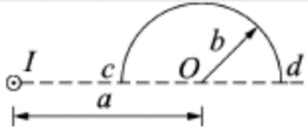
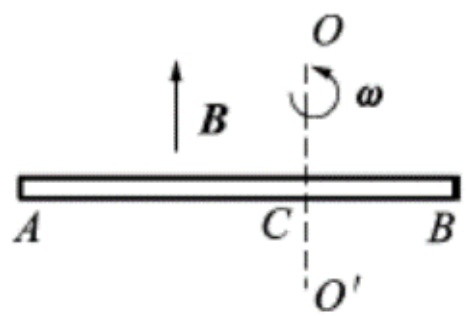
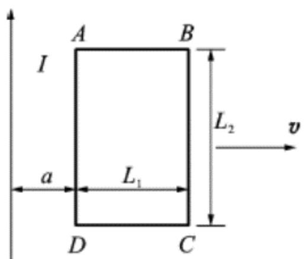
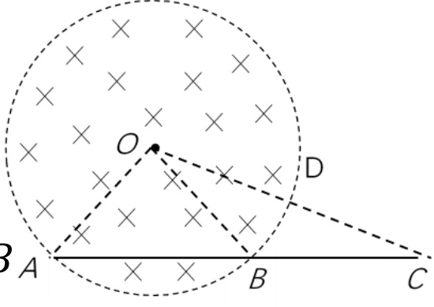
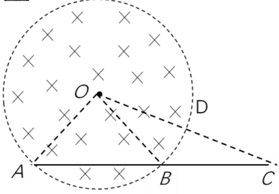
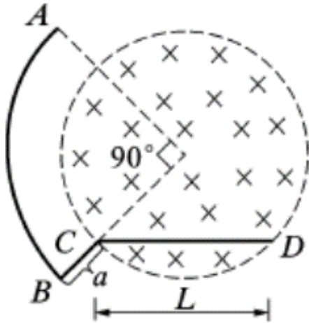

# 24-练习24 动生电动势 感生电动势

[返回全书目录](../../README.md)

> PDF 页码：181–188

<!-- page: 181 -->

### 练习24 动生电动势 感生电动势

1. 载有恒定电流  $ I $ 的长直导线旁有一半圆环导线  $ cd $，半圆环半径为  $ b $，环面与直导线垂直，且半圆环两端点连线的延长线与直导线相交，如图 24.1 所示，当半圆环以速度  $ v $ 沿平行于直导线的方向下移时，半圆环上的感应电动势的大小为  $ \underline{\frac{v\frac{\mu_0I}{2\pi}ln\frac{a+b}{a-b}}{}} $。

解：加辅助线 $ \overrightarrow{cd} $构成闭合回路， $ |\varepsilon_i| = \left|\frac{d\Phi_m}{dt}\right| = 0 $， $ \therefore |\varepsilon_{\overrightarrow{cd}}| = |\varepsilon_{\overrightarrow{cd}}| $

 $$ d\varepsilon_{\overrightarrow{c d}}=(\overrightarrow{v}\times\overrightarrow{B})\cdot d\overrightarrow{l}=v B\sin\frac{\pi}{2}d r\cos\pi=-\;v\frac{\mu_{0}I}{2\pi r}d r $$ 

 $$ \left|\varepsilon_{\overline{c d}}\right|=\left|-\int_{a-b}^{a+b}v\frac{\mu_{0}I}{2\pi r}d r\right|=v\frac{\mu_{0}I}{2\pi}l n\frac{a+b}{a-b} $$ 

<!-- page: 182 -->

2. 如图24.2所示，导体棒AB在均匀磁场 $ \overrightarrow{B} $中绕通过C点的垂直于棒长且沿磁场方向的轴 $ OO' $转动（角速度 $ \omega $与B同方向），BC的长度为棒长的1/3，则A点比B点电势 $ \underline{\text{高}} $。

解：非静电场 $ \overrightarrow{v} \times \overrightarrow{B} $由C指向导体棒两端，两端电势高于C点。CA上距离C点等于CB长度处的电势与B点相同，但低于A点电势，所以A点比B点电势高。

<!-- page: 183 -->

3. 无限长直通电螺线管的半径为  $ R $，设其内部的磁场以 dB/dt 的变化率增加，则在螺线管内离开轴线距离为  $ r $ ( $ r < R $)处的感生电场的强度为  $ \frac{r}{2} \frac{dB}{dt} $。

解：感生电场 $ \oint_L \overrightarrow{E_r} \cdot d\overrightarrow{l} = -\iint \frac{d\overrightarrow{B}}{dt} \cdot d\overrightarrow{S} $

在螺线管内r处的有： $ E_{r}2\pi r = \frac{dB}{dt}\pi r^{2} $

所以， $ E_{r}=\frac{r}{2}\frac{dB}{dt} $

<!-- page: 184 -->

4. 如图 24.3，一长直导线载有电流 I，旁边有一矩形线圈 ABCD（与长直导线共面），AB 长  $ L_{1} $，BC 宽  $ L_{2} $，线圈共 N 匝，令线圈以速度  $ \vec{v} $ 水平向右平动，求线圈的 AD 边与长直导线距离 a 时线圈中的动生电动势。

 $$ \begin{aligned}\varepsilon=N\oint(\vec{v}\times\overrightarrow{B})d\overrightarrow{l}=N\left[-\int_{B}^{c}(\vec{v}\times\overrightarrow{B}_{1})d\overrightarrow{l}+\int_{A}^{D}(\vec{v}\\=N\left(-v B_{1}\int_{B}^{C}d l+v B_{2}\int_{A}^{D}d l\right)\right.\\=N v\left(\frac{\mu_{0}I}{2\pi a}L_{2}-\frac{\mu_{0}I}{2\pi(a+L_{1})}L_{2}\right)\\=N v\frac{\mu_{0}I L_{2}}{2\pi}\left(\frac{1}{a}-\frac{1}{a+L_{1}}\right)\end{aligned} $$ 

<!-- page: 185 -->

5. 半径为 R 的圆柱形空间内分布有沿圆柱轴线方向的均匀磁场，磁场方向垂直纸面向里，变化率 $ \frac{dB}{dt} > 0 $。有一长度为 2R 的金属杆放在如图 24.4 所示的位置，其中一半位于磁场内，一半位于磁场外，求该金属杆上的感生电动势。

解：添加辅助导线组成闭合回路，用法拉第电磁感应定律 $ \varepsilon=-\frac{d\Phi}{dt} $计算。如图中所示，作辅助线 OA、OC 组成闭合回路 OACO，穿过该回路围成面积的磁通量实际上只是穿过三角形 OAB 围成面积  $ S_{1} $ 的磁通量与穿过扇形 OBD 围成面积

 $ S_{2} $ 的磁通量之和。

因此取整个闭合回路围成面积的正法向 $ \overrightarrow{n} $与 $ \overrightarrow{B} $同方向时，穿过该回路的磁通量为

 $$ \varphi=(s_{1}+s_{2})B=(\frac{1}{2}Rh+\frac{1}{2}R^{2}\frac{\pi}{6})B=(\frac{\sqrt{3}}{4}R^{2}+\frac{\pi}{12}R^{2})B_{A} $$ 

<!-- page: 186 -->

所以， $ \varepsilon = -\frac{d\varphi}{dt} = -(\frac{\sqrt{3}}{4} + \frac{\pi}{12})R^{2}\frac{dB}{dt} $，其中  $ \varphi = (\frac{\sqrt{3}}{4}R^{2} + \frac{\pi}{12}R^{2})B $

因为 $ \overrightarrow{E}_{r} $线是以O为圆心的一系列同心圆，所以在辅助线OA与OC上 $ \overrightarrow{E}_{r} $处处与之垂直。因此辅助线OA、OC上的感生电动势均为零，故所求出闭合回路OACO上的感生电动势 $ \varepsilon $就是金属杆AC上的感生电动势。式中的负号表示感生电动势的方向与 $ \hat{n} $成左手螺旋关系，具体到金属杆AC上是从A指向C。

<!-- page: 187 -->

6. 如图 24.5 所示，半径为 R 的圆形区域内有一均匀磁场  $ \overrightarrow{B} $ 垂直纸面，且 B 以均匀速率  $ \frac{dB}{dt} $ 增大，求图中导线 ABCD 的感生电动势。

解：选取半径为  $ r $ 的同心圆为闭合回路  $ L $， $ L $ 包围面积的正法向设为与  $ \overrightarrow{B} $ 同向，当  $ r < R $ 时， $ \oint_L \overrightarrow{E}_r \cdot d\overrightarrow{l} = E_r 2\pi r = -\frac{d}{dt} (B\pi r^2) = -\pi r^2 \frac{dB}{dt} $

 $$ E_{r}=-\frac{r}{2}\frac{d B}{d t} $$ 

当 $ r > R $时， $ \oint_{L} \overrightarrow{E}_{r} \cdot d\overrightarrow{l} = E_{r} 2\pi r = -\frac{d}{dt} (B\pi R^{2}) = -\pi R^{2} \frac{dB}{dt} $

 $$ E_{r}=-\frac{R^{2}}{2r}\frac{dB}{dt} $$ 

$$\because\frac{dB}{dt}>0,\therefore E_{r}<0,\text{即}\vec{E}_{r}\text{沿L的逆时针切线方向}.$$

<!-- page: 188 -->

$$ \begin{aligned}&\overrightarrow{DE_{r}}\cdot\overrightarrow{dl}=\int_{AB}\overrightarrow{E_{r}}\cdot\overrightarrow{dl}+\int_{BC}\overrightarrow{E_{r}}\cdot\overrightarrow{dl}+\int_{CD}\overrightarrow{E_{r}}\cdot\overrightarrow{dl}\\ &=\int_{AB}\frac{R^{2}}{2r}\frac{dB}{dt}dl+0+\int_{CD}\frac{r}{2}\frac{dB}{dt}dl\cos\theta\\ &=\frac{R^{2}}{2r}\frac{dB}{dt}\int_{AB}dl+\frac{1}{2}\frac{dB}{dt}\int_{CD}\sqrt{R^{2}-(\frac{L}{2})^{2}}dl\\ &=(\frac{\pi R^{2}}{4}+\frac{L}{2}\sqrt{R^{2}-\frac{L^{2}}{4}})\frac{dB}{dt}\\ \end{aligned} $$ 

 $ \varepsilon $方向与积分方向相同。

