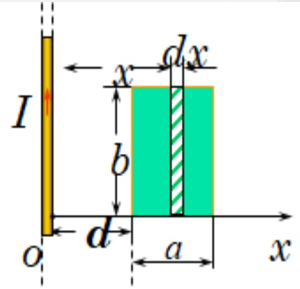
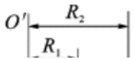
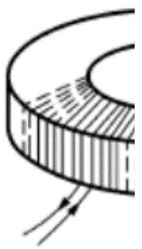
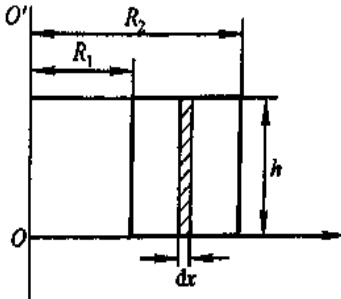
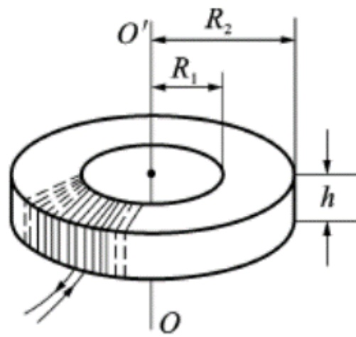
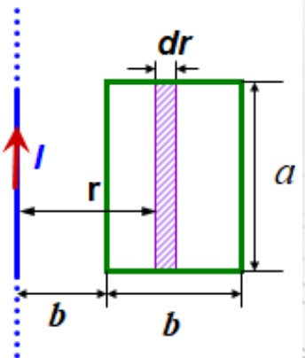
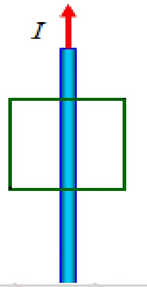
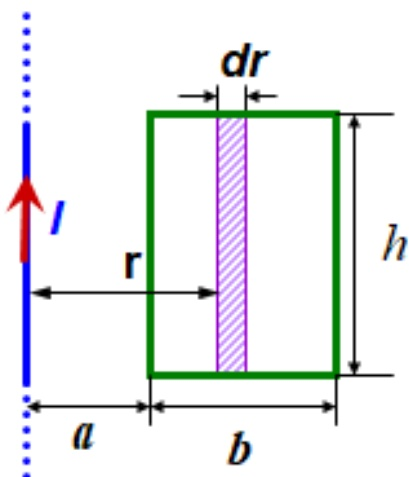
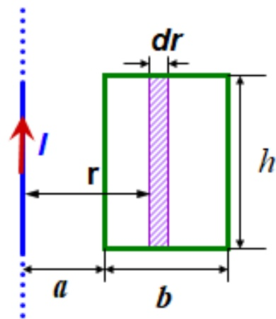

# 25-练习25 自感应与互感应 磁场的能量

[返回全书目录](../../README.md)

> PDF 页码：189–197

<!-- page: 189 -->

### 练习25 自感应与互感应 磁场的能量

1. 真空中无限长密绕直螺线管通以电流  $ I $，管上单位长度绕有  $ n $ 匝导线，真空磁导率为  $ \mu_0 $。则管内部的磁感应强度为 $ \underline{\quad\mu_0 n I\quad} $，内部的磁能密度为 $ \underline{\quad\frac{1}{2}\mu_0 n^2 I^2\quad} $。

解：无限长密绕螺线管内部磁感应强度为： $ B = \mu_{0} n I $

磁场能量为： $ w = \frac{1}{2} \frac{B^{2}}{\mu_{0}} = \frac{1}{2} \mu_{0} n^{2} I^{2} $

<!-- page: 190 -->

2. 一根长直导线输入电流 I，I 均匀分布在它的横截面上，则导体内部单位长度的磁场能量为  $ \frac{\mu_{0}I^{2}}{16\pi} $。

解：由安培环路定理$\oint B\cdot dl = B\cdot2\pi r = \mu_0\frac{I}{\pi R^2}\pi r^2$，得导线中任意半径$r$处，磁感应强度为：$B = \mu_0I\frac{r}{2\pi R^2}$。

单位长度导线中磁场能量为：

 $$ \mathrm{W}=\int\frac{1}{2}\frac{B^{2}}{\mu_{0}}d V=\int_{0}^{R}\frac{\mu_{0}I^{2}r^{2}}{8\pi^{2}R^{4}}\cdot2\pi r d r=\frac{\mu_{0}I^{2}}{16\pi} $$

<!-- page: 191 -->

3. 如图 25.1 所示，一长直导线旁有一宽为 b，长为 a 的矩形线圈，线圈与导线共面，宽度为 b 的边与导线平行，则线圈与导线的互感系数为  $ \frac{\mu_0 b}{2\pi} \ln \frac{d + a}{d} $。

解：设长导线电流为 I，则

 $$ \begin{aligned}\varPhi_{m}=\int d\varPhi_{m}&=\int_{d}^{d+a}\frac{\mu_{0}I b}{2\pi}\frac{d x}{x}=\frac{\mu_{0}I b}{2\pi}l n\frac{d+a}{d}\\M&=\frac{\varPhi_{m}}{I}=\frac{\mu_{0}b}{2\pi}l n\frac{d+a}{d}\end{aligned} $$ 

<!-- page: 192 -->

4. 横截面为长方形的环形均匀密绕螺绕环，其尺寸如图 25.2 所示，共有 N 匝（图中仅画出少量几匝）。试求：

（1）该螺绕环的自感系数；

（2）若导线内通有电流 I，则螺绕环内磁能为多少？

解：设有电流I通过线圈，线圈回路呈长方形，由安培回路定理可求得  $ R_1 < r < R_2 $ 范围内的磁场分布： $ B = \frac{N \mu_0 I}{2\pi x} $

由于线圈由N匝相同回路构成，所以穿过回路的磁链为：

 $$ \psi_{m}=N\int d\Phi_{m}=\int\limits_{R_{1}}^{R_{2}}\frac{\mu_{0}NIh}{2\pi}\frac{dx}{x}=\frac{\mu_{0}IN^{2}h}{2\pi}\ln\frac{R_{2}}{R_{1}} $$ 

则自感系数  $ L = \frac{\mu_0 N^2 h}{2\pi} \ln \frac{R_2}{R_1} $

<!-- page: 193 -->

4. 横截面为长方形的环形均匀密绕螺绕环，其尺寸如图25.2所示，共有N匝（图中仅画出少量几匝）。试求：

（1）该螺绕环的自感系数；

（2）若导线内通有电流 I，则螺绕环内磁能为多少？

（2）自感系数  $ L = \frac{\mu_0 N^2 h}{2\pi} \ln \frac{R_2}{R_1} $，则：

 $$ W_{m}=\frac{1}{2}LI^{2}=\frac{\mu_{0}N^{2}I^{2}h}{4\pi}ln\frac{R_{2}}{R_{1}} $$ 

<!-- page: 194 -->

5. 一矩形线圈长  $ a=20 \, cm $ 宽  $ b=10 \, cm $，共绕 100 匝。一根很长的直导线与线圈在同一平面内且与线圈的长边平行，此长直导线是闭合回路的一部分，其他部分离线圈都很远，其影响可忽略不计。求在下面所描述的两种情况下，线圈与长直导线之间的互感系数：

(1) 长导线与线圈一边相距为 b;

(2) 长导线位于线圈的对称轴处。

解：（1）设长直电流为I，它产生的磁场通过矩形线圈的磁通为

 $$ \Phi_{12}=\int_{(S)}\overrightarrow{B}\cdot d\overrightarrow{S}=\frac{\mu_{0}I a}{2\pi}\int_{b}^{2b}\frac{d r}{r}=\\ \frac{\mu_{0}I a}{2\pi}l n2 $$ 

 $$ M=\frac{N\Phi_{12}}{I}=N\frac{\mu_{0}a}{2\pi}l n2=2.8\times10^{-6}\ H $$ 

<!-- page: 195 -->

5. 一矩形线圈长  $ a=20 \, cm $ 宽  $ b=10 \, cm $，共绕 100 匝。一根很长的直导线与线圈在同一平面内且与线圈的长边平行，此长直导线是闭合回路的一部分，其他部分离线圈都很远，其影响可忽略不计。求在下面所描述的两种情况下，线圈与长直导线之间的互感系数：

(1) 长导线与线圈一边相距为 b;

(2) 长导线位于线圈的对称轴处。

(2)∵长导线位于线圈的对称轴处，

∴长直电流磁场通过矩形线圈的磁通 $ \Phi_{12}=0 $

 $$ \therefore M=0 $$ 

<!-- page: 196 -->

6. 一长直导线和一矩形线圈共面，各相关尺寸如图 25.3 所示。求当：

（1）长直导线通有电流 $ I_{1}=I_{0}\cos\omega $ t时，矩形线圈中感应电动势的大小；

（2）当矩形线圈中通有电流 $ I_{2}=I_{0}\sin\omega t $时，直导线中感应电动势大小。

解：（1）这是一个求闭合回路中感生电动势的问题，一般都用法接第电磁感应定律 $ \varepsilon=-\frac{d\Phi}{dt} $计算。于是有

 $$ \begin{aligned}\Phi&=\int_{s}\overrightarrow{B}\cdot d\overrightarrow{S}=\int_{a}^{a+b}\frac{\mu_{0}I_{1}}{2\pi r}hdr=\frac{\mu_{0}I_{1}h}{2\pi}ln\frac{a+b}{a}\\&=\frac{\mu_{0}hI_{0}cos\omega t}{2\pi}ln\frac{a+b}{a}\end{aligned} $$ 

所以， $ |\varepsilon| = \left| -\frac{d\Phi}{dt} \right| = \frac{\mu_{0}h\omega I_{0}| \sin \omega t|}{2\pi} \ln \frac{a+b}{a} $

<!-- page: 197 -->

6. 一长直导线和一矩形线圈共面，各相关尺寸如图 18.3 所示。求当：

（1）长直导线通有电流 $ I_{1}=I_{0}\cos\omega $ t时，矩形线圈中感应电动势的大小；

（2）当矩形线圈中通有电流 $ I_{2}=I_{0}\sin\omega t $时，直导线中感应电动势大小。

（2）利用上面求出的 $ \Phi $可得长直导线和矩形线圈的互感系数为

 $$ M=\frac{\phi}{I_{1}}=\frac{\mu_{0}h}{2\pi}ln\frac{a+b}{a} $$ 

当矩形线圈通有电流 $ I_{2}=I_{0}\sin\omega t $时，因互感系数与电流无关，所以长直导线中的感应电动势的大小为

 $$ |\varepsilon|=\left|-M\frac{d I_{2}}{d t}\right|=\frac{\mu_{0}h\omega I_{0}|c o s\omega t|}{2\pi}l n\frac{a+b}{a} $$ 

