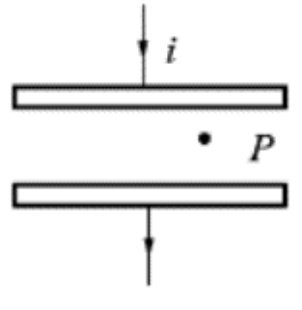
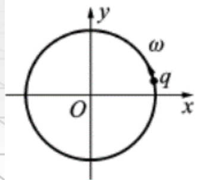
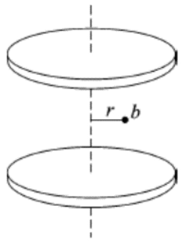

# 26-练习26 位移电流 麦克斯韦方程组

[返回全书目录](../../README.md)

> PDF 页码：198–203

<!-- page: 198 -->

### 练习26 位移电流 麦克斯韦方程组

1. 如图 26.1 所示，圆形平行板电容器，从 q=0 开始充电，极板某点 P 处电场强度方向 $ \underline{\text{向下}} $，磁场强度方向 $ \underline{\text{☺}} $。

解：上极板带正电，下极板带负电。电容器内电场方向和充电电流方向相同，故而方向向下；

位移电流方向和外部电流方向相同，由右手螺旋法则，P处磁场方向垂直纸面向外。

<!-- page: 199 -->

2. 如图 26.2 所示，一电量为  $ q $ 的点电荷，以匀角速度  $ \omega $ 作圆周运动，圆周半径为 R，设  $ t=0 $ 时  $ q $ 所在点的坐标为  $ x_0=R $， $ y_0=0 $；以  $ \vec{i} $、 $ \vec{j} $ 分别表示 x 轴与 y 轴上的单位矢量，则圆心处 O 点位移电流密度为  $ \underline{\frac{q\omega}{4\pi R^2}(sin\omega t\vec{i}-cos\omega t\vec{j})} $。

解：t时刻，q 在圆心O处产生的电场强度为

 $$ \vec{E}=\frac{q}{4\pi\varepsilon_{0}R^{2}}\left(-\cos\omega t\right.\left.\vec{i}-\sin\omega t\right.\left.\vec{j}\right) $$ 

O点的电位移矢量为

 $$ \overrightarrow{D}=\varepsilon_{0}\overrightarrow{E}=\frac{q}{4\pi R^{2}}\left(-\cos\omega t\right.\left.\overrightarrow{i}-\sin\omega t\right.\overrightarrow{j}) $$ 

位移电流密度为：

 $$ \overrightarrow{j}_{D}=\frac{d\overrightarrow{D}}{dt}=\frac{q\omega}{4\pi R^{2}}(sin\omega t\overrightarrow{i}-cos\omega t\overrightarrow{j}) $$ 

<!-- page: 200 -->

3. 写出包含下列意义的麦克斯韦方程组中的方程式：

（1）电场线始于正电荷，终止于负电荷 $ \underline{\phi_{s}\vec{E}\cdot d\vec{S}\frac{1}{\varepsilon_{0}}\Sigma Q_{i}} $；

(2) 变化的磁场一定伴随有电场  $ \oint_L \overrightarrow{E} \cdot d\overrightarrow{l} = -\int_s \frac{\partial B}{\partial t} \cdot d\overrightarrow{S} $；

(3) 磁感应线无头无尾  $ \oint_{S}\overrightarrow{B} \cdot d\overrightarrow{S} = 0 $；

（4）静电场是保守力场  $ \oint_L \overrightarrow{E} \cdot d\overrightarrow{l} = 0 $。

解：略

<!-- page: 201 -->

4. 一平板空气电容器的两极板都是半径为 r 的圆形导体板，充电时，板间电场强度的变化率为  $ \frac{dE}{dt} $，略去边缘效应，求两极板间的位移电流。

解：平板电脑容器内部为匀强场，则位移电流

 $$ I_{d}=\vec{j}\cdot\vec{S}=\frac{d(\overrightarrow{D}\cdot\overrightarrow{S})}{dt}=\varepsilon_{0}\frac{dE}{dt}\pi r^{2} $$

<!-- page: 202 -->

5. 一平行板电容器的两极板由半径为 5.0 cm 的圆形金属板组成，两极板之间为空气。忽略边缘效应，当电容器充电时，极板间的电场强度变化率为 $ \frac{dE}{dt}=1.0\times10^{12}\text{V}/(\text{m}\cdot\text{s}) $，求：

（1）两极板间的位移电流；

（2）两极板边缘的磁感应强度的大小。

解：（1）平板电容器内部为匀强场两极板间的位移电流

 $$ I_{d}=\vec{j}\cdot\vec{S}=\frac{d(\overrightarrow{D}\cdot\overrightarrow{S})}{d t}=\varepsilon_{0}\frac{d E}{d t}\pi r^{2}=6.95\times10^{-2}\mathrm{A} $$ 

（2）由$\oint\overrightarrow{H}\cdot d\overrightarrow{l}=\int\frac{\partial\overrightarrow{D}}{\partial t}\cdot d\overrightarrow{S}$得，$2\pi RH=\varepsilon_{0}\frac{dE}{dt}\pi R^{2}$，所以$B=\frac{1}{2}\varepsilon_{0}\mu_{0}\frac{dE}{dt}R=2.78\times10^{-7}$（T）

<!-- page: 203 -->

6. 一平行板电容器，极板是半径为 R 的两圆形金属板，极板间为空气，如图 26.3 所示。此电容器与交变电源相接。极板上带电量随时间变化的关系为  $ q = q_{0}\sin(\omega t) $ （ $ \omega $ 为常量），忽略边缘效应，求：

（1）电容器极板间位移电流及位移电流密度。

(2) 两极板间离中心轴线距离为  $ r (r < R) $ 处的 b 点的磁场强度 H 的大小。

解：平板电脑电容器内部为匀强场

（1）位移电流： $ I_d = \overrightarrow{J_d} \cdot \overrightarrow{S} = \frac{d(\overrightarrow{D} \cdot \overrightarrow{S})}{dt} = \frac{dq}{dt} = q_0 \omega \cos \omega t $

位移电流密度为： $ j_d = \frac{I_d}{S} = \frac{q_0 \omega \cos \omega t}{\pi R^2} $

（2）由$\oint\vec{H}\cdot d\vec{l}=\int\frac{\partial\vec{D}}{\partial t}\cdot d\vec{S}=\int\vec{j}_{d}\cdot d\vec{S}$，

得：$2\pi rH=\frac{q_{0}\omega\cos\omega t}{\pi R^{2}}\pi r^{2}$，$H=\frac{q_{0}\omega r\cos\omega t}{2\pi R^{2}}$

