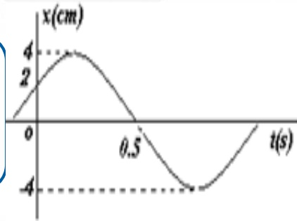
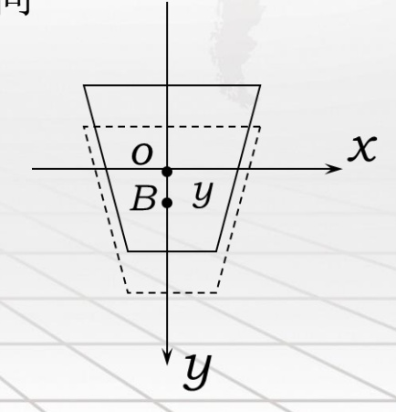
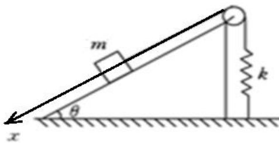
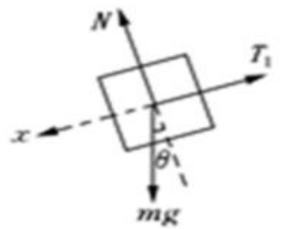
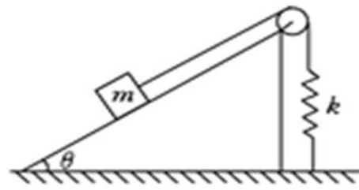
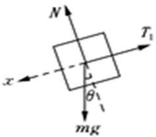
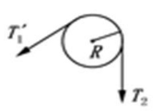

# 27-练习27 简谐振动的运动学

[返回全书目录](../../README.md)

> PDF 页码：204–211

<!-- page: 204 -->

### 练习27简谐振动的运动学

1. 已知一谐振动的  $ x-t $ 曲线如图 27.1，则该简谐振动的振动表达式为  $ \frac{x = 4 \cos\left(\frac{5\pi}{3}t - \frac{\pi}{3}\right) \text{cm}}{3} $。

解 由图可知，振幅： $ A = 4cm $

当 $t = 0$ 时，$x_0 = 2cm \Rightarrow 2 = 4\cos\varphi \Rightarrow \varphi = \pm\frac{\pi}{3} \Rightarrow \varphi = -\frac{\pi}{3}$

又 $v_0 = -\omega A\sin\varphi > 0$

当 $t = 0.5$ 时，$x_1 = 0 \Rightarrow 0 = 4\cos(0.5\omega - \frac{\pi}{3}) \Rightarrow 0.5\omega - \frac{\pi}{3} = \frac{\pi}{2}$ 或 $\frac{3\pi}{2}$

又当 $t = 0.5$ 时，$v_1 \prec 0 \Rightarrow -4\omega\sin(0.5\omega - \frac{\pi}{3}) \prec 0 \Rightarrow 0.5\omega - \frac{\pi}{3} = \frac{\pi}{2} \Rightarrow \omega = \frac{5\pi}{3}$

所以该简谐振动的振动表达式为 $x = 4\cos\left(\frac{5\pi}{3}t - \frac{\pi}{3}\right)$ cm

<!-- page: 205 -->

2. 一弹簧振子沿  $ x $ 轴作谐振动，已知振动物体最大位移为  $ x_m = 0.4m $ 时，最大速度为  $ v_m = 0.8\pi m/s $，又知  $ t = 0 $ 时的物体位移为  $ x_0 = +0.2m $，且初速度  $ v_0 $ 与所选  $ x $ 轴方向相反。则物体振动表达式为  $ \underline{x = 0.4\cos(2\pi t + \frac{\pi}{2})} $。

解 由最大位移 $ x_{m}=0.4m $可知，振幅： $ A=0.4m $

由最大速度 $ v_{m}=0.8\pi m/s $可知， $ A\omega=0.8\pi\Rightarrow\omega=2\pi $

当t=0时， $ x_{0}=0.2m,\Rightarrow0.2=0.4\cos\varphi\Rightarrow\varphi=\pm\frac{\pi}{3} $

又t=0时， $ v_{0}\prec0\Rightarrow-0.4\omega\sin\varphi\prec0\Rightarrow\sin\varphi\succ0 $

所以物体的振动表达式为 $ x = 0.4\cos(2\pi t + \frac{\pi}{3}) $

<!-- page: 206 -->

3. 一弹簧振子作简谐振动，若选物体处在下述运动状态时开始计时，请写出各对应的初相：

（1）t=0时，物体在+A处，则 $ \varphi=\underline{0} $；

（2）t=0时，物体在-A处，则 $ \varphi=\underline{\pm\pi} $；

（3）t=0时，物体在平衡位置，且向X轴负向运动，则 $ \varphi=\frac{\pi}{2} $

（4）t=0时，物体经 $ -\frac{A}{2} $，且向X轴负向运动，则 $ \varphi=\underline{\frac{2\pi}{2}} $。

解（1）当t=0时， $ x_{0}=A $， $ \Rightarrow A=A\cos\varphi\Rightarrow\cos\varphi=1\Rightarrow\varphi=0 $

（2）当t = 0时， $ x_{0} = -A, \Rightarrow A = -A\cos\varphi \Rightarrow \cos\varphi = -1 \Rightarrow \varphi = \pm\pi $

（3）当 $ t=0 $时， $ x_{0}=0,\Rightarrow\cos\varphi=0\Rightarrow\varphi=\frac{\pi}{2} $或 $ \frac{3\pi}{2} $，当 $ v<0 $时 $ \varphi=\frac{\pi}{2} $

（4）当 $ t = 0 $时， $ x_{0} = -\frac{A}{2}, \Rightarrow \cos \varphi = -\frac{1}{2} \Rightarrow \varphi = \frac{2\pi}{3} $或 $ \frac{5\pi}{3} $，当 $ v < 0 $时 $ \varphi = \frac{2\pi}{3} $

<!-- page: 207 -->

4. 一远洋货轮，质量为 m，浮在水面时其水平截面面积为 S，设在水面附近货轮的水平截面积近似相等，设水的密度为  $ \rho $，且不计水的黏滞阻力。(1) 证明：货轮在水中作振幅较小的竖直自由运动是简谐运动；(2) 求振动周期。

证明：取固定坐标系xoy，坐标原点o在水面上。设货轮静止不动时，货轮上的B点恰在水面上。此时浮力和重力平衡。设B点坐标为y，则浮力的增量为 $ S\rho gy $。该力与位移成正比，方向指向平衡位置。有

 $$ m\frac{d^{2}y}{dt^{2}}+S\rho g y=0\quad 即：\frac{d^{2}y}{dt^{2}}+\frac{S\rho g}{m}y=0 $$ 

上式满足简谐振动的动力学方程，说明货轮作简谐振动。

解：根据简谐振动的动力学方程，有： $ \omega^{2}=S\rho g/m $

则振动周期： $ T = \frac{2\pi}{\omega} = 2\pi \sqrt{\frac{m}{S\rho g}} $

<!-- page: 208 -->

5. 若一物体做简谐振动，振动表达式为  $ x=0.10\cos(20\pi t+\frac{\pi}{4})m $，求：

（1）振幅 A、频率 V、角频率  $ \omega $、周期 T 和初相  $ \varphi $；（2）物体在  $ t=2s $ 时的位移  $ x_{2} $、速度  $ v_{2} $ 和加速度  $ a_{2} $.

解：（1）由简谐振动表达式与标准形式  $ x = A\cos(\omega t + \varphi) $ 相对比得，振幅： $ A = 0.10m $

角频率： $ \omega = 20\pi rad / s $

频率： $ v = \frac{\omega}{2\pi} = 10Hz $

周期： $ T = \frac{2\pi}{3} = 0.1s $

初相位： $ \phi = \frac{\pi}{4} $

<!-- page: 209 -->

（2）由简谐运动表达式可得：

振动速度： $ v = \frac{dx}{dt} = -0.10 \times 20\pi \sin(20\pi t + \frac{\pi}{4}) = -2\pi \sin(20\pi t + \frac{\pi}{4}) \ m / s $

振动加速度： $ a = \frac{dv}{dt} = -0.10 \times 20\pi \times 20\pi \cos(20\pi t + \frac{\pi}{4}) = -40\pi^2 \cos(20\pi t + \frac{\pi}{4}) \ m / s^2 $

把t=2s带入上面式子，可得：

 $$ x_{2}=0.10\cos\left(20\pi\times2+\frac{\pi}{4}\right)=\frac{\sqrt{2}}{20}m $$ 

 $$ v_{_{2}}=-2\pi\sin(20\pi\times2+\frac{\pi}{4})=-\sqrt{2}\ \pi\ m/s $$ 

 $$ a_{2}=-40\pi^{2}\cos\left(20\pi\times2+\frac{\pi}{4}\right)=-20\sqrt{2}\pi^{2}m/s^{2} $$

<!-- page: 210 -->

6. 重物 A 质量 m，放在倾角为  $ \theta $ 的光滑斜面上，并用轻绳跨过定滑轮与劲度系数为 k 的轻质弹簧连接。在初始时刻，先把物体托住，使弹簧维持原长，然后由静止释放，如图 27.2 所示。证明：

（1）不计滑轮质量，物体 A 在斜面上的运动是简谐运动；

（2）滑轮是质量为 M，半径为 r 的均质圆盘，物体 A 的运动是简谐运动。

证明:(1)以物体平衡位置为坐标原点O，沿斜面向下为x轴正方向建立坐标，平衡时物体在初始位置斜下方距离 $ x_{0} $处，平衡条件为： $ mg\sin\theta=kx_{0} $

物体共受三力；重力mg，支持力N，张力T。当物体处在任意位置x处，不计滑轮质量时，绳上张力为： $ T=k(x+x_{0}) $。

物体所受合力为：

 $ \Sigma F = mg \sin \theta - T = mg \sin \theta - k (x + x_0) = -kx $

由牛顿方程式有： $ -kx = m \frac{d^2 x}{dt^2} \Rightarrow \frac{d^2 x}{dt^2} + \frac{k}{m} x = 0 $

故物体A的运动是简谐振动，且  $ \omega = \sqrt{\frac{k}{m}} $

(a)
 

(b)
 

<!-- page: 211 -->

（2）以物体平衡位置为坐标原点O，沿斜面向下为x轴正方向建立坐标，平衡条件为：

 $$ mg\sin\theta=kl_{0} $$ 

现让物体沿x轴正方向有一位移x，对平动物体m，由牛顿定律可得：

 $$ F=mg\sin\theta-T_{1}=ma $$ 

对转动的刚体，由刚体的转动定律可得： $ T_{1}R - T_{2}R = J\beta $

由弹力满足： $ T_{2}=k(l_{0}+x) $

转动与平动的关系为  $ a = R\beta $

解上述方程组得： $ a=\frac{d^2x}{dt^2}=-\frac{k}{\frac{M}{2}+m}x $， $ \frac{d^2x}{dt^2}+\frac{2k}{M+2m}x=0 $

满足简谐振动动力学特征，故物体做简谐振动，且有：

 $$ \omega^{2}==\frac{2k}{M+2m},\Rightarrow\omega=\sqrt{\frac{2k}{M+2m}} $$ 

(a)
 

(b)
 

