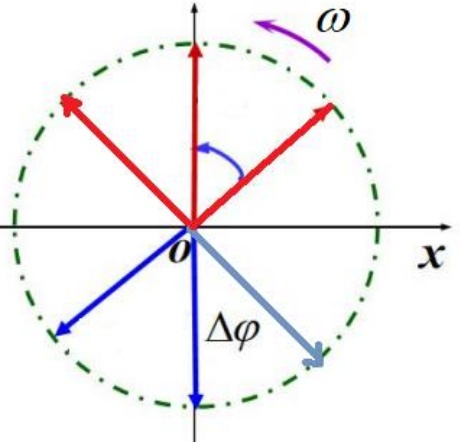
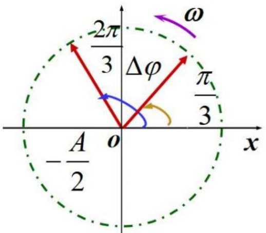
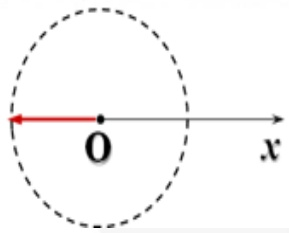
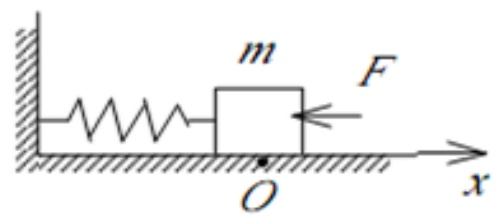
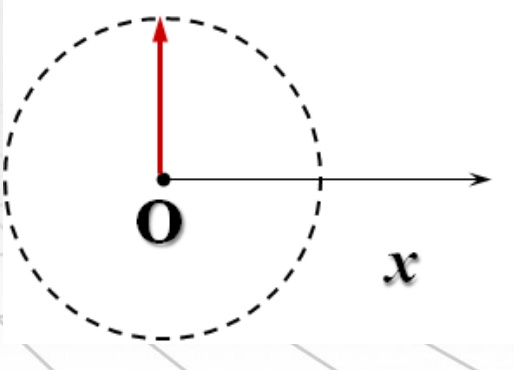
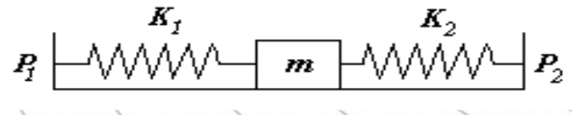
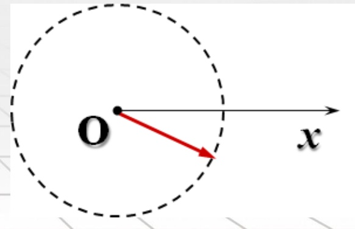

# 28-练习28 简谐振动的动力学

[返回全书目录](../../README.md)

> PDF 页码：212–218

<!-- page: 212 -->

### 练习28简谐振动的动力学

1. 质量为  $ 10 \times 10^{-3} kg $ 的小球与轻弹簧组成系统，按  $ x = 0.1 \cos(8\pi t + 2\pi/3) $ 规律振动，式中 t 以秒计，x 以米计，小球的振动周期为  $ \underline{0.25s} $；振幅为  $ \underline{0.1m} $ 初位相为  $ \underline{2\pi/3} $；最大的回复力为  $ \underline{0.63N} $ 最大的加速度为  $ \underline{63.2m/s^{2}} $。

挥：振动表达式与标准形式  $ x = A \cos(\omega t + \phi) $ 相对比得

角频率： $ \omega = 8\pi rad / s \Rightarrow $ 周期： $ T = \frac{2\pi}{\omega} = 0.25s $

振幅：A = 0.10m

初相位： $ \phi = \frac{2\pi}{3} $

最大回复力 $ F_{max} = mA\omega^{2} = 0.63N $

最大加速度 $ a_{max} = A\omega^{2} = 63.2m/s^{2} $

<!-- page: 213 -->

2. 已知一质点作简谐振动，其振动表达式为  $ x = 6.0 \times 10^{-2} \cos\left(\frac{\pi t}{3} - \frac{\pi}{4}\right) $ (SI)，当  $ x = \underline{\pm 4.24 \times 10^{-2} m} $ 时，系统的势能等于总能量的一半，质点从平衡位置移动到此位置所需最短时间  $ \Delta t = \underline{0.75s} $。

解：由$2E_P = E \Rightarrow 2 \times \frac{1}{2} kx^2 = \frac{1}{2} kA^2 \Rightarrow x = \pm \frac{\sqrt{2}}{2} A = \pm 4.24$

振动表达式与标准形式$x = A \cos(\omega t + \varphi)$相对比值

角频率：$\omega = \frac{\pi}{3}$

质点从平衡位置移至此位置最小角位移$\Delta\varphi = \frac{\pi}{4} = \omega\Delta t$

所需最短时间$\Delta t = \frac{\pi}{4} / \frac{\pi}{3} = 0.75s$

<!-- page: 214 -->

3. 一质点作简谐振动，其振动方程为  $ x=0.24\cos\left(\frac{\pi t}{2}+\frac{\pi}{3}\right) $ (SI)，由用旋转矢量法可知，质点由初始状态运动到  $ x=-0.12m, v<0 $ 的状态所需最短时间  $ \Delta t=\underline{0.67s} $。

解：振动表达式与标准形式  $ x = A \cos(\omega t + \varphi) $ 角频率： $ \omega = \frac{\pi}{2} $

由振动方程  $ x = 0.24\cos\left(\frac{\pi t}{2} + \frac{\pi}{3}\right) $ (SI) 可知，

当t=0时，相位 $ \varphi=\frac{\pi}{3} $；x=-0.12m时相位 $ \varphi'=\frac{2\pi}{3} $

从初始状态到x=-0.12m转过的角度 $ \Delta\varphi=\frac{\pi}{3}=\omega\Delta t $

所需时间 $ \Delta t=\frac{\pi}{3}/\frac{\pi}{2}=0.67s $

<!-- page: 215 -->

4. 如图 28.1 所示，有一水平弹簧振子，弹簧的劲度系数  $ k = 24N \cdot m^{-1} $，物体的质量  $ m = 6kg $，物体静止在平衡位置上。设以一水平恒力  $ F = 10N $ 向左作用于物体（不计摩擦）使之由平衡位置向左运动了  $ 0.05m $ 时撤去力 F，当重物运动到左方最远位置时开始计时，求：物体的运动表达式。

解：选取坐标如图，设运动方程为 $ x = A\cos(\omega t + \varphi) $

弹簧振子最大弹性势能 $ E_{p} = E_{总} = F\left|\Delta\vec{r}\right| = 10 \times 0.05 = 0.5J = \frac{1}{2} kA^{2} $

 $ \Rightarrow A = \frac{\sqrt{6}}{12} = 0.204m $

依题意，初始时刻有： $ x_{0} = -A, v_{0} = 0 $

由旋转矢量法可得： $ \varphi = \pi $ 而 $ \omega = \sqrt{\frac{k}{m}} = 2(rad/s) $

 $ \therefore $ 物体的运动方程为： $ x = 0.204\cos(2t + \pi)m $

<!-- page: 216 -->

5. 一物体作简谐振动，其速度最大值  $ v_{m}=3\times10^{-2}m\cdot s^{-1} $，其振幅  $ A=2\times10^{-2}m $。若 t=0 时，物体位于平衡位置且向 x 轴的负方向运动。求：

（1）振动周期 T；（2）加速度的最大值  $ a_{m} $；（3）振动表达式。

解：（1） $ v_{m} = 3 \times 10^{-2} m/s $， $ A = 2 \times 10^{-2} m $； $ x_{0} = 0 $， $ v_{0} < 0 $

 $$ \begin{aligned}:\boldsymbol{v}_{m}=\omega A\Rightarrow\omega=1.5rad/s\Rightarrow T=\frac{2\pi}{\omega}=\frac{4\pi}{3}=4.19s\end{aligned} $$ 

（2）由： $ a_{\mathrm{m}} = \omega^2 A $ 得： $ a_{\mathrm{m}} = 4.5 \times 10^{-2} \, \mathrm{m/s^2} $

（3）设振动方程为： $ x = A\cos(\omega t + \varphi) $ m

因为： $ x_0 = 0 $， $ v_0 < 0 $，由旋转矢量法可得： $ \varphi = \frac{\pi}{2} $

所以，振动表达式为： $ x = 0.02\cos(1.5t + \frac{\pi}{2}) $ m

<!-- page: 217 -->

6. 如图28.2所示，两弹簧的倔强系数分别为 $ k_{1}=1N\cdot m^{-1} $、 $ k_{2}=3N\cdot m^{-1} $，在光滑的水平面上分别将两弹簧连接到质量为 $ m=0.1kg $的物体的两端，弹簧的其余两端分别固定在支柱 $ P_{1} $及 $ P_{2} $上。今使物体有一向右初位移 $ x_{0}=\sqrt{3}\times10^{-2}m $，向右初速度 $ v_{0}=\sqrt{40}\times10^{-2}m\cdot s^{-1} $。

（1）证明物体将作谐振动；（2）求：物体的振动表达式。（设物体在振动中，两弹簧始终处于被拉伸状态，取 x 轴方向向右为正）.

解：（1）设当物体处于平衡位置时，两弹簧伸长量分别为 $ \Delta x_1 $， $ \Delta x_2 $，则有： $ k_1\Delta x_1 = k_2\Delta x_2 $

以平衡位置为坐标原点O，设向右为x轴正方向。当物体偏离平衡位置位移为x时， $ k_1 $的伸长量为 $ \Delta x_1 + x $， $ k_2 $的伸长量为 $ \Delta x_2 - x $，则物体受合力为：

 $ f = k_{2}(\Delta x_{2} - x) - k_{1}(\Delta x_{1} + x) = -(k_{1} + k_{2})x = -kx $，其中 $ k = k_{1} + k_{2} $只与弹簧性质有关。

因此物体作简谐振动。

<!-- page: 218 -->

（2）振动的角频率和振幅分别为：

 $$ \omega=\sqrt{\frac{k}{m}}=\sqrt{\frac{k_{1}+k_{2}}{m}}=2\sqrt{10}(\mathrm{rad/s}) $$ 

 $$ A=\sqrt{x_{0}^{2}+\frac{v_{0}^{2}}{\omega^{2}}}=0.02(m) $$ 

由 $ \cos\varphi=\frac{x_{0}}{A}=\frac{\sqrt{3}}{2} $且 $ v_{0}>0 $

得初相位为： $ \varphi=-\frac{\pi}{6} $

（或由旋转矢量法求初相位如图）

所以，振动方程为：

 $$ x=2\times10^{-2}\cos(2\sqrt{10}t-\frac{\pi}{6})m $$ 

