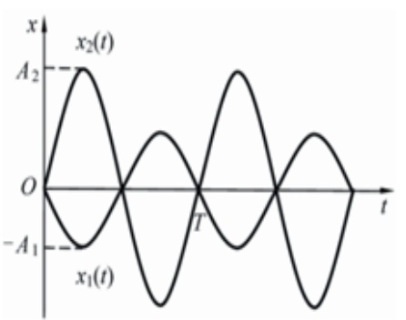
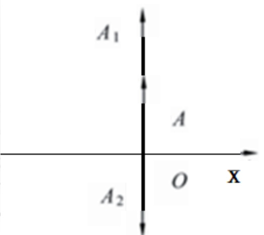
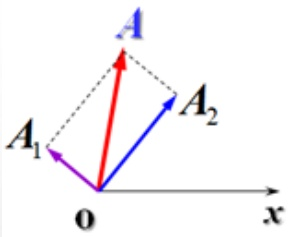
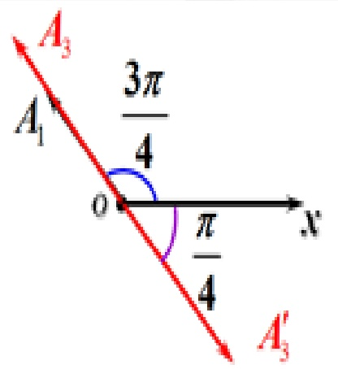
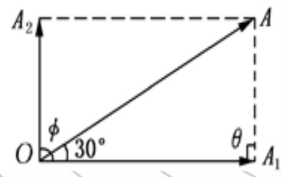

# 29-练习29 简谐振动的合成

[返回全书目录](../../README.md)

> PDF 页码：219–225

<!-- page: 219 -->

### 练习29 简谐振动的合成

1. 两个同方向的简谐振动曲线如图29.1所示，合振动的振幅为 $ \underline{A_{2}-A_{1}} $，合振动的振动表达式为 $ \underline{x=(A_{2}-A_{1})\cos(\frac{2\pi}{T}t-\frac{\pi}{2})(m)} $

解：由图可知， $ x_2(t) $ 振动表达式为： $ x_2(t) = A_2 \cos\left(\frac{2\pi}{T}t - \frac{\pi}{2}\right)(m) $

 $ x_1(t) $ 振动表达式为： $ x_1(t) = -A_1 \cos\left(\frac{2\pi}{T}t - \frac{\pi}{2}\right)(m) $

两个振动周期相同，相差为 $ \pi $。 $ \therefore $ 合振动振幅 $ A = A_2 - A_1 $

合成振动表达式为： $ x = (A_2 - A_1) \cos\left(\frac{2\pi}{T}t - \frac{\pi}{2}\right)(m) $

<!-- page: 220 -->

2. 两个同方向、同频率的简谐振动，其振动表达式分别为： $ x_1 = 6 \times 10^{-2} \cos(5t + \frac{\pi}{2})m $， $ x_2 = 2 \times 10^{-2} \sin(\pi - 5t)m $，它们的合振动的振幅  $ A = \underline{4cm} $，初相  $ \varphi = \frac{\pi}{2} $

 $$ x_{2}=2\times10^{-2}\sin\left(\pi-5t\right)\mathrm{m}=2\times10^{-2}\cos\left(5t-\frac{\pi}{2}\right)\mathrm{m} $$ 

 $ x_{2} $与 $ x_{1} $刚好相位相反，相差为 $ \pi $，如图所示，

 $$ \therefore A=A_{1}-A_{2}=4cm;\quad\varphi=\frac{\pi}{2} $$ 

<!-- page: 221 -->

3. 已知两个振动，其表达式分别为  $ x_1 = 3.0\cos(\omega t + \frac{\pi}{3})\text{cm} $， $ x_2 = 8.0\cos(\omega t + \frac{\pi}{6})\text{cm} $，它们的合振动的振幅  $ A = \underline{10.7\text{cm}} $，初相  $ \varphi = \underline{38^\circ} $。若再加一个振动  $ x_3 = 6.0\sin(\omega t)\text{cm} $，则合振幅  $ A' = \underline{4.4^\circ} $，初相  $ \varphi' = \underline{8.43\text{cm}} $

解：由 $ A=\sqrt{A_{1}^{2}+A_{2}^{2}+2A_{1}A_{2}}\cos(\varphi_{2}-\varphi_{1})\Rightarrow A=10.7cm $

 $ \tan\varphi=\frac{A_{1}\sin\varphi_{1}+A_{2}\sin\varphi_{2}}{A_{1}\cos\varphi_{1}+A_{2}\cos\varphi_{2}}=\frac{3\sin\frac{\pi}{3}+8\sin\frac{\pi}{6}}{3\cos\frac{\pi}{3}+8\cos\frac{\pi}{6}}\Rightarrow\varphi=38^{\circ} $

又 $ x_{3}=6.0\sin(\omega t)cm=6.0\cos(\omega t-\frac{\pi}{2})\Rightarrow A_{3}=6.0,\varphi_{3}=-\frac{\pi}{2} $

 $ A^{\prime}=\sqrt{A^{2}+A_{3}^{2}+2AA_{3}\cos(\varphi-\varphi_{3})}=\sqrt{10.7^{2}+6^{2}+2\times6\times10.7\times\cos128^{\circ}}=8.43cm $

 $ \tan\varphi^{\prime}=\frac{A\sin\varphi+A_{3}\sin\varphi_{3}}{A\cos\varphi+A_{3}\cos\varphi_{3}}=\frac{10.7\times\sin38^{\circ}+6\times\sin\left(-\frac{\pi}{2}\right)}{10.7\times\cos38^{\circ}+6\times\cos\left(-\frac{\pi}{2}\right)}=0.077\Rightarrow\varphi^{\prime}=4.4^{\circ} $

<!-- page: 222 -->

4. 请用旋转矢量法计算，并画出旋转矢量图。已知有两个分振动，它们的表达式分别为： $ x_1 = 6\cos(100\pi t + 0.75\pi)mm $  $ x_2 = 6\sqrt{3}\cos(100\pi t + 0.25\pi)mm $，求：（1）合振动的振幅及初相位；（2）合振动的表达式。

解：由 $ A=\sqrt{A_{1}^{2}+A_{2}^{2}+2A_{1}A_{2}\cos(\varphi_{2}-\varphi_{1})} $得

 $$ A=\sqrt{A_{1}^{2}+A_{2}^{2}}=12(mm) $$ 

由旋转矢量法得： $ \varphi=\frac{\pi}{4}+\arctan\frac{A_{1}}{A_{2}}=\frac{\pi}{4}+\arctan\frac{6}{6\sqrt{3}}=\frac{\pi}{4}+\frac{\pi}{6}=\frac{5\pi}{12} $

则合成振动的表达式为： $ x=12\cos(100\pi t+\frac{5\pi}{12})(mm) $

<!-- page: 223 -->

5. 请用旋转矢量法计算，并画出旋转矢量图。已知有两个分振动，它们的表达式分别为： $ x_{1}=5\times10^{-2}\cos(10t+\frac{3}{4}\pi)m $， $ x_{2}=6\times10^{-2}\cos(10t+\frac{\pi}{4})m $求：（1）合振动的振幅和初位相；（2）如另有第三个简谐振动  $ x_{3}=7\times10^{-2}\cos(10t+\alpha)m $，则  $ \alpha $ 应取何值时，才能使  $ x_{1}+x_{3} $ 的合振动的振幅最大？又  $ \alpha $ 应取何值时，才能使  $ x_{1}+x_{3} $ 的合振动的振幅最小？

解：由 $ A=\sqrt{A_{1}^{2}+A_{2}^{2}+2A_{1}A_{2}\cos(\varphi_{2}-\varphi_{1})} $得

合振动的振幅为 $ A=\sqrt{A_{1}^{2}+A_{2}^{2}}=7.8\times10^{-2}(m) $

由旋转矢量图得合振动的初相位为： $ \varphi=\frac{\pi}{4}+\arctan\frac{A_{1}}{A_{2}}=\frac{\pi}{4}+\arctan\frac{5}{6} $

<!-- page: 224 -->

或有公式求解  $ \tan\varphi=\frac{A_{1}\sin\varphi_{1}+A_{2}\sin\varphi_{2}}{A_{1}\cos\varphi_{1}+A_{2}\cos\varphi_{2}} $

可得： $ \varphi = \arctan 11 = 84.8^{\circ} $

（2）当 $ \alpha-\varphi_{1}=\pm2k\pi $，即 $ \alpha=\pm2k\pi+\varphi_{1}=\pm2k\pi+\frac{3\pi}{4} $时， $ x_{1}+x_{3} $的合振幅最大。

因为 $ \alpha $是第三个振动的初相位， $ \alpha=\frac{3\pi}{4} $

当 $ \alpha-\varphi_{1}=\pm(2k+1)\pi $，即 $ \alpha=\pm(2k+1)\pi+\varphi_{1}=\pm2k\pi+\frac{7\pi}{4} $时， $ x_{1}+x_{3} $的合振幅最小。

因为 $ \alpha $是第三个振动的初相位， $ \alpha=\frac{7\pi}{4} $

<!-- page: 225 -->

6. 有两个同方向、同频率的简谐振动，其合成振动的振幅为  $ A = 0.20m $，其相位与第一个振动的相位差为  $ \pi/6 $，已知第一振动的振幅为  $ A_1 = 0.173m $，求：（1）第二个振动的振幅  $ A_2 $；（2）第一、第二两个振动的相位差  $ \Delta\varphi $。

解：由题意可做出旋转矢量图如右图

 $ A_{2}^{2}=A_{1}^{2}+A^{2}-2A_{1}A\cos30^{\circ}=(0.173)^{2}+(0.2)^{2}-2\times0.173\times0.2\times\frac{\sqrt{3}}{2}=0.01 $

 $ \Rightarrow A_{2}=0.1m $

设  $ \angle AA_{1}O=\theta $，则由余弦定理  $ A^{2}=A_{1}^{2}+A_{2}^{2}-2A_{1}A_{2}\cos\theta $ 得

 $ \cos\theta=\frac{A_{1}^{2}+A_{2}^{2}-A^{2}}{2A_{1}A_{2}}=\frac{(0.173)^{2}+(0.1)^{2}-(0.2)^{2}}{2\times0.173\times0.1}=0 $

 $ \Rightarrow \theta=\frac{\pi}{2} $，说明  $ A_{1} $ 与  $ A_{2} $ 间夹角为  $ \frac{\pi}{2} $，即两个振动的相位差为  $ \Delta\varphi=\frac{\pi}{2} $

