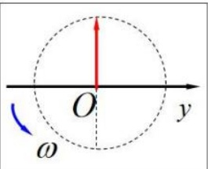
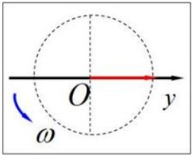
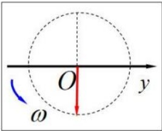
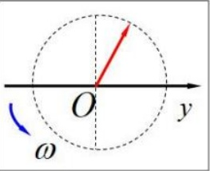
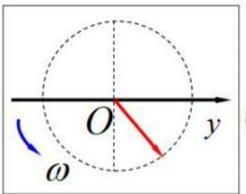
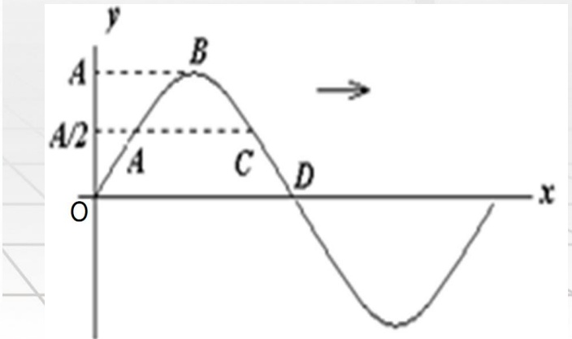
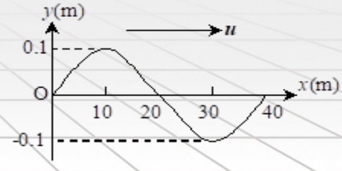
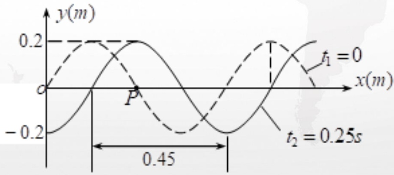
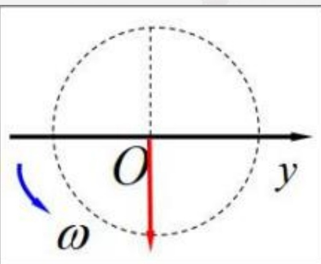

# 30-练习30 机械波的形成和传播 平面简谐波的波函数

[返回全书目录](../../README.md)

> PDF 页码：226–232

<!-- page: 226 -->

### 练习30 机械波的形成和传播 平面简谐波的波函数

1. 如图30.1所示，一平面简谐波沿x轴负方向传播，波长为 $ \lambda $，若P点到坐标原点O的距离为L，设在P点处有一质点，其振动方程为 $ y_{P}=A\cos(2\pi vt+\pi/2) $，则该波的表达式为： $ \underline{A\cos(2\pi vt+2\pi\frac{x+L}{\lambda}+\frac{\pi}{2})} $，P处质点在 $ t_{P}=\underline{t_{1}+\frac{L}{\lambda v}} $时刻的振动状态与O处质点 $ t_{1} $时刻的振动状态相同。

解：任意位置Q处质点比P处质点超前 $ \Delta t = \frac{x + L}{u} $； $ y_Q(t) = y_P(t + \Delta t) $

 $ y_Q(t) = A \cos[2\pi\nu(t + \frac{x + L}{u}) + \frac{\pi}{2}] = A \cos(2\pi\nu t + 2\pi \frac{x + L}{\lambda} + \frac{\pi}{2}) $

P处质点比O处质点落后 $ \Delta t = \frac{L}{u} \Rightarrow t_p = t_1 + \frac{L}{u} = t_1 + \frac{L}{\lambda v} $

<!-- page: 227 -->

2. 一用余弦函数表示的沿  $ x $ 轴正方向传播的平面简谐波在  $ t=0 $ 时的波形曲线如图 30.2 所示，则图中 O, A, B, C, D 各点振动的初位相分别为  $ \frac{\pi}{2} $， $ \frac{\pi}{3} $， $ \frac{0}{3} $， $ \frac{-\frac{\pi}{3}}{3} $， $ \frac{-\frac{\pi}{2}}{2} $。

解：如图，由旋转矢量法可得：O, A, B, C, D的初始分别相位为：

 $$ \varphi_{o}=\frac{\pi}{2} $$ 

 $$ \boldsymbol{\varphi}_{B}=\mathbf{0} $$ 

 $$ \varphi_{A}=\frac{\pi}{3} $$ 

 $$ \varphi_{_{D}}=-\frac{\pi}{2} $$ 

 $$ \varphi_{c}=\frac{\pi}{3} $$ 

\[\left/{\begin{array}{c} / \\ / \\ / \\ / \\ / \\ / \\ / \\ / \\ / \\ / \\ / \\ / \\ / \\ / \\ / \\ / \\ / \\ / \\ / \\ / \\ / \\ / \\ / \\ / \\ / \\ / \\ / \\ / \\ / \\ / \\ / \\ / \\ / \\ / \\ / \\ / \\ / \\ / \\ / \\ / \\ / \\ / \\ / \\ / \\ / \\ / \\ / \\ / \\ / \\ / \\ / \\ / \\ / \\ / \\ / \\ / \\ / \\ / \\ / \\ / \\ / \\ / \\ / \\ / \\ / \\ / \\ / \\ / \\ / \\ / \\ / \\ / \\ / \\ / \\ / \\ / \\ / \\ / \\ / \\ / \\ / \\ / \\ / \\ / \\ / \\ / \\ / \\ / \\ / \\ / \\ / \\ / \\ / \\ / \\ / \\ / \\ / \\ / \\ / \\ / \\ / \\ / \\ / \\ / \\ / \\ / \\ / \\ / \\ / \\ / \\ / \\ / \\ / \\ / \\ / \\ / \\ / \\ / \\ / \\ / \\ / \\ / \\ / \\ / \\ / \\ / \\ / \\ / \\ / \\ / \\ / \\ / \\ / \\ / \\ / \\ / \\ / \\ / \\ / \\ / \\ / \\ / \\ / \\ / \\ / \\ / \\ / \\ / \\ / \\ / \\ / \\ / \\ / \\ / \\ / \\ / \\ / \\ / \\ / \\ / \\ / \\ / \\ / \\ / \\ / \\ / \\ / \\ / \\ / \\ / \\ / \\ / \\ / \\ / \\ / \\ / \\ / \\ / \\ / \\ / \\ / \\ / \\ / \\ / \\ / \\ / \\ / \\ / \\ / \\ / \\ / \\ / \\ / \\ / \\ / \\ / \\ / \\ / \\ / \\ / \\ / \\ / \\ / \\ / \\ / \\ / \\ / \\ / \\ / \\ / \\ / \\ / \\ / \\ / \\ / \\ / \\ / \\ / \\ / \\ / \\ / \\ / \\ / \\ / \\ / \\ / \\ / \\ / \\ / \\ / \\ / \\ / \\ / \\ / \\ / \\ / \\ / \\ / \\ / \\ / \\ / \\ / \\ / \\ / \\ / \\ / \\ / \\ / \\ / \\ / \\ / \\ / \\ / \\ / \\ / \\ / \\ / \\ / \\ / \\ / \\ / \\ / \\ / \\ / \\ / \\ / \\ / \\ / \\ / \\ / \\ / \\ / \\ / \\ / \\ / \\ / \\ / \\ / \\ / \\ / \\ / \\ / \\ / \\ / \\ / \\ / \\ / \\ / \\ / \\ / \\ / \\ / \\ / \\ / \\ / \\ / \\ / \\ / \\ / \\ / \\ / \\ / \\ / \\ / \\ / \\ / \\ / \\ / \\ / \\ / \\ / \\ / \\ / \\ / \\ / \\ / \\ / \\ / \\ / \\ / \\ / \\ / \\ / \\ / \\ / \\ / \\ / \\ / \\ / \\ / \\ / \\ / \\ / \\ / \\ / \\ / \\ / \\ / \\ / \\ / \\ / \\ / \\ / \\ / \\ / \\ / \\ / \\ / \\ / \\ / \\ / \\ / \\ / \\ / \\ / \\ / \\ / \\ / \\ / \\ / \\ / \\ / \\ / \\ / \\ / \\ / \\ / \\ / \\ / \\ / \\ / \\ / \\ / \\ / \\ / \\ / \\ / \\ / \\ / \\ / \\ / \\ / \\ / \\ / \\ / \\ / \\ / \\ / \\ / \\ / \\ / \\ / \\ / \\ / \\ / \\ / \\ / \\ / \\ / \\ / \\ / \\ / \\ / \\ / \\ / \\ / \\ / \\ / \\ / \\ / \\ / \\ / \\ / \\ / \\ / \\ / \\ / \\ / \\ / \\ / \\ / \\ / \\ / \\ / \\ / \\ / \\ / \\ / \\ / \\ / \\ / \\ / \\ / \\ / \\ / \\ / \\ / \\ / \\ / \\ / \\ / \\ / \\ / \\ / \\ / \\ / \\ / \\ / \\ / \\ / \\ / \\ / \\ / \\ / \\ / \\ / \\ / \\ / \\ / \\ / \\ / \\ / \\ / \\ / \\ / \\ / \\ / \\ / \\ / \\ / \\ / \\ / \\ / \\ / \\ / \\ / \\ / \\ / \\ / \\ / \\ / \\ / \\ / \\ / \\ / \\ / \\ / \\ / \\ / \\ / \\ / \\ / \\ / \\ / \\ / \\ / \\ / \\ / \\ / \\ / \\ / \\ / \\ / \\ / \\ / \\ / \\ / \\ / \\ / \\ / \\ / \\ / \\ / \\ / \\ / \\ / \\ / \\ / \\ / \\ / \\ / \\ / \\ / \\ / \\ / \\ / \\ / \\ / \\ / \\ / \\ / \\ / \\ / \\ / \\ / \\ / \\ / \\ / \\ / \\ / \\ / \\ / \\ / \\ / \\ / \\ / \\ / \\ / \\ / \\ / \\ / \\ / \\ / \\ / \\ / \\ / \\ / \\ / \\ / \\ / \\ / \\ / \\ / \\ / \\ / \\ / \\ / \\ / \\ / \\ / \\ / \\ / \\ / \\ / \\ / \\ / \\ / \\ / \\ / \\ / \\ / \\ / \\ / \\ / \\ / \\ / \\ / \\ / \\ / \\ / \\ / \\ / \\ / \\ / \\ / \\ / \\ / \\ / \\ / \\ / \\ / \\ / \\ / \\ / \\ / \\ / \\ / \\ / \\ / \\ / \\ / \\ / \\ / \\ / \\ / \\ / \\ / \\ / \\ / \\ / \\ / \\ / \\ / \\ / \\ / \\ / \\ / \\ / \\ / \\ / \\ / \\ / \\ / \\ / \\ / \\ / \\ / \\ / \\ / \\ / \\ / \\ / \\ / \\ / \\ / \\ / \\ / \\ / \\ / \\ / \\ / \\ / \\ / \\ / \\ / \\ / \\ / \\ / \\ / \\ / \\ / \\ / \\ / \\ / \\ / \\ / \\ / \\ / \\ / \\ / \\ / \\ / \\ / \\ / \\ / \\ / \\ / \\ / \\ / \\ / \\ / \\ / \\ / \\ / \\ / \\ / \\ / \\ / \\ / \\ / \\ / \\ / \\ / \\ / \\ / \\ / \\ / \\ / \\ / \\ / \\ / \\ / \\ / \\ / \\ / \\ / \\ / \\ / \\ / \\ / \\ / \\ / \\ / \\ / \\ / \\ / \\ / \\ / \\ / \\ / \\ / \\ / \\ / \\ / \\ / \\ / \\ / \\ / \\ / \\ / \\ / \\ / \\ / \\ / \\ / \\ / \\ / \\ / \\ / \\ / \\ / \\ / \\ / \\ / \\ / \\ / \\ / \\ / \\ / \\ / \\ / \\ / \\ / \\ / \\ / \\ / \\ / \\ / \\ / \\ / \\ / \\ / \\ / \\ / \\ / \\ / \\ / \\ / \\ / \\ / \\ / \\ / \\ / \\ / \\ / \\ / \\ / \\ / \\ / \\ / \\ / \\ / \\ / \\ / \\ / \\ / \\ / \\ / \\ / \\ / \\ / \\ / \\ / \\ / \\ / \\ / \\ / \\ / \\ / \\ / \\ / \\ / \\ / \\ / \\ / \\ / \\ / \\ / \\ / \\ / \\ / \\ / \\ / \\ / \\ / \\ / \\ / \\ / \\ / \\ / \\ / \\ / \\ / \\ / \\ / \\ / \\ / \\ / \\ / \\ / \\ / \\ / \\ / \\ / \\ / \\ / \\ / \\ / \\ / \\ / \\ / \\ / \\ / \\ / \\ / \\ / \\ / \\ / \\ / \\ / \\ / \\ / \\ / \\ / \\ / \\ / \\ / \\ / \\ / \\ / \\ / \\ / \\ / \\ / \\ / \\ / \\ / \\ / \\ / \\ / \\ / \\ / \\ / \\ / \\ / \\ / \\ / \\ / \\ / \\ / \\ / \\ / \\ / \\ / \\ / \\ / \\ / \\ / \\ / \\ / \\ / \\ / \\ / \\ / \\ / \\ / \\ / \\ / \\ / \\ / \\ / \\ / \\ / \\ / \\ / \\ / \\ / \\ / \\ / \\ / \\ / \\ / \\ / \\ / \\ / \\ / \\ / \\ / \\ / \\ / \\ / \\ / \\ / \\ / \\ / \\ / \\ / \\ / \\ / \\ / \\ / \\ / \\ / \\ / \\ / \\ / \\ / \\ / \\ / \\ / \\ / \\ / \\ / \\ / \\ / \\ / \\ / \\ / \\ / \\ / \\ / \\ / \\ / \\ / \\ / \\ / \\ / \\ / \\ / \\ / \\ / \\ / \\ / \\ / \\ / \\ / \\ / \\ / \\ / \\ / \\ / \\ / \\ / \\ / \\ / \\ / \\ / \\ / \\ / \\ / \\ / \\ / \\ / \\ / \\ / \\ / \\ / \\ / \\ / \\ / \\ / \\ / \\ / \\ / \\ / \\ / \\ / \\ / \\ / \\ / \\ / \\ / \\ / \\ / \\ / \\ / \\ / \\ / \\ / \\ / \\ / \\ / \ / \ / \ / \/ \ / \/ \ / \/ \ / \/ \ / \/ \ / \/ \ / \/ \ / \/ \ / \/ \ / \/ \ / \/ \ / \/ \ / \/ \ / \/ \ / \/ \ / \ / \ / \ / \ / \ / \ / \ / \ / \ / \ / \ / \ / \ / \ / \ / \ / \ / \ / \ / \ / \ / \ / \ / \ / \ / \ / \ / \ / \ / \ / \ / \ / \ / \ / \ / \ / \ / \ / \ / \ / \ / \ / \ / \ / \ / \ / \ / \ / \ / \ / \ / \ / \ / \ / \ / \ / \ / \ / \ / \ / \ / \ / \ / \ / \ / \ / \ / \ / \ / \ / \ / \ / \ / \ / \ / \ / \ / \ / \ / \ / \ / \ / \ / \ / \ / \ / \ / \ / \ / \ / \ / \ / \ / \ / \ / \ / \ / \ / \ / \ / \ / \ / \ / \ / \ / \ / \ / \ / \ / \ / \ / \ / \ / \ / \ / \ / \ / \ / \ / \ / \ / \ / \ / \ / \ / \ / \ / \ / \ / \ / \ / \ / \ / \ / \ / \ / \ / \ / \ / \ / \ / \ / \ / \ / \ / \ / \ / \ / \ / \ / \ / \ / \ / \ / \ / \ / \ / \ / \ / \ / \ / \ / \ / \ / \ / \ / \ / \ / \ / \ / \ / \ / \ / \ / \ / \ / \ / \ / \ / \ / \ / \ / \ / \ / \ / \ / \ / \ / \ / \ / \ / \ / \ / \ / \ / \ / \ / \ / \ / \ / \ / \ / \ / \ / \ / \ / \ / \ / \ / \ / \ / \ / \ / \ / \ / \ / \ / \ / \ / \ / \ / \ / \ / \ / \ / \ / \ / \ / \ / \ / \ / \ / \ / \ / \ / \ / \ / \ / \ / \ / \ / \ / \ / \ / \ / \ / \ / \ / \ / \ / \ / \ / \ / \ / \ / \ / \ / \ / \ / \ / \ / \ / \ / \ / \ / \ / \ / \ / \ / \ / \ / \ / \ / \ / \ / \ / \ / \ / \ / \ / \ / \ / \ / \ / \ / \ / \ / \ / \ / \ / \ / \ / \ / \ / \ / \ / \ / \ / \ / \ / \ / \ / \ / \ / \ / \ / \ / \ / \ / \ / \ / \ / \ / \ / \ / \ / \ / \ / \ / \ / \ / \ / \ / \ / \ / \ / \ / \ / \ / \ / \ / \ / \ / \ / \ / \ / \ / \ / \ / \ / \ / \ / \ / \ / \ / \ / \ / \ / \ / \ / \ / \ / \ / \ / \ / \ / \ / \ / \ / \ / \ / \ / \ / \ / \ / \ / \ / \ / \ / \ / \ / \ / \ / \ / \ / \ / \ / \ / \ / \ / \ / \ / \ / \ / \ / \ / \ / \ / \ / \ / \ / \ / \ / \ / \ / \ / \ / \ / \ / \ / \ / \ / \ / \ / \ / \ / \ / \ / \ / \ / \ / \ / \ / \ / \ / \ / \ / \ / \ / \ / \ / \ / \ / \ / \ / \ / \ / \ / \ / \ / \ / \ / \ / \ / \ / \ / \ / \ / \ / \ / \ / \ / \ / \ / \ / \ / \ / \ / \ / \ / \ / \ / \ / \ / \ / \ / \ / \ / \ / \ / \ / \ / \ / \ / \ / \ / \ / \ / \ / \ / \ / \ / \ / \ / \ / \ / \ / \ / \ / \ / \ / \ / \ / \ / \ / \ / \ / \ / \ / \ / \ / \ / \ / \ / \ / \ / \ / \ / \ / \ / \ / \ / \ / \ / \ / \ / \ / \ / \ / \ / \ / \ / \ / \ / \ / \ / \ / \ / \ / \ / \ / \ / \ / \ / \ / \ / \ / \ / \ / \ / \ / \ / \ / \ / \ / \ / \ / \ / \ / \ / \ / \ / \ / \ / \ / \ / \ / \ / \ / \ / \ / \ / \ / \ / \ / \ / \ / \ / \ / \ / \ / \ / \ / \ / \ / \ / \ / \ / \ / \ / \ / \ / \ / \ / \ / \ / \ / \ / \ / \ / \ / \ / \ / \ / \ / \ / \ / \ / \ / \ / \ / \ / \ / \ / \ / \ / \ / \ / \ / \ / \ / \ / \ / \ / \ / \ / \ / \ / \ / \ / \ / \ / \ / \ / \ / \ / \ / \ / \ / \ / \ / \ / \ / \ / \ / \ / \ / \ / \ / \ / \ / \ / \ / \ / \ / \ / \ / \ / \ / \ / \ / \ / \ / \ / \ / \ / \ / \ / \ / \ / \ / \ / \ / \ / \ / \ / \ / \ / \ / \ / \ / \ / \ / \ / \ / \ / \ / \ / \ / \ / \ / \ / \ / \ / \ / \ / \ / \ / \ / \ / \ / \ / \ / \ / \ / \ / \ / \ / \ / \ / \ / \ / \ / \ / \ / \ / \ / \ / \ / \ / \ / \ / \ / \ / \ / \ / \ / \ / \ / \ / \ / \ / \ / \ / \ / \ / \ / \ / \ / \ / \ / \ / \ / \ / \ / \ / \ / \ / \ / \ / \ / \ / \ / \ / \ / \ / \ / \ / \ / \ / \ / \ / \ / \ / \ / \ / \ / \ / \ / \ / \ / \ / \ / \ / \ / \ / \ / \ / \ / \ / \ / \ / \ / \ / \ / \ / \ / \ / \ / \ / \ / \ / \ / \ / \ / \ / \ / \ / \ / \ / \ / \ / \ / \ / \ / \ / \ / \ / \ / \ / \ / \ / \ / \ / \ / \ / \ / \ / \ / \ / \ / \ / \ / \ / \ / \ / \ / \ / \ / \ / \ / \ / \ / \ / \ / \ / \ / \ / \ / \ / \ / \ / \ / \ / \ / \ / \ / \ / \ / \ / \ / \ / \ / \ / \ / \ / \ / \ / \ / \ / \ / \ / \ / \ / \ / \ / \ / \ / \ / \ / \ / \ / \ / \ / \ / \ / \ / \ / \ / \ / \ / \ / \ / \ / \ / \ / \ / \ / \ / \ / \ / \ / \ / \ / \ / \ / \ / \ / \ / \ / \ / \ / \ / \ / \ / \ / \ / \ / \ / \ / \ / \ / \ / \ / \ / \ / \ / \ / \ / \ / \ / \ / \ / \ / \ / \ / \ / \ / \ / \ / \ / \ / \ / \ / \ / \ / \ / \ / \ / \ / \ / \ / \ / \ / \ / \ / \ / \ / \ / \ / \ / \ / \ / \ / \ / \ / \ / \ / \ / \ / \ / \ / \ / \ / \ / \ / \ / \ / \ / \ / \ / \ / \ / \ / \ / \ / \ / \ / \ / \ / \ / \ / \ / \ / \ / \ / \ / \ / \ / \ / \ / \ / \ / \ / \ / \ / \ / \ / \ / \ / \ / \ / \ / \ / \ / \ / \ / \ / \ / \ / \ / \ / \ / \ / \ / \ / \ / \ /

<!-- page: 228 -->

3. 处于原点  $ (x=0) $ 的一波源所发出的平面简谐波的波动表达式为  $ y=A\cos(Bt-Cx) $，其中 A, B, C 皆为正值恒量，则此波的速度  $ u=\frac{B}{C} $，波的周期  $ T=\frac{2\pi}{B} $，波长  $ \lambda=\frac{2\pi}{C} $；离波源距离为 L 处的质元振动相位比波源落后  $ \underline{CL} $；此质元的初相位为  $ -\underline{CL} $。

解：由波动方程为  $ y = A \cos[\omega(t - \frac{X}{u}) + \varphi] = A \cos[\mathrm{B}(t - \frac{X}{B/C})] $ 得

 $$ \omega=B;T=\frac{2\pi}{\omega}=\frac{2\pi}{B};u=\frac{B}{C};\lambda=uT=\frac{2\pi}{C} $$ 

 $$ \Delta\varphi\;=\;\frac{2\pi}{\lambda}\;L\;=\;CL $$ 

 $$ y_{x=L}=A\cos(Bt-Cx)\Rightarrow\varphi=-CL $$

<!-- page: 229 -->

4. 一平面简谐波的波动表达式为： $ y=10\times10^{-2}\cos4\pi(t+\frac{x}{10})m $。求：（1）波的传播方向；（2）波的频率，周期，波长，波速；（3）介质中各质元振动的最大速度和最大加速度；（4）波线上相距1m远的两点的位相差的大小。

解：（1）波动表达式中x前面是“+”，表示该波沿x轴负方向传播。

(2)由波动表达式可知：圆频率为 $ \omega=4\pi=2\pi\nu $

频率为： $ v = \frac{\omega}{2\pi} = 2Hz $；周期为： $ T = \frac{1}{v} = \frac{1}{2}s $

波速为： $ u = 10m/s $，波长为： $ \lambda = uT = 5m $

(3)  $ v_{\text{max}} = \omega A = 40\pi \times 10^{-2} = 1.26 \, (m/s) $

 $$ a_{max}=\omega^{2}A=160\pi^{2}\times10^{-2}=15.8(m/s^{2}) $$ 

(4)  $ \Delta\varphi=\frac{2\pi}{\lambda}\times\Delta x=\frac{2\pi}{5}\times1=\frac{2}{5}\pi=0.4\pi rad $

<!-- page: 230 -->

5. 用余弦函数表示的一列沿 x 轴正方向传播的平面简谐波在  $ t=0.25s $ 时的波形曲线如图 30.3 所示，已知波速为  $ u=40m\cdot s^{-1} $，求：（1）0 点处质点的振动表达式；（2）此波的波动表达式。

解：（1）设O点处质点的振动表达式为： $ y_0 = A\cos(\omega t + \varphi) $

由在时的波形曲线可知，振幅  $ A = 0.1\,\text{m} $，波长  $ \lambda = 40\,\text{m} $

 $$ \omega=\frac{2\pi}{T}=\frac{2\pi}{\lambda/u}=\frac{2\pi u}{\lambda}=\frac{2\pi\times40}{40}=2\pi $$ 

由旋转矢量法可得： $ (\omega \times 0.25 + \varphi) = (2\pi \times 0.25 + \varphi) = \frac{\pi}{2} \Rightarrow \varphi = 0 $

O点处质点的振动表达式为： $ y_0 = 0.1 \cos(2\pi t) \, m $

波动方程为 $ y = 0.1 \cos 2\pi(t - \frac{X}{u}) = 0.1 \cos 2\pi(t - \frac{X}{40}) \, m $

<!-- page: 231 -->

6. 用余弦函数表示的一列沿 x 轴正方向传播的平面简谐波在  $ t_{1}=0 $ 和  $ t_{2}=0.25s $ 时的波形曲线如图 30.4 所示，假设周期  $ T>0.25s $，求：（1）P 点处质点的振动表达式；（2）此波的波动表达式。

解：由波形曲线可得：振幅 $ A = 0.2m $

波长 $ \lambda = 0.6m $

P点位置： $ x_{P}=2\times\frac{0.45}{3}=0.3m $

波速： $ u = \frac{\Delta x}{\Delta t} = \frac{0.15}{0.25} = 0.6 m / s $

 $$ \omega=\frac{2\pi}{T}=\frac{2\pi}{\lambda/u}=\frac{2\pi u}{\lambda}=\frac{2\pi\times0.6}{0.6}=2\pi $$

<!-- page: 232 -->

（1）设P点振动表达式为： $ y_{P} = A \cos(\omega t + \varphi) $

由旋转矢量图即可判断P点处质点的初相位为： $ \varphi = -\frac{\pi}{2} $

 $ \therefore P $点振动表达式为： $ y_{P} = 0.2 \cos(2\pi t - \frac{\pi}{2})m $

（2）此波的波动表达时为

 $$ \begin{aligned}y~&=~0.2\cos[2\pi(t-\frac{x-x_{_{P}}}{u})-\frac{\pi}{2}]\\&=~0.2\cos[2\pi(t-\frac{x-0.3}{0.6})-\frac{\pi}{2}]\\&=~0.2\cos[2\pi t-\frac{10\pi x}{3}+\frac{\pi}{2}]m\end{aligned} $$ 

