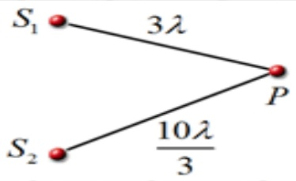
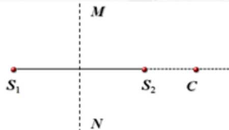
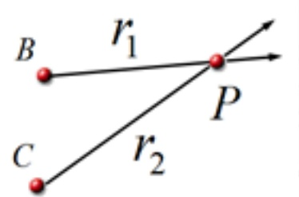
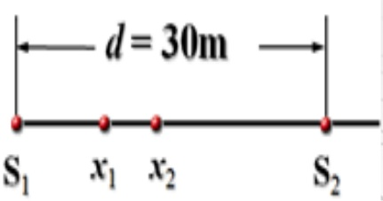

# 31-练习31 波的能量 波的衍射 干涉

[返回全书目录](../../README.md)

> PDF 页码：233–239

<!-- page: 233 -->

### 练习31 波的能量 波的衍射 干涉

1. 一列平面简谐波在弹性介质中传播，当传播方向上介质中某质元处在负的最大位移处时，则它的动能 $ \underline{\text{最小}} $，势能 $ \underline{\text{最小}} $，机械能 $ \underline{\text{最小}} $（请填“最大”或“最小”）；当某一介质质元的振动动能的位相是 $ \pi/2 $时，它的弹性势能的位相是 $ \underline{\frac{\pi}{9}} $。

解：在最大位移处，速度为零  $ \Rightarrow $ 动能最小

介质弹性形变为零  $ \Rightarrow $ 势能最小

⇒ 机械能最小

平面简谐波的动能和势能是同相位的，当动能相位为 $ \frac{\pi}{2} $时，弹性势能的相位也是 $ \frac{\pi}{2} $。

<!-- page: 234 -->

2. 如图31.1所示，相干波源 $ S_{1} $和 $ S_{2} $发出波强均为 $ I_{0} $的两列相干波在弹性介质中传播，已知P点距 $ S_{1} $和 $ S_{2} $的距离分别为 $ 3\lambda $和 $ 10\lambda/3 $， $ \lambda $为两列波在介质中的波长。若位于P点处质点的合振幅总是极大值，则两波的振动频率 $ \underline{\text{相同}} $，波源 $ S_{1} $的相位比 $ S_{2} $的相位领先 $ \underline{\text{4π/3}} $，在P点的波强 $ I_{P}=\underline{\text{4I_{0}}} $。

解：依题意，P处质点合振幅总是极大值说明：两列波频率相同

且 $ \Delta\phi = \phi_{2} - \phi_{1} - \frac{2\pi}{\lambda}(r_{2} - r_{1}) = \pm2k\pi \Rightarrow \phi_{2} - \phi_{1} = -\frac{10\pi}{3} $、 $ \frac{4\pi}{3} $、 $ \frac{2\pi}{3} $、 $ \frac{8\pi}{3} $等

由 $ A = \sqrt{A_{1}^{2} + A_{2}^{2} + 2A_{1}A_{2}\cos\Delta\varphi} \Rightarrow I = I_{1} + I_{2} + 2\sqrt{I_{1}I_{2}}\cos\Delta\varphi $

 $ \Rightarrow I_{P} = I_{0} + I_{0} + 2\sqrt{I_{0}I_{0}} = 4I_{0} $

<!-- page: 235 -->

3. 如图 31.2 所示， $ S_{1} $ 和  $ S_{2} $ 为两个相干波源，两者相距  $ 3\lambda/2 $（ $ \lambda $ 为波长）。已知  $ S_{1} $ 的初相为  $ \pi/2 $。（1）若使射线  $ S_{2}C $ 上各点由两列波引起的振动均干涉相消，则  $ S_{2} $ 的初相位  $ \varphi_{2} = \frac{\pi}{2} $。（2）若使  $ S_{1}S_{2} $ 连线的中垂线 MN 上各点由两列波引起的振动均干涉相消，则  $ S_{2} $ 的初相位  $ \varphi_{2}' = -\frac{\pi}{2} $

解：\Delta\varphi=\varphi_{2}-\varphi_{1}-\frac{2\pi}{\lambda}(r_{s_{2}c}-r_{s_{1}c})=\varphi_{2}-\varphi_{1}+\frac{2\pi}{\lambda}\times\frac{3\lambda}{2}=\varphi_{2}-\frac{\pi}{2}+3\pi

S_{2}C 上各点干涉相消条件：\Delta\varphi=\pm(2k+1)\pi，

因此 \varphi_{2}-\frac{\pi}{2}+3\pi=\pm(2k+1)\pi\Rightarrow\varphi_{2}=2k\pi+\frac{\pi}{2},k=0,\pm1,\pm2,\ldots

MN 上各点干涉相消条件：\Delta\varphi=\varphi_{2}'-\varphi_{1}-\frac{2\pi}{\lambda}(r_{s_{2}p}-r_{s_{1}p})=\varphi_{2}'-\frac{\pi}{2}=\pm(2k+1)\pi\Rightarrow\varphi_{2}'=2k\pi-\frac{\pi}{2}

<!-- page: 236 -->

4. 一列平面简谐波, 其频率为  $ \nu=1.0\times10^{3} $ Hz, 波速为  $ u=1.0\times10^{3} $ m·s $ ^{-1} $, 振幅为  $ A=1.0\times10^{-4} $ m 在截面面积为  $ S=4.0\times10^{-4} $ m $ ^{2} $ 的管内介质中传播, 若介质的密度为  $ \rho=8.0\times10^{2} $ kg·m $ ^{-3} $, 求: (1) 该波的平均能流密度 I; (2) 波的平均能量密度 W; (3) 通过截面的平均能流 P; (4) 在 1min 内垂直通过管内介质截面的波的总能量 W。

解：（1）该波的平均能流密度（即波强）为：

 $$ I=\frac{1}{2}\rho\omega^{2}A^{2}u=\frac{1}{2}\rho(2\pi v)^{2}A^{2}u=2\pi^{2}\rho v^{2}A^{2}u=1.58\times10^{5}(\mathrm{W/m^{2}}) $$ 

（2）因为 $ P = uSw \Rightarrow uw = \frac{P}{S} = I \Rightarrow w = \frac{I}{u} = \frac{1.58 \times 10^5}{1.0 \times 10^3} = 1.58 \times 10^2 J \cdot m^{-3} $

（3）由 $ I=\frac{P}{S} $  $ \Rightarrow $ 通过截面的平均能量流

 $$ P~=~IS~=~1.58\times10^{5}\times4.0\times10^{-4}~=~63.2J\cdot s^{-1} $$ 

（4）总能量 $ W = P\Delta t = 6.32 \times 10 \times 60 = 3.79 \times 10^{3}J $

<!-- page: 237 -->

5. 如图 31.3 所示，设平面横波 1 沿 BP 传播，它在 B 点的振动表达式为  $ y_{1}=0.002\cos2\pi t(SI) $，平面横波 2 沿 CP 传播，它在 C 点的振动表达式为  $ y_{2}=0.002\cos(2\pi t+\pi)(SI) $，P 点与 B 点相距 0.40m，与 C 点相距 0.50m，设波速为  $ u=0.20m\cdot s^{-1} $。求：（1）两波传到 P 点时的相位差；（2）在 P 点处的质点合振动的振幅；（3）如果在 P 处相遇的两横波，振动方向是互相垂直的，则合振动的振幅又如何？

解：（1）相位差 $ \Delta\phi = \phi_{2} - \phi_{1} - \frac{2\pi}{\lambda}(r_{2} - r_{1}) = \phi_{2} - \phi_{1} - \frac{\omega}{u}(r_{2} - r_{1}) = \pi - \frac{2\pi}{0.20} \times (0.50 - 0.40) = 0 $

（2）合振动振幅： $ A = A_{1} + A_{2} = 0.002 + 0.002 = 4 \times 10^{-3} m $

（3）若两振动方向相互垂直，在相遇点两个分振动的相位差等于0（同相的），此时合振动的轨迹是在二四象限的直线，合振幅为：

 $$ A=\sqrt{A_{_{1}}^{2}+A_{_{2}}^{2}}=\sqrt{0.002^{2}+0.002^{2}}=2.83\times10^{-3}m $$ 

<!-- page: 238 -->

6. 两列相干的平面简谐波沿 X 轴传播。波源  $ S_{1} $ 和  $ S_{2} $ 相距  $ d = 30m $，设  $ S_{1} $ 为坐标原点。已知位于  $ x_{1} = 9m $ 和  $ x_{2} = 12m $ 处的两个质点是相邻的两个因干涉而静止的质点（图 31.4）。求：（1）两列波的波长  $ \lambda $；（2）两波源的最小位相差  $ \varphi_{2} - \varphi_{1} $。

解：（1）设波源处质点振动的初相位分别是 $ \varphi_{1} $和 $ \varphi_{2} $

两列波在相遇点的相位差是 $ \Delta\varphi=\varphi_{2}-\varphi_{1}-\frac{2\pi}{\lambda}(r_{2}-r_{1})=\varphi_{2}-\varphi_{1}-\frac{2\pi}{\lambda}(d-x-x)=\varphi_{2}-\varphi_{1}-\frac{2\pi}{\lambda}(d-2x) $

干涉相消： $ \varphi_{2}-\varphi_{1}-\frac{2\pi}{\lambda}(d-2x)=(2k+1)\pi $

设  $ x_{1} $ 处的质点对应 k 级干涉极小， $ x_{2} $ 处的质点对应级干涉极小

<!-- page: 239 -->

可得： $ \phi_{2}-\phi_{1}-\frac{2\pi}{\lambda}(d-2x_{1})=(2k+1)\pi $

 $$ \varphi_{2}-\varphi_{1}-\frac{2\pi}{\lambda}(d-2x_{2})=(2k+3)\pi $$ 

上面两式相减得： $ \frac{4\pi x_{2}-4\pi x_{1}}{\lambda}=2\pi $

 $ \lambda = 2(x_{2} - x_{1}) = 2 \times (12 - 9) = 6m $

（2）将波长代入相位差的式子中得：

 $$ \varphi_{2}-\varphi_{1}=\frac{2\pi}{\lambda}(d-2x_{1})+(2k+1)\pi=\frac{2\pi}{6}(30-2\times9)+(2k+1)\pi=(2k+5)\pi $$ 

当 $ k = -2 $时，相位差最小，有： $ \varphi_{2} - \varphi_{1} = \pi $

