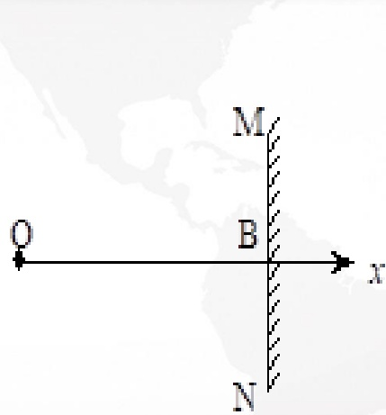
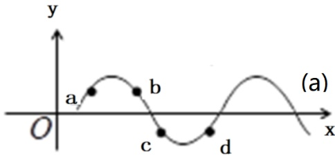
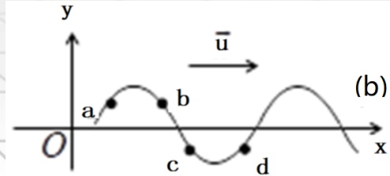
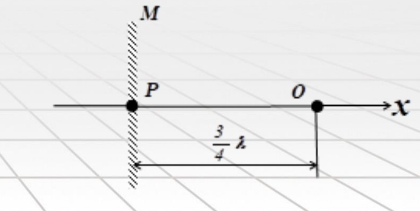

# 32-练习32 驻波

[返回全书目录](../../README.md)

> PDF 页码：240–247

<!-- page: 240 -->

### 练习32 驻波

1. 一驻波表达式为  $ y = 2A\cos(2\pi x / \lambda)\cos 2\pi vt $，则在  $ x = -\lambda / 2 $ 处质点的振幅为 $ \underline{2A} $，振动表达式为 $ \underline{y = -2A\cos \omega t} $ 该质点的振动速度表达式为 $ \underline{v = 2A\omega\sin \omega t} $。

解：依题意，将 $ x=-\lambda/2 $代入振幅 $ 2A\cos(2\pi x/\lambda) $得

该处质点振幅为2A

将 $ x=-\lambda/2 $代入波函数 $ y=2A\cos(2\pi x/\lambda)\cos\omega t $可得

振动表达式为 $ y=-2A\cos\omega t $

对振动方程 $ y=-2A\cos\omega t $求一阶导数得

振动速度表达式为 $ v=2A\omega\sin\omega t $

<!-- page: 241 -->

2. 如图32.1所示，在x=0处的0点有一平面余弦波波源，其振动表达式为  $ y_0 = A\cos(\omega t + \pi) $，在x=1.25λ处发生反射，反射点为固定端，设波在传播和反射过程中振幅不变，则会在 $ \underline{\frac{\lambda}{4}, \frac{3\lambda}{4}, \frac{5\lambda}{4}} $之间形成驻波，其中波节坐标是 $ \underline{\frac{\lambda}{2}} $；两个相邻波节之间的距离是 $ \underline{\frac{\lambda}{2}} $。

解：驻波是入射波与反射波叠加形成，因此会发生在 $ 0 \sim B $之间。

可求得 $ y_{\lambda} = A \cos[\omega(t - x / u) + \pi] $

可求得 $ y_{\alpha} = A \cos[\omega(t + x / u) - \pi] $

当 $ \Delta\varphi = (2k+1) \pi $时为波节，即： $ \frac{2\omega x}{u} = \frac{4\pi x}{\lambda} = (2k+1)\pi \Rightarrow x = \frac{\lambda}{4}, \frac{3\lambda}{4}, \frac{5\lambda}{4} $处为波节

当 $ \Delta\varphi = 2k\pi $时为波腹，即： $ \frac{2\omega x}{u} = \frac{4\pi x}{\lambda} = 2k\pi \Rightarrow x = 0; \frac{\lambda}{2}; \lambda $处为波腹

两个相邻波节之间距离是： $ \frac{\lambda}{2} $

<!-- page: 242 -->

3. 已知一驻波在 $ _{t} $时刻各点振动到最大位移处，其波形如图32.2（a）所示；一行波（设为横波）在 $ _{t} $时刻的波形如图32.2（b）所示。则在图32.2（a）中的a、b、c、d四点此时运动速度的方向分别为a $ \underline{\quad} $ $ \downarrow $、b $ \underline{\quad} $ $ \downarrow $、c、 $ \underline{\quad} $ $ \uparrow $、d $ \underline{\quad} $ $ \uparrow $；而在图32.2（b）中的a、b、c、d四点此时运动速度的方向分别为a $ \underline{\quad} $ $ \downarrow $、b $ \underline{\quad} $ $ \uparrow $、c、 $ \underline{\quad} $ $ \uparrow $、d $ \underline{\quad} $ $ \downarrow $。（请填“ $ \uparrow $”或“ $ \downarrow $”表示运动速度方向）

解：图32.2(a)为驻波，各点处在最大位移处，振动方向指向平衡位置，因此图中的a、b、c、d四点此时运动速度的方向分别为 $ a\downarrow $、 $ b\downarrow $、 $ c\uparrow $、 $ d\uparrow $；

图32.2(b)为行波，质点总是落后前一质点，传播方向向右，所以前一质点在左边，因此图中的a、b、c、d四点此时运动速度的方向分别为 $ a\downarrow $、 $ b\uparrow $、 $ c\uparrow $、 $ d\downarrow $。

(a)
 

(b)
 

<!-- page: 243 -->

4. 设平面简谐波沿 x 轴传播时在 x=0 处发生反射，已知反射点处为一自由端，反射波的表达式为： $ y_{反} = A\cos[2\pi(vt - x/\lambda) + \pi/2] $。求：（1）入射波的表达式；（2）驻波方程；（3）若反射点处为一固定端时，入射波的表达式。

解：（1）设入射波的表达式为： $ y_{\lambda} = A \cos[2\pi(vt + x / \lambda) + \varphi] $

入射波引起反射点处质点的振动表达式为：

 $$ \left.y_{\lambda}\right|_{x=0}=A\cos[2\pi(vt+0/\lambda)+\varphi]=A\cos\left(2\pi vt+\varphi\right) $$ 

反射波引起反射点处质点的振动表达式为：

 $$ \left.y_{ 反 }\right|_{x=0}=\left.y_{ 入 }\right|_{x=0}=A\cos\left(2\pi\nu t+\varphi\right) $$ 

反射波为： $ y_{反} = A \cos[2\pi\nu(t - x / u) + \varphi] = A \cos[2\pi(\nu t - x / \lambda) + \varphi] $

 $ \Rightarrow \varphi = \frac{\pi}{2} \Rightarrow $ 入射波的表达式： $ y_{\lambda} = A \cos[2\pi(\nu t + x / \lambda) + \pi / 2] $

<!-- page: 244 -->

（2）驻波方程为入射波和反射波叠加，有

 $$ \begin{aligned}&y=y_{ 入 }+y_{ 反 }=A\cos\left[2\pi(vt+\frac{x}{\lambda})+\frac{\pi}{2}\right]+A\cos\left[2\pi(vt-\frac{x}{\lambda})+\frac{\pi}{2}\right]\\ &=2A\cos\frac{[2\pi(vt+\frac{x}{\lambda})+\frac{\pi}{2}]+[2\pi(vt-\frac{x}{\lambda})+\frac{\pi}{2}]}{2}\cos\frac{[2\pi(vt+\frac{x}{\lambda})+\frac{\pi}{2}]-[2\pi(vt-\frac{x}{\lambda})+\frac{\pi}{2}]}{2}\\ &=2A\cos\frac{2\pi x}{\lambda}\cos\left(2\pi vt+\frac{\pi}{2}\right)\\ \end{aligned} $$ 

（3）设入射波的表达式为： $ y_{\lambda} = A \cos[2\pi(vt + x / \lambda) + \phi] $

入射波引起反射点的振动方程为： $ y_{\lambda}\big|_{x=0} = A \cos[2\pi(vt + 0 / \lambda) + \phi] = A \cos(2\pi vt + \phi) $

反射波引起反射点处质点的振动方程为： $ y_{\lambda}\big|_{x=0} = y_{\lambda}\big|_{x=0} = A \cos[(2\pi vt + \phi) + \pi] $

反射波为： $ y_{\lambda} = A \cos[2\pi v(t - x / u) + \phi + \pi] = A \cos[2\pi(vt - x / \lambda) + \phi + \pi] $

 $ \Rightarrow \phi + \pi = \frac{\pi}{2} $;  $ \phi = -\frac{\pi}{2} $

所以入射波的表达式为： $ y_{\lambda} = A \cos[2\pi(vt + x / \lambda) - \pi / 2] $

<!-- page: 245 -->

5. 两列波在一细绳上传播，波动方程分别为  $ y_{1}=0.05\cos\pi(x-t) $ m， $ y_{2}=0.05\cos\pi(x+t) $ m。求：（1）细绳上形成驻波的波动方程；（2）该驻波的波腹和波节位置所在处的坐标；（3）细绳上在 x=1.2m 处质点的振幅。

解：（1）合成波的波动方程  $ y = y_{1} + y_{2} = 0.05 \cos \pi(x - t) + 0.05 \cos \pi(x + t) = 2 \times 0.05 \cos \frac{\pi(x - t) + \pi(x + t)}{2} \cos \frac{\pi(x - t) - \pi(x + t)}{2} = 0.10 \cos \pi x \cos \pi t $

所以驻波方程为： $ y = 0.10 \cos \pi x \cos \pi t $ m

（2）波腹满足： $ \left|\cos \pi x\right|=1 \Rightarrow \therefore x=k(m) $， $ (k=0, \pm 1, \pm 2, \cdots) $

波节满足： $ \left|\cos \pi x\right|=0 \Rightarrow x=\frac{2k+1}{2}(m) $， $ (k=0, \pm 1, \pm 2, \cdots) $

（3）细绳上在x=1.2m处质点的振幅为： $ A\Big|_{1.2m}=\left|0.10\cos(\pi\times1.2)\right|=0.081m $

<!-- page: 246 -->

6. 如图 32.3 所示，在 x 轴原点 O 处，振动方程为  $ y_{0} = A \cos \omega t $ 的波源发出的平面简谐波沿 x 轴正、负两个方向传播，在 x 轴负方向距离原点 O 为  $ 3\lambda/4 $ 的位置处有一由波密媒质做成的理想反射面，求：（1）由 O 点向反射面发出的行波表达式；（2）反射波的波动表达式；（3）驻波的波动表达式。

解：（1）由坐标原点的振动方程 $ y = A\cos\omega t $，可得由0点向反射面发出的行波引起各处质点振动落后于原点处质点振动的时间为： $ \Delta t = \frac{|x|}{u} = \frac{-x}{u} $

所以，由O点发出的向反射面传播的行波表达式为：

 $$ y_{-}=A\cos\omega(t+\frac{x}{u})=A\cos(\omega t+\frac{2\pi x}{\lambda}), $$ 

这就是入射波，即： $ y_{\lambda}=A\cos(\omega t+\frac{2\pi x}{\lambda}) $

<!-- page: 247 -->

（2）P点的入射波引起反射面处质点的振动表达式为：

 $$ \boldsymbol{y}_{\lambda\mathrm{P}}=A\cos\omega(t+\frac{x}{u})=A\cos(\omega t+\frac{2\pi x}{\lambda})=A\cos\left[\omega t+\frac{2\pi(-\frac{3\lambda}{4})}{\lambda}\right]=A\cos(\omega t-\frac{3\pi}{2}), $$ 

P点的反射波引起反射面处质点的振动表达式为：

 $$ y_{ 反 P}=A\cos[(\omega t-\frac{3\pi}{2})+\pi], $$ 

波从P到Q所需时间： $ \Delta t = \frac{|\Delta x|}{u} = \frac{\frac{4\lambda}{3} - |x|}{u} = \frac{\frac{4\lambda}{3} + x}{u} $

所以，反射波方程为： $ y_{反} = A\cos[\omega(t - \frac{\frac{3\pi}{4} + x}{u} - \frac{3\pi}{2}) + \pi] = A\cos(\omega t - \frac{2\pi x}{\lambda}) $

（3）驻波方程： $ y_{驻}=y_{-}+y_{反}=A\cos(\omega t+\frac{2\pi x}{\lambda})+A\cos(\omega t-\frac{2\pi x}{\lambda}) $

 $$ =2A\cos\omega t\cos\frac{2\pi x}{\lambda} $$

