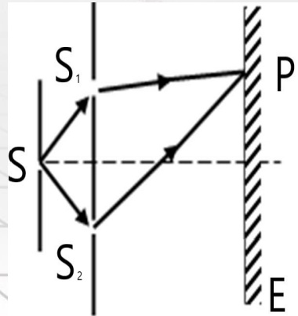
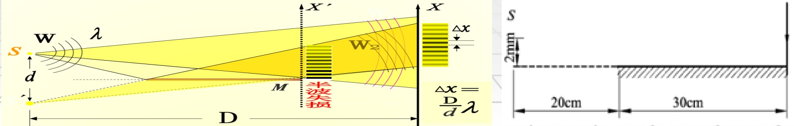
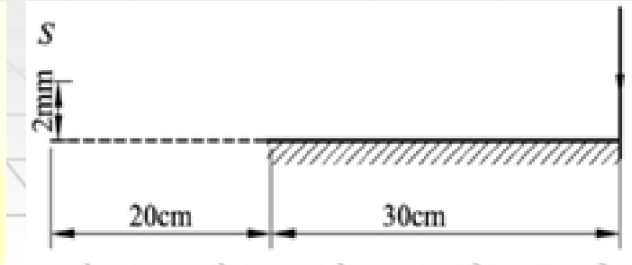
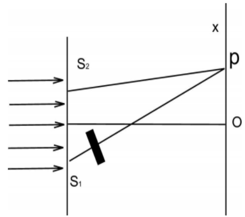

# 33-练习33 光波的基本概念 光波的叠加 分波阵面法干涉

[返回全书目录](../../README.md)

> PDF 页码：248–254

<!-- page: 248 -->

### 练习33 光波的基本概念 光波的叠加 分波阵面法干涉

1. 光的相干条件是 $ \underline{\text{频率}} $相同、 $ \underline{\text{振动方向}} $相同、 $ \underline{\text{相位}} $相同或 $ \underline{\text{相位差}} $恒定；如果在用白光光源进行杨氏双缝干涉实验中，用一个纯红色的滤光片遮盖一条缝，用一个纯蓝色的滤光片遮盖另一条缝，则将 $ \underline{\text{不产生}} $（请填“产生”或“不产生”）干涉条纹。

解：获得相干光的方法：把由光源上同一点发出的光设法分成两部分，然后再使这两部分叠加起来，这两部分光具有相同频率、相同振动方向、相同相位或相位差恒定。

红光和蓝光为非相干光，所以不产生干涉条纹

<!-- page: 249 -->

2. 如图 33.1 所示，在双缝干涉实验中  $ \overline{SS_1} = \overline{SS_2} $，用波长为  $ \lambda $ 的单色光照射双缝  $ S_1 $ 和  $ S_2 $，通过空气后在屏幕  $ E $ 上形成干涉条纹。已知  $ P $ 点为第三级明条纹，则  $ S_1 $ 和  $ S_2 $ 到  $ P $ 点的光程差  $ \delta = \underline{32} $。若两缝到屏幕上  $ P $ 点的距离差为  $ \overline{S_2P} - \overline{S_1P} = r_2 - r_1 = \lambda/3 $，则  $ P $ 点的光强  $ I $ （按振幅平方计算）与干涉加强时最大光强  $ I_{\max} $ 的比  $ I:I_{\max} = \underline{1:4} $，若将整个装置放于某种透明液体中， $ P $ 点处为第四级明条纹，则该液体的折射率  $ n = \underline{4/3} $，此时的干涉条纹间距  $ \Delta x' $ 与在空气中观察时的条纹间距  $ \Delta x $ 之比  $ \Delta x':\Delta x = \underline{3/4} $

解：因为P点为第三级明纹，故 $ s_1 $和 $ s_2 $到P点的光程差 $ \delta = r_2 - r_1 = 3\lambda $

 $$ \Delta\boldsymbol{\varphi}=\boldsymbol{\varphi}_{2}-\boldsymbol{\varphi}_{1}-\frac{2\pi}{\lambda}(\boldsymbol{r}_{2}-\boldsymbol{r}_{1})=-\frac{2\pi}{\lambda}\times\frac{\lambda}{3}=-\frac{2\pi}{3} $$ 

 $$ \mathbf{I}=2\mathbf{I}_{0}+2\mathbf{I}_{0}\cos\Delta\varphi=2\mathbf{I}_{0}+2\mathbf{I}_{0}\cos(-\frac{2\pi}{3})=\mathbf{I}_{0},\  又 \mathbf{I}_{\max}=4\mathbf{I}_{0}\Rightarrow\mathbf{I}:\mathbf{I}_{\max}=1:4 $$ 

 $$ \boldsymbol{\delta}^{^{\prime}}=\boldsymbol{n}(\boldsymbol{r}_{2}-\boldsymbol{r}_{1})=4\lambda\Longrightarrow\boldsymbol{n}=4/3 $$ 

 $$ \Delta x=\frac{D\lambda}{d},\ \Delta x^{^{\prime}}=\frac{D\lambda}{d n}\Longrightarrow\Delta x^{^{\prime}}:\Delta x=1:n=\frac{3}{4} $$ 

<!-- page: 250 -->

3. 洛埃镜干涉装置如图 33.2 所示，镜长 30cm，狭缝光源 S 在离镜左边 20cm 的平面内，与镜面的垂直距离为 2.0mm，若光源波长为  $ \lambda = 7.2 \times 10^{-7} m $，则位于镜右边缘的屏幕上第一条明纹到镜边缘的距离  $ x_{1} = \underline{\quad 4.5 \times 10^{-2} mm\quad} $。

解：洛埃镜原理图如下，位于右边缘的屏幕上第一条明纹到镜边缘的距离： $ x_1 = \frac{D\lambda}{2d} = \frac{0.5 \times 7.2 \times 10^{-7}}{2 \times 4 \times 10^{-3}} = 4.5 \times 10^{-2} mm $

<!-- page: 251 -->

4. 在杨氏双缝干涉实验中，双缝间距  $ d=0.20mm $，观察屏幕到缝的距离为  $ D=1.0m $，若第二级明条纹离屏幕中心的距离为  $ x_{2}=6.0mm $，试求：（1）此单色光的波长  $ \lambda $；（2）相邻两明条纹间的距离  $ \Delta x_{1} $；（3）屏幕中心明条纹两侧的两个第三级明条纹之间的距离  $ \Delta x_{2} $。

解：（1）由明条纹的位置  $ x_{明} = \frac{k\lambda D}{d} $ 知：  $ x_{2} = \frac{2\lambda D}{d} $，

 $$ \lambda=\frac{x_{2}d}{2D}=\frac{6.0\times10^{-3}\times0.20\times10^{-3}}{2\times1.0}=6.0\times10^{-7}m=600nm $$ 

（2）由条纹间距公式： $ \Delta x = \frac{\lambda D}{d} $，

 $$ \Delta x_{1}=\frac{\lambda D}{d}=\frac{6.0\times10^{-7}\times1.0}{0.20\times1.0^{-3}}=3.0\times10^{-3}m=3mm $$ 

（3）屏幕中心明条纹两侧的两个第三级明条纹之间的距离为：

 $$ \Delta x_{2}=6\times\frac{\lambda D}{d}=6\times3mm=18mm $$

<!-- page: 252 -->

5. 在双缝干涉实验中，两缝间距为  $ d=0.30mm $，用单色光垂直照射双缝，在离缝为  $ D=1.20m $ 的屏上测得中央明纹一侧第5条暗纹与另一侧第5条暗纹间的距离为  $ 22.78mm $，求：（1）所用光的波长  $ \lambda $；（2）屏幕中心0点上方第三级明条纹的坐标  $ x_{3} $；（3）如果用厚度  $ l=1.0\times10^{-2}mm $，折射率  $ n=1.58 $ 的透明薄膜盖在下边的那条缝后面，那么此时的第五级明条纹的坐标  $ x_{5}' $ 是多少？

解：（1）暗纹公式： $ x = \pm \frac{D}{d}(2k + 1)\frac{\lambda}{2} $

 $$ \begin{aligned}&L=x_{+}-x_{-}=\frac{D}{d}\left(2\times4+1\right)\frac{\lambda}{2}-\left[-\frac{D}{d}\left(2\times4+1\right)\right]\\ &=\frac{2D}{d}\left(2\times4+1\right)\frac{\lambda}{2}=\frac{9D\lambda}{d}=22.78mm\Rightarrow\lambda=\frac{Ld}{9D}=632.8nm\\ \end{aligned} $$ 

方法二：相邻条纹间距  $ \Delta x = \frac{D\lambda}{d} $ 共9个条纹间距  $ L = 9 \frac{D\lambda}{d} \Rightarrow \lambda = \frac{Ld}{9D} = 632.8nm $

<!-- page: 253 -->

（2）明纹公式： $ x_{明} = \pm \frac{kD\lambda}{d} $

 $ x_{3} = \frac{3\lambda D}{d} = \frac{3 \times 632.8 \times 10^{-9} \times 1.20}{0.30 \times 1.0^{-3}} = 7.59 \times 10^{-3} m = 7.59 mm $

（3）当缝 $ S_{1} $后有薄膜时，如图所示，

P处的光程差为： $ \delta = S_{1}P + (n-1)\boldsymbol{l} - S_{2}P $

由几何关系可知： $ S_{1}P - S_{2}P = \frac{d}{D} x_{5} $

 $$ \boldsymbol{\delta}=\frac{d}{D}\boldsymbol{x}_{5}^{^{\prime}}+(n-1)\boldsymbol{l}=\pm5\lambda $$ 

 $$ x_{5}^{^{\prime}}=\frac{D}{d}\left[5\lambda-(n-1)\boldsymbol{l}\right]=\frac{5\lambda D}{d}-\frac{(n-1)\boldsymbol{l}D}{d}=-1.05\times10^{-2}m $$ 

 $$ x^{^{\prime}}_{-5}=\frac{D}{d}\left[-5\lambda-(n-1)\boldsymbol{l}\right]=-3.59\times10^{-2}m $$

<!-- page: 254 -->

6. 在杨氏双缝干涉实验中，双缝的距离  $ d = 2mm $，观察屏离两缝的距离  $ D = 2m $，若用包含两种波长的混合光垂直照射，其中  $ \lambda_{1} = 450nm $， $ \lambda_{2} = 600nm $，求：（1）这两种波长的明纹在屏幕上发生第一次重叠（不计屏幕中心处的重叠）时，到屏幕中心的距离 x；（2）若入射光是波长范围为  $ 400nm \sim 760nm $ 的白光，则在观察屏上距离屏幕中心  $ 3mm $ 处，能最大限度地加强的光的全部波长  $ \lambda $。

解：（1）由双缝干涉明纹位置 $ x=\pm\frac{kD\lambda}{d} $

 $ x=k_{1}\frac{D}{d}\lambda_{1}=k_{2}\frac{D}{d}\lambda_{2}\Rightarrow k_{1}\lambda_{1}=k_{2}\lambda_{2}\Rightarrow\frac{k_{1}}{k_{2}}=\frac{\lambda_{2}}{\lambda_{1}}=\frac{4}{3} $

第一次重叠位置到中心的距离： $ x=k_{1}\frac{D\lambda_{1}}{d}=4\times\frac{2\times450\times10^{-9}}{2\times10^{-3}}=1.8\text{(mm)} $

（2）由双缝干涉明纹位置可知 $ \lambda=\frac{xd}{Dk}=\frac{3\times10^{-6}}{k} $

将 $ k=4,5,6,7 $代入上式 $ \Rightarrow\lambda=750,600,500,428.6\text{(nm)} $

