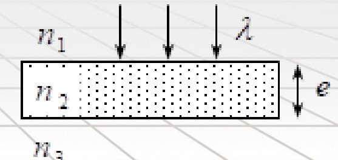
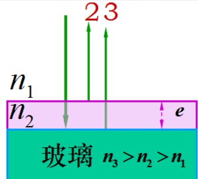
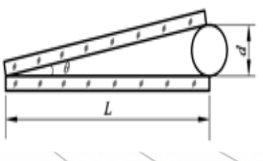

# 34-练习34 分振幅法干涉

[返回全书目录](../../README.md)

> PDF 页码：255–262

<!-- page: 255 -->

### 练习34 分振幅法干涉

1. 如图34.1，波长为  $ \lambda $ 的平行单色光垂直入射在折射率为  $ n_2 $ 的薄膜上，经上下两个表面反射的两束光发生干涉。若薄膜厚度为  $ e $，而且  $ n_1 > n_2 > n_3 $，则两束反射光在相遇点的光程差  $ \delta_{反射} = \underline{2n_2e} $，两束透射光在相遇点的光程差为  $ \delta_{透射} = \underline{2n_2e + \frac{\lambda}{2}} $。

解：依题意 $ n_1 > n_2 > n_3 $，因两束反射光，在上下面的反射条件相同，没有半波损失有： $ \delta_{反} = 2n_2e $

两束透射光，有半波损失，

 $$ \therefore\delta_{ 透 }=2n_{2}e+\frac{\lambda}{2} $$ 

<!-- page: 256 -->

2. 折射率分别是  $ n_{1} $ 和  $ n_{2} $ 的两块平板玻璃之间构成空气劈尖，用波长为  $ \lambda $ 的单色光垂直照射，观察反射光的干涉。若测得相邻明条纹的间距为  $ l_{1} $，则劈尖角  $ \theta = \frac{\lambda}{2l_{1}} $，如果将该劈尖装置浸入折射率为 n 的透明液体中，且  $ n_{2} > n > n_{1} $，此时条纹间距变为  $ l_{2} = \frac{l_{1}}{2} \cdot n $，劈尖厚度为 e 处两反射光的光程差的改变量是  $ \Delta\delta = \frac{2(n-1)e}{2} \cdot \frac{\lambda}{2} $。

解：依题意相邻明条纹间距  $ l_{1} = \frac{\lambda}{2n_{空}\theta} = \frac{\lambda}{2\theta} \Rightarrow $ 劈尖角  $ \theta = \frac{\lambda}{2l_{1}} $

劈尖装置浸入液体中后明条纹间距  $ l_{2} = \frac{\lambda}{2n\theta} = \frac{l_{1}}{n} $

劈尖装置浸入液体前后反射光光程差分别为  $ \delta_{反1} = 2e \pm \frac{\lambda}{2} $， $ \delta_{反2} = 2ne $

∴ 光程差的改变量为  $ \Delta\delta_{反} = \delta_{反2} - \delta_{反1} = 2(n-1)e + \frac{\lambda}{2} $

<!-- page: 257 -->

3. 为了使对照相底片和视觉最敏感的黄绿光（波长  $ \lambda=550nm $）透射增强，常在照相机的镜头和光学仪器的透镜（折射率为  $ n_{3}=1.52 $）表面镀一层氟化镁薄膜（折射率为  $ n_{2}=1.38 $）作为增透膜。假设光线垂直入射，则该增透膜的最小厚度为  $ e_{\min}=\underline{99.6nm} $，此增透膜 $ \underline{\text{不能}} $（请填“能”或“不能”）对白光中其它波长的光反射加强。

解：光程差为 $ \delta=2n_{2}e $
对 $ \lambda=550nm $的光透射增强、反射相消，即 $ \therefore2n_{2}e=(2k+1)\frac{\lambda}{2} $
最小厚度取k=0，即： $ e_{\min}=\frac{\lambda}{4n_{2}}=99.6nm $
反射加强，即 $ 2n_{2}e=\frac{\lambda}{4n_{2}}=2n_{2}\frac{1}{4n_{2}}=\frac{\lambda}{2k}=\frac{550}{2k}nm\leq275nm $
所以不能对白光中其它波长的光反射加强

<!-- page: 258 -->

4. 如图 34.2 所示，波长为  $ \lambda = 680nm $ 的平行光垂直照射到长度均为  $ L = 0.12m $ 的两块平玻璃片上，两玻璃片一边相互接触，另一边被一直径  $ d = 0.048mm $ 的细钢丝隔开。求：（1）两玻璃片间的夹角  $ \theta $；（2）相邻两明条纹间空气膜的厚度差  $ \Delta e $；（3）相邻两暗条纹的间距  $ l $；（4）在这玻璃片的长度  $ L = 0.12m $ 内呈现出的明条纹的数目  $ \Delta N $。

解：（1）由于劈尖角很小，由图可知，

 $ L\sin\theta=d $，有： $ L\theta=d\Rightarrow $两玻璃间夹角 $ \theta=\frac{d}{L}=\frac{0.048\times10^{-3}}{0.12}=4.0\times10^{-4}rad $

(2)相邻两明条纹间空气膜的厚度差 $ \Delta e=\frac{\lambda}{2}=\frac{680\times10^{-9}}{2}=3.4\times10^{-7}m $

相邻两暗条纹间距 $ l=\frac{\lambda}{2\theta}=\frac{680\times10^{-9}}{2\times4.0\times10^{-4}}=850\times10^{-6}m=0.85mm $

明条纹数目 $ \Delta N=\frac{L}{l}=\frac{0.12}{0.85\times10^{-3}}\approx141 $条

<!-- page: 259 -->

5. 用白色平行光束照射在空气中的肥皂膜上，该肥皂膜的折射率为 n=1.33 当观察方向与膜面法线成  $ 30^{\circ} $ 角时，看到肥皂膜的反射光是亮度均匀且波长为  $ \lambda=500nm $ 的绿色光。求：（1）肥皂膜的最小厚度  $ e_{\min} $；（2）若肥皂膜的厚度为最小厚度的4倍时，从膜的法线方向上看，反射加强的光的波长  $ \lambda_{\text{反射}} $，该膜的正面呈现什么颜色？（3）透射加强的光的波长  $ \lambda_{\text{透射}} $，此时肥皂膜背面呈现什么颜色？

解：（1）由于只有肥皂膜上表面的反射光存在半波损失

 $$ \delta_{_{ 反射 }}=2e\sqrt{n_{_{2}}^{2}-n_{_{1}}^{2}\sin^{2}i}+\frac{\lambda}{2}=k\lambda( 明纹 ) $$ 

令 k=1，肥皂膜的最小厚度为：

 $$ e_{\min}=\frac{\lambda}{4\sqrt{n_{2}^{2}-n_{1}^{2}\sin^{2}i}}=\frac{500}{4\sqrt{1.33^{2}-1^{2}\times\sin^{2}30^{\circ}}}=101.4nm $$

<!-- page: 260 -->

（2）在膜的法线方向看反射光，入射角为零，反射光干涉加强

 $$ \delta_{ 反 }=2\boldsymbol{n}_{2}\boldsymbol{e}+\frac{\lambda}{2}=2\boldsymbol{n}_{2}(4\boldsymbol{e}_{\min})+\frac{\lambda}{2}=k\lambda $$ 

 $$ \lambda=\frac{4\boldsymbol{n}_{2}\times4\boldsymbol{e}_{\min}}{2k-1}=\frac{4\times1.33\times101.4\times4}{2k-1}=\frac{2157.8}{2k-1}\boldsymbol{n}\boldsymbol{m} $$ 

可得： $ k = 2, \lambda = 719.3nm; k = 3, \lambda = 431.6nm $，呈紫红色。

（3）在膜的法线方向看反射光，入射角为零，反射相消，透射光干涉加强

 $$ \delta_{ 反 }=2\boldsymbol{n}_{2}\boldsymbol{e}+\frac{\lambda}{2}\boldsymbol{=2n_{2}(4e_{\min})}+\frac{\lambda}{2}=(2k+1)\frac{\lambda}{2} $$ 

 $$ \lambda=\frac{2\boldsymbol{n}_{2}\times4\boldsymbol{e}_{\min}}{k}=\frac{2\times1.33\times101.4\times4}{k}=\frac{1078.9}{k}\boldsymbol{n}\boldsymbol{m} $$ 

可得： $ k = 2, \lambda = 539.5 nm $; 呈绿色。

<!-- page: 261 -->

6. 用  $ \lambda=500nm $ 的平行光垂直入射到劈形薄膜（即劈尖）上面，从反射光中观察，劈尖的棱边处呈现的是暗纹。若劈尖上面介质的折射率  $ n_{1} $ 大于劈形薄膜的折射率  $ n $（设 n=1.5），求：（1）劈形薄膜下面介质的折射率  $ n_{2} $ 与 n 的大小关系；（2）第 10 条暗纹处对应的劈形薄膜的厚度 e；

（3）若使膜的下表面向下平移一微小距离  $ \Delta e $，干涉条纹有什么变化？如果  $ \Delta e = 2.0\mu m $，原来的第10条暗纹处将被现在的哪级暗纹所占据？

解：（1）因为劈尖的棱边是暗纹，对应光程差 $ \delta = 2ne + \frac{\lambda}{2} = (2k+1)\frac{\lambda}{2} $

膜厚 $ e = 0 $处，有 $ k = 0 $，只能是下面媒质的反射光有半波损失 $ \frac{\lambda}{2} $才符合题意。

所以有 $ n_2 > n $

（2）劈尖干涉中相邻两条明纹或暗纹对应的薄膜厚度差为： $ \Delta e_{0} = \frac{\lambda}{2n} $

<!-- page: 262 -->

因10个暗条纹之间只有9个条纹间距，所以第10条暗纹处对应的劈形薄膜的厚度为：

 $$ e=9\Delta e_{0}=\frac{9\lambda}{2n}=\frac{9\times500\times10^{-9}}{2\times1.5}=1.5\times10^{-6}m=1.5\times10^{-3}mm $$ 

（3）膜的下表面向下平移时，各级条纹向棱边方向移动。原来第10条暗纹处现对应的膜厚为：

 $$ e^{\prime}=(1.5{\times}10^{-3}+2.0{\times}10^{-3})m m $$ 

 $$ \boldsymbol{\delta}=2\boldsymbol{n}\boldsymbol{e}^{^{\prime}}+\frac{\lambda}{2}=(2k+1)\frac{\lambda}{2} $$ 

 $$ k=\frac{2ne}{\lambda}=\frac{2\times1.5\times3.5\times10^{-3}\times10^{-3}}{500\times10^{-9}}=21 $$ 

所以，原来的第10条（即第9级）暗纹处现被第21级暗纹所占据。

