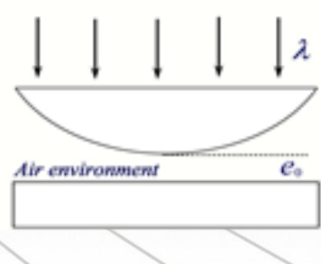

# 35-练习35 牛顿环 迈克尔孙干涉仪

[返回全书目录](../../README.md)

> PDF 页码：263–271

<!-- page: 263 -->

### 练习35 牛顿环 迈克尔孙干涉仪

1. 在牛顿环实验中，若平凸透镜的曲率半径  $ R=3.00m $，用单色光垂直照射，观察反射光形成的牛顿环，测得第 K 级暗环半径为  $ r_{k}=4.24mm $，第  $ k+10 $ 级暗环半径为  $ r_{k+10}=6.00mm $，则所用单色光的波长  $ \lambda=\underline{600.7nm} $。现将平凸透镜和平板玻璃之间充满折射率为 n=1.33 的透明液体（设平凸透镜和平板玻璃的折射率都大于1.33），此时，第 K 级暗环的半径变为  $ r_{k}'=\underline{3.68mm} $，与平凸透镜和平板玻璃之间为空气时相比，相邻暗环的间距  $ \underline{\text{减小}} $（请填“增大”或“减小”）。

解：暗环半径 $ r_{k}=\sqrt{kR\lambda}\Rightarrow10R\lambda=\left(r_{k+10}^{2}-r_{k}^{2}\right)\Rightarrow\lambda=\left(r_{k+10}^{2}-r_{k}^{2}\right)/10R=600.7nm $

充满液体后 $ r_{k}^{'}=\sqrt{kR\lambda/n}\Rightarrow r_{k}^{'}/r_{k}=\sqrt{1/n}\Rightarrow r_{k}^{'}=\frac{4.24}{\sqrt{1.33}}=3.68mm $

暗环间距 $ \Delta r=r_{k+1}-r_{k}=\sqrt{\frac{R\lambda}{n}}(\sqrt{k+1}-\sqrt{k})\Rightarrow $ n增大，间距减小。

<!-- page: 264 -->

2. 牛顿环实验中平凸透镜顶部恰与平板玻璃接触。若透镜与玻璃之间由空气变为充满某种液体时，测得第10个明环的直径由 $ d_{1}=1.40\times10^{-2}m $变为 $ d_{2}=1.27\times10^{-2}m $，则该液体的折射率为 $ \underline{1.22} $。若平凸透镜的曲率半径为3m，用波长为 $ \lambda=650nm $的平行单色光垂直照射到该牛顿环装置上时，则从中心向外数第10个明环所在处的液体厚度为 $ \underline{2.53\mu m} $。

解：明环半径 $ r_{k}=\frac{d_{k}}{2}=\sqrt{\frac{(2k-1)R\lambda}{2n}}\Rightarrow n=\left(\frac{d_{1}}{d_{2}}\right)^{2}=1.22 $

 $$ \delta=2ne+\frac{\lambda}{2}=k\lambda=10\lambda\Rightarrow e=\frac{9.5\lambda}{2n}=2.53\mu m $$

<!-- page: 265 -->

3. 利用迈克耳孙干涉仪测量单色光的波长。当迈克耳孙干涉仪的可动反射镜  $ M_{1} $ 移动距离为  $ \Delta d $ 时，测得某单色光的干涉条纹移动了  $ N_{1} $ 条，则所用光波的波长为  $ \lambda = \underline{\frac{2\Delta d}{N_{1}}} $；若在迈克耳孙干涉仪的一条光路上，放入一折射率为 n 厚度为 t 的透明薄片，则这条光路的光程改变量  $ \Delta L = \underline{2(n-1)t} $，可观察到干涉条纹移动的数目  $ N_{2} = \underline{\frac{(n-1)t}{\Delta d}N_{1}} $ 条。

解：反射镜M_{1}移动距离： $ \Delta d = N_{1} \frac{\lambda}{2} \Rightarrow \lambda = \frac{2\Delta d}{N_{1}} $

放入薄片后光程的改变量： $ \Delta L = 2(n - 1)t $

又 $ \Delta L = N_{2}\lambda \therefore N_{2} = \frac{2(n-1)t}{\lambda} = \frac{(n-1)t}{\Delta d} N_{1} $

<!-- page: 266 -->

4. 在牛顿环实验中，平凸透镜顶部刚好与平板玻璃接触，其间为空气。如果用两种波长的光进行观测：（1） $ \lambda_{1} $ 的第 K 级暗环与  $ \lambda_{2} $ 的第  $ k+1 $ 级暗环相重叠，且  $ \lambda_{1}=600nm $， $ \lambda_{2}=450nm $，若平凸透镜的曲率半径为  $ R=190cm $，求： $ \lambda_{1} $ 的第 k 级暗环的半径  $ r_{k} $；（2）在该实验中，如果用波长为  $ \lambda_{1}'=500nm $ 的单色光照射时的第 5 个明环与用波长为  $ \lambda_{2}' $ 照射时的第 6 个明环相重合，求：未知波长  $ \lambda_{2}' $。

解：由牛顿暗环公式： $ r_{k} = \sqrt{kR\lambda} $

根据题意有： $ r_{k} = \sqrt{kR\lambda_{1}} = \sqrt{(k+1)R\lambda_{2}} \Rightarrow k = \frac{\lambda_{2}}{\lambda_{1} - \lambda_{2}} $

将k代入牛顿暗环公式得  $ r_{k} = \sqrt{\frac{R\lambda_{1}\lambda_{2}}{\lambda_{1} - \lambda_{2}}} = 1.85 \times 10^{-3} m $

<!-- page: 267 -->

用 $ \lambda_{1}' = 500nm $的光照射，第五个明环（ $ \mathrm{k}_{1}=5 $）与第六个明环（ $ \mathrm{k}_{2}=6 $）重合

则有： $  r = \sqrt{\frac{(2k_{1}-1)R\lambda_{1}}{2}} = \sqrt{\frac{(2k_{2}-1)R\lambda_{2}}{2}}  $

可得： $ \lambda_{2}^{\prime}=\frac{2k_{1}-1}{2k_{2}-1}\lambda_{1}^{\prime}=\frac{2\times5-1}{2\times6-1}\times500nm=409.1nm $

<!-- page: 268 -->

5. 用波长为  $ \lambda $ 的单色平行光垂直照射如图 35.1 所示的牛顿环装置，观察从空气膜上下表面反射光形成的牛顿环。求：（1）若使平凸透镜慢慢地垂直向上移动，则观察到的干涉条纹应怎样移动？（2）从透镜顶点与平板玻璃接触到两者距离为  $ e_{0} $ 的移动过程中，移过视场中某固定观察点的条纹数目  $ \Delta N $ 等于多少？（3）若平凸透镜的曲率半径为 R，此时反射光形成的牛顿环的各暗环半径表达式。

解：（1）牛顿环干涉是等厚干涉，当平凸透镜慢慢地垂直向上移动时，平凸透镜与下面平板玻璃之间的薄膜厚度整体增加，所以对应原来某一厚度的条纹将向环的中心收缩。

（2）由于相邻两个明纹或者暗纹对应的薄膜厚度为： $ e_{k+1}-e_{k}=\frac{\lambda}{2} $ 即在空气中，条纹每移动一条，对应的薄膜厚度差为半个波长，所以，如果薄膜度改变为 $ e_{0} $，则有：

 $$ e_{0}=\Delta N(e_{k+1}-e_{k})=\Delta N\times\frac{\lambda}{2}\qquad\therefore\quad\Delta N=\frac{e_{0}}{e_{k+1}-e_{k}}=\frac{e_{0}}{\lambda/2}=\frac{2e_{0}}{\lambda} $$ 

<!-- page: 269 -->

任意位置经过牛顿环上下表面反射光的光程差为： $ \delta=2(e_{0}+e_{k})+\frac{\lambda}{2} $

暗环所在的位置应满足： $ \delta=(2k+1)\frac{\lambda}{2} $

即： $ 2(e_{0}+e_{k})+\frac{\lambda}{2}=(2k+1)\frac{\lambda}{2} $

由此可得： $ e_{k}=\frac{k\lambda-2e_{0}}{2} $

由几何关系，牛顿环半径 $ r_{k} $应满足：

 $$ \begin{aligned}&r_{k}^{~^{2}}=R^{2}-(R-e_{k})^{2}=2e_{k}R-e_{k}^{~^{2}}\approx2e_{k}R\\&\quad\Rightarrow r_{k}=\sqrt{2e_{k}R}=\sqrt{R(k\lambda-2e_{0})},(k\geq\frac{2e_{0}}{\lambda})\\ \end{aligned} $$

<!-- page: 270 -->

6. 折射率为  $ n_{2}=1.20 $ 的油滴滴落在  $ n_{3}=1.50 $ 的平板玻璃上，形成一上表面近似于球面的油膜，油膜中心最高处  $ e_{\max}=1.1\mu m $，用  $ \lambda=600nm $ 的单色光垂直照射油膜，问：（1）油膜边缘是明环还是暗环？整个油膜能看到几个明环和几个暗环？（能看到条纹中心就算看到该级条纹）；（2）最高级次的明环和暗环所对应的油膜厚度？（3）油膜继续展开的过程中干涉条纹将怎样变化？

解：（1）经油膜上、下两个表面反射光的光程差为： $ \delta_{反}=2n_{2}e $

明环和暗环的条件为： $ \delta_{反}=2n_{2}e=\left\{\begin{array}{ll}k\lambda & k=0,1,2\ldots\text{(明环)} \ $ 2k+1)\frac{\lambda}{2} & k=0,1,2\ldots\text{(暗环)}\end{array}\right. $

油膜边缘处薄膜厚度e=0，所以对应的是0级明环。

按照油膜最厚的地方 $ e_{max}=1.1\mu m $计算

<!-- page: 271 -->

$ \delta_{明}=2n_{2}e_{max}=k\lambda\Rightarrow k=\frac{2n_{2}e_{max}}{\lambda}=4.4\Rightarrow $ 可看到 $ k=0,1,2,3,4 $共5个明环。

 $ \delta_{暗}=2n_{2}e_{max}=\frac{(2k+1)\lambda}{2}\Rightarrow k=\frac{2n_{2}e_{max}}{\lambda}-\frac{1}{2}=3.9\Rightarrow $ 可看到 $ k=0,1,2,3 $共4个暗环

（2）最高级次明环所对应的油膜厚度为：

 $$ \delta_{ 明 }=2n_{2}e\quad=k\lambda\implies e_{ 明 \max}=\frac{4\lambda}{2n_{2}}=\frac{4\times600nm}{2\times1.20}=1000nm $$ 

最高级次暗环所对应的油膜厚度为：

 $$ \delta_{ 暗 }=2n_{2}e=\frac{(2k+1)\lambda}{2}\Rightarrow e_{ 暗 \max}=\frac{(2k+1)\lambda}{4n_{2}}=\frac{7\lambda}{4n_{2}}=875nm $$ 

（3）油膜继续展开的过程中干涉条纹将半径扩大，条纹个数减少、变稀，中心处明暗交替改变

