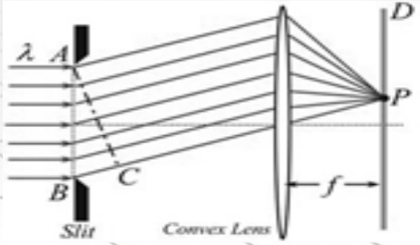
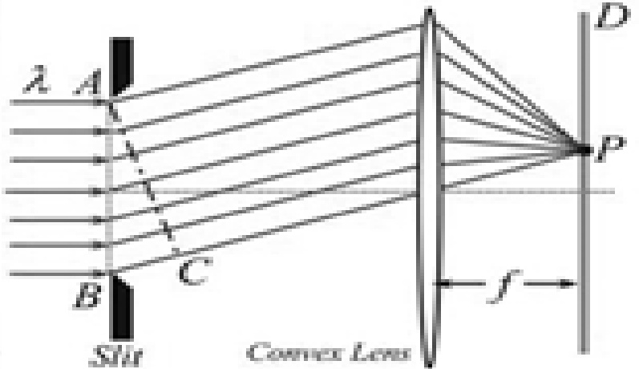

# 36-练习36 单缝夫琅禾费衍射

[返回全书目录](../../README.md)

> PDF 页码：272–280

<!-- page: 272 -->

### 练习36 单缝夫琅禾费衍射

1. 如图36.1所示，在单缝夫琅和费衍射实验中，若单缝的宽度为a，单缝两边缘点A、B发出的单色平行光到空间某点P的光程差为 $ 1.5\lambda $，则P点处为 $ \underline{\text{明}} $（填“明”或“暗”）条纹，A、B间单缝处的波面相应地可分为 $ \underline{3} $个半波带；若光程差为 $ 2\lambda $，则P点处为 $ \underline{\text{暗}} $（填“明”或“暗”）条纹，A、B间单缝处的波面相应地可分为 $ \underline{4} $个半波带，此时的衍射角 $ \theta=\underline{\arcsin(2\lambda/a)} $；若将缝宽缩小一半，原来第三级暗纹处将是第 $ \underline{1} $级 $ \underline{\text{明}} $纹（填“明”或“暗”），单缝衍射条纹中央明纹的宽度 $ \Delta x $将变为原来的 $ \underline{2} $倍。

解：光程差为 $ 1.5\lambda $，即： $ a\sin\theta=\frac{3\lambda}{2}=(2+1)\frac{\lambda}{2}\Rightarrow P $点为明纹，波面分为3个半波带。

光程差为 $ 2\lambda $，即： $ a\sin\theta = 2\lambda = 4 \times \frac{\pi}{3} $

 $ \Rightarrow P $点为暗纹，波面分为4个半波带。 $ \Rightarrow \theta = \arcsin(2\lambda/a) $

<!-- page: 273 -->

第三级暗纹： $ a\sin\theta=3\lambda $， $ \Delta x=2\lambda f/a $

若将缝缩小一半，即： $ a' = \frac{a}{2} $，又 $ a \sin \theta = 3\lambda $

则： $ a'\sin\theta=\frac{3\lambda}{2}=(2k+1)\frac{\lambda}{2}\Rightarrow k=1 $

∴原来的第三级暗纹变为第一级明纹。

 $$ \therefore\Delta x^{\prime}=2\lambda f/a^{\prime}=4\lambda f/a=2\Delta x $$

<!-- page: 274 -->

2. 在夫琅禾费单缝衍射实验中，以钠黄光为光源，其波长  $ \lambda=589.0nm $，平行光垂直入射到单缝上。若缝宽为  $ a=0.10mm $，则第一级衍射极小（即暗纹）的衍射角  $ \theta_{1}=\underline{5.89\times10^{-3}rad} $；若要使第一级衍射极小出现在衍射角为  $ \theta_{1}'=0.5^{\circ} $ 的方向上，则缝宽  $ a'=0.0675mm $。

解：（1）真空时，单缝衍射第一级暗纹的条件为：

 $$ a\sin\theta_{1}=\lambda\Rightarrow\theta\doteq\lambda/a=5.89\times10^{-3}rad $$ 

 $$ a^{\prime}\doteq\lambda/\theta_{1}^{^{\prime}}=\frac{5.89\times10^{-7}}{0.5\times\frac{2\pi}{360}}=0.0675mm $$

<!-- page: 275 -->

3. 在单缝衍射实验中，若光源发出的光中包含有两种波长，分别为  $ \lambda_{1} $ 和  $ \lambda_{2} $，并垂直入射于单缝上。假如  $ \lambda_{1} $ 的第一级衍射极小（即暗纹）与  $ \lambda_{2} $ 的第二级衍射极小相重合，则这两种光的波长之比  $ \lambda_{1} : \lambda_{2} = \underline{2:1} $；在这两种波长的光所形成的衍射图样中， $ \underline{\text{还有}} $（请填“还有”或“没有”）其他衍射极小相重合。

解：单缝衍射中， $ \lambda_{1} $的第一级暗纹与 $ \lambda_{2} $的第二级暗纹重叠，即：

 $$ a\sin\theta_{1}=\lambda_{1}=2\lambda_{2}\Rightarrow\lambda_{1}\therefore\lambda_{2}=2{:}1 $$ 

 $$ a\sin\theta=k_{1}\lambda_{1}=k_{2}\lambda_{2}\Rightarrow\frac{k_{1}}{k_{2}}=\frac{\lambda_{2}}{\lambda_{1}}=\frac{1}{2}=\frac{2}{4}=\frac{3}{6}\ldots $$ 

∴除了 $ \lambda_{1} $的第一级暗纹与 $ \lambda_{2} $的第二级暗纹重叠，还有其他暗纹重叠。

<!-- page: 276 -->

4. 某种单色平行光垂直照射在单缝上，单缝宽  $ a=0.15mm $，缝后放一个焦距  $ f=400mm $ 的凸透镜，在透镜焦平面的屏幕上，测得中央明条纹两侧的两个第三级暗条纹之间的距离为  $ 8.0mm $，求：（1）入射光的波长  $ \lambda $；（2）第二级明纹到屏幕中心的距离  $ x_{2} $.

解：（1）设第三级暗纹的衍射角为 $ \theta $，由单缝衍射暗纹条件可知

 $ a\sin\theta=3\lambda\Rightarrow\sin\theta=\frac{3\lambda}{a} $

此暗纹到屏幕中心的距离为 $ x=f\tan\theta $， $ \theta $很小，有 $ \sin\theta\approx\tan\theta $

∴两侧第三级暗纹的距离是： $ 2x_{3}=f\frac{6\lambda}{a}=8.0mm $

 $ \therefore \lambda = \frac{2x_{3}a}{6f} = \frac{8.0 \times 10^{-3} \times 0.15 \times 10^{-3}}{6 \times 400 \times 10^{-3}} = 500 \times 10^{-9} m = 500 nm $

<!-- page: 277 -->

（2）由单缝衍射明纹条件： $ a\sin\theta=\pm(2k+1)\frac{\lambda}{2} $

第二级明纹k=2，即： $ a\sin\theta=5\times\frac{\lambda}{2} $

又  $ \because \sin \theta = \frac{5\lambda}{2a} \approx \tan \theta = \frac{X_{2}}{f} $

 $$ \therefore x_{2}=\frac{5\lambda f}{2a}=\frac{5\times500\times10^{-9}\times400\times10^{-3}}{2\times0.15\times10^{-3}}=3.33\times10^{-3}m $$

<!-- page: 278 -->

5. 波长为  $ \lambda = 500nm $ 的平行光垂直照射在一宽度为  $ a = 0.10mm $ 的狭缝上，若在缝的后面有一焦距为  $ f = 50cm $ 的薄透镜，使光线会聚于该透镜焦平面处的屏幕上，求：（1）中央明纹的线宽度  $ \Delta x_{01} $ 及半角宽  $ \theta_{1} $ 半角；（2）如果将此装置浸入水中，中央明纹的线宽度  $ \Delta x_{02} $ 为多少？（设水的折射率为  $ n = 1.33 $）

解：（1）由第一级衍射暗纹条件： $ a \sin \theta_{1} = \pm \lambda $ 以及  $ \theta_{1} \approx \sin \theta_{1} = \frac{X_{1}}{f} $ 可得中央明纹半角宽： $ \theta_{1\text{半角}} = \frac{\lambda}{a} = 5.0 \times 10^{-3} rad $

中央明纹线宽度： $ \Delta x_{01}=2x_{1}=\frac{2\lambda f}{a}=5mm $

（2）若将此装置浸入水中，中央明纹线宽度为：

 $$ \Delta x_{_{02}}=\frac{2\lambda_{_{n}}}{a}f=\frac{2\lambda}{na}f=\frac{5}{1.33}=3.76mm $$

<!-- page: 279 -->

6. 在单缝夫琅禾费衍射实验中，已知单缝宽度  $ a=0.60mm $，缝后透镜的焦距为  $ f=40.0cm $，平行白光垂直照射单缝，若在屏幕上距离中心  $ x=1.4mm $ 的 P 点有两种波长的光呈现衍射明纹。求：（1）这两种光的波长  $ \lambda_{1} $ 和  $ \lambda_{2} $；（2）这两种波长的光在 P 点处条纹的级数  $ k_{1} $ 和  $ k_{2} $；（3）从 P 点看，这两种波长的光对应狭缝处的波面可分成半波带的个数分别为多少？（4）这两种光的第二级衍射明纹中心之间的距离  $ \Delta x_{22} $。

解：（1）由单缝衍射明纹条件： $ a\sin\theta=(2k+1)\frac{\lambda}{2} $以及 $ \sin\theta\approx\tan\theta=\frac{x}{f} $可得

 $$ \lambda=\frac{2ax}{f(2k+1)}=\frac{4.2\times10^{-6}}{2k+1}m $$ 

当 $ k=1 $时， $ \lambda=1400nm $（舍去）；当 $ k=2 $时， $ \lambda=840nm $（舍去）

当 $ k=3 $时， $ \lambda_{1}=600nm $；当 $ k=4 $时， $ \lambda_{2}=467nm $

(2)  $ \therefore \lambda_1 = 600nm $ 对应级次  $ k_1 = 3 $， $ \lambda_2 = 467nm $ 对应级次  $ k_2 = 4 $。

<!-- page: 280 -->

（3）由单缝衍射明纹条件： $ a\sin\theta=(2k+1)\frac{\lambda}{2} $ 可知：当 $ k_{1}=3 $时，狭缝的波面可分为 $ 2k_{1}+1=7 $个半波带当 $ k_{2}=4 $时，狭缝的波面可分为 $ 2k_{2}+1=9 $个半波带

（4）由单缝衍射明纹条件： $ a\sin\theta=(2k+1)\frac{\lambda}{2} $ 可知：

当k=2时有： $ a\sin\theta=\frac{5\lambda}{2} $，又 $ \sin\theta\approx\tan\theta=\frac{x}{f} $

 $ \therefore x_{1}=\frac{5\lambda_{1}f}{2a},\quad x_{2}=\frac{5\lambda_{2}f}{2a} $

 $ \therefore \Delta x_{22}=\frac{5\lambda_{1}f}{2a}-\frac{5\lambda_{2}f}{2a}=\frac{5f}{2a}\left(\lambda_{1}-\lambda_{2}\right)=\frac{5\times40.0\times10^{-2}}{2\times0.60\times10^{-3}}\times\left(600\times10^{-9}-467\times10^{-9}\right) $

 $ =2.2\times10^{-4}m=0.22mm $

