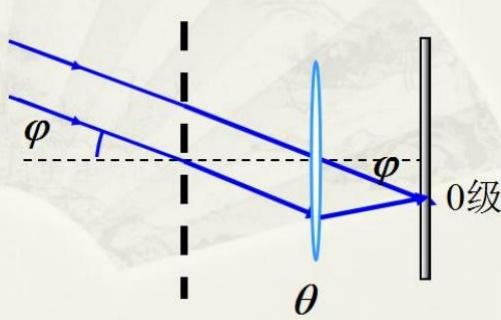
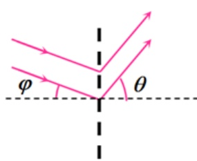
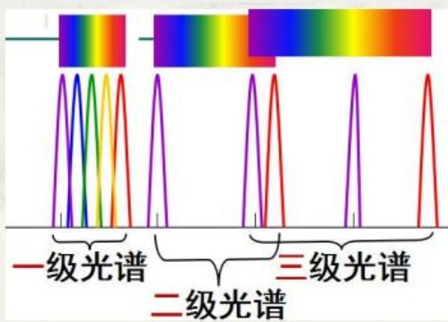

# 37-练习37 光栅衍射

[返回全书目录](../../README.md)

> PDF 页码：281–288

<!-- page: 281 -->

### 练习37 光栅衍射

1. 一束平行光垂直入射到某个光栅上，该光束包含有两种波长的单色光，波长分别为  $ \lambda_{1}=440nm $ 及  $ \lambda_{2}=660nm $。实验发现，两种波长的光谱线（即光栅衍射主极大明纹）第二次重合（不计中央明纹处的重合）在衍射角  $ \theta=60^{\circ} $ 的方向上，则此光栅的光栅常数  $ d=\underline{3.05\times10^{-3}mm} $。

解：由光栅方程： $ d\sin\theta=\pm k\lambda $可知

重叠处 $ d\sin\theta=k_{1}\lambda_{1}=k_{2}\lambda_{2}\Rightarrow\frac{k_{1}}{k_{2}}=\frac{\lambda_{2}}{\lambda_{1}}=\frac{3}{2}=\frac{6}{4}=\ldots $

第二次重合， $ k_{1}=6.0 $即： $ \mathrm{d}\sin60^{\circ}=6\lambda_{1} $

 $ \therefore d=\frac{6\lambda_{1}}{\sin60^{\circ}}=\frac{6\times440}{\sin60^{\circ}}nm=3.05\times10^{-3}mm $

<!-- page: 282 -->

2. 波长为  $ 400 \, nm $ 的单色平行光垂直入射在一光栅上，测得第三级光谱的衍射角为  $ 30^{\circ} $，第四级缺级，此光栅上相邻两缝的间距即光栅常数  $ d = a + b = \underline{2.4 \times 10^{-3} mm} $，光栅上狭缝可能的最小宽度  $ a_{\min} = \underline{0.6 \times 10^{-3} mm} $，若以白光（波长范围  $ 400 \, nm \sim 760 \, nm $）照射在该光栅上，则第三级光谱的张角等于  $ \Delta\theta_{3} = \underline{41.8^{\circ}} $。

解：由光栅方程： $ d\sin\theta=\pm k\lambda $可知
 $ \therefore d=k\lambda/\sin\theta=3\times400\times10^{-9}/\sin30^{\circ}=2.4\times10^{-3}mm $
 $ k=\frac{d}{a} $,取 $ k'=1 $得k=4
最小缝宽为： $ a=d/4=0.6\times10^{-3}mm $
 $ \lambda_{1}=400nm $时，第三级光谱 $ \sin\theta_{3}=3\lambda_{1}/d=1/2\Rightarrow\theta_{3}=30^{\circ} $
 $ \lambda_{2}=760nm $时，第三级光谱 $ \sin\theta_{3}=3\lambda_{2}/d=0.95\Rightarrow\theta_{3}=71.8^{\circ} $

<!-- page: 283 -->

3. 波长为  $ \lambda=500nm $ 的平行光垂直照射到每毫米有 200 条刻痕的光栅上，光栅后的透镜焦距为  $ f=60cm $，在透镜焦距处的屏幕上，光栅衍射的第一级光谱线（即主极大明纹）到屏幕中心距离  $ x_{1}=\underline{6cm} $，当入射光与光栅平面的法线的夹角为  $ \varphi=30^{\circ} $ 斜入射时，屏幕中心处原来的 0 级光谱线的移动距离  $ x=\underline{35cm} $。

解：光栅方程： $ d \sin \theta = \pm k \lambda $

光栅常数： $ d = \frac{1}{200} = 5 \times 10^{-3} \text{mm} $

第一主极大明纹到屏幕中心距离  $ x_1 = \frac{\lambda f}{d} = 6 \text{cm} $

0级光谱线移动距离： $ x = \tan 30^\circ f = 35 \text{cm} $

<!-- page: 284 -->

4. 一衍射光栅，每厘米有200条透光缝，每条透光缝宽为  $ a=2.0\times10^{-3}cm $，在光栅后放一焦距  $ f=1m $ 的凸透镜，现以  $ \lambda=600nm $ 的单色平行光垂直照射光栅，求：（1）缝宽为  $ a $ 的单缝衍射中央明纹线宽度  $ \Delta x_{0} $ 为多少？（2）在上述宽度内（即单缝衍射中央明纹区域）光栅衍射光谱线的条数及全部级次。

解：（1）单缝衍射中央明纹线宽度为：

 $$ \Delta x_{_{0}}=\frac{2\lambda f}{a}=\frac{2\times600\times10^{-9}\times1}{2.0\times10^{-3}\times10^{-2}}=0.06m=6cm $$ 

(2)光栅常数： $ d=\frac{1cm}{200}=5\times10^{-3}cm\Rightarrow\frac{d}{a}=\frac{5\times10^{-3}}{2.0\times10^{-3}}=2.5 $

由光栅衍射缺级条件： $ k = \frac{d}{a}k' = 2.5k' \Rightarrow $ 当 $ k' = 1 $时，k = 2.5

即：在单缝衍射第一级暗纹的地方对应光栅衍射的第2.5级主极大明纹，因此，在单缝衍射中央明纹区域内，光栅衍射的主极大明纹有：

k=0, $ \pm1 $, $ \pm2 $，共有5条谱线

<!-- page: 285 -->

5. 一光栅的透光缝宽度 a 是其间距 b 的一半，波长为  $ \lambda=500nm $ 的单色平行光，与光栅平面法线夹角为  $ \varphi=30^{\circ} $ 斜入射到光栅上，此时，第2级主极大明纹的位置恰与垂直入射时屏幕中心处的0级主极大明纹的位置重合，求：（1）该光栅每厘米上透光缝的数目 N；（2）在屏幕上出现的各主极大明纹的级次；（3）若是垂直入射，能看到的主极大明纹的最大级次？各主极大明纹的级次？

解:(1)斜入射时，光栅相邻两缝对应光线到达屏的光程差还包含入射光光程差。光栅方程为 $ (a+b)(\sin\varphi\pm\sin\theta)=\pm k\lambda $

当第2级主极大明纹的位置恰与垂直入射时屏幕中心处的0级主极大明纹的位置重合，则 k=2,\theta=0

 $$ \therefore\quad a+b=\frac{2\lambda}{\sin30^{\circ}}=\frac{2\times500\times10^{-9}}{0.5}=2\times10^{-6}m=\frac{1cm}{N} $$ 

∴每厘米光栅的刻痕数为： $ N=\frac{1cm}{2\times10^{-6}m}=5000 $

<!-- page: 286 -->

（2）由光栅方程 $ (a + b)(\sin \varphi + \sin \theta) = \pm k\lambda $可知：当衍射角 $ \theta = \pm 90^\circ $时，光栅衍射级次最大

最大级次为： $  k_{m} < \frac{(a + b)(1 / 2 + 1)}{\lambda} = 6, \Rightarrow k_{\max} = 5  $

 $  k_{m}' \succ \frac{(a + b)(1 / 2 - 1)}{\lambda} = \frac{-2 \times 10^{-6} \times 0.5}{500 \times 10^{-9}} = -2, \Rightarrow k_{\max}' = -1  $

 $  a = \frac{b}{2} \Rightarrow \frac{d}{a} = 3 \Rightarrow  $ 缺级条件  $  k = \frac{d}{a} k' = 3k' \Rightarrow 3  $ 的整数倍的级次缺失

出现的主极大级次为： $  k = -1, 0, +1, +2, +4, +5  $，共六条

（3）当光线垂直入射时光栅方程为： $ (a + b)\sin\theta = \pm k\lambda $

最大级次 $ k_{m} < \frac{a + b}{\lambda} = \frac{2 \times 10^{-6}}{500 \times 10^{-9}} = 4 \Rightarrow k_{\max} = 3 $

由缺级条件： $ k = \frac{d}{a}k' = 3 \Rightarrow $ 屏幕上能看到条纹的级次为： $ k = 0, \pm 1 $

<!-- page: 287 -->

6. 用白光垂直照射到每厘米刻有5000条缝的光栅上，透镜焦距为  $ f = 1m $，求：（1）由该光栅能产生多少级完整光谱？（2）第二级光谱的张角  $ \Delta\theta $；（3）没有发生重叠的完整光谱的最高级次  $ k_{\max} $；（4）第三级光谱重叠部分的波长范围。

解：（1）白光入射时，在同级光谱中，红光离屏幕中央主极大最远，

由光栅方程可知： $ d\sin\theta = \pm k\lambda \Rightarrow k \leq \frac{d\sin90^\circ}{\lambda_{红}} = 2.6 \Rightarrow $ 最大级次 $ k_m = 2 \Rightarrow $ 能看到两级完整光谱

（2）第二级光谱的张角就是第二级光谱中最长波长和最短波长光谱线对透镜中心的张角

光栅常数为： $ d = \frac{1cm}{5000} = 2 \times 10^{-6} m $，白光波长范围： $ 400 nm \sim 760 nm $

第2级光谱的衍射角为 $ \theta_{2}:\sin\theta_{2}=\frac{k\lambda}{d}=\frac{2\lambda}{d} $

将白光中最短波长和最长波长代入可得：

 $$ \sin\theta_{2}=\frac{2\lambda_{\min}}{d}=\frac{2\times400\times10^{-9}}{2\times10^{-6}}=0.40\Rightarrow\theta_{2}=23.58^{\circ} $$

<!-- page: 288 -->

$$ \sin\theta_{_{2}}^{\prime}=\frac{2\lambda_{\max}}{d}=\frac{2\times760\times10^{-9}}{2\times10^{-6}}=0.76\Rightarrow\theta_{_{2}}^{\prime}=49.46^{\circ} $$ 

$\therefore$ 第2级同级光谱的张角为：$\Delta\theta = \theta_{2}^{\prime} - \theta_{2} = 49.46^{\circ} - 23.58^{\circ} = 25.88^{\circ}$

（3）没有发生重叠的完整光谱的级次满足： $ k\lambda_{\max} \leq (k+1)\lambda_{\min} $

 $$ k\leq\frac{\lambda_{\min}}{\lambda_{\max}-\lambda_{\min}}=1.11\Longrightarrow k_{\max}=\pm1 $$ 

（4）因为第1级光谱没有重叠，则第二级与第三级光谱重叠。

设第三级光谱重叠部分的波长为 $ 400nm \sim \lambda $

 $ \lambda $是与第二级光谱中最长波长重叠，有： $ 2\lambda_{\max}=3\lambda $

 $$ \lambda=\frac{2\lambda_{max}}{3}=\frac{2\times760nm}{3}=507nm $$ 

∴重叠波长范围：400nm～507nm

