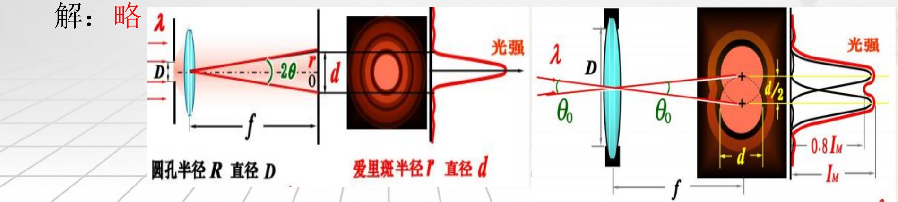
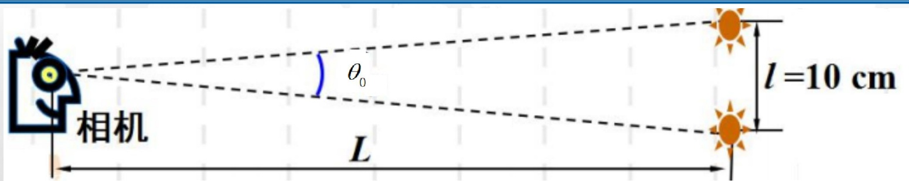

# 38-练习38 光学仪器的分辨率

[返回全书目录](../../README.md)

> PDF 页码：289–295

<!-- page: 289 -->

### 练习38 光学仪器的分辨率

1. 波长为  $ \lambda $ 的单色平行光，经圆孔（直径为 D）衍射后，在屏上形成同心圆形状（或圆环）的明暗条纹，中央亮班叫  $ \underline{\text{爱里斑}} $ 其半角宽  $ \theta=\underline{\text{\frac{1.22\lambda}{D}}} $。根据瑞利判据，圆孔的最小分辨角  $ \delta_{\min}=\underline{\frac{1.22\lambda}{D}} $。

解：略

<!-- page: 290 -->

2. 用一架照相机在离地面  $ L=2\times10^{4}m $ 的高空拍摄地面上的物体。如果要求它能分辨地面上  $ l=0.1m $ 的两点，则照相机镜头的进光孔直径 D 至少为  $ \underline{0.134m} $。（设感光波长为  $ \lambda=5500\ \text{Å} $）

解：半角宽 $ \theta_{0}=\frac{1.22\lambda}{D}=\frac{1}{L} $

 $$ \begin{aligned}\Rightarrow D=1.22\frac{\lambda}{1}L=0.134m\end{aligned} $$

<!-- page: 291 -->

3. 已知天空中两颗星相对于一望远镜的角距离为  $ \Delta\theta = 4.84 \times 10^{-6} rad $，由它们发出的光波波长都为  $ \lambda = 5500 \mathring{A} $，望远镜物镜的进光孔直径 D 至少要为  $ \underline{13.86cm} $，才能分辨出这两颗星。

解：半角宽 $ \Delta\theta=\frac{1.22\lambda}{D} $

 $ \Rightarrow D = 1.22 \frac{\lambda}{\Delta\theta} = 13.86 cm $

<!-- page: 292 -->

4. 在夫琅禾费圆孔衍射中, 设圆孔半径为  $ D/2=0.10mm $, 透镜焦距为  $ f=50cm $, 所用单色光波长为  $ \lambda=5000\mathring{A} $, 求: 在透镜焦平面处屏幕上呈现的爱里斑半径 r。

解：由爱里斑的半角宽度：

 $$ \theta_{0}=1.22\frac{\lambda}{D}=1.22\times\frac{5000\times10^{-10}}{2\times0.10\times10^{-3}}=3.05\times10^{-3}rad $$ 

：爱里斑的半径为：

 $$ r=\frac{d}{2}=f\tan\theta=50\times10^{-2}\times\tan\left(3.05\times10^{-3}rad\right)=1.53\times10^{-3}m $$

<!-- page: 293 -->

5. 在通常亮度下，人眼瞳孔直径约为  $ D=3.0mm $，（1）人眼的最小分辨角  $ \delta_{\min} $ 是多大？（2）远处两根细丝之间的距离为  $ l=2.0mm $，求：人需要站在到两根细丝的距离 L 为多远处恰能分辨？（人眼视觉最敏感的黄绿光波长  $ \lambda=550nm $）

解：（1）根据瑞利判据，人眼瞳孔的最小分辨角为：

 $$ \delta_{\min}=1.22\frac{\lambda}{D}=1.22\times\frac{550\times10^{-9}}{3.0\times10^{-3}}=2.24\times10^{-4}rad $$ 

（2）人需要站在到两根细丝的距离为处恰能分辨，

 $$ \delta_{min}=\frac{1.22\lambda}{D}=\frac{l}{L}\Rightarrow L=\frac{lD}{1.22\lambda} $$ 

将 $ \lambda=550nm, D=3.0mm, l=2.0mm $代入上式可得：

 $$ L=\frac{lD}{1.22\lambda}=\frac{2.0\times10^{-3}\times3.0\times10^{-3}}{1.22\times550\times10^{-9}}=8.94m $$

<!-- page: 294 -->

6. 一直径为  $ d = 2mm $ 的激光束射向月球表面，其波长为  $ \lambda = 632.8nm $，月球和地面的距离为  $ L = 3.84 \times 10^5 km $。试求：（1）在月球上得到的光斑直径 D 有多大？（2）如果这束激光经扩束器扩展成直径  $ d' = 2m $ 的光束，在月球表面得到的光斑直径  $ D' $ 将为多大？

（3）请查阅相关资料回答：在激光测距仪中，通常都采用激光扩束器，这是为什么？

解：（1）设在月球上的爱里斑半径为R，激光束直径为d，地球至月球距离为L。

由瑞利判据得： $ \theta_{R}=1.22\frac{\lambda}{d}=\frac{R}{L}\Rightarrow R=1.22\frac{\lambda L}{d} $

D = 2R = 2 × 1.22  $ \frac{\lambda L}{d} $ = 2 × 1.22 ×  $ \frac{632.8 \times 10^{-9} \times 3.84 \times 10^{5} \times 10^{3}}{2 \times 10^{-3}} $ = 2.96 × 10^{5} m

（2）若将激光束的直径扩为 $ d' $，则月球表面爱里斑的直径为：

 $$ D^{~^{\prime}}=2R^{~^{\prime}}=2\times1.22\frac{\lambda L}{d^{~^{\prime}}}=2\times1.22\times\frac{632.8\times10^{-9}\times3.84\times10^{5}\times10^{3}}{2}=2.96\times10^{2}m $$ 

(3) 使用激光扩束器可减小光束的发散，使光能集中， $ D'=\frac{d}{d'}D=\frac{1}{1000}D $ 方向性更好，从而提高测距精度。

<!-- page: 295 -->

7. （选做）已知入射的 X 射线束含有从  $ 0.95\sim1.30\mathring{A} $ 范围内的各种波长，晶体的晶格常数为  $ d=0.275nm $，当 X 射线以入射角  $ \theta=45^{\circ} $ 入射到晶体上时，问对哪些波长的 X 射线能产生强反射？

解：由布拉格公式： $ 2d\sin\phi = k\lambda $ 可知：当  $ \lambda = \frac{2d\sin\phi}{k} $ 时干涉相长。

当  $ k = 1 $ 时， $ \lambda = 2d\sin\phi = 2 \times 0.275 \times 10^{-9} \times \sin 45^\circ = 3.89 \times 10^{-10} m = 3.89 A^\circ $

当  $ k = 2 $ 时， $ \lambda = \frac{2 \times 2.75 \times \sin 45^\circ}{2} = 1.94 A^\circ $

当  $ k = 3 $ 时， $ \lambda = \frac{3.89 A^\circ}{3} = 1.30 A^\circ $

当  $ k = 4 $ 时， $ \lambda = \frac{3.89 A^\circ}{4} = 0.97 A^\circ $

因为在入射的X射线束中含有从  $ 0.95 A^\circ \sim 1.30 A^\circ $ 范围内的各种波长，

故只有  $ \lambda_3 = 1.30 A^\circ $ 和  $ \lambda_4 = 0.97 A^\circ $ 的射线能产生强反射

