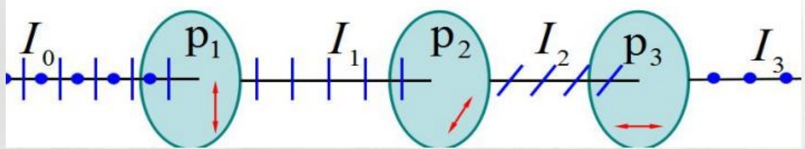
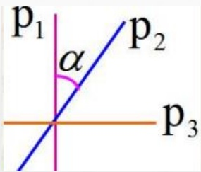
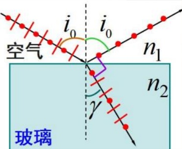
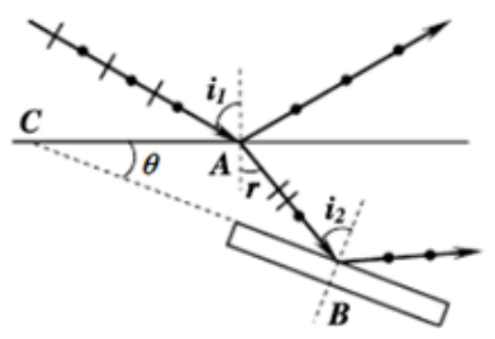

# 39-练习39 光的偏振

[返回全书目录](../../README.md)

> PDF 页码：296–302

<!-- page: 296 -->

### 练习39 光的偏振

1. 一束光由自然光和线偏振光混合而成, 让它垂直通过一偏振片, 若以此入射光束为轴旋转该偏振片, 测得透射光强度的最大值是最小值的5倍, 则入射光束中自然光强 $ I_{0} $与线偏振光的光强 $ I_{1} $之比 $ I_{0}:I=\underline{1:2} $。

解：光强最大值  $ I_{max} = \frac{1}{2} I_{0} + I $

光强最小值  $ I_{max} = \frac{1}{2} I_{0} $

由于  $ I_{max} = 5I_{min} \Rightarrow \frac{1}{2}I_{0} + I = 5 \times \frac{1}{2}I_{0} \Rightarrow \frac{I_{0}}{I} = \frac{1}{2} $

<!-- page: 297 -->

2. 当一束自然光在从一种介质（折射率为  $ n_{1} $）入射到另一种介质（折射率为  $ n_{2} $）分界面处发生反射和折射时，其反射光是完全偏振光，则入射角  $ i_{0} = \underline{\text{arctan\frac{n_{2}}{n_{1}}}} $，反射光光矢量的振动方向  $ \underline{\text{垂直}} $ 于入射面；而折射光为  $ \underline{\text{部分偏振光}} $，折射角  $ \gamma = \underline{\text{\frac{\pi}{2} - \arctan\frac{n_{2}}{n_{1}}}} $

解：由布儒斯特定律  $ \tan i_{0} = \frac{n_{2}}{n_{1}} $

 $ \Rightarrow $ 当反射光是完全线偏光时，入射角为布儒斯特角  $ i_{0} = \arctan \frac{n_{2}}{n_{1}} $

此时，反射光光矢量的振动方向垂直于入射面；而折射光为部分偏振光

即： $ i_{0} + \gamma = \frac{\pi}{2} \Rightarrow $ 折射角  $ \gamma = \frac{\pi}{2} - i_{0} = \frac{\pi}{2} - \arctan \frac{n_{2}}{n_{1}} $

<!-- page: 298 -->

3. 某种透明介质对于空气的全反射临界角等于  $ i_{C} = 45^{\circ} $，光从空气射向此透明介质时的布儒斯特角  $ i_{0} = \underline{54.7^{\circ}} $。

解：全反射临界角 $ i_{c} $满足： $ \sin i_{c} = \frac{1}{n} = \frac{\sqrt{2}}{2} \Rightarrow n = \sqrt{2} $

由布儒斯特定律  $ \tan i_{0} = \frac{n_{2}}{n_{1}} $

 $ \Rightarrow $ 布儒斯特角  $ i_{0} = \arctan \frac{n_{2}}{n_{1}} = \arctan n = \arctan \sqrt{2} = 54.7 $

<!-- page: 299 -->

4. 一束光强为  $ I_{0} $ 的自然光垂直入射在三个叠在一起的偏振片  $ P_{1} $、 $ P_{2} $ 和  $ P_{3} $ 上已知  $ P_{1} $ 与  $ P_{3} $ 的偏振化方相互垂直。求：（1） $ P_{2} $ 与  $ P_{1} $ 的偏振化方向之间夹角  $ \alpha $ 为多大时，穿过第三个偏振片的透射光强为  $ I_{0}/8 $；（2）若以入射光方向为轴转动  $ P_{2} $，若穿过第三个偏振片的透射光强由原来的  $ I_{0}/8 $ 单调减小到  $ I_{0}/16 $ 时， $ P_{2} $ 与  $ P_{1} $ 的偏振化方向之间的夹角  $ \alpha' $ 为多大？ $ P_{2} $ 转过多大角度？

解：（1）自然光通过偏振片 $ P_1 $后成为偏振光，其光强为： $ I_1 = I_0 / 2 $

再透过偏振片 $ P_2 $后，由马吕斯定律得到光强为： $ I_2 = I_1 \cos^2 \alpha = I_0 \cos^2 \alpha / 2 $

<!-- page: 300 -->

再透过 $ P_{3} $的光强为：

 $ I_{3}=I_{2}\cos^{2}(90^{\circ}-\alpha)=\frac{I_{0}}{2}\cos^{2}\alpha\sin^{2}\alpha=\frac{I_{0}}{8}\sin^{2}2\alpha $

当 $ I_{3}=\frac{I_{0}}{8} $时 $ \Rightarrow\sin^{2}2\alpha=1\Rightarrow2\alpha=90^{\circ}\Rightarrow\alpha=45^{\circ} $

（2）转动 $ P_{2} $，若使 $ I_{3}=\frac{1}{16}I_{0} $，即： $ I_{3}=\frac{I_{0}}{8}\sin^{2}2\alpha^{\prime}=\frac{I_{0}}{16} $

 $ \Rightarrow\sin^{2}2\alpha^{\prime}=\frac{1}{2}\Rightarrow\alpha^{\prime}=45^{\circ}/2=22.5^{\circ} $

$\therefore P_{2}$转过的角度：$\Delta\alpha = \alpha - \alpha' = 45^\circ - 22.5^\circ = 22.5^\circ$

<!-- page: 301 -->

5. 自然光从空气照射到平行平板玻璃上，反射光恰为线偏振光，且折射光的折射角为  $ \gamma = 32^{\circ} $，试求：（1）自然光的入射角  $ i_{0} $；（2）玻璃的折射率  $ n_{2} $；（3）在玻璃下表面的起偏角  $ i_{0} $ 等于多少？玻璃下表面的反射光、透射光的偏振状态。

解：（1）由布儒斯特定律可知，当反射光为线偏振光时，反射光与折射光相互垂直，即： $ i_{0} + \gamma = 90^{\circ} $

∴自然光的入射角为： $ i_{0} = 90^{\circ} - \gamma = 90^{\circ} - 32^{\circ} = 58^{\circ} $

（2）根据布儒斯特定律： $ \tan i_{0} = \frac{n_{2}}{n_{1}} = 1 $

 $ \Rightarrow $ 玻璃折射率  $ n_{2} = n_{1} \tan i_{0} = \tan 58^{\circ} = 1.6 $

 $$ \because i_{_{0}}+\gamma=90^{\circ},\tan i_{_{0}}=\frac{n_{_{2}}}{} $$ 

 $ \therefore \tan \gamma = \frac{n_{1}}{n_{2}} \Rightarrow $ 起偏角为  $ i_{0}^{n_{1}} = \gamma = 32^{\circ} $

这种情况下，在玻璃片下表面的入射角就是布鲁斯特角，其反射光也是线偏振光，振动方向垂直于入射面，玻璃片的透射光还是部分偏振光，振动方向平行于入射面的光振动多于垂直入射面的光振动。

<!-- page: 302 -->

6. 如图 39.1 所示，一平面玻璃板 B放在水中，板面与水面 C 的夹角为  $ \theta $，设水和玻璃的折射率分别为  $ n_{2}=1.333 $ 和  $ n_{3}=1.517 $，欲使图中水面和玻璃板面的反射光都是完全偏振光， $ \theta $ 应该等于多少？

解：由布儒斯特定律  $ \tan i_{0} = \frac{n_{2}}{n_{1}} $

当自然光从空气入射到玻璃时，起偏角  $ i_{1} $ 满足  $ \tan i_{1} = \frac{n_{2}}{n_{1}} = n_{2} = 1.333 \Rightarrow i_{1} = 53.12^{\circ} $

当自然光从水入射到玻璃时，起偏角  $ i_{2} $ 满足： $ \tan i_{2} = \frac{n_{3}}{n} = 1.138 \Rightarrow i_{2} = 48.69^{\circ} $

当反射光为线偏振光时，反射光与折射光相互垂直

即： $ i_{1} + \gamma = 90^{\circ} \Rightarrow \gamma = 90^{\circ} - i_{1} $

又 $ \angle A + \angle B + \angle C = 180^{\circ} \Rightarrow (90^{\circ} + \gamma) + (90^{\circ} - i_{2}) + \theta = 180^{\circ} $

 $ \therefore \quad \theta = i_{2} - \gamma $

 $ \Rightarrow \theta = i_{2} - (90^{\circ} - i_{1}) = 48.69^{\circ} - (90^{\circ} - 53.12^{\circ}) = 11.81^{\circ} $

