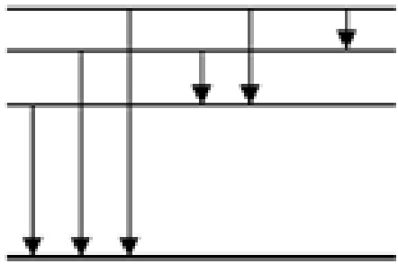
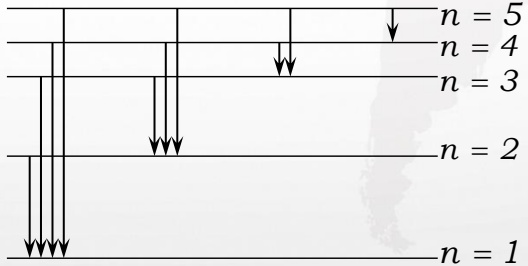
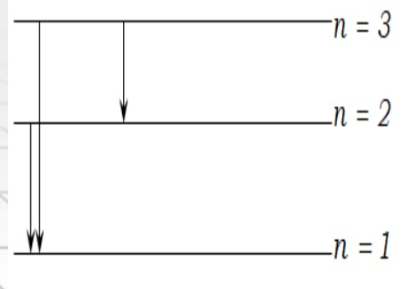
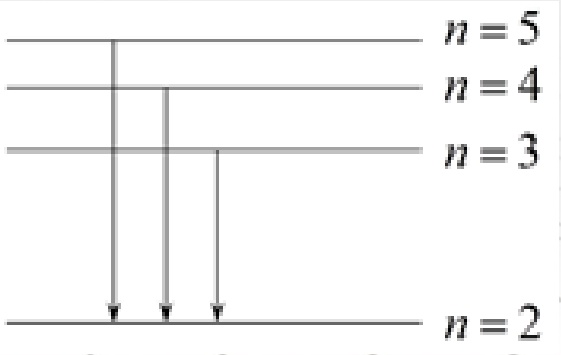

# 45-练习45 玻尔氢原子理论

[返回全书目录](../../README.md)

> PDF 页码：337–342

<!-- page: 337 -->

### 练习45 玻尔氢原子理论

1. 已知基态氢原子的能量为-13.6 eV，当基态氢原子被 12.09 eV 的光子激发后，将处于  $ n = \underline{3} $ 的量子态，其电子的轨道半径将增加到玻尔半径的  $ \underline{9} $ 倍。

解：基态 $ E_{1} = -13.6eV $，

 $$ E_{\mathrm{n}}=-13.6\mathrm{e v}+12.09\mathrm{e v}=-1.51e v=\frac{E_{1}}{3^{2}}e v $$ 

 $$ \therefore n=3 $$ 

 $$ \therefore\ \boldsymbol{r}_{3}=\boldsymbol{n}^{2}\boldsymbol{r}_{1}=9\boldsymbol{r}_{1} $$

<!-- page: 338 -->

2. 已知氢原子从基态激发到某一定态所需能量为 10.19 eV，若氢原子从能量为 -0.85 eV 的状态跃迁到上述定态时，所发射的光子的能量为  $ \underline{2.56ev} $。

解:基态 $ E_{1} = -13.6eV $,

 $$ E_{\mathrm{n}}=-13.6\mathrm{e v}+10.19\mathrm{e v}=-3.41e v $$ 

 $$ \Delta E\;=\;-0.85e v\;-\;(-3.41e v)\;=\;2.56e v $$

<!-- page: 339 -->

3. 氢原子的部分能级跃迁如图 45.1 所示。在这些能级跃迁中，(1) 从  $ n = \underline{4} $的能级跃迁到  $ n = \underline{1} $的能级时所发射的光子的波长最短；(2) 从  $ n = \underline{4} $的能级跃迁到  $ n = \underline{3} $的能级时所发射的光子的频率最小

#### 解：

能量越大，波长越短，所以从4能级跃迁到1能级，波长最短能量越小，频率越小，

所以从4能级跃迁到3能级，频率最小

<!-- page: 340 -->

4. 氢原子光谱的巴耳末线系中，有一光谱线的波长为 434 nm，试求：（1）与这一谱线相应的光子能量为多少电子伏特？（2）该谱线是氢原子由能级  $ E_{n} $ 跃迁到能级  $ E_{k} $ 产生的， n 和 k 各为多少?

解： ①  $ E = h\nu = \frac{hc}{\lambda} = 2.86eV $

② 由于此谱线是巴耳末线系，其 k=2，有：

 $$ E_{k}=\frac{E_{1}}{2^{2}}\qquad\left(E_{1}=-13.6eV\right) $$ 

 $$ E_{n}=\frac{E_{1}}{n^{2}}=E_{k}+h\nu $$ 

 $$ \begin{array}{c} \Rightarrow\left(\frac{1}{n^{2}}-\frac{1}{2^{2}}\right)\times(-13.6eV)=2.86eV\quad\Rightarrow\boldsymbol{n}=5 \end{array} $$

<!-- page: 341 -->

5. 在气体放电管中，用能量为 12.2 eV 的电子去轰击处于基态的氢原子，求此时氢原子所能辐射的谱线波长。

解：基态 $ E_{1} = -13.6eV $，

 $$ E_{\mathrm{n}}=-13.6\mathrm{e v}+12.2e v=-1.4e v\cong\frac{E_{1}}{3^{2}}e v $$ 

所以只能跃迁到n=3的能级上

如图所示，能产生三种谱线，波长如下：

 $$ \frac{1}{\lambda_{1}}=R(\frac{1}{2^{2}}-\frac{1}{1^{2}})\Rightarrow\lambda_{1}=121.5nm $$ 

 $$ \frac{1}{\lambda_{_{2}}}=R(\frac{1}{3^{2}}-\frac{1}{2^{2}})\Rightarrow\lambda_{_{2}}=656.3nm $$ 

 $$ \frac{1}{\lambda_{_{3}}}=R(\frac{1}{3^{2}}-\frac{1}{1^{2}})\Rightarrow\lambda_{_{3}}=102.6nm $$ 

<!-- page: 342 -->

6. 处于第一激发态的氢原子被外来单色光激发后，在发射的光谱中，仅观察到三条如图 45.2 所示的巴耳末系的光谱线。试求：这三条光谱线中波长最长的那条谱线的波长以及外来光的频率。（ $ R=1.097\times10^{7}\ m^{-1} $）

解：在巴尔末系中

 $$ \frac{1}{\lambda_{\max}}=R(\frac{1}{3^{2}}-\frac{1}{2^{2}})\Rightarrow\lambda_{\max}=656.3nm $$ 

从n=2跃迁至n=5

 $$ \frac{1}{\lambda}=R(\frac{1}{5^{2}}-\frac{1}{2^{2}}) $$ 

 $$ \Rightarrow v=\frac{c}{\lambda}=R c\times0.21=6.9\times10^{14}h z $$ 

