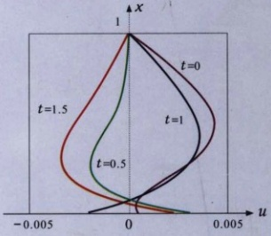

# 00-封面与前言目录

[返回全书目录](../../README.md)

> PDF 页码：1–12

<!-- page: 1 -->

数学物理方法

Mathematical Methods for Physics

〔德〕顾樵（Qiao GU）编著

<!-- page: 2 -->

# 数学物理方法 Mathematical Methods for Physics

www.sciencep.com

<!-- page: 3 -->

## 数学物理方法

# Mathematical Methods for Physics

（德）顾樵（Qiao GU）编著

北京

<!-- page: 4 -->

#### 内容简介

本书根据作者20多年来在德国和中国开设数学物理方法讲座内容及相关的研究成果提炼而成。其主要内容包括傅里叶级数、傅里叶变换、拉普拉斯变换、数学物理方程的建立、分离变量法、本征函数法、施图姆-刘维尔理论、行波法、积分变换法、格林函数法、贝塞尔函数、勒让德多项式、量子力学薛定谔方程等。本书注重自身理论体系的科学性、严谨性、完整性与实用性，将中国传统教材讲授内容与国外先进教材相结合、教学实践与其他相关课程的需要相结合、抽象的数理概念与直观的物理实例相结合、经典的数理方法与新兴交叉学科的生长点相结合、基础的数理知识与科学前沿中的热点问题相结合。本书既可为教学所用，又可适应科研需要，同时，附有大量不同类型的综合性例题，便于不同层次读者学习掌握分析问题与解决问题的思路和方法。

本书可作为物理学、应用数学及相关理工科专业本科生与研究生的教材，也可供高等院校教师和科研院所技术人员在理论研究与实际工程中使用，或供有高等数学及普通物理学基础的自学者自修，还可供在国外研读相关专业的研究生及访问学者参考。

#### 图书在版编目（CIP）数据

数学物理方法=Mathematical Methods for Physics/（德）顾樵编著. —北京：科学出版社，2012

ISBN 978-7-03-033064-2

I. ①数… II. ①顾… III. ①数学物理方法-高等学校-教材 IV. ①O411.1 中国版本图书馆 CIP 数据核字(2011) 第 265894 号

责任编辑：刘凤娟/责任校对：包志虹

责任印制：钱玉芬/封面设计：耕者

#### 科学出版社出版

北京东黄城根北街16号

邮政编码：100717

http://www.sciencep.com

北京彩虹伟业印刷有限公司印刷

科学出版社发行 各地新华书店经销

2012年1月第一版开本：B5(720×1000)

2012年1月第一次印刷 印张：34 3/4 插页：1

字数：667000

定价：69.00元

（如有印装质量问题，我社负责调换）

<!-- page: 5 -->

### 前言

追溯历史，数学的发展有两条清晰的轨迹：一是纯理论性发展；二是与物理等实体科学和工程问题相结合。数学物理方法明显属于后者，作为一门高等数理工具，日益突显其广泛的实用性。它不仅可以直接用于物理学，而且涉及几乎所有理工类学科，甚至包含生命科学和经济学。

自20多年前到德国之后，我一直从事生物光子学的研究、开发与应用。由于自身理论物理的学术背景以及研究所的工作需要，也经常开设一些学术讲座，主讲数学物理方法和量子力学。作为一名以中国模式培养出来的教授，我感到所使用的外文教材系统性与缜密性不足。因此，我总是按照自己认定的逻辑授课，讲述的内容与学生手中的教材大相径庭。

近年，我常回中国讲学。除介绍国外科学前沿与高新技术外，也讲授数学物理方法和量子力学等基础课程，所用的通常是中文教材，面对母语颇感亲切。但对于一个熟谙西方治学方法的学者，又感到中文教材的灵活性与实用性欠缺。所以，讲课内容依然与学生手中的课本不相配合，而且不提供课件。有学生给我发邮件诉求：“说句真心话，听顾老师的课是一种享受，您讲课太棒了！不知您能否把课件上传，这样我们复习就可以节约一些时间。”问题还是没有称心如意的教材。许多学生以及听课教师问我为什么不出版自己的教材。我的想法是，有写教材的时间，不如去钻研重要的生物光子学课题。

但是，这样的想法随着听课人数的增加，渐渐发生了改变，授课内容与课本不相配合产生的负面影响越来越明显。于是，潜移默化地萌生了写书的念头。就在这时，我发现不少学生已经设法将我的课件复制下来并发到网上，这说明学生们对课件的喜爱，但殊不知其中很多原创内容迄今尚未发表。这个情况使写书的念头突然间转化成一种冲动。其实，平心而论，作为一名定居海外多年的学者，在讲学和研究之余，能为祖国留下几本教科书，以飨众多中国读者，也是一件很有意义的事情。

成书后的《数学物理方法》涉及内容较多，教学中可根据需要和课时加以取舍。书中所述知识绝非一个学期就可以完全掌握，需要长期反复思考与练习，所以本书对硕士生和博士生同样有用。另外，本人基于自己的经历深深感到，即使是从事教学、科研或工程多年的学者与技术人员，也常常需要查阅相关的基础性知识。所以，既为教学所用、又适应科研需要，是本书的宗旨。书中列出大量例题，读者可从中学习解决实际问题的思路与方法，但没有像普通教科书那样附上练习题。在

<!-- page: 6 -->

本科阶段，授课老师寻找一些练习题布置给学生，并非一件难事。本书数学推导及物理论述详尽、浅显、简明，可以作为各类人员的自学教材及参考书。

在多年的学术讲座中，有不少学生提出许多有意义的问题，使本书内容日臻丰富，在此向他们致谢。另外，与 F. A. Popp 教授的有益讨论以及在德国国际生物物理研究所多年的学术合作使我受益良多。自 1977 年进入大学以来，在 30 多年的科学生涯中我一直受到妻子张爱华的全力支持和悉心关照，谨此表示由衷的感谢。

本书不妥之处，恳请读者批评指正。

#### 顾樵

Prof. Dr. Qiao GU(Chief Scientist)

gu-qiao@gmx.de

International Institute of Quantum Biology

Haßloch, Germany

20 August 2011

<!-- page: 7 -->

## 目录

前言    
    
第1章 基础理论知识 ..... 1    
1.1 常微分方程模型与求解 ..... 1    
1.2 矢量微分算子与拉普拉斯算子 ..... 10    
1.2.1 矢量微分算子  $ \nabla $ ..... 10    
1.2.2 拉普拉斯算子  $ \nabla^{2} $ ..... 15    
第2章 傅里叶级数 ..... 20    
2.1 周期函数的傅里叶级数 ..... 20    
2.2 半幅傅里叶级数 ..... 26    
2.3 傅里叶积分 ..... 29    
第3章 傅里叶变换 ..... 35    
3.1 傅里叶变换简介 ..... 35    
3.1.1 傅里叶变换的定义 ..... 35    
3.1.2 傅里叶变换的性质 ..... 38    
3.2  $ \delta $ 函数 ..... 42    
3.2.1  $ \delta $ 函数的定义和含义 ..... 42    
3.2.2  $ \delta $ 函数的性质 ..... 43    
3.2.3  $ \delta $ 函数的辅助函数 ..... 47    
3.2.4 狄利克雷定理的证明 ..... 52    
3.3 典型函数的傅里叶变换 ..... 54    
3.4 傅里叶变换应用举例 ..... 70    
第4章 拉普拉斯变换 ..... 78    
4.1 拉普拉斯变换简介 ..... 78    
4.1.1 拉普拉斯变换的定义 ..... 78    
4.1.2 拉普拉斯变换的性质 ..... 80    
4.2 典型函数的拉普拉斯变换 ..... 84    
4.3 拉普拉斯变换应用举例 ..... 89    
第5章 基本数学物理方程的建立 ..... 98    
5.1 波动方程 ..... 98    
5.1.1 弦振动问题 ..... 98

<!-- page: 8 -->

5.1.2 强迫振动与阻尼振动 ..... 100    
5.1.3 高频传输线问题 ..... 102    
5.2 热传导方程 ..... 104    
5.3 拉普拉斯方程 ..... 107    
5.4 二阶偏微分方程 ..... 110    
5.4.1 分类与标准形式 ..... 110    
5.4.2 常系数方程 ..... 116    
5.5 定解问题 ..... 120    
5.5.1 一个例子 ..... 120    
5.5.2 泛定方程与叠加原理 ..... 120    
5.5.3 初始条件与边界条件 ..... 123    
5.5.4 几个典型的定解问题 ..... 125    
第6章 分离变量法 ..... 132    
6.1 弦振动问题 ..... 132    
6.1.1 弦振动问题的求解 ..... 132    
6.1.2 解的物理意义及驻波条件 ..... 137    
6.2 基本定解问题 ..... 140    
6.3 二维泛定方程的定解问题 ..... 155    
6.3.1 二维波动方程 ..... 155    
6.3.2 二维热传导方程 ..... 160    
6.4 第三类边界条件下的定解问题 ..... 162    
6.4.1 本征函数的正交性 ..... 162    
6.4.2 热辐射定解问题 ..... 163    
第7章 分离变量法的应用 ..... 175    
7.1 热吸收定解问题 ..... 175    
7.1.1 吸收-耗散系统 ..... 175    
7.1.2 吸收-绝热系统 ..... 184    
7.2 综合热传导定解问题 ..... 190    
7.2.1 对称边界条件 ..... 190    
7.2.2 反对称边界条件 ..... 198    
7.3 拉普拉斯方程的求解 ..... 208    
7.3.1 直角坐标系的拉普拉斯方程 ..... 208    
7.3.2 极坐标系的拉普拉斯方程 ..... 216    
第8章 本征函数法 ..... 224    
8.1 本征函数法的引入 ..... 224

<!-- page: 9 -->

8.2 非齐次方程的解法 ..... 227    
8.2.1 一分为二法 ..... 227    
8.2.2 合二为一法 ..... 230    
8.3 有源热传导定解问题 ..... 236    
8.3.1 绝热系统 ..... 236    
8.3.2 绝热-耗散系统 ..... 240    
8.3.3 绝热-辐射系统 ..... 242    
8.3.4 吸收-耗散系统 ..... 244    
8.4 泊松方程的定解问题 ..... 247    
8.5 非齐次边界条件的处理 ..... 252    
8.6 综合定解问题的求解 ..... 256    
第9章 施图姆-刘维尔理论及应用 ..... 266    
9.1 施图姆-刘维尔本征值问题 ..... 266    
9.2 施图姆-刘维尔理论的应用：吊摆问题 ..... 271    
9.3 厄米算符本征函数的正交性 ..... 275    
第10章 行波法 ..... 278    
10.1 一维波动方程的通解 ..... 278    
10.2 一维波动方程的达朗贝尔公式 ..... 281    
10.2.1 达朗贝尔公式的推导 ..... 281    
10.2.2 达朗贝尔公式的讨论 ..... 284    
10.3 双曲型方程的定解问题 ..... 286    
10.4 一阶线性偏微分方程的特征线法 ..... 289    
10.5 非齐次波动方程：齐次化原理 ..... 291    
10.6 三维波动方程 ..... 296    
10.6.1 三维波动方程的球对称解 ..... 297    
10.6.2 三维波动方程的泊松公式 ..... 297    
10.6.3 泊松公式的物理意义 ..... 300    
10.7 旁轴波动方程：格林算子法 ..... 303    
10.7.1 旁轴波动方程的解 ..... 303    
10.7.2 光学元件与光学系统的格林算子 ..... 306    
10.7.3 格林算子法的应用 ..... 307    
10.8 非线性波动方程：光学孤立子 ..... 309    
第11章 积分变换法 ..... 311    
11.1 傅里叶变换法 ..... 311    
11.1.1 热传导问题与高斯核 ..... 312

<!-- page: 10 -->

11.1.2 傅里叶变换法的应用 ..... 315    
11.2 拉普拉斯变换法 ..... 324    
11.3 联合变换法 ..... 334    
11.3.1 对流热传导问题 ..... 334    
11.3.2 线性衰变的影响 ..... 336    
11.3.3 有源热传导问题 ..... 338    
11.3.4 非齐次波动方程问题 ..... 342    
11.3.5 无边界电报方程问题 ..... 345    
11.4 半导体载流子的输运方程 ..... 346    
第 12 章 格林函数法 ..... 349    
12.1 无界域的格林函数 ..... 349    
12.2 三维波动方程问题 ..... 353    
12.3 一维有界热传导问题 ..... 358    
12.4 格林公式 ..... 362    
12.4.1 格林定理 ..... 362    
12.4.2 散度定理 ..... 364    
12.4.3 格林公式 ..... 366    
12.5 拉普拉斯方程和泊松方程 ..... 367    
12.5.1 拉普拉斯方程的基本解 ..... 367    
12.5.2 泊松方程的基本积分公式 ..... 368    
12.5.3 泊松方程的边值问题 ..... 370    
12.6 格林函数法的应用：电像法 ..... 376    
12.7 第二、第三类边值问题的格林函数 ..... 387    
12.7.1 第二类边值问题的格林函数 ..... 387    
12.7.2 第三类边值问题的格林函数 ..... 389    
12.8 非线性问题的格林函数解法 ..... 392    
第 13 章 贝塞尔函数 ..... 395    
13.1 几个微分方程的引入 ..... 395    
13.2 伽马函数的基本知识 ..... 398    
13.3 贝塞尔方程的求解 ..... 401    
13.3.1 贝塞尔方程的广义幂级数解 ..... 401    
13.3.2 第一类贝塞尔函数 ..... 402    
13.3.3 贝塞尔方程的通解 ..... 404    
13.4 贝塞尔函数的基本性质 ..... 408    
13.4.1 生成函数 ..... 408

<!-- page: 11 -->

13.4.2 递推公式 ..... 409    
13.4.3 积分表示 ..... 415    
13.4.4 渐近公式 ..... 419    
13.5 贝塞尔函数的正交完备性 ..... 420    
13.5.1 正交函数集的构造 ..... 420    
13.5.2 参数形式的贝塞尔函数 ..... 422    
13.5.3 贝塞尔函数的正交性 ..... 424    
13.5.4 贝塞尔函数的完备性 ..... 427    
13.6 贝塞尔函数应用举例 ..... 431    
13.7 球贝塞尔函数 ..... 437    
第14章 勒让德多项式 ..... 440    
14.1 勒让德方程的引入 ..... 440    
14.2 勒让德多项式 ..... 441    
14.3 勒让德多项式的基本性质 ..... 449    
14.3.1 微分表示 ..... 449    
14.3.2 积分表示 ..... 450    
14.3.3 生成函数 ..... 451    
14.3.4 递推公式 ..... 455    
14.3.5 例题 ..... 459    
14.4 勒让德多项式的正交完备性 ..... 466    
14.4.1 正交性 ..... 466    
14.4.2 模值 ..... 467    
14.4.3 完备性 ..... 469    
14.4.4 例题 ..... 470    
14.5 勒让德多项式应用举例 ..... 480    
第15章 量子力学薛定谔方程 ..... 485    
15.1 薛定谔方程的一般解 ..... 485    
15.2 角向解：球谐函数 ..... 488    
15.2.1 中心力场 ..... 488    
15.2.2 连带勒让德函数 ..... 490    
15.2.3 连带勒让德函数的性质 ..... 492    
15.2.4 球谐函数 ..... 495    
15.2.5 球谐函数的性质 ..... 497    
15.3 径向解：广义拉盖尔多项式 ..... 499    
15.3.1 库仑场中的束缚态 ..... 499

<!-- page: 12 -->

15.3.2 广义拉盖尔多项式 …… 504    
15.3.3 径向概率密度 …… 507    
15.4 量子谐振子与厄米多项式 …… 514    
15.4.1 量子谐振子 …… 514    
15.4.2 厄米多项式 …… 523    
15.4.3 系统的含时解 …… 528    
15.4.4 概率密度 …… 529    
索引

