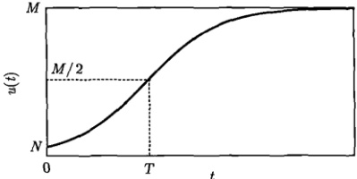
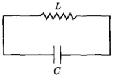
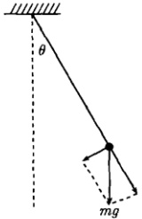
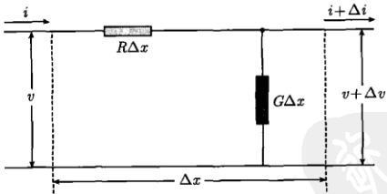
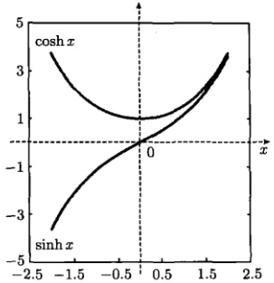
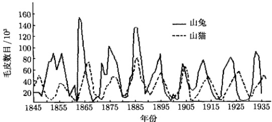
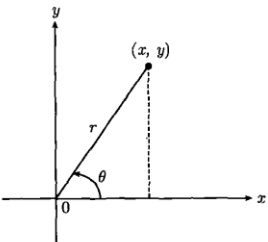
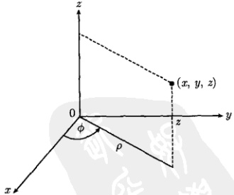
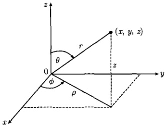

# 01-第1章 基础理论知识

[返回全书目录](../../README.md)

> PDF 页码：13–31

<!-- page: 13 -->

### 第1章 基础理论知识

### 1.1 常微分方程模型与求解

常微分方程理论在实际问题上的应用是建立模型并求解。本节将通过不同领域的若干实例，论述常微分方程模型的建立和求解过程。这对于随后建立偏微分方程模型、求解数学物理方法的定解问题，具有直接的参考价值。我们首先讨论一个社会学问题。

#### 例 1 马尔萨斯人口模型

英国著名人口统计学家马尔萨斯（Malthus，1766~1834）在担任牧师期间，利用教堂所拥有的资料，研究了英国100多年的人口变化，并由此建立了一个描述人口增长的模型，即后来闻名于世的“马尔萨斯人口模型”。

解 马尔萨斯人口模型可以归结为常微分方程

$$  \frac{1}{u}\frac{\mathrm{d}u}{\mathrm{d}t}=\alpha\Rightarrow\frac{\mathrm{d}u}{\mathrm{d}t}=\alpha u   \tag*{(1.1.1)}$$

其中，t 是时间，u 是依赖于时间的人口数目， $ \alpha(\alpha>0) $ 为相对增长率常数。式(1.1.1) 中的 du/dt 是绝对增长率，被 u 除后则表示相对增长率。设初始时刻  $ (t=0) $ 的人口数目为 n，由方程 (1.1.1) 容易解出

$$  u(t)=n\exp(\alpha t)   \tag*{(1.1.2)}$$

式(1.1.2) 显示了一个指数增长规律。

这个模型对于人口增长的相对短期预测是正确的。不过研究者发现，如果按照该模型预测世界人口，到2510年世界人口将多达2万亿。这意味着，即使将全世界所有陆地和所有海洋面积都计算在内，人均面积也只有0.86m $ ^{2} $。显然这样一种状况是不可能出现的。这意味着马尔萨斯模型对于人口增长的长期预测是不正确的。

马尔萨斯模型的缺陷在于没有考虑人口增长的非线性机制。事实上，人口总数不太大时，其增长可以用式(1.1.1)所示的线性动力学[即指数增长规律(1.1.2)]描述。但是随着人口总数的增加，地球上生存环境及生态资源对人口增长的限制变得越来越显著，这个重要的因素将使人口的增长趋于缓慢。马尔萨斯模型的问题在于没有考虑环境对人口增长的制约。

<!-- page: 14 -->

描述人口增长的更精确的模型是非线性的，它与下面的传染病问题有关。

#### 例 2 传染病问题 (Logistic 模型)

一个区域有 M 只老鼠，其中 N 只患上了传染病。它们可以通过接触将病传染给健康的老鼠。问任意时刻患上传染病的老鼠有多少？

解 设任意 t 时刻病鼠和健康老鼠的数目分别为 u 和 v，则

$$  u+v=M   \tag*{(1.1.3)}$$

病鼠数目的变化率正比于乘积 uv，即

$$  \frac{\mathrm{d}u}{\mathrm{d}t}=\beta u v   \tag*{(1.1.4)}$$

这里非线性项 uv 刻画老鼠的接触性传染，比例系数  $ \beta > 0 $。利用式 (1.1.3)，可以将方程 (1.1.4) 修改为

$$  \frac{\mathrm{d}u}{\mathrm{d}t}=\alpha u-\beta u^{2}   \tag*{(1.1.5)}$$

其中， $ \alpha=\beta M $。现在求解方程(1.1.5)，首先将它写成

$$  \frac{M\mathrm{d}u}{u(u-M)}=-\alpha\mathrm{d}t   \tag*{(1.1.6)}$$

的形式，然后两边取定积分

$$  M\int_{N}^{u(t)}\frac{\mathrm{d}u}{u(u-M)}=-\alpha\int_{0}^{t}\mathrm{d}t   \tag*{(1.1.7)}$$

利用积分公式

$$  \int\frac{\mathrm{d}u}{(u+a)(u+b)}=\frac{1}{b-a}\ln\frac{a+u}{b+u}\quad(a\neq b)   \tag*{(1.1.8)}$$

式(1.1.7)给出

$$  u(t)=\frac{M}{1+\left(\frac{M}{N}-1\right)\exp(-\alpha t)}   \tag*{（1.1.9）}$$

式(1.1.9)作为非线性方程(1.1.5)的解给出任意时刻病鼠的数目。我们看出，它正是众所周知的生物学中的“生长曲线”，如图1.1所示。

<!-- page: 15 -->

图1.1 式(1.1.9)所示的生长曲线（亦称“S曲线”）。初始值为 $ u(0)=N $，饱和值为 $ u(\infty)=M $，曲线拐点出现在时刻 $ T=\frac{1}{\alpha}\ln[(M/N)-1] $，函数在拐点的取值达到饱和值的一半，即 $ u(T)=M/2 $。生长曲线能够描述许多生物学过程，如人体重量、身高随年龄的增加，各种微生物的繁殖，生物群体中个体数目的增加，人体光子辐射信号随年龄的变化等

式(1.1.5)所示的非线性动力学包含了个体数目增长的非线性机制，能够相当好地描述人口增长，在人口学中称为Logistic模型。其中，非线性项 $ -\beta u^{2} $所包含的机制是：人口的相对增长率不再是一个简单的常数，而是一个随u增大而线性衰减的函数，即

$$  \alpha\longrightarrow\alpha\left(1-\frac{u}{M}\right)   \tag*{(1.1.10)}$$

这样方程(1.1.1)修正为

$$  \frac{\mathrm{d}u}{\mathrm{d}t}=\alpha\left(1-\frac{u}{M}\right)u=\alpha u-\beta u^{2}   \tag*{(1.1.11)}$$

由式(1.1.11)可以看出，在人口增长的线性阶段，个体数量u远小于饱和值M，这时比值 $ u/M \ll 1 $，相对增长率 $ \alpha(1-u/M) \approx \alpha $，Logistic模型约化为马尔萨斯模型。随着u的增大，u/M变得不能忽略，于是相对增长率下降，人口增长率趋于缓慢。Logistic模型被验证与许多国家及世界人口增长的统计数据相吻合。

由上述两个例子，可以大体看出建立常微分方程模型解决实际问题的基本步骤是：①分析考查量的变化规律，建立相应的微分方程；②写出考查量所满足的相关条件（如上述两个实例中的初始条件）；③根据微分方程和相关条件，求出考查量的解；④分析考查量的变化特征；⑤讨论解的适用条件（比如，马尔萨斯模型只能用于个体增长的线性阶段）。随后我们将对于数学物理方法的实际问题，建立偏微分方程模型，而解决问题的步骤也基本如此。下面我们继续讨论常微分方程的模型与求解。

#### 例 3 L-C 电路

讨论图 1.2 的 L-C 电路中电容器所带电荷与回路中电流的变化规律，已知初始时刻  $ (t=0) $ 的电荷与电流分别为  $ Q(0)=Q_{0}, I(0)=0 $。

<!-- page: 16 -->

图 1.2 一个 L-C 电路
 

解 设电路中任意时刻的电流为 I，它经过电感 L 和电容 C 所产生的电压降分别为  $ L\frac{dI}{dt} $ 和  $ \frac{Q}{C} $，其中 Q 为任意时刻电容器的电荷。由基尔霍夫定律得到

$$  L\frac{\mathrm{d}I}{\mathrm{d}t}+\frac{Q}{C}=0   \tag*{(1.1.12)}$$

因为  $ I = \frac{dQ}{dt} $，方程 (1.1.12) 可以写为

$$  \frac{\mathrm{d}^{2}Q}{\mathrm{d}t^{2}}+\frac{Q}{L C}=0   \tag*{(1.1.13)}$$

这个方程的通解是

$$  Q(t)=A\cos\frac{t}{\sqrt{LC}}+B\sin\frac{t}{\sqrt{LC}}   \tag*{(1.1.14)}$$

其中，A 和 B 均是待定的常数。电荷的初始条件为

$$  Q(0)=Q_{0},\quad\dot{Q}(0)=I(0)=0   \tag*{(1.1.15)}$$

利用后者得到 B=0，再利用前者得到 A=Q_{0}。这样式(1.1.14)给出特解

$$  Q(t)=Q_{0}\cos\frac{t}{\sqrt{LC}}   \tag*{(1.1.16)}$$

而任意时刻的电流为

$$  I(t)=\frac{\mathrm{d}Q}{\mathrm{d}t}=-\frac{Q_{0}}{\sqrt{LC}}\sin\frac{t}{\sqrt{LC}}   \tag*{(1.1.17)}$$

很明显，电荷与电流均以  $ 1/\sqrt{LC} $ 为圆频率做周期振荡，故图 1.2 所示的电路又称为 L-C 振荡回路。

最后我们考查电流的方程，事实上，方程(1.1.12)对t求导数立即得到

$$  \frac{\mathrm{d}^{2}I}{\mathrm{d}t^{2}}+\frac{I}{L C}=0   \tag*{（1.1.18）}$$

可见它与电荷方程(1.1.13)有完全相同的形式。这类常微分方程还可以描述许多其他的实际问题，如下面的单摆问题。

<!-- page: 17 -->

#### 例4 单摆问题

长度为 l 的柔软轻线，一端固定，一端系质量为 m 的质点（称为摆球），于铅直平面内在平衡位置两侧摆动，如图 1.3 所示。问摆角  $ \theta $ 的变化服从什么规律？

图 1.3 单摆：取摆球反时针运动的方向为摆角  $ \theta $ 的正向
 

解 设任意时刻摆球偏离铅垂线的角度为  $ \theta $，摆球受到的合力为重力 mg 在切向的分量  $ mg\sin\theta $，其切向速度为  $ v = l\frac{d\theta}{dt} $。由牛顿第二定律得到

$$  m\frac{\mathrm{d}v}{\mathrm{d}t}=-mg\sin\theta   \tag*{(1.1.19)}$$

式(1.1.19)中有负号是由于摆球加速度  $ m\frac{dv}{dt} $ 的方向与  $ \theta $ 方向相反，故

$$  \frac{\mathrm{d}^{2}\theta}{\mathrm{d}^{2}t}+\frac{g}{l}\sin\theta=0   \tag*{(1.1.20)}$$

这就是单摆的运动方程，作为一个非线性方程它能够描述单摆在任意摆角时的运动。如果摆动的角度很小，以致  $ \sin\theta\approx\theta $ ，则方程(1.1.20)化为线性方程

$$  \frac{\mathrm{d}^{2}\theta}{\mathrm{d}^{2}t}+\frac{g}{l}\theta=0   \tag*{(1.1.21)}$$

我们看到微振动单摆的角频率为  $ \sqrt{g/l} $，它与 L-C 电路具有相同的数学模型

$$  \frac{\mathrm{d}^{2}y}{\mathrm{d}^{2}x}+k^{2}y=0   \tag*{(1.1.22)}$$

其中，k > 0。不同问题可以具有相同的数学模型这一事实，反映了不同现象之间的内在相通性。正是这样的相通性，提供了用模拟方法研究复杂问题的理论依据。例如，利用简单的电路模拟力学系统、物理系统，生物系统中的动力学过程。

方程 (1.1.22) 是一个极为有用的常微分方程，让我们对它进行一般性的讨论。它的通解是

$$  y(x)=A\cos kx+B\sin kx   \tag*{(1.1.23)}$$

<!-- page: 18 -->

还可以等价地写为

$$  y(x)=E\sin\left(kx+\delta\right) 或 y(x)=E\cos\left(kx+\delta\right)   \tag*{(1.1.24)}$$

其中，E 和  $ \delta $ 分别是振幅与位相，式(1.1.23)和式(1.1.24)在物理上通常称为“驻波”解。而借助欧拉公式

$$  \mathrm{e}^{\mathrm{i}z}=\cos z+\mathrm{i}\sin z,\quad\mathrm{e}^{-\mathrm{i}z}=\cos z-\mathrm{i}\sin z   \tag*{(1.1.25)}$$

方程（1.1.22）的通解还可以写成“行波”的形式

$$  y(x)=C\exp(\mathrm{i}kx)+D\exp\left(-\mathrm{i}kx\right)   \tag*{(1.1.26)}$$

方程 (1.1.22) 的通解取驻波还是行波，视具体问题的相关条件而定。总的原则是利用相关条件尽可能使式 (1.1.23) 或式 (1.1.26) 中的一项为零。例如，对于条件 (1.1.15)，方程 (1.1.13) 应该取驻波解 (1.1.14)，得到单项解 (1.1.16)。另外，如果能够确定实际的系统只有一个方向的行波，则取行波解 (1.1.26)。例如，只有正向行波时，便只有单项解  $ y(x) = C \exp(ikx) $，这种情况在量子力学中尤为常见。

#### 例 5 R-G 传输线

当电流通过传输线时，由于电路中存在电阻和电漏，传输线上的电压与电流都是随空间 x 变化的。讨论传输线上电压与电流的变化规律。

解 研究传输线上电压与电流的变化规律的方法是从传输线划出一个微元  $ \Delta x $，它的等效电路如图1.4所示，其中R和G分别是单位长度的电阻与电漏。由于微元足够小，每个原件的尺度均视为 $ \Delta x $。根据基尔霍夫定律，在长度为 $ \Delta x $的传输线中，电压降为

图 1.4 传输线的微元  $ \Delta x $ 的等效电路
 

$$  v-(v+\Delta v)=R\Delta x\cdot i   \tag*{(1.1.27a)}$$

在节点，流入的电流等于流出的电流，即

$$  i=(i+\Delta i)+G\Delta x\cdot(v+\Delta v)   \tag*{(1.1.27b)}$$

<!-- page: 19 -->

略去方程 (1.1.27b) 右边的二阶小量  $ \Delta x \Delta v $，并将式 (1.1.27) 中的变化量用微商近似代替，得到

$$  \frac{\partial i}{\partial x}+G v=0   \tag*{(1.1.28a)}$$

$$  \frac{\partial v}{\partial x}+Ri=0   \tag*{(1.1.28b)}$$

这是电压与电流的耦合方程，下面我们推出各自独立的方程。对式(1.1.28a)两边关于x求导数，得到

$$  \frac{\partial^{2}i}{\partial x^{2}}+G\frac{\partial v}{\partial x}=0   \tag*{(1.1.29)}$$

由式(1.1.28b)解出 $ \partial v/\partial x $，再代入式(1.1.29)，得到

$$  \frac{\partial^{2}i}{\partial x^{2}}-R G i=0   \tag*{(1.1.30a)}$$

这是电流的方程。同理可得电压的方程

$$  \frac{\partial^{2}v}{\partial x^{2}}-R G v=0   \tag*{(1.1.30b)}$$

可见电压与电流有相同的变化规律。方程(1.1.30a)和方程(1.1.30b)具有相同的形式

$$  \frac{\mathrm{d}^{2}y}{\mathrm{d}^{2}x}-k^{2}y=0   \tag*{(1.1.31)}$$

其中，k>0。方程(1.1.31)也是一个常见的方程，它的通解常表示为指数形式

$$  y(x)=C\mathrm{e}^{kx}+D\mathrm{e}^{-kx}   \tag*{(1.1.32)}$$

其中，C 和 D 是待定的常数。利用公式

$$  \cosh x=\frac{\mathrm{e}^{x}+\mathrm{e}^{-x}}{2},\quad\sinh x=\frac{\mathrm{e}^{x}-\mathrm{e}^{-x}}{2}   \tag*{(1.1.33)}$$

式（1.1.32）也可以表示为双曲函数形式（图1.5）

$$  y(x)=A\cosh kx+B\sinh kx   \tag*{(1.1.34)}$$

解 (1.1.34) 在数学物理方法中是很有用的。方程 (1.1.31) 的通解选式 (1.1.32) 还是式 (1.1.34)，也视具体问题的相关条件而定，选取原则也是尽量使其中一项为零。

<!-- page: 20 -->

图 1.5 双曲函数是一种特别有用的特殊函数，这里  $ \cosh^{2}x - \sinh^{2}x = 1 $
 

下面我们介绍一个关于生态学的常微分方程组的模型，并用特殊的方法进行求解。

#### 例 6 捕食者-被捕食者模型 (predator-prey model)

设想一群食草类动物（如山兔）和一群食肉类动物（如山猫）居住在一个区域。这两群动物的数目变化具有怎样的动力学特性？定性地说，山猫吃了山兔，繁殖力增强，山猫的数目会增加。这样一来，山兔的数目便随之减少。接下来，山猫由于食物短缺而数目下降，导致山兔遇到山猫的机会减少，即被吃掉的概率下降，结果山兔的数目又逐渐增多。这样山猫得到食物的机会随之增加，其数目又一次上升，而山兔数目又一次减少，如此不断循环。其结果是两种动物的个体数目必然出现周期性的变化，而且彼此有一定的位相差。事实上，两种动物数目的变化可以进行定量的研究。

解 设任意 t 时刻山兔与山猫的数目分别为 x 和 y，二者的变化服从下面的动力学方程

$$  \frac{\mathrm{d}x}{\mathrm{d}t}=k_{1}x-\mu x y   \tag*{(1.1.35a)}$$

$$  \frac{\mathrm{d}y}{\mathrm{d}t}=\nu x y-k_{2}y   \tag*{(1.1.35b)}$$

其中， $ k_{1} $， $ k_{2} $， $ \mu $ 和  $ \nu $ 都是正常数。在方程 (1.1.35a) 中， $ k_{1}x $ 项表示山兔数目的自然增长率，与山兔的数目成正比。 $ -\mu xy $ 项表示山兔被山猫吃掉而导致的减少率，与乘积 xy 成正比，也就是说与两种动物相遇的概率成正比。对山猫而言，其繁殖率取决于捕食量，因此也与两种动物相遇的概率成正比，即  $ \nu xy $ 项表示山猫数目的增长率。 $ k_{2}y $ 项是山猫的自然死亡率，与其数目成正比。至于山兔的自然死亡率，由于与 x 成正比，可以被认为包含在  $ k_{1}x $ 项之中。因此准确地说， $ k_{1}x $ 项表示山兔数目的净增长率。

<!-- page: 21 -->

方程组(1.1.35)是非线性的，因为右边含有非线性乘积xy。现在采用线性化的特殊方法求解，也就是研究个体数目x和y在其稳态值附近的微小涨落。设方程组(1.1.35)的稳态解为 $ x=x_{0} $， $ y=y_{0} $，它们由

$$  \frac{\mathrm{d}x}{\mathrm{d}t}\bigg|_{x=x_{0},y=y_{0}}=0,\quad\frac{\mathrm{d}y}{\mathrm{d}t}\bigg|_{x=x_{0},y=y_{0}}=0   \tag*{(1.1.36)}$$

决定，即

$$  k_{1}x_{0}-\mu x_{0}y_{0}=0   \tag*{(1.1.37a)}$$

$$  \nu x_{0}y_{0}-k_{2}y_{0}=0   \tag*{(1.1.37b)}$$

代数方程组（1.1.37）的解为

$$  x_{0}=\frac{k_{2}}{\nu}   \tag*{(1.1.38a)}$$

$$  y_{0}=\frac{k_{1}}{\mu}   \tag*{(1.1.38b)}$$

现在，我们将方程组（1.1.35）的解写为

$$  x=x_{0}+\xi   \tag*{(1.1.39a)}$$

$$  y=y_{0}+\eta   \tag*{(1.1.39b)}$$

其中， $ \xi $ 和  $ \eta $ 与  $ x_{0} $ 和  $ y_{0} $ 相比都是小量。将式 (1.1.39) 代入式 (1.1.35)，得到关于变量  $ \xi $ 和  $ \eta $ 的方程组

 $$ \frac{\mathrm{d}\xi}{\mathrm{d}t}=k_{1}\xi-\mu x_{0}\eta-\mu y_{0}\xi-\mu\xi\eta $$ 

$$  \frac{\mathrm{d}\eta}{\mathrm{d}t}=\nu x_{0}\eta+\nu y_{0}\xi-k_{2}\eta+\nu\xi\eta   \tag*{(1.1.40b)}$$

其中， $ \mu\xi\eta $ 和  $ \nu\xi\eta $ 两项可被忽略，因为它们都是二阶小量。再利用式(1.1.38)，最后得到线性化的耦合方程组

$$  \frac{\mathrm{d}\xi}{\mathrm{d}t}=-k_{2}\frac{\mu}{\nu}\eta   \tag*{(1.1.41a)}$$

$$  \frac{\mathrm{d}\eta}{\mathrm{d}t}=k_{1}\frac{\nu}{\mu}\xi   \tag*{(1.1.41b)}$$

其中的耦合可以解开，变为

$$  \frac{\mathrm{d}^{2}\xi}{\mathrm{d}t^{2}}+k_{1}k_{2}\xi=0   \tag*{(1.1.42a)}$$

$$  \frac{\mathrm{d}^{2}\eta}{\mathrm{d}t^{2}}+k_{1}k_{2}\eta=0   \tag*{(1.1.42b)}$$

它们均为式(1.1.22)类型的方程。按照式(1.1.24)写出它们的解，再代入式(1.1.39)，并利用式(1.1.38)，最终的解可以写为

$$  x=\frac{k_{2}}{\nu}+E_{1}\sin\left(\sqrt{k_{1}k_{2}}t+\delta_{1}\right)   \tag*{(1.1.43a)}$$

<!-- page: 22 -->

$$  y=\frac{k_{1}}{\mu}+E_{2}\sin\left(\sqrt{k_{1}k_{2}}t+\delta_{2}\right)   \tag*{(1.1.43b)}$$

这就是线性化方法的最后结果，它们显示山兔和山猫的数目均在各自的稳态值附近振荡，振荡的圆频率均为  $ \sqrt{k_{1}k_{2}} $，而振荡的幅度和位相取决于各自的初始条件。十分有趣的是，山猫与山兔数目周期性变化的理论结果与相应的统计数据相吻合，如图1.6所示。

图 1.6 加拿大赫德森·贝 (Hudson Bay) 公司利用 1845~1935 年得到的毛皮数目的资料，画出相应的山兔和山猫个体数目在 90 年间的变化曲线。数据显示，两种动物个体数目的变化都是周期性的，而且具有大致相等的周期(约为10年)。也可以粗略看出，二者之间存在一定的位相差
 

上述的捕食者-被捕食者模型不但能描述众多的生态学问题，而且能够描述自催化反应系统的振荡特性，并且与细胞和生物体中出现的一系列基本过程的数学模型有许多共同之处。

以上例子说明常微分方程模型在众多自然科学和技术领域，甚至在社会科学中都有广泛的应用。对于一个实际问题，如何将最本质的过程提炼出来，建立起相应的常微分方程模型，是解决问题的关键。这需要对具体问题的准确认识，也需要具备相关的专业知识，还需要数学上的分析与抽象能力。这些方面的积累需要一定的时间。在数学物理方法这门课程中，我们将进一步学习如何建立偏微分方程模型及其求解方法。

### 1.2 矢量微分算子与拉普拉斯算子

#### 1.2.1 矢量微分算子  $ \nabla $

算子

$$  \nabla=\frac{\partial}{\partial x}\mathbf{i}+\frac{\partial}{\partial y}\mathbf{j}+\frac{\partial}{\partial z}\mathbf{k}   \tag*{(1.2.1)}$$

<!-- page: 23 -->

称为矢量微分算子，简称矢量算子。在  $ \nabla $ 算子的基础上，若函数  $ u(x,y,z) $ 和矢量  $ E(x,y,z) $ 有连续的一阶偏导数，则可作如下定义。

(1) 梯度：函数 u 的梯度定义为

$$  \nabla u=\frac{\partial u}{\partial x}\boldsymbol{i}+\frac{\partial u}{\partial y}\boldsymbol{j}+\frac{\partial u}{\partial z}\boldsymbol{k}   \tag*{(1.2.2)}$$

(2) 散度：矢量 E 的散度定义为

$$  \nabla\cdot\boldsymbol{E}=\left(\frac{\partial}{\partial x}\boldsymbol{i}+\frac{\partial}{\partial y}\boldsymbol{j}+\frac{\partial}{\partial z}\boldsymbol{k}\right)\cdot(E_{x}\boldsymbol{i}+E_{y}\boldsymbol{j}+E_{z}\boldsymbol{k})=\frac{\partial E_{x}}{\partial x}+\frac{\partial E_{y}}{\partial y}+\frac{\partial E_{z}}{\partial z}   \tag*{(1.2.3)}$$

(3) 旋度：矢量 E 的旋度定义为

$$  \begin{aligned}\nabla\times\mathbf{E}=&\left|\begin{array}{ccc}\mathbf{i}&\mathbf{j}&\mathbf{k}\\\frac{\partial}{\partial x}&\frac{\partial}{\partial y}&\frac{\partial}{\partial z}\\E_{x}&E_{y}&E_{z}\end{array}\right|=\left|\begin{array}{cc}\frac{\partial}{\partial y}&\frac{\partial}{\partial z}\\E_{y}&E_{z}\end{array}\right|\mathbf{i}-\left|\begin{array}{cc}\frac{\partial}{\partial x}&\frac{\partial}{\partial z}\\E_{x}&E_{z}\end{array}\right|\mathbf{j}+\left|\begin{array}{cc}\frac{\partial}{\partial x}&\frac{\partial}{\partial y}\\E_{x}&E_{y}\end{array}\right|\mathbf{k}\\=&\left(\frac{\partial E_{z}}{\partial y}-\frac{\partial E_{y}}{\partial z}\right)\mathbf{i}+\left(\frac{\partial E_{x}}{\partial z}-\frac{\partial E_{z}}{\partial x}\right)\mathbf{j}+\left(\frac{\partial E_{y}}{\partial x}-\frac{\partial E_{x}}{\partial y}\right)\mathbf{k}\tag{1}\end{aligned}   \tag*{(1.2.4)}$$

拉普拉斯算子表示为

$$  \nabla^{2}=\frac{\partial^{2}}{\partial x^{2}}+\frac{\partial^{2}}{\partial y^{2}}+\frac{\partial^{2}}{\partial z^{2}}   \tag*{(1.2.5)}$$

它作用于函数 u 给出

$$  \nabla^{2}u\equiv\nabla\cdot(\nabla u)=\frac{\partial^{2}u}{\partial x^{2}}+\frac{\partial^{2}u}{\partial y^{2}}+\frac{\partial^{2}u}{\partial z^{2}}   \tag*{(1.2.6)}$$

而作用于矢量 E 给出

$$  \nabla^{2}\mathbf{E}=(\nabla^{2}E_{x})\mathbf{i}+(\nabla^{2}E_{y})\mathbf{j}+(\nabla^{2}E_{z})\mathbf{k}   \tag*{(1.2.7)}$$

设函数 u, v 和矢量 E, F 都是  $ (x, y, z) $ 的函数，如果它们的一阶偏导数是存在的，则存在许多有关  $ \nabla $ 和  $ \nabla^{2} $ 的公式，举例如下：

(1)  $ \nabla(u+v) = \nabla u + \nabla v $;

(2)  $ \nabla \cdot (E + F) = \nabla \cdot E + \nabla \cdot F $;

(3)  $ \nabla \times (E + F) = \nabla \times E + \nabla \times F $;

(4)  $ \nabla \cdot (u \mathbf{E}) = (\nabla u) \cdot \mathbf{E} + u (\nabla \cdot \mathbf{E}) $;

(5)  $ \nabla \times (u \mathbf{E}) = (\nabla u) \times \mathbf{E} + u (\nabla \times \mathbf{E}) $;

<!-- page: 24 -->

(6)  $ \nabla \cdot (E \times F) = F \cdot (\nabla \times E) - E \cdot (\nabla \times F) $;

(7)  $ \nabla \times (\mathbf{E} \times \mathbf{F}) = (\mathbf{F} \cdot \nabla) \mathbf{E} - \mathbf{F} (\nabla \cdot \mathbf{E}) - (\mathbf{E} \cdot \nabla) \mathbf{F} + \mathbf{E} (\nabla \cdot \mathbf{F}); $

(8)  $ \nabla(\boldsymbol{E} \cdot \boldsymbol{F}) = (\boldsymbol{F} \cdot \nabla)\boldsymbol{E} + (\boldsymbol{E} \cdot \nabla)\boldsymbol{F} + \boldsymbol{F} \times (\nabla \times \boldsymbol{E}) + \boldsymbol{E} \times (\nabla \times \boldsymbol{F}); $

(9)  $ \nabla \times (\nabla u) = 0 $，即 u 的梯度的旋度是零；

(10)  $ \nabla \cdot (\nabla \times \boldsymbol{E}) = 0 $，即 E 的旋度的散度是零；

(11)  $ \nabla \times (\nabla \times \boldsymbol{E}) = \nabla (\nabla \cdot \boldsymbol{E}) - \nabla^2 \boldsymbol{E} $.

上述公式 (9)~公式 (11) 还假定 u 和 E 有二阶连续偏导数。这些公式均可以按  $ \nabla $ 的定义式 (1.2.1) 及矢量的点乘与叉乘运算公式予以证明，这里举几个例子。

例 1 证明公式

$$  \nabla\cdot(u\boldsymbol{E})=(\nabla u)\cdot\boldsymbol{E}+u(\nabla\cdot\boldsymbol{E})   \tag*{(1.2.8)}$$

证明

 $$ \begin{aligned}\nabla\cdot(u\boldsymbol{E})&=\nabla\cdot(uE_{x}\boldsymbol{i}+uE_{y}\boldsymbol{j}+uE_{z}\boldsymbol{k})\\&=\frac{\partial}{\partial x}(uE_{x})+\frac{\partial}{\partial y}(uE_{y})+\frac{\partial}{\partial z}(uE_{z})\\&=\frac{\partial u}{\partial x}E_{x}+\frac{\partial u}{\partial y}E_{y}+\frac{\partial u}{\partial z}E_{z}+u\left(\frac{\partial E_{x}}{\partial x}+\frac{\partial E_{y}}{\partial y}+\frac{\partial E_{z}}{\partial z}\right)\\&=\left(\frac{\partial u}{\partial x}\boldsymbol{i}+\frac{\partial u}{\partial y}\boldsymbol{j}+\frac{\partial u}{\partial z}\boldsymbol{k}\right)\cdot(E_{x}\boldsymbol{i}+E_{y}\boldsymbol{j}+E_{z}\boldsymbol{k})\\&\quad+u\left(\frac{\partial}{\partial x}\boldsymbol{i}+\frac{\partial}{\partial y}\boldsymbol{j}+\frac{\partial}{\partial z}\boldsymbol{k}\right)\cdot(E_{x}\boldsymbol{i}+E_{y}\boldsymbol{j}+E_{z}\boldsymbol{k})\\&=(\nabla u)\cdot\boldsymbol{E}+u(\nabla\cdot\boldsymbol{E})\end{aligned} $$ 

例2 证明公式

$$  \nabla\cdot(\nabla\times\boldsymbol{E})=0   \tag*{(1.2.9)}$$

证明

 $$ \begin{aligned}\nabla\cdot(\nabla\times\boldsymbol{E})&=\nabla\cdot\left|\begin{array}{ccc}\boldsymbol{i}&\boldsymbol{j}&\boldsymbol{k}\\\frac{\partial}{\partial x}&\frac{\partial}{\partial y}&\frac{\partial}{\partial z}\\E_{x}&E_{y}&E_{z}\end{array}\right|\\&=\nabla\cdot\left[\left(\frac{\partial E_{z}}{\partial y}-\frac{\partial E_{y}}{\partial z}\right)\boldsymbol{i}+\left(\frac{\partial E_{x}}{\partial z}-\frac{\partial E_{z}}{\partial x}\right)\boldsymbol{j}+\left(\frac{\partial E_{y}}{\partial x}-\frac{\partial E_{x}}{\partial y}\right)\boldsymbol{k}\right]\\&=\frac{\partial}{\partial x}\left(\frac{\partial E_{z}}{\partial y}-\frac{\partial E_{y}}{\partial z}\right)+\frac{\partial}{\partial y}\left(\frac{\partial E_{x}}{\partial z}-\frac{\partial E_{z}}{\partial x}\right)+\frac{\partial}{\partial z}\left(\frac{\partial E_{y}}{\partial x}-\frac{\partial E_{x}}{\partial y}\right)\end{aligned} $$

<!-- page: 25 -->

$$ =\frac{\partial^{2}E_{z}}{\partial x\partial y}-\frac{\partial^{2}E_{y}}{\partial x\partial z}+\frac{\partial^{2}E_{x}}{\partial y\partial z}-\frac{\partial^{2}E_{z}}{\partial y\partial x}+\frac{\partial^{2}E_{y}}{\partial z\partial x}-\frac{\partial^{2}E_{x}}{\partial z\partial y}=0 $$ 

例 3 证明公式

$$  \nabla\times(\nabla\times\boldsymbol{E})=\nabla(\nabla\cdot\boldsymbol{E})-\nabla^{2}\boldsymbol{E}   \tag*{(1.2.10)}$$

证明

 $$ \begin{aligned}\nabla\times(\nabla\times\boldsymbol{E})&=\nabla\times\left|\begin{array}{ccc}\boldsymbol{i}&\boldsymbol{j}&\boldsymbol{k}\\\frac{\partial}{\partial x}&\frac{\partial}{\partial y}&\frac{\partial}{\partial z}\\\mathrm{E}_{x}&\mathrm{E}_{y}&\mathrm{E}_{z}\end{array}\right|\\&=\nabla\times\left[\left(\frac{\partial E_{z}}{\partial y}-\frac{\partial E_{y}}{\partial z}\right)\boldsymbol{i}+\left(\frac{\partial E_{x}}{\partial z}-\frac{\partial E_{z}}{\partial x}\right)\boldsymbol{j}+\left(\frac{\partial E_{y}}{\partial x}-\frac{\partial E_{x}}{\partial y}\right)\boldsymbol{k}\right]\\&=\left|\begin{array}{ccc}\boldsymbol{i}&\boldsymbol{j}&\boldsymbol{k}\\\frac{\partial}{\partial x}&\frac{\partial}{\partial y}&\frac{\partial}{\partial z}\\\frac{\partial E_{z}}{\partial y}-\frac{\partial E_{y}}{\partial z}&\frac{\partial E_{x}}{\partial z}-\frac{\partial E_{z}}{\partial x}&\frac{\partial E_{y}}{\partial x}-\frac{\partial E_{x}}{\partial y}\end{array}\right|\\&=\left[\frac{\partial}{\partial y}\left(\frac{\partial E_{y}}{\partial x}-\frac{\partial E_{x}}{\partial y}\right)-\frac{\partial}{\partial z}\left(\frac{\partial E_{x}}{\partial z}-\frac{\partial E_{z}}{\partial x}\right)\right]\boldsymbol{i}\\&\quad+\left[\frac{\partial}{\partial z}\left(\frac{\partial E_{z}}{\partial y}-\frac{\partial E_{y}}{\partial z}\right)-\frac{\partial}{\partial x}\left(\frac{\partial E_{y}}{\partial x}-\frac{\partial E_{x}}{\partial y}\right)\right]\boldsymbol{j}\\&\quad+\left[\frac{\partial}{\partial x}\left(\frac{\partial E_{x}}{\partial z}-\frac{\partial E_{z}}{\partial x}\right)-\frac{\partial}{\partial y}\left(\frac{\partial E_{z}}{\partial y}-\frac{\partial E_{y}}{\partial z}\right)\right]\boldsymbol{k}\\&=\left(-\frac{\partial^{2}E_{x}}{\partial y^{2}}-\frac{\partial^{2}E_{x}}{\partial z^{2}}\right)\boldsymbol{i}+\left(-\frac{\partial^{2}E_{y}}{\partial z^{2}}-\frac{\partial^{2}E_{y}}{\partial x^{2}}\right)\boldsymbol{j}+\left(-\frac{\partial^{2}E_{z}}{\partial x^{2}}-\frac{\partial^{2}E_{z}}{\partial y^{2}}\right)\boldsymbol{k}\\&\quad+\left(\frac{\partial^{2}E_{y}}{\partial x\partial y}+\frac{\partial^{2}E_{z}}{\partial z\partial x}\right)\boldsymbol{i}+\left(\frac{\partial^{2}E_{z}}{\partial y\partial z}+\frac{\partial^{2}E_{x}}{\partial x\partial y}\right)\boldsymbol{j}+\left(\frac{\partial^{2}E_{x}}{\partial z\partial x}+\frac{\partial^{2}E_{y}}{\partial y\partial z}\right)\boldsymbol{k}\\&=\left(-\frac{\partial^{2}E_{x}}{\partial x^{2}}-\frac{\partial^{2}E_{x}}{\partial y^{2}}-\frac{\partial^{2}E_{x}}{\partial z^{2}}\right)\boldsymbol{i}+\left(-\frac{\partial^{2}E_{y}}{\partial x^{2}}-\frac{\partial^{2}E_{y}}{\partial y^{2}}-\frac{\partial^{2}E_{y}}{\partial z^{2}}\right)\boldsymbol{j}\\&\quad+\left(-\frac{\partial^{2}E_{z}}{\partial x^{2}}-\frac{\partial^{2}E_{z}}{\partial y^{2}}-\frac{\partial^{2}E_{z}}{\partial z^{2}}\right)\boldsymbol{k}+\left(\frac{\partial^{2}E_{x}}{\partial x^{2}}+\frac{\partial^{2}E_{y}}{\partial x\partial y}+\frac{\partial^{2}E_{z}}{\partial z\partial x}\right)\boldsymbol{i}\\&\quad+\left(\frac{\partial^{2}E_{x}}{\partial x\partial y}+\frac{\partial^{2}E_{y}}{\partial y^{2}}+\frac{\partial^{2}E_{z}}{\partial y\partial z}\right)\boldsymbol{j}+\left(\frac{\partial^{2}E_{x}}{\partial z\partial x}+\frac{\partial^{2}E_{y}}{\partial y\partial z}+\frac{\partial^{2}E_{z}}{\partial z^{2}}\right)\boldsymbol{k}\end{aligned} $$

<!-- page: 26 -->

$$ \begin{aligned}&=-\left(\frac{\partial^{2}}{\partial x^{2}}+\frac{\partial^{2}}{\partial y^{2}}+\frac{\partial^{2}}{\partial z^{2}}\right)(E_{x}\boldsymbol{i}+E_{y}\boldsymbol{j}+E_{z}\boldsymbol{k})\\&\quad+i\frac{\partial}{\partial x}\left(\frac{\partial E_{x}}{\partial x}+\frac{\partial E_{y}}{\partial y}+\frac{\partial E_{z}}{\partial z}\right)+j\frac{\partial}{\partial y}\left(\frac{\partial E_{x}}{\partial x}+\frac{\partial E_{y}}{\partial y}+\frac{\partial E_{z}}{\partial z}\right)\\&\quad+k\frac{\partial}{\partial z}\left(\frac{\partial E_{x}}{\partial x}+\frac{\partial E_{y}}{\partial y}+\frac{\partial E_{z}}{\partial z}\right)\\&=-\nabla^{2}\boldsymbol{E}+\nabla\left(\frac{\partial E_{x}}{\partial x}+\frac{\partial E_{x}}{\partial y}+\frac{\partial E_{x}}{\partial z}\right)=\nabla(\nabla\cdot\boldsymbol{E})-\nabla^{2}\boldsymbol{E}\end{aligned} $$ 

关于  $ \nabla $ 算子的一个基本问题是它的本征函数，与此有关的是下面的例题。

例 4 量子力学中的动量算符为  $ -\mathrm{i}\hbar\nabla $，其中  $ \hbar=h/2\pi $， $ h $ 是普朗克常数。求动量算符的本征函数。

解 动量算符  $ -\mathrm{i}\hbar\nabla $ 的本征方程为

$$  \mathrm{-i}\hbar\nabla\psi_{\mathbf{p}}(\mathbf{r})=\mathbf{p}\psi_{\mathbf{p}}(\mathbf{r})   \tag*{(1.2.11)}$$

其中，p 是本征值， $ \psi_{p}(r) $ 是属于这个本征值的本征函数。设  $ \psi_{p}(r) $ 可以写成  $ \psi_{p}(r)=\psi_{p_{x}}(x)\psi_{p_{y}}(y)\psi_{p_{z}}(z) $，代入方程 (1.2.11)，分离变量后得到三个分量方程

$$  -\mathrm{i}\hbar\frac{\partial}{\partial x}\psi_{p_{x}}(x)=p_{x}\psi_{p_{x}}(x)   \tag*{(1.2.12a)}$$

$$  -\mathrm{i}\hbar\frac{\partial}{\partial y}\psi_{p_{y}}(y)=p_{y}\psi_{p_{y}}(y)   \tag*{(1.2.12b)}$$

$$  -\mathrm{i}\hbar\frac{\partial}{\partial z}\psi_{p_{z}}(z)=p_{z}\psi_{p_{z}}(z)   \tag*{(1.2.12c)}$$

其中， $ p = p_{x}i + p_{y}j + p_{z}k $。分量方程（1.2.12a~c）的解为

$$  \psi_{p_{x}}(x)=c_{x}\exp\left(\frac{\mathrm{i}}{\hbar}p_{x}x\right)   \tag*{(1.2.13a)}$$

$$  \psi_{p_{y}}(y)=c_{y}\exp\left(\frac{\mathrm{i}}{\hbar}p_{y}y\right)   \tag*{(1.2.13b)}$$

$$  \psi_{p_{z}}(z)=c_{z}\exp\left(\frac{\mathrm{i}}{\hbar}p_{z}z\right)   \tag*{(1.2.13c)}$$

其中， $ c_x $， $ c_y $ 和  $ c_z $ 是待定常数。于是动量算符  $ -\mathrm{i}\hbar\nabla $ 的本征函数为

$$  \psi_{\pmb{p}}(\pmb{r})=c\exp\left(\frac{\mathrm{i}}{\hbar}\pmb{p}\cdot\pmb{r}\right)   \tag*{(1.2.14)}$$

其中， $ c = c_{x}c_{y}c_{z} $ 是待定的归一化常数。

<!-- page: 27 -->

#### 1.2.2 拉普拉斯算子  $ \nabla^{2} $

函数  $ u $ 的梯度为  $ \nabla u $，如果再求  $ \nabla u $ 的散度，便成为  $ \nabla \cdot (\nabla u) \equiv \nabla^2 u $，它是拉普拉斯算子  $ \nabla^2 $ 对  $ u $ 的运算，简称拉普拉斯 (Laplacian)。在偏微分方程中， $ \nabla^2 u $ 扮演着十分重要的角色，特别是，我们在数学物理方法中将要讨论如下方程

$$  \nabla^{2}u=0\quad( 拉普拉斯方程 )   \tag*{(1.2.15a)}$$

$$  \nabla^{2}u+k^{2}u=0\quad( 亥姆霍兹方程 )   \tag*{(1.2.15b)}$$

$$  \frac{\partial^{2}u}{\partial t^{2}}=a^{2}\nabla^{2}u\quad( 波动方程 )   \tag*{(1.2.15c)}$$

$$  \frac{\partial u}{\partial t}=a^{2}\nabla^{2}u\quad( 热传导方程 )   \tag*{(1.2.15d)}$$

$$  \mathrm{i}\hbar\frac{\partial\psi}{\partial t}=-\frac{\hbar^{2}}{2m}\nabla^{2}\psi+V(r)\psi\quad( 薛定谔方程 )   \tag*{(1.2.15e)}$$

在这些方程中， $ \nabla^{2} $ 可以是三维形式，如式 (1.2.5) 所示，也可以是二维形式

$$  \nabla^{2}=\frac{\partial^{2}}{\partial x^{2}}+\frac{\partial^{2}}{\partial y^{2}}   \tag*{(1.2.16)}$$

另外在二维情况下，对于圆域问题需要采用极坐标系；对于三维问题经常需要采用球坐标系或柱坐标系。为了随后数学物理方法问题的需要，本节将推导出拉普拉斯算子  $ \nabla^{2} $ 在不同坐标系中的表示式。

# 1. 极坐标系中的拉普拉斯算子

极坐标系如图 1.7 所示，它与直角坐标系的关系为

$$  x=r\cos\theta,\quad y=r\sin\theta   \tag*{(1.2.17a)}$$

图 1.7 极坐标系
 

而

$$  r^{2}=x^{2}+y^{2},\quad\tan\theta=\frac{y}{x}   \tag*{(1.2.17b)}$$

利用  $ r^{2}=x^{2}+y^{2} $ 计算 r 对 x 的微商，得到

$$  2r\frac{\partial r}{\partial x}=2x\Rightarrow\frac{\partial r}{\partial x}=\frac{x}{r}   \tag*{(1.2.18)}$$

再次对 x 微商，得到

$$  \frac{\partial^{2}r}{\partial x^{2}}=\frac{r-x}{\ r^{2}}=\frac{\partial r}{\partial x}=\frac{r-x\frac{x}{r}}{r^{2}}=\frac{r^{2}-x^{2}}{r^{3}}=\frac{y^{2}}{r^{3}}   \tag*{(1.2.19)}$$

<!-- page: 28 -->

利用  $ \tan\theta=\frac{y}{x} $ 计算  $ \theta $ 对 x 的微商，得到

$$  \frac{\partial\theta}{\partial x}=\frac{1}{1+\left(\frac{y}{x}\right)^{2}}\left(-\frac{y}{x^{2}}\right)=-\frac{y}{r^{2}}   \tag*{(1.2.20)}$$

再次对 $ \theta $微商得

$$  \frac{\partial^{2}\theta}{\partial x^{2}}=\frac{2y}{r^{3}}\frac{\partial r}{\partial x}=\frac{2xy}{r^{4}}   \tag*{(1.2.21)}$$

现在对 y 微分，按照类似的过程，我们得到

$$  \frac{\partial r}{\partial y}=\frac{y}{r},\quad\frac{\partial^{2}r}{\partial y^{2}}=\frac{x^{2}}{r^{3}},\quad\frac{\partial\theta}{\partial y}=\frac{x}{r^{2}},\quad\frac{\partial^{2}\theta}{\partial y^{2}}=-\frac{2xy}{r^{4}}   \tag*{(1.2.22)}$$

从以上结果，容易推出下面两个关系式

$$  \frac{\partial^{2}\theta}{\partial x^{2}}+\frac{\partial^{2}\theta}{\partial y^{2}}=0   \tag*{(1.2.23)}$$

$$  \frac{\partial r}{\partial x}\frac{\partial\theta}{\partial x}+\frac{\partial r}{\partial y}\frac{\partial\theta}{\partial y}=0   \tag*{(1.2.24)}$$

现在我们可以着手将拉普拉斯算子变换到极坐标系。利用复合函数的微分法则，我们有

$$  \frac{\partial u}{\partial x}=\frac{\partial u}{\partial r}\frac{\partial r}{\partial x}+\frac{\partial u}{\partial\theta}\frac{\partial\theta}{\partial x}   \tag*{(1.2.25)}$$

再次对 x 微商得

$$  \begin{aligned}\frac{\partial^{2}u}{\partial x^{2}}&=\frac{\partial}{\partial x}\left(\frac{\partial u}{\partial r}\right)\frac{\partial r}{\partial x}+\frac{\partial u}{\partial r}\frac{\partial^{2}r}{\partial x^{2}}+\frac{\partial}{\partial x}\left(\frac{\partial u}{\partial\theta}\right)\frac{\partial\theta}{\partial x}+\frac{\partial u}{\partial\theta}\frac{\partial^{2}\theta}{\partial x^{2}}\\&=\left(\frac{\partial^{2}u}{\partial r^{2}}\frac{\partial r}{\partial x}+\frac{\partial^{2}u}{\partial r\partial\theta}\frac{\partial\theta}{\partial x}\right)\frac{\partial r}{\partial x}+\frac{\partial u}{\partial r}\frac{\partial^{2}r}{\partial x^{2}}\\&\quad+\left(\frac{\partial^{2}u}{\partial r\partial\theta}\frac{\partial r}{\partial x}+\frac{\partial^{2}u}{\partial\theta^{2}}\frac{\partial\theta}{\partial x}\right)\frac{\partial\theta}{\partial x}+\frac{\partial u}{\partial\theta}\frac{\partial^{2}\theta}{\partial x^{2}}\\&=\frac{\partial^{2}u}{\partial r^{2}}\left(\frac{\partial r}{\partial x}\right)^{2}+2\frac{\partial^{2}u}{\partial r\partial\theta}\frac{\partial r}{\partial x}\frac{\partial\theta}{\partial x}+\frac{\partial u}{\partial r}\frac{\partial^{2}r}{\partial x^{2}}+\frac{\partial^{2}u}{\partial\theta^{2}}\left(\frac{\partial\theta}{\partial x}\right)^{2}+\frac{\partial u}{\partial\theta}\frac{\partial^{2}\theta}{\partial x^{2}}.\end{aligned}   \tag*{(1.2.26)}$$

对于 y 有同样的结果

$$  \frac{\partial^{2}u}{\partial y^{2}}=\frac{\partial^{2}u}{\partial r^{2}}\left(\frac{\partial r}{\partial y}\right)^{2}+2\frac{\partial^{2}u}{\partial r\partial\theta}\frac{\partial r}{\partial y}\frac{\partial\theta}{\partial y}+\frac{\partial u}{\partial r}\frac{\partial^{2}r}{\partial y^{2}}+\frac{\partial^{2}u}{\partial\theta^{2}}\left(\frac{\partial\theta}{\partial y}\right)^{2}+\frac{\partial u}{\partial\theta}\frac{\partial^{2}\theta}{\partial y^{2}}   \tag*{(1.2.27)}$$

将式（1.2.26）与式（1.2.27）相加并注意式（1.2.23）和式（1.2.24），我们得到

 $$ \frac{\partial^{2}u}{\partial x^{2}}+\frac{\partial^{2}u}{\partial y^{2}}=\frac{\partial^{2}u}{\partial r^{2}}\left[\left(\frac{\partial r}{\partial x}\right)^{2}+\left(\frac{\partial r}{\partial y}\right)^{2}\right]+2\frac{\partial^{2}u}{\partial r\partial\theta}\left[\frac{\partial r}{\partial x}\frac{\partial\theta}{\partial x}+\frac{\partial r}{\partial y}\frac{\partial\theta}{\partial y}\right] $$

<!-- page: 29 -->

$$ \begin{aligned}&+\frac{\partial u}{\partial r}\left[\frac{\partial^{2}r}{\partial x^{2}}+\frac{\partial^{2}r}{\partial y^{2}}\right]+\frac{\partial^{2}u}{\partial\theta^{2}}\left[\left(\frac{\partial\theta}{\partial x}\right)^{2}+\left(\frac{\partial\theta}{\partial y}\right)^{2}\right]+\frac{\partial u}{\partial\theta}\left[\frac{\partial^{2}\theta}{\partial x^{2}}+\frac{\partial^{2}\theta}{\partial y^{2}}\right]\\=&\frac{\partial^{2}u}{\partial r^{2}}\left[\left(\frac{\partial r}{\partial x}\right)^{2}+\left(\frac{\partial r}{\partial y}\right)^{2}\right]+\frac{\partial u}{\partial r}\left[\frac{\partial^{2}r}{\partial x^{2}}+\frac{\partial^{2}r}{\partial y^{2}}\right]\\&+\frac{\partial^{2}u}{\partial\theta^{2}}\left[\left(\frac{\partial\theta}{\partial x}\right)^{2}+\left(\frac{\partial\theta}{\partial y}\right)^{2}\right]\tag{1.2.2}\end{aligned} $$ 

进一步利用式(1.2.20)~式(1.2.22)，则式(1.2.28)变为

$$  \frac{\partial^{2}u}{\partial x^{2}}+\frac{\partial^{2}u}{\partial y^{2}}=\frac{\partial^{2}u}{\partial r^{2}}\left(\frac{x^{2}}{r^{2}}+\frac{y^{2}}{r^{2}}\right)+\frac{\partial u}{\partial r}\left(\frac{x^{2}}{r^{3}}+\frac{y^{2}}{r^{3}}\right)+\frac{\partial^{2}u}{\partial\theta^{2}}\left(\frac{x^{2}}{r^{4}}+\frac{y^{2}}{r^{4}}\right)   \tag*{(1.2.29)}$$

利用  $ r^{2}=x^{2}+y^{2} $，我们得到极坐标系中的拉普拉斯

$$  \nabla^{2}u=\frac{\partial^{2}u}{\partial r^{2}}+\frac{1}{r}\frac{\partial u}{\partial r}+\frac{1}{r^{2}}\frac{\partial^{2}u}{\partial\theta^{2}}   \tag*{(1.2.30)}$$

它还可以写为更加简洁的形式

$$  \nabla^{2}u=\frac{1}{r}\frac{\partial}{\partial r}\left(r\frac{\partial u}{\partial r}\right)+\frac{1}{r^{2}}\frac{\partial^{2}u}{\partial\theta^{2}}   \tag*{(1.2.31)}$$

而极坐标系中的拉普拉斯算子为

$$  \nabla^{2}=\frac{1}{r}\frac{\partial}{\partial r}\left(r\frac{\partial}{\partial r}\right)+\frac{1}{r^{2}}\frac{\partial^{2}}{\partial\theta^{2}}   \tag*{(1.2.32)}$$

# 2. 柱坐标系中的拉普拉斯算子

柱坐标系如图 1.8 所示，它与直角坐标系的关系为

$$  x=\rho\cos\phi,\quad y=\rho\sin\phi,\quad z=z   \tag*{(1.2.33)}$$

这里我们用  $ \rho $ 和  $ \phi $ 标记 x-y 平面的极坐标。柱坐标系只是在极坐标系的基础上增加了 z 坐标，因此利用式 (1.2.31) 容易写出柱坐标系中的拉普拉斯

 $$ \nabla^{2}u=\frac{\partial^{2}u}{\partial\rho^{2}}+\frac{1}{\rho}\frac{\partial u}{\partial\rho}+\frac{1}{\rho^{2}}\frac{\partial^{2}u}{\partial\phi^{2}}+\frac{\partial^{2}u}{\partial z^{2}} $$ 

图 1.8 柱坐标系
 

而柱坐标系中的拉普拉斯算子为

$$  \nabla^{2}=\frac{\partial^{2}}{\partial\rho^{2}}+\frac{1}{\rho}\frac{\partial}{\partial\rho}+\frac{1}{\rho^{2}}\frac{\partial^{2}}{\partial\phi^{2}}+\frac{\partial^{2}}{\partial z^{2}}   \tag*{(1.2.35)}$$

<!-- page: 30 -->

# 3. 球坐标系中的拉普拉斯算子

球坐标系如图 1.9 所示，它与直角坐标系的关系为

$$  x=r\cos\phi\sin\theta   \tag*{(1.2.36a)}$$

$$  y=r\sin\phi\sin\theta   \tag*{(1.2.36b)}$$

图 1.9 球坐标系
 

$$  z=r\cos\theta   \tag*{(1.2.36c)}$$

而

$$  r^{2}=x^{2}+y^{2}+z^{2}   \tag*{(1.2.37)}$$

从图1.8，我们有

$$  \rho=r\sin\theta,\quad x=\rho\cos\phi,\quad y=\rho\sin\phi,\quad\rho^{2}=x^{2}+y^{2}   \tag*{(1.2.38)}$$

现在我们要用球坐标变量 r， $ \theta $ 和  $ \phi $ 来表示拉普拉斯  $ \nabla^{2}u $。首先我们写出 x-y 平面的极坐标系 (变量为  $ \rho $ 和  $ \phi $) 的拉普拉斯，利用式 (1.2.30) 我们得到

$$  \frac{\partial^{2}u}{\partial x^{2}}+\frac{\partial^{2}u}{\partial y^{2}}=\frac{\partial^{2}u}{\partial\rho^{2}}+\frac{1}{\rho}\frac{\partial u}{\partial\rho}+\frac{1}{\rho^{2}}\frac{\partial^{2}u}{\partial\phi^{2}}   \tag*{(1.2.39)}$$

注意到

$$  z=r\cos\theta,\quad\rho=r\sin\theta   \tag*{(1.2.40)}$$

与极坐标系-直角坐标系的变换关系 (1.2.17a) 是类似的。这样在  $ z-\rho $ 平面的极坐标系的拉普拉斯为

$$  \frac{\partial^{2}u}{\partial z^{2}}+\frac{\partial^{2}u}{\partial\rho^{2}}=\frac{\partial^{2}u}{\partial r^{2}}+\frac{1}{r}\frac{\partial u}{\partial r}+\frac{1}{r^{2}}\frac{\partial^{2}u}{\partial\theta^{2}}   \tag*{(1.2.41)}$$

在式(1.2.39)两边加入 $ \frac{\partial^{e}u}{\partial x^{2}} $，并利用(1.2.41)，即得到三维情况的拉普拉斯

$$  \frac{\partial^{2}u}{\partial x^{2}}+\frac{\partial^{2}u}{\partial y^{2}}+\frac{\partial^{2}u}{\partial z^{2}}=\frac{\partial^{2}u}{\partial r^{2}}+\frac{1}{r}\frac{\partial u}{\partial r}+\frac{1}{r^{2}}\frac{\partial^{2}u}{\partial\theta^{2}}+\frac{1}{\rho}\frac{\partial u}{\partial\rho}+\frac{1}{\rho^{2}}\frac{\partial^{2}u}{\partial\phi^{2}}   \tag*{(1.2.42)}$$

现在需要将式 (1.2.42) 右边的  $ \frac{\partial u}{\partial \rho} $ 表示为球坐标的形式。为此利用关系式  $ \tan\theta = \rho/z $ 求出

$$  \frac{\partial\theta}{\partial\rho}=\frac{1}{1+(\rho/z)^{2}}\frac{1}{z}=\frac{z}{z^{2}+\rho^{2}}=\frac{z}{r^{2}}=\frac{\cos\theta}{r}   \tag*{(1.2.43)}$$

对  $ \rho = r \sin \theta $ 两边关于  $ \rho $ 微分，并利用式 (1.2.43) 得到

$$  1=\frac{\partial r}{\partial\rho}\sin\theta+r\cos\theta\frac{\partial\theta}{\partial\rho}=\frac{\partial r}{\partial\rho}\sin\theta+\cos^{2}\theta   \tag*{(1.2.44)}$$

<!-- page: 31 -->

由此

$$  \frac{\partial r}{\partial\rho}=\frac{1-\cos^{2}\theta}{\sin\theta}=\sin\theta   \tag*{(1.2.45)}$$

现在对 u(作为  $ r,\theta,\phi $ 的函数) 关于  $ \rho $ 求微商

$$  \frac{\partial u}{\partial\rho}=\frac{\partial u}{\partial r}\frac{\partial r}{\partial\rho}+\frac{\partial u}{\partial\theta}\frac{\partial\theta}{\partial\rho}+\frac{\partial u}{\partial\phi}\frac{\partial\phi}{\partial\rho}   \tag*{(1.2.46)}$$

由于 x-y 平面的极坐标系变量  $ \rho $ 和  $ \phi $ 是相互独立的，因此  $ \partial\phi/\partial\rho=0 $，再利用式(1.2.45)和式(1.2.43)，式(1.2.46)变成

$$  \frac{\partial u}{\partial\rho}=\frac{\partial u}{\partial r}\sin\theta+\frac{\partial u}{\partial\theta}\frac{\cos\theta}{r}   \tag*{(1.2.47)}$$

将式(1.2.47)代入式(1.2.42)，并利用 $ \rho=r\sin\theta $，即得球坐标系的拉普拉斯

$$  \nabla^{2}u=\frac{\partial^{2}u}{\partial r^{2}}+\frac{2}{r}\frac{\partial u}{\partial r}+\frac{1}{r^{2}}\left(\frac{\partial^{2}u}{\partial\theta^{2}}+\cot\theta\frac{\partial u}{\partial\theta}\right)+\frac{1}{r^{2}\sin^{2}\theta}\frac{\partial^{2}u}{\partial\phi^{2}}+\frac{\partial^{2}u}{\partial r^{2}}\cos\theta\frac{\partial u}{\partial r}   \tag*{(1.2.48)}$$

它还可以写成更简洁的形式

$$  \nabla^{2}u=\frac{1}{r^{2}}\frac{\partial}{\partial r}\left(r^{2}\frac{\partial u}{\partial r}\right)+\frac{1}{r^{2}\sin\theta}\frac{\partial}{\partial\theta}\left(\sin\theta\frac{\partial u}{\partial\theta}\right)+\frac{1}{r^{2}\sin^{2}\theta}\frac{\partial^{2}u}{\partial\phi^{2}}   \tag*{(1.2.49)}$$

而球坐标系中的拉普拉斯算子为

$$  \nabla^{2}=\frac{1}{r^{2}}\frac{\partial}{\partial r}\left(r^{2}\frac{\partial}{\partial r}\right)+\frac{1}{r^{2}\sin\theta}\frac{\partial}{\partial\theta}\left(\sin\theta\frac{\partial}{\partial\theta}\right)+\frac{1}{r^{2}\sin^{2}\theta}\frac{\partial^{2}}{\partial\phi^{2}}   \tag*{(1.2.50)}$$

在随后的数学物理方法中，当我们求解圆域问题、柱体和球体问题时，将分别采用相应坐标系中的拉普拉斯算子，即式(1.2.32)、式(1.2.35)和式(1.2.50)。为了对拉普拉斯有直观的理解，我们给出下面的例题。

例 在球坐标系中求函数

$$  u(x,y,z)=\ln\left(x^{2}+y^{2}+z^{2}\right),\quad(x,y,z)\neq(0,0,0)   \tag*{(1.2.51)}$$

的拉普拉斯。

解 在球坐标系中

$$  u(r,\theta,\phi)=\ln r^{2}=2\ln r   \tag*{(1.2.52)}$$

因为 u 不含  $ \theta $， $ \phi $ 的依赖性，故

$$  \frac{\partial u}{\partial r}=\frac{\partial}{\partial r}(2\ln r)=\frac{2}{r}   \tag*{(1.2.53)}$$

于是拉普拉斯为

$$  \nabla^{2}u=\frac{1}{r^{2}}\frac{\partial}{\partial r}\left(r^{2}\frac{\partial u}{\partial r}\right)=\frac{1}{r^{2}}\frac{\partial}{\partial r}\left(2r\right)=\frac{2}{r^{2}}   \tag*{(1.2.54)}$$

