# 02-第2章 傅里叶级数

[返回全书目录](../../README.md)

> PDF 页码：32–46

<!-- page: 32 -->

### 第2章 傅里叶级数

如同我们熟知的泰勒级数一样，傅里叶级数是一种特殊形式的函数展开。一个函数按泰勒级数展开时，基底函数取  $ 1, x, x^2, x^3, \cdots $，而一个函数按傅里叶级数展开时，基底函数取  $ 1, \cos x, \cos 2x, \cos 3x, \cdots, \sin x, \sin 2x, \sin 3x, \cdots $。与泰勒级数不同的是，在傅里叶级数中，任意两个不同的基底函数在  $ [0, 2\pi] $ 上是正交的，即

$$  \int_{0}^{2\pi}1\cdot\cos nx\mathrm{d}x=0,\quad\int_{0}^{2\pi}1\cdot\sin nx\mathrm{d}x=0   \tag*{(2.0.1a)}$$

$$  \int_{0}^{2\pi}\cos mx\cdot\cos nx\mathrm{d}x=0,\quad\int_{0}^{2\pi}\sin mx\cdot\sin nx\mathrm{d}x=0   \tag*{(2.0.1b)}$$

$$  \int_{0}^{2\pi}\cos mx\cdot\sin nx\mathrm{d}x=0   \tag*{(2.0.1c)}$$

我们将会看到，基底函数的正交性对一个函数的傅里叶展开是至关重要的。傅里叶级数是一种很自然的函数展开形式，不但能够解决某些应用数学的经典问题，而且是描述许多重要物理现象的基础，如力学、声学、电子学以及信号分析等。本节介绍傅里叶级数的基本性质。

### 2.1 周期函数的傅里叶级数

一个傅里叶级数在一般情况下表示为

$$  f(x)=a_{0}+\sum_{n=1}^{\infty}(a_{n}\cos nx+b_{n}\sin nx)   \tag*{(2.1.1)}$$

其中， $ a_{0} $， $ a_{n} $ 和  $ b_{n} $ 是展开系数。假定一个周期为  $ 2\pi $ 的函数  $ f(x) $， $ f(x+2\pi)=f(x) $，能按式 (2.1.1) 展开，现在计算其中的展开系数。为此，对式 (2.1.1) 两边在  $ [0,2\pi] $ 范围积分，并利用式 (2.0.1a)，我们有

 $$ \begin{aligned}\int_{0}^{2\pi}f(x)\mathrm{d}x&=\int_{0}^{2\pi}\left[a_{0}+\sum_{n=1}^{\infty}\left(a_{n}\cos nx+b_{n}\sin nx\right)\right]\mathrm{d}x\\&=2\pi a_{0}+\sum_{n=1}^{\infty}a_{n}\underbrace{\int_{0}^{2\pi}\cos nx\mathrm{d}x}_{=0}+\sum_{n=1}^{\infty}b_{n}\underbrace{\int_{0}^{2\pi}\sin nx\mathrm{d}x}_{=0}\\&=2\pi a_{0}\end{aligned} $$

<!-- page: 33 -->

这样

$$  a_{0}=\frac{1}{2\pi}\int_{0}^{2\pi}f(x)\mathrm{d}x   \tag*{(2.1.2)}$$

注意  $ a_{0} $ 是函数  $ f(x) $ 在  $ [0,2\pi] $ 区间的平均值。为了计算系数  $ a_{n} $，对式 (2.1.1) 两边同乘以  $ \cos mx $ ( $ m=1,2,3,\cdots $)，然后在  $ [0,2\pi] $ 范围积分，并利用式 (2.0.1)，我们有

$$  \begin{aligned}\int_{0}^{2\pi}f(x)\cos mx\mathrm{d}x=&\int_{0}^{2\pi}\cos mx\left[a_{0}+\sum_{n=1}^{\infty}\left(a_{n}\cos nx+b_{n}\sin nx\right)\right]\mathrm{d}x\\=&a_{0}\underbrace{\int_{0}^{2\pi}\cos mx\mathrm{d}x}_{=0}+\sum_{n=1}^{\infty}b_{n}\underbrace{\int_{0}^{2\pi}\cos mx\sin nx\mathrm{d}x}_{=0}\\&+\sum_{n=1}^{\infty}a_{n}\int_{0}^{2\pi}\cos mx\cos nx\mathrm{d}x\\=&\sum_{n=1}^{\infty}a_{n}\left\{\begin{array}{ll}\pi&(m=n)\\0&(m\neq n)\end{array}\right.\\=&\pi\sum_{n=1}^{\infty}a_{n}\delta_{mn}\end{aligned}   \tag*{(2.1.3)}$$

其中，符号  $ \delta_{mn} $ 定义为

$$  \delta_{m n}=\left\{\begin{array}{c l}{1}&{(m=n)}\\ {0}&{(m\neq n)}\end{array}\right.   \tag*{(2.1.4)}$$

这是一个非常有用的符号。为了熟悉它的作用，我们仔细分析式(2.1.3)最后的求和，将它展开为

$$  \sum_{n=1}^{\infty}a_{n}\delta_{mn}=a_{1}\delta_{m1}+a_{2}\delta_{m2}+\cdots+a_{m}\delta_{mm}+a_{m+1}\delta_{m,m+1}+\cdots   \tag*{(2.1.5)}$$

利用式(2.1.4)考查式(2.1.5)中每一项的 $ \delta_{mn} $，容易看出，只有 $ \delta_{mm}=1 $，其余的都等于零，于是 $ \sum_{n=1}^{\infty}a_{n}\delta_{mn}=a_{m} $，这样我们由式(2.1.3)得到

$$  a_{n}=\frac{1}{\pi}\int_{0}^{2\pi}f(x)\cos nx\mathrm{d}x   \tag*{(2.1.6a)}$$

类似地，对式 (2.1.1) 两边同乘以  $ \sin mx $ ( $ m = 1, 2, 3, \cdots $)，积分后得到

$$  b_{n}=\frac{1}{\pi}\int_{0}^{2\pi}f(x)\sin nx\mathrm{d}x   \tag*{(2.1.6b)}$$

<!-- page: 34 -->

在式(2.1.6)中， $ n=1,2,3,\cdots $。我们的结论是，一个周期为 $ 2\pi $的函数 $ f(x) $可以按傅里叶级数(2.1.1)展开，其中的系数 $ a_{0},a_{n},b_{n} $由式(2.1.2)和式(2.1.6)确定。

这里需要说明，式(2.1.2)和式(2.1.6)的积分范围为 $ [0,2\pi] $，这种情况在数学物理方法的问题中经常出现。如果从一开始就取积分范围为 $ [-\pi,\pi] $，在最后结果中，展开系数的表达式与式(2.1.2)和式(2.1.6)相同，只是积分范围变为 $ [-\pi,\pi] $。事实上，由于被积函数是以 $ 2\pi $为周期的，积分范围可以选取任意一个宽度为 $ 2\pi $的区间。

现在我们讨论一个很重要的问题，即函数  $ f(x) $ 的傅里叶级数 (2.1.1) 的收敛性。这个问题由狄利克雷 (Dirichlet) 定理确定，该定理的完整叙述是：

假定

(1)  $ f(x) $ 在  $ (-\pi, \pi) $ 内除了有限个点外有定义且单值；

(2) $ f(x) $在 $ (-π,π) $外是周期函数，周期为 $ 2π $;

(3)  $ f(x) $ 和  $ f'(x) $ 在  $ (-π, π) $ 内分段连续 [即  $ f(x) $ 分段光滑]，则傅里叶级数收敛于

$$  a_{0}+\sum_{n=1}^{\infty}(a_{n}\cos nx+b_{n}\sin nx)=f(x)\quad( 在 x 的连续点 )   \tag*{(2.1.7a)}$$

$$  a_{0}+\sum_{n=1}^{\infty}\left(a_{n}\cos nx+b_{n}\sin nx\right)=\frac{f(x-0)+f(x+0)}{2}\quad( 在 x 的间断点 )   \tag*{(2.1.7b)}$$

其中， $ f(x-0) $ 和  $ f(x+0) $ 是  $ f(x) $ 在 x 处的左极限和右极限。狄利克雷定理的含义是，如果将一个函数  $ f(x) $ 按式 (2.1.1) 展开，其中的展开系数  $ a_{0} $， $ a_{n} $， $ b_{n} $ 由式 (2.1.2) 和式 (2.1.6) 计算，将算出的  $ a_{0} $， $ a_{n} $， $ b_{n} $ 代入展开式 (2.1.1)，得到傅里叶级数。这个傅里叶级数在原函数的一个连续点 x 给出  $ f(x) $ 值，在原函数的一个间断点 x 给出  $ [f(x-0)+f(x+0)]/2 $ 值。

需要说明，狄利克雷定理中加在  $ f(x) $ 的条件 (1)，(2)，(3) 是傅里叶级数收敛的充分条件，但不是必要条件，在实际问题中这些条件通常是满足的。目前尚不清楚傅里叶级数收敛的必要且充分的条件。图 2.1 显示了一个函数  $ f(x) $ 与它的傅里叶级数的比较。

狄利克雷定理有非常广泛的用途，它不但可以确定以  $ 2\pi $ 为周期的函数的傅里叶级数的收敛性，还适用于随后讨论的半幅傅里叶级数、傅里叶积分以及傅里叶变换。我们将会看到，在分析级数（及积分）收敛行为的过程中，狄利克雷定理能给出许多重要的信息，这是傅里叶变换理论的重要产物。关于狄利克雷定理的证明，传统的方法比较繁复，我们将在 3.2.4 节介绍一个比较简单的方法（借助于  $ \delta $ 函数）。

<!-- page: 35 -->

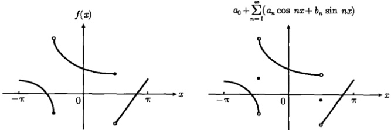

图 2.1 一个以  $ 2\pi $ 为周期的分段光滑的函数  $ f(x) $ 与它的傅里叶级数
 

 $ a_{0}+\sum_{n=1}^{\infty}(a_{n}\cos nx+b_{n}\sin nx) $ 的比较，其中  $ a_{0},a_{n},b_{n} $ 由式(2.1.2)和式(2.1.6)给出。傅里叶级数在原函数的连续点收敛于 f，在原函数的间断点收敛于  $ [f(x-0)+f(x+0)]/2 $
 

上述傅里叶级数可以推广到以 2L 为周期的函数，即  $ f(x+2L)=f(x) $。在这种情况下，式(2.1.1)变为

$$  f(x)=a_{0}+\sum_{n=1}^{\infty}\left(a_{n}\cos\frac{n\pi}{L}x+b_{n}\sin\frac{n\pi}{L}x\right)   \tag*{(2.1.8)}$$

 $$ a_{0}=\frac{1}{2L}\int_{-L}^{L}f(t)\mathrm{d}t $$ 

其中的展开系数可以按照得到式(2.1.2)和式(2.1.6)的方法求出，结果为

$$  a_{n}=\frac{1}{L}\int_{-L}^{L}f(t)\cos\frac{n\pi}{L}t\mathrm{d}t   \tag*{(2.1.9b)}$$

$$  b_{n}=\frac{1}{L}\int_{-L}^{L}f(t)\sin\frac{n\pi}{L}t\mathrm{d}t   \tag*{(2.1.9c)}$$

需要注意，式(2.1.9)的被积函数有周期 2L，因此其中的积分区间  $ (-L,L) $ 可以用任意一个宽度为 2L 的区间代替，如  $ (-L+x,L+x) $，这样

$$  \int_{-L+x}^{L+x}\cdots\mathrm{d}t=\int_{-L}^{L}\cdots\mathrm{d}t   \tag*{(2.1.10)}$$

现在我们通过一个例题说明傅里叶级数的基本含义。

例 讨论图 2.2 所示的锯齿函数

$$  f(x)=\left\{\begin{array}{ll}\frac{1}{2}(\pi-x)&(0<x\leq2\pi)\\f(x+2\pi)&(x 在其他点 )\end{array}\right.   \tag*{(2.1.11)}$$

的傅里叶级数。

<!-- page: 36 -->

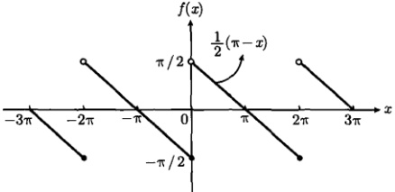

图 2.2 式(2.1.11)的锯齿函数
 

解 利用式(2.1.2)和式(2.1.6)，我们有

 $$ a_{0}=\frac{1}{2\pi}\int_{0}^{2\pi}f(x)\mathrm{d}x=\frac{1}{2\pi}\int_{0}^{2\pi}\frac{1}{2}(\pi-x)\mathrm{d}x=0 $$ 

 $$ \begin{aligned}a_{n}=&\frac{1}{\pi}\int_{0}^{2\pi}\frac{1}{2}(\pi-x)\cos nx\mathrm{d}x\\=&\frac{1}{2\pi}\left[\int_{0}^{2\pi}\pi\cos nx\mathrm{d}x-\int_{0}^{2\pi}x\cos nx\mathrm{d}x\right]\\&\left( 利用 \int x\cos ax\mathrm{d}x=\frac{1}{a^{2}}\cos ax+\frac{x}{a}\sin ax\right)\\=&0\end{aligned} $$ 

 $$ \begin{aligned}b_{n}=&\frac{1}{\pi}\int_{0}^{2\pi}\frac{1}{2}(\pi-x)\sin nx\mathrm{d}x\\=&\frac{1}{2\pi}\left[\int_{0}^{2\pi}\pi\sin nx\mathrm{d}x-\int_{0}^{2\pi}x\sin x\mathrm{d}x\right]\\&\left( 利用 \int x\sin ax\mathrm{d}x=\frac{1}{a^{2}}\sin ax-\frac{x}{a}\cos ax\right)\\=&\frac{1}{2\pi}\frac{2\pi}{n}=\frac{1}{n}\end{aligned} $$ 

于是锯齿函数 f 的傅里叶级数为

$$  \sum_{n=1}^{\infty}\frac{\sin nx}{n}   \tag*{(2.1.12)}$$

这个级数的部分和（前 m 项之和）为

$$  S_{m}(x)=\sum_{n=1}^{m}\frac{\sin nx}{n}   \tag*{(2.1.13)}$$

<!-- page: 37 -->

$ S_{m}(x) $ 对于不同的 m 值显示在图 2.3。可以看出，随着求和项数 m 的增加， $ S_{m}(x) $ 逐渐趋于图 2.2 所示的 f 函数。当  $ m \to \infty $ 时，按照狄利克雷定理，傅里叶级数 (2.1.12) 在连续点收敛于 f，在间断点  $ (x = 0, \pm 2\pi, \pm 4\pi, \cdots) $ 收敛于  $ [f(x - 0) + f(x + 0)] / 2 = 0 $，如图 2.4 所示。

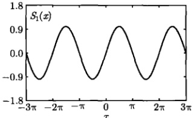

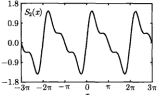

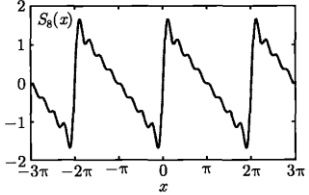

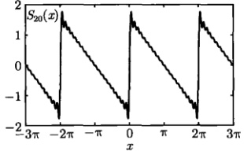

图 2.3 锯齿函数的傅里叶级数的部分和  $ S_{m}(x) $，来自式 (2.1.13)
 

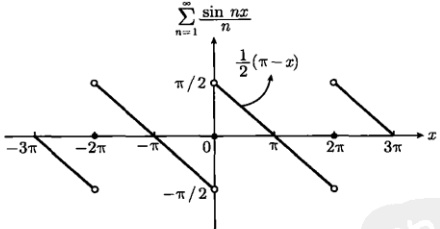

图 2.4 锯齿函数的傅里叶级数 (2.1.12)，它在连续点收敛于 $f$，在间断点 $(x=0,\pm2\pi,\pm4\pi,\cdots)$ 收敛于 $[f(x-0)+f(x+0)]/2=0$
 

特别是，傅里叶级数(2.1.12)在连续区域 $ 0<x<2\pi $收敛于 $ \frac{1}{2}(\pi-x) $，即

$$  \sum_{n=1}^{\infty}\frac{\sin nx}{n}=\frac{1}{2}\left(\pi-x\right)\quad(0<x<2\pi)   \tag*{(2.1.14)}$$

这是一个重要的求和公式。我们看到，在讨论傅里叶级数(2.1.12)收敛行为的过程

<!-- page: 38 -->

中，自然得到了这个公式。

### 2.2 半幅傅里叶级数

在许多实际问题中，函数  $ \phi(x) $ 是一个定义在有限区间  $ 0 < x < L $ 上的任意函数，因为它不具有周期性，2.1 节的结果是不适用的。而这样的函数能展开为所谓的半幅傅里叶级数 (half-range Fourier series)。事实上，如果  $ \phi(x) $ 在  $ 0 < x < L $ 内是分段光滑的，则  $ \phi(x) $ 有正弦函数展开式

$$  \phi(x)=\sum_{n=1}^{\infty}C_{n}\sin\frac{n\pi x}{L}   \tag*{(2.2.1)}$$

其中，展开系数为

$$  C_{n}=\frac{2}{L}\int_{0}^{L}\phi(x)\sin\frac{n\pi x}{L}\mathrm{d}x\quad(n=1,2,3,\cdots)   \tag*{(2.2.2)}$$

另外， $ \phi(x) $还有余弦函数展开式

$$  \phi(x)=D_{0}+\sum_{n=1}^{\infty}D_{n}\cos\frac{n\pi x}{L}   \tag*{(2.2.3)}$$

其中，展开系数是

$$  D_{0}=\frac{1}{L}\int_{0}^{L}\phi(x)\mathrm{d}x   \tag*{(2.2.4a)}$$

和

$$  D_{n}=\frac{2}{L}\int_{0}^{L}\phi(x)\cos\frac{n\pi x}{L}\mathrm{d}x\quad(n=1,2,3,\cdots)   \tag*{(2.2.4b)}$$

下面我们推导式(2.2.2)的展开系数，为此首先计算下面的积分

 $$ \begin{aligned}&\int_{0}^{L}\sin\frac{m\pi x}{L}\sin\frac{n\pi x}{L}\mathrm{d}x\quad(m,n=1,2,3,\cdots)\\=&\frac{1}{2}\int_{0}^{L}\left[\cos\frac{(m-n)\pi x}{L}-\cos\frac{(m+n)\pi x}{L}\right]\mathrm{d}x\\=&\frac{L}{2\pi}\left[\frac{1}{m-n}\sin\frac{(m-n)\pi x}{L}-\frac{1}{m+n}\sin\frac{(m+n)\pi x}{L}\right]_{0}^{L}\\=&\frac{L}{2\pi}\left[\frac{\sin(m-n)\pi}{m-n}-\frac{\sin(m+n)\pi}{m+n}\right]\\=&0\quad(m\neq n)\end{aligned} $$

<!-- page: 39 -->

而

$$  \int_{0}^{L}\sin\frac{m\pi x}{L}\sin\frac{n\pi x}{L}\mathrm{d}x=\frac{L}{2}\quad(m=n)   \tag*{(2.2.5)}$$

统一表示为

$$  \int_{0}^{L}\sin\frac{m\pi x}{L}\sin\frac{n\pi x}{L}\mathrm{d}x=\frac{L}{2}\delta_{mn}   \tag*{(2.2.6)}$$

现在，对式(2.2.1)两边同乘以 $ \sin\frac{m\pi x}{L}(m=1,2,3,\cdots) $，然后在区间 $ (0,L) $积分，并利用式(2.2.6)，我们有

 $$ \begin{aligned}\int_{0}^{L}\phi(x)\sin\frac{m\pi x}{L}\mathrm{d}x&=\int_{0}^{L}\sin\frac{m\pi x}{L}\left(\sum_{n=1}^{\infty}C_{n}\sin\frac{n\pi x}{L}\right)\mathrm{d}x\quad(m,n=1,2,3,\cdots)\\&=\sum_{n=1}^{\infty}C_{n}\int_{0}^{L}\sin\frac{m\pi x}{L}\sin\frac{n\pi x}{L}\mathrm{d}x\\&=\frac{L}{2}\sum_{n=1}^{\infty}C_{n}\delta_{mn}=\frac{L}{2}C_{m}\end{aligned} $$ 

它给出式(2.2.2)的结果。下面推导式(2.2.4)的展开系数。首先，直接对式(2.2.3)两边积分，得到

$$  \int_{0}^{L}\phi(x)\mathrm{d}x=D_{0}\int_{0}^{L}\mathrm{d}x+\sum_{n=1}^{\infty}D_{n}\underbrace{\int_{0}^{L}\cos\frac{n\pi x}{L}\mathrm{d}x}_{=0}   \tag*{(2.2.7)}$$

它给出式 (2.2.4a)。现在计算式 (2.2.4b) 的系数，先按照得到式 (2.2.6) 的方法，求出下面的积分

$$  \int_{0}^{L}\cos\frac{m\pi x}{L}\cos\frac{n\pi x}{L}\mathrm{d}x=\frac{L}{2}\delta_{mn}   \tag*{(2.2.8)}$$

然后给式(2.2.3)两边同乘以 $ \cos\frac{m\pi x}{L}(m=1,2,3,\cdots) $，并在区间 $ (0,L) $积分，再利用 $ \int_{0}^{L}\cos\frac{m\pi x}{L}\mathrm{d}x=0 $及式(2.2.8)，最终得到式(2.2.4b)。

需要强调，半幅傅里叶级数的收敛性服从式 (2.1.7) 所示的狄利克雷定理，即级数 (2.2.1) 和级数 (2.2.3) 在函数  $ \phi(x) $ 的连续点收敛于  $ \phi $，在它的在间断点收敛于  $ [\phi(x-0)+\phi(x+0)]/2 $。

上面介绍的半幅傅里叶级数在有限区间问题中有非常广泛的应用，对于具体的问题，特别是数学物理方法的不同边值问题，半幅傅里叶级数呈现不同的形式，除了式（2.2.1）和式（2.2.3）的形式外，还能取

$$  \phi(x)=\sum_{n=0}^{\infty}C_{n}\sin\frac{(2n+1)\pi x}{2L}   \tag*{(2.2.9)}$$

<!-- page: 40 -->

$$  \phi(x)=\sum_{n=0}^{\infty}D_{n}\cos\frac{(2n+1)\pi x}{2L}   \tag*{(2.2.10)}$$

的形式，其中的展开系数为

$$  C_{n}=\frac{2}{L}\int_{0}^{L}\phi(x)\sin\frac{(2n+1)\pi x}{2L}\mathrm{d}x   \tag*{(2.2.11)}$$

$$  D_{n}=\frac{2}{L}\int_{0}^{L}\phi(x)\cos\frac{(2n+1)\pi x}{2L}\mathrm{d}x   \tag*{(2.2.12)}$$

具体问题我们将在随后的章节中详细讨论。

例 将图 2.5 所示的函数  $ \phi(x)=\sin x(0\leq x\leq\pi) $ 展开成半幅傅里叶级数。

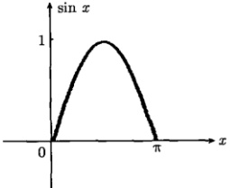

图 2.5 函数  $ \phi(x)=\sin x(0 \leqslant x \leqslant \pi) $
 

解 将函数  $ \phi(x)=\sin x(0\leqslant x\leqslant\pi) $ 按式 (2.2.1) 展开时，只有一项  $ \sin x $ 。现在将它按余弦函数式 (2.2.3) 展开，我们有

 $$ D_{0}=\frac{1}{L}\int_{0}^{L}\phi(x)\mathrm{d}x=\frac{1}{\pi}\int_{0}^{\pi}\sin x\mathrm{d}x=\frac{2}{\pi} $$ 

 $$ \begin{aligned}D_{n}&=\frac{2}{L}\int_{0}^{L}\phi(x)\cos\frac{n\pi x}{L}\mathrm{d}x=\frac{2}{\pi}\int_{0}^{\pi}\sin x\cos nx\mathrm{d}x\\&=\frac{1}{\pi}\int_{0}^{\pi}\left[\sin(x+nx)+\sin(x-nx)\right]\mathrm{d}x\\&=\frac{1}{\pi}\left[\frac{1-\cos(n+1)\pi}{n+1}-\frac{1-\cos(n-1)\pi}{n-1}\right]\\&=\frac{1}{\pi}\left[\frac{1+\cos n\pi}{n+1}-\frac{1+\cos n\pi}{n-1}\right]\\&=-\frac{2(1+\cos n\pi)}{\pi(n^{2}-1)}\quad(n\neq1)\end{aligned} $$ 

当n=1时

$$  D_{1}=\frac{2}{\pi}\int_{0}^{\pi}\sin x\cos x dx=\frac{1}{\pi}\int_{0}^{\pi}\sin2x dx=0   \tag*{(2.2.13)}$$

<!-- page: 41 -->

于是半幅傅里叶级数（2.2.3）给出

 $$ \begin{aligned}f(x)&=\frac{2}{\pi}-\frac{2}{\pi}\sum_{n=2}^{\infty}\frac{1+\cos n\pi}{n^{2}-1}\cos nx\\&=\frac{2}{\pi}-\frac{2}{\pi}\sum_{n=2}^{\infty}\frac{1+(-1)^{n}}{n^{2}-1}\cos nx\quad\left[1+(-1)^{n}=\left\{\begin{array}{l}0(n=1,3,5,\cdots)\\2(n=0,2,4,\cdots)\end{array}\right.\right]\\&=\frac{2}{\pi}-\frac{4}{\pi}\left(\frac{\cos2x}{2^{2}-1}+\frac{\cos4x}{4^{2}-1}+\frac{\cos6x}{6^{2}-1}+\cdots\right)\\&=\frac{2}{\pi}-\frac{4}{\pi}\sum_{k=1}^{\infty}\frac{\cos2kx}{(2k)^{2}-1}\end{aligned} $$ 

由于图2.5的函数在定义区间 $ [0,\pi] $没有间断点，因此收敛于f。这样我们得到

$$  \sin x=\frac{2}{\pi}-\frac{4}{\pi}\sum_{k=1}^{\infty}\frac{\cos2kx}{(2k)^{2}-1}\quad(0\leqslant x\leqslant\pi)   \tag*{(2.2.14)}$$

这是一个  $ \sin x $ 的展开式。在讨论图 2.5 所示函数的傅里叶级数收敛行为的过程中，我们自然地得到了它。

### 2.3 傅里叶积分

以上两节我们讨论了周期函数的傅里叶级数以及有限区间的半幅傅里叶级数，那么一个定义在  $ (-\infty, \infty) $ 区间的非周期函数还能进行傅里叶展开吗？这就是本节将要讨论的问题。实际上，傅里叶级数可以扩展到连续变化的情况，即傅里叶积分。

在讨论傅里叶级数向傅里叶积分转变的过程中，函数的“绝对可积”是一个重要的概念，我们首先介绍它。如果一个定义在区间  $ (-\infty, \infty) $ 上的函数  $ f(x) $ 满足条件

$$  \int_{-\infty}^{\infty}|f(x)|\mathrm{d}x<\infty   \tag*{(2.3.1)}$$

则称  $ f(x) $ 在  $ (-\infty, \infty) $ 上是绝对可积的。一个绝对可积函数的示意图如图 2.6 所示。明显地

$$  \int_{-\infty}^{\infty}|f(x)|\mathrm{d}x\geqslant\int_{-\infty}^{\infty}f(x)\mathrm{d}x   \tag*{(2.3.2)}$$

等号相应于  $ f(x) \geqslant 0 $。因此  $ \left|f(x)\right| $ 在区间  $ (-\infty, \infty) $ 上的可积确保了  $ f(x) $ 的可积，即一个绝对可积函数  $ f(x) $ 有性质

$$  \int_{-\infty}^{\infty}f(x)\mathrm{d}x= 有限值   \tag*{(2.3.3)}$$

<!-- page: 42 -->

另一方面，绝对可积条件式(2.3.1)还要求

$$   当 x\to\pm\infty 时 ,\quad f(x)\to0   \tag*{(2.3.4)}$$

这是绝对可积函数的另一个性质。

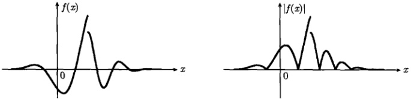

图 2.6 一个绝对可积函数  $ f(x) $ 和它的绝对值  $ \left|f(x)\right| $ 的示意图
 

现在我们考虑一个满足绝对可积条件式（2.3.1）的周期函数，周期为 2L，即  $ f(x) = f(x + 2L) $，它的傅里叶级数 [见式 (2.1.8)] 为

$$  f(x)=a_{0}+\sum_{n=1}^{\infty}\left(a_{n}\cos\frac{n\pi}{L}x+b_{n}\sin\frac{n\pi}{L}x\right)   \tag*{(2.3.5)}$$

其中，系数  $ a_{0}, a_{n}, b_{n} $ 由式 (2.1.9) 确定。其实，这样的周期函数可以转变成一个定义在  $ (-\infty, \infty) $ 区间的非周期函数，最简单的途径是取  $ L \to \infty $，这样一来函数就不再具有周期性，而且定义扩展到  $ (-\infty, \infty) $ 区间。这时式 (2.1.9a) 中的系数为

$$  a_{0}=\frac{1}{2L}\int_{-L}^{L}f(t)\mathrm{d}t\xrightarrow{L\to\infty}0   \tag*{(2.3.6)}$$

其中，我们用到了绝对可积函数的性质(2.3.3)。进一步，令  $ \omega_{n}=n\pi/L $ ，则

$$  \Delta\omega=\omega_{n}-\omega_{n-1}=\frac{\pi}{L}   \tag*{(2.3.7)}$$

由式 (2.3.7) 可以看出，傅里叶级数 (2.3.5) 的求和间隔  $ \Delta\omega $ 在  $ L \to \infty $ 时将变成微元  $ \mathrm{d}\omega $，而变量  $ \omega_n $ 趋于连续变化，傅里叶级数则转变成积分的形式，即

$$  \sum_{n=1}^{\infty}\cdots\Delta\omega\xrightarrow{L\to\infty}\int_{0}^{\infty}\cdots\mathrm{d}\omega   \tag*{(2.3.8)}$$

事实上

 $$ \begin{aligned}\sum_{n=1}^{\infty}a_{n}\cos\frac{n\pi}{L}x&=\sum_{n=1}^{\infty}\frac{1}{L}\left[\int_{-L}^{L}f(t)\cos\frac{n\pi}{L}t\mathrm{d}t\right]\cos\frac{n\pi}{L}x\\&=\sum_{n=1}^{\infty}\frac{\Delta\omega}{\pi}\left[\int_{-L}^{L}f(t)\cos\omega_{n}t\mathrm{d}t\right]\cos\omega_{n}x\end{aligned} $$

<!-- page: 43 -->

$$  \xrightarrow{L\to\infty}\int_{0}^{\infty}\mathrm{d}\omega\left[\frac{1}{\pi}\int_{-\infty}^{\infty}f(t)\cos\omega t\mathrm{d}t\right]\cos\omega x   \tag*{(2.3.9a)}$$

同理

$$  \sum_{n=1}^{\infty}b_{n}\sin\frac{n\pi}{L}x\xrightarrow{L\to\infty}\int_{0}^{\infty}\mathrm{d}\omega\left[\frac{1}{\pi}\int_{-\infty}^{\infty}f(t)\sin\omega t\mathrm{d}t\right]\sin\omega x   \tag*{(2.3.9b)}$$

现在我们利用式(2.3.9)，将式(2.3.5)写成

$$  f(x)=\int_{0}^{\infty}[A(\omega)\cos\omega x+B(\omega)\sin\omega x]\mathrm{d}\omega   \tag*{(2.3.10)}$$

其中

$$  A(\omega)=\frac{1}{\pi}\int_{-\infty}^{\infty}f(t)\cos\omega t\mathrm{d}t   \tag*{(2.3.11a)}$$

$$  B(\omega)=\frac{1}{\pi}\int_{-\infty}^{\infty}f(t)\sin\omega t\mathrm{d}t   \tag*{(2.3.11b)}$$

式 (2.3.10) 就是函数  $ f(x) $ 的傅里叶积分表示，其中的展开系数  $ A(\omega) $ 和  $ B(\omega) $ 由式 (2.3.11) 确定。在上述由级数到积分的转变中，具体的变化是：①  $ L \to \infty $ 和  $ f(x) $ 的绝对可积性质 (2.3.3) 导致系数  $ a_0 = 0 $；② 计算  $ a_n $ 和  $ b_n $ 时的积分限  $ (-L, L) $ 变成了计算  $ A(\omega) $ 和  $ B(\omega) $ 时的积分限  $ (-\infty, \infty) $；③ 分立变化的求和变量  $ \omega_n = n\pi/L (n = 1, 2, \cdots) $ 变成了连续变化的积分变量  $ \omega \geq 0 $。而确保级数可以转变成积分的条件则是式 (2.3.1) 所示的绝对可积。这个条件还进一步确保了式 (2.3.11) 中系数  $ A(\omega) $ 和  $ B(\omega) $ 的存在性，如图 2.7 所示的那样。当然，为了使傅里叶积分式 (2.3.10) 具有式 (2.1.7) 所确定的收敛行为，函数  $ f(x) $ 要满足狄利克雷定理成立的条件，即  $ f(x) $ 分段光滑。总而言之，一个分段光滑且绝对可积的函数  $ f(x) $ 具有傅里叶积分表示式 (2.3.10)，其中的  $ A(\omega) $ 和  $ B(\omega) $ 由式 (2.3.11) 确定；而傅里叶积分的收敛行为服从狄利克雷定理，即在原函数的连续点收敛于  $ f(x) $，在原函数的间断点收敛于  $ [f(x - 0) + f(x + 0)]/2 $。

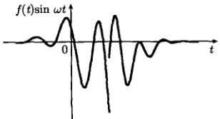

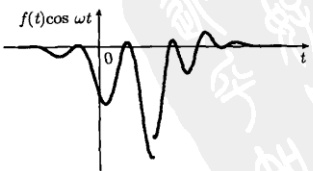

图 2.7 图 2.6 所示的绝对可积函数  $ f(x) $ 确保系数  $ A(\omega) $ 和  $ B(\omega) $ 的存在性
 

<!-- page: 44 -->

物理上通常认为， $ f(x) $ 代表一个“信号”，系数  $ A(\omega) $ 和  $ B(\omega) $ 则是信号  $ f(x) $ 的频谱分布函数，它们分别相应于正交分量  $ \cos\omega t $ 和  $ \sin\omega t $。由信号得到频谱的过程，通常称为傅里叶分析。从式 (2.3.11) 可以看出：如果  $ f(t) $ 是偶函数，则  $ B(\omega)=0 $；如果 f 是奇函数，则  $ A(\omega)=0 $。

应该注意，上述绝对可积条件(2.3.1)是傅里叶积分存在的充分条件，但不是必要的。实际上不少函数并不满足绝对可积条件，但它们的傅里叶积分确实存在。下面我们将通过两个例子进一步了解傅里叶积分的含义与意义。

例 1 求图 2.8 所示的函数

$$  f(x)=\left\{\begin{array}{ll}1&\left(|x|\leqslant1\right)\\ 0&\left(|x|>1\right)\end{array}\right.   \tag*{(2.3.12)}$$

的傅里叶积分表示式。

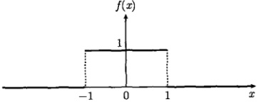

图 2.8 函数 (2.3.12)
 

解 首先计算式(2.3.11)中的频谱分布函数，因为式(2.3.12)表示一个偶函数，故  $ B(\omega)=0 $，而

$$  A(\omega)=\frac{1}{\pi}\int_{-1}^{1}\cos\omega t\mathrm{d}t=\frac{2\sin\omega}{\pi\omega}   \tag*{(2.3.13)}$$

于是傅里叶积分表示式为

$$  f(x)=\frac{2}{\pi}\int_{0}^{\infty}\frac{\sin\omega\cos\omega x}{\omega}\mathrm{d}\omega   \tag*{(2.3.14)}$$

根据狄利克雷定理，式 (2.3.14) 在原函数的不连续点  $ x = \pm 1 $ 收敛于  $ [f(x - 0) + f(x + 0)] / 2 = 1/2 $，在连续点收敛于 f，因此

$$  \frac{2}{\pi}\int_{0}^{\infty}\frac{\sin\omega\cos\omega x}{\omega}\mathrm{d}\omega=\left\{\begin{array}{ll}1\quad(|x|<1)\\ \frac{1}{2}\quad(|x|=1)\\ 0\quad(|x|>1)\end{array}\right.   \tag*{(2.3.15)}$$

特别地，在 x=0 ，有

$$  \int_{0}^{\infty}\frac{\sin\omega}{\omega}\mathrm{d}\omega=\frac{\pi}{2}   \tag*{(2.3.16)}$$

<!-- page: 45 -->

这就是熟知的狄利克雷积分，我们在讨论傅里叶积分(2.3.14)的收敛行为时自然得到了这个公式。在式(2.3.15)中讨论 $ |x|=1 $的情况也能得到公式(2.3.16)。

例2 求图2.9所示的函数

$$  f(x)=\left\{\begin{array}{ll}\cos x&(|x|<\pi/2)\\ 0&(|x|>\pi/2)\end{array}\right.   \tag*{(2.3.17)}$$

的傅里叶积分表示式。

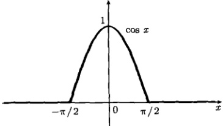

图 2.9 式 (2.3.17) 所示的函数
 

解 首先计算式(2.3.11)中的频谱分布函数，式(2.3.17)所示的函数 f 是定义在区间  $ (-\infty, \infty) $ 上的偶函数，所以  $ B(\omega) = 0 $，而

 $$ \begin{aligned}A(\omega)&=\frac{1}{\pi}\int_{-\infty}^{\infty}f(x)\cos\omega x\mathrm{d}x=\frac{2}{\pi}\int_{0}^{\pi/2}\cos x\cos\omega x\mathrm{d}x\\&=\frac{1}{\pi}\int_{0}^{\pi/2}[\cos(1+\omega)x+\cos(1-\omega)x]\mathrm{d}x\\&=\frac{1}{\pi}\left\{\frac{\sin\left[(1+\omega)\pi/2\right]}{1+\omega}+\frac{\sin\left[(1-\omega)\pi/2\right]}{1-\omega}\right\}\\&=\frac{1}{\pi}\left\{\frac{\cos(\omega\pi/2)}{1+\omega}+\frac{\cos(\omega\pi/2)}{1-\omega}\right\}\\&=\frac{2\cos(\omega\pi/2)}{\pi(1-\omega^{2})}\\ \end{aligned} $$ 

这个结果允许  $ \omega = 1 $，事实上，利用洛必达法则，有

$$  \lim_{\omega\to1}\frac{2\cos(\omega\pi/2)}{\pi(1-\omega^{2})}=\frac{1}{2}\lim_{\omega\to1}\frac{\sin(\omega\pi/2)}{\omega}=\frac{1}{2}   \tag*{(2.3.18a)}$$

另一方面，我们利用式(2.3.11a)直接计算出

$$  A(1)=\frac{2}{\pi}\int_{0}^{\pi/2}\cos^{2}x\mathrm{d}x=\frac{1}{2}   \tag*{(2.3.18b)}$$

<!-- page: 46 -->

可见两种计算方法的结果是相同的。正如图 2.10 所示， $ A(\omega) $ 在  $ \omega = 1 $ 是连续的。于是函数 (2.3.17) 的傅里叶积分表示式为

$$  f(x)=\frac{2}{\pi}\int_{0}^{\infty}\frac{\cos(\omega\pi/2)}{1-\omega^{2}}\cos\omega x\mathrm{d}\omega   \tag*{(2.3.19)}$$

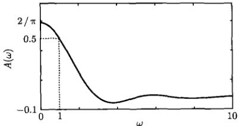

图 2.10 信号（2.3.17）的频谱分布
 

由于函数(2.3.17)在区间 $ (-∞,∞) $上没有间断点，因此在所有x处收敛于f，即

$$  \frac{2}{\pi}\int_{0}^{\infty}\frac{\cos(\omega\pi/2)}{1-\omega^{2}}\cos\omega x\mathrm{d}\omega=\left\{\begin{array}{ll}\cos x,&(|x|<\pi/2)\\ 0,&(|x|>\pi/2)\end{array}\right.   \tag*{(2.3.20)}$$

特别地，在 x=0 处，有

$$  \int_{0}^{\infty}\frac{\cos(\omega\pi/2)}{1-\omega^{2}}\mathrm{d}\omega=\frac{\pi}{2}   \tag*{(2.3.21)}$$

这是另一个重要的积分公式，我们在讨论傅里叶积分（2.3.19）的收敛行为时自然得到了它。

