# 03-第3章 傅里叶变换

[返回全书目录](../../README.md)

> PDF 页码：47–89

<!-- page: 47 -->

### 第3章 傅里叶变换

求解数学物理方法问题的重要工具之一是积分变换。所谓积分变换就是把函数  $  f(t)  $ 经过积分运算变为另一类函数  $  F(\beta)  $，一般表示为

$$  F(\beta)=\int_{a}^{b}f(t)K(\beta,t)\mathrm{d}t   \tag*{(3.0.1)}$$

其中， $ \beta $ 是一个参变量， $ K(\beta,t) $ 是一个确定的二元函数，称为积分变换的核。不同的核与不同的积分区域，构成不同的积分变换。本书主要介绍傅里叶变换与拉普拉斯变换这两种最常用的变换。它们具有非常广泛的应用，不但涉及工程技术，如力学、声学、电工学、电子学、信息光学、信息工程等领域的信号分析和信号处理等，还广泛应用于理论学科，如理论物理、量子力学、电动力学等。

### 3.1 傅里叶变换简介

第 2 章讨论的傅里叶积分是傅里叶级数向连续变量的扩展，而傅里叶积分又可以进一步扩展到傅里叶变换，这一扩展所引起的变化是频谱范围由  $ \omega \in [0, \infty) $ 变成了  $ \omega \in (-\infty, \infty) $。因此傅里叶变换涉及的问题更加广泛。本节介绍傅里叶变换的定义和性质，而傅里叶变换的计算和应用将随后讨论。

#### 3.1.1 傅里叶变换的定义

考虑一个定义在区间  $ (-\infty, \infty) $ 上的函数  $ f(x) $，下面我们将从  $ f(x) $ 的傅里叶积分过渡到傅里叶变换，为此首先利用式 (2.3.10) 和式 (2.3.11) 写出它的傅里叶积分表示式

$$  \begin{aligned}f(x)&=\frac{1}{\pi}\int_{\omega=0}^{\infty}\int_{t=-\infty}^{\infty}f(t)\left(\cos\omega t\cos\omega x+\sin\omega t\sin\omega x\right)\mathrm{d}t\mathrm{d}\omega\\&=\frac{1}{\pi}\int_{0}^{\infty}\int_{-\infty}^{\infty}f(t)\cos\omega(x-t)\mathrm{d}t\mathrm{d}\omega\\&=\frac{1}{2\pi}\int_{0}^{\infty}\int_{-\infty}^{\infty}f(t)\left[\mathrm{e}^{\mathrm{i}\omega(x-t)}+\mathrm{e}^{-\mathrm{i}\omega(x-t)}\right]\mathrm{d}t\mathrm{d}\omega\\&=\frac{1}{2\pi}\int_{-\infty}^{\infty}\left[\int_{0}^{\infty}f(t)\mathrm{e}^{\mathrm{i}\omega(x-t)}\mathrm{d}\omega+\int_{0}^{\infty}f(t)\mathrm{e}^{-\mathrm{i}\omega(x-t)}\mathrm{d}\omega\right]\mathrm{d}t\end{aligned}   \tag*{(3.1.1)}$$

<!-- page: 48 -->

现在，将式(3.1.1)中的后一个积分写为

 $$ \begin{align*}\int_{0}^{\infty}f(t)\mathrm{e}^{-\mathrm{i}\omega(x-t)}\mathrm{d}\omega&=-\int_{0}^{-\infty}f(t)\mathrm{e}^{\mathrm{i}y(x-t)}\mathrm{d}y(y=-\omega)\\&=\int_{-\infty}^{0}f(t)\mathrm{e}^{\mathrm{i}y(x-t)}\mathrm{d}y\\&=\int_{-\infty}^{0}f(t)\mathrm{e}^{\mathrm{i}\omega(x-t)}\mathrm{d}\omega\end{align*} $$ 

将结果代入式(3.1.1)，与前一个积分合并后，得到

$$  f(x)=\frac{1}{2\pi}\int_{-\infty}^{\infty}\left[\int_{-\infty}^{\infty}f(t)\mathrm{e}^{\mathrm{i}\omega(x-t)}\mathrm{d}\omega\right]\mathrm{d}t=\frac{1}{2\pi}\int_{-\infty}^{\infty}\underbrace{\int_{-\infty}^{\infty}f(t)\mathrm{e}^{-\mathrm{i}\omega t}\mathrm{d}t}_{F(\omega)}\mathrm{e}^{\mathrm{i}\omega x}\mathrm{d}\omega   \tag*{(3.1.2)}$$

我们得到

$$  F(\omega)=\int_{-\infty}^{\infty}f(x)\mathrm{e}^{-\mathrm{i}\omega x}\mathrm{d}x\quad(-\infty<\omega<\infty)   \tag*{(3.1.3)}$$

$$  f(x)=\frac{1}{2\pi}\int_{-\infty}^{\infty}F(\omega)\mathrm{e}^{\mathrm{i}\omega x}\mathrm{d}\omega\quad(-\infty<x<\infty)   \tag*{(3.1.4)}$$

其中， $ F(\omega) $ 称为函数  $ f(x) $ 的傅里叶变换，而  $ f(x) $ 称为  $ F(\omega) $ 的傅里叶反变换。我们将  $ f(x) $ 和  $ F(\omega) $ 之间的变换与反变换记为

$$  F(\omega)=\mathcal{F}\left\{f(x)\right\}   \tag*{(3.1.5a)}$$

$$  f(x)=\mathcal{F}^{-1}\left\{F(\omega)\right\}   \tag*{(3.1.5b)}$$

或者更简单地表示为

$$  F(\omega)\longleftrightarrow f(x)   \tag*{(3.1.6)}$$

习惯上， $ F(\omega) $ 称为象函数，而  $ f(x) $ 称为原函数。从得到式 (3.1.3) 和式 (3.1.4) 的过程可以看出，傅里叶变换是从傅里叶积分过渡来的，因此傅里叶变换存在的条件与傅里叶积分存在的条件是相同的。具体说，函数  $ f(x) $ 的傅里叶变换  $ F(\omega) $ 存在的条件是式 (2.3.1) 所示的绝对可积。与傅里叶积分的情况一样，这个条件是充分的但不是必要的。当然，为了使傅里叶反变换 (3.1.4) 具有式 (2.1.7) 所确定的收敛行为，函数  $ f(x) $ 要满足狄利克雷定理成立的条件，即  $ f(x) $ 分段光滑。总而言之，一个分段光滑且绝对可积的函数  $ f(x) $ 具有傅里叶变换 (3.1.3)，而反变换积分的收敛行为则服从狄利克雷定理，即在原函数的连续点收敛于  $ f(x) $，在原函数的间断点收敛于  $ [f(x-0)+f(x+0)]/2 $。

<!-- page: 49 -->

傅里叶变换与傅里叶积分的区别在于  $ \omega $ 的变化范围由  $ \omega \in [0, \infty) $ 扩展到  $ \omega \in (-\infty, \infty) $。不过，当积分 (3.1.4) 的被积函数是偶函数时，傅里叶变换约化为傅里叶积分。另外，像傅里叶积分情况下的解释一样， $ f(x) $ 是信号， $ F(\omega) $ 是频谱。由  $ f(x) $ 求  $ F(\omega) $ 的过程称为傅里叶分析，而由  $ F(\omega) $ 求  $ f(x) $ 的过程称为“反演”。在式 (3.1.3) 中令  $ \omega = 0 $，得到

$$  F(0)=\int_{-\infty}^{\infty}f(x)\mathrm{d}x   \tag*{(3.1.7a)}$$

这意味着频谱在  $ \omega = 0 $ 的值等于信号  $ f(x) $ 的面积。另一方面，在式(3.1.4)中取 x = 0，得到

$$  f(0)=\frac{1}{2\pi}\int_{-\infty}^{\infty}F(\omega)\mathrm{d}\omega   \tag*{(3.1.7b)}$$

即频谱的积分给出函数在原点取值的  $ 2\pi $ 倍。

为了对傅里叶变换有一个直观的认识，首先考查下面简单函数的傅里叶变换。

例 讨论函数

$$  f(x)=\left\{\begin{array}{l l}1&\left(|x|<a\right)\\ 0&\left(|x|>a\right)\end{array}\right.   \tag*{(3.1.8)}$$

的傅里叶变换。

解　这个函数与式(2.3.12)的函数类似，它满足绝对可积条件(2.3.1)，由式(3.1.3)得到它的傅里叶变换

$$  \begin{aligned}F(\omega)&=\int_{-\infty}^{\infty}f(x)\mathrm{e}^{-\mathrm{i}\omega x}\mathrm{d}x=\int_{-a}^{a}\mathrm{e}^{-\mathrm{i}\omega x}\mathrm{d}x\\&=-\frac{1}{\mathrm{i}\omega}\left.\mathrm{e}^{-\mathrm{i}\omega x}\right|_{-a}^{a}=\frac{1}{\mathrm{i}\omega}\left(\mathrm{e}^{\mathrm{i}\omega a}-\mathrm{e}^{-\mathrm{i}\omega a}\right)\\&=2\frac{\sin a\omega}{\omega}\\ \end{aligned}   \tag*{(3.1.9)}$$

式(3.1.9)允许取 $ \omega=0 $，事实上

$$  \lim_{\omega\to0}F(\omega)=2\lim_{\omega\to0}\frac{\sin a\omega}{\omega}=2a   \tag*{(3.1.10a)}$$

另一方面，我们利用式 $  (3.1.7a)  $进行验证

$$  F(0)=\int_{-\infty}^{\infty}f(x)\mathrm{d}x=\int_{-a}^{a}\mathrm{d}x=2a   \tag*{(3.1.10b)}$$

两种方法的结果相同。因此对于所有  $ \omega $，频谱分布函数由式 (3.1.9) 表示 (图 3.1)。

<!-- page: 50 -->

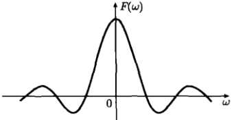

图 3.1 信号 (3.1.9) 的频谱分布  $ F(\omega) $
 

现在我们利用  $ F(\omega) $ 计算傅里叶反变换，由式(3.1.4)得到

 $$ \begin{aligned}f(x)&=\frac{1}{2\pi}\int_{-\infty}^{\infty}F(\omega)\mathrm{e}^{\mathrm{i}\omega x}\mathrm{d}\omega=\frac{1}{\pi}\int_{-\infty}^{\infty}\frac{\sin a\omega}{\omega}\mathrm{e}^{\mathrm{i}\omega x}\mathrm{d}\omega\\&=\frac{1}{\pi}\int_{-\infty}^{\infty}\frac{\sin a\omega}{\omega}(\cos\omega x-\mathrm{i}\sin\omega x)\mathrm{d}\omega\\&=\frac{2}{\pi}\int_{0}^{\infty}\frac{\sin a\omega\cos\omega x}{\omega}\mathrm{d}\omega\end{aligned} $$ 

得到该结果是因为  $ \frac{\sin a\omega}{\omega}\sin\omega x $ 是  $ \omega $ 的奇函数，它的积分为零。当 a=1 时，上式作为  $ 2\frac{\sin a\omega}{\omega} $ 的反变换正好给出函数 (2.3.12) 的傅里叶积分表示式。得到这个结果是不奇怪的，如上所述，当积分 (3.1.4) 的被积函数是偶函数时，傅里叶变换约化为傅里叶积分。按照狄利克雷定理，反变换积分收敛于

$$  \frac{2}{\pi}\int_{0}^{\infty}\frac{\sin a\omega\cos\omega x}{\omega}\mathrm{d}\omega=\left\{\begin{array}{ll}1&\left(|x|<a\right)\\ \displaystyle\frac{1}{2}&\left(|x|=a\right)\\ 0&\left(|x|>a\right)\end{array}\right.   \tag*{(3.1.11)}$$

特别是在 x=0 时，有

$$  \int_{0}^{\infty}\frac{\sin a\omega}{\omega}\mathrm{d}\omega=\frac{\pi}{2}\quad(a>0)   \tag*{(3.1.12a)}$$

这是狄利克雷积分(2.3.16)的一个推广。由式(3.1.12a)还可以得到

$$  \int_{0}^{\infty}\frac{\sin a\omega}{\omega}\mathrm{d}\omega=-\frac{\pi}{2}\quad(a<0)   \tag*{(3.1.12b)}$$

推广的狄利克雷积分（3.1.12）将被用于3.3节的例12。

#### 3.1.2 傅里叶变换的性质

首先，傅里叶变换是线性变换，即

$$  \mathcal{F}\left\{C_{1}f_{1}+C_{2}f_{2}\right\}=C_{1}\mathcal{F}\left\{f_{1}\right\}+C_{2}\mathcal{F}\left\{f_{2}\right\}   \tag*{(3.1.13)}$$

<!-- page: 51 -->

其中， $ C_{1} $， $ C_{2} $ 均是常数。

证明

 $$ \begin{aligned}\mathcal{F}\left\{C_{1}f_{1}+C_{2}f_{2}\right\}&=\int_{-\infty}^{\infty}[C_{1}f_{1}(x)+C_{2}f_{2}(x)]\mathrm{e}^{-\mathrm{i}\omega x}\mathrm{d}x\\&=C_{1}\int_{-\infty}^{\infty}f_{1}(x)\mathrm{e}^{-\mathrm{i}\omega x}\mathrm{d}x+C_{2}\int_{-\infty}^{\infty}f_{2}(x)\mathrm{e}^{-\mathrm{i}\omega x}\mathrm{d}x\\&=C_{1}\mathcal{F}\left\{f_{1}\right\}+C_{2}\mathcal{F}\left\{f_{2}\right\}\\ \end{aligned} $$ 

进而，如果

$$  f(x)\longleftrightarrow F(\omega)   \tag*{(3.1.14)}$$

则傅里叶变换有以下定理。

1) 微分定理 I

$$  \frac{\mathrm{d}f(x)}{\mathrm{d}x}\longleftrightarrow\mathrm{i}\omega F(\omega)   \tag*{(3.1.15)}$$

证明

 $$ \begin{aligned}\frac{\mathrm{d}f(x)}{\mathrm{d}x}\longleftrightarrow\int_{-\infty}^{\infty}\frac{\mathrm{d}f(x)}{\mathrm{d}x}\mathrm{e}^{-\mathrm{i}\omega x}\mathrm{d}x&=\int_{-\infty}^{\infty}\mathrm{d}f(x)\mathrm{e}^{-\mathrm{i}\omega x}\\&=\left[f(x)\mathrm{e}^{-\mathrm{i}\omega x}\right]_{-\infty}^{\infty}+\mathrm{i}\omega\int_{-\infty}^{\infty}f(x)\mathrm{e}^{-\mathrm{i}\omega x}\mathrm{d}x\\&=\mathrm{i}\omega F(\omega)\end{aligned} $$ 

这里利用了当  $ x \to \pm\infty $ 时， $ f(x) \to 0 $ 的性质 [见式(2.3.4)]。

类似地，可以证明

$$  f^{(n)}(x)\longleftrightarrow(\mathrm{i}\omega)^{n}F(\omega)   \tag*{(3.1.16)}$$

2) 微分定理 II

$$  x f(x)\longleftrightarrow\mathrm{i}\frac{\mathrm{d}}{\mathrm{d}\omega}F(\omega)   \tag*{(3.1.17)}$$

证明 在式(3.1.3)两边关于 $ \omega $求导数

 $$ \begin{aligned}\frac{\mathrm{d}}{\mathrm{d}\omega}F(\omega)&=\frac{\mathrm{d}}{\mathrm{d}\omega}\int_{-\infty}^{\infty}f(x)\mathrm{e}^{-\mathrm{i}\omega x}\mathrm{d}x\\&=\int_{-\infty}^{\infty}f(x)\frac{\mathrm{d}}{\mathrm{d}\omega}\left(\mathrm{e}^{-\mathrm{i}\omega x}\right)\mathrm{d}x=-\mathrm{i}\int_{-\infty}^{\infty}x f(x)\mathrm{e}^{-\mathrm{i}\omega x}\mathrm{d}x\\&=-\mathrm{i}\mathcal{F}\{x f(x)\}\end{aligned} $$ 

故式 $ （3.1.17） $成立。类似地，可以证明

$$  x^{n}f(x)\longleftrightarrow\mathrm{i}^{n}\frac{\mathrm{d}}{\mathrm{d}\omega}F(\omega)   \tag*{(3.1.18)}$$

<!-- page: 52 -->

3）积分定理

$$  \int_{x_{0}}^{x}f(x)\mathrm{d}x\xleftarrow{\quad}\xrightarrow{}\frac{F(\omega)}{\mathrm{i}\omega}\quad( 积分下限 x_{0} 取任意值 )   \tag*{(3.1.19)}$$

证明 令  $ g(x)=\int_{x_{0}}^{x}f(x)\mathrm{d}x $，则  $ f(x)=g'(x) $。由于

$$  F(\omega)=\mathcal{F}\left\{f(x)\right\}=\mathcal{F}\left\{g^{\prime}(x)\right\}=\mathrm{i}\omega G(\omega)   \tag*{(3.1.20)}$$

最后一步利用了式(3.1.15)，式(3.1.20)即为

$$  \frac{F(\omega)}{\mathrm{i}\omega}=G(\omega)\longleftrightarrow\int_{x_{0}}^{x}f(x)\mathrm{d}x   \tag*{(3.1.21)}$$

故式(3.1.19)成立。

4）位移定理

$$  f(x+\xi)\longleftrightarrow\mathrm{e}^{\mathrm{i}\omega\xi}F(\omega)\quad(\xi 为任意实数 )   \tag*{(3.1.22)}$$

证明

 $$ \begin{aligned}&\int_{-\infty}^{\infty}f(x+\xi)\mathrm{e}^{-\mathrm{i}\omega x}\mathrm{d}x\quad(y=x+\xi)\\=&\int_{-\infty}^{\infty}f(y)\mathrm{e}^{-\mathrm{i}\omega(y-\xi)}\mathrm{d}y\\=&\mathrm{e}^{\mathrm{i}\omega\xi}\int_{-\infty}^{\infty}f(y)\mathrm{e}^{-\mathrm{i}\omega y}\mathrm{d}y\\=&\mathrm{e}^{\mathrm{i}\omega\xi}F(\omega)\end{aligned} $$ 

故式(3.1.22)成立。

5）卷积定义与卷积定理

设函数  $ f_{1}(x) $ 和  $ f_{2}(x) $ 均定义在区间  $ (-∞,∞) $，则它们的卷积定义为

$$  f_{1}(x)*f_{2}(x)=\int_{-\infty}^{\infty}f_{1}(\xi)f_{2}(x-\xi)\mathrm{d}\xi   \tag*{(3.1.23)}$$

卷积是一种综合性运算，包含函数相乘、延迟和积分。卷积的结果仍然是 x 的函数。卷积定理表示为

$$  f_{1}(x)*f_{2}(x)\longleftrightarrow F_{1}(\omega)F_{2}(\omega)   \tag*{(3.1.24)}$$

其中， $ F_{1}(\omega) $ 和  $ F_{2}(\omega) $ 分别是  $ f_{1}(x) $ 和  $ f_{2}(x) $ 的傅里叶变换。

证明 我们根据卷积定义 (3.1.23) 计算函数  $ f_{1}(x)*f_{2}(x) $ 的傅里叶变换

 $$ \int_{-\infty}^{\infty}f_{1}(x)*f_{2}(x)\mathrm{e}^{-\mathrm{i}\omega x}\mathrm{d}x=\int_{-\infty}^{\infty}\left[\int_{-\infty}^{\infty}f_{1}(\xi)f_{2}(x-\xi)\mathrm{d}\xi\right]\mathrm{e}^{-\mathrm{i}\omega x}\mathrm{d}x $$

<!-- page: 53 -->

$$ \begin{align*}=&\int_{-\infty}^{\infty}f_{1}(\xi)\left[\int_{-\infty}^{\infty}f_{2}(x-\xi)\mathrm{e}^{-\mathrm{i}\omega(x-\xi)}\mathrm{d}x\right]\mathrm{e}^{-\mathrm{i}\omega\xi}\mathrm{d}\xi\quad(y=x-\xi)\\=&\int_{-\infty}^{\infty}f_{1}(\xi)\left[\int_{-\infty}^{\infty}f_{2}(y)\mathrm{e}^{-\mathrm{i}\omega y}\mathrm{d}y\right]\mathrm{e}^{-\mathrm{i}\omega\xi}\mathrm{d}\xi\\=&\int_{-\infty}^{\infty}f_{1}(\xi)F_{2}(\omega)\mathrm{e}^{-\mathrm{i}\omega\xi}\mathrm{d}\xi=F_{2}(\omega)\int_{-\infty}^{\infty}f_{1}(\xi)\mathrm{e}^{-\mathrm{i}\omega\xi}\mathrm{d}\xi\\=&F_{1}(\omega)F_{2}(\omega)\end{align*} $$ 

故式(3.1.24)成立。同样  $ f_{2}(x)*f_{1}(x)\longleftrightarrow F_{2}(\omega)F_{1}(\omega) $，这意味着卷积运算服从交换律

$$  f_{1}(x)*f_{2}(x)=f_{2}(x)*f_{1}(x)   \tag*{(3.1.25)}$$

事实上

 $$ \begin{aligned}f_{1}(x)*f_{2}(x)&=\int_{-\infty}^{\infty}f_{1}(\xi)f_{2}(x-\xi)\mathrm{d}\xi\quad(\eta=x-\xi)\\&=-\int_{\infty}^{-\infty}f_{1}(x-\eta)f_{2}(\eta)\mathrm{d}\eta\\&=\int_{-\infty}^{\infty}f_{2}(\eta)f_{1}(x-\eta)\mathrm{d}\eta=f_{2}(x)*f_{1}(x)\\ \end{aligned} $$ 

下面的例题显示了卷积运算的一些有趣性质。

例 对于偶函数  $ f(-x) = f(x) $ 和奇函数  $ h(-x) = -h(x) $，分别计算它们与  $ \cos\omega x $， $ \sin\omega x $ 函数的卷积，其中  $ \omega $ 是任意实数。

解 对于偶函数  $ f(-x) = f(x) $

 $$ \begin{aligned}f(x)*\cos\omega x&=\int_{-\infty}^{\infty}f(\xi)\cos\omega(x-\xi)\mathrm{d}\xi\\&=\int_{-\infty}^{\infty}f(\xi)\left(\cos\omega x\cos\omega\xi+\sin\omega x\sin\omega\xi\right)\mathrm{d}\xi\\&\quad\left(f(\xi)\sin\omega\xi 是 \xi 的奇函数 \right)\\&=\cos\omega x\int_{-\infty}^{\infty}f(\xi)\cos\omega\xi\mathrm{d}\xi\\&=\cos\omega x\int_{-\infty}^{\infty}f(\xi)\left(\cos\omega\xi-\mathrm{i}\sin\omega\xi\right)\mathrm{d}\xi\\&=\cos\omega x\int_{-\infty}^{\infty}f(\xi)\mathrm{e}^{-\mathrm{i}\omega\xi}\mathrm{d}\xi\end{aligned} $$ 

即

$$  f(x)*\cos\omega x=F(\omega)\cos\omega x   \tag*{(3.1.26a)}$$

同理可证

$$  f(x)*\sin\omega x=F(\omega)\sin\omega x   \tag*{(3.1.26b)}$$

<!-- page: 54 -->

对于奇函数  $ h(-x) = -h(x) $，则有

$$  h(x)*\cos\omega x=\mathrm{i}H(\omega)\sin\omega x   \tag*{(3.1.27a)}$$

$$  h(x)*\sin\omega x=-\mathrm{i}H(\omega)\cos\omega x   \tag*{(3.1.27b)}$$

### 3.2  $ \delta $ 函数

由量子力学大师狄拉克 (Dirac) 创建的  $ \delta $ 函数是一个非常奇妙的函数，它在量子力学、经典物理学以及许多科学技术领域都有广泛的用途。这个函数定义在区间  $ (-\infty, \infty) $，记为  $ \delta(x - x_0) $，其中  $ |x_0| < \infty $。本节将讨论  $ \delta $ 函数的定义和性质，以及  $ \delta $ 函数的极限表示。

#### 3.2.1  $ \delta $ 函数的定义和含义

 $ \delta $ 函数的定义涉及它的两个特征。第一个特征是

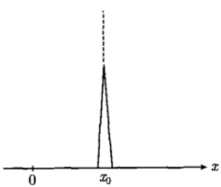

$$  \delta(x-x_{0})=\left\{\begin{array}{ll}0&(x\neq x_{0})\\\infty&(x=x_{0})\end{array}\right.   \tag*{(3.2.1)}$$

这意味着  $ \delta $ 函数是无限高且无穷窄的 (图 3.2)。它的第二个特征是

图 3.2  $ \delta $ 函数  $ \delta(x-x_{0}) $
 

$$  \int_{-\infty}^{\infty}\delta(x-x_{0})\mathrm{d}x=1   \tag*{(3.2.2)}$$

即  $ \delta $ 函数有单位面积。这两个特征作为  $ \delta $ 函数的定义是缺一不可的。

 $ \delta $ 函数的定义直接导致它的另一个重要性质：对于任何一个连续函数  $ f(x) $ 都有

$$  \int_{-\infty}^{\infty}f(x)\delta(x-x_{0})\mathrm{d}x=f(x_{0})   \tag*{(3.2.3)}$$

证明 因为  $ \delta(x-x_{0}) $ 在  $ x_{0} $ 以外的任何地方均为零，因此，式(3.2.3)左边的积分范围可以写成  $ [x_{0}-\varepsilon, x_{0}+\varepsilon] $。其中， $ \varepsilon $ 是一个无穷小量，在这样一个无穷窄的区间内， $ f(x) $ 可以被它的中间值  $ f(x_{0}) $ 代替，于是

 $$ \begin{aligned}\int_{-\infty}^{\infty}f(x)\delta(x-x_{0})\mathrm{d}x&=\int_{x_{0}-\varepsilon}^{x_{0}+\varepsilon}f(x)\delta(x-x_{0})\mathrm{d}x\\&=f(x_{0})\int_{x_{0}-\varepsilon}^{x_{0}+\varepsilon}\delta(x-x_{0})\mathrm{d}x\\&=f(x_{0})\end{aligned} $$

<!-- page: 55 -->

可以看出， $ \delta $ 函数的作用是通过式(3.2.3)左边的积分将  $ f(x) $ 在  $ x_{0} $ 的值  $ f(x_{0}) $ 选出来，所以式(3.2.3)称为  $ \delta $ 函数的“筛选”性质。

当  $ x_{0}=0 $ 时，上述结果约化为

$$  \delta(x)=\left\{\begin{array}{l l}0&(x\neq0)\\ \infty&(x=0)\end{array}\right.   \tag*{(3.2.4)}$$

$$  \int_{-\infty}^{\infty}\delta(x)\mathrm{d}x=1   \tag*{(3.2.5)}$$

$$  \int_{-\infty}^{\infty}f(x)\delta(x)\mathrm{d}x=f(0)   \tag*{(3.2.6)}$$

我们进一步分析  $ \delta $ 函数的物理含义，从式 (3.2.1) 看， $ \delta $ 函数是一个点源函数，可以表示许多特殊的物理量。比如，位于  $ x_0 $ 而质量为 m 的质点的线密度为  $ m\delta(x-x_0) $；位于  $ x_0 $ 而电量为 q 的点电荷的线密度为  $ q\delta(x-x_0) $；冲量 k 在  $ x_0 $ 位置作用而产生的冲量密度为  $ k\delta(x-x_0) $。另一方面，从式 (3.2.2) 看， $ \delta $ 函数又是一个归一化的分布函数，因此式 (3.2.3) 右边的  $ f(x_0) $ 可以理解为物理量  $ f(x) $ 在这个分布中的平均值。无论作为点源函数还是分布函数， $ \delta(x-x_0) $ 是有量纲的： $ [\delta(x)] = 1/[x] $。比如，在电荷线密度中， $ \delta(x-x_0) $ 具有坐标倒数的量纲。而作为分布函数， $ \delta(x-x_0) $ 可以具有众多不同的量纲（依赖于哪个物理量的分布），如波长分布、质量分布、浓度分布等。具体情况我们将在随后的有关章节中详细讨论。

#### 3.2.2  $ \delta $ 函数的性质

本节将通过不同类型的例题进一步讨论  $ \delta $ 函数的性质。

例 1 证明  $ \delta $ 函数是偶函数。

证明 设  $ f_{1}(x)=\delta(x-x_{1}) $， $ f_{2}(x)=\delta(x-x_{2}) $，作积分  $ \int_{-\infty}^{\infty}f_{1}(x)f_{2}(x)\mathrm{d}x $，并利用式(3.2.3)，得到

$$  \int_{-\infty}^{\infty}f_{1}(x)f_{2}(x)\mathrm{d}x=\int_{-\infty}^{\infty}\delta(x-x_{1})f_{2}(x)\mathrm{d}x=f_{2}(x_{1})=\delta(x_{1}-x_{2})   \tag*{(3.2.7a)}$$

$$  \int_{-\infty}^{\infty}f_{1}(x)f_{2}(x)\mathrm{d}x=\int_{-\infty}^{\infty}f_{1}(x)\delta(x-x_{2})\mathrm{d}x=f_{1}(x_{2})=\delta(x_{2}-x_{1})   \tag*{(3.2.7b)}$$

式(3.2.7)的两式相等，故

$$  \delta(x_{1}-x_{2})=\delta(x_{2}-x_{1})   \tag*{(3.2.8)}$$

若  $ x_{2}-x_{1}=x $，则

$$  \delta(-x)=\delta(x)   \tag*{(3.2.9)}$$

<!-- page: 56 -->

所以  $ \delta $ 函数是偶函数。

例2 讨论  $ \delta $ 函数与函数  $ f(x)(-\infty < x < \infty) $ 的卷积。

解 首先， $ \delta(x) $ 函数与  $ f(x) $ 的卷积给出  $ f(x) $ 本身

$$  \delta(x)*f(x)=\int_{-\infty}^{\infty}f(\xi)\delta(x-\xi)\mathrm{d}\xi=f(x)   \tag*{(3.2.10)}$$

而  $ \delta(x-a) $ 与  $ f(x) $ 的卷积为

$$  \delta(x-a)*f(x)=\int_{-\infty}^{\infty}\delta(\xi-a)f(x-\xi)\mathrm{d}\xi=f(x-a)   \tag*{(3.2.11)}$$

可见卷积结果是将  $ f(x) $ 平移了一段距离 a，如图 3.3 所示。

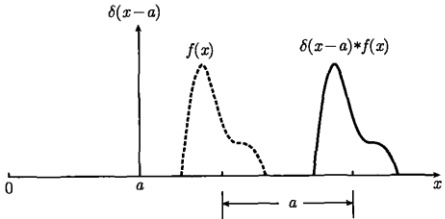

图 3.3  $ \delta(x-a) $ 与  $ f(x) $ 的卷积给出  $ f(x-a) $
 

两个  $ \delta $ 函数的卷积为

$$  \delta(x-a)*\delta(x-b)=\int_{-\infty}^{\infty}\delta(\xi-a)\delta(x-\xi-b)\mathrm{d}\xi=\delta\left[x-(a+b)\right]   \tag*{(3.2.12)}$$

上述  $ \delta $ 函数的卷积性质在计算机运算中是很有用的。

例 3 在量子力学中，坐标 x 是一个算符，证明  $ \delta $ 函数满足算符 x 的本征方程

$$  x\delta(x-x_{0})=x_{0}\delta(x-x_{0})   \tag*{(3.2.13)}$$

其中， $ x_{0} $ 是本征值，并进而讨论本征函数  $ \delta(x-x_{0}) $ 的正交归一性和完备性。

证明 在式(3.2.6)左边的积分中取  $ f(x)=x $，则积分筛选出 x 在 0 的取值，即

$$  \int_{-\infty}^{\infty}f(x)\delta(x)\mathrm{d}x=\int_{-\infty}^{\infty}x\delta(x)\mathrm{d}x=0   \tag*{(3.2.14)}$$

该定积分结果为零有两种可能：一是被积函数  $ x\delta(x)=0 $；二是被积函数  $ x\delta(x) $ 随 x 变化在积分区间出现正负面积相等的情况。现在， $ x\delta(x) $ 在 0 以外的任何地方为零，不可能出现后一种可能，因此必定有

$$  x\delta(x)=0   \tag*{(3.2.15)}$$

<!-- page: 57 -->

其中，x 是任意的，现在用 x - x_{0} 代换其中的 x，得到

$$  (x-x_{0})\delta(x-x_{0})=0   \tag*{(3.2.16)}$$

它给出本征方程(3.2.13)。

本征函数  $ \delta(x-x_{0}) $ 对于本征值  $ x_{0} $ 的连续变化，构成了本征函数集合  $ \{\delta(x-x_{0})\} $。为了讨论本征函数的正交归一性，从集合  $ \{\delta(x-x_{0})\} $ 中取出两个本征函数  $ \delta(x-x_{1}) $ 和  $ \delta(x-x_{2}) $ 作积分，再利用式(3.2.3)，我们得到

$$  \int_{-\infty}^{\infty}\delta(x-x_{1})\delta(x-x_{2})\mathrm{d}x=\delta(x_{1}-x_{2})   \tag*{(3.2.17)}$$

这就是坐标算符 x 的本征函数的正交归一性表达式，由于本征值  $ x_{0} $ 的变化形成了连续谱，积分结果归于  $ \delta $ 函数，而不像分立谱情况下归于  $ \delta_{mn} $ 符号 [见式 (2.1.4)]。

 $ \delta $ 函数的完备性是

$$  f(x)=\int_{-\infty}^{\infty}f(\xi)\delta(\xi-x)\mathrm{d}\xi   \tag*{(3.2.18)}$$

它表示任意一个连续函数  $ f(x) $ 可以按照坐标算符的本征函数集  $ \{\delta(\xi-x)\} $ 展开。

例4 讨论  $ \delta $ 函数的傅里叶变换。

解  $ \delta(x-x_{0}) $ 函数满足绝对可积条件 (2.3.1)，它的傅里叶变换为

$$  \mathcal{F}\left\{\delta(x-x_{0})\right\}=\int_{-\infty}^{\infty}\delta(x-x_{0})\mathrm{e}^{-\mathrm{i}\omega x}\mathrm{d}x=\mathrm{e}^{-\mathrm{i}\omega x_{0}}   \tag*{(3.2.19a)}$$

其中利用了  $ \delta $ 函数的筛选性质 (3.2.6)。当  $ x_{0}=0 $ 时，式 (3.2.19a) 给出

$$  \mathcal{F}\left\{\delta(x)\right\}=1   \tag*{(3.2.19b)}$$

由于  $ \delta(x) $ 函数在定义区间  $ (-\infty, \infty) $ 没有间断点，因此反变换积分收敛于

$$  \delta(x)=\frac{1}{2\pi}\int_{-\infty}^{\infty}\mathrm{e}^{\mathrm{i}\omega x}\mathrm{d}\omega   \tag*{(3.2.20)}$$

根据  $ \delta(x) $ 的偶函数性质 (3.2.9)，式 (3.2.20) 还可以写为

$$  \delta(x)=\frac{1}{2\pi}\int_{-\infty}^{\infty}\mathrm{e}^{-\mathrm{i}\omega x}\mathrm{d}\omega   \tag*{(3.2.21)}$$

即

$$  2\pi\delta(\omega)=\int_{-\infty}^{\infty}\mathrm{e}^{-\mathrm{i}\omega x}\mathrm{d}x   \tag*{(3.2.22)}$$

<!-- page: 58 -->

我们有  $ \mathcal{F}\{\delta(x)\}=1 $ 与  $ \mathcal{F}\{1\}=2\pi\delta(\omega) $，这样 1 与  $ \delta(x) $ 构成了一个傅里叶变换对。另外式 (3.2.20) 与式 (3.2.22) 给出

$$  \int_{-\infty}^{\infty}\mathrm{e}^{-\mathrm{i}\omega x}\mathrm{d}x=\int_{-\infty}^{\infty}\mathrm{e}^{\mathrm{i}\omega x}\mathrm{d}x   \tag*{(3.2.23)}$$

这是一个有趣的结果。

式(3.2.21)可以变为

$$  \delta(x)=\frac{1}{2\pi a}\int_{-\infty}^{\infty}\mathrm{e}^{\frac{\mathrm{i}}{a}(a\omega)x}\mathrm{d}\left(a\omega\right)=\frac{1}{2\pi a}\int_{-\infty}^{\infty}\mathrm{e}^{\frac{\mathrm{i}}{a}kx}\mathrm{d}k\quad(k=a\omega)   \tag*{(3.2.24)}$$

其中，a 是常数，即

$$  \delta(x)=\frac{1}{2\pi a}\int_{-\infty}^{\infty}\mathrm{e}^{\frac{\mathrm{i}}{a}px}\mathrm{d}p   \tag*{(3.2.25)}$$

将 x 换成  $ p - p' $，将积分变量换成 x，得到

$$  \delta(p-p^{\prime})=\frac{1}{2\pi a}\int_{-\infty}^{\infty}\mathrm{e}^{\frac{1}{a}(p-p^{\prime})x}\mathrm{d}x   \tag*{(3.2.26)}$$

式（3.2.25）和式（3.2.26）在量子力学中有特别的物理意义。

例 5 讨论动量本征函数（见 1.2.1 节，例 4）的正交归一性和完备性。

解 式 (1.2.13a) 给出动量本征函数

$$  \psi_{p}(x)=c\exp\left(\frac{\mathrm{i}}{\hbar}p x\right)   \tag*{(3.2.27)}$$

其中，本征值 p 的变化组成连续谱。为了讨论动量本征函数的正交归一性，从集合  $ \{\psi_{p}(x)\} $ 中取出两个本征函数作积分，得到

$$  \begin{aligned}\int_{-\infty}^{\infty}\psi_{p^{\prime}}^{*}(x)\cdot\psi_{p}(x)\mathrm{d}x&=\int_{-\infty}^{\infty}c^{*}\exp\left(-\frac{\mathrm{i}}{\hbar}p^{\prime}x\right)\cdot c\exp\left(\frac{\mathrm{i}}{\hbar}p x\right)\mathrm{d}x\\&=\left|c\right|^{2}\int_{-\infty}^{\infty}\exp\left[\frac{\mathrm{i}}{\hbar}(p-p^{\prime})x\right]\mathrm{d}x\quad\left[ 利用式 (3.2.2\right.\\&=\left|c\right|^{2}\left[2\pi\hbar\delta(p-p^{\prime})\right]\quad\left( 取 c=\frac{1}{\sqrt{2\pi\hbar}}\right)\\&=\delta(p-p^{\prime})\end{aligned}   \tag*{[3.2.26]}$$

这就是动量算符的本征函数的正交归一性表达式，其实这个结果是式(3.2.26)在 $ a=\hbar $时的特殊情况。与坐标本征函数类似，动量本征函数的正交归一性也是归于 $ \delta $函数。而归一化的动量本征函数为

$$  \psi_{p}(x)=\frac{1}{\sqrt{2\pi\hbar}}\exp\left(\frac{\mathrm{i}}{\hbar}p x\right)   \tag*{(3.2.28)}$$

<!-- page: 59 -->

为了讨论动量算符的本征函数的完备性，将式(3.1.4)写为

 $$ \begin{aligned}f(x)&=\frac{1}{2\pi a}\int_{-\infty}^{\infty}F(a\omega)\mathrm{e}^{\frac{\mathrm{i}}{a}(a\omega)x}\mathrm{d}\left(a\omega\right)\quad(p=a\omega)\\&=\frac{1}{2\pi a}\int_{-\infty}^{\infty}F(p)\mathrm{e}^{\frac{\mathrm{i}}{a}p x}\mathrm{d}p\end{aligned} $$ 

取 $ a=\hbar $，得到

$$  f(x)=\frac{1}{2\pi\hbar}\int_{-\infty}^{\infty}F(p)\mathrm{e}^{\frac{1}{\hbar}p x}\mathrm{d}p=\frac{1}{\sqrt{2\pi\hbar}}\int_{-\infty}^{\infty}F(p)\psi_{p}(x)\mathrm{d}p   \tag*{(3.2.29)}$$

式(3.2.29)就是动量本征函数(3.2.28)的完备性表达式，它表示任意一个连续函数 $ f(x) $可以按照动量本征函数集 $ \{\psi_{p}(x)\} $展开。而展开系数正比于 $ f(x) $的傅里叶变换 $ F(\omega) $。特别是，在式(3.2.25)中取 $ a=\hbar $，得到

$$  \delta(x)=\frac{1}{2\pi\hbar}\int_{-\infty}^{\infty}\mathrm{e}^{\frac{i}{\hbar}px}\mathrm{d}p=\frac{1}{\sqrt{2\pi\hbar}}\int_{-\infty}^{\infty}\psi_{p}(x)\mathrm{d}p   \tag*{(3.2.30)}$$

它是  $ \delta(x) $ 函数按动量本征函数集  $ \{\psi_{p}(x)\} $ 的展开式。

#### 3.2.3  $ \delta $ 函数的辅助函数

本节讨论  $ \delta $ 函数的辅助函数。这个问题的提出是基于 3.2.1 节所述的  $ \delta $ 函数的两个特征：

(1)  $ \delta(x) $ 在 x=0 为无穷大，在其他处为零；

(2)  $ \delta(x) $ 是归一化的分布函数:  $ \int_{-\infty}^{\infty}\delta(x)\mathrm{d}x=1 $。

按照这两个特征，我们考虑一个定义在区间 $ (-∞,∞) $上的函数 $ F_{\beta}(x) $，它在x=0取最大值 $ F_{\beta}(0) $， $ \beta $是一个参量。如果 $ F_{\beta}(x) $对于每一个 $ \beta $值都满足归一化条件

$$  \int_{-\infty}^{\infty}F_{\beta}(x)\mathrm{d}x=1   \tag*{(3.2.31)}$$

而且它的峰值  $ F_{\beta}(0) $ 随着参量  $ \beta $ 的变化不断升高，并在  $ \beta $ 取极限值  $ \beta_{0} $ 时趋于无穷大，那么这个函数的极限形式就是  $ \delta $ 函数

$$  \lim_{\beta\to\beta_{0}}F_{\beta}(x)=\delta(x)   \tag*{(3.2.32)}$$

这样的函数  $ F_{\beta}(x) $ 称为  $ \delta $ 函数的辅助函数。其实许多函数都具有这样的特征，最简单的辅助函数是

$$  U(x)=\left\{\begin{array}{ll}\displaystyle\frac{1}{2\beta}&(|x|\leq\beta)\\0&(|x|>\beta)\end{array}\right.   \tag*{(3.2.33a)}$$

<!-- page: 60 -->

而最常见的辅助函数是

$$  V(x)=\frac{\sin\beta x}{\pi x}   \tag*{(3.2.33b)}$$

它们的曲线如图3.4所示， $ U(x) $ 和  $ V(x) $ 在极限情况下均趋于  $ \delta $ 函数

 $$ \lim_{\beta\to0}U(x)=\delta(x),\quad\lim_{\beta\to\infty}V(x)=\delta(x) $$ 

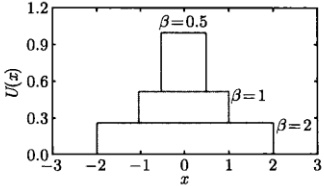

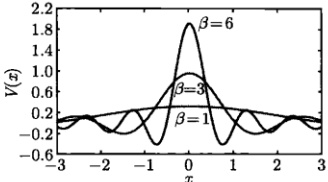

图 3.4 式 (3.2.33) 所示的函数
 

我们进而考查下列熟知的函数

$$  G(x-a)=\frac{1}{\sqrt{\pi\beta}}\exp\left[-\frac{(x-a)^2}{\beta}\right]   \tag*{(3.2.34a)}$$

$$  L(x-a)=\frac{1}{\pi}\frac{\beta}{(x-a)^{2}+\beta^{2}}   \tag*{(3.2.34b)}$$

$$  S(x-a)=\frac{\beta}{\pi(x-a)^{2}}\sin^{2}\left(\frac{x-a}{\beta}\right)   \tag*{(3.2.34c)}$$

$$  E(x-a)=\frac{1}{2\beta}\exp\left(-\frac{|x-a|}{\beta}\right)   \tag*{(3.2.34d)}$$

这些函数都是定义在区间  $ (-\infty, \infty) $ 上的归一化分布函数，都在 x = a 取最大值，参数  $ \beta > 0 $。它们的峰值分别为

 $$ G(0)=\frac{1}{\sqrt{\pi\beta}},L(0)=\frac{1}{\pi\beta},S(0)=\frac{1}{\pi\beta},E(0)=\frac{1}{2\beta} $$ 

当参数  $ \beta $ 逐渐变小时，这些峰值不断升高，如图 3.5 所示。而在极限  $ \beta \to 0 $，它们均趋于无穷大，于是这些函数的极限形式均是  $ \delta(x - a) $ 函数，即

$$  \lim_{\beta\to0}\frac{1}{\sqrt{\pi\beta}}\exp\left[-\frac{(x-a)^2}{\beta}\right]=\delta(x-a)   \tag*{(3.2.35a)}$$

$$  \lim_{\beta\to0}\frac{1}{\pi}\frac{\beta}{(x-a)^{2}+\beta^{2}}=\delta(x-a)   \tag*{(3.2.35b)}$$

<!-- page: 61 -->

$$  \lim_{\beta\to0}\frac{\beta}{\pi(x-a)^{2}}\sin^{2}\left(\frac{x-a}{\beta}\right)=\delta(x-a)   \tag*{(3.2.35c)}$$

$$  \lim_{\beta\to0}\frac{1}{2\beta}\exp\left(-\frac{|x-a|}{\beta}\right)=\delta(x-a)   \tag*{(3.2.35d)}$$

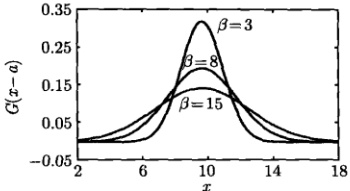

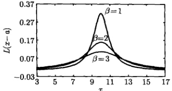

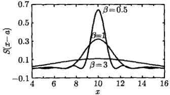

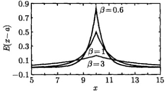

图 3.5 来自式 (3.2.34) 的函数。对于每一个函数，随着参量  $ \beta $ 的逐渐减小，峰值不断升高，在极限  $ \beta \to 0 $ 时，趋于  $ \delta(x - a) $ 函数
 

式 (3.2.34) 的函数都是在区间  $ (-\infty, \infty) $ 上的归一化分布函数。而某些函数在有限区间  $ [-a, a] $ 内是归一化分布函数，其极限行为也具有  $ \delta $ 函数的两个特征。一个典型的例子是函数

$$  C(x,b)=\frac{1}{2\pi}\frac{1-b^{2}}{1-2b\cos x+b^{2}}   \tag*{(3.2.36)}$$

其中，0 < b < 1，这是一个关于 x 的偶函数，它在区间  $ [-π, π] $ 上是归一化的

$$  \int_{-\pi}^{\pi}C(x,b)\mathrm{d}x=1   \tag*{(3.2.37)}$$

 $ C(x,b) $ 在 x=0 取峰值

$$  C(0,b)=\frac{1}{2\pi}\frac{1+b}{1-b}   \tag*{(3.2.38)}$$

当参数 b 增大时，峰值  $ C(0,b) $ 升高，如图 3.6(a) 所示。在极限  $ b \to 1 $ 时，式 (3.2.38) 给出峰值  $ C(0,1) \to \infty $，即

$$  \lim_{b\to1}C(x,b)=\frac{1}{2\pi}\lim_{b\to1}\frac{1-b^2}{1-2b\cos x+b^2}=\delta(x)   \tag*{(3.2.39)}$$

<!-- page: 62 -->

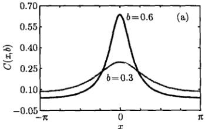

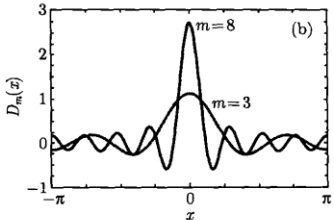

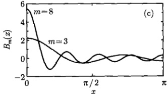

图 3.6 (a) 分布函数 (3.2.36); (b) 狄利克雷内核 (3.2.45); (c) 狄利克雷倍核 (3.2.49) 现在我们考查  $ \delta $ 函数的另一个辅助函数，它基于求和式
 

$$  1+2\cos x+2\cos2x+\cdots+2\cos mx   \tag*{(3.2.40)}$$

我们首先计算这个求和，利用

$$  \sin\frac{1}{2}x\cos nx=\frac{1}{2}\left[\sin\left(n+\frac{1}{2}\right)x-\sin\left(n-\frac{1}{2}\right)x\right]   \tag*{(3.2.41)}$$

得到

 $$ \begin{aligned}&2\sin\frac{1}{2}x\left(\cos x+\cos2x+\cdots+\cos mx\right)\\=&\left(\sin\frac{3}{2}x-\sin\frac{1}{2}x\right)+\left(\sin\frac{5}{2}x-\sin\frac{3}{2}x\right)+\left(\sin\frac{7}{2}x-\sin\frac{5}{2}x\right)+\cdots\\&+\left[\sin\left(m+\frac{1}{2}\right)x-\sin\left(m-\frac{1}{2}\right)x\right]\\=&\sin\left(m+\frac{1}{2}\right)x-\sin\frac{1}{2}x\end{aligned} $$ 

两边同除以  $ \sin\frac{1}{2}x $，得到

$$  1+2\cos x+2\cos2x+\cdots+2\cos mx=\frac{\sin\left(m+\frac{1}{2}\right)x}{\sin\frac{1}{2}x}   \tag*{(3.2.42)}$$

<!-- page: 63 -->

式(3.2.42)两边在区间 $ [-\pi,\pi] $积分，因为所有的余弦项积分为零，得到

$$  \int_{-\pi}^{\pi}\frac{\sin\left(m+\frac{1}{2}\right)x}{\sin\frac{1}{2}x}\mathrm{d}x=2\pi   \tag*{(3.2.43)}$$

它可以写成

$$  \int_{-\pi}^{\pi}D_{m}(x)\mathrm{d}x=1   \tag*{(3.2.44)}$$

其中

$$  D_{m}(x)=\frac{1}{2\pi}\frac{\sin\left(m+\frac{1}{2}\right)x}{\sin\frac{1}{2}x}   \tag*{(3.2.45)}$$

称为狄利克雷内核 (Dirichlet kernel)。可以看出， $ D_{m}(x) $ 是偶函数且是区间  $ [-\pi, \pi] $ 上的归一化分布函数 [与函数 (3.2.36) 类似]。 $ D_{m}(x) $ 在 x = 0 取峰值

$$  D_{m}(0)=\frac{1}{2\pi}\lim_{x\to0}\frac{\sin\left(m+\frac{1}{2}\right)x}{\sin\frac{1}{2}x}=\frac{1}{2\pi}\left(2m+1\right)   \tag*{(3.2.46)}$$

 $ D_{m}(x) $ 对于不同的 m 值显示在图 3.6(b)。很明显，随着 m 的增加，其峰值  $ D_{m}(0) $ 线性地升高；在  $ m \to \infty $ 时， $ D_{m}(0) \to \infty $，因此， $ D_{m}(x) $ 是  $ \delta $ 函数的辅助函数

$$  \lim_{m\to\infty}D_{m}(x)=\frac{1}{2\pi}\lim_{m\to\infty}\frac{\sin\left(m+\frac{1}{2}\right)x}{\sin\frac{1}{2}x}=\delta(x)   \tag*{(3.2.47)}$$

另外，注意到  $ D_{m}(x) $ 是偶函数，故式 (3.2.44) 给出

$$  \int_{0}^{\pi}D_{m}(x)\mathrm{d}x=\frac{1}{2}   \tag*{(3.2.48)}$$

我们引入狄利克雷倍核  $ B_{m}(x) $，它是狄利克雷内核的 2 倍

$$  B_{m}(x)=2D_{m}(x)=\frac{1}{\pi}\frac{\sin\left(m+\frac{1}{2}\right)x}{\sin\frac{1}{2}x}   \tag*{(3.2.49)}$$

这样

$$  \int_{0}^{\pi}B_{m}(x)\mathrm{d}x=1   \tag*{(3.2.50)}$$

<!-- page: 64 -->

需要注意，函数  $ B_{m}(x) $ 在区间  $ [0,\pi] $ 上虽然不是对称的，但式 (3.2.50) 表示它是该区间上的归一化分布函数。而且随着 m 的增加，其峰值  $ B_{m}(0)=(2m+1)/\pi $ 线性地升高，如图 3.6(c) 所示，并在  $ m \to \infty $ 时， $ B_{m}(0) \to \infty $，因此  $ B_{m}(x) $ 也是  $ \delta $ 函数的辅助函数：

$$  \lim_{m\to\infty}B_{m}(x)=\frac{1}{\pi}\lim_{m\to\infty}\frac{\sin\left(m+\frac{1}{2}\right)x}{\sin\frac{1}{2}x}=\delta(x)   \tag*{(3.2.51)}$$

有了式（3.2.47）和式（3.2.51），我们可以便捷地证明式（2.1.7）所示的狄利克雷定理。

#### 3.2.4 狄利克雷定理的证明

狄利克雷定理是傅里叶变换理论的核心，它确定了傅里叶级数（以及由它扩展而来的傅里叶积分和傅里叶变换）

$$  a_{0}+\sum_{n=1}^{\infty}(a_{n}\cos nx+b_{n}\sin nx)   \tag*{(3.2.52)}$$

的收敛行为。我们已经看到（并且还会继续看到），在讨论每一个级数（或积分）收敛行为的过程中，狄利克雷定理都自然给出相应的求和（或积分）公式，其作用过程非常奇妙，应用非常广泛，这些公式是傅里叶变换理论的重要产物。不过按照传统方法，狄利克雷定理的证明过程相当复杂。这里我们借助狄利克雷内核和狄利克雷倍核在极限情况下的  $ \delta(x) $ 函数形式，可以使之变得相当简单。

我们的出发点是傅里叶级数（3.2.52）的部分和

$$  S_{m}(x)=a_{0}+\sum_{n=1}^{m}\left(a_{n}\cos nx+b_{n}\sin nx\right)   \tag*{(3.2.53)}$$

现在，我们对一个周期为  $ 2\pi $ 的函数  $ f(x) $ 计算  $ S_{m}(x) $，从  $ L=\pi $ 时的式 (2.1.9b) 和式 (2.1.9c) 得到

 $$ \begin{aligned}a_{n}\cos nx+b_{n}\sin nx&=\frac{\cos nx}{\pi}\int_{-\pi}^{\pi}f(t)\cos nt\mathrm{d}t+\frac{\sin nx}{\pi}\int_{-\pi}^{\pi}f(t)\sin nt\mathrm{d}t\\&=\frac{1}{\pi}\int_{-\pi}^{\pi}f(t)\left(\cos nt\cos nx+\sin nt\sin nx\right)\mathrm{d}t\\&=\frac{1}{\pi}\int_{-\pi}^{\pi}f(t)\cos n(x-t)\mathrm{d}t\\ \end{aligned} $$ 

再利用  $ L=\pi $ 时的式 (2.1.9a)，得到部分和

 $$ S_{m}(x)=\frac{1}{2\pi}\int_{-\pi}^{\pi}f(t)\mathrm{d}t+\frac{1}{\pi}\sum_{n=1}^{m}\int_{-\pi}^{\pi}f(t)\cos n(x-t)\mathrm{d}t $$

<!-- page: 65 -->

$$  \begin{aligned}&=\frac{1}{2\pi}\int_{-\pi}^{\pi}f(t)\left[1+2\sum_{n=1}^{m}\cos n(x-t)\right]\mathrm{d}t\quad\left[ 利用式 (3.2.42)\right.\\&=\int_{-\pi}^{\pi}f(t)\frac{\sin\left(m+\frac{1}{2}\right)(x-t)}{2\pi\sin\frac{1}{2}(x-t)}\mathrm{d}t\quad\left[ 利用式 (3.2.45)\right]\\&=\int_{-\pi}^{\pi}f(t)D_{m}(x-t)\mathrm{d}t\end{aligned}   \tag*{(3.2.54)}$$

现在考虑  $ m \to \infty $ 的极限情况，利用式 (3.2.47) 得到

$$  \lim_{m\to\infty}S_{m}(x)=\int_{-\pi}^{\pi}f(t)\delta(x-t)\mathrm{d}t=f(x)   \tag*{(3.2.55a)}$$

这里假定函数  $ f(x) $ 是连续的，可以利用  $ \delta $ 函数的筛选性质，式 (3.2.55a) 即为

$$  a_{0}+\sum_{n=1}^{\infty}(a_{n}\cos nx+b_{n}\sin nx)=f(x)   \tag*{(3.2.55b)}$$

至此，我们证明了狄利克雷定理在函数连续点的正确性。

现在考虑  $ f(x) $ 在 x 点不连续的情况。将式 (3.2.54) 的积分分成两部分，并利用  $ D_{m}(x) $ 的偶函数性质，得到

$$  \begin{aligned}S_{m}(x)&=\frac{1}{2}\underbrace{\int_{-\pi}^{\pi}f(t)D_{m}(x-t)\mathrm{d}t}_{ 令 x-t=y}+\frac{1}{2}\underbrace{\int_{-\pi}^{\pi}f(t)D_{m}(t-x)\mathrm{d}t}_{ 令 t-x=z}\\&=\frac{1}{2}\left[\int_{x-\pi}^{x+\pi}f(x-y)D_{m}(y)\mathrm{d}y+\int_{-\pi-x}^{\pi-x}f(x+z)D_{m}(z)\mathrm{d}z\right]\\&=\frac{1}{2}\left[\int_{-\pi}^{\pi}f(x-t)D_{m}(t)\mathrm{d}t+\int_{-\pi}^{\pi}f(x+t)D_{m}(t)\mathrm{d}t\right]\\ \end{aligned}   \tag*{(3.2.56)}$$

最后一步的得出是因为被积函数有  $ 2\pi $ 周期，积分范围可以用任一长度为  $ 2\pi $ 的区间代替 [见式 (2.1.10)]。现在将式 (3.2.56) 中的积分分成两段： $ [-π, π] \to [-π, 0] + [0, π] $，我们有

 $$ \begin{aligned}S_{m}(x)&=\frac{1}{2}\underbrace{\int_{-\pi}^{0}f(x-t)D_{m}(t)\mathrm{d}t}_{t=-T}+\frac{1}{2}\int_{0}^{\pi}f(x-t)D_{m}(t)\mathrm{d}t\\&\quad+\frac{1}{2}\underbrace{\int_{-\pi}^{0}f(x+t)D_{m}(t)\mathrm{d}t}_{t=-T}+\frac{1}{2}\int_{0}^{\pi}f(x+t)D_{m}(t)\mathrm{d}t\quad[D_{m}(-x)=D_{m}(x)]\end{aligned} $$

<!-- page: 66 -->

$$ \begin{aligned}&=\frac{1}{2}\int_{0}^{\pi}f(x+T)D_{m}(T)\mathrm{d}T+\frac{1}{2}\int_{0}^{\pi}f(x-t)D_{m}(t)\mathrm{d}t\\&\quad+\frac{1}{2}\int_{0}^{\pi}f(x-T)D_{m}(T)\mathrm{d}T+\frac{1}{2}\int_{0}^{\pi}f(x+t)D_{m}(t)\mathrm{d}t\\&=\int_{0}^{\pi}f(x-t)D_{m}(t)\mathrm{d}t+\int_{0}^{\pi}f(x+t)D_{m}(t)\mathrm{d}t\quad\left[ 利用式 (3.2.49\right.\\&=\frac{1}{2}\left[\int_{0}^{\pi}f(x-t)B_{m}(t)\mathrm{d}t+\int_{0}^{\pi}f(x+t)B_{m}(t)\mathrm{d}t\right]\end{aligned} $$ 

现在考虑  $ m \to \infty $ 的极限情况，利用式 (3.2.51) 得到

$$  \lim_{m\to\infty}S_{m}(x)=\frac{1}{2}\left[\int_{0}^{\pi}f(x-t)\delta(t)\mathrm{d}t+\int_{0}^{\pi}f(x+t)\delta(t)\mathrm{d}t\right]   \tag*{(3.2.57)}$$

式(3.2.57)的两个积分区间均为  $ 0 \leqslant t \leqslant \pi $，因此两个积分分别相应于间断点 x 左侧的函数  $ f(x-t) $ 与右侧的函数  $ f(x+t) $，它们在各自的区域都是连续的。因此可以利用  $ \delta $ 函数的筛选性质积分得到

$$  \lim_{m\to\infty}S_{m}(x)=\frac{f(x-0)+f(x+0)}{2}   \tag*{(3.2.58)}$$

这表示在  $ f(x) $ 的间断点，有

$$  a_{0}+\sum_{n=1}^{\infty}(a_{n}\cos nx+b_{n}\sin nx)=\frac{f(x-0)+f(x+0)}{2}   \tag*{(3.2.59)}$$

这样，我们完整地证明了狄利克雷定理(2.1.7)。需要指出，由于这里采用了狄利克雷内核 $ D_{m}(x) $和狄利克雷倍核 $ B_{m}(x) $在 $ m\to\infty $时的 $ \delta(x) $函数形式，上述证明过程比传统的方法要简单得多。此例也显示了 $ \delta $函数的奇特用途。

### 3.3 典型函数的傅里叶变换

傅里叶变换存在的绝对可积条件，即式(2.3.1)，是一个充分条件，但不是必要的条件，比如  $ \sin x $、 $ \cos x $ 函数、单位阶跃函数、符号函数等都不满足绝对可积条件，但它们的傅里叶变换确实存在，而且这些函数的傅里叶变换有重要的应用价值。另外，无论所讨论的函数是否满足绝对可积条件，一旦求出它们的傅里叶变换  $ F(\omega) $，就可以利用式(3.1.4)进一步计算傅里叶反变换积分，在考查积分收敛的同时，会自然得出一些很有用的积分公式。我们在本节将计算这些函数及其他典型函数的傅里叶变换，并引出若干积分公式与相关的重要结果。

例 1 求函数  $ \sin kx $ 和  $ \cos kx $ 的傅里叶变换，其中，k 是实常数。

<!-- page: 67 -->

解 函数  $ \sin kx $ 和  $ \cos kx $ 虽然不满足绝对可积条件式 (2.3.1)，但代入式 (3.1.3) 后可以进行计算，事实上

$$  \begin{aligned}\int_{-\infty}^{\infty}\sin kx\mathrm{e}^{-\mathrm{i}\omega x}\mathrm{d}x&=\frac{1}{2\mathrm{i}}\int_{-\infty}^{\infty}\left(\mathrm{e}^{\mathrm{i}kx}-\mathrm{e}^{-\mathrm{i}kx}\right)\mathrm{e}^{-\mathrm{i}\omega x}\mathrm{d}x\\&=\frac{1}{2\mathrm{i}}\left[\int_{-\infty}^{\infty}\mathrm{e}^{-\mathrm{i}(\omega-k)x}\mathrm{d}x-\int_{-\infty}^{\infty}\mathrm{e}^{-\mathrm{i}(\omega+k)x}\mathrm{d}x\right]\quad[ 利用式 (3.2.2)\\&=\frac{1}{2\mathrm{i}}\left[2\pi\delta(\omega-k)-2\pi\delta(\omega+k)\right]\\&=\mathrm{i}\pi\left[\delta(\omega+k)-\delta(\omega-k)\right]\tag{3.3}\end{aligned}   \tag*{(3.3.1a)}$$

用类似的方法可以求出  $ \cos kx $ 的傅里叶变换

$$  \int_{-\infty}^{\infty}\cos k x\mathrm{e}^{-\mathrm{i}\omega x}\mathrm{d}x=\frac{1}{2}\int_{-\infty}^{\infty}\left(\mathrm{e}^{\mathrm{i}k x}+\mathrm{e}^{-\mathrm{i}k x}\right)\mathrm{e}^{-\mathrm{i}\omega x}\mathrm{d}x=\pi\left[\delta(\omega+k)+\delta(\omega-k)\right]   \tag*{(3.3.1b)}$$

例2 计算函数  $ f(x)=\mathrm{e}^{-|x|} $ 的傅里叶变换。

解 这个函数是式 (3.2.34d) 所示的分布函数，满足绝对可积条件式 (2.3.1)，由式 (3.1.3) 得到它的傅里叶变换

 $$ \begin{aligned}F(\omega)&=\int_{-\infty}^{\infty}\mathrm{e}^{-|x|}\mathrm{e}^{-\mathrm{i}\omega x}\mathrm{d}x\\&=\int_{-\infty}^{0}\mathrm{e}^{x}\mathrm{e}^{-\mathrm{i}\omega x}\mathrm{d}x+\int_{0}^{\infty}\mathrm{e}^{-x}\mathrm{e}^{-\mathrm{i}\omega x}\mathrm{d}x\quad(y=-x)\\&=\int_{0}^{\infty}\mathrm{e}^{-y}\mathrm{e}^{\mathrm{i}\omega y}\mathrm{d}y+\int_{0}^{\infty}\mathrm{e}^{-x}\mathrm{e}^{-\mathrm{i}\omega x}\mathrm{d}x\\&=\int_{0}^{\infty}\mathrm{e}^{-x}\left(\mathrm{e}^{\mathrm{i}\omega x}+\mathrm{e}^{-\mathrm{i}\omega x}\right)\mathrm{d}x\\&=2\int_{0}^{\infty}\mathrm{e}^{-x}\cos\omega x\mathrm{d}x=\frac{2}{1+\omega^{2}}\end{aligned} $$ 

现在，利用这个结果计算反变换积分式(3.1.4)，我们有

 $$ \begin{aligned}f(x)&=\frac{1}{2\pi}\int_{-\infty}^{\infty}F(\omega)\mathrm{e}^{\mathrm{i}\omega x}\mathrm{d}\omega\\&=\frac{1}{\pi}\int_{-\infty}^{\infty}\frac{1}{1+\omega^{2}}\left(\cos\omega x+\mathrm{i}\sin\omega x\right)\mathrm{d}\omega\\&=\frac{2}{\pi}\int_{0}^{\infty}\frac{\cos\omega x}{1+\omega^{2}}\mathrm{d}\omega\end{aligned} $$ 

因为函数  $ f(x) = \mathrm{e}^{-|x|} $ 在区间  $ (-\infty, \infty) $ 没有间断点，该积分收敛于 f，这样我们得到

$$  \int_{0}^{\infty}\frac{\cos\omega x}{1+\omega^{2}}\mathrm{d}\omega=\frac{\pi}{2}\mathrm{e}^{-|x|}   \tag*{(3.3.2)}$$

<!-- page: 68 -->

这是一个很有用的积分公式。特别地，当 x = 0 时

$$  \int_{0}^{\infty}\frac{1}{1+\omega^{2}}\mathrm{d}\omega=\frac{\pi}{2}   \tag*{(3.3.3)}$$

例3 计算函数  $ f(x)=\frac{1}{1+x^{2}} $ 的傅里叶变换。

解 这个函数是式 (3.2.34b) 所示的分布函数，满足绝对可积条件式 (2.3.1)，由式 (3.1.3) 得到它的傅里叶变换

 $$ \begin{aligned}F(\omega)&=\int_{-\infty}^{\infty}\frac{1}{1+x^{2}}\mathrm{e}^{-\mathrm{i}\omega x}\mathrm{d}x\\&=\int_{-\infty}^{\infty}\frac{1}{1+x^{2}}\left(\cos\omega x-\mathrm{i}\sin\omega x\right)\mathrm{d}x\\&=2\int_{0}^{\infty}\frac{\cos\omega x}{1+x^{2}}\mathrm{d}x\quad\left[ 利用式 (3.3.2)\right]\\&=\pi\mathrm{e}^{-|\omega|}\end{aligned} $$ 

现在利用这个结果计算反变换积分式(3.1.4)，得到

$$  f(x)=\frac{1}{2}\int_{-\infty}^{\infty}\mathrm{e}^{-|\omega|}\mathrm{e}^{\mathrm{i}\omega x}\mathrm{d}\omega=\int_{0}^{\infty}\mathrm{e}^{-\omega}\cos\omega x\mathrm{d}\omega   \tag*{(3.3.4)}$$

推导式(3.3.4)采用了例2的计算方法。因为函数 $ f(x)=\frac{1}{1+x^{2}} $在区间 $ (-\infty,\infty) $没有间断点，该积分收敛于f，这样我们得到

$$  \int_{0}^{\infty}\mathrm{e}^{-\omega}\cos\omega x\mathrm{d}\omega=\frac{1}{1+x^{2}}   \tag*{(3.3.5)}$$

这是另一个很有用的积分公式，在例2的计算中就用过它。

以上两个例题显示： $ \mathcal{F}\left\{\frac{1}{1+x^2}\right\}\sim\mathrm{e}^{-|\omega|} $，而 $ \mathcal{F}\left\{\mathrm{e}^{-|x|}\right\}\sim\frac{1}{1+\omega^2} $，因此这两个函数构成一个傅里叶变换对。

例4 计算高斯函数  $ g(x)=\exp\left(-\frac{a}{2}x^{2}\right) $ 的傅里叶变换，其中 a>0。

解 这个函数是式(3.2.34a)所示的高斯分布函数，满足绝对可积条件式(2.3.1)，记它的傅里叶变换为  $ G(\omega) = \mathcal{F}\left\{\exp\left(-\frac{a}{2}x^2\right)\right\} $，由式(3.1.3)得到

 $$ \begin{aligned}G(\omega)&=\int_{-\infty}^{\infty}\exp\left(-\frac{ax^{2}}{2}\right)\mathrm{e}^{-\mathrm{i}\omega x}\mathrm{d}x=\frac{\mathrm{i}}{\omega}\int_{-\infty}^{\infty}\exp\left(-\frac{ax^{2}}{2}\right)\mathrm{d}\left(\mathrm{e}^{-\mathrm{i}\omega x}\right)\\&=\frac{\mathrm{i}}{\omega}\left[\exp\left(-\frac{ax^{2}}{2}\right)\mathrm{e}^{-\mathrm{i}\omega x}\right]_{-\infty}^{\infty}+\frac{\mathrm{i}a}{\omega}\int_{-\infty}^{\infty}x\exp\left(-\frac{ax^{2}}{2}\right)\mathrm{e}^{-\mathrm{i}\omega x}\mathrm{d}x\end{aligned} $$

<!-- page: 69 -->

$$ \begin{aligned}&=\frac{\mathrm{i}a}{\omega}\mathcal{F}\left\{x\exp\left(-\frac{ax^{2}}{2}\right)\right\}\quad[ 利用式 (3.1.17)]\\&=\frac{\mathrm{i}a}{\omega}\left[\mathrm{i}\frac{\mathrm{d}}{\mathrm{d}\omega}G(\omega)\right]=-\frac{a}{\omega}\frac{\mathrm{d}G(\omega)}{\mathrm{d}\omega}\end{aligned} $$ 

它是一个关于  $ G(\omega) $ 的常微分方程

$$  \frac{\mathrm{d}G(\omega)}{\mathrm{d}\omega}+\frac{\omega}{a}G(\omega)=0   \tag*{(3.3.6)}$$

它的解为

$$  G(\omega)=G(0)\exp\left(-\frac{\omega^{2}}{2a}\right)   \tag*{(3.3.7)}$$

而傅里叶变换  $  G(\omega)  $ 在  $ \omega = 0 $ 的值为

$$  G(0)=\int_{-\infty}^{\infty}\exp\left(-\frac{ax^{2}}{2}\right)\mathrm{d}x=\sqrt{\frac{2\pi}{a}}   \tag*{(3.3.8)}$$

这是一个非常有用的积分公式，可以用一个极其简便的方法证明。设 $ I=\int_{-\infty}^{\infty}e^{-bx^2}dx $，取它的平方，利用极坐标 $ (r^2=x^2+y^2,\mathrm{d}x\mathrm{d}y=r\mathrm{d}r\mathrm{d}\theta) $得到

 $$ \begin{aligned}I^{2}&=\int_{-\infty}^{\infty}\mathrm{e}^{-bx^{2}}\mathrm{d}x\int_{-\infty}^{\infty}\mathrm{e}^{-by^{2}}\mathrm{d}y=\int_{-\infty}^{\infty}\int_{-\infty}^{\infty}\mathrm{e}^{-b(x^{2}+y^{2})}\mathrm{d}x\mathrm{d}y\\&=\int_{\theta=0}^{2\pi}\int_{r=0}^{\infty}\mathrm{e}^{-br^{2}}r\mathrm{d}r\mathrm{d}\theta=\int_{0}^{2\pi}\left[-\frac{1}{2b}\mathrm{e}^{-br^{2}}\right]_{0}^{\infty}\mathrm{d}\theta\\&=\frac{1}{2b}\int_{0}^{2\pi}\mathrm{d}\theta=\frac{\pi}{b}\\ \end{aligned} $$ 

开方后给出积分公式(3.3.8)。

 $$ G(\omega)=\sqrt{\frac{2\pi}{a}}\exp\left(-\frac{\omega^{2}}{2a}\right) $$ 

将式(3.3.8)代入式(3.3.7)，得到

这就是高斯函数  $ g(x)=\exp\left(-\frac{a}{2}x^{2}\right) $ 的傅里叶变换。

现在，利用式(3.3.9)计算反变换积分式(3.1.4)，我们有

 $$ \begin{aligned}f(x)&=\frac{1}{\sqrt{2\pi a}}\int_{-\infty}^{\infty}\exp\left(-\frac{\omega^{2}}{2a}\right)\mathrm{e}^{\mathrm{i}\omega x}\mathrm{d}\omega\\&=\frac{1}{\sqrt{2\pi a}}\int_{-\infty}^{\infty}\exp\left(-\frac{\omega^{2}}{2a}\right)(\cos\omega x+\mathrm{i}\sin\omega x)\mathrm{d}\omega\\&=\sqrt{\frac{2}{\pi a}}\int_{0}^{\infty}\exp\left(-\frac{\omega^{2}}{2a}\right)\cos\omega x\mathrm{d}\omega\\ \end{aligned} $$

<!-- page: 70 -->

因为  $ g(x)=\exp\left(-\frac{a}{2}x^{2}\right) $ 在区间  $ (-\infty, \infty) $ 没有间断点，故这个积分收敛于 g，即

$$  \sqrt{\frac{2}{\pi a}}\int_{0}^{\infty}\exp\left(-\frac{\omega^{2}}{2a}\right)\cos\omega x\mathrm{d}\omega=\exp\left(-\frac{ax^{2}}{2}\right)   \tag*{(3.3.10)}$$

在式(3.3.10)中取a=1/2，有

$$  \int_{0}^{\infty}\exp\left(-\omega^{2}\right)\cos\omega x\mathrm{d}\omega=\frac{\sqrt{\pi}}{2}\exp\left(-\frac{x^{2}}{4}\right)   \tag*{(3.3.11)}$$

这是一个重要的积分公式，当 x=0 时给出高斯积分  $ \int_{0}^{\infty}\exp\left(-\omega^{2}\right)\mathrm{d}\omega=\sqrt{\pi}/2 $。

另外在原函数  $ \exp\left(-\frac{a}{2}x^{2}\right) $ 及它的傅里叶变换式 (3.3.9) 中取 a=1，得到

$$  \mathcal{F}\left\{\exp\left(-\frac{x^{2}}{2}\right)\right\}=\sqrt{2\pi}\exp\left(-\frac{\omega^{2}}{2}\right)   \tag*{(3.3.12)}$$

这表明函数  $ \exp\left(-x^{2}/2\right) $ 的傅里叶变换是自身函数形式的再现。这个有趣的情况还出现在下面的例题中。

例 5 计算图 3.7 中的双曲正割函数  $ f(x)=\operatorname{sech} k x (k > 0) $ 的傅里叶变换。

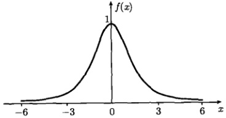

图 3.7 函数  $ f(x)=\operatorname{sech} k x $，这里的曲线取 k=1
 

解 这个函数满足绝对可积条件式 (2.3.1)，由式 (3.1.3) 得到它的傅里叶变换

 $$ \begin{aligned}F(\omega)&=\int_{-\infty}^{\infty}\mathrm{sech}kx\mathrm{e}^{-\mathrm{i}\omega x}\mathrm{d}x\\&=\int_{-\infty}^{\infty}\mathrm{sech}kx\left(\cos\omega x-\mathrm{i}\sin\omega x\right)\mathrm{d}x\\&=2\int_{0}^{\infty}\mathrm{sech}kx\cos\omega x\mathrm{d}x\\&=\frac{\pi}{k}\mathrm{sech}\frac{\pi\omega}{2k}\end{aligned} $$ 

现在，利用这个结果计算反变换积分式(3.1.4)，我们有

<!-- page: 71 -->

$$ \begin{aligned}f(x)&=\frac{1}{2k}\int_{-\infty}^{\infty}\mathrm{sech}\frac{\pi\omega}{2k}\mathrm{e}^{\mathrm{i}\omega x}\mathrm{d}\omega\\&=\frac{1}{2k}\int_{-\infty}^{\infty}\mathrm{sech}\frac{\pi\omega}{2k}\left(\cos\omega x+\mathrm{i}\sin\omega x\right)\mathrm{d}\omega\\&=\frac{1}{k}\int_{0}^{\infty}\mathrm{sech}\frac{\pi\omega}{2k}\cos\omega x\mathrm{d}\omega\end{aligned} $$ 

因为函数  $ f(x)=\operatorname{sech} k x $ 在区间  $ (-\infty, \infty) $ 没有间断点，该积分收敛于 f，这样我们得到

$$  \frac{1}{k}\int_{0}^{\infty}\operatorname{sech}\frac{\pi\omega}{2k}\cos\omega x\mathrm{d}\omega=\operatorname{sech} k x   \tag*{(3.3.14)}$$

令  $ a=\pi/2k $ ，式 (3.3.14) 给出

$$  \int_{0}^{\infty}\operatorname{sech}\omega\cos\omega x\mathrm{d}\omega=\frac{\pi}{2a}\operatorname{sech}\frac{\pi x}{2a}   \tag*{(3.3.15)}$$

这也是一个重要的积分公式。特别是，当 x=0 时

$$  \int_{0}^{\infty}\mathrm{sech}\omega\mathrm{d}\omega=\frac{\pi}{2a}   \tag*{(3.3.16)}$$

另外在原函数 sechkx 及它的傅里叶变换式 (3.3.14) 中取  $ k = \sqrt{\pi/2} $，得到

$$  \mathcal{F}\left\{\operatorname{s e c h}{\sqrt{\frac{\pi}{2}}}x\right\}=\sqrt{2\pi}\mathrm{s e c h}{\sqrt{\frac{\pi}{2}}}\omega   \tag*{(3.3.17)}$$

这表明函数  $ \operatorname{sech}\sqrt{\frac{\pi}{2}}x $ 的傅里叶变换是自身函数形式的再现，与例4中高斯函数情况类似。

例6 计算图3.8所示的 $ \Delta $函数

$$  \Delta(x)=\left\{\begin{array}{cc}1-\frac{\left|x\right|}{2}&(\left|x\right|<2)\\0&(\left|x\right|\geqslant2)\end{array}\right.   \tag*{(3.3.18)}$$

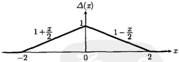

图 3.8 式 (3.3.18) 的函数
 

的傅里叶变换。

解 这个函数满足绝对可积条件式(2.3.1)，由式(3.1.3)得到它的傅里叶变换

 $$ \begin{aligned}F(\omega)&=\int_{-\infty}^{\infty}\varDelta(x)\mathrm{e}^{-\mathrm{i}\omega x}\mathrm{d}x\\&=\underbrace{\int_{-2}^{0}\left(1+\frac{x}{2}\right)\mathrm{e}^{-\mathrm{i}\omega x}\mathrm{d}x}_{y=-x}+\int_{0}^{2}\left(1-\frac{x}{2}\right)\mathrm{e}^{-\mathrm{i}\omega x}\mathrm{d}x\end{aligned} $$

<!-- page: 72 -->

$$ \begin{aligned}&=\int_{0}^{2}\left(1-\frac{y}{2}\right)\mathrm{e}^{\mathrm{i}\omega y}\mathrm{d}y+\int_{0}^{2}\left(1-\frac{x}{2}\right)\mathrm{e}^{-\mathrm{i}\omega x}\mathrm{d}x\\&=\int_{0}^{2}\left(1-\frac{x}{2}\right)\left(\mathrm{e}^{\mathrm{i}\omega x}+\mathrm{e}^{-\mathrm{i}\omega x}\right)\mathrm{d}x\\&=2\int_{0}^{2}\left(1-\frac{x}{2}\right)\cos\omega x\mathrm{d}x=\frac{2\sin^{2}\omega}{\omega^{2}}\end{aligned} $$ 

现在，利用这个结果计算反变换积分式(3.1.4)，我们有

 $$ \begin{aligned}f(x)&=\frac{1}{2\pi}\int_{-\infty}^{\infty}F(\omega)\mathrm{e}^{\mathrm{i}\omega x}\mathrm{d}\omega\\&=\frac{1}{\pi}\int_{-\infty}^{\infty}\frac{\sin^{2}\omega}{\omega^{2}}\left(\cos\omega x+\mathrm{i}\sin\omega x\right)\mathrm{d}\omega\\&=\frac{2}{\pi}\int_{0}^{\infty}\frac{\sin^{2}\omega\cos\omega x}{\omega^{2}}\mathrm{d}\omega\end{aligned} $$ 

因为图 3.8 所示的函数在区间  $ (-∞, ∞) $ 没有间断点，积分收敛于

$$  \frac{2}{\pi}\int_{0}^{\infty}\frac{\sin^{2}\omega\cos\omega x}{\omega^{2}}\mathrm{d}\omega=\left\{\begin{array}{c l}1-\frac{\left|x\right|}{2}&(\left|x\right|<2)\\ 0&(\left|x\right|\geqslant2)\end{array}\right.   \tag*{(3.3.19)}$$

特别是在 x=0，式(3.3.19)给出

$$  \int_{0}^{\infty}\frac{\sin^{2}\omega}{\omega^{2}}\mathrm{d}\omega=\frac{\pi}{2}   \tag*{(3.3.20)}$$

这也是一个常用的积分公式。

例7 计算函数  $ f(x)=\frac{\sin^{2}x}{x^{2}} $ 的傅里叶变换。

解　这个函数是式 $  (3.2.34b)  $所示的分布函数，满足绝对可积条件式 $  (2.3.1)  $，由式 $  (3.1.3)  $得到它的傅里叶变换

 $$ \begin{aligned}F(\omega)&=\int_{-\infty}^{\infty}\frac{\sin^{2}x}{x^{2}}\mathrm{e}^{-\mathrm{i}\omega x}\mathrm{d}x\\&=\int_{-\infty}^{\infty}\frac{\sin^{2}x}{x^{2}}\left(\cos\omega x+\mathrm{i}\sin\omega x\right)\mathrm{d}x\\&=2\int_{0}^{\infty}\frac{\sin^{2}x\cos\omega x}{x^{2}}\mathrm{d}x\quad[ 利用式 (3.3.19)]\\&=\left\{\begin{array}{cc}\pi\left(1-\frac{|\omega|}{2}\right)&(|\omega|<2)\\0&(|\omega|\geqslant2)\end{array}\right.=\pi\Delta(\omega)\end{aligned} $$

<!-- page: 73 -->

这就是函数  $ f(x)=\frac{\sin^{2}x}{x^{2}} $ 的傅里叶变换。可以看出  $ \mathcal{F}\left\{\frac{\sin^{2}x}{x^{2}}\right\}\sim\Delta(\omega) $，而  $ \mathcal{F}\left\{\Delta(x)\right\}\sim\frac{\sin^{2}\omega}{\omega^{2}} $，因此这两个函数构成一个傅里叶变换对。

在下面的例题中，我们要证明一个复变函数的极限公式和相关的积分公式，它们对于后续的许多计算问题是有用的。

例8 证明关于复变函数  $ \mathrm{e}^{-(\beta+\mathrm{i}\omega)t} $ 的极限公式

$$  \operatorname*{l i m}_{t\to\infty}\mathrm{e}^{-(\beta+\mathrm{i}\omega)t}=0   \tag*{(3.3.21)}$$

和积分公式

$$  \int_{0}^{\infty}\mathrm{e}^{-(\beta+\mathrm{i}\omega)t}\mathrm{d}t=\frac{1}{\beta+\mathrm{i}\omega}   \tag*{(3.3.22)}$$

其中， $ \beta>0,\ -\infty<\omega<\infty $。

证明 首先计算复数  $ e^{-i\omega t} $ 的模

$$  \left|\mathrm{e}^{-\mathrm{i}\omega t}\right|=\left|\cos\omega t-\mathrm{i}\sin\omega t\right|=\sqrt{\cos^{2}\omega t+\sin^{2}\omega t}=1   \tag*{(3.3.23)}$$

进而计算模的极限

$$  \operatorname*{l i m}_{t\to\infty}\left|\mathrm{e}^{-(\beta+\mathrm{i}\omega)t}\right|=\operatorname*{l i m}_{t\to\infty}\left|\mathrm{e}^{-\mathrm{i}\omega t}\right|\mathrm{e}^{-\beta t}=\operatorname*{l i m}_{t\to\infty}\mathrm{e}^{-\beta t}=0   \tag*{(3.3.24)}$$

如果一个复数的模为零，则这个复数为零，式(3.3.21)得证。

利用式(3.3.21)，我们有

$$  \begin{aligned}\int_{0}^{\infty}\mathbf{e}^{-(\beta+\mathrm{i}\omega)t}\mathrm{d}t&=-\frac{1}{\beta+\mathrm{i}\omega}\left[\mathbf{e}^{-(\beta+\mathrm{i}\omega)t}\right]_{0}^{\infty}\\&=-\frac{1}{\beta+\mathrm{i}\omega}\left[\lim_{t\to\infty}\mathbf{e}^{-(\beta+\mathrm{i}\omega)t}-1\right]\\&=\frac{1}{\beta+\mathrm{i}\omega}\end{aligned}   \tag*{[3.3.21]}$$

即式(3.3.22)成立。

例 9 讨论图 3.9 所示的函数

$$  f(t)=\mathrm{e}^{-\beta|t|}   \tag*{(3.3.25)}$$

的傅里叶变换，其中  $ \beta>0 $。

解 首先需要说明，这个例题并非本节例2的重复。我们将会看到，由于参数 $ \beta $的引入，它的傅里叶变换的结果对后续问题有重要的意义。

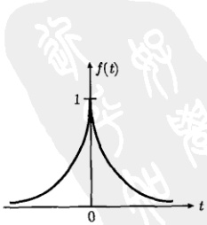

图 3.9 式 (3.3.25) 的函数
 

<!-- page: 74 -->

这个函数满足绝对可积条件式(2.3.1)，由式(3.1.3)得到它的傅里叶变换

 $$ \begin{aligned}\int_{-\infty}^{\infty}f(t)\mathrm{e}^{-\mathrm{i}\omega t}\mathrm{d}t&=\int_{-\infty}^{0}\mathrm{e}^{\beta t}\mathrm{e}^{-\mathrm{i}\omega t}\mathrm{d}t+\int_{0}^{\infty}\mathrm{e}^{-\beta t}\mathrm{e}^{-\mathrm{i}\omega t}\mathrm{d}t\\&=\underbrace{\int_{-\infty}^{0}\mathrm{e}^{(\beta-\mathrm{i}\omega)t}\mathrm{d}t}_{t=-\tau}+\int_{0}^{\infty}\mathrm{e}^{-(\beta+\mathrm{i}\omega)t}\mathrm{d}t\\&=\int_{0}^{\infty}\mathrm{e}^{-(\beta-\mathrm{i}\omega)\tau}\mathrm{d}\tau+\int_{0}^{\infty}\mathrm{e}^{-(\beta+\mathrm{i}\omega)t}\mathrm{d}t\quad[ 利用式 (3.3.22)\\&=\frac{1}{\beta-\mathrm{i}\omega}+\frac{1}{\beta+\mathrm{i}\omega}\\&=\frac{2\beta}{\beta^{2}+\omega^{2}}\end{aligned} $$ 

现在我们利用这个结果进一步计算傅里叶反变换，由式（3.1.4）得到

 $$ \begin{aligned}f(t)&=\frac{1}{2\pi}\int_{-\infty}^{\infty}F(\omega)\mathrm{e}^{\mathrm{i}\omega t}\mathrm{d}\omega\\&=\frac{1}{\pi}\int_{-\infty}^{\infty}\frac{\beta}{\beta^{2}+\omega^{2}}\left(\cos\omega t+\mathrm{i}\sin\omega t\right)\mathrm{d}\omega\\&=\frac{2}{\pi}\int_{0}^{\infty}\frac{\beta\cos\omega t}{\beta^{2}+\omega^{2}}\mathrm{d}\omega\\ \end{aligned} $$ 

由于原函数(3.3.25)在区间 $ (-\infty,\infty) $没有间断点，故反变换积分收敛于

$$  \frac{2}{\pi}\int_{0}^{\infty}\frac{\beta\cos\omega t}{\beta^{2}+\omega^{2}}\mathrm{d}\omega=\mathrm{e}^{-\beta|t|}   \tag*{(3.3.26)}$$

我们看到，在讨论反变换积分收敛行为的过程中，自然得到了这个很有用的积分公式。

由于随后的需要，我们现在计算极限值

$$  \lim_{\beta\to0^{+}}\frac{\beta}{\beta^{2}+\omega^{2}}   \tag*{(3.3.27)}$$

可以看出，式(3.3.27)正是洛伦兹线型函数的极限所给出的  $ \pi\delta(\omega) $ 函数 [式(3.2.34b)]。作为验证，我们将用另外的方法计算之。观察发现，式(3.3.27)可以写成

$$  \lim_{\beta\rightarrow0}\frac{\beta}{\beta^{2}+\omega^{2}}=\left\{\begin{array}{l l}\infty&(\omega=0)\\ 0&(\omega\neq0)\end{array}\right.=C\delta(\omega)   \tag*{(3.3.28)}$$

它具有  $ \delta $ 函数的第一个特征，其中，C 是待定的系数。现在我们利用  $ \delta $ 函数的第二个特性，即式 (3.2.5)，来确定 C，为此，对式 (3.3.28) 两边关于  $ \omega $ 积分

$$  \lim_{\beta\to0}\int_{-\infty}^{\infty}\frac{\beta}{\beta^{2}+\omega^{2}}\mathrm{d}\omega=C\int_{-\infty}^{\infty}\delta(\omega)\mathrm{d}\omega=C   \tag*{(3.3.29)}$$

<!-- page: 75 -->

进而计算 C，我们得到

$$  C=\lim_{\beta\rightarrow0}\int_{-\infty}^{\infty}\frac{\beta}{\beta^{2}+\omega^{2}}\mathrm{d}\omega=\lim_{\beta\rightarrow0}\left[\arctan\left(\frac{\omega}{\beta}\right)\right]_{-\infty}^{\infty}=\left(\frac{\pi}{2}\right)-\left(-\frac{\pi}{2}\right)=\pi   \tag*{(3.3.30)}$$

将式(3.3.30)代入式(3.3.28)，得到

 $$ \lim_{\beta\to0}\frac{\beta}{\beta^{2}+\omega^{2}}=\pi\delta(\omega) $$ 

它确实符合(3.2.34b)的表示。

上述讨论表明，函数 (3.3.25) 的傅里叶变换在  $ \beta \to 0^+ $ 情况下给出  $ 2\pi\delta(\omega) $，而  $ 2\pi\delta(\omega) $ 正是 1 的傅里叶变换 [式 (3.2.22)]。这意味着，函数 (3.3.25) 在  $ \beta \to 0^+ $ 情况下趋于  $ f(t) = 1 $。这一结论将为随后单位阶跃函数的傅里叶变换的计算提供一个特别有效的途径。

#### 例 10 讨论图 3.10 所示的函数

$$  f(t)=\left\{\begin{array}{cl}0&(t<0)\\\mathrm{e}^{-\beta t}&(t\geqslant0)\end{array}\right.   \tag*{(3.3.32)}$$

的傅里叶变换，其中  $ \beta>0 $。

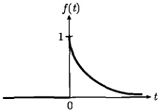

解 这个函数满足绝对可积条件式(2.3.1)，由式(3.1.3)得到它的傅里叶变换

图 3.10 式 (3.3.32) 的函数
 

$$  \begin{aligned}F(\omega)&=\int_{-\infty}^{\infty}f(t)\mathrm{e}^{-\mathrm{i}\omega t}\mathrm{d}t\\&=\int_{0}^{\infty}\mathrm{e}^{-\beta t}\mathrm{e}^{-\mathrm{i}\omega t}\mathrm{d}t=\int_{0}^{\infty}\mathrm{e}^{-(\beta+\mathrm{i}\omega)t}\mathrm{d}t\quad[ 利用式 (3.3.22)]\\&=\frac{1}{\beta+\mathrm{i}\omega}\end{aligned}   \tag*{(3.3.33)}$$

这个例题随后还可以用4.2节例1的拉普拉斯变换方法求解。

现在我们利用式 (3.3.33) 的结果进一步计算它的傅里叶反变换，由式 (3.1.4) 得到

 $$ \begin{aligned}f(t)&=\frac{1}{2\pi}\int_{-\infty}^{\infty}F(\omega)\mathrm{e}^{\mathrm{i}\omega t}\mathrm{d}\omega\\&=\frac{1}{2\pi}\int_{-\infty}^{\infty}\frac{1}{\beta+\mathrm{i}\omega}\mathrm{e}^{\mathrm{i}\omega t}\mathrm{d}\omega\\&=\frac{1}{2\pi}\int_{-\infty}^{\infty}\frac{\beta-\mathrm{i}\omega}{\beta^{2}+\omega^{2}}\left(\cos\omega t+\mathrm{i}\sin\omega t\right)\mathrm{d}\omega\\&=\frac{1}{\pi}\int_{0}^{\infty}\frac{\beta\cos\omega t+\omega\sin\omega t}{\beta^{2}+\omega^{2}}\mathrm{d}\omega\end{aligned} $$

<!-- page: 76 -->

这就是函数（3.3.32）的傅里叶积分表达式。我们从傅里叶变换出发得到了傅里叶积分。这是不奇怪的，因为被积函数是偶函数，正像3.1.1节的例1那样。

根据狄利克雷定理，这个积分在函数(3.3.32)的连续点收敛于f，但在间断点t=0收敛于 $ [f(x-0)+f(x+0)]/2=1/2 $，所以反变换积分给出

$$  \frac{1}{\pi}\int_{0}^{\infty}\frac{\beta\cos\omega t+\omega\sin\omega t}{\beta^{2}+\omega^{2}}\mathrm{d}\omega=\left\{\begin{array}{ll}0&(t<0)\\ 1/2&(t=0)\\ \mathrm{e}^{-\beta t}&(t>0)\end{array}\right.   \tag*{(3.3.34)}$$

特别是在 t=0 有

$$  \int_{0}^{\infty}\frac{1}{\beta^{2}+\omega^{2}}\mathrm{d}\omega=\frac{\pi}{2\beta}   \tag*{(3.3.35)}$$

我们利用函数(3.3.32)的傅里叶积分的收敛性，自然地得到了参变量积分式(3.3.34)以及重要的积分公式(3.3.35)。

例 11 讨论图 3.11 所示的单位阶跃函数

$$  u(t)=\left\{\begin{array}{l l}0&(t<0)\\ 1&(t\geqslant0)\end{array}\right.   \tag*{(3.3.36)}$$

的傅里叶变换。

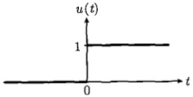

图 3.11 式 (3.3.36) 所示的单位阶跃函数
 

解 单位阶跃函数  $ u(t) $ 与本节例1讨论的  $ \sin kx $ 和  $ \cos kx $ 一样，也不满足绝对可积条件式 (2.3.1)，事实上  $ \int_{-\infty}^{\infty}|u(t)|\,\mathrm{d}t=\int_{0}^{\infty}\mathrm{d}t\to\infty $。为了得到它的傅里叶变换，我们将利用单位阶跃函数  $ u(t) $ 与函数 (3.3.32) 的关系进行计算。本节例9的讨论表明， $ f(t)=1 $ 是函数 (3.3.25) 在  $ \beta\to0^{+} $ 的极限，这样  $ u(t) $ 就是函数 (3.3.32) 在  $ \beta\to0^{+} $ 的极限，因此

$$  \mathcal{F}\{u(t)\}=\lim_{\beta\to0^{+}}\frac{1}{\beta+\mathrm{i}\omega}   \tag*{(3.3.37)}$$

由式 (3.3.37) 得到  $ 1/i\omega $ 的结果是一个明显的错误，因为复变函数的极限要分成实部和虚部来求。我们有

$$  \lim_{\beta\to0^{+}}\frac{1}{\beta+\mathrm{i}\omega}=\lim_{\beta\to0}\frac{\beta}{\beta^{2}+\omega^{2}}-\mathrm{i}\lim_{\beta\to0}\frac{\omega}{\beta^{2}+\omega^{2}}   \tag*{(3.3.38)}$$

<!-- page: 77 -->

式（3.3.38）中的实部正是式（3.3.31），而虚部为

$$  \lim_{\beta\to0}\frac{\omega}{\beta^{2}+\omega^{2}}=\frac{1}{\omega}   \tag*{(3.3.39)}$$

式(3.3.38)给出

$$  \lim_{\beta\to0^{+}}\frac{1}{\beta+\mathrm{i}\omega}=\pi\delta(\omega)+\frac{1}{\mathrm{i}\omega}   \tag*{(3.3.40)}$$

这个结果意味着单位阶跃函数  $ u(t) $ 的傅里叶变换为

$$  F(\omega)=\pi\delta(\omega)+\frac{1}{\mathrm{i}\omega}   \tag*{(3.3.41)}$$

这个例子再次说明绝对可积条件不是傅里叶变换存在的必要条件。我们利用函数(3.3.32)和函数(3.3.36)的关系，间接地得到了 $ u(t) $的傅里叶变换式(3.3.41)。为了检验这个结果的正确性，下面我们将式(3.3.41)代入式(3.1.4)，考查积分的收敛行为，即计算式(3.3.41)的傅里叶反变换。

例 12 计算  $ \mathcal{F}^{-1}\left\{\pi\delta(\omega) + \frac{1}{\mathrm{i}\omega}\right\} $。

解 由傅里叶反变换式 (3.1.4)，我们有

 $$ \begin{aligned}f(t)&=\frac{1}{2\pi}\int_{-\infty}^{\infty}\left[\pi\delta(\omega)+\frac{1}{i\omega}\right]\mathrm{e}^{i\omega t}\mathrm{d}\omega\\&=\frac{1}{2}\int_{-\infty}^{\infty}\delta(\omega)\mathrm{e}^{i\omega t}\mathrm{d}\omega+\frac{1}{2\pi}\int_{-\infty}^{\infty}\frac{1}{i\omega}\mathrm{e}^{i\omega t}\mathrm{d}\omega\quad[ 利用式 (3.2.19b)\\&=\frac{1}{2}+\frac{1}{2\pi}\int_{-\infty}^{\infty}\frac{1}{i\omega}\left(\cos\omega t+i\sin\omega t\right)\mathrm{d}\omega\\&=\frac{1}{2}+\frac{1}{\pi}\int_{0}^{\infty}\frac{\sin\omega t}{\omega}\mathrm{d}\omega\end{aligned} $$ 

根据推广的狄利克雷积分(3.1.12)，我们有

$$  \int_{0}^{\infty}\frac{\sin\omega t}{\omega}\mathrm{d}\omega=\left\{\begin{array}{ll}-\pi/2&(t<0)\\0&(t=0)\\\pi/2&(t>0)\end{array}\right.   \tag*{(3.3.42)}$$

于是

$$  f(t)=\left\{\begin{array}{ll}0&(t<0)\\1/2&(t=0)\\1&(t>0)\end{array}\right.   \tag*{(3.3.43)}$$

它在连续点正好收敛于单位阶跃函数  $ u(t) $，而在间断点 t = 0 则收敛于  $ [f(0 - 0) + f(0 + 0)] / 2 = 1/2 $，服从狄利克雷定理。因此，式 (3.3.41) 确实是单位阶跃函数  $ u(t) $ 的傅里叶变换。

<!-- page: 78 -->

另外，我们还得到单位阶跃函数的积分表达式

$$  u(t)=\frac{1}{2}+\frac{1}{\pi}\int_{0}^{\infty}\frac{\sin\omega t}{\omega}\mathrm{d}\omega\quad(t\neq0)   \tag*{(3.3.44)}$$

和一个很有用的积分公式

$$  \int_{-\infty}^{\infty}u(t)\mathrm{e}^{-\mathrm{i}\omega t}\mathrm{d}t=\int_{0}^{\infty}\mathrm{e}^{-\mathrm{i}\omega t}\mathrm{d}t=\pi\delta(\omega)+\frac{1}{\mathrm{i}\omega}   \tag*{(3.3.45)}$$

单位阶跃函数  $ u(t) $ 是一个很重要的函数，它实际上刻画一种开关的作用，可以用于电工学、光学、信号处理等许多过程。它在理论上也有特别的意义，随后我们将会看到，正是借助于  $ u(t) $ 函数，可以实现傅里叶变换到拉普拉斯变换的转变。现在我们进一步讨论  $ u(t) $ 的性质。

例 13 讨论单位阶跃函数  $ u(x) $ 的微分性质。

解 关于单位阶跃函数  $ u(x) $ 的微分性质，经过直观的分析就能得到定性正确的结果。正如图 3.12 所示的那样， $ u(x) $ 的微分在其连续段均为零： $ u'(x < 0) = 0 $ 和  $ u'(x > 0) = 0 $ (因为切线的斜率为零)。在 x = 0 点，函数不连续： $ u(0^{-}) \neq u(0^{+}) $，因此导数  $ u'(0) $ 必然发散。这样  $ u'(t) $ 的性质可以表示为

$$  u^{\prime}(x)=\left\{\begin{array}{ll}0&(x\neq0)\\ \infty&(x=0)\end{array}\right\}\rightarrow\delta(x)   \tag*{(3.3.46)}$$

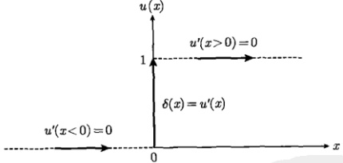

图 3.12 单位阶跃函数  $ u(x) $ 的导数等于  $ \delta(x) $ 函数
 

从微分的原始定义也有

$$  u^{\prime}(x)=\lim_{x\to0}\frac{\Delta u}{\Delta x}=\lim_{x\to0}\frac{u(x+\Delta x)-u(x)}{\Delta x}=\left\{\begin{array}{ll}0&(x\neq0)\\ \infty&(x\neq0)\end{array}\right\}\to\delta(x)   \tag*{(3.3.47)}$$

还可以从  $ \delta $ 函数的“反微分”的角度考虑这个问题，事实上

$$  \int_{-\infty}^{x}\delta(t)\mathrm{d}t=\left\{\begin{array}{ll}0&(x<0)\\ 1&(x>0)\end{array}\right\}\rightarrow u(x)   \tag*{(3.3.48)}$$

<!-- page: 79 -->

现在我们给出一个数学上的证明。设  $ \phi(x) $ 是一个任意的连续函数，我们有

 $$ \begin{aligned}\int_{-\infty}^{\infty}\phi(x)\frac{\mathrm{d}u(x)}{\mathrm{d}x}\mathrm{d}x&=\int_{-\infty}^{\infty}\phi(x)\mathrm{d}u(x)\\&=\left[\phi(x)u(x)\right]_{-\infty}^{\infty}-\int_{-\infty}^{\infty}u(x)\mathrm{d}\phi(x)\\&=\phi(\infty)-\int_{0}^{\infty}\mathrm{d}\phi(x)\\&=\phi(\infty)-\left[\phi(\infty)-\phi(0)\right]=\phi(0)\end{aligned} $$ 

另一方面

 $$ \int_{-\infty}^{\infty}\phi(x)\delta(x)\mathrm{d}x=\phi(0) $$ 

上两式相等，故

$$  \int_{-\infty}^{\infty}\phi(x)\frac{\mathrm{d}u(x)}{\mathrm{d}x}\mathrm{d}x=\int_{-\infty}^{\infty}\phi(x)\delta(x)\mathrm{d}x   \tag*{(3.3.49)}$$

即

$$  \int_{-\infty}^{\infty}\phi(x)\left[\frac{\mathrm{d}u(x)}{\mathrm{d}x}-\delta(x)\right]\mathrm{d}x=0   \tag*{(3.3.50)}$$

由于  $ \phi(x) $ 是任意的，所以

$$  \frac{\mathrm{d}u(x)}{\mathrm{d}x}=\delta(x)   \tag*{(3.3.51)}$$

其实， $ u(x) $ 和  $ \delta(x) $ 的关系在物理上是很有用的，除了理论上的应用外，它还提供了一种特别有效的数据处理手段。一个典型的例子是量子霍尔效应的实验数据处理，如图 3.13 所示。

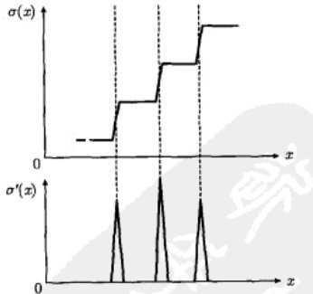

图 3.13 在关于量子霍尔效应的实验中，测量出电导率  $ \sigma(x) $ 随参数 x 的变化数据。数据处理时，画出导数  $ \sigma'(x) $ 随 x 变化的关系图，根据  $ \sigma'(x) $ 的尖峰位置判断电导率的突变点，从而确认电导率的量子特性。该实验数据处理的理论依据正是  $ u'(x) = \delta(x) $ 关系
 

<!-- page: 80 -->

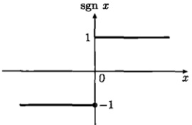

例 14 计算符号函数 (图 3.14)

$$  \mathrm{sgn}x=\left\{\begin{array}{ll}-1&(x<0)\\1&(x\geqslant0)\end{array}\right.   \tag*{(3.3.52)}$$

图 3.14 式 (3.3.52) 所示的符号函数
 

的傅里叶变换。

解 利用单位阶跃函数 (3.3.36)，可以将符号函数 (3.3.52) 表示为

$$  \mathrm{sgn}x=u(x)-u(-x)   \tag*{(3.3.53)}$$

我们已经有

$$  \mathcal{F}\left\{u(x)\right\}=\pi\delta(\omega)+\frac{1}{\mathrm{i}\omega}   \tag*{(3.3.54)}$$

另外

 $$ \begin{aligned}\mathcal{F}\left\{u(-x)\right\}&=\int_{-\infty}^{\infty}u(-x)e^{-i\omega x}d x\quad(y=-x)\\&=\int_{-\infty}^{\infty}u(y)e^{i\omega y}d y\\&=\int_{-\infty}^{\infty}u(x)e^{-i(-\omega)x}d x\quad[ 利用式 (3.3.54)]\\&=\pi\delta(-\omega)+\frac{1}{i(-\omega)}\quad[\delta(-x)=\delta(x)]\\&=\pi\delta(\omega)-\frac{1}{i\omega}\end{aligned} $$ 

故

 $$ \begin{aligned}\mathcal{F}\left\{\mathrm{sgn}x\right\}&=\mathcal{F}\left\{u(x)\right\}-\mathcal{F}\left\{u(-x)\right\}\\&=\pi\delta(\omega)+\frac{1}{\mathrm{i}\omega}-\left[\pi\delta(\omega)-\frac{1}{\mathrm{i}\omega}\right]\\&=\frac{2}{\mathrm{i}\omega}\end{aligned} $$ 

现在我们利用这个结果进一步计算傅里叶反变换，由式（3.1.4）得到

 $$ \begin{aligned}f(x)&=\frac{1}{2\pi}\int_{-\infty}^{\infty}F(\omega)\mathrm{e}^{\mathrm{i}\omega x}\mathrm{d}\omega\\&=\frac{1}{\pi}\int_{-\infty}^{\infty}\frac{1}{\mathrm{i}\omega}\left(\cos\omega x+\mathrm{i}\sin\omega x\right)\mathrm{d}\omega\\&=\frac{1}{\pi}\int_{0}^{\infty}\frac{\sin\omega x}{\omega}\mathrm{d}\omega\\ \end{aligned} $$

<!-- page: 81 -->

按照狄利克雷定理，它收敛于

$$  \frac{1}{\pi}\int_{0}^{\infty}\frac{\sin\omega x}{\omega}\mathrm{d}\omega=\left\{\begin{array}{ll}-1&(x<0)\\0&(x=0)\\1&(x>0)\end{array}\right.   \tag*{(3.3.55)}$$

我们自然地推导出了这个积分结果，它正是本节例12中所需要的式(3.3.42)。特别是在x=1时，式(3.3.55)给出狄利克雷积分(2.3.16)。

例 15 计算奇函数 (图 3.15)

$$  f(x)=\frac{x}{x^{2}+1}   \tag*{(3.3.56)}$$

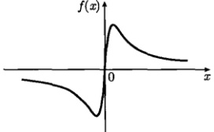

的傅里叶变换。

图 3.15 式 (3.3.56) 所示的奇函数
 

解 这个函数满足绝对可积条件式(2.3.1)，图3.15式(3.3.1)由式(3.1.3)得到它的傅里叶变换

 $$ \begin{aligned}F(\omega)&=\int_{-\infty}^{\infty}\frac{x}{x^{2}+1}\mathrm{e}^{-\mathrm{i}\omega x}\mathrm{d}x\\&=\int_{-\infty}^{\infty}\frac{x}{x^{2}+1}\left(\cos\omega x-\mathrm{i}\sin\omega x\right)\mathrm{d}x\\&=-2\mathrm{i}\int_{0}^{\infty}\frac{x\sin\omega x}{x^{2}+1}\mathrm{d}x\end{aligned} $$ 

现在，我们计算积分

$$  I(t)=\int_{0}^{\infty}\frac{\omega\sin\omega t}{\beta^{2}+\omega^{2}}\mathrm{d}\omega   \tag*{(3.3.57)}$$

事实上，由式(3.3.34)和式(3.3.26)得到

$$  I(t)=\frac{\pi}{2}\left\{\begin{array}{ll}-\mathrm{e}^{\beta t}&(t<0)\\ \mathrm{e}^{-\beta t}&(t>0)\end{array}=\frac{\pi}{2}\mathrm{sgn}\mathrm{e}^{-\beta|t|}\right.   \tag*{(3.3.58a)}$$

图 3.16 显示了  $ I(t) \sim t $ 曲线。利用  $ I(t) $，我们得到

$$  F(\omega)=-\mathrm{i}\pi\left\{\begin{array}{l}-\mathrm{e}^{\omega}(\omega<0)\\ \mathrm{e}^{-\omega}(\omega>0)\end{array}\right.=-\mathrm{i}\pi\mathrm{sgn}\omega\mathrm{e}^{-|\omega|}   \tag*{(3.3.58b)}$$

<!-- page: 82 -->

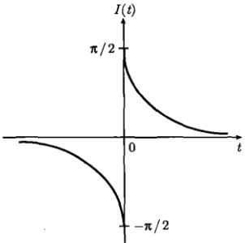0) $." width="31%" />

图 3.16 函数  $ I(t)=\frac{\pi}{2}\mathrm{sgn}te^{-\beta|t|}(\beta>0) $.
 

现在，利用这个结果计算反变换积分式(3.1.4)，我们有

 $$ \begin{aligned}f(x)&=\frac{\mathrm{i}}{2}\left[\int_{-\infty}^{0}\mathrm{e}^{\omega}\mathrm{e}^{\mathrm{i}\omega x}\mathrm{d}\omega-\int_{0}^{\infty}\mathrm{e}^{-\omega}\mathrm{e}^{\mathrm{i}\omega x}\mathrm{d}\omega\right]\quad(\omega=-y)\\&=\frac{\mathrm{i}}{2}\left[\int_{0}^{\infty}\mathrm{e}^{-y}\mathrm{e}^{-\mathrm{i}yx}\mathrm{d}y-\int_{0}^{\infty}\mathrm{e}^{-\omega}\mathrm{e}^{\mathrm{i}\omega x}\mathrm{d}\omega\right]\\&=\frac{1}{2\mathrm{i}}\int_{0}^{\infty}\mathrm{e}^{-\omega}\left(\mathrm{e}^{\mathrm{i}\omega x}-\mathrm{e}^{-\mathrm{i}\omega x}\right)\mathrm{d}\omega\\&=\int_{0}^{\infty}\mathrm{e}^{-\omega}\sin\omega x\mathrm{d}\omega\end{aligned} $$ 

因为函数(3.3.56)在区间 $ (-\infty,\infty) $没有间断点，该积分收敛于f，这样我们得到

$$  \int_{0}^{\infty}\mathrm{e}^{-\omega}\sin\omega x\mathrm{d}\omega=\frac{x}{1+x^{2}}   \tag*{(3.3.59)}$$

这是又一个重要的积分公式。

### 3.4 傅里叶变换应用举例

傅里叶变换的一个重要应用是求解微分方程、积分方程以及微分积分方程。其步骤是：①通过傅里叶变换将复杂的方程化成简单的代数方程；②求解代数方程；③将结果经过反变换，即得原方程的解。本节我们将通过典型例题的求解，阐述傅里叶变换的具体应用。

例 1 计算函数

$$  f_{1}(x)=u(x)\sin ax   \tag*{(3.4.1a)}$$

$$  f_{2}(x)=u(x)\cos ax   \tag*{(3.4.1b)}$$

<!-- page: 83 -->

的傅里叶变换。其中， $ a > 0 $， $ u(x) $ 是单位阶跃函数 (3.3.36)，变量 x 的变化范围是  $ -\infty < x < \infty $。

解 首先作出函数  $ f_{1}(x) $ 和  $ f_{2}(x) $ 的曲线，如图 3.17 所示。

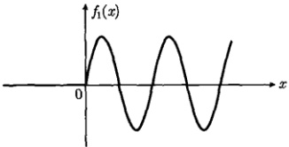

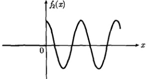

图 3.17 函数  $ f_{1}(x)=u(x)\cos ax $ 和  $ f_{2}(x)=u(x)\cos ax $，图中取 a=1
 

函数  $ f_{1}(x)=u(x)\sin ax $ 的傅里叶变换为

 $$ \begin{aligned}F_{1}(\omega)&=\int_{-\infty}^{\infty}u(x)\sin a x\mathrm{e}^{-\mathrm{i}\omega x}\mathrm{d}x\\&=\frac{1}{2\mathrm{i}}\int_{-\infty}^{\infty}u(x)\left[\mathrm{e}^{\mathrm{i}a x}-\mathrm{e}^{-\mathrm{i}a x}\right]\mathrm{e}^{-\mathrm{i}\omega x}\mathrm{d}x\\&=\frac{1}{2\mathrm{i}}\int_{-\infty}^{\infty}u(x)\left[\mathrm{e}^{-\mathrm{i}(\omega-a)x}-\mathrm{e}^{-\mathrm{i}(\omega+a)x}\right]\mathrm{d}x\quad\left[\int_{-\infty}^{\infty}u(x)\mathrm{e}^{-\mathrm{i}\omega x}\mathrm{d}x=\pi\delta(\omega)+\frac{1}{\mathrm{i}\omega}\right]\\&=\frac{1}{2\mathrm{i}}\left[\pi\delta(\omega-a)+\frac{1}{\mathrm{i}\left(\omega-a\right)}-\pi\delta(\omega+a)-\frac{1}{\mathrm{i}\left(\omega+a\right)}\right]\\&=\frac{a}{a^{2}-\omega^{2}}+\frac{\pi}{2\mathrm{i}}\left[\delta(\omega-a)-\delta(\omega+a)\right]\\ \end{aligned} $$ 

现在我们利用这个结果进一步计算傅里叶反变换，由式（3.1.4）得到

 $$ \begin{aligned}f_{1}(x)&=\frac{1}{2\pi}\int_{-\infty}^{\infty}F_{1}(\omega)\mathrm{e}^{\mathrm{i}\omega x}\mathrm{d}\omega\\&=\frac{1}{2\pi}\int_{-\infty}^{\infty}\frac{a}{a^{2}-\omega^{2}}\left(\cos\omega x+\mathrm{i}\sin\omega x\right)\mathrm{d}\omega\\&\quad+\frac{1}{4\mathrm{i}}\int_{-\infty}^{\infty}[\delta(\omega-a)-\delta(\omega+a)]\mathrm{e}^{\mathrm{i}\omega x}\mathrm{d}\omega\\&=\frac{1}{\pi}\int_{0}^{\infty}\frac{a\cos\omega x}{a^{2}-\omega^{2}}\mathrm{d}\omega+\frac{1}{4\mathrm{i}}\left(\mathrm{e}^{\mathrm{i}a x}-\mathrm{e}^{-\mathrm{i}a x}\right)\\&=\frac{1}{\pi}\int_{0}^{\infty}\frac{a\cos\omega x}{a^{2}-\omega^{2}}\mathrm{d}\omega+\frac{1}{2}\sin a x\end{aligned} $$ 

函数  $ f_{1}(x) $ 在  $ (-\infty, \infty) $ 没有间断点，按照狄利克雷定理，它收敛于

$$  \frac{1}{\pi}\int_{0}^{\infty}\frac{a\cos\omega x}{a^{2}-\omega^{2}}\mathrm{d}\omega+\frac{1}{2}\sin ax=\left\{\begin{array}{ll}0&(x<0)\\ \sin ax&(x\geqslant0)\end{array}\right.   \tag*{(3.4.2)}$$

<!-- page: 84 -->

即

$$  \frac{1}{\pi}\int_{0}^{\infty}\frac{a\cos\omega x}{a^{2}-\omega^{2}}\mathrm{d}\omega=\left\{\begin{array}{ll}-\frac{1}{2}\sin ax&(x<0)\\ \frac{1}{2}\sin ax&(x\geqslant0)\end{array}\right.   \tag*{(3.4.3)}$$

用类似的过程求出  $ f_{2}(x)=u(x)\cos ax $ 的傅里叶变换

 $$ \begin{aligned}F_{2}(\omega)&=\int_{-\infty}^{\infty}u(x)\cos a x\mathrm{e}^{-\mathrm{i}\omega x}\mathrm{d}x\\&=\frac{1}{2}\int_{-\infty}^{\infty}u(x)\left[\mathrm{e}^{\mathrm{i}a x}+\mathrm{e}^{-\mathrm{i}a x}\right]\mathrm{e}^{-\mathrm{i}\omega x}\mathrm{d}x\\&=\frac{\mathrm{i}\omega}{a^{2}-\omega^{2}}+\frac{\pi}{2}\left[\delta(\omega-a)+\delta(\omega+a)\right]\\ \end{aligned} $$ 

其傅里叶反变换为

 $$ \begin{aligned}f_{2}(x)&=\frac{1}{2\pi}\int_{-\infty}^{\infty}F_{2}(\omega)\mathrm{e}^{\mathrm{i}\omega x}\mathrm{d}\omega\\&=\frac{1}{2\pi}\int_{-\infty}^{\infty}\frac{\mathrm{i}\omega}{a^{2}-\omega^{2}}\left(\cos\omega x+\mathrm{i}\sin\omega x\right)\mathrm{d}\omega\\&\quad+\frac{1}{4}\int_{-\infty}^{\infty}[\delta(\omega-a)+\delta(\omega+a)]\mathrm{e}^{\mathrm{i}\omega x}\mathrm{d}\omega\\&=\frac{1}{\pi}\int_{0}^{\infty}\frac{\omega\sin\omega x}{\omega^{2}-a^{2}}\mathrm{d}\omega+\frac{1}{4}\left(\mathrm{e}^{\mathrm{i}ax}+\mathrm{e}^{-\mathrm{i}ax}\right)\\&=\frac{1}{\pi}\int_{0}^{\infty}\frac{\omega\sin\omega x}{\omega^{2}-a^{2}}\mathrm{d}\omega+\frac{1}{2}\cos ax\end{aligned} $$ 

函数  $ f_{2}(x) $ 只有一个间断点 x=0，按照狄利克雷定理，在该点收敛于  $ [f_{2}(x-0)+f_{2}(x+0)]/2=1/2 $，而在其他点收敛于  $ f_{2} $，于是

$$  \frac{1}{\pi}\int_{0}^{\infty}\frac{\omega\sin\omega x}{\omega^{2}-a^{2}}\mathrm{d}\omega+\frac{1}{2}\cos ax=\left\{\begin{array}{ll}0&(x<0)\\1/2&(x=0)\\\cos x&(x>0)\end{array}\right.   \tag*{(3.4.4)}$$

即

$$  \frac{1}{\pi}\int_{0}^{\infty}\frac{\omega\sin\omega x}{\omega^{2}-a^{2}}\mathrm{d}\omega=\left\{\begin{array}{ll}-\frac{1}{2}\cos ax&(x<0)\\0&(x=0)\\\frac{1}{2}\cos ax&(x>0)\end{array}\right.   \tag*{(3.4.5)}$$

例 2 求解下列微分方程

$$  \delta(x)-f(x)=\frac{\mathrm{d}^{2}f(x)}{\mathrm{d}x^{2}}\quad(-\infty<x<\infty)   \tag*{(3.4.6a)}$$

<!-- page: 85 -->

$$  \delta(x)-\frac{\mathrm{d}f(x)}{\mathrm{d}x}=\int_{-\infty}^{x}f(x)\mathrm{d}x\quad(-\infty<x<\infty)   \tag*{(3.4.6b)}$$

解 对式 (3.4.6a) 两边取傅里叶变换，并利用式 (3.2.19b) 以及傅里叶变换的微分定理 (3.1.16)，得到

$$  1-F(\omega)=-\omega^{2}F(\omega)\Rightarrow F(\omega)=\frac{1}{1-\omega^{2}}   \tag*{(3.4.7)}$$

现在利用这个结果计算傅里叶反变换，由式(3.1.4)得到

 $$ \begin{aligned}f(x)&=\frac{1}{2\pi}\int_{-\infty}^{\infty}F(\omega)\mathrm{e}^{\mathrm{i}\omega x}\mathrm{d}\omega\\&=\frac{1}{2\pi}\int_{-\infty}^{\infty}\frac{1}{1-\omega^{2}}\left(\cos\omega x+\mathrm{i}\sin\omega x\right)\mathrm{d}\omega\\&=\frac{1}{\pi}\int_{0}^{\infty}\frac{\cos\omega x}{1-\omega^{2}}\mathrm{d}\omega\quad\left[ 利用式 (3.4.3)\right]\\&=\left\{\begin{array}{ll}-\frac{1}{2}\sin x&(x<0)\\\frac{1}{2}\sin x&(x\geqslant0)\end{array}\right.\end{aligned} $$ 

这就是方程（3.4.6a）的解。

在式 $ （3.4.6b） $两边取傅里叶变换，并利用式 $ （3.2.19b） $以及傅里叶变换的微分定理 $ （3.1.15） $与积分定理 $ （3.1.19） $，得到

$$  1-\mathrm{i}\omega F(\omega)=\frac{F(\omega)}{\mathrm{i}\omega}\Rightarrow F(\omega)=\frac{\mathrm{i}\omega}{1-\omega^{2}}   \tag*{(3.4.8)}$$

现在利用这个结果计算傅里叶反变换，由式(3.1.4)得到

 $$ \begin{aligned}f(x)&=\frac{1}{2\pi}\int_{-\infty}^{\infty}F(\omega)\mathrm{e}^{\mathrm{i}\omega x}\mathrm{d}\omega\\&=\frac{1}{2\pi}\int_{-\infty}^{\infty}\frac{\mathrm{i}\omega}{1-\omega^{2}}\left(\cos\omega x+\mathrm{i}\sin\omega x\right)\mathrm{d}\omega\\&=\frac{1}{\pi}\int_{0}^{\infty}\frac{\omega\sin\omega x}{\omega^{2}-1}\mathrm{d}\omega\quad\left[ 利用式 (3.4.5)\right]\\&=\frac{1}{\pi}\left\{\begin{array}{ll}-\frac{1}{2}\cos x&(x<0)\\0&(x=0)\\\frac{1}{2}\cos x&(x>0)\end{array}\right.\end{aligned} $$ 

这就是方程(3.4.6b)的解。

<!-- page: 86 -->

例 3 求解微积分方程

$$  a\frac{\mathrm{d}f(x)}{\mathrm{d}x}+bf(x)+c\int_{-\infty}^{x}f(x)\mathrm{d}x=h(x)\quad(-\infty<x<\infty)   \tag*{(3.4.9)}$$

其中，a，b，c 均是实常数， $ h(x) $ 为已知函数。

解 对方程(3.4.9)两端取傅里叶变换，得到

$$  a\mathrm{i}\omega F(\omega)+b F(\omega)+\frac{c}{\mathrm{i}\omega}F(\omega)=H(\omega)   \tag*{(3.4.10)}$$

解之得

$$  F(\omega)=\frac{H(\omega)}{b+\mathrm{i}\left(a\omega-\frac{c}{\omega}\right)}   \tag*{(3.4.11)}$$

 $$ f(x)=\frac{1}{2\pi}\int_{-\infty}^{\infty}\frac{H(\omega)}{b+\mathrm{i}\left(a\omega-\frac{c}{\omega}\right)}\mathrm{e}^{\mathrm{i}\omega x}\mathrm{d}\omega $$ 

代入傅里叶反变换式(3.1.4)，得到

这就是方程(3.4.9)的解。

例 4 求解非齐次常微分方程

$$  \frac{\mathrm{d}^{2}}{\mathrm{d}t^{2}}y(t)-y(t)=-2f(t)\quad(-\infty<t<\infty)   \tag*{(3.4.13)}$$

其中， $ f(t) $ 是已知函数；如果  $ f(t)=\delta(t) $，讨论解的性质。

解 对方程(3.4.13)两端取傅里叶变换，并利用傅里叶变换的微分定理(3.1.16)，得到

$$  -\omega^{2}Y(\omega)-Y(\omega)=-2F(\omega)   \tag*{(3.4.14)}$$

解此代数方程，得到

$$  Y(\omega)=F(\omega)\frac{2}{1+\omega^{2}}   \tag*{(3.4.15)}$$

对式(3.4.15)反演，并利用3.3节例2的结果，即

$$  \mathrm{e}^{-|t|}\longleftrightarrow\frac{2}{1+\omega^{2}}   \tag*{(3.4.16)}$$

我们得到

$$  y(t)=f(t)*\mathrm{e}^{-|t|}=\int_{-\infty}^{\infty}f(\tau)\mathrm{e}^{-|t-\tau|}\mathrm{d}\tau   \tag*{(3.4.17)}$$

这就是方程(3.4.13)的解。

如果  $ f(t)=\delta(t) $，式(3.4.17)变为

$$  y(t)=\int_{-\infty}^{\infty}\delta(\tau)\mathrm{e}^{-|t-\tau|}\mathrm{d}\tau=\mathrm{e}^{-|t|}   \tag*{(3.4.18)}$$

<!-- page: 87 -->

图 3.18 显示了  $ y(t) $,  $ y'(t) $ 和  $ y''(t) $ 的性质, t=0 是函数  $ y(t) $ 的尖点, 因此  $ y'(t) $ 是不连续的, 而  $ y''(t) $ 则是发散的。实际上, 由方程 (3.4.13) 得知  $ y''(0) = -2\delta(t) + 1 $。

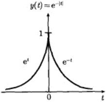

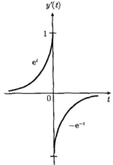

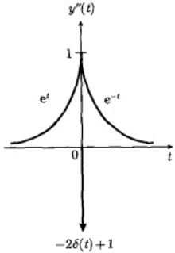

图 3.18 解 (3.4.18) 的性质
 

例 5 求解关于  $ y(x) $ 的积分方程

$$  y(x)=g(x)+\int_{-\infty}^{\infty}y(\xi)r(x-\xi)\mathrm{d}\xi\quad(-\infty<x<\infty)   \tag*{(3.4.19)}$$

其中， $ g(x) $ 和  $ r(x) $ 均是已知函数。

解 对方程(3.4.19)两端取傅里叶变换，并利用傅里叶变换的卷积定理(3.1.24)，得到

$$  Y(\omega)=G(\omega)+Y(\omega)R(\omega)\Rightarrow Y(\omega)=\frac{G(\omega)}{1-R(\omega)}   \tag*{(3.4.20)}$$

若  $ R(\omega)=1 $，则  $ r(x)=\mathcal{F}^{-1}\{1\}=\delta(x) $，原方程 (3.4.19) 无解。若  $ R(\omega)\neq1 $，设

$$  \mathcal{F}^{-1}\left\{\frac{1}{1-R(\omega)}\right\}=h(x)   \tag*{(3.4.21)}$$

则原方程的解为

$$  y(x)=h(x)*g(x)=\int_{-\infty}^{\infty}h(\xi)g(x-\xi)\mathrm{d}\xi   \tag*{(3.4.22)}$$

例 6 求解常微分方程

$$  \frac{\mathrm{d}^{2}x}{\mathrm{d}t^{2}}+2\gamma\frac{\mathrm{d}x}{\mathrm{d}t}+\omega_{0}^{2}x=f(t)\quad(-\infty<t<\infty)   \tag*{(3.4.23)}$$

其中， $ \gamma $ 和  $ \omega_{0} $ 是常数， $ f(t) $ 是已知函数，并给出该方程在  $ f(t)=a $ (常数) 时的解。

解 对方程(3.4.23)两边取傅里叶变换，得到

$$  -\omega^{2}X(\omega)+2\mathrm{i}\gamma\omega X(\omega)+\omega_{0}^{2}X(\omega)=F(\omega)   \tag*{(3.4.24)}$$

<!-- page: 88 -->

解之得

$$  X(\omega)=\frac{F(\omega)}{\omega_{0}^{2}-\omega^{2}+2\mathrm{i}\gamma\omega}   \tag*{(3.4.25)}$$

反演后得到

$$  x(t)=\frac{1}{2\pi}\int_{-\infty}^{\infty}\frac{F(\omega)}{\omega_{0}^{2}-\omega^{2}+2\mathrm{i}\gamma\omega}\mathrm{e}^{\mathrm{i}\omega t}\mathrm{d}\omega   \tag*{(3.4.26)}$$

这就是方程(3.2.3)的解。

当  $ f(t)=a $ 时，由式(3.2.22)得到它的傅里叶变换  $ F(\omega)=2\pi a\delta(\omega) $，于是

$$  x(t)=a\int_{-\infty}^{\infty}\frac{\delta(\omega)}{\omega_{0}^{2}-\omega^{2}+2\mathrm{i}\gamma\omega}\mathrm{e}^{\mathrm{i}\omega t}\mathrm{d}\omega=\frac{a}{\omega_{0}^{2}}   \tag*{(3.4.27)}$$

这是一个与 t 无关的常数解，它显然满足方程 (3.4.23)。

例 7 量子力学中的定态薛定谔方程为

$$  H\psi=E\psi   \tag*{(3.4.28)}$$

其中

$$  H=-\frac{\hbar^{2}}{2m}\frac{\mathrm{d}^{2}}{\mathrm{d}x^{2}}+V(x)   \tag*{(3.4.29)}$$

为哈密顿算符， $ \psi $ 和 E 分别是 H 的本征函数和本征值，m 是微观粒子的质量。假定粒子在  $ \delta $ 势阱（图 3.19）

$$  V(x)=-\alpha\delta(x)\quad(\alpha>0)   \tag*{(3.4.30)}$$

中运动，对于束缚态情况  $ (E<0) $，求解本征方程 (3.4.28)。

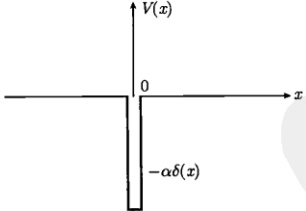

图 3.19  $ \delta $ 函数势阱
 

解 方程 (3.4.28) 可以写为

$$  \frac{\mathrm{d}^{2}\psi}{\mathrm{d}x^{2}}-k^{2}\psi=-A\delta(x)\psi   \tag*{(3.4.31)}$$

<!-- page: 89 -->

其中

$$  k=\sqrt{-\frac{2mE}{\hbar^{2}}},\quad A=\frac{2m\alpha}{\hbar^{2}}   \tag*{(3.4.32)}$$

对式（3.4.31）两边进行傅里叶变换，得到

$$  -\omega^{2}\varPsi(\omega)-k^{2}\varPsi(\omega)=-A\int_{-\infty}^{\infty}\delta(x)\psi(x)\mathrm{e}^{-\mathrm{i}\omega x}\mathrm{d}x=-A\psi(0)   \tag*{(3.4.33)}$$

解之得

$$  \Psi(\omega)=\frac{A\psi(0)}{k^{2}+\omega^{2}}   \tag*{(3.4.34)}$$

代入傅里叶反变换式(3.1.4)，得到

 $$ \begin{aligned}\psi(x)&=\frac{1}{2\pi}\int_{-\infty}^{\infty}\varPsi(\omega)\mathrm{e}^{\mathrm{i}\omega x}\mathrm{d}\omega\\&=\frac{A\psi(0)}{2\pi}\int_{-\infty}^{\infty}\frac{1}{k^{2}+\omega^{2}}\left(\cos\omega x+\mathrm{i}\sin\omega x\right)\mathrm{d}\omega\\&=\frac{A\psi(0)}{\pi}\int_{0}^{\infty}\frac{\cos\omega x}{k^{2}+\omega^{2}}\mathrm{d}\omega\quad\left[ 利用式 (3.3.26)\right]\\&=\frac{A\psi(0)}{2k}\mathrm{e}^{-k|x|}\end{aligned} $$ 

由 A=2k 得到

$$  k=\frac{m\alpha}{\hbar^{2}}   \tag*{(3.4.35)}$$

而本征能量为

$$  E=-\frac{m\alpha^{2}}{2\hbar^{2}}   \tag*{(3.4.36)}$$

式(3.4.36)显示系统只有一个束缚态[无论势 $ V(x) $的“强度” $ \alpha $如何]。最后我们要确定 $ \psi(0) $，为此利用归一化条件

$$  \int_{-\infty}^{\infty}\left|\psi(x)\right|^{2}\mathrm{d}x=2\left|\psi(0)\right|^{2}\int_{0}^{\infty}\mathrm{e}^{-2kx}\mathrm{d}x=\frac{\left|\psi(0)\right|^{2}}{k}=1   \tag*{(3.4.37)}$$

得到

$$  \psi(0)=\sqrt{k}   \tag*{(3.4.38)}$$

于是归一化的本征函数为

$$  \psi(x)=\frac{\sqrt{m\alpha}}{\hbar}\exp\left(-\frac{m\alpha}{\hbar^{2}}\left|x\right|\right)   \tag*{(3.4.39)}$$

它的曲线如图3.9所示。

从以上各种类型的例题可以看出傅里叶变换的广泛应用，至于它在求解数学物理方程中的应用，我们将在随后的章节中详细讨论。

