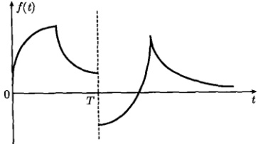
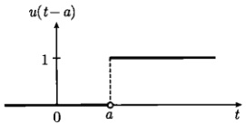
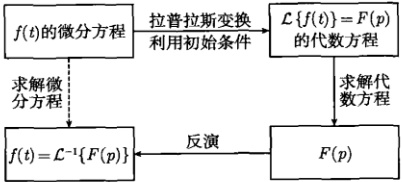
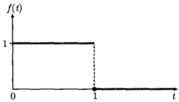
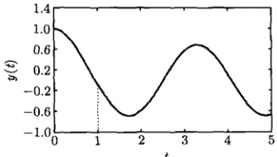
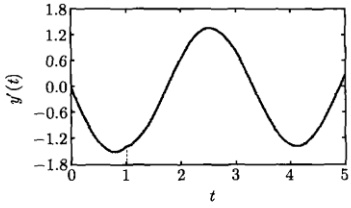
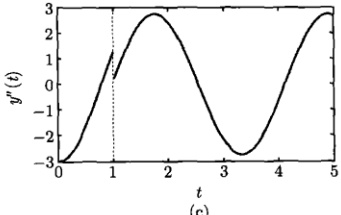

# 04-第4章 拉普拉斯变换

[返回全书目录](../../README.md)

> PDF 页码：90–109

<!-- page: 90 -->

### 第4章 拉普拉斯变换

前面讨论的傅里叶变换有非常广泛的应用，也有明显的缺点，即对函数  $ f(x) $ 的要求太苛刻，这表现在两个方面：

(1) 当函数在区间  $ (-∞,∞) $ 绝对可积，即满足  $ \int_{-\infty}^{x}|f(x)|\,\mathrm{d}x < ∞ $ 时，傅里叶变换存在。这个条件要求当  $ |x| \to ∞ $ 时， $ f(x) \to 0 $。事实上，许多函数都不满足这个条件，如  $ f = a $（常数）、正弦和余弦函数、线性函数、单位阶跃函数等。

(2) 要求函数  $ f(x) $ 必须在整个区间  $ (-\infty, \infty) $ 有定义，对于定义在区间  $ 0 \leq x < \infty $ 的函数，如以时间 t 为变量的函数  $ f(t) $，则无法进行傅里叶变换。

解决这些问题的办法是引入拉普拉斯变换。

### 4.1 拉普拉斯变换简介

#### 4.1.1 拉普拉斯变换的定义

拉普拉斯变换是在傅里叶变换的基础上引入的。现在考虑对一个任意函数 $ g(t)(t \geqslant 0) $进行傅里叶变换，为了使之在 $ (-\infty, \infty) $区间有定义，给它乘以单位阶跃函数 $ u(t) $；为了容易满足绝对可积条件，再乘以衰减因子 $ \exp(-\beta t)(\beta > 0) $，然后对函数 $ g(t)u(t) \exp(-\beta t) $进行傅里叶变换

$$  \int_{-\infty}^{\infty}g(t)u(t)\exp(-\beta t)\mathrm{e}^{-\mathrm{i}\omega t}\mathrm{d}t=\int_{0}^{\infty}f(t)\mathrm{e}^{-p t}\mathrm{d}t   \tag*{(4.1.1)}$$

其中， $ p=\beta+\mathrm{i}\omega $， $ f(t)=g(t)u(t) $。式（4.1.1）右边展示了一种新的积分变换，称为拉普拉斯变换，记为

$$  F(p)=\int_{0}^{\infty}f(t)\mathrm{e}^{-p t}\mathrm{d}t   \tag*{(4.1.2)}$$

可以看出，函数  $ f(t) $ 的拉普拉斯变换就是  $ g(t)u(t)\exp(-\beta t) $ 的傅里叶变换。在一个由式 (4.1.2) 定义的拉普拉斯变换中，函数  $ f(t) $ 的变量  $ t $ 的变换范围是  $ [0,\infty) $，而参量  $ p $ 是一个复数，其实部为正，即  $ \mathrm{Rep}=\beta>0 $。

 $ f(t) $ 的拉普拉斯变换记为  $ F(p) = \mathcal{L}\{f(t)\} $，而反变换为  $ f(t) = \mathcal{L}^{-1}\{F(p)\} $，或者更简单地表示为

 $$ F(p)\longleftrightarrow f(t) $$ 

习惯上  $ F(p) $ 称为象函数，而  $ f(t) $ 称为原函数。

<!-- page: 91 -->

相对于傅里叶变换，拉普拉斯变换存在的条件要弱得多，因为指数因子  $ \exp(-\beta t) $ 的嵌入使积分变得很容易收敛。但这并不意味着任意一个函数都存在拉普拉斯变换而无需任何条件。事实上，拉普拉斯变换存在的充分条件可以表述为：

(1) 函数  $ f(t) $ 在区间  $ [0, \infty) $ 上是分段连续的；

(2) 存在正常数 M 和  $ \alpha $，对于所有的  $ t \geqslant 0 $，使得  $ \left|f(t)\right| \leqslant M \exp(\alpha t) $ 成立，则函数  $ f(t) $ 对于所有的  $ p > \alpha $，存在拉普拉斯变换，即

$$  \left|\int_{0}^{\infty}f(t)\mathrm{e}^{-pt}\mathrm{d}t\right|<\infty   \tag*{(4.1.4)}$$

这个条件是不难证明的。

证明 考虑一个如图 4.1 所示的分段连续的函数  $ f(t) \in [0, \infty) $，它在  $ t = T $ 是不连续的，我们有

$$  F(p)=\int_{0}^{\infty}f(t)\mathrm{e}^{-p t}\mathrm{d}t=\int_{0}^{T}f(t)\mathrm{e}^{-p t}\mathrm{d}t+\int_{T}^{\infty}f(t)\mathrm{e}^{-p t}\mathrm{d}t   \tag*{(4.1.5)}$$

由于  $ f(t) $ 在  $ 0 \leq t < T $ 是连续的，所以  $ f(t)e^{-pt} $ 在这个区间也是连续的，于是式 (4.1.5) 右边的第一个积分存在。

图4.1 一个分段连续的函数  $ f(t)(0 \leq t < \infty) $，在区间  $ [0, T) $ 和  $ (T, \infty) $ 均连续，在 t = T 不连续。为了证明第二个积分的存在，我们要利用条件  $ |f(t)| \leq M \exp(\alpha t) $，事实上我们有

 $$ \begin{aligned}\left|\int_{T}^{\infty}f(t)\mathrm{e}^{-p t}\mathrm{d}t\right|&\leqslant\int_{T}^{\infty}|f(t)|\mathrm{e}^{-p t}\mathrm{d}t\leqslant\int_{T}^{\infty}M\mathrm{e}^{-(p-\alpha)t}\mathrm{d}t\\&\leqslant M\int_{0}^{\infty}\mathrm{e}^{-(p-\alpha)t}\mathrm{d}t=\frac{M}{p-\alpha}<\infty\quad(p>\alpha)\end{aligned} $$ 

所以式(4.1.4)成立。

实际问题中的函数大都满足拉普拉斯存在的充分条件，而不满足傅里叶变换中绝对可积条件的  $ u(t) $， $ \cos t $，t 等函数，现在都满足上述拉普拉斯变换存在的条件：

$$  |u(t)|\leqslant1\cdot\exp(0\cdot t):M=1,\alpha=0   \tag*{(4.1.6a)}$$

<!-- page: 92 -->

$$  |\cos t|\leqslant1\cdot\exp(0\cdot t):M=1,\alpha=0   \tag*{(4.1.6b)}$$

$$  |t|\leqslant1\cdot\exp(1\cdot t):M=1,\alpha=1   \tag*{(4.1.6c)}$$

应该强调，与傅里叶变换的情况类似，上述拉普拉斯变换存在的两个条件是充分的，但不是必要的。有的函数尽管不满足上面的条件，但仍然存在拉普拉斯变换。为了直观了解拉普拉斯变换的作用及存在的条件，我们首先考查下面简单函数的拉普拉斯变换。

例 1 计算  $ \mathcal{L}\{1\} $， $ \mathcal{L}\{t\} $ 和  $ \mathcal{L}\{\mathrm{e}^{\alpha t}\} $，其中  $ \alpha $ 是常数。

解

$$  \mathcal{L}\left\{1\right\}=\int_{0}^{\infty}\mathrm{e}^{-p t}\mathrm{d}t=\frac{1}{p}\quad(p>0)   \tag*{(4.1.7a)}$$

$$  \mathcal{L}\left\{t\right\}=\int_{0}^{\infty}t\mathrm{e}^{-p t}\mathrm{d}t=\frac{1}{p^{2}}\quad(p>0)   \tag*{(4.1.7b)}$$

$$  \mathcal{L}\left\{\mathrm{e}^{\alpha t}\right\}=\int_{0}^{\infty}\mathrm{e}^{\alpha t}\mathrm{e}^{-p t}\mathrm{d}t=\frac{1}{p-\alpha}\quad(p>\alpha)   \tag*{(4.1.7c)}$$

例2 讨论函数  $ f(t)=\frac{1}{\sqrt{t}} $ 的拉普拉斯变换。

解 首先注意到这个函数不满足条件  $ \left|f(t)\right| \leqslant M \exp (\alpha t) $ (对于所有的  $ t \geqslant 0 $)。事实上，在  $ t = 0, f(0) \to \infty $。但是它的拉普拉斯变换存在

$$  \mathcal{L}\left\{\frac{1}{\sqrt{t}}\right\}=\int_{0}^{\infty}t^{-1/2}\mathrm{e}^{-pt}\mathrm{d}t=\sqrt{\frac{\pi}{p}}   \tag*{(4.1.8)}$$

#### 4.1.2 拉普拉斯变换的性质

与傅里叶变换一样，拉普拉斯变换有一系列的性质。首先，拉普拉斯变换是线性变换，即

$$  \mathcal{L}\left\{C_{1}f_{1}+C_{2}f_{2}\right\}=C_{1}\mathcal{L}\left\{f_{1}\right\}+C_{2}\mathcal{L}\left\{f_{2}\right\}   \tag*{(4.1.9)}$$

其中， $ C_{1} $ 和  $ C_{2} $ 是常数。

证明

 $$ \begin{aligned}\mathcal{L}\left\{C_{1}f_{1}+C_{2}f_{2}\right\}&=\int_{0}^{\infty}\left[C_{1}f_{1}(x)+C_{2}f_{2}(x)\right]\mathrm{e}^{-p t}\mathrm{d}t\\&=C_{1}\int_{0}^{\infty}f_{1}(t)\mathrm{e}^{-p t}\mathrm{d}t+C_{2}\int_{0}^{\infty}f_{2}(t)\mathrm{e}^{-p t}\mathrm{d}t\\&=C_{1}\mathcal{L}\left\{f_{1}\right\}+C_{2}\mathcal{L}\left\{f_{2}\right\}\\ \end{aligned} $$ 

进而，如果

$$  f(t)\longleftrightarrow F(p)   \tag*{(4.1.10)}$$

<!-- page: 93 -->

则拉普拉斯变换有以下定理。

### 1) 微分定理 I

$$  \frac{\mathrm{d}f(t)}{\mathrm{d}t}\longleftrightarrow p F(p)-f(0)   \tag*{(4.1.11)}$$

证明

 $$ \begin{aligned}\frac{\mathrm{d}f(t)}{\mathrm{d}t}&\longleftrightarrow\int_{0}^{\infty}\frac{\mathrm{d}f(t)}{\mathrm{d}t}\mathrm{e}^{-p t}\mathrm{d}t=\int_{0}^{\infty}\mathrm{d}f(t)\mathrm{e}^{-p t}\\&=\left[f(t)\mathrm{e}^{-p t}\right]_{0}^{\infty}+p\int_{0}^{\infty}f(t)\mathrm{e}^{-p t}\mathrm{d}t\\&=-\;f(0)+p F(p)\end{aligned} $$ 

类似地，可以证明

$$  \frac{\mathrm{d}^{2}f(t)}{\mathrm{d}t^{2}}\longleftrightarrow p^{2}F(p)-p f(0)-f^{\prime}(0)   \tag*{(4.1.12)}$$

2) 微分定理 II

$$  tf(t)\longleftrightarrow-\frac{\mathrm{d}}{\mathrm{d}p}F(p)   \tag*{(4.1.13)}$$

证明 对式(4.1.2)两边关于p求导数

 $$ \begin{align*}\frac{\mathrm{d}}{\mathrm{d}p}F(p)&=\frac{\mathrm{d}}{\mathrm{d}p}\int_{0}^{\infty}f(t)\mathrm{e}^{-pt}\mathrm{d}t\\&=\int_{0}^{\infty}f(t)\frac{\mathrm{d}}{\mathrm{d}p}\left(\mathrm{e}^{-pt}\right)\mathrm{d}t=\int_{0}^{\infty}f(t)\left(-t\mathrm{e}^{-pt}\right)\mathrm{d}t\\&=-\int_{0}^{\infty}[tf(t)]\mathrm{e}^{-pt}\mathrm{d}t=-\mathcal{L}\{tf(t)\}\end{align*} $$ 

故式 $ （4.1.13） $成立。

类似地，可以证明

$$  t^{n}f(t)\longleftrightarrow(-1)^{n}\frac{\mathrm{d}^{n}}{\mathrm{d}p^{n}}F(p)   \tag*{(4.1.14)}$$

3) 积分定理

$$  \int_{0}^{t}f(t)\mathrm{d}t\longleftrightarrow\frac{F(p)}{p}   \tag*{(4.1.15)}$$

证明 令  $  g(t) = \int_{0}^{t} f(t) \, dt  $，则

$$  f(t)=g^{\prime}(t)\longleftrightarrow pG(p)-g(0)=pG(p)   \tag*{(4.1.16)}$$

这里利用了

$$  g(0)=\int_{0}^{0}f(t)\mathrm{d}t=0   \tag*{(4.1.17)}$$

<!-- page: 94 -->

由式(4.1.16)得出

$$  p\boldsymbol{G}(\boldsymbol{p})=\boldsymbol{F}(\boldsymbol{p})   \tag*{(4.1.18)}$$

故式 $ （4.1.15） $成立。

4) 位移定理 I

$$  \mathrm{e}^{\alpha t}f(t)\longleftrightarrow F(p-\alpha)   \tag*{(4.1.19)}$$

其中， $ \alpha $ 是实数。

证明

$$  \int_{0}^{\infty}\mathrm{e}^{\alpha t}f(t)\mathrm{e}^{-p t}\mathrm{d}t=\int_{0}^{\infty}f(t)\mathrm{e}^{-(p-\alpha)t}\mathrm{d}t=F(p-\alpha)   \tag*{(4.1.20)}$$

故式 $ （4.1.19） $成立。

5) 位移定理 II

$$  u(t-a)f(t-a)\longleftrightarrow\mathrm{e}^{-a p}F(p)   \tag*{(4.1.21)}$$

其中，a>0， $ u(t-a) $ 是图4.2所示的单位阶跃函数

 $$ u(t-a)=\left\{\begin{array}{ll}0&(t<a)\\1&(t\geqslant a)\end{array}\right. $$ 

图 4.2 式 (4.1.22) 的单位阶跃函数
 

证明 函数  $ u(t-a)f(t-a) $ 可以写为

$$  u(t-a)f(t-a)=\left\{\begin{array}{cc}0&(t<a)\\ f(t-a)&(t\geqslant a)\end{array}\right.   \tag*{(4.1.23)}$$

它的拉普拉斯变换为

 $$ \begin{aligned}&\int_{0}^{\infty}u(t-a)f(t-a)\mathrm{e}^{-p t}\mathrm{d}t\\=&\int_{a}^{\infty}f(t-a)\mathrm{e}^{-p t}\mathrm{d}t\quad(T=t-a)\\=&\int_{0}^{\infty}f(T)\mathrm{e}^{-(T+a)p}\mathrm{d}T\\=&\mathrm{e}^{-a p}\int_{0}^{\infty}f(T)\mathrm{e}^{-T p}\mathrm{d}T\\=&\mathrm{e}^{-a p}F(p)\end{aligned} $$ 

故式 $ （4.1.21） $成立。

<!-- page: 95 -->

6) 卷积的定义与卷积定理

在讨论傅里叶变换时，卷积由式（3.1.23）定义为

$$  f_{1}(t)*f_{2}(t)=\int_{-\infty}^{\infty}f_{1}(\tau)f_{2}(t-\tau)\mathrm{d}\tau   \tag*{(4.1.24)}$$

在拉普拉斯变换(4.1.2)中，函数 $ f(t) $定义在区间 $ [0,\infty) $，所以可以认为，当t<0时， $ f(t)=0 $。这样一来，对拉普拉斯变换而言，卷积(4.1.24)的积分区间可以缩小。事实上，如果 $ f_{1}(t) $和 $ f_{2}(t) $都满足条件：当t<0时， $ f_{1}(t)=0 $和 $ f_{2}(t)=0 $，则式(4.1.24)可以写为

 $$ \begin{aligned}f_{1}(t)*f_{2}(t)=&\underbrace{\int_{-\infty}^{0}f_{1}(\tau)f_{2}(t-\tau)\mathrm{d}\tau}_{=0}\quad[f_{1}(t)=0(t<0)]\\&+\int_{0}^{t}f_{1}(\tau)f_{2}(t-\tau)\mathrm{d}\tau+\int_{t}^{\infty}f_{1}(\tau)f_{2}(t-\tau)\mathrm{d}\tau\\=&\int_{0}^{t}f_{1}(\tau)f_{2}(t-\tau)\mathrm{d}\tau+\underbrace{\int_{t}^{\infty}f_{1}(\tau)f_{2}(t-\tau)\mathrm{d}\tau}_{T=t-\tau}\\=&\int_{0}^{t}f_{1}(\tau)f_{2}(t-\tau)\mathrm{d}\tau-\underbrace{\int_{0}^{-\infty}f_{1}(t-T)f_{2}(T)\mathrm{d}T}_{=0}\quad[f_{2}(t)=0(t<0)]\\=&\int_{0}^{t}f_{1}(\tau)f_{2}(t-\tau)\mathrm{d}\tau\end{aligned} $$ 

这样，我们得到了拉普拉斯变换的卷积定义

$$  f_{1}(t)*f_{2}(t)=\int_{0}^{t}f_{1}(\tau)f_{2}(t-\tau)\mathrm{d}\tau   \tag*{(4.1.25)}$$

它是傅里叶变换的卷积定义在拉普拉斯变换情况下的简约形式。进而

 $$ \begin{aligned}F_{1}(p)F_{2}(p)&=\left[\int_{0}^{\infty}f_{1}(u)\mathrm{e}^{-pu}\mathrm{d}u\right]\left[\int_{0}^{\infty}f_{2}(v)\mathrm{e}^{-pv}\mathrm{d}v\right]\\&=\int_{0}^{\infty}\int_{0}^{\infty}\mathrm{e}^{-p(u+v)}f_{1}(u)f_{2}(v)\mathrm{d}u\mathrm{d}v\quad(t=u+v)\\&=\int_{t=0}^{\infty}\int_{u=0}^{t}\mathrm{e}^{-pt}f_{1}(u)f_{2}(t-u)\mathrm{d}u\mathrm{d}t\\&=\int_{t=0}^{\infty}\mathrm{e}^{-pt}\left[\int_{u=0}^{t}f_{1}(u)f_{2}(t-u)\mathrm{d}u\right]\mathrm{d}t\\&=\int_{t=0}^{\infty}\mathrm{e}^{-pt}\left[f_{1}(t)*f_{2}(t)\right]\mathrm{d}t=\mathcal{L}\left\{f_{1}(t)*f_{2}(t)\right\}\\ \end{aligned} $$

<!-- page: 96 -->

于是

$$  F_{1}(p)F_{2}(p)\longleftrightarrow f_{1}(t)*f_{2}(t)=\int_{0}^{t}f_{1}(\tau)f_{2}(t-\tau)\mathrm{d}\tau   \tag*{(4.1.26)}$$

这就是拉普拉斯变换的卷积定理。另外，与傅里叶变换一样，拉普拉斯变换的卷积运算也服从交换率。

### 4.2 典型函数的拉普拉斯变换

本节将通过若干典型例题，进一步讨论拉普拉斯变换的计算方法。

例 1 求函数 (3.3.32) 的傅里叶变换。

解

$$  \begin{aligned}F(\omega)&=\int_{-\infty}^{\infty}f(t)\mathrm{e}^{-\mathrm{i}\omega t}\mathrm{d}t\\&=\int_{0}^{\infty}\mathrm{e}^{-\beta t}\mathrm{e}^{-\mathrm{i}\omega t}\mathrm{d}t\quad\left[=\mathcal{L}\left\{\mathrm{e}^{-\mathrm{i}\omega t}\right\}, 再利用式 (4.1.7c)\right]\\&=\frac{1}{\beta+\mathrm{i}\omega}\\ \end{aligned}   \tag*{(4.2.1)}$$

这个例子表明，某些傅里叶变换问题能更简便地用拉普拉斯变换的方法处理。

例2 求  $ \sin kt $ 和  $ \cos kt $ 的拉普拉斯变换，其中 k 是实数。

解

方法 1 直接积分

 $$ \begin{aligned}\int_{0}^{\infty}\sin k t\mathrm{e}^{-p t}\mathrm{d}t&=\frac{1}{p^{2}+k^{2}}\left[\mathrm{e}^{-p t}\left(-p\sin k t-k\cos k t\right)\right]_{0}^{\infty}\\&=\frac{1}{p^{2}+k^{2}}\left[0-(-k)\right]\\&=\frac{k}{p^{2}+k^{2}}\end{aligned} $$ 

方法2

 $$ \begin{aligned}\int_{0}^{\infty}\sin k t\mathrm{e}^{-p t}\mathrm{d}t&=-\frac{1}{p}\int_{0}^{\infty}\sin k t\mathrm{d}\left(\mathrm{e}^{-p t}\right)\\&=-\frac{1}{p}\left(\left.\sin k t\mathrm{e}^{-p t}\right|_{0}^{\infty}-k\int_{0}^{\infty}\mathrm{e}^{-p t}\cos k t\mathrm{d}t\right)\\&=\frac{k}{p}\int_{0}^{\infty}\mathrm{e}^{-p t}\cos k t\mathrm{d}t=-\frac{k}{p^{2}}\int_{0}^{\infty}\cos k t\mathrm{d}\left(\mathrm{e}^{-p t}\right)\\&=-\frac{k}{p^{2}}\left(\left.\cos k t\mathrm{e}^{-p t}\right|_{0}^{\infty}+k\int_{0}^{\infty}\mathrm{e}^{-p t}\sin k t\mathrm{d}t\right)\\&=-\frac{k}{p^{2}}\left(-1+k\int_{0}^{\infty}\mathrm{e}^{-p t}\sin k t\mathrm{d}t\right)\end{aligned} $$

<!-- page: 97 -->

从该方程解出

$$  \int_{0}^{\infty}\sin k t e^{-p t}\mathrm{d}t=\frac{k}{p^{2}+k^{2}}   \tag*{(4.2.2a)}$$

方法3

 $$ \begin{aligned}\int_{0}^{\infty}\sin k t\mathrm{e}^{-p t}\mathrm{d}t&=\frac{1}{2\mathrm{i}}\int_{0}^{\infty}\left(\mathrm{e}^{\mathrm{i}k t}-\mathrm{e}^{-\mathrm{i}k t}\right)\mathrm{e}^{-p t}\mathrm{d}t\\&=\frac{1}{2\mathrm{i}}\left[\int_{0}^{\infty}\mathrm{e}^{-(p-\mathrm{i}k)t}\mathrm{d}t-\int_{0}^{\infty}\mathrm{e}^{-(p+\mathrm{i}k)t}\mathrm{d}t\right]\quad[ 利用式 (3.3.22)]\\&=\frac{1}{2\mathrm{i}}\left(\frac{1}{p-\mathrm{i}k}-\frac{1}{p+\mathrm{i}k}\right)\\&=\frac{1}{2\mathrm{i}}\frac{2\mathrm{i}k}{p^{2}+k^{2}}=\frac{k}{p^{2}+k^{2}}\end{aligned} $$ 

用以上三种方法，可以类似地求出

$$  \int_{0}^{\infty}\cos k t\mathrm{e}^{-p t}\mathrm{d}t=\frac{p}{p^{2}+k^{2}}   \tag*{(4.2.2b)}$$

方法 4 以上方法都是分别求出  $ \sin kt $ 和  $ \cos kt $ 的拉普拉斯变换，下面的方法将同时求出二者的拉普拉斯变换。利用拉普拉斯变换的线性性质，对欧拉公式  $ \exp(ikt) = \cos kt + i\sin kt $ 两端取拉普拉斯变换

 $$ \begin{aligned}\mathcal{L}\left\{\cos kt\right\}+i\mathcal{L}\left\{\cos kt\right\}&=\int_{0}^{\infty}\left(\cos kt+i\sin kt\right)e^{-pt}d t\\&=\int_{0}^{\infty}e^{-(p-ik)t}d t\quad\left[ 利用式 (3.3.22)\right]\\&=\frac{1}{p-ik}=\frac{p}{p^{2}+k^{2}}+i\frac{k}{p^{2}+k^{2}}\end{aligned} $$ 

两边比较实部和虚部，得到

 $$ \int_{0}^{\infty}\cos k t\mathrm{e}^{-p t}\mathrm{d}t=\frac{p}{p^{2}+k^{2}},\quad\int_{0}^{\infty}\sin k t\mathrm{e}^{-p t}\mathrm{d}t=\frac{k}{p^{2}+k^{2}} $$ 

方法 5 这个问题还有一个很特别的微分方程解法。考虑微分方程 (1.1.22) 的一个初值问题

 $$ \left\{\begin{array}{l}\frac{\mathrm{d}^{2}x}{\mathrm{d}^{2}t}+k^{2}x=0\end{array}\right.\qquad(t>0) $$ 

$$  x(0)=1,\dot{x}(0)=0   \tag*{(4.2.3b)}$$

它的解为

$$  x(t)=\cos kt   \tag*{(4.2.4)}$$

<!-- page: 98 -->

这样一来，如果我们对方程(4.2.3a)两边作拉普拉斯变换，并利用初始条件(4.2.3b)，就可以得到象函数  $ X(p) $ 的代数方程，它的解就是  $ X(p) = \mathcal{L} \{\cos kt\} $。我们有

$$  p^{2}X(p)-p x(0)-\dot{x}(0)+k^{2}X(p)=0   \tag*{(4.2.5)}$$

利用式(4.2.3b)后

$$  p^{2}X(p)-p+k^{2}X(p)=0   \tag*{(4.2.6)}$$

 $$ X(p)=\mathcal{L}\left\{\cos kt\right\}=\frac{p}{p^{2}+k^{2}} $$ 

解之得

类似地，利用初值问题

$$  \left\{\begin{array}{l}\frac{\mathrm{d}^{2}x}{\mathrm{d}^{2}t}+k^{2}x=0\\ x(0)=0,\dot{x}(0)=k\end{array}\right.   \tag*{(4.2.8a)}$$

的解  $ x(t)=\sin kt $，得到

$$  p^{2}X(p)-k+k^{2}X(p)=0   \tag*{(4.2.9)}$$

 $$ \dot{X}(p)=\mathcal{L}\left\{\sin k t\right\}=\frac{k}{p^{2}+k^{2}} $$ 

从而

例 3 求  $ \sinh kt $ 和  $ \cosh kt $ 的拉普拉斯变换，其中 k 是实数。

解　这个题也有类似于例2的各种解法，这里用微分方程解法。考虑微分方程(1.1.31)的两个初值问题

$$  \left\{\begin{array}{l}\frac{\mathrm{d}^{2}x}{\mathrm{d}^{2}t}-k^{2}x=0\\ x(0)=1,\dot{x}(0)=0\end{array}\right. 和 \quad\left\{\begin{array}{l}\frac{\mathrm{d}^{2}x}{\mathrm{d}^{2}t}-k^{2}x=0\\ x(0)=0,\dot{x}(0)=k\end{array}\right.   \tag*{(4.2.11)}$$

其解分别为

$$  \cosh kt\quad 和 \quad\sinh kt   \tag*{(4.2.12)}$$

对式（4.2.11）中的方程两端取拉普拉斯变换，得到

$$  p^{2}X(p)-px(0)-\dot{x}(0)-k^{2}X(p)=0   \tag*{(4.2.13)}$$

代入初始条件后，得到

$$  p^{2}X(p)-p-k^{2}X(p)=0\quad 和 \quad p^{2}X(p)-k-k^{2}X(p)=0   \tag*{(4.2.14)}$$

解之得

$$  X(p)=\frac{p}{p^{2}-k^{2}}=\mathcal{L}\left\{\cosh kt\right\}\quad 和 \quad X(p)=\frac{k}{p^{2}-k^{2}}=\mathcal{L}\left\{\sinh kt\right\}   \tag*{(4.2.15)}$$

<!-- page: 99 -->

这两个拉普拉斯变换存在的条件是  $ p > |k| $。需要指出，函数  $ \cosh kt $ 和  $ \sinh kt $（图1.5）都不满足傅里叶变换的绝对可积条件，它们的傅里叶变换确实不存在，但是它们的拉普拉斯变换都存在而且很容易求出。这个例子再次显示出拉普拉斯变换的优越性。

例4 计算  $ \mathcal{L}\left\{t\sin kt\right\} $，其中 k 是实数。

解

 $$ \begin{aligned}\mathcal{L}\left\{t\sin kt\right\}&=\int_{0}^{\infty}t\sin kte^{-pt}\mathrm{d}t=\frac{1}{2\mathrm{i}}\int_{0}^{\infty}t\left(\mathrm{e}^{\mathrm{i}kt}-\mathrm{e}^{-\mathrm{i}kt}\right)\mathrm{e}^{-pt}\mathrm{d}t\\&=\frac{1}{2\mathrm{i}}\left[\int_{0}^{\infty}te^{-(p-\mathrm{i}k)t}\mathrm{d}t-\int_{0}^{\infty}te^{-(p+\mathrm{i}k)t}\mathrm{d}t\right]\quad\left[ 利用式 (4.1.7b)\right]\\&=\frac{1}{2\mathrm{i}}\left[\frac{1}{\left(p-\mathrm{i}k\right)^{2}}-\frac{1}{\left(p+\mathrm{i}k\right)^{2}}\right]\\&=\frac{1}{2\mathrm{i}}\frac{4\mathrm{i}pk}{\left(p^{2}+k^{2}\right)^{2}}=\frac{2pk}{\left(p^{2}+k^{2}\right)^{2}}\end{aligned} $$ 

这个问题的另一解法见下面的例题。

例 5 计算  $ tf(x) $ 类函数的拉普拉斯变换。

解 利用拉普拉斯变换的微分定理 (4.1.13)

$$  tf(t)\longleftrightarrow-\frac{\mathrm{d}}{\mathrm{d}p}F(p)   \tag*{(4.2.16)}$$

我们有

$$  t\mathrm{e}^{-\alpha t}\longleftrightarrow-\frac{\mathrm{d}}{\mathrm{d}p}\left(\frac{1}{p+\alpha}\right)=\frac{1}{\left(p+\alpha\right)^{2}}   \tag*{(4.2.17)}$$

$$  t\sin kt\longleftrightarrow-\frac{\mathrm{d}}{\mathrm{d}p}\left(\frac{k}{p^{2}+k^{2}}\right)=\frac{2pk}{\left(p^{2}+k^{2}\right)^{2}}   \tag*{(4.2.18a)}$$

$$  t\cos kt\longleftrightarrow-\frac{\mathrm{d}}{\mathrm{d}p}\left(\frac{p}{p^{2}+k^{2}}\right)=\frac{p^{2}-k^{2}}{(p^{2}+k^{2})^{2}}   \tag*{(4.2.18b)}$$

$$  t\sinh kt\longleftrightarrow-\frac{\mathrm{d}}{\mathrm{d}p}\left(\frac{k}{p^{2}-k^{2}}\right)=\frac{2pk}{(p^{2}-k^{2})^{2}}   \tag*{(4.2.19a)}$$

$$  t\cosh kt\longleftrightarrow-\frac{\mathrm{d}}{\mathrm{d}p}\left(\frac{p}{p^{2}-k^{2}}\right)=\frac{p^{2}+k^{2}}{(p^{2}-k^{2})^{2}}   \tag*{(4.2.19b)}$$

$$  t\cdot t=t^{2}\longleftrightarrow-\frac{\mathrm{d}}{\mathrm{d}p}\left(\frac{1}{p^{2}}\right)=\frac{2}{p^{3}}   \tag*{(4.2.20a)}$$

$$  t\cdot t^{2}=t^{3}\longleftrightarrow-\frac{\mathrm{d}}{\mathrm{d}p}\left(\frac{2}{p^{3}}\right)=\frac{6}{p^{4}}   \tag*{(4.2.20b)}$$

<!-- page: 100 -->

例 6 计算  $ \mathrm{e}^{\alpha t}f(x) $ 类函数的拉普拉斯变换，其中  $ \alpha $ 是实数。

解 利用拉普拉斯变换的位移定理 (4.1.19)

$$  \mathcal{L}\left\{\mathrm{e}^{\alpha t}f(t)\right\}=F(p-\alpha)   \tag*{(4.2.21)}$$

再利用相关函数的拉普拉斯变换，我们得到

$$  \mathcal{L}\left\{\mathrm{e}^{\alpha t}\sin k t\right\}=\frac{k}{(p-\alpha)^{2}+k^{2}}   \tag*{(4.2.22a)}$$

$$  \mathcal{L}\left\{\mathrm{e}^{\alpha t}\cos k t\right\}=\frac{p-\alpha}{(p-\alpha)^{2}+k^{2}}   \tag*{(4.2.22b)}$$

$$  \mathcal{L}\left\{\mathrm{e}^{\alpha t}\sinh kt\right\}=\frac{k}{(p-\alpha)^{2}-k^{2}}   \tag*{(4.2.23a)}$$

$$  \mathcal{L}\left\{\mathrm{e}^{\alpha t}\cos k t\right\}=\frac{p-\alpha}{(p-\alpha)^{2}-k^{2}}   \tag*{(4.2.23b)}$$

例7 计算  $ \mathcal{L}^{-1}\left\{\frac{2}{(p-1)^2+4}\right\} $ 和  $ \mathcal{L}^{-1}\left\{\frac{1}{p^2+2p+3}\right\} $，其中  $ \alpha $ 是实数。

解 在式 (4.2.22a) 中取  $ \alpha = 1 $ 和 k = 2，得到

$$  \mathcal{L}\left\{\mathrm{e}^{t}\sin2t\right\}=\frac{2}{(p-1)^{2}+4}   \tag*{(4.2.24)}$$

所以

$$  \mathcal{L}^{-1}\left\{\frac{2}{(p-1)^{2}+4}\right\}=\mathrm{e}^{t}\sin2t   \tag*{(4.2.25)}$$

另外

$$  \frac{1}{p^{2}+2p+3}=\frac{1}{(p+1)^{2}+\left(\sqrt{2}\right)^{2}}=\frac{1}{\sqrt{2}}\frac{\sqrt{2}}{(p+1)^{2}+\left(\sqrt{2}\right)^{2}}   \tag*{(4.2.26)}$$

故

$$  \mathcal{L}^{-1}\left\{\frac{1}{p^{2}+2p+3}\right\}=\frac{1}{\sqrt{2}}\mathrm{e}^{-t}\sin\sqrt{2}t   \tag*{(4.2.27)}$$

例8 已知象函数  $ F(p) = -\frac{1}{p^{2}(p-1)} $，求它的原函数  $ f(t) $。

$$  F(p)=-\frac{1}{p^{2}(p-1)}=\left(-\frac{1}{p^{2}}\right)\left(\frac{1}{p-1}\right)   \tag*{(4.2.28)}$$

记

$$  F_{1}(p)=-\frac{1}{p^{2}},\quad F_{2}(p)=\frac{1}{p-1}   \tag*{(4.2.29)}$$

对式(4.2.29)反演，并利用式(4.1.7b)和式(4.1.7c)，得到

$$  f_{1}(t)=-t,\quad f_{2}(t)=\mathrm{e}^{t}   \tag*{(4.2.30)}$$

<!-- page: 101 -->

利用卷积定理(4.1.26)，对式(4.2.28)反演，得到

 $$ \begin{aligned}f(t)&=f_{1}(t)*f_{2}(t)=\int_{0}^{t}f_{1}(\tau)f_{2}(t-\tau)\mathrm{d}\tau\\&=\int_{0}^{t}(-\tau)\mathrm{e}^{t-\tau}\mathrm{d}\tau=1+t-\mathrm{e}^{t}\end{aligned} $$ 

### 4.3 拉普拉斯变换应用举例

拉普拉斯变换的主要应用是求解微分方程（以及积分方程和微积分方程），而对于求解常系数线性微分方程的初值问题是特别有用的。求解中首先对方程两边取拉普拉斯变换，并利用初始条件得到象函数的代数方程。从代数方程解出象函数，进而对象函数反演，就得到初值问题的解，整个过程如图4.3所示。这个方法也适用于非齐次方程、常微分方程组的初值问题，以及随后讨论的数学物理方法的定解问题。由于用拉普拉斯变换求解微分方程的便捷性，使之在力学、电磁学、电工学、光学、地学、信号处理等理论问题与工程技术领域中得到广泛的应用。

图 4.3 用拉普拉斯变换法求解微分方程的过程
 

下面用典型的例题加以说明。

例 1 求解积分方程

$$  y(t)=1+\int_{0}^{t}y(\tau)\sin(t-\tau)\mathrm{d}\tau\quad(t\geqslant0)   \tag*{(4.3.1)}$$

解 方程（4.3.1）右边的积分可以写为

$$  y(t)*\sin t=\int_{0}^{t}y(\tau)\sin(t-\tau)\mathrm{d}\tau   \tag*{(4.3.2)}$$

对式(4.3.1)两端取拉普拉斯变换，并利用式(4.1.7a)，式(4.2.2a)和式(4.1.26)，得到

$$  Y(p)=\frac{1}{p}+Y(p)\frac{1}{p^{2}+1}   \tag*{(4.3.3)}$$

解之得

$$  Y(p)=\frac{p^{2}+1}{p^{3}}=\frac{1}{p}+\frac{1}{p^{3}}   \tag*{(4.3.4)}$$

<!-- page: 102 -->

对式（4.3.4）反演，并利用式（4.1.7a）和式（4.2.20a），得到

$$  y(t)=1+\frac{t^{2}}{2}   \tag*{(4.3.5)}$$

例 2 求解常微分方程的初值问题

$$  \left\{\begin{array}{ll}\frac{\mathrm{d}^{2}x}{\mathrm{d}t^{2}}+\lambda x=0&\quad(t>0)\end{array}\right.   \tag*{(4.3.6a)}$$

$$  x(0)=\phi,\ \dot{x}(0)=\psi   \tag*{(4.3.6b)}$$

其中， $ \lambda $ 是常数。

解 对方程(4.3.6a)两边取拉普拉斯变换，得到

$$  \left[p^{2}X(p)-p x(0)-\dot{x}(0)\right]+\lambda X(p)=0   \tag*{(4.3.7)}$$

将初始条件(4.3.6b)代入，得到

$$  [p^{2}X(p)-p\phi-\psi]+\lambda X(p)=0   \tag*{(4.3.8)}$$

解之得

$$  X(p)=\phi\frac{p}{p^{2}+\lambda}+\psi\frac{1}{p^{2}+\lambda}   \tag*{(4.3.9)}$$

有三种情况需要考虑。

(1) $ \lambda>0 $，这时设 $ \lambda=a^{2}(a>0) $，式(4.3.9)写为

$$  X(p)=\phi\frac{p}{p^{2}+a^{2}}+\psi\frac{1}{p^{2}+a^{2}}   \tag*{（4.3.10）}$$

对式 (4.3.10) 反演，并利用式 (4.2.2)，得到

$$  x(t)=\phi\cos at+\frac{\psi}{a}\sin at   \tag*{(4.3.11)}$$

(2) $ \lambda=0 $，式(4.3.9)写为

$$  X(p)=\phi\frac{1}{p}+\psi\frac{1}{p^{2}}   \tag*{(4.3.12)}$$

对式(4.3.12)反演，并利用式(4.1.7a)和式(4.1.7b)，得到

$$  x(t)=\phi+\psi t   \tag*{(4.3.13)}$$

(3) $ \lambda<0 $，这时设 $ \lambda=-b^{2}(b>0) $，式(4.3.9)写为

$$  X(p)=\phi\frac{p}{p^{2}-b^{2}}+\psi\frac{1}{p^{2}-b^{2}}   \tag*{(4.3.14)}$$

<!-- page: 103 -->

对式 (4.3.14) 反演，并利用式 (4.2.15)，得到

$$  x(t)=\phi\cosh bt+\frac{\psi}{b}\sinh bt   \tag*{(4.3.15)}$$

例 3 求解非齐次常微分方程的初值问题

$$  \left\{\begin{array}{l l}y^{\prime\prime}+y=2&(t>0)\\ y(0)=0,\dot{y}(0)=1\end{array}\right.   \tag*{(4.3.16a)}$$

解 对方程(4.3.16a)两边取拉普拉斯变换，得到

$$  p^{2}Y(p)-p y(0)-y^{\prime}(0)+Y(p)=\frac{2}{p}   \tag*{(4.3.17)}$$

将初始条件（4.3.16b）代入，得到

$$  (p^{2}+1)Y(p)-1=\frac{2}{p}\Rightarrow Y(p)=\frac{1}{p^{2}+1}+\frac{2}{p(p^{2}+1)}   \tag*{(4.3.18)}$$

将式(4.3.18)化成部分分式

$$  Y(p)=\frac{1}{p^{2}+1}+\frac{2}{p}-\frac{2p}{p^{2}+1}   \tag*{(4.3.19)}$$

对式（4.3.19）反演，得到

$$  y(t)=\sin t+2-2\cos t   \tag*{(4.3.20)}$$

这就是初值问题（4.3.16）的解。

例 4 求解非齐次常微分方程的初值问题

$$  y^{\prime\prime}+2y^{\prime}-3y=\mathrm{e}^{-t}\quad(t>0)   \tag*{(4.3.21a)}$$

$$  y(0)=0,\ \dot{y}(0)=1   \tag*{(4.3.21b)}$$

解 对方程(4.3.21a)两边取拉普拉斯变换，得到

$$  \left[p^{2}Y(p)-p y(0)-y^{\prime}(0)\right]+2\left[p Y(p)-y(0)\right]-3Y(p)=\frac{1}{p+1}   \tag*{(4.3.22)}$$

利用初始条件(4.3.21b)，式(4.3.22)变为

$$  p^{2}Y(p)-1+2pY(p)-3Y(p)=\frac{1}{p+1}   \tag*{(4.3.23)}$$

解之得

 $$ Y(p)=\frac{p+2}{(p+1)(p^2+2p-3)}=\frac{p+2}{(p+1)(p-1)(p+3)} $$

<!-- page: 104 -->

$$ =-\frac{1}{4}\left(\frac{1}{p+1}\right)+\frac{3}{8}\left(\frac{1}{p-1}\right)-\frac{1}{8}\left(\frac{1}{p+3}\right) $$ 

反演给出

$$  y(t)=-\frac{1}{4}\exp(-t)+\frac{3}{8}\exp(t)-\frac{1}{8}\exp(-3t)   \tag*{(4.3.24)}$$

这就是初值问题（4.3.21）的解。

例 5 求解强迫振动系统的初值问题

$$  \left\{\begin{array}{l}y^{\prime\prime}+4y=f(t)\quad(t>0)\\ y(0)=1,\dot{y}(0)=0\end{array}\right.   \tag*{(4.3.25a)}$$

其中，t 是时间， $ y(t) $ 是 t 时刻的位移， $ f(t) $ 表示驱动力（图 4.4）

 $$ f(t)=\left\{\begin{array}{l l}1&(0\leqslant t\leqslant1)\\ 0&(t>1)\end{array}\right. $$ 

图 4.4 式 (4.3.26) 的函数
 

并进一步讨论解的性质。

解 利用式(4.1.22)的单位阶跃函数可以将驱动力(4.3.26)表示为

$$  f(t)=1-u(t-1)   \tag*{(4.3.27)}$$

这样方程(4.3.25a)变为

$$  y^{\prime\prime}+4y=1-u(t-1)   \tag*{(4.3.28)}$$

首先计算  $ \mathcal{L}\left\{u(t-1)\right\} $。为此，在式(4.1.21)中取  $ f(t)=1,\alpha=1 $，并利用式(4.1.7a)，得到

$$  \mathcal{L}\left\{u(t-1)\right\}=\frac{\mathrm{e}^{-p}}{p}   \tag*{(4.3.29)}$$

对方程(4.3.28)两边取拉普拉斯变换，并利用初始条件(4.3.25b)，得到

$$  p^{2}Y(p)-p+4Y(p)=\frac{1}{p}-\frac{\mathbf{e}^{-p}}{p}   \tag*{(4.3.30)}$$

解之得

 $$ \begin{aligned}Y(p)&=\frac{p}{p^{2}+4}+\frac{1+\mathrm{e}^{-p}}{p\left(p^{2}+4\right)}\\&=\frac{p}{p^{2}+4}+\frac{1}{4}\left(1-\mathrm{e}^{-p}\right)\left(\frac{1}{p}-\frac{p}{p^{2}+4}\right)\\&=\frac{p}{p^{2}+4}+\frac{1}{4}\left(\frac{1}{p}-\frac{p}{p^{2}+4}\right)-\frac{1}{4}\mathrm{e}^{-p}\left(\frac{1}{p}-\frac{p}{p^{2}+4}\right)\\ \end{aligned} $$

<!-- page: 105 -->

对上式反演，并利用式(4.2.2b)、式(4.1.7a)、式(4.3.29)以及式(4.1.21)，得到

$$  y(t)=\cos2t+\frac{1}{4}\left(1-\cos2t\right)-\frac{1}{4}u(t-1)\left[1-\cos2(t-1)\right]   \tag*{(4.3.31)}$$

式(4.3.31)所示的位移函数  $ y(t) $ 随时间 t 的变化曲线如图 4.5(a) 所示。实际上， $ y(t) $ 可以分段写为

$$  y_{1}(t)=\frac{1}{4}+\frac{3}{4}\cos2t\quad(0\leqslant t\leqslant1)   \tag*{(4.3.32a)}$$

$$  y_{2}(t)=\frac{3}{4}\cos2t+\frac{1}{4}\cos2(t-1)=A\cos2(t-\theta)\quad(t>1)   \tag*{(4.3.32b)}$$

其中， $ A=\frac{\sqrt{10+6\cos2}}{4}=0.685 $， $ \tan2\theta=\frac{\sin2}{3+\cos2}=0.352 $。在驱动力作用的过程中 $ (0\leq t\leq1) $，位移函数按式(4.3.32a)变化；在驱动力撤销后 $ (t>1) $，系统按规律 $ y''+4y=0 $作简谐振动，位移函数按式(4.3.32b)变化。在t=1时刻，虽然驱动力是不连续的，但函数 $ y_{1}(t) $和 $ y_{2}(t) $是连续的

$$  y_{1}(1)=y_{2}(1)=\frac{1}{4}+\frac{3}{4}\cos2=-0.062   \tag*{(4.3.33)}$$

而且二者之间的连接还是光滑的，如图4.5(a)所示。

我们进一步利用式（4.3.32）计算出  $ y'(t) $ 和  $ y''(t) $

$$  y_{1}^{\prime}(t)=-\frac{3}{2}\sin2t,\quad y_{2}^{\prime}(t)=-\frac{3}{2}\sin2t-\frac{1}{2}\sin2(t-1)   \tag*{(4.3.34a)}$$

$$  y_{1}^{\prime\prime}(t)=-3\cos2t,\quad y_{2}^{\prime\prime}(t)=-3\cos2t-\cos2(t-1)   \tag*{(4.3.34b)}$$

图4.5(b) 和 (c) 显示了  $ y'(t) $ 和  $ y''(t) $ 随时间 t 的变化曲线。可以看出，在 t = 1,  $ y'(t) $ 是连续的： $ y'(1) = y'(1) = -\frac{3}{2}\sin 2 = -1.364 $，但它是不光滑的。而  $ y''(t) $ 在 t = 1 则出现不连续性。其实  $ y''(t) $ 的不连续性从方程 (4.3.28) 可以直接看出来，事实上

$$  y^{\prime\prime}(t)=1-u(t-1)-4y=\left\{\begin{array}{ll}1-4y&(0\leqslant t\leqslant1)\\ -4y&(t>1)\end{array}\right.   \tag*{(4.3.35)}$$

再利用式(4.3.33)，得到

$$  y^{\prime \prime}(1)=\left\{\begin{array}{ll}1.248&(t\to1^{-})\\ 0.248&(t\to1^{+})\end{array}\right.   \tag*{(4.3.36)}$$

这种不连续行为如图 4.5(c) 所示。

<!-- page: 106 -->

二阶导数  $  y''(t)  $ 在 t = 1 出现不连续性的物理机制是很简单的，因为此刻系统的受力情况发生了突变，因此加速度  $  y''(t)  $ 自然随之突变，但位移  $  y(t)  $ 和速度  $  y'(t)  $ 仍然是连续的。

(a)
 

(b)
 

(c)
 

图 4.5 在驱动力撤销的 t=1 时刻，(a) 位移函数  $ y(t) $ 保持连续，(b)  $ y'(t) $ 显示不光滑行为，而 (c)  $ y''(t) $ 出现不连续性
 

例 6 求解强迫振动的初值问题

$$  \left\{\begin{array}{l}\frac{\mathrm{d}^{2}x}{\mathrm{d}t^{2}}+2\gamma\frac{\mathrm{d}x}{\mathrm{d}t}+\omega_{0}^{2}x=f(t)\quad(t>0)\end{array}\right.   \tag*{(4.3.37a)}$$

$$  x(0)=\phi,\dot{x}(0)=\psi   \tag*{(4.3.37b)}$$

其中， $ \gamma $ 和  $ \omega_{0} $ 是常数， $ f(t) $ 是已知函数。

解 本例题是问题（4.3.6）的推广。对方程（4.3.37a）两边取拉普拉斯变换，得到

$$  \left[p^{2}X(p)-p x(0)-\dot{x}(0)\right]+2\gamma\left[p X(p)-x(0)\right]+\omega_{0}^{2}X(p)=F(p)   \tag*{(4.3.38)}$$

将初始条件(4.3.37b)代入式(4.3.38)，得到

$$  \left[p^{2}X(p)-p\phi-\psi\right]+2\gamma\left[p X(p)-\phi\right]+\omega_{0}^{2}X(p)=F(p)   \tag*{(4.3.39)}$$

解之得

$$  X(p)=\frac{p\phi+(2\gamma\phi+\psi)+F(p)}{p^{2}+2\gamma p+\omega_{0}^{2}}   \tag*{(4.3.40)}$$

<!-- page: 107 -->

将式(4.3.40)化成部分分式

$$  X(p)=\phi\frac{p+\gamma}{\left(p+\gamma\right)^{2}+R}+\left(\gamma\phi+\psi\right)\frac{1}{\left(p+\gamma\right)^{2}+R}+\frac{F(p)}{\left(p+\gamma\right)^{2}+R}   \tag*{(4.3.41)}$$

其中， $ R=\omega_{0}^{2}-\gamma^{2} $，有三种情况需要考虑。

(1) R > 0，这时设  $ R = a^{2} \left( a = \sqrt{\omega_{0}^{2} - \gamma^{2}} \right) $，式 (4.3.41) 写为

$$  X(p)=\phi\frac{p+\gamma}{\left(p+\gamma\right)^{2}+a^{2}}+\left(\gamma\phi+\psi\right)\frac{1}{\left(p+\gamma\right)^{2}+a^{2}}+\frac{F(p)}{\left(p+\gamma\right)^{2}+a^{2}}   \tag*{(4.3.42)}$$

反演后得到

$$  x(t)=\exp(-\gamma t)\left[\phi\cos at+\frac{\gamma\phi+\psi}{a}\sin at\right]+\frac{1}{a}\int_{0}^{t}f(\tau)e^{-\gamma(t-\tau)}\sin a(t-\tau)d\tau   \tag*{(4.3.43)}$$

(2) $ R=0 $，式(4.3.41)写为

$$  X(p)=\phi\frac{1}{p+\gamma}+\left(\gamma\phi+\psi\right)\frac{1}{\left(p+\gamma\right)^{2}}+\frac{F(p)}{\left(p+\gamma\right)^{2}}   \tag*{(4.3.44)}$$

反演后得到

$$  x(t)=\exp(-\gamma t)\left[\phi+(\gamma\phi+\psi)t\right]+\int_{0}^{t}f(\tau)\left(t-\tau\right)\mathrm{e}^{-\gamma(t-\tau)}\mathrm{d}\tau   \tag*{(4.3.45)}$$

(3) R < 0，这时设  $ R = -b^{2} \left( b = \sqrt{\gamma^{2} - \omega_{0}^{2}} \right) $，式 (4.3.41) 写为

$$  X(p)=\phi\frac{p+\gamma}{\left(p+\gamma\right)^{2}-b^{2}}+\left(\gamma\phi+\psi\right)\frac{1}{\left(p+\gamma\right)^{2}-b^{2}}+\frac{F(p)}{\left(p+\gamma\right)^{2}-b^{2}}   \tag*{(4.3.46)}$$

反演后得到

$$  x(t)=\exp(-\gamma t)\left[\phi\cosh bt+\frac{\gamma\phi+\psi}{b}\sinh bt\right]+\frac{1}{a}\int_{0}^{t}f(\tau)\mathrm{e}^{-\gamma(t-\tau)}\sinh b(t-\tau)\mathrm{d}\tau   \tag*{(4.3.47)}$$

需要指出，这个问题用傅里叶变换法求解时 [见式 (3.4.23)]，只能得到形式解 (3.4.26) 及常数解 (3.4.27)，但用拉普拉斯变换法，可以得到初值问题的所有解。

例 7 求解微分方程组的初值问题

$$  y^{\prime\prime}-x^{\prime\prime}+x^{\prime}-y=\mathrm{e}^{t}-2   \tag*{(4.3.48a)}$$

$$  2y^{\prime \prime}-x^{\prime \prime}-2y^{\prime}+x=-t   \tag*{(4.3.48b)}$$

$$  x(0)=x^{\prime}(0)=0   \tag*{(4.3.48c)}$$

$$  y(0)=y^{\prime}(0)=0   \tag*{(4.3.48d)}$$

<!-- page: 108 -->

解 对方程组作拉普拉斯变换，并利用初始条件，得到

$$  \int p^{2}Y(p)-p^{2}X(p)+pX(p)-Y(p)=\frac{1}{p-1}-\frac{2}{p}   \tag*{(4.3.49a)}$$

$$  2p^{2}Y(p)-p^{2}X(p)-2pY(p)+X(p)=-\frac{1}{p^{2}}   \tag*{(4.3.49b)}$$

化简后得

$$  \int\left(p+1\right)Y-pX=\frac{-p+2}{p(p-1)^{2}}   \tag*{(4.3.50a)}$$

$$  (p+1)Y-pX=\frac{-p+2}{p(p-1)^{2}}   \tag*{(4.3.50b)}$$

解之得

$$  \int Y(p)=\frac{1}{p(p-1)^{2}}=\frac{1}{P}-\frac{1}{P-1}+\frac{1}{(p-1)^{2}}   \tag*{(4.3.51a)}$$

$$  X(p)=\frac{2p-1}{p^{2}(p-1)^{2}}=-\frac{1}{p^{2}}+\frac{1}{(p-1)^{2}}   \tag*{(4.3.51b)}$$

反演后得

$$  y(t)=1-\mathbf{e}^{t}+t\mathbf{e}^{t},\quad x(t)=-t+t\mathbf{e}^{t}   \tag*{(4.3.52)}$$

这就是方程组（4.3.48）的解。

例 8 设 a 和 b 分别是量子系统中光子和声子的湮灭算子， $ a^{+} $ 和  $ b^{+} $ 是相应的产生算子，它们服从玻色对易关系： $ [a, a^{+}] = 1 $ 和  $ [b, b^{+}] = 1 $，求解光子-声子耦合方程组

$$  \int\frac{\mathrm{d}\boldsymbol{a}(t)}{\mathrm{d}t}=-\gamma_{a}\boldsymbol{a}(t)+\kappa\boldsymbol{b}^{\dagger}(t)   \tag*{(4.3.53a)}$$

$$  \left\{\begin{array}{l}\frac{\mathrm{d}b(t)}{\mathrm{d}t}=-\gamma_{b}b(t)+\kappa a^{\dagger}(t)\end{array}\right.   \tag*{(4.3.53b)}$$

其中， $ \gamma_{a} $， $ \gamma_{a} $ 和  $ \kappa $ 均是常数。

解　对方程 (4.3.53a) 和方程 (4.3.53b) 两边分别取拉普拉斯变换，得到相应的代数方程，解之得到象函数  $ A(p) = \mathcal{L}\{a(t)\} $ 和  $ B(p) = \mathcal{L}\{b(t)\} $，然后对象函数反演，最后得到

$$  a(t)=[a(\cosh\Omega t-\cos\Theta\sinh\Omega t)+b^{+}\sin\Theta\sinh\Omega t]\exp(-\gamma t)   \tag*{(4.3.54a)}$$

$$  b(t)=[a^{+}\sin\Theta\sinh\Omega t+b(\cosh\Omega t+\cos\Theta\sinh\Omega t)]\exp(-\gamma t)   \tag*{(4.3.54b)}$$

其中， $ a \equiv a(0) $ 和  $ b \equiv b(0) $ 分别是初始 t = 0 时刻的光子和声子的湮灭算子，而

$$  \Omega=\sqrt{\delta^{2}+\kappa^{2}}   \tag*{(4.3.55a)}$$

$$  \tan\theta=\frac{\kappa}{\delta}\quad(0\leqslant\theta\leqslant\pi)   \tag*{(4.3.55b)}$$

<!-- page: 109 -->

$$  \gamma=\frac{1}{2}(\gamma_{a}+\gamma_{b}),\quad\delta=\frac{1}{2}(\gamma_{a}-\gamma_{b})   \tag*{(4.3.55c)}$$

均是不含时间的参量。

以上例题显示了拉普拉斯变换法在求解常微分方程中的应用，至于它在求解数学物理方程中的应用，我们将在随后的章节中详细讨论。

