# 05-第5章 基本数学物理方程的建立

[返回全书目录](../../README.md)

> PDF 页码：110–143

<!-- page: 110 -->

### 第5章 基本数学物理方程的建立

正如第1章所讨论的，许多实际问题可以用常微分方程模型描述，只涉及一个变量。但是有更多的问题一般含有两个变量，如空间与时间。而数学物理方法所研究的主要对象是包含两个（或更多）变量的偏微分方程问题。数学物理方程的典型例子是电磁场的麦克斯韦方程和量子力学的薛定谔方程，前者涉及电磁场的时空变化规律，后者则包含波函数的时空依赖特征。而基本的数学物理方程有三类：①基于弦振动问题的波动方程；②热传导方程；③描述多维系统稳态温度分布及电磁场空间分布的拉普拉斯方程。本章将围绕这些基本数学物理方程的建立、一般二阶偏微分方程的基本问题，以及数学物理方法定解问题的表述进行详细的讨论。

### 5.1 波动方程

#### 5.1.1 弦振动问题

本节首先推导弦振动问题的方程，旨在建立波动方程，因为波动方程具有极为广泛的应用。

考虑一根长度为 L、水平放置的弦，取弦平衡时所在的直线为 x 轴，弦的两个端点固定在 x=0 和 x=L 处。假定弦在初始 t=0 时刻的形状被函数  $ \phi(x) $ 描述，它表示弦上任意点 x 离开平衡位置的位移（图 5.1）。在随后 t>0 时，弦在平衡位置附近振动。现在我们要确定在任意 t 时刻，处于任意位置  $ x(0<x<L) $ 的弦点离开其平衡位置的位移  $ u(x,t) $。

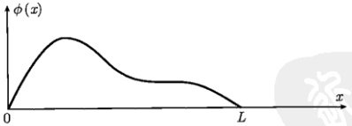

图 5.1 弦的初始形状
 

在建立  $ u(x,t) $ 所满足的运动方程之前，我们首先作如下假定：

(1) 弦是均匀的，平衡时的线密度为  $ \rho $;

(2) 弦是完全轻质而柔软的，在平衡和振动时均是绷紧的（内部有张力）；

(3) 弦振动的幅度很小 (微振动)，由此弦线上每一点的斜率  $ \partial u/\partial x $ 很小；

<!-- page: 111 -->

(4) 弦振动是横向的，即每一点的振动方向均与 x 轴垂直，且整个弦的振动在同一个平面（即  $ x \sim u $ 平面）内。

我们首先分析无外界驱动力的情况，并忽略弦的重力。这样弦在平衡位置和振动时只有张力起作用。设弦在平衡位置时内部张力的大小为常数 T。弦在振动时，由于幅度很小，它的伸长很小，张力相对于平衡态时变化很小，由此可以认为各个点的张力近似相等，并维持为平衡态时的常数 T。

现在我们分析弦振动时任意 x 处的一段微元  $ \Delta s $ 的受力情况。如图 5.2 所示， $ \Delta s $ 的左右端受到的张力分别为  $ T_{1} $ 和  $ T_{2} $，它们的方向不同（沿  $ \Delta s $ 左右端的切线方向），但大小均为 T，即  $ T_{1}=T_{2}=T $。由于弦振动是横向的，在 x 方向没有运动（合力为零）。根据牛顿第二定律写出 u 方向的运动方程为

$$  T_{2}\sin\alpha_{2}-T_{1}\sin\alpha_{1}=T\left(\sin\alpha_{2}-\sin\alpha_{1}\right)=m\frac{\partial^{2}u}{\partial t^{2}}   \tag*{(5.1.1)}$$

其中， $ \alpha_{1} $ 和  $ \alpha_{2} $ 是  $ \Delta s $ 左右两端的切线与 x 轴的夹角，m 是  $ \Delta s $ 的质量，也是平衡位置时  $ \Delta x $ 的质量，因此

$$  m=\rho\,\Delta x   \tag*{(5.1.2)}$$

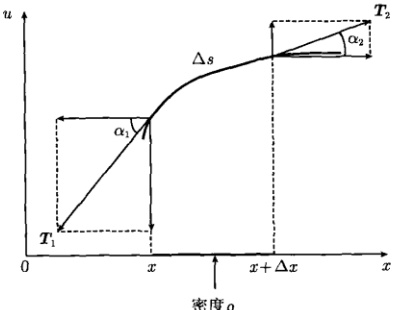

图 5.2 弦振动系统中微元  $ \Delta s $ 的受力分析
 

现在考查  $ \Delta s $ 两端的斜率，考虑到微振动的性质： $ \alpha_{1},\alpha_{2}\rightarrow0 $ ，我们有

$$  \left.\frac{\partial u}{\partial x}\right|_{x}=\tan\alpha_{1}\approx\sin\alpha_{1}   \tag*{(5.1.3a)}$$

$$  \left.\frac{\partial u}{\partial x}\right|_{x+\Delta x}=\tan\alpha_{2}\approx\sin\alpha_{2}   \tag*{(5.1.3b)}$$

式(5.1.3b)与式(5.1.3a)之差 $ \left(\left.\frac{\partial u}{\partial x}\right|_{x+\Delta x}-\left.\frac{\partial u}{\partial x}\right|_{x}\right) $是 $ \frac{\partial u}{\partial x} $的变化量，故

<!-- page: 112 -->

$$  \left(\left.\frac{\partial u}{\partial x}\right|_{x+\Delta x}-\left.\frac{\partial u}{\partial x}\right|_{x}\right)=\Delta\left(\frac{\partial u}{\partial x}\right)=\frac{\Delta\left(\frac{\partial u}{\partial x}\right)}{\Delta x}\Delta x\approx\frac{\partial^{2}u}{\partial x^{2}}\Delta x   \tag*{(5.1.4)}$$

最后一步我们用微商近似代替了变化量。将式（5.1.1）中的  $ \sin\alpha_{1} $ 和  $ \sin\alpha_{2} $ 用式（5.1.3）中的斜率代换，并利用式（5.1.4）和式（5.1.2），得到

$$  T\frac{\partial^{2}u}{\partial x^{2}}\Delta x=\rho\Delta x\frac{\partial^{2}u}{\partial t^{2}}   \tag*{(5.1.5)}$$

即

$$  \frac{\partial^{2}u}{\partial t^{2}}=a^{2}\frac{\partial^{2}u}{\partial x^{2}}   \tag*{(5.1.6)}$$

式(5.1.6)就是弦振动的运动方程，其中  $ a=\sqrt{T/\rho} $ 是弦的物理参量，它具有速度的量纲。我们将会看到，a 就是振动传播的速度（即波速）。

#### 5.1.2 强迫振动与阻尼振动

现在进一步考虑横向附加力的影响，如重力或外界驱动力。一般情况下，附加力是时空依赖的，设作用在单位长度弦上的附加力为  $ F(x,t) $，如图 5.3 所示，则方程 (5.1.1) 左边应添加微元受到的附加力  $ F(x,t)\Delta x $，即

$$  \begin{aligned}T_{2}\sin\alpha_{2}-T_{1}\sin\alpha_{1}+F\Delta x&=T\left(\left.\frac{\partial u}{\partial x}\right|_{x+\Delta x}-\left.\frac{\partial u}{\partial x}\right|_{x}\right)+F\Delta x\\&=T\frac{\partial^{2}u}{\partial x^{2}}\Delta x+F\Delta x\\&=\rho\Delta x\frac{\partial^{2}u}{\partial t^{2}}\\ \end{aligned}   \tag*{(5.1.7)}$$

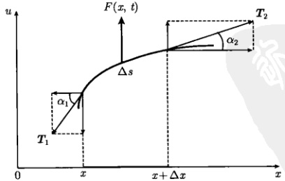

图 5.3 强迫弦振动系统中微元  $ \Delta s $ 的受力分析
 

<!-- page: 113 -->

因此

$$  \frac{\partial^{2}u}{\partial t^{2}}=a^{2}\frac{\partial^{2}u}{\partial x^{2}}+f(x,t)   \tag*{(5.1.8)}$$

其中

$$  f(x,t)=\frac{F(x,t)}{\rho}   \tag*{(5.1.9)}$$

方程 (5.1.8) 就是所谓强迫振动方程。如果附加力是弦的重力，则式 (5.1.7) 中的附加力为  $ F\Delta x = -mg = -\rho\Delta xg $ (g 是重力加速度)，于是方程 (5.1.8) 变成

$$  \frac{\partial^{2}u}{\partial t^{2}}=a^{2}\frac{\partial^{2}u}{\partial x^{2}}-g   \tag*{(5.1.10)}$$

对于弦振动位移  $ u(x,t) $ 而言，附加力  $ f(x,t) $ 和重力 mg 是外界驱动力，通常称为“力项”(force term)，也称为驱动项，方程 (5.1.8) 和方程 (5.1.10) 是非齐次偏微分方程。

现在进一步考虑阻尼弦振动的情况，如图5.4所示。设想弦在某种介质中做微振动，振动时受到的阻力与振动的速度成正比，这样单位长度的弦受到的阻力可以表示为

$$  F(x,t)=-k\frac{\partial u}{\partial t}   \tag*{(5.1.11)}$$

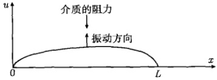

图 5.4 阻尼弦振动的示意图
 

其中，k 是阻尼系数，负号表示阻力与振动方向相反。式(5.1.11)的阻力属于弦振动的一种附加力，即式(5.1.8)中的力项  $ f(x,t) $，它现在表示为

$$  f(x,t)=\frac{F(x,t)}{\rho}=-\frac{k}{\rho}\frac{\partial u}{\partial t}\equiv-2b\frac{\partial u}{\partial t}   \tag*{(5.1.12)}$$

将式（5.1.12）代入式（5.1.8）得到

$$  \frac{\partial^{2}u}{\partial t^{2}}-a^{2}\frac{\partial^{2}u}{\partial x^{2}}+2b\frac{\partial u}{\partial t}=0   \tag*{(5.1.13)}$$

这就是阻尼弦振动的运动方程。需要注意，虽然附加力(5.1.11)是来自外界的阻力，但它的大小依赖于弦本身的运动状态(弦的速度越大，受到的阻力越大)。对于弦振动位移  $ u(x,t) $ 而言，这种作用已经不是纯粹的外界力项，而是系统与外界相互作用的结果，它所导致的阻尼项  $ \partial u/\partial t $ 反映系统本身的性质。现在，方程(5.1.13)明显是一个齐次方程。

<!-- page: 114 -->

上述弦振动问题的解  $ u(x,t) $ 表示位于 x 处的弦点在任意 t 时刻离开平衡位置的位移。其实，时空依赖的振动就是波动，波动是振动的传播。在波动的意义上， $ u(x,t) $ 表示空间任意 x 点的波形 (图 5.5)；又可以理解为任意 t 时刻波动在空间的分布。上述的振动方程常称为波动方程，而波动方程 (5.1.8) 中的附加力  $ f(x,t) $ 可以视为外波源。

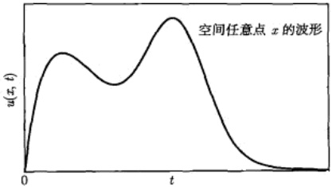

图 5.5 波动方程的解  $ u(x,t) $ 表示空间任意 x 点的波形
 

上述一维波动方程的结果容易推广到二维和三维情况

$$  \frac{\partial^{2}u}{\partial t^{2}}=a^{2}\left(\frac{\partial^{2}u}{\partial x^{2}}+\frac{\partial^{2}u}{\partial y^{2}}\right)+f(x,y,t)   \tag*{(5.1.14)}$$

$$  \frac{\partial^{2}u}{\partial t^{2}}=a^{2}\left(\frac{\partial^{2}u}{\partial x^{2}}+\frac{\partial^{2}u}{\partial y^{2}}+\frac{\partial^{2}u}{\partial z^{2}}\right)+f(x,y,z,t)   \tag*{（5.1.15）}$$

它们分别刻画一个二维平面上和一个三维立体空间内的波动行为，而  $ f(x,y,t) $ 和  $ f(x,y,z,t) $ 则是相应的时空依赖的外波源。特别是方程 (5.1.14) 可以描述二维膜的振动，具体问题我们将在 6.3.1 节详细讨论。

#### 5.1.3 高频传输线问题

除了弦振动问题之外，还有许多物理现象都服从波动方程，一个典型的例子是高频传输线问题。与1.1节例5的普通传输线不同，当高频电流通过传输线时，不仅有导线电阻和电路电漏的存在，而且分布电容、分布电感更是不可避免的，因此高频传输线上的电压与电流不但随空间变化，而且随时间变化。与研究普通传输线的方法相同，对于高频传输线，也是从传输线划出一个微元 $ \Delta x $，不过它的等效电路更为复杂，如图5.6所示。图中的R，L，C和G分别是单位长度的电阻、电感、电容和电漏，由于微元足够小，每个元件的尺度均为 $ \Delta x $。现在根据基尔霍夫定律写出电压与电流的方程。在长度为 $ \Delta x $的传输线中，电压降为

$$  v-(v+\Delta v)=R\Delta x\cdot i+L\Delta x\cdot\frac{\partial i}{\partial t}   \tag*{(5.1.16a)}$$

<!-- page: 115 -->

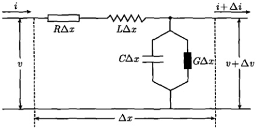

图 5.6 高频传输线微元  $ \Delta x $ 的等效电路
 

在节点，流入的电流等于流出的电流

$$  i=(i+\Delta i)+C\Delta x\cdot\frac{\partial v}{\partial t}+G\Delta x\cdot v   \tag*{(5.1.16b)}$$

注意，式(5.1.16)右边的v原本是 $ v+\Delta v $，这里略去了二阶小量 $ \Delta x\Delta v $。方程(5.1.16)中的变化量用微商近似代替后变成

$$  \frac{\partial i}{\partial x}+C\frac{\partial v}{\partial t}+G v=0   \tag*{(5.1.17a)}$$

$$  \frac{\partial v}{\partial x}+L\frac{\partial i}{\partial t}+R i=0   \tag*{(5.1.17b)}$$

这是电压与电流的耦合方程，下面我们推出各自独立的方程。为此，对式(5.1.17a)两边关于x求导数，得到

$$  \frac{\partial^{2}i}{\partial x^{2}}+C\frac{\partial^{2}v}{\partial x\partial t}+G\frac{\partial v}{\partial x}=0   \tag*{(5.1.18a)}$$

对式(5.1.17b)两边关于t求导数，得到

$$  \frac{\partial^{2}v}{\partial x\partial t}+L\frac{\partial^{2}i}{\partial t^{2}}+R\frac{\partial i}{\partial t}=0   \tag*{(5.1.18b)}$$

式(5.1.18b)两边同乘以C，再与式(5.1.18a)相减，得到

$$  \frac{\partial^{2}i}{\partial x^{2}}+G\frac{\partial v}{\partial x}-L C\frac{\partial^{2}i}{\partial t^{2}}-R C\frac{\partial i}{\partial t}=0   \tag*{(5.1.19)}$$

由式(5.1.17b)解出 $ \partial v/\partial x $，再代入式(5.1.19)，得到

$$  \frac{\partial^{2}i}{\partial x^{2}}=LC\frac{\partial^{2}i}{\partial t^{2}}+\left(RC+GL\right)\frac{\partial i}{\partial t}+GRi   \tag*{(5.1.20a)}$$

这是电流的方程。同理可得电压的方程

$$  \frac{\partial^{2}v}{\partial x^{2}}=L C\frac{\partial^{2}v}{\partial t^{2}}+\left(R C+G L\right)\frac{\partial v}{\partial t}+G R v   \tag*{(5.1.20b)}$$

<!-- page: 116 -->

可见电压与电流有相同的变化规律。方程(5.1.20a)和方程(5.1.20b)具有相同的形式

$$  \frac{\partial^{2}u}{\partial t^{2}}-a^{2}\frac{\partial^{2}u}{\partial x^{2}}+2b\frac{\partial u}{\partial t}+c u=0   \tag*{(5.1.21)}$$

方程(5.1.21)称为电报方程(telegraph equation)，其中a,b,c>0。它与阻尼弦振动方程(5.1.13)相比，多了函数项cu。

对于理想的传输线，电阻与电漏的影响可以忽略，方程(5.1.20)约化为

$$  \frac{\partial^{2}u}{\partial t^{2}}=a^{2}\frac{\partial^{2}u}{\partial x^{2}}\ \left(u=i\  或 \ v\right)   \tag*{(5.1.22)}$$

其中， $ a=\sqrt{1/LC} $。这就是理想高频传输线方程，我们看到它与弦振动方程(5.1.6)有完全相同的形式。

同一个方程可以描述不同的物理现象，换言之，不同的物理现象可以被相同的规律所支配，这反映了不同物理现象之间的相通性。式(5.1.22)的波动方程还适用于许多波动现象，事实上自然界许多弹性振动，如机械振动、地震波、声波，以及电磁波等，都可以在波动方程的基础上加以描述。

### 5.2 热传导方程

热传导是一个很常见的现象。当物体内部的温度分布不均匀时，热量就会从温

度较高的地方向温度较低的地方流动，在这个过程中，温度是空间和时间的函数。热传导方程就是温度所满足的偏微分方程，它的解给出任意时刻物体内的温度分布。

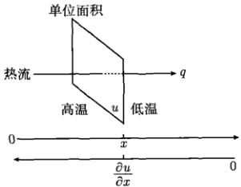

图 5.7 热传导的傅里叶定律
 

为了建立热传导方程，我们首先介绍热传导的傅里叶定律。设一维热传导系统置于x轴，考查系统在任意x处的横截面上的一个单位面积，如图5.7所示。设热流沿x方向传递，x处的温度为 $ u(x) $，温度梯度为 $ \partial u/\partial x $。傅里叶定律指出：在单位时间内流经该单位面积的热量q与该处的温度梯度成正比，即

 $$ q=-k\frac{\partial u}{\partial x} $$ 

其中，k 是热导率，负号表示热流方向与温度梯度方向相反。

现在设这个一维的热传导系统（如一个均匀的细杆）的长度为 L，横截面积为 S，杆的两个端点处于 x = 0 和 x = L。假定杆在初始 t = 0 时刻的温度分布为

<!-- page: 117 -->

$ \phi(x) $，在随后的时间 $ (t>0) $，热量在杆中流动。现在我们要确定在任意t时刻，杆中任意位置 $ x(0<x<L) $的温度 $ u(x,t) $。

我们考查系统在 x 位置的一段微元  $ \Delta x $，如图 5.8 所示。根据傅里叶定律  $ (5.2.1) $，在  $ \Delta t $ 时间内从  $ \Delta x $ 前端流入的热量为

$$  Q_{1}=-kS\Delta t\left.\frac{\partial u}{\partial x}\right|_{x}   \tag*{(5.2.2)}$$

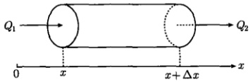

图 5.8 一维热传导系统的微元  $ \Delta x $
 

另一方面，在该时间内从  $ \Delta x $ 后端流出的热量为

$$  Q_{2}=-kS\Delta t\left.\frac{\partial u}{\partial x}\right|_{x+\Delta x}   \tag*{(5.2.3)}$$

在没有其他热源的情况下，体积元  $ S\Delta x $ 吸收的热量使之温度升高。而温度升高的描述则是基于物体比热 c 的定义：

$$  c=\frac{1}{m}\frac{\Delta Q}{\Delta u}   \tag*{(5.2.4)}$$

其中，m 是物体的质量，c 表示单位质量的物体温度升高 1K 所需要的热量。这样体积元  $ S\Delta x $ 吸收的热量为

$$  Q_{3}=c\rho S\Delta x\Delta u   \tag*{(5.2.5)}$$

其中， $ \rho = m/S\Delta x $ 是系统的质量体密度。热量守恒要求

$$  Q_{1}-Q_{2}=Q_{3}   \tag*{(5.2.6)}$$

将式(5.2.2)、式(5.2.3)和式(5.2.5)代入式(5.2.6)，得到

$$  k S\Delta t\left(\left.\frac{\partial u}{\partial x}\right|_{x+\Delta x}-\left.\frac{\partial u}{\partial x}\right|_{x}\right)=c\rho S\Delta x\Delta u   \tag*{(5.2.7)}$$

温度梯度的变化量 [利用式（5.1.4）] 为

$$  \left(\left.\frac{\partial u}{\partial x}\right|_{x+\Delta x}-\left.\frac{\partial u}{\partial x}\right|_{x}\right)\approx\frac{\partial^{2}u}{\partial x^{2}}\Delta x   \tag*{(5.2.8)}$$

<!-- page: 118 -->

再利用变化量与微分的近似关系

$$  \frac{\Delta u}{\Delta t}\approx\frac{\partial u}{\partial t}   \tag*{(5.2.9)}$$

式(5.2.7)变为

$$  \frac{\partial u}{\partial t}=a^{2}\frac{\partial^{2}u}{\partial x^{2}}   \tag*{(5.2.10)}$$

其中， $ a = \sqrt{k/c\rho} $ 是系统的物理参量，它扮演了一个热扩散系数。式 (5.2.10) 就是一维系统的热传导方程。

热传导方程 (5.2.10) 与波动方程 (5.1.6) 的不同之处在于，它的时间微商项是一阶的，这使得我们可以讨论热传导系统的稳态行为。在稳态情况下， $ u(x,t) $ 不随时间变化，即  $ \partial u/\partial t=0 $，故  $ \partial^{2}u/\partial x^{2}=0 $，因此系统的稳态温度分布为

$$  u(x)=A x+B   \tag*{(5.2.11)}$$

这是一个简单的线性解，其中 A 和 B 是常数，由热传导系统的边界条件确定。比如对于边界条件  $ u(0)=T_{1} $ 和  $ u(L)=T_{2} $，则  $ A=(T_{2}-T_{1})/L $， $ B=T_{1} $。如果边界条件为  $ u(0)=0 $ 和  $ u(L)=0 $，则 A=B=0。

与弦振动时附加力的引入类似，有源热传导方程表示为

$$  \frac{\partial u}{\partial t}=a^{2}\frac{\partial^{2}u}{\partial x^{2}}+f(x,t)   \tag*{(5.2.12)}$$

其中， $ f(x,t) $ 表示一个时空依赖的外热源。

一维热传导方程（5.2.12）容易推广到二维与三维情况

$$  \frac{\partial u}{\partial t}=a^{2}\left(\frac{\partial^{2}u}{\partial x^{2}}+\frac{\partial^{2}u}{\partial y^{2}}\right)+f(x,y,t)   \tag*{(5.2.13)}$$

$$  \frac{\partial u}{\partial t}=a^{2}\left(\frac{\partial^{2}u}{\partial x^{2}}+\frac{\partial^{2}u}{\partial y^{2}}+\frac{\partial^{2}u}{\partial z^{2}}\right)+f(x,y,z,t)   \tag*{(5.2.14)}$$

它们分别描述一个二维平面上和一个三维立体空间内的热传导行为，而  $ f(x,y,t) $ 和  $ f(x,y,z,t) $ 则是相应的时空依赖的外波源。这两个方程以后都会用到。

下面我们通过一个例题讨论有源热传导方程的建立。

例 一个长度为 L，横截面积为 S、电阻率为 r 的匀质导线，内有电流密度为 j 的均匀分布的直流电通过。设导线的比热、体密度和热导率分别为 c， $ \rho $ 和 k。试推导导线内的热传导方程。

解 按照推导方程 (5.2.10) 的过程，进一步考虑电流在系统体积元  $ S\Delta x $ 中产生的焦耳热量

$$  Q_{4}=I^{2}R\frac{\Delta x}{L}\Delta t=j^{2}r S\Delta x\Delta t   \tag*{(5.2.15)}$$

<!-- page: 119 -->

其中，R 和 I 分别是导线的总电阻和电流强度，则热量守恒方程由 (5.2.6) 变为

$$  Q_{1}-Q_{2}+Q_{4}=Q_{3}   \tag*{(5.2.16)}$$

这样，在式 (5.2.7) 左边加入  $ j^{2}rS\Delta x\Delta t $，并利用式 (5.2.8)，得到

$$  k S\Delta t\frac{\partial^{2}u}{\partial x^{2}}\Delta x+j^{2}r S\Delta x\Delta t=c\rho S\Delta x\Delta u   \tag*{(5.2.17)}$$

即

$$  \frac{\partial u}{\partial t}=a^{2}\frac{\partial^{2}u}{\partial x^{2}}+f   \tag*{(5.2.18)}$$

其中， $ f=\frac{j^{2}r}{c\rho} $，式(5.2.18)就是导线内的热传导方程，由于内部热源的存在，它是一个非齐次的方程。

### 5.3 拉普拉斯方程

二维热传导方程(5.2.13)在稳态 $ \partial u/\partial t=0 $且 $ f(x,y,t)=0 $情况下给出

$$  \frac{\partial^{2}u}{\partial x^{2}}+\frac{\partial^{2}u}{\partial y^{2}}=0   \tag*{(5.3.1)}$$

这就是熟知的二维拉普拉斯方程。这个方程给出关于二维热传导系统稳态温度分布的各种形式解。另外，它还能描述电磁场的空间分布，现在我们利用麦克斯韦方程推导电磁场的拉普拉斯方程。

描述电磁波时空变化规律的麦克斯韦方程为

$$  \nabla\cdot\pmb{D}=\rho   \tag*{(5.3.2a)}$$

$$  \nabla\times\boldsymbol{E}=-\frac{\partial\boldsymbol{B}}{\partial t}   \tag*{(5.3.2b)}$$

$$  \nabla\cdot\boldsymbol{B}=0   \tag*{(5.3.2c)}$$

$$  \nabla\times\boldsymbol{H}=\boldsymbol{J}+\frac{\partial\boldsymbol{D}}{\partial t}   \tag*{(5.3.2d)}$$

其中，D 是电位移矢量，E 是电场强度，B 是磁感应强度，H 是磁场强度， $ \rho $ 是自由电荷体密度，J 是传导电流密度。另外还有物质方程

$$  \boldsymbol{D}=\varepsilon\boldsymbol{E}   \tag*{(5.3.3a)}$$

$$  \boldsymbol{B}=\mu\boldsymbol{H}   \tag*{(5.3.3b)}$$

$$  \boldsymbol{J}=\boldsymbol{\sigma}\boldsymbol{E}   \tag*{(5.3.3c)}$$

<!-- page: 120 -->

其中， $ \varepsilon $， $ \mu $ 和  $ \sigma $ 分别是介质的介电常数、磁导率与电导率。

现在我们从式（5.3.2）和式（5.3.3）出发，首先推导电磁场方程，利用矢量运算公式（1.2.10），我们有

$$  \nabla(\nabla\cdot\boldsymbol{E})-\nabla^{2}\boldsymbol{E}=\nabla\times(\nabla\times\boldsymbol{E})   \tag*{(5.3.4)}$$

将式（5.3.4）中的 E 视为电场强度，利用式（5.3.3a）和式（5.3.2a），得到

$$  \nabla(\nabla\cdot\boldsymbol{E})=\frac{1}{\varepsilon}\nabla\left(\nabla\cdot\boldsymbol{D}\right)=\frac{1}{\varepsilon}\nabla\rho=0   \tag*{(5.3.5)}$$

最后一步是假定自由电荷密度  $ \rho $ 为常数。进一步利用式(5.3.2)和式(5.3.3)，我们有

 $$ \begin{aligned}\nabla\times\left(\nabla\times\boldsymbol{E}\right)&=-\nabla\times\frac{\partial\boldsymbol{B}}{\partial t}=-\frac{\partial}{\partial t}\nabla\times\boldsymbol{B}\\&=-\mu\frac{\partial}{\partial t}\nabla\times\boldsymbol{H}=-\mu\frac{\partial}{\partial t}\left(\boldsymbol{J}+\frac{\partial\boldsymbol{D}}{\partial t}\right)\\&=-\mu\left(\frac{\partial\boldsymbol{J}}{\partial t}+\frac{\partial^{2}\boldsymbol{D}}{\partial t^{2}}\right)=-\mu\sigma\frac{\partial\boldsymbol{E}}{\partial t}-\mu\varepsilon\frac{\partial^{2}\boldsymbol{E}}{\partial t^{2}}\end{aligned} $$ 

将这个结果和式（5.3.5）代入式（5.3.4），得到

$$  \mu\varepsilon\frac{\partial^{2}\mathbf{E}}{\partial t^{2}}+\mu\sigma\frac{\partial\mathbf{E}}{\partial t}=\nabla^{2}\mathbf{E}   \tag*{(5.3.6a)}$$

这是电场方程。同理可得磁场方程

$$  \mu\varepsilon\frac{\partial^{2}\boldsymbol{H}}{\partial t^{2}}+\mu\sigma\frac{\partial\boldsymbol{H}}{\partial t}=\nabla^{2}\boldsymbol{H}   \tag*{(5.3.6b)}$$

式(5.3.6)中的一阶微商项刻画系统的损耗，电导率 $ \sigma $扮演了一个唯象的损耗因子。如果系统的损耗为零，则式(5.3.6)变为

$$  \frac{\partial^{2}\boldsymbol{E}}{\partial t^{2}}=\frac{1}{\mu\varepsilon}\nabla^{2}\boldsymbol{E},\quad\frac{\partial^{2}\boldsymbol{H}}{\partial t^{2}}=\frac{1}{\mu\varepsilon}\nabla^{2}\boldsymbol{H}   \tag*{(5.3.7)}$$

这是电磁场所满足的波动方程。在一维情况下约化为

$$  \frac{\partial^{2}E}{\partial t^{2}}=a^{2}\frac{\partial^{2}E}{\partial x^{2}},\quad\frac{\partial^{2}H}{\partial t^{2}}=a^{2}\frac{\partial^{2}H}{\partial x^{2}}   \tag*{（5.3.8）}$$

其中， $ a = \sqrt{1/\mu\varepsilon} $ 正是电磁波的速度。我们看到，从麦克斯韦方程推导出了波动方程 (5.3.8)。

求解矢量场的波动方程 (5.3.7) 是相当繁复的。为了得到矢量 E，通常的方法是借助电场 E 与电位 u 的关系

$$  \pmb{E}=-\nabla u   \tag*{(5.3.9)}$$

<!-- page: 121 -->

先求出标量 u，取梯度后便得到矢量 E。

下面我们通过一个简单的方式，来解释关系式(5.3.9)。在一个理想的平行板电容器中，电场强度是均匀的，电场强度与电位梯度的关系如图5.9所示，电场为

$$  E=\frac{U_{ 高 }-U_{ 低 }}{d}=-\frac{U_{ 低 }-U_{ 高 }}{d}   \tag*{(5.3.10)}$$

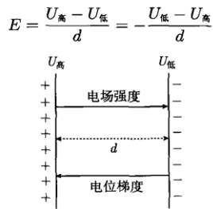

图 5.9 均强电场中电场强度与电位梯度的关系
 

其中， $ U_{高} $ 和  $ U_{低} $ 分别表示平行板电容器的高、低电位。进而考虑一个任意电荷系统形成的电场（图 5.10），在任意 x 点的电场强度  $ E(x) $ 可以近似为微元  $ \Delta x $ 范围内的平行板电容器的电场，因此

$$  E(x)=-\frac{U|_{x+\Delta x}-U|_{x}}{\Delta x}=-\frac{\Delta U}{\Delta x}\approx-\frac{\partial U}{\partial x}   \tag*{(5.3.11)}$$

这个结果简要地解释了关系式(5.3.9)。

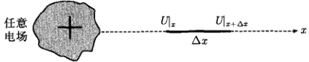

图 5.10 非均匀电场中电场强度与电位梯度的关系
 

从式（5.3.9）可以进一步得到

$$  \nabla\cdot\nabla\boldsymbol{u}=-\nabla\cdot\boldsymbol{E}=-\frac{1}{\varepsilon}\nabla\cdot\boldsymbol{D}=-\frac{\rho}{\varepsilon}   \tag*{(5.3.12)}$$

式（5.3.12）就是熟知的泊松方程

$$  \nabla^{2}u=-\frac{\rho}{\varepsilon}   \tag*{（5.3.13）}$$

如果电场是无源的，即  $ \rho=0 $，则方程(5.3.13)就变成拉普拉斯方程

$$  \nabla^{2}u=0   \tag*{(5.3.14)}$$

这个结果意味着无源场的电位满足拉普拉斯方程。

<!-- page: 122 -->

方程（5.3.13）和方程（5.3.14）都是三维的，它们的二维形式为

$$  \frac{\partial^{2}u}{\partial x^{2}}+\frac{\partial^{2}u}{\partial y^{2}}=-\frac{\rho_{\mathrm{s}}}{\varepsilon}   \tag*{(5.3.15)}$$

$$  \frac{\partial^{2}u}{\partial x^{2}}+\frac{\partial^{2}u}{\partial y^{2}}=0   \tag*{(5.3.16)}$$

方程(5.3.15)中的 $ \rho_{s} $表示自由电荷面密度。

我们在 5.1~5.3 节分别建立了波动方程、热传导方程和拉普拉斯方程，它们是基本的数学物理方程。建立方程固然是我们的需要，但最重要的是体会建立方程所用的方法。我们所用的方法，加之第1章建立常微分方程模型的方法，总结起来有三种，它们的基本思路如下：

(1) 统计法 对所考查的问题进行统计学研究，分析考查量的变化规律，归纳出它所满足的微分方程。这种方法具有非常广泛的用途，包括生物学、生态学、医学、经济学、社会学等。典型例子是建立马尔萨斯人口模型和 Logistic 模型。

(2) 微元法 在系统中分出一个微元，分析它与附近部分的相互作用，推导出作用规律（如牛顿第二定律、基尔霍夫定理、热传导的傅里叶定律）的数学表达式，它就是系统的微分方程。典型例子是建立波动方程、电报方程和热传导方程。

(3) 规律法 直接从物理学规律出发，将它变成数学物理方程。比如，利用电磁波的麦克斯韦方程，得到电场强度、磁场强度、电位等物理量的微分方程。

### 5.4 二阶偏微分方程

#### 5.4.1 分类与标准形式

我们在 5.1~5.3 节建立了如下双变量的二阶偏微分方程

$$  \frac{\partial^{2}u}{\partial t^{2}}=a^{2}\frac{\partial^{2}u}{\partial x^{2}}\quad( 一维波动方程 )   \tag*{(5.4.1a)}$$

$$  \frac{\partial^{2}u}{\partial t^{2}}=a^{2}\frac{\partial^{2}u}{\partial x^{2}}+f(x,t)\quad( 一维有源波动方程 )   \tag*{(5.4.1b)}$$

$$  \frac{\partial^{2}u}{\partial t^{2}}-a^{2}\frac{\partial^{2}u}{\partial x^{2}}+2b\frac{\partial u}{\partial t}=0\quad( 一维阻尼波动方程 )   \tag*{(5.4.1c)}$$

$$  \frac{\partial^{2}u}{\partial t^{2}}-a^{2}\frac{\partial^{2}u}{\partial x^{2}}+2b\frac{\partial u}{\partial t}+c u=0\quad( 电报方程 )   \tag*{(5.4.1d)}$$

$$  \frac{\partial u}{\partial t}=a^{2}\frac{\partial^{2}u}{\partial x^{2}}\quad( 一维热传导方程 )   \tag*{(5.4.1e)}$$

$$  \frac{\partial u}{\partial t}=a^{2}\frac{\partial^{2}u}{\partial x^{2}}+f(x,t)\quad( 一维有源热传导方程 )   \tag*{(5.4.1f)}$$

<!-- page: 123 -->

$$  \frac{\partial^{2}u}{\partial x^{2}}+\frac{\partial^{2}u}{\partial y^{2}}=0\quad( 二维拉普拉斯方程 )   \tag*{(5.4.1g)}$$

$$  \frac{\partial^{2}u}{\partial x^{2}}+\frac{\partial^{2}u}{\partial y^{2}}=f(x,y)\quad( 二维泊松方程 )   \tag*{(5.4.1h)}$$

这些方程都是线性的（方程中的函数和它的各阶导数都是一次方）。确切地说，它们都是二阶线性双变量偏微分方程。

从方程（5.4.1）可以归纳出二阶线性双变量的偏微分方程的通式

$$  A\frac{\partial^{2}u}{\partial x^{2}}+2B\frac{\partial^{2}u}{\partial x\partial y}+C\frac{\partial^{2}u}{\partial y^{2}}+D\frac{\partial u}{\partial x}+E\frac{\partial u}{\partial y}+Fu=G   \tag*{(5.4.2)}$$

其中，A、B、C、D、E、F、G 都是 x 和 y 的函数，但不含 u。方程 (5.4.2) 是非齐次的，如果 G = 0，则变成齐次的。这里已经假定函数 u 满足  $ \partial^{2}u/\partial x\partial y = \partial^{2}u/\partial y\partial x $。

现在讨论方程 (5.4.2) 的分类，我们将证明该方程按照  $ \Delta = B^{2} - AC $ 的取值分成三类，而且可以化成如下标准形式：

 $ \Delta>0 $（双曲形方程）

$$  \frac{\partial^{2}u}{\partial x\partial y}=[\cdots]\quad 或 \quad\frac{\partial^{2}u}{\partial x^{2}}-\frac{\partial^{2}u}{\partial y^{2}}=[\cdots]   \tag*{(5.4.3)}$$

 $ \Delta = 0 $ (抛物线形方程)

$$  \frac{\partial^{2}u}{\partial x^{2}}=[\cdots]\quad 或 \quad\frac{\partial^{2}u}{\partial y^{2}}=[\cdots]   \tag*{(5.4.4)}$$

 $ \Delta<0 $（椭圆形方程）

$$  \frac{\partial^{2}u}{\partial x^{2}}+\frac{\partial^{2}u}{\partial y^{2}}=[\cdots]   \tag*{(5.4.5)}$$

其中，[‥]代表所有不含二阶偏导数的项。

为了化简方程(5.4.2)，引入变量代换

$$  \xi=\xi(x,y),\quad\eta=\eta(x,y)   \tag*{(5.4.6)}$$

为保证逆变换存在，其雅可比行列式满足

$$  \left|\begin{array}{l l}\frac{\partial\xi}{\partial x}&\frac{\partial\xi}{\partial y}\\ \frac{\partial\eta}{\partial x}&\frac{\partial\eta}{\partial y}\end{array}\right|\neq0   \tag*{(5.4.7)}$$

现在要把方程(5.4.2)化成关于 $ u(\xi,\eta) $的形式。由式(5.4.6)，我们有

 $$ \frac{\partial u}{\partial x}=\frac{\partial u}{\partial\xi}\frac{\partial\xi}{\partial x}+\frac{\partial u}{\partial\eta}\frac{\partial\eta}{\partial x} $$

<!-- page: 124 -->

$$ \frac{\partial u}{\partial y}=\frac{\partial u}{\partial\xi}\frac{\partial\xi}{\partial y}+\frac{\partial u}{\partial\eta}\frac{\partial\eta}{\partial y} $$ 

 $$ \begin{aligned}&\frac{\partial^{2}u}{\partial x^{2}}=\frac{\partial^{2}u}{\partial\xi^{2}}\left(\frac{\partial\xi}{\partial x}\right)^{2}+2\frac{\partial^{2}u}{\partial\xi\partial\eta}\frac{\partial\xi}{\partial x}\frac{\partial\eta}{\partial x}+\frac{\partial^{2}u}{\partial\eta^{2}}\left(\frac{\partial\eta}{\partial x}\right)^{2}+\frac{\partial u}{\partial\xi}\frac{\partial^{2}\xi}{\partial x^{2}}+\frac{\partial u}{\partial\eta}\frac{\partial^{2}\eta}{\partial x^{2}}\\&\frac{\partial^{2}u}{\partial x\partial y}=\frac{\partial^{2}u}{\partial\xi^{2}}\frac{\partial\xi}{\partial x}\frac{\partial\xi}{\partial y}+\frac{\partial^{2}u}{\partial\xi\partial\eta}\left(\frac{\partial\xi}{\partial x}\frac{\partial\eta}{\partial y}+\frac{\partial\xi}{\partial y}\frac{\partial\eta}{\partial x}\right)+\frac{\partial^{2}u}{\partial\eta^{2}}\frac{\partial\eta}{\partial x}\frac{\partial\eta}{\partial y}+\frac{\partial u}{\partial\xi}\frac{\partial^{2}\xi}{\partial x\partial y}+\frac{\partial u}{\partial\eta}\frac{\partial^{2}\eta}{\partial x\partial y}\\&\frac{\partial^{2}u}{\partial y^{2}}=\frac{\partial^{2}u}{\partial\xi^{2}}\left(\frac{\partial\xi}{\partial y}\right)^{2}+2\frac{\partial^{2}u}{\partial\xi\partial\eta}\frac{\partial\xi}{\partial y}\frac{\partial\eta}{\partial y}+\frac{\partial^{2}u}{\partial\eta^{2}}\left(\frac{\partial\eta}{\partial y}\right)^{2}+\frac{\partial u}{\partial\xi}\frac{\partial^{2}\xi}{\partial y^{2}}+\frac{\partial u}{\partial\eta}\frac{\partial^{2}\eta}{\partial y^{2}}\end{aligned} $$ 

将这些结果代入式(5.4.2)，得到

$$  a\frac{\partial^{2}u}{\partial\xi^{2}}+2b\frac{\partial^{2}u}{\partial\xi\partial\eta}+c\frac{\partial^{2}u}{\partial\eta^{2}}+d\frac{\partial u}{\partial\xi}+e\frac{\partial u}{\partial\eta}+f u=g   \tag*{(5.4.8)}$$

它就是以  $ \xi,\eta $ 为变量的方程，其中

 $$ \begin{aligned}&a=A\left(\frac{\partial\xi}{\partial x}\right)^{2}+2B\frac{\partial\xi}{\partial x}\frac{\partial\xi}{\partial y}+C\left(\frac{\partial\xi}{\partial y}\right)^{2}\\ &b=A\frac{\partial\xi}{\partial x}\frac{\partial\eta}{\partial x}+B\left(\frac{\partial\xi}{\partial x}\frac{\partial\eta}{\partial y}+\frac{\partial\xi}{\partial y}\frac{\partial\eta}{\partial x}\right)+C\frac{\partial\xi}{\partial y}\frac{\partial\eta}{\partial y}\\ &c=A\left(\frac{\partial\eta}{\partial x}\right)^{2}+2B\frac{\partial\eta}{\partial x}\frac{\partial\eta}{\partial y}+C\left(\frac{\partial\eta}{\partial y}\right)^{2}\\ &d=A\frac{\partial^{2}\xi}{\partial x^{2}}+2B\frac{\partial^{2}\xi}{\partial x\partial y}+C\frac{\partial^{2}\xi}{\partial y^{2}}+D\frac{\partial\xi}{\partial x}+E\frac{\partial\xi}{\partial y}\\ &e=A\frac{\partial^{2}\eta}{\partial x^{2}}+2B\frac{\partial^{2}\eta}{\partial x\partial y}+C\frac{\partial^{2}\eta}{\partial y^{2}}+D\frac{\partial\eta}{\partial x}+E\frac{\partial\eta}{\partial y}\\ \end{aligned} $$ 

 $$ f=F $$ 

 $$ g=G $$ 

可以看出，a 和 c 有相同的形式。我们从这个特点入手化简方程 (5.4.8)，为此考查相应的微分方程

$$  A\left(\frac{\partial W}{\partial x}\right)^{2}+2B\frac{\partial W}{\partial x}\frac{\partial W}{\partial y}+C\left(\frac{\partial W}{\partial y}\right)^{2}=0   \tag*{(5.4.9)}$$

由于式(5.4.9)中平方项的存在， $ W(x,y) $有两个特解，而且可以看出它有常数解

$$  W(x,y)=\gamma\quad( 常数 )   \tag*{（5.4.10）}$$

如果让两个常数解作为  $ \xi $ 和  $ \eta $，即  $ \xi(x,y)=\gamma_{1} $ 和  $ \eta(x,y)=\gamma_{2} $，则 a=0 和 c=0，那么方程 (5.4.8) 就被化简了。式 (5.4.10) 中将 y 视为 x 的函数，利用隐函数求导得到

<!-- page: 125 -->

$$  \frac{\mathrm{d}y}{\mathrm{d}x}=-\frac{\partial W}{\partial x}\bigg/\frac{\partial W}{\partial y}   \tag*{(5.4.11)}$$

方程(5.4.9)两边同除以 $ \left(\frac{\partial W}{\partial y}\right)^{2} $，并利用式(5.4.11)，得到

$$  A\left(\frac{\mathrm{d}y}{\mathrm{d}x}\right)^{2}-2B\frac{\mathrm{d}y}{\mathrm{d}x}+C=0   \tag*{(5.4.12)}$$

方程(5.4.12)被称为二阶线性偏微分方程(5.4.2)的特征方程，曲线 $ \xi(x,y)=\gamma_{1} $和 $ \eta(x,y)=\gamma_{2} $称为方程(5.4.2)的特征线。特征方程(5.4.12)可以分解成两个方程

$$  \frac{\mathrm{d}y}{\mathrm{d}x}=\frac{B+\sqrt{B^{2}-AC}}{A}   \tag*{(5.4.13a)}$$

$$  \frac{\mathrm{d}y}{\mathrm{d}x}=\frac{B-\sqrt{B^{2}-AC}}{A}   \tag*{(5.4.13b)}$$

现在我们按  $ \Delta = B^{2} - AC $ 的取值分三种情况具体讨论。

(1) 当  $ \Delta > 0 $ 时，式 (5.4.13) 给出两族特征线

$$  \xi(x,y)=\gamma_{1}\  和 \ \eta(x,y)=\gamma_{2}   \tag*{(5.4.14)}$$

它们是方程(5.4.9)的解，从而

$$  a=c=0   \tag*{(5.4.15)}$$

则式(5.4.8)变成

$$  \frac{\partial^{2}u}{\partial\xi\partial\eta}=-\frac{1}{2b}\left(d\frac{\partial u}{\partial\xi}+e\frac{\partial u}{\partial\eta}+f u-g\right)   \tag*{(5.4.16)}$$

这正是式 $  (5.4.3)  $的第一个方程所示的双曲形方程的标准形式。

如果令  $ \xi = \mu + \nu, \eta = \mu - \nu $ ，则式 (5.4.16) 变成

$$  \frac{\partial^{2}u}{\partial\mu^{2}}-\frac{\partial^{2}u}{\partial\nu^{2}}=-\frac{1}{b}\left[(d+e)\frac{\partial u}{\partial\mu}+(d-e)\frac{\partial u}{\partial\nu}+2f u-2g\right]   \tag*{(5.4.17)}$$

它是双曲形方程的另一个标准形式 [见式 (5.4.3) 的第二个方程]。显然波动方程 (5.4.1a)~(5.4.1d) 都属于双曲形方程。

(2) 当  $ \Delta = 0 (B^{2} = AC) $ 时，方程 (5.4.9) 变为

 $$ \begin{aligned}&A\left(\frac{\partial W}{\partial x}\right)^{2}+2B\frac{\partial W}{\partial x}\frac{\partial W}{\partial y}+C\left(\frac{\partial W}{\partial y}\right)^{2}\\=&A\left(\frac{\partial W}{\partial x}\right)^{2}+2\sqrt{AC}\frac{\partial W}{\partial x}\frac{\partial W}{\partial y}+C\left(\frac{\partial W}{\partial y}\right)^{2}\\=&\left(\sqrt{A}\frac{\partial W}{\partial x}+\sqrt{C}\frac{\partial W}{\partial y}\right)^{2}=0\end{aligned} $$

<!-- page: 126 -->

这时我们取  $  W = \xi(x, y)  $，则

$$  \sqrt{A}\frac{\partial\xi}{\partial x}+\sqrt{C}\frac{\partial\xi}{\partial y}=0   \tag*{(5.4.18)}$$

当式(5.4.6)中的  $ \xi(x,y) $ 取这个变换时，a=0。 $ \eta(x,y) $ 则可以取与  $ \xi(x,y) $ 无关的任何函数 [但要满足条件 (5.4.7)]。同时还有

 $$ \begin{aligned}b&=A\frac{\partial\xi}{\partial x}\frac{\partial\eta}{\partial x}+B\left(\frac{\partial\xi}{\partial x}\frac{\partial\eta}{\partial y}+\frac{\partial\xi}{\partial y}\frac{\partial\eta}{\partial x}\right)+C\frac{\partial\xi}{\partial y}\frac{\partial\eta}{\partial y}\\&=A\frac{\partial\xi}{\partial x}\frac{\partial\eta}{\partial x}+\sqrt{AC}\frac{\partial\xi}{\partial x}\frac{\partial\eta}{\partial y}+\sqrt{AC}\frac{\partial\xi}{\partial y}\frac{\partial\eta}{\partial x}+C\frac{\partial\xi}{\partial y}\frac{\partial\eta}{\partial y}\\&=\sqrt{A}\frac{\partial\xi}{\partial x}\left(\sqrt{A}\frac{\partial\eta}{\partial x}+\sqrt{C}\frac{\partial\eta}{\partial y}\right)+\sqrt{C}\frac{\partial\xi}{\partial y}\left(\sqrt{A}\frac{\partial\eta}{\partial x}+\sqrt{C}\frac{\partial\eta}{\partial y}\right)\\&=\underbrace{\left(\sqrt{A}\frac{\partial\xi}{\partial x}+\sqrt{C}\frac{\partial\xi}{\partial y}\right)}_{C}\left(\sqrt{A}\frac{\partial\eta}{\partial x}+\sqrt{C}\frac{\partial\eta}{\partial y}\right)=0\\ \end{aligned} $$ 

现在我们有 a=0 和 b=0，故方程 (5.4.8) 化成

$$  \frac{\partial^{2}u}{\partial\eta^{2}}=-\frac{1}{c}\left(d\frac{\partial u}{\partial\xi}+e\frac{\partial u}{\partial\eta}+f u-g\right)   \tag*{(5.4.19)}$$

这正是式 (5.4.4) 所示的抛物线形方程的标准形式。如果取  $ W = \eta(x, y) $，则式 (5.4.19) 呈现  $ \frac{\partial^2 u}{\partial \xi^2} = [\cdots] $ 的形式。热传导方程 (5.4.1e) 和方程 (5.4.1f) 都属于抛物线形方程。

(3) 当  $ \Delta < 0 $ 时，特征方程 (5.4.12) 没有实根。设它的解为复函数

$$  \psi(x,y)=\psi_{1}(x,y)+\mathrm{i}\psi_{2}(x,y)=\gamma   \tag*{(5.4.20)}$$

其中， $ \psi_{1}(x,y) $ 和  $ \psi_{2}(x,y) $ 为实函数，则利用方程 (5.4.9)，得到

$$  \boldsymbol{A}\left(\frac{\partial\boldsymbol{\psi}}{\partial x}\right)^{2}+2\boldsymbol{B}\frac{\partial\boldsymbol{\psi}}{\partial x}\frac{\partial\boldsymbol{\psi}}{\partial y}+\boldsymbol{C}\left(\frac{\partial\boldsymbol{\psi}}{\partial y}\right)^{2}=0   \tag*{(5.4.21)}$$

分别考虑实部和虚部，得到

$$  \begin{aligned}&A\left(\frac{\partial\psi_{1}}{\partial x}\right)^{2}+2B\frac{\partial\psi_{1}}{\partial x}\frac{\partial\psi_{1}}{\partial y}+C\left(\frac{\partial\psi_{1}}{\partial y}\right)^{2}\\=&A\left(\frac{\partial\psi_{2}}{\partial x}\right)^{2}+2B\frac{\partial\psi_{2}}{\partial x}\frac{\partial\psi_{2}}{\partial y}+C\left(\frac{\partial\psi_{2}}{\partial y}\right)^{2}\end{aligned}   \tag*{(5.4.22)}$$

$$  A\frac{\partial\psi_{1}}{\partial x}\frac{\partial\psi_{2}}{\partial x}+B\left(\frac{\partial\psi_{1}}{\partial x}\frac{\partial\psi_{2}}{\partial y}+\frac{\partial\psi_{1}}{\partial y}\frac{\partial\psi_{2}}{\partial x}\right)+C\frac{\partial\psi_{1}}{\partial y}\frac{\partial\psi_{2}}{\partial y}=0   \tag*{(5.4.23)}$$

<!-- page: 127 -->

由此可以取变换

$$  \xi=\psi_{1}(x,y),\quad\eta=\psi_{2}(x,y)   \tag*{(5.4.24)}$$

则有

$$  a=c,\quad b=0   \tag*{(5.4.25)}$$

从而方程(5.4.8)变为

$$  \frac{\partial^{2}u}{\partial\xi^{2}}+\frac{\partial^{2}u}{\partial\eta^{2}}=-\frac{1}{a}\left(d\frac{\partial u}{\partial\xi}+e\frac{\partial u}{\partial\eta}+f u-g\right)   \tag*{(5.4.26)}$$

这正是式(5.4.5)所示的椭圆形方程的标准形式。二维拉普拉斯方程(5.4.1g)和二维泊松方程(5.4.1h)都属于椭圆形方程。

例 将下列特里科米（Tricomi）方程化为标准形式

$$  y\frac{\partial^{2}u}{\partial x^{2}}+\frac{\partial^{2}u}{\partial y^{2}}=0   \tag*{(5.4.27)}$$

解 将方程（5.4.27）与方程（5.4.2）相比较，有

$$  (A=y,\quad B=0,\quad C=1)\Rightarrow\Delta=-y   \tag*{(5.4.28)}$$

(1) 当  $ \Delta > 0 (y < 0) $ 时，式 (5.4.13) 给出特征方程

$$  \frac{\mathrm{d}y}{\mathrm{d}x}=\pm\frac{1}{\sqrt{-y}}   \tag*{(5.4.29)}$$

解之得到特征线

$$  x\pm\frac{2}{3}(-y)^{3/2}=\gamma   \tag*{(5.4.30)}$$

则变换为

$$  \xi=x-\frac{2}{3}(-y)^{3/2},\quad\eta=x+\frac{2}{3}(-y)^{3/2}   \tag*{(5.4.31)}$$

下面利用式(5.4.31)计算出式(5.4.16)中的b，d，e即可。但我们可以写出反变换

$$  x=\frac{\xi+\eta}{2},\quad y=-\left[\frac{3}{4}(\eta-\xi)\right]^{2/3}   \tag*{(5.4.32)}$$

利用式(5.4.32)计算出

$$  \frac{\partial^{2}u}{\partial x^{2}}=\frac{\partial^{2}u}{\partial\xi^{2}}+2\frac{\partial^{2}u}{\partial\xi\partial\eta}+\frac{\partial^{2}u}{\partial\eta^{2}}   \tag*{(5.4.33a)}$$

$$  \frac{\partial^{2}u}{\partial y^{2}}=-\frac{1}{2\sqrt{-y}}\left(\frac{\partial u}{\partial\xi}-\frac{\partial u}{\partial\eta}\right)-y\left(\frac{\partial^{2}u}{\partial\xi^{2}}-2\frac{\partial^{2}u}{\partial\xi\partial\eta}+\frac{\partial^{2}u}{\partial\eta^{2}}\right)   \tag*{(5.4.33b)}$$

<!-- page: 128 -->

将式（5.4.33）代入方程（5.4.27），化简后得到标准方程

$$  \frac{\partial^{2}u}{\partial\xi\partial\eta}=\frac{1}{6(\xi-\eta)}\left(\frac{\partial u}{\partial\xi}-\frac{\partial u}{\partial\eta}\right)   \tag*{(5.4.34)}$$

(2) 当  $ \Delta = 0 (y = 0) $ 时，式 (5.4.27) 变为

$$  \frac{\partial^{2}u}{\partial y^{2}}=0   \tag*{(5.4.35)}$$

这是抛物线形方程的标准形式（5.4.4）。

(3) 当  $ \Delta < 0 (y > 0) $ 时，式 (5.4.13) 给出特征方程

$$  \frac{\mathrm{d}y}{\mathrm{d}x}=\pm\mathrm{i}\frac{1}{\sqrt{y}}   \tag*{(5.4.36)}$$

解之得到特征线

$$  x+\mathrm{i}\frac{2}{3}y^{3/2}=\gamma_{1},\quad x-\mathrm{i}\frac{2}{3}y^{3/2}=\gamma_{2}   \tag*{(5.4.37)}$$

二者的和与差给出

$$  x=\gamma_{3},\quad\frac{2}{3}y^{3/2}=\gamma_{4}   \tag*{(5.4.38)}$$

变换取为

$$  \xi=x,\quad\eta=\frac{2}{3}y^{3/2}   \tag*{(5.4.39)}$$

反变换为

$$  x=\xi,\quad y=\left(\frac{3}{2}\eta\right)^{2/3}   \tag*{(5.4.40)}$$

标准方程（5.4.26）约化为

$$  \frac{\partial^{2}u}{\partial\xi^{2}}+\frac{\partial^{2}u}{\partial\eta^{2}}=-\frac{1}{3\eta}\frac{\partial u}{\partial\eta}   \tag*{(5.4.41)}$$

综合上述，特里科米方程在上半平面 $ (y>0) $是椭圆形方程，在平面 $ (y=0) $上是抛物线形方程，在下半平面 $ (y<0) $是双曲形方程。

#### 5.4.2 常系数方程

若方程(5.4.2)中的A, B, C均为常数，则判别式 $ \Delta = B^{2} - AC $也是常数，这种情况在数学物理方法中尤为常见，这里专门讨论之。从方程(5.4.13)解出

$$  y-\frac{B+\sqrt{B^{2}-AC}}{A}x=\gamma_{1},\quad y-\frac{B-\sqrt{B^{2}-AC}}{A}x=\gamma_{2}   \tag*{(5.4.42)}$$

(1) 当  $ \Delta > 0 $ 时，式 (5.4.42) 给出变换

$$  \xi=y-\frac{B+\sqrt{B^{2}-AC}}{A}x,\quad\eta=y-\frac{B-\sqrt{B^{2}-AC}}{A}x   \tag*{(5.4.43)}$$

<!-- page: 129 -->

标准方程是式 $ （5.4.16） $的约化形式，即

$$  \frac{\partial^{2}u}{\partial\xi\partial\eta}=d_{1}\frac{\partial u}{\partial\xi}+e_{1}\frac{\partial u}{\partial\eta}+f_{1}u+g_{1}(\xi,\eta)   \tag*{(5.4.44)}$$

其中， $ d_{1} $， $ e_{1} $， $ f_{1} $ 均是常数。

(2) 当  $ \Delta = 0 $ 时，取变换

$$  \xi=y-\frac{B}{A}x,\quad\eta=y   \tag*{(5.4.45)}$$

其中， $ \eta $ 可以任意选择，式 (5.4.45) 的选择满足式 (5.4.7)。标准方程是式 (5.4.19) 的约化形式，即

$$  \frac{\partial^{2}u}{\partial\eta^{2}}=d_{2}\frac{\partial u}{\partial\xi}+e_{2}\frac{\partial u}{\partial\eta}+f_{2}u+g_{2}(\xi,\eta)   \tag*{(5.4.46)}$$

其中， $ d_{2} $， $ e_{2} $， $ f_{2} $ 均是常数。

(3) 当  $ \Delta < 0 $ 时，式 (5.4.42) 给出特征线

$$  y-\frac{B+\mathrm{i}\sqrt{AC-B^{2}}}{A}x=\gamma_{1}   \tag*{(5.4.47a)}$$

$$  y-\frac{B-\mathrm{i}\sqrt{AC-B^{2}}}{A}x=\gamma_{2}   \tag*{(5.4.47b)}$$

式（5.4.47a）与式（5.4.47b）分别相加、相减得出特征线

$$  y-\frac{B}{A}x=\gamma_{3},\quad\frac{\sqrt{AC-B^{2}}}{A}x=\gamma_{4}   \tag*{(5.4.48)}$$

于是取变换

$$  \xi=y-\frac{B}{A}x,\quad\eta=\frac{\sqrt{AC-B^{2}}}{A}x   \tag*{(5.4.49)}$$

标准方程是式 $ （5.4.26） $的约化形式，即

$$  \frac{\partial^{2}u}{\partial\xi^{2}}+\frac{\partial^{2}u}{\partial\eta^{2}}=d_{3}\frac{\partial u}{\partial\xi}+e_{3}\frac{\partial u}{\partial\eta}+f_{3}u+g_{3}(\xi,\eta)   \tag*{(5.4.50)}$$

其中， $ d_{3} $， $ e_{3} $， $ f_{3} $ 均是常数。

例 1 一个二阶偏微分方程为

$$  \frac{\partial^{2}u}{\partial x^{2}}-(A+B)\frac{\partial^{2}u}{\partial x\partial y}+AB\frac{\partial^{2}u}{\partial y^{2}}=0   \tag*{(5.4.51)}$$

其中，A 和 B 均是常数，且  $ A \neq B $。判断它是什么类型的方程，并将它化成标准形式。

<!-- page: 130 -->

解

$$  \Delta=\left(A+B\right)^{2}-4AB=\left(A-B\right)^{2}>0\quad(A\neq B)   \tag*{(5.4.52)}$$

它是双曲形方程。

变换式（5.4.43）约化为

$$  \xi=y+A x,\quad\eta=y+B x   \tag*{(5.4.53)}$$

这时 d=0, e=0,  $ b \neq 0 $, 故方程变成标准形式

$$  \frac{\partial^{2}u}{\partial\xi\partial\eta}=0   \tag*{(5.4.54)}$$

这个问题还可以采用直接证明的方法。在变换式(5.4.53)之下，有

 $$ \begin{aligned}\frac{\partial u}{\partial x}&=\frac{\partial u}{\partial\xi}\frac{\partial\xi}{\partial x}+\frac{\partial u}{\partial\eta}\frac{\partial\eta}{\partial x}=A\frac{\partial u}{\partial\xi}+B\frac{\partial u}{\partial\eta}\\\frac{\partial u}{\partial y}&=\frac{\partial u}{\partial\xi}\frac{\partial\xi}{\partial y}+\frac{\partial u}{\partial\eta}\frac{\partial\eta}{\partial y}=\frac{\partial u}{\partial\xi}+\frac{\partial u}{\partial\eta}\end{aligned} $$ 

 $$ \begin{aligned}\frac{\partial^{2}u}{\partial x^{2}}&=\frac{\partial}{\partial\xi}\left(A\frac{\partial u}{\partial\xi}+B\frac{\partial u}{\partial\eta}\right)\frac{\partial\xi}{\partial x}+\frac{\partial}{\partial\eta}\left(A\frac{\partial u}{\partial\xi}+B\frac{\partial u}{\partial\eta}\right)\frac{\partial\eta}{\partial x}\\&=A^{2}\frac{\partial^{2}u}{\partial\xi^{2}}+2AB\frac{\partial^{2}u}{\partial\xi\partial\eta}+B^{2}\frac{\partial^{2}u}{\partial\eta^{2}}\end{aligned} $$ 

 $$ \begin{align*}\frac{\partial^{2}u}{\partial x\partial y}&=\frac{\partial}{\partial\xi}\left(A\frac{\partial u}{\partial\xi}+B\frac{\partial u}{\partial\eta}\right)\frac{\partial\xi}{\partial y}+\frac{\partial}{\partial\eta}\left(A\frac{\partial u}{\partial\xi}+B\frac{\partial u}{\partial\eta}\right)\frac{\partial\eta}{\partial y}\\&=A\frac{\partial^{2}u}{\partial\xi^{2}}+(A+B)\frac{\partial^{2}u}{\partial\xi\partial\eta}+B\frac{\partial^{2}u}{\partial\eta^{2}}\end{align*} $$ 

 $$ \begin{align*}\frac{\partial^{2}u}{\partial y^{2}}&=\frac{\partial}{\partial\xi}\left(\frac{\partial u}{\partial\xi}+\frac{\partial u}{\partial\eta}\right)\frac{\partial\xi}{\partial y}+\frac{\partial}{\partial\eta}\left(\frac{\partial u}{\partial\xi}+\frac{\partial u}{\partial\eta}\right)\frac{\partial\eta}{\partial y}\\&=\frac{\partial^{2}u}{\partial\xi^{2}}+2\frac{\partial^{2}u}{\partial\xi\partial\eta}+\frac{\partial^{2}u}{\partial\eta^{2}}.\end{align*} $$ 

代入方程(5.4.51)，有

 $$ \begin{aligned}&\frac{\partial^{2}u}{\partial x^{2}}-(A+B)\frac{\partial^{2}u}{\partial x\partial y}+AB\frac{\partial^{2}u}{\partial y^{2}}\\&=A^{2}\frac{\partial^{2}u}{\partial\xi^{2}}+2AB\frac{\partial^{2}u}{\partial\xi\partial\eta}+B^{2}\frac{\partial^{2}u}{\partial\eta^{2}}\\&\quad-(A+B)\left[A\frac{\partial^{2}u}{\partial\xi^{2}}+(A+B)\frac{\partial^{2}u}{\partial\xi\partial\eta}+B\frac{\partial^{2}u}{\partial\eta^{2}}\right]\\&\quad+AB\left[\frac{\partial^{2}u}{\partial\xi^{2}}+2\frac{\partial^{2}u}{\partial\xi\partial\eta}+\frac{\partial^{2}u}{\partial\eta^{2}}\right]\end{aligned} $$

<!-- page: 131 -->

$$ =-(A-B)^{2}\frac{\partial^{2}u}{\partial\xi\partial\eta} $$ 

由于  $ A \neq B $，故方程 (5.4.51) 变为方程 (5.4.54)。

例 2 利用例 1 的结果将波动方程

$$  \frac{\partial^{2}u}{\partial t^{2}}=a^{2}\frac{\partial^{2}u}{\partial x^{2}}   \tag*{(5.4.55)}$$

化成标准形式。

解 方程 (5.4.55) 与方程 (5.4.51) 相对照，有  $ A + B = 0, AB = -a^{2} $，所以 A = a, B = -a，故式 (5.4.53) 变为

$$  \xi=x+at,\quad\eta=x-at   \tag*{(5.4.56)}$$

于是波动方程（5.4.55）在变换式（5.4.56）之下变成标准形式

$$  \frac{\partial^{2}u}{\partial\xi\partial\eta}=0   \tag*{(5.4.57)}$$

例 3 将电报方程 [见式 (5.1.21)]

$$  \frac{\partial^{2}u}{\partial x^{2}}-\alpha^{2}\frac{\partial^{2}u}{\partial y^{2}}+2\beta\frac{\partial u}{\partial x}+\delta u=0   \tag*{(5.4.58)}$$

化成标准形式。

解 方程 (5.4.58) 与方程 (5.4.2) 相比较，有

$$  A=1,\quad B=0,\quad C=-\alpha^{2},\quad D=2\beta,\quad E=0,\quad F=\delta,\quad G=0   \tag*{(5.4.59)}$$

变换式(5.4.43)约化为

$$  \xi=y+\alpha x,\quad\eta=y+\beta x   \tag*{(5.4.60)}$$

求出  $ b = \alpha\beta - a^{2} $， $ d = 2\alpha\beta $， $ e = 2\beta^{2} $，式 (5.4.44) 约为

$$  \frac{\partial^{2}u}{\partial\xi\partial\eta}=\frac{\beta}{\alpha\left(\alpha-\beta\right)}\left(\alpha\frac{\partial u}{\partial\xi}+\beta\frac{\partial u}{\partial\eta}+\frac{\delta}{2\beta}u\right)   \tag*{(5.4.61)}$$

这就是电报方程(5.4.58)的标准形式。

例4 将非齐次方程

$$  \frac{\partial^{2}u}{\partial x^{2}}-4\frac{\partial^{2}u}{\partial x\partial y}+4\frac{\partial^{2}u}{\partial y^{2}}=e^{y}   \tag*{(5.4.62)}$$

化成标准形式。

<!-- page: 132 -->

解 将方程（5.4.62）与方程（5.4.2）相比较，有

$$  (A=1,\quad B=-2,\quad C=4)\Rightarrow\Delta=0   \tag*{(5.4.63)}$$

变换式(5.4.45)约化为

$$  \xi=y+2x,\quad\eta=y   \tag*{(5.4.64)}$$

标准方程是式 $ （5.4.46） $的约化形式，即

$$  \frac{\partial^{2}u}{\partial\eta^{2}}=\frac{1}{4}\mathrm{e}^{\eta}   \tag*{(5.4.65)}$$

### 5.5 定解问题

#### 5.5.1 一个例子

我们在 5.1.1 节推导弦振动方程时，假定弦的两个端点固定在 x=0 和 x=L，而弦在初始 t=0 时刻的位移是  $ \phi(x) $，最终得到弦的运动方程 (5.1.6)。利用这些条件还不能完全确定任意位置 x(0<x<L) 的弦点在任意 t 时刻离开其平衡位置的位移 u(x,t)。根据常微分方程的知识我们知道，方程 (5.1.6) 的时间导数是二阶的，要确定问题的特解还需要知道弦的初始速度。如果进一步知道弦的初始速度为  $ \psi(x) $，我们把方程与所有的条件列出来，便是

$$  \left\{\begin{array}{l l}{\displaystyle\frac{\partial^{2}u}{\partial t^{2}}=a^{2}\frac{\partial^{2}u}{\partial x^{2}}\qquad}&{(0<x<L,\;t>0)}\end{array}\right.   \tag*{(5.5.1a)}$$

$$  u\vert_{t=0}=\phi(x),\quad\left.\frac{\partial u}{\partial t}\right|_{t=0}=\psi(x)\quad(0\leqslant x\leqslant L)   \tag*{(5.5.1b)}$$

$$  u|_{x=0}=0,\quad u|_{x=L}=0\quad(t>0)   \tag*{(5.5.1c)}$$

式(5.5.1)就构成了上述弦振动的定解问题，解这个问题就可以完全确定任意位置的弦点在任意时刻离开其平衡位置的位移 $ u(x,t) $。其中，式(5.5.1a)称为泛定方程，而式(5.5.1b)和式(5.5.1c)则是初始条件和边界条件。下面对它们进行一般性的论述。

#### 5.5.2 泛定方程与叠加原理

泛定方程反映广泛性的运动规律，不涉及具体的系统和具体的问题。比如，波动方程(5.1.6)既可以描述弦振动，也可以描述高频传输线，这就是数学的抽象性。数学物理方法中的泛定方程是各种各样的，如式(5.4.1)中的那些线性方程。另外，如非线性常微分方程(1.1.5)及方程(1.1.21)，数学物理方程也可以是非线性的。例如

$$  \frac{\partial^{2}u}{\partial t^{2}}=a^{2}\frac{\partial^{2}u}{\partial x^{2}}+\sin u   \tag*{(5.5.2)}$$

<!-- page: 133 -->

是描述孤立（soliton）的 sine-Gordon 方程。而

$$  \frac{\partial u}{\partial t}+u\frac{\partial u}{\partial x}=0   \tag*{(5.5.3)}$$

是冲击波方程。我们知道线性方程的定义是函数与它的各阶导数都是一次方。方程(5.5.2)的非线性在于 $ \sin u $项，就像方程(1.1.21)那样。而方程(5.5.3)中的非线性项是它左边的后一项(函数与导数的乘积)。

必须指出，线性与非线性方程的区别在于线性方程服从叠加原理，这对于线性方程来说是一个特别有用的性质。为了解释叠加原理，我们需要一点算符的概念。简单地说，算符就是运算符号。比如

$$  \frac{\mathrm{d}}{\mathrm{d}x},\quad\frac{\partial}{\partial x}+\frac{\partial}{\partial y},\quad\frac{\partial^{2}}{\partial t^{2}}-a^{2}\frac{\partial^{2}}{\partial x^{2}}   \tag*{(5.5.4)}$$

都是微分算符，而

$$  \int\mathrm{d}x,\quad\int\mathrm{d}x\mathrm{d}y,\quad\int\mathrm{d}\boldsymbol{r}   \tag*{（5.5.5）}$$

都是积分算符。就连

$$  \sqrt{\mathrm{~,~}}\mathrm{l n},\mathrm{s i n}   \tag*{(5.5.6)}$$

也都是算符。算符可以用一个字母表示，如用 L 表示算符。

如果算符 L 满足

$$  \mathbf{L}(a u_{1}+b u_{2})=a\mathbf{L}(u_{1})+b\mathbf{L}(u_{2})   \tag*{（5.5.7）}$$

其中，a 和 b 是常数，而  $ u_{1} $ 和  $ u_{2} $ 是函数，则 L 称为线性算符。按照这样的定义，式 (5.5.4) 和式 (5.5.5) 中的算符都是线性的，而式 (5.5.6) 中的算符都是非线性的。利用算符，可以把波动方程 (3.4.1a)、热传导方程 (3.4.1e) 和拉普拉斯方程 (3.4.1g) 统一表示为

$$  \pmb{L}u=0   \tag*{(5.5.8)}$$

其中，L 分别为

$$  \mathbf{L}=\frac{\partial^{2}}{\partial t^{2}}-a^{2}\frac{\partial^{2}}{\partial x^{2}},\quad\mathbf{L}=\frac{\partial}{\partial t}-a^{2}\frac{\partial^{2}}{\partial x^{2}},\quad\mathbf{L}=\frac{\partial^{2}}{\partial x^{2}}+\frac{\partial^{2}}{\partial y^{2}}   \tag*{(5.5.9)}$$

它们都是线性算符。而一般的二阶线性齐次偏微分方程也可以表示为式（5.5.8）的形式，其中的算符

$$  \mathbf{L}=A\frac{\partial^{2}}{\partial x^{2}}+2B\frac{\partial^{2}}{\partial x\partial y}+C\frac{\partial^{2}}{\partial y^{2}}+D\frac{\partial}{\partial x}+E\frac{\partial}{\partial y}+F   \tag*{（5.5.10）}$$

是一个线性算符。

<!-- page: 134 -->

在了解算符概念的基础上，我们可以介绍叠加原理。叠加原理的表述如下：如果  $ u_{i}(x,y)(i=1,2,3,\cdots) $ 是方程 (5.5.8) 的解，即

$$  \boldsymbol{L}u_{i}(x,y)=0   \tag*{(5.5.11)}$$

其中，算符 L 由式 (5.5.10) 表示，而且级数

$$  u=\sum_{i=1}^{\infty}C_{i} u_{i}(x,y)   \tag*{(5.5.12)}$$

收敛，并且能够逐项微分两次（ $ C_{i} $ 是任意常数）则式（5.5.12）也是方程（5.5.8）的解。

证明 用式(5.5.10)的算符 L 作用于式(5.5.12)，利用 L 的线性性质及式(5.5.11)，我们有

$$  L u=L\sum_{i=1}^{\infty}C_{i}u_{i}=\sum_{i=1}^{\infty}C_{i}L u_{i}=0   \tag*{(5.5.13)}$$

式（5.5.13）表明叠加式（5.5.12）也是方程（5.5.8）的解。

我们将会看到，叠加原理为求解线性泛定方程的定解问题提供了有力的工具。不过在使用叠加原理之前，一定要检查泛定方程是否是线性齐次的。下面的例题表明，如果方程不是线性的，则叠加原理失效。

例 证明叠加原理不适用于非线性方程(5.5.3)。

证明 该方程有解

$$  u(x,t)=\frac{x}{t+1}   \tag*{(5.5.14)}$$

它给出

$$  \frac{\partial u}{\partial t}=-\frac{x}{(t+1)^{2}},\quad\frac{\partial u}{\partial x}=\frac{1}{t+1}   \tag*{(5.5.15)}$$

代入方程(5.5.3)，有

$$  \frac{\partial u}{\partial t}+u\frac{\partial u}{\partial x}=-\frac{x}{(t+1)^{2}}+\frac{x}{t+1}\cdot\frac{1}{t+1}=0   \tag*{(5.5.16)}$$

下面考查方程（5.5.3）的两个解的叠加，即

$$  u(x,t)=\frac{x}{t+1}+\frac{x}{t+1}=\frac{2x}{t+1}   \tag*{(5.5.17)}$$

现在

$$  \frac{\partial u}{\partial t}=-\frac{2x}{(t+1)^{2}},\quad\frac{\partial u}{\partial x}=\frac{2}{t+1}   \tag*{(5.5.18)}$$

<!-- page: 135 -->

代入方程(5.5.3)，有

$$  \frac{\partial u}{\partial t}+u\frac{\partial u}{\partial x}=-\frac{2x}{(t+1)^{2}}+\frac{2x}{t+1}\cdot\frac{2}{t+1}=\frac{2x}{(t+1)^{2}}\neq0   \tag*{(5.5.19)}$$

可见解(5.5.14)的叠加式(5.5.17)不是方程(5.5.3)的解，故叠加原理不适用于非线性方程(5.5.3)。

#### 5.5.3 初始条件与边界条件

5.5.2 节讨论了构成定解问题的泛定方程 (及相关的叠加原理)，本节继续讨论定解问题所包含的定解条件。对于一个物理问题的求解，条件与方程是同等重要、缺一不可的。没有方程，固然谈不上解；而只有方程没有相应的条件，同样得不到问题的解。定解条件的重要性还表现在同样的方程，在不同条件下，其解会大不相同。我们这里所说的定解条件主要指初始条件和边界条件。

初始条件关系到系统的时间行为。一个系统在某个时刻的状态，总是由前一个时刻的状态演化而来的，总是与以前的状态有关，由此往前追溯，就一定与系统的初始状态有关。我们知道，5.1.1节所讨论的弦振动问题，其泛定方程的时间导数是二阶的，因此涉及两个初始条件，即式(5.5.1b)所示的初始位移和初始速度

$$  u\vert_{t=0}=\phi(x),\quad\left.\frac{\partial u}{\partial t}\right|_{t=0}=\psi(x)\quad(0\leqslant x\leqslant L)   \tag*{(5.5.20)}$$

其中， $ \phi(x) $ 和  $ \psi(x) $ 是任意函数，它们定义在系统所占据的整个空间（包括端点）。对于热传导问题，由于泛定方程的时间导数是一阶的，只有一个初始条件，可以写为

$$  u\vert_{t=0}=\phi(x)\quad(0\leqslant x\leqslant L)   \tag*{(5.5.21)}$$

它表示系统的初始温度分布。

对于不含时间的泛定方程，如泊松方程与拉普拉斯方程，它们不涉及初始条件。

关于边界条件，对于 5.1.1 节讨论的弦振动问题，由于弦的两端始终固定，所以

$$  u\vert_{x=0}=0,\quad u\vert_{x=L}=0\quad(t>0)   \tag*{(5.5.22)}$$

注意，由于式(5.5.20)已经确定了端点在t=0时刻的状态，这里只是对于端点在t>0的状态而言。式(5.5.22)所示的边界条件是两端的函数均为零，描述函数u行为的边界条件称为第一类边界条件。弦振动还可能具有另外形式的边界条件，如

$$  u\vert_{x=0}=0,\quad\left.\frac{\partial u}{\partial x}\right|_{x=L}=0\quad(t>0)   \tag*{(5.5.23)}$$

<!-- page: 136 -->

这时 x=0 端点的边界条件仍然是第一类，而 x=L 端的边界条件是导数为零，描述导数  $ \partial u/\partial x $ 行为的边界条件称为第二类边界条件。式 (5.5.23) 所示的 x=L 端的边界条件表示，该端点不固定（自由端），在位移方向的受力为零，即  $ T_{2}\sin\alpha_{2}=0 $ (图 5.2)，因而  $ \alpha_{2}=0 $，即弦线在该点的斜率为零，如图 5.11 所示。如果 x=L 端在位移方向的张力  $ T_{2}\sin\alpha_{2} $ 被一个弹性力所平衡（即该端是一个弹性支承端），则由式 (5.1.3b) 得到

$$  T\left.\frac{\partial u}{\partial x}\right|_{x=L}=-k\left.u\right|_{x=L}   \tag*{(5.5.24)}$$

其中，k 是倔强系数，而  $ -ku|_{x=L} $ 是弹性力。式(5.5.24)可以改写为

$$  \left[u+\beta\frac{\partial u}{\partial x}\right]_{x=L}=0   \tag*{(5.5.25)}$$

其中， $ \beta = T/k $，式(5.5.25)表示函数与导数的线性组合为零。描述函数u与导数 $ \partial u/\partial x $组合行为的边界条件称为第三类边界条件。

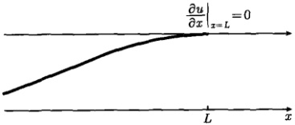

图 5.11 弦振动的自由端
 

上述的三类边界条件都是齐次的，如果在边界 S 上的条件为

$$  u|_{S}=f_{1}(t)   \tag*{(5.5.26a)}$$

$$  \left.\frac{\partial u}{\partial x}\right|_{S}=f_{2}(t)   \tag*{(5.5.26b)}$$

$$  \left[u+\beta\frac{\partial u}{\partial x}\right]_{S}=f_{3}(t)   \tag*{(5.5.26c)}$$

其中， $ f_{1}(t) $， $ f_{2}(t) $， $ f_{3}(t) $ 为已知的函数（一般依赖于时间 t），则式 (6.5.26) 称为非齐次边界条件。对于热传导问题也存在三类边界条件，也有齐次和非齐次两种情况（我们将在后续的内容中讨论）。

在有些定解问题中还涉及衔接条件。比如，研究几种不同介质组成的材料时，物理量在界面上可能是连续的，也可能是跃变的。在连续情况下，物理量在界面上的变化可以写出衔接条件。例如，光由空气进入水时，电场强度的切向分量是连续变化的，而电感强度的法向分量是连续的，如图5.12所示。

<!-- page: 137 -->

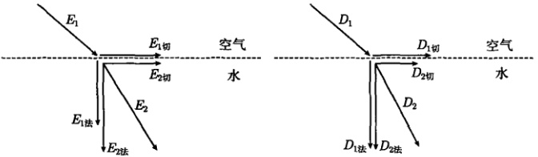

图 5.12 衔接条件的一个例子
 

#### 5.5.4 几个典型的定解问题

建立定解问题就是对一个系统的运动规律建立泛定方程，并找到相关物理量所满足的定解条件（特别是初始条件和边界条件），把泛定方程与定解条件结合在一起，就构成了一个定解问题。本节通过一些具体的例子说明定解问题的建立过程。

例 1 均匀柔软弦的两端 x = 0 和 x = L 固定，用横向力 F 拉弦上的点 x = c (设  $ F \ll T $，T 为弦在平衡状态时的张力)，弦在受力平衡后形成如图 5.13 所示的初始位移。然后撤掉拉力，弦做微振动，写出弦振动的定解问题。

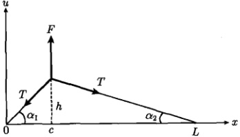

图 5.13 弦的初始位移
 

解 对于图 5.13 所示的弦的初始位移，由于  $ F \ll T $， $ h \ll c $，故

$$  \sin\alpha_{1}\approx\tan\alpha_{1}=\frac{h}{c},\quad\sin\alpha_{2}\approx\tan\alpha_{2}=\frac{h}{L-c}   \tag*{(5.5.27)}$$

因为弦伸长很小，其张力维持平衡态时的 T 值，所以弦的受力平衡条件为

 $$ \begin{aligned}F&=T\sin\alpha_{1}+T\sin\alpha_{2}\\&=Th\left(\frac{1}{c}+\frac{1}{L-c}\right)=Th\frac{L}{c(L-c)}\end{aligned} $$ 

解出

$$  h=\frac{Fc\left(L-c\right)}{TL}   \tag*{(5.5.28)}$$

<!-- page: 138 -->

由此，弦的初始位移为

$$  h\frac{x}{c}=\frac{F\left(L-c\right)x}{TL}\quad(0\leqslant x\leqslant c)   \tag*{(5.5.29a)}$$

$$  h\frac{L-x}{L-c}=\frac{Fc\left(L-x\right)}{TL}\quad(c\leqslant x\leqslant L)   \tag*{(5.5.29b)}$$

而弦的初始速度为零，故弦振动的定解问题为

$$  \frac{\partial^{2}u}{\partial t^{2}}=a^{2}\frac{\partial^{2}u}{\partial x^{2}}\quad\left(0<x<L,\ t>0\right)   \tag*{(5.5.30a)}$$

$$  u|_{t=0}=\left\{\begin{array}{l l}{\frac{F\left(L-c\right)x}{T L}}&{(0\leqslant x\leqslant c)}\\ {\frac{F c\left(L-x\right)}{T L}}&{(c\leqslant x\leqslant L)}\\ \end{array}\right.   \tag*{(5.5.30b)}$$

$$  \frac{\partial u}{\partial t}\Big|_{t=0}=0\quad(0\leqslant x\leqslant L)   \tag*{(5.5.30c)}$$

$$  u|_{x=0}=0,\quad u|_{x=L}=0\quad(t>0)   \tag*{(5.5.30d)}$$

例 2 均匀柔软弦的两端 x=0 和 x=L 固定，初始处于平衡位置，开始时敲击弦上的点 x=c，使弦获得冲量 k，然后弦做微振动。设弦的质量线密度为  $ \rho $，写出弦振动的定解问题。

解 弦的初始位移为零。敲击弦上的点使之获得动量，相当于给弦一个初速度。清楚起见，假定冲量作用范围是以 c 点为中心、长度为  $ 2\delta $ 的一小段弦（其质量为 m），这样弦在  $ 2\delta $ 范围内获得了初始速度，其他地方速度为零，如图 5.14 所示。根据冲量定理（动量的变化等于冲量），有

$$  mv-mv_{0}=k   \tag*{（5.5.31）}$$

其中， $ v_{0} $ 是敲击前的速度  $ (v_{0}=0) $，v 是敲击后的速度，这样式 (5.5.31) 变为

$$  m\frac{\partial u}{\partial t}\bigg|_{t=0}=k   \tag*{（5.5.32）}$$

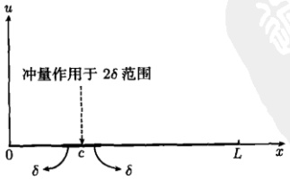

图 5.14 弦的初始速度
 

<!-- page: 139 -->

式(5.5.32)只限于 $ 2\delta $范围，而该范围的冲量密度（单位长度的冲量）为

$$  \frac{m}{2\delta}\frac{\partial u}{\partial t}\bigg|_{t=0}=\rho\frac{\partial u}{\partial t}\bigg|_{t=0}=\frac{k}{2\delta}   \tag*{(5.5.33)}$$

于是弦的初始速度为

$$  \left.\frac{\partial u}{\partial t}\right|_{t=0}=\left\{\begin{array}{l l}0,&\left|x-c\right|>\delta\\ \displaystyle\frac{k}{2\delta\rho},&\left|x-c\right|\leqslant\delta\end{array}\quad(\delta\rightarrow0)\right.   \tag*{(5.5.34)}$$

利用  $ \delta $ 函数（见 3.2.1 节），冲量 k 在 x = c 位置作用而产生的冲量密度为  $ k\delta(x - c) $，于是式 (5.5.33) 可以表示为

$$  \rho\frac{\partial u}{\partial t}\bigg|_{t=0}=k\delta(x-c)   \tag*{（5.5.35）}$$

事实上，按照  $ \delta $ 函数的极限表示式 (3.2.33a)，从式 (5.5.34) 也得到式 (5.5.35) 的结果。综合上述，所得的定解问题为

$$  \frac{\partial^{2}u}{\partial t^{2}}=a^{2}\frac{\partial^{2}u}{\partial x^{2}}\quad(0<x<L,\;t>0)   \tag*{(5.5.36a)}$$

$$  u|_{t=0}=0,\quad\left.\frac{\partial u}{\partial t}\right|_{t=0}=\frac{k}{\rho}\delta(x-c)\quad(0\leqslant x\leqslant L)   \tag*{(5.5.36b)}$$

$$  \left|\begin{array}{c c c c}{u|_{x=0}=0,}&{u|_{x=L}=0}&{}&{(t>0)}\end{array}\right.   \tag*{(5.5.36c)}$$

例 3 均匀柔软弦的端点 x=0 是自由端，端点 x=L 固定，弦的初始位移和初始速度均为任意函数，写出弦的微振动的定解问题。

解 弦的端点 x=0 是自由端，该处在位移方向的受力为零，即  $ T_{1}\sin\alpha_{1}=0 $ (图 5.2)，因而  $ \alpha_{1}=0 $，则弦在该点的斜率为零

$$  \left.\frac{\partial u}{\partial x}\right|_{x=0}=0   \tag*{(5.5.37)}$$

故定解问题为

$$  \left\{\begin{array}{l l}{\displaystyle\frac{\partial^{2}u}{\partial t^{2}}=a^{2}\frac{\partial^{2}u}{\partial x^{2}}\qquad}&{\qquad(0<x<L,t>0)}\end{array}\right.   \tag*{(5.5.38a)}$$

$$  u|_{t=0}=\phi(x),\quad\left.\frac{\partial u}{\partial t}\right|_{t=0}=\psi(x)\quad(0\leqslant x\leqslant L)   \tag*{(5.5.38b)}$$

$$  \left\lfloor\begin{array}{l l}{\left.\frac{\partial u}{\partial x}\right|_{x=0}=0,}&{u|_{x=L}=0\quad(t>0)}\end{array}\right.   \tag*{(5.5.38c)}$$

<!-- page: 140 -->

例 4 把高频输电线充电到具有电压 E，然后一端短路封闭，另一端仍保持断开，求以后电压的分布。

解 设输电线长度为 L，把高频输电线充电到各处具有电压 E 之后，x = 0 端短路，x = L 端始终开启，如图 5.15 所示。之后，传输线上的电压随空间和时间变化，设为  $ u(x,t) $。传输线上的初始电压为 E（常数），因此系统的初始条件为

$$  u\left|_{t=0}\right.=E,\left.\quad\frac{\partial u}{\partial t}\right|_{t=0}=0   \tag*{（5.5.39）}$$

传输线的 x=0 端短路，则电压为零

 $$ u\mid_{x=0}=0 $$ 

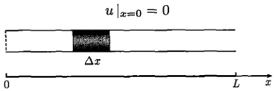

图 5.15 高频传输线，其中  $ \Delta x $ 的等效电路见图 5.6
 

传输线的 x = L 端开路，则电流为零。由式(5.1.17b)可知

$$  \frac{\partial u}{\partial x}\bigg|_{x=L}=0   \tag*{(5.5.41)}$$

判断 x = L 端边界条件的另一个办法是电流、电流密度、电场、电位梯度的正比关系： $ I \propto J \propto E \propto \frac{\partial u}{\partial x} $，它导致式 (5.5.41) 的结果。故定解问题为

$$  \left\{\begin{array}{l}\frac{\partial^{2}u}{\partial t^{2}}=a^{2}\frac{\partial^{2}u}{\partial x^{2}}\end{array}\right.\qquad(0<x<L,\;t>0)   \tag*{(5.5.42a)}$$

$$  u\vert_{t=0}=E,\quad\left.\frac{\partial u}{\partial t}\right|_{t=0}=0\quad(0\leqslant x\leqslant L)   \tag*{(5.5.42b)}$$

$$  u\vert_{x=0}=0,\quad\left.\frac{\partial u}{\partial x}\right|_{x=L}=0\quad(t>0)   \tag*{(5.5.42c)}$$

例 5 均匀有界杆的长度为 L，侧面绝热。设杆一端的温度为零，另一端有恒定热流 q 进入（即单位时间内通过单位面积流入的热量为 q）。已知杆的初始温度分布为  $ \frac{x(L-x)}{2} $，写出杆内任意时刻温度分布的定解问题。

解 设有界杆的两个端点处于 x=0 和 x=L。杆的初始温度分布  $ \left.u\right|_{t=0} $ 如图 5.16 所示。杆的 x=0 端的温度为零，即  $ \left.u\right|_{x=0}=0 $。它的 x=L 端有恒定的热流 q 进入，根据傅里叶热传导定律 [式 (5.2.1)]，当热量沿 x 轴正向流动时，在单位时间内流经单位面积的热量为

$$  q=-k\frac{\partial u}{\partial x}   \tag*{(5.5.43)}$$

<!-- page: 141 -->

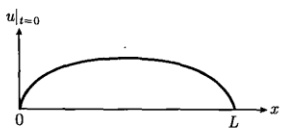

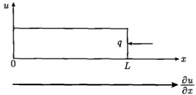

图 5.16 一个热传导系统
 

现在热流的方向是沿 x 轴的负向，温度梯度  $ \partial u/\partial x $ 与 x 方向相同，于是

$$  q=k\left.\frac{\partial u}{\partial x}\right|_{x=L}   \tag*{(5.5.44)}$$

这样定解问题为

$$  \left\{\begin{array}{l l}{\displaystyle\frac{\partial u}{\partial t}=a^{2}\frac{\partial^{2}u}{\partial x^{2}}\qquad}&{(0<x<L,\;t>0)}\end{array}\right.   \tag*{(5.5.45a)}$$

$$  u\vert_{t=0}=\frac{x(L-x)}{2}\quad(0\leqslant x\leqslant L)   \tag*{(5.5.45b)}$$

$$  u\vert_{x=0}=0,\quad\left.\frac{\partial u}{\partial x}\right|_{x=L}=\frac{q}{k}\quad(t>0)   \tag*{(5.5.45c)}$$

其中，x=L 端是第二类非齐次边界条件。

例6 有界杆的长度为 L，其左端保持为零度，右端自由散热（设外界介质温度为  $ u_{0} $）。已知杆内初始温度分布为任意函数  $ \phi(x) $，写出杆内任意时刻温度分布的定解问题。

解 设有界杆的两个端点处于 x=0 和 x=L。杆的 x=0 端保持为零度，则

$$  u|_{x=0}=0   \tag*{(5.5.46)}$$

它的 x = L 端自由散热，按照牛顿冷却定律，散失的热量正比于该端温度与外界介质温度之差，即

$$  -k\frac{\partial u}{\partial x}\bigg|_{x=L}=H(u|_{x=L}-u_{0})   \tag*{(5.5.47)}$$

其中，k 是杆的热导率，H 是比例系数  $ (H > 0) $。整理后得

$$  \left[u+h\frac{\partial u}{\partial x}\right]_{x=L}=u_{0}   \tag*{（5.5.48）}$$

其中， $ h = k/H $。式(5.5.48)表示一个第三类非齐次边界条件。于是系统的定解问

<!-- page: 142 -->

题为

 $$ \frac{\partial u}{\partial t}=a^{2}\frac{\partial^{2}u}{\partial x^{2}} $$ 

$$  (0<x<L,t>0)   \tag*{(5.5.49a)}$$

 $$ u|_{t=0}=\phi(x) $$ 

$$  (0\leq x\leq L)   \tag*{(5.5.49b)}$$

$$  u\vert_{x=0}=0,\quad\left[u+h\frac{\partial u}{\partial x}\right]_{x=L}=u_{0}\quad(t>0)   \tag*{(5.5.49c)}$$

如果  $ u_{0}=0 $，式(5.5.48)可以写成

$$  \left.\frac{\partial u}{\partial x}\right|_{x=L}=-\frac{1}{h}u\left|_{x=L}\right.   \tag*{(5.5.50)}$$

式(5.5.50)表示x=L端的自由散热是热量流入温度为零的介质之中。

另外，从物理上式(5.5.50)还可以理解为这样一种热传导作用：从 x = L 端流出的热量与该端的温度成正比。一般来说，比例系数可以取正值与负值。如果 h > 0，表示系统是散热的（热辐射），而 h < 0 则表示系统从外界吸收热量（热吸收）。这两种情况我们将在随后的热传导定解问题中详细讨论。

以上我们建立了一些典型的定解问题，它们涉及不同类型的泛定方程和各种组合的定解条件。有些情况下，一个定解问题只有初始条件，没有边界条件，称为初值问题；反之，只有边界条件而没有初始条件，称为边值问题。既有初始条件也有边界条件的定解问题称为混合问题。

定解问题作为一个数学物理模型，是否能准确无误地描述实际过程，需要对结果进一步检验。从数学角度来看，即考查解的“适定性”，它包括三个方面：

(1) 存在性 即考查定解问题的解是否存在；

(2) 唯一性 实际问题的解往往是唯一的，但数学解可能不是唯一的，要舍去没有实际意义的数学解；

(3) 稳定性 考查定解条件或驱动项的微小变化是否导致解的性质的改变。如果一个解经不起微扰，或者说在小小的微扰下，解的性质就发生了改变 (图 5.17)，尽管这个解是存在的和唯一的，但没有实际意义。

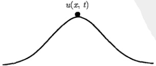

图 5.17 一个存在唯一但不稳定的解  $ u(x,t) $
 

<!-- page: 143 -->

如果一个定解问题的解是存在的、唯一的、稳定的，则称这个定解问题是适定的。适定性的讨论，对于一个定解问题是很必要的。本书所涉及的定解问题都是经典的，它们的适定性都经过了证明。

当然一个定解问题的解的正确性和适用性，最终要通过实践来证实。例如，我们在1.1节讨论的马尔萨斯人口模型，它的解确实是适定性的，但实际上有很大的局限性。

