# 06-第6章 分离变量法

[返回全书目录](../../README.md)

> PDF 页码：144–186

<!-- page: 144 -->

### 第6章 分离变量法

在传统意义上，数学物理方法的定解问题涉及物理系统与物理问题。但随着科学技术的不断发展，在许多领域都出现各种各样的定解问题。数学物理方法的应用不但已经覆盖几乎所有的理工学科，甚至涉及生物学、医学、经济学和社会学。因此，研究定解问题的建立和求解具有普遍的意义。在第5章我们已经初步看到怎样把实际的物理问题表达为定解问题。从本章开始我们要继续建立一些新的定解问题，但更重要的内容则是介绍关于定解问题的解法，包括分离变量法、本征函数法、辅助函数法等。除了齐次方程和齐次边界条件之外，还将涉及非齐次方程和非齐次边界条件。关于泛定方程，主要讨论第5章所建立的波动方程、热传导方程以及拉普拉斯方程。

分离变量法是求解数学物理方法定解问题的基本方法。它的基本思想是将多变量的偏微分方程转变成几个单变量的常微分方程，以便逐一求解。这里我们所讨论的问题主要是有界区域的弦振动问题和热传导问题，也涉及矩形域和圆域的拉普拉斯方程问题。所需要的数学工具是简单的常微分方程理论和傅里叶级数知识。

### 6.1 弦振动问题

#### 6.1.1 弦振动问题的求解

为了说明什么是分离变量法以及分离变量法的使用条件，我们选取两端固定的弦的自由振动问题为例，在具体的求解过程中逐步回答这些问题。两端固定弦振动的定解问题 [式 (5.5.1)] 为

$$  \left\{\begin{array}{l}\displaystyle\frac{\partial^{2}u}{\partial t^{2}}=a^{2}\frac{\partial^{2}u}{\partial x^{2}}\end{array}\right.\qquad(0<x<L,\;t>0)   \tag*{(6.1.1a)}$$

$$  \left\{\left.u\right|_{t=0}=\phi(x),\quad\left.\frac{\partial u}{\partial t}\right|_{t=0}=\psi(x)\quad(0\leqslant x\leqslant L)\right.   \tag*{(6.1.1b)}$$

$$  u|_{x=0}=0,\quad u|_{x=L}=0\quad(t>0)   \tag*{(6.1.1c)}$$

其中， $ \phi(x) $ 和  $ \psi(x) $ 是已知函数，分别代表弦的初始位移与初始速度。

分离变量法旨在把关于  $ u(x,t) $ 的偏微分方程转化为空间 x 和时间 t 的常微分

<!-- page: 145 -->

方程，即

$$  \begin{aligned}\mathbf{L}u\left(x,t\right)=0\Rightarrow\left\{\begin{array}{l}\mathbf{L}_{x}X\left(x\right)=0\\\mathbf{L}_{t}T\left(t\right)=0\end{array}\right.\end{aligned}   \tag*{(6.1.2)}$$

按照式（6.1.2）的思想，我们设方程（6.1.1a）有变量分离的形式解

$$  u(x,t)=X(x)T(t)   \tag*{(6.1.3)}$$

将  $ u(x,t) $ 代入方程 (6.1.1a)，得到

$$  X(x)T^{\prime\prime}(t)=a^{2}X^{\prime\prime}(x)T(t)   \tag*{(6.1.4)}$$

式(6.1.4)两边同除以 $ X(x)T(t) $，得到

$$  \frac{X^{\prime \prime}(x)}{X(x)}=\frac{T^{\prime \prime}(t)}{a^{2}T(t)}   \tag*{(6.1.5)}$$

式(6.1.5)两边对x求导数，因为右边不含x，故

$$  \frac{\mathrm{d}}{\mathrm{d}x}\left[\frac{X^{\prime \prime}(x)}{X(x)}\right]=\frac{\mathrm{d}}{\mathrm{d}x}\left[\frac{T^{\prime \prime}(t)}{a^{2}T(t)}\right]=0   \tag*{(6.1.6)}$$

这样

$$  \frac{X^{\prime \prime}(x)}{X(x)}=\frac{T^{\prime \prime}(t)}{a^{2}T(t)}= 常数   \tag*{(6.1.7)}$$

设这一常数为  $ -\lambda $，它被称为分离常数（separation constant）。这样式（6.1.7）给出

$$  X^{\prime\prime}(x)+\lambda X(x)=0   \tag*{(6.1.8a)}$$

$$  T^{\prime\prime}(t)+\lambda a^{2}T(t)=0   \tag*{(6.1.8b)}$$

这样我们得到了空间函数  $ X(x) $ 与时间函数  $ T(t) $ 的常微分方程。同时我们可以看出，利用分离变量法的条件是：泛定方程必须是齐次的。否则由于方程中驱动项  $ f(x,t) $ 的存在，式 (6.1.4) 变成

$$  X(x)T^{\prime \prime}(t)=a^{2}X^{\prime \prime}(x)T(t)+f(x,t)   \tag*{(6.1.9)}$$

不能进而写出变量分离的形式，即式(6.1.8)。

进一步考查形式解(6.1.3)，它必须满足边界条件(6.1.1c)，即

$$  X(0)T(t)=0,\quad X(L)T(t)=0   \tag*{（6.1.10）}$$

由于  $ T(t) \neq 0 $ [否则导致 (6.1.3) 中  $ u(x, t) \equiv 0 $，这是无意义的平庸解]，故式 (6.1.10) 给出

$$  X(0)=0,\quad X(L)=0   \tag*{(6.1.11)}$$

<!-- page: 146 -->

这样空间函数  $ X(x) $ 构成下列常微分方程的边值问题

$$  \left\{\begin{array}{l}X^{\prime\prime}(x)+\lambda X(x)=0\\ X(0)=0,\quad X(L)=0\end{array}\right.   \tag*{(6.1.12a)}$$

解这个边值问题就可以得到  $ X(x) $。不过可以看出，利用分离变量法的另一个条件是边界条件必须是齐次的。否则，非齐次边界条件将导致

$$  X(0)T(t)=f_{1}(t),\quad X(L)T(t)=f_{2}(t)   \tag*{(6.1.13)}$$

这样的条件（仍然含有时间 t）与方程 (6.1.12a) 联立后，仍然是双变量情况，并没有构成关于  $ X(x) $ 的常微分方程问题，不能求出单独的空间函数  $ X(x) $。只有  $ f_{1}(t) $,  $ f_{1}(t)=0 $，才能消去  $ T(t) $，构成边值问题 (6.1.12)。

注意到边值问题 (6.1.12) 是一个本征值问题。下面我们将求解这个本征值问题，这意味着既要求出本征函数  $ X(x) $，还要求出本征值  $ \lambda $。我们将会看到，并不是所有的  $ \lambda $ 都能给出非零解  $ X(x) $。现在分三种情况讨论。

(1) $ \lambda=0 $，这时方程(6.1.12a)的通解为 $ X(x)=A+Bx $，其中A和B为任意常数。满足边界条件(6.1.12b)的唯一结果是A=B=0，它导致平庸解 $ u(x,t)\equiv0 $。

(2)  $ \lambda < 0 $，这时方程(6.1.12a)的通解为[式(1.1.34)]

$$  X(x)=A\cosh kx+B\sinh kx   \tag*{(6.1.14)}$$

其中， $ k = \sqrt{-\lambda} $。这时  $ X(0) = 0 $ 要求 A = 0，于是  $ X(x) = B \sinh k x $。而  $ X(L) = 0 $ 要求  $ B \sinh k L = 0 $。但由于一般情况下  $ k L \neq 0 $，所以  $ \sinh k L \neq 0 $ (图 1.5)。因此，满足边界条件 (6.1.12b) 的唯一结果是 A = B = 0，它再次导致平庸解  $ u(x, t) \equiv 0 $。

(3)  $ \lambda > 0 $，这时方程(6.1.12a)的通解为[式(1.1.23)]

$$  X(x)=A\cos kx+B\sin kx   \tag*{(6.1.15)}$$

其中， $ k = \sqrt{\lambda} $。这时边界条件 X(0) = 0 要求 A = 0，于是

$$  X(x)=B\sin kx   \tag*{(6.1.16)}$$

而  $ X(L)=0 $ 要求  $ B\sin kL=0 $。但是  $ B\neq0 $ [否则  $ u(x,t)\equiv0 $]，所以

$$  \sin kL=0   \tag*{(6.1.17)}$$

故

$$  k=k_{n}=\frac{n\pi}{L}\quad(n=1,\ 2,\ 3,\cdots)   \tag*{（6.1.18）}$$

<!-- page: 147 -->

这里 n 不取零与负值是由于 k > 0。于是本征值为

$$  \lambda=\lambda_{n}=\left(\frac{n\pi}{L}\right)^{2}   \tag*{(6.1.19)}$$

而本征函数为

$$  X(x)=X_{n}(x)=B_{n}\sin\frac{n\pi}{L}x   \tag*{(6.1.20)}$$

式(6.1.19)和式(6.1.20)就是本征值问题(6.1.12)的结果。它们是一系列分立的本征值 $ \lambda_{n} $和相应的本征函数 $ X_{n}(x) $。

现在回到式(6.1.8b)，它变为

$$  T^{\prime\prime}(t)+\left(\frac{a n\pi}{L}\right)^{2}T(t)=0   \tag*{(6.1.21)}$$

它的通解为

$$  T(t)=T_{n}(t)=c_{n}\cos\frac{an\pi}{L}t+d_{n}\sin\frac{an\pi}{L}t   \tag*{(6.1.22)}$$

其中， $ c_{n} $ 和  $ d_{n} $ 是任意常数。于是由式 (6.1.20) 和式 (6.1.22) 得到满足泛定方程 (6.1.1a) 和边界条件 (6.1.1c) 的解

$$  u_{n}(x,t)=\left(C_{n}\cos\frac{a n\pi}{L}t+D_{n}\sin\frac{a n\pi}{L}t\right)\sin\frac{n\pi}{L}x\quad(n=1,2\cdots)   \tag*{(6.1.23)}$$

其中， $ C_{n}=B_{n}c_{n} $ 和  $ D_{n}=B_{n}d_{n} $ 是任意常数。由于解 (6.1.23) 中的空间函数是本征方程 (6.1.12) 的解，我们称式 (6.1.23) 为泛定方程 (6.1.1a) 的本征解。它满足泛定方程 (6.1.1a)，因为它是将形式解 (6.1.3) 代入泛定方程 (6.1.1a) 而得到的，同时它还满足边界条件 (6.1.1c)，因为它是在边界条件 (6.1.10) 之下得到的。

至此我们没有涉及初始条件(6.1.1b)，但式(6.1.23)显然不能表征任意的初始位移  $ \phi(x) $，因为  $ u_{n}(x,0)=C_{n}\sin\frac{n\pi}{L}x $ 是一个特定的正弦函数。我们注意到泛定方程(6.1.1a)是一个线性齐次方程，可以按照叠加原理将本征解(6.1.23)叠加起来，构成

$$  u(x,t)=\sum_{n=1}^{\infty}u_{n}(x,t)=\sum_{n=1}^{\infty}\left(C_{n}\cos\frac{an\pi}{L}t+D_{n}\sin\frac{an\pi}{L}t\right)\sin\frac{n\pi}{L}x   \tag*{(6.1.24)}$$

若这个无穷级数收敛并且对 x 和 t 二次可微，则也是方程 (6.1.1a) 的解，且满足边界条件 (6.1.1c)。我们将式 (6.1.24) 称为定解问题 (6.1.1a) 的一般解 (general solution)，它不同于偏微分方程的通解，因为一般解不只满足泛定方程，还满足边界条件，而且选择展开系数  $ C_{n} $ 和  $ D_{n} $ 之后还能满足初始条件。

现在我们要确定式 (6.1.24) 中的展开系数  $ C_{n} $ 和  $ D_{n} $，为此首先由式 (6.1.24) 计算出任意时刻的速度

$$  \frac{\partial u(x,t)}{\partial t}=\sum_{n=1}^{\infty}\frac{an\pi}{L}\left(-C_{n}\sin\frac{an\pi}{L}t+D_{n}\cos\frac{an\pi}{L}t\right)\sin\frac{n\pi}{L}x   \tag*{(6.1.25)}$$

<!-- page: 148 -->

利用初始条件(6.1.1b)，得到

$$  \phi(x)=\sum_{n=1}^{\infty}C_{n}\sin\frac{n\pi}{L}x   \tag*{(6.1.26a)}$$

$$  \psi(x)=\sum_{n=1}^{\infty}D_{n}\frac{a n\pi}{L}\sin\frac{n\pi}{L}x   \tag*{(6.1.26b)}$$

可以看出， $ C_{n} $ 和  $ D_{n}\frac{d\pi}{L} $ 正是  $ \phi(x) $ 和  $ \psi(x) $ 的半幅傅里叶级数（2.2.1）的展开系数，它们由式(2.2.2)确定，即

$$  C_{n}=\frac{2}{L}\int_{0}^{L}\phi(x)\sin\frac{n\pi}{L}x\mathrm{d}x   \tag*{(6.1.27a)}$$

$$  D_{n}=\frac{2}{n\pi a}\int_{0}^{L}\psi(x)\sin\frac{n\pi}{L}x\mathrm{d}x   \tag*{(6.1.27b)}$$

现在，一般解(6.1.24)中的系数 $ C_{n} $和 $ D_{n} $由式(6.1.27)确定，它满足初始条件(6.1.1b)。我们看到，利用上述方法，叠加式(6.1.24)中的系数不但被确定，还使之正好满足给定的初始条件。综合上述，一般解(6.1.24)满足式(6.1.1a)、式(6.1.1b)和式(6.1.1c)，因此它就是定解问题(6.1.1)的解。

现在对上述求解过程及结果作进一步讨论。首先，时间函数(6.1.22)中的频率 $ an\pi/L $称为弦振动的特征频率，它是基频 $ a\pi/L $的整数倍，这样由各种频率成分叠加而成的一般解(6.1.24)的时间变化便是周期性的，所以弦振动是一种周期运动。

另外应该思考一个问题：为什么要首先求解空间函数的本征值问题 (6.1.12)，能否首先求解时间函数  $ T(t) $？事实上，这时方程 (6.1.8b) 与初始条件 (6.1.1b) 结合构成

$$  T^{\prime\prime}(t)+\lambda a^{2}T(t)=0   \tag*{(6.1.28a)}$$

$$  T(0)=\frac{\phi(x)}{X(x)},\quad T^{\prime}(0)=\frac{\psi(x)}{X(x)}   \tag*{(6.1.28b)}$$

这个问题不能求解，因为式 (6.1.28b) 中的  $ X(x) $ 是未知的，而且式 (6.1.28a) 中的  $ \lambda $ 是未定的。

那么，在求解空间函数的本征值问题时，定出  $ \lambda $ 的“机制”是什么？原则上， $ \lambda $ 的确定基于边界条件 (6.1.12)，但就其细节而言是利用了线性齐次方程组的一个重要性质，下面我们给予具体的说明。事实上，通解 (6.1.15) 在满足齐次边界条件 (6.1.12b) 的情况下，给出了关于 A 和 B 的线性齐次方程组

$$  \boldsymbol{A}+\boldsymbol{B}\cdot\boldsymbol{0}=0   \tag*{(6.1.29a)}$$

$$  A\cos kL+B\sin kL=0   \tag*{(6.1.29b)}$$

<!-- page: 149 -->

这里有三个未知量：A，B 和 k。方程组 (6.1.29) 有非零解的必要充分条件是系数行列式为零，即

 $$ \left|\begin{array}{c c}{1}&{0}\\ {\cos k L}&{\sin k L}\end{array}\right|=0 $$ 

它导致  $ \sin kL = 0 $，进而得到本征值  $ k_{n} $（即  $ \lambda_{n} $）。总而言之，空间函数的通解满足 x = 0 和 x = L 两个端点的齐次边界条件时，给出两个线性齐次方程，所构成的方程组有非零解的必要充分条件给出了本征值。利用这样的方法求本征值具有一般性的意义，以后我们会经常使用。顺便而言，利用方程组 (6.1.29) 能够确定 A = 0，还不能确定 B，因为 k 确定后，式 (6.1.29a) 与式 (6.1.29b) 是线性相关的，所以式 (6.1.20) 中维持待定的 B。量子力学中常常再利用附加的归一化条件，使 A 和 B 都确定下来，而数学物理方法的定解问题，则利用初始条件进而确定它们。

现在我们可以总结分离变量法的使用条件：

(2) 泛定方程必须是齐次的：

(1) 泛定方程必须是线性的；

(3) 边界条件必须是齐次的。

强调泛定方程必须是线性的是为了使用叠加原理得到一般解，从而表征任意的初始条件。换言之，利用初始条件可以确定一般解中的展开系数。在满足上述三个条件的前提下，用分离变量法求解定解问题的步骤是：

(1) 对于泛定方程写出变量分离的形式解  $  u(x, t) = X(x)T(t)  $;

(2) 代入泛定方程得到空间函数  $ X(x) $ 和时间函数  $ T(t) $ 的常微分方程;

(3) 求解  $ X(x) $ 的常微分方程与相应的边界条件构成的本征值问题，得到本征值  $ \lambda_{n} $ 和本征函数  $ X_{n}(x) $;

(4) 将  $ \lambda_{n} $ 代入时间函数的方程解出  $ T_{n}(t) $，与  $ X_{n}(x) $ 相乘得到泛定方程的本征解  $ u_{n}(x,t)=X_{n}(x)T_{n}(t) $;

(5) 利用叠加原理得到一般解  $ u(x, t) = \sum_{n=1} u_n(x, t) $，并利用初始条件确定  $ u_n(x, t) $ 中的系数。

#### 6.1.2 解的物理意义及驻波条件

本节进一步分析上述结果的物理意义，首先考查本征解(6.1.23)。它可以改写成

$$  u_{n}(x,t)=N_{n}\sin\left(\omega_{n}t+\theta_{n}\right)\sin\frac{n\pi}{L}x   \tag*{(6.1.30)}$$

其中

$$  N_{n}=\sqrt{C_{n}^{2}+D_{n}^{2}},\quad\omega_{n}=\frac{na\pi}{L},\quad\tan\theta_{n}=\frac{C_{n}}{D_{n}}   \tag*{(6.1.31)}$$

<!-- page: 150 -->

现在我们从两方面来分析本征波(6.1.30)。首先对于确定的时间 $ t_{0} $，式(6.1.30)给出

$$  u_{n}(x)=A_{n}(t_{0})\sin\frac{n\pi}{L}x   \tag*{(6.1.32)}$$

这意味着本征波的空间形状是一条正弦曲线，其振幅与  $ t_{0} $ 有关。作为一个例子，图6.1显示 n=3 时本征波的曲线。可以看出，当  $ t_{0} $ 取不同的值  $ (t_{1}, t_{2}, t_{3}, t_{4}) $，正弦曲线有不同的振幅。另一方面，对于确定的弦点  $ x_{0} $，式(6.1.30)给出

$$  u_{n}(t)=B_{n}(x_{0})\sin\left(\omega_{n}t+\theta_{n}\right)   \tag*{(6.1.33)}$$

它表示该弦点在平衡位置附近以特征频率  $ \omega_{n} $ 作简谐振荡，其振幅与  $ x_{0} $ 有关。

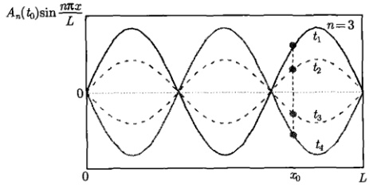

图 6.1 弦振动的本征解  $ u \sim \sin \frac{n\pi}{L} x $ 满足驻波条件  $ L = \frac{\lambda}{2} n $
 

图 6.1 显示，在任意时刻，本征波的节点（即正弦曲线的零点）的位置总是固定的。在一般情况下，节点的位置由  $ \sin\frac{n\pi}{L}x=0 $ 确定，即  $ \frac{n\pi}{L}x=m\pi $，故第 m 个节点的位置是

$$  x_{m}=\frac{mL}{n}\quad(m=0,\;1,\;2,\cdots,n)   \tag*{(6.1.34)}$$

可以看出，一个本征波有  $ n+1 $ 个节点，第 0 个位于  $ x_{0}=0 $，第 n 个位于  $ x_{n}=L $。显然，两端固定有界弦自由振动的本征波为驻波。由式 (6.1.34) 得到  $ L=(x_{m}/m)n $，其中  $ x_{m}/m $ 对于每一个 m 都等于波长的一半，即

$$  L=\frac{\lambda}{2}n\quad(n=1,2,3\cdots)   \tag*{(6.1.35)}$$

这就是熟知的驻波条件。满足驻波条件是弦振动的本质特点。驻波条件的概念是非常一般的，它意味着，对于一个确定的系统 (L 确定)，一个由 n 标志的本征态  $ \sin(n\pi x/L) $ 对应一个波长由式 (6.1.35) 确定的驻波。

当然，对于弦振动情况，本征波(6.1.30)并不代表弦的真实形状，弦的真实形状是许多本征波叠加而成的一般解(6.1.24)。那么是否存在一个工作在单个本征态的物理系统呢？回答是肯定的，最典型的就是单模激光，单模激光是工作在单个本

<!-- page: 151 -->

征态  $ E \sim \sin(n\pi x/L) $ 的物理系统，单模激光的产生必须满足驻波条件 (6.1.35)，如图 6.2 所示，其中 L 是激光谐振腔的腔长， $ \lambda $ 是激光的波长。

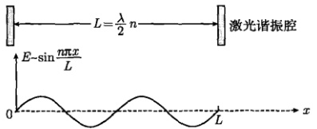

图 6.2 单模激光场  $ E \sim \sin \frac{n\pi x}{L} $ 满足驻波条件  $ L = \frac{\lambda}{2} n $
 

工作在单个本征态的另一个物理系统涉及量子力学的一维无限深势阱模型，势阱中微观粒子的波函数为  $ \psi \sim \sin(n\pi x/L) $，如图 6.3 所示。这里也有驻波条件 (6.1.35)，其中  $ L $ 是势阱的宽度， $ \lambda $ 是几率波的波长，而驻波条件的具体含义是势阱中粒子的一个本征态对应一个特定波长的德布罗意驻波。

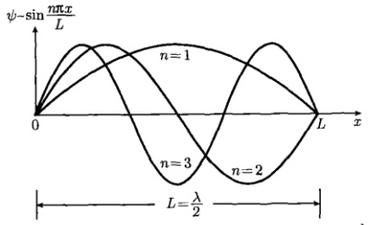

图 6.3 几率波  $ \psi \sim \sin \frac{n\pi x}{L} $ 满足驻波条件  $ L = \frac{\lambda}{2} n $
 

我们把上述几个不同系统的单模本征态联系起来，可以看出它们之间的内在相通性，也可以看出数学物理方法的广泛适用性，如表6.1所示。

表 6.1 不同系统的驻波条件  $ L = \frac{\lambda}{2} n $
 

<table border=1 style='margin: auto; word-wrap: break-word;'><tr><td style='text-align: center; word-wrap: break-word;'>系统</td><td style='text-align: center; word-wrap: break-word;'>波</td><td style='text-align: center; word-wrap: break-word;'>L</td><td style='text-align: center; word-wrap: break-word;'>学科</td></tr><tr><td style='text-align: center; word-wrap: break-word;'>弦振动</td><td style='text-align: center; word-wrap: break-word;'>机械波</td><td style='text-align: center; word-wrap: break-word;'>弦的长度</td><td style='text-align: center; word-wrap: break-word;'>数学物理方法</td></tr><tr><td style='text-align: center; word-wrap: break-word;'>单模激光</td><td style='text-align: center; word-wrap: break-word;'>电磁波</td><td style='text-align: center; word-wrap: break-word;'>谐振腔长度</td><td style='text-align: center; word-wrap: break-word;'>激光物理学</td></tr><tr><td style='text-align: center; word-wrap: break-word;'>势阱中的粒子</td><td style='text-align: center; word-wrap: break-word;'>几率波</td><td style='text-align: center; word-wrap: break-word;'>势阱宽度</td><td style='text-align: center; word-wrap: break-word;'>量子力学</td></tr></table>

现在进而考虑本征波的叠加。式(6.1.30)显示，本征波  $ u_{1}(x,t) $,  $ u_{2}(x,t) $,  $ u_{3}(x,t)\cdots $ 是一系列驻波，它们的振幅、频率、位相都因 n 的不同而不同。物理上， $ u_{1}(x,t) $ 称为基波（或基态），而  $ u_{n}(x,t) $ ( $ n \geq 2 $) 则称为谐波（或激发态）。物理学的理论和实

<!-- page: 152 -->

验证实，一个系统可以处于基态或某个激发态，也可以处于若干个状态的叠加

$$  \sum_{n}N_{n}\sin\left(\omega_{n}t+\theta_{n}\right)\sin\frac{n\pi}{L}x   \tag*{(6.1.36)}$$

叠加态仍然是系统的状态。所以，叠加原理不但是数学的原理，也是物理学的原理，而且物理上的叠加态是可以观察、可以测量的。比如激光器的输出模式就是可测量的，测量后可以明确地知道一台激光器是工作在单模还是哪些本征模的叠加。另外，叠加原理不但适用于宏观系统，在微观系统中也扮演着十分重要的角色。描述微观系统运动规律的薛定谔方程是

$$  \mathrm{i}\hbar\frac{\partial\varPsi}{\partial t}=-\frac{\hbar^{2}}{2m}\nabla^{2}\varPsi+U(r)\varPsi   \tag*{(6.1.37)}$$

对于这样一个线性齐次方程。数学上的叠加原理表述为：如果  $ \Psi_{1} $ 和  $ \Psi_{2} $ 是它的解，则  $ C_{1}\Psi_{1}+C_{2}\Psi_{2} $ 也是它的解。而物理上的表述则完全相同：如果  $ \Psi_{1} $ 和  $ \Psi_{2} $ 是微观粒子的状态，则它们的线性组合  $ C_{1}\Psi_{1}+C_{2}\Psi_{2} $ 也是该粒子的状态，这就是量子力学的态叠加原理。因此数学上关于线性方程本征解的叠加原理与物理上关于线性系统本征态的叠加原理是相通的。

### 6.2 基本定解问题

用分离变量法不但可以圆满求解上述第一类边界条件下的波动方程的定解问题，还可以应用于第二类、第三类边界条件。而泛定方程还可以是更复杂的波动方程，以及热传导方程和拉普拉斯方程。本节通过一些典型例题进一步求解波动方程和热传导的定解问题，而关于拉普拉斯方程的定解问题，在第7章进行专门的讨论。

例 1 求解 5.5.4 节例 1 的定解问题 (5.5.30)，其中  $ L=1, c=\frac{1}{3}, \frac{F}{T}=\frac{9}{20} $

解　这个问题是 6.1.1 节讨论的两端固定弦振动问题的一个具体例子，定解问题 (5.5.30) 现在约化为

$$  \left\{\begin{array}{l}\displaystyle\frac{\partial^{2}u}{\partial t^{2}}=a^{2}\frac{\partial^{2}u}{\partial x^{2}}\end{array}\right.\qquad\qquad\left(0<x<1,t>0\right)   \tag*{(6.2.1a)}$$

$$  \left.u\right|_{t=0}=\left\{\begin{array}{l l}\frac{3}{10}x&\quad(0\leqslant x\leqslant1/3)\\ \frac{3}{20}\left(1-x\right)&\quad(1/3\leqslant x\leqslant1)\end{array}\right.   \tag*{(6.2.1b)}$$

$$  \left\{\begin{array}{l l}\left.\frac{\partial u}{\partial t}\right|_{t=0}=0&\left(0\leqslant x\leqslant1\right)\\ u|_{x=0}=0,\quad u|_{x=L}=0&\left(t>0\right)\end{array}\right.   \tag*{(6.2.1c)}$$

<!-- page: 153 -->

展开系数(6.1.27)现在为

 $$ \begin{aligned}C_{n}&=2\int_{0}^{1}\phi(x)\sin\frac{n\pi}{L}x\mathrm{d}x=\frac{3}{5}\int_{0}^{1/3}x\sin\left(n\pi x\right)\mathrm{d}x+\frac{3}{10}\int_{1/3}^{1}\left(1-x\right)\sin\left(n\pi x\right)\mathrm{d}x\\&=-\frac{\cos\frac{n\pi}{3}}{5n\pi}+\frac{3}{5}\frac{\sin\frac{n\pi}{3}}{n^{2}\pi^{2}}+\frac{\cos\frac{n\pi}{3}}{5n\pi}+\frac{3}{10}\frac{\sin\frac{n\pi}{3}}{n^{2}\pi^{2}}=\frac{9}{10\pi^{2}}\frac{\sin\frac{n\pi}{3}}{n^{2}}\\&D_{n}=0\end{aligned} $$ 

将  $ C_{n} $ 和  $ D_{n} $ 代入一般解 (6.1.24)，得到

$$  u(x,t)=\frac{9}{10\pi^{2}}\sum_{n=1}^{\infty}\frac{\sin\frac{n\pi}{3}}{n^{2}}\cos(a n\pi t)\sin(n\pi x)   \tag*{(6.2.2)}$$

图 6.4 显示了一般解 (6.2.2) 所示的弦在不同 t 时刻的形态。图 6.5 显示了弦中点  $ (x=1/2) $ 的位移随时间变化的曲线，可以看出，它是周期性变化的。

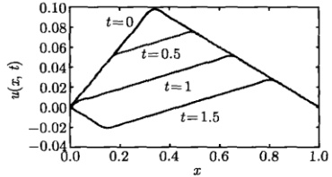 0 时，不同时刻的曲线存在有趣的重" width="39%" />

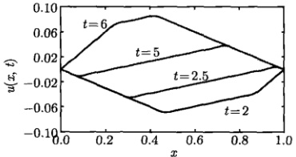

图 6.4 一般解 (6.2.2) 的部分和 (前 20 项) 的曲线，这里取  $ a\pi = 1 $。图中 t = 0 的曲线有图 5.13 的形态，当 t > 0 时，不同时刻的曲线存在有趣的重叠现象 (每一条曲线的两个端点都在 x = 0 和 x = 1)。图中的曲线显示了弦振动在一个周期中的各种形态
 

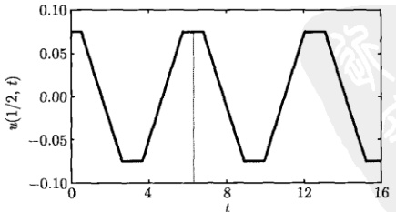

图 6.5 弦中点  $ (x=1/2) $ 的位移随时间的演化，这里取  $ a\pi=1 $，周期约为 6.3。在一定的时间段，位移不发生变化，相应于该时间段内的曲线重叠（图 6.4）
 

<!-- page: 154 -->

例 2 求解 5.5.4 节例 2 的定解问题 (5.5.36)。

解　这个问题是 6.1.1 节讨论的两端固定弦振动问题的一个具体例子，其特点在于初始位移和初始速度分别为

$$  \phi(x)=0,\quad\psi(x)=\frac{k}{\rho}\delta(x-c)   \tag*{(6.2.3)}$$

这样一来，式(6.1.27)给出

$$  C_{n}=0   \tag*{(6.2.4)}$$

$$  D_{n}=\frac{2}{n\pi a}\int_{0}^{L}\psi(x)\sin\frac{n\pi}{L}x\mathrm{d}x=\frac{2}{n\pi a}\int_{0}^{L}\frac{k}{\rho}\delta(x-c)\sin\frac{n\pi}{L}x\mathrm{d}x   \tag*{(6.2.5)}$$

由于 0 < c < L，而且函数  $ \sin\frac{n\pi}{L}x $ 在区间  $ [0, L] $ 上是连续的，利用  $ \delta $ 函数的筛选性质 (3.2.3)，得到

$$  D_{n}=\frac{2k}{n\pi a\rho}\sin\frac{n\pi c}{L}   \tag*{(6.2.6)}$$

将式 (6.2.4) 和式 (6.2.6) 代入一般解 (6.1.24)，得到

$$  u(x,t)=\frac{2k}{\pi a\rho}\sum_{n=1}^{\infty}\frac{1}{n}\sin\frac{n\pi c}{L}\sin\frac{a n\pi}{L}t\sin\frac{n\pi}{L}x   \tag*{(6.2.7)}$$

这就是定解问题(5.5.36)的解。弦振动在不同时刻的形态如图6.6所示。

例 3 求解阻尼波动方程 (5.1.13) 的定解问题

$$  \frac{\partial^{2}u}{\partial t^{2}}-a^{2}\frac{\partial^{2}u}{\partial x^{2}}+2b\frac{\partial u}{\partial t}=0\quad\left(0<x<L,\;t>0\right)   \tag*{(6.2.8a)}$$

$$  u\vert_{t=0}=\phi(x),\quad\left.\frac{\partial u}{\partial t}\right|_{t=0}=\psi(x)\quad(0\leqslant x\leqslant L)   \tag*{(6.2.8b)}$$

$$  u|_{x=0}=0,\quad u|_{x=L}=0\quad(t>0)   \tag*{(6.2.8c)}$$

其中，b>0。

解 这里的波动方程 (6.2.8a) 虽然比基本形式 (5.1.6) 多出了阻尼项，但仍然是线性齐次方程，而且边界条件是齐次的，故可以用分离变量法求解。令  $ u(x,t)=X(x)T(t) $，其中  $ X(x) $ 构成本征值问题

$$  \left\{\begin{array}{l}X^{\prime\prime}(x)+\lambda X(x)=0\\ X(0)=0,\quad X(L)=0\end{array}\right.   \tag*{(6.2.9a)}$$

<!-- page: 155 -->

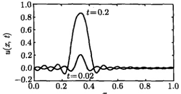

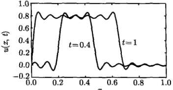

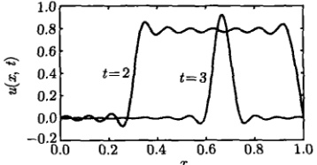

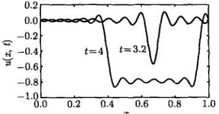

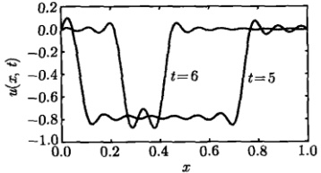

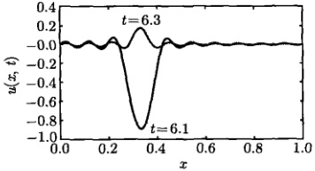

图 6.6 一般解 (6.2.7) 的部分和（前 20 项）的曲线，这里取
 

L=1,  $ a\pi=1 $,  $ 2k/\rho=1 $, c=1/3。图中的曲线显示了弦振动在一个周期内的形态演化

而  $ T(t) $ 满足方程

$$  T^{\prime\prime}(t)+2b T^{\prime}(t)+\lambda a^{2}T(t)=0   \tag*{(6.2.10)}$$

本征值问题(6.2.9)在 $ \lambda>0 $时有解

$$  \lambda_{n}=\left(\frac{n\pi}{L}\right)^{2},\quad X_{n}(x)=B_{n}\sin\left(\frac{n\pi}{L}x\right)\quad(n=1,2,3,\cdots)   \tag*{(6.2.11)}$$

时间函数  $ T(t) $ 的方程为

$$  T^{\prime\prime}(t)+2b T^{\prime}(t)+\left(\frac{n\pi a}{L}\right)^{2}T(t)=0   \tag*{(6.2.12)}$$

它的通解有三种情况

$$  T_{n}(t)=\exp(-bt)\left(c_{n}\cosh q_{n}t+d_{n}\sinh q_{n}t\right)\quad\left(n<\frac{bL}{\pi a}\right)   \tag*{(6.1.13a)}$$

$$  T_{n}(t)=c_{n}\exp(-bt)+d_{n}t\exp(-bt)\quad\left(n=\frac{bL}{\pi a}\right)   \tag*{(6.2.13b)}$$

<!-- page: 156 -->

$$  T_{n}(t)=\exp(-bt)\left(c_{n}\cos q_{n}t+d_{n}\sin q_{n}t\right)\quad\left(n>\frac{bL}{\pi a}\right)   \tag*{(6.2.13c)}$$

其中， $ c_{n} $ 和  $ d_{n} $ 是任意常数，而

$$  q_{n}=\sqrt{\left|\left(\frac{n\pi a}{L}\right)^{2}-b^{2}\right|}   \tag*{(6.2.14)}$$

考虑阻尼较小的情况，即  $ \frac{bL}{\pi a}<1 $，我们有  $ n>\frac{bL}{\pi a} $（对于所有的 n），这样只需要考虑解 (6.2.13c)，故一般解为

$$  u(x,t)=\exp(-bt)\sum_{n=1}^{\infty}\left(C_{n}\cos q_{n}t+D_{n}\sin q_{n}t\right)\sin\frac{n\pi}{L}x   \tag*{(6.2.15)}$$

其中， $ C_{n}=B_{n}c_{n} $， $ D_{n}=B_{n}d_{n} $。考虑到初始条件(6.2.9b)，我们有

$$  \phi(x)=\sum_{n=1}^{\infty}C_{n}\sin\frac{n\pi}{L}x   \tag*{(6.2.16a)}$$

$$  \psi(x)=\sum_{n=1}^{\infty}\left(-C_{n}b+D_{n}q_{n}\right)\sin\frac{n\pi}{L}x   \tag*{(6.2.16b)}$$

其中， $ C_{n} $ 和  $ -C_{n}b+D_{n}q_{n} $ 分别是初始位移  $ \phi(x) $ 和初始速度  $ \psi(x) $ 的半幅傅里叶级数的展开系数，从式(2.2.2)得到

$$  C_{n}=\frac{2}{L}\int_{0}^{L}\phi(x)\sin\frac{n\pi}{L}x\mathrm{d}x   \tag*{(6.2.17a)}$$

$$  D_{n}=\frac{b}{q_{n}}C_{n}+\frac{2}{Lq_{n}}\int_{0}^{L}\psi(x)\sin\frac{n\pi}{L}x\mathrm{d}x   \tag*{(6.2.17b)}$$

式 (6.2.15) 就是定解问题 (6.2.8) 在较小阻尼情况下的解，其中  $ C_{n} $ 和  $ D_{n} $ 由式 (6.2.17) 表示。由于阻尼因子  $ \exp(-bt) $ 的作用，其稳态解为  $ u(x,\infty)=0 $。

例 4 求解电报方程 (5.1.21) 的定解问题

$$  \left\{\begin{array}{l}\frac{\partial^{2}u}{\partial t^{2}}-a^{2}\frac{\partial^{2}u}{\partial x^{2}}+2b\frac{\partial u}{\partial t}+c u=0\quad(0<x<L,t>0)\end{array}\right.   \tag*{(6.2.18a)}$$

$$  u\vert_{t=0}=\phi(x),\quad\left.\frac{\partial u}{\partial t}\right|_{t=0}=\psi(x)\quad(0\leqslant x\leqslant L)   \tag*{(6.2.18b)}$$

$$  u|_{x=0}=0,\quad u|_{x=L}=0\quad(t>0)   \tag*{(6.2.18c)}$$

其中，b, c > 0。

<!-- page: 157 -->

解 这里的泛定方程比上例的阻尼波动方程多出了函数项  $ c_{u} $，但仍然是线性齐次方程，而且边界条件是齐次的，故可以用分离变量法求解。令  $ u(x,t)=X(x)T(t) $，其中  $ X(x) $ 构成本征值问题

$$  \left\{\begin{array}{l}X^{\prime\prime}(x)+\lambda X(x)=0\\ X(0)=0,X(L)=0\end{array}\right.   \tag*{(6.2.19a)}$$

而  $ T(t) $ 满足方程

$$  T^{\prime\prime}(t)+2b T^{\prime}(t)+\left(\lambda a^{2}+c\right)T(t)=0   \tag*{(6.2.20)}$$

接下来的运算与上例相同，只需要将上例中的  $ \lambda a^{2} $ 换成  $ \lambda a^{2} + c $ 即可。本征值问题的解依然是

$$  \lambda_{n}=\left(\frac{n\pi}{L}\right)^{2},\quad X_{n}(x)=B_{n}\sin\left(\frac{n\pi}{L}x\right)\quad(n=1,2,3,\cdots)   \tag*{(6.2.21)}$$

而时间函数  $ T(t) $ 的方程为

$$  T^{\prime\prime}(t)+2b T^{\prime}(t)+\left[\left(\frac{n\pi a}{L}\right)^{2}+c\right]T(t)=0   \tag*{(6.2.22)}$$

在阻尼较小的情况下，一般解为

$$  u(x,t)=\exp(-bt)\sum_{n=1}^{\infty}\left(C_{n}\cos q_{n}t+D_{n}\sin q_{n}t\right)\sin\frac{n\pi}{L}x   \tag*{(6.2.23)}$$

其中

$$  q_{n}=\sqrt{\left(\frac{n\pi a}{L}\right)^{2}+c-b^{2}\bigg|}   \tag*{(6.2.24)}$$

展开系数  $ C_{n} $ 和  $ D_{n} $ 仍由式 (6.2.17) 给出。

在泛定方程(6.2.18a)中，如果 b=0，则空间函数的结果仍由式(6.2.22)确定，而时间函数 T(t) 的方程为

$$  T^{\prime\prime}(t)+\left[\left(\frac{n\pi a}{L}\right)^{2}+c\right]T(t)=0   \tag*{(6.2.25)}$$

一般解为

$$  u(x,t)=\sum_{n=1}^{\infty}\left(C_{n}\cos q_{n}t+D_{n}\sin q_{n}t\right)\sin\frac{n\pi}{L}x   \tag*{(6.2.26)}$$

其中

$$  q_{n}=\sqrt{\left(\frac{n\pi a}{L}\right)^{2}+c}   \tag*{(6.2.27)}$$

展开系数  $ C_{n} $ 和  $ D_{n} $ 仍由式 (6.2.17) 给出。

<!-- page: 158 -->

例 5 (1) 求解 x=0 端自由，x=L 端固定的弦振动的定解问题 (5.5.38);

(2) 对于初始条件

$$  u\big|_{t=0}=\cos\frac{\pi x}{2L},\quad\left.\frac{\partial u}{\partial t}\right|_{t=0}=0   \tag*{(6.2.28)}$$

求解该定解问题。

解 (1) 这里 x=0 端是第二类齐次边界条件，x=L 端是第一类齐次边界条件，可以用分离变量法求解。令  $ u(x,t)=X(x)T(t) $，其中  $ X(x) $ 构成本征值问题

$$  \left\{\begin{array}{l}X^{\prime\prime}(x)+\lambda X(x)=0\\ X^{\prime}(0)=0,\quad X(L)=0\end{array}\right.   \tag*{(6.2.29a)}$$

而  $ T(t) $ 满足方程

$$  T^{\prime\prime}(t)+\lambda a^{2}T(t)=0   \tag*{(6.2.30)}$$

我们首先求解本征值问题 (6.2.29)，与两端固定弦振动问题一样， $ \lambda \leq 0 $ 时都只有零解，而  $ \lambda > 0 $ 时，泛定方程 (6.2.29a) 的通解为

$$  X(x)=A\cos kx+B\sin kx   \tag*{(6.2.31)}$$

其中， $ k = \sqrt{\lambda} $，A 和 B 是任意常数。它的导数为

$$  X^{\prime}(x)=-k A\sin k x+k B\cos k x   \tag*{(6.2.32)}$$

现在边界条件  $ X'(0)=0 $ 要求 B=0，于是解 (6.2.31) 约化为

$$  X(x)=A\cos kx   \tag*{(6.2.33)}$$

从边界条件  $ X(L)=0 $ 得到  $ \cos kL=0 $，故

$$  kL=\frac{(2n+1)\pi}{2}\quad(n=0,\ 1,\ 2,\cdots)   \tag*{(6.2.34)}$$

这里没有考虑 n 为负值的情况，因为 k > 0。本征值和本征函数为

$$  \lambda_{n}=\left[\frac{(2n+1)\pi}{2L}\right]^{2},\quad X_{n}(x)=A_{n}\cos\frac{(2n+1)\pi}{2L}x   \tag*{(6.2.35)}$$

将  $ \lambda_{n} $ 代入式 (6.2.30)，得到时间函数的通解

$$  T_{n}(t)=c_{n}\cos\frac{(2n+1)\pi a}{2L}t+d_{n}\sin\frac{(2n+1)\pi a}{2L}t   \tag*{(6.2.36)}$$

<!-- page: 159 -->

其中， $ c_{n} $ 和  $ d_{n} $ 是任意常数。由此得到一般解

$$  u(x,t)=\sum_{n=0}^{\infty}\left[C_{n}\cos\frac{(2n+1)\pi a}{2L}t+D_{n}\sin\frac{(2n+1)\pi a}{2L}t\right]\cos\frac{(2n+1)\pi a}{2L}x   \tag*{(6.2.37)}$$

其中， $ C_{n}=A_{n}c_{n} $ 和  $ D_{n}=B_{n}d_{n} $ 分别是初始位移  $ \phi(x) $ 和初始速度  $ \psi(x) $ 的半幅傅里叶级数的展开系数，根据式(2.2.12)得到

$$  C_{n}=\frac{2}{L}\int_{0}^{L}\phi(x)\cos\frac{(2n+1)\pi}{2L}x\mathrm{d}x   \tag*{(6.2.38a)}$$

$$  D_{n}=\frac{4}{(2n+1)\pi a}\int_{0}^{L}\psi(x)\cos\frac{(2n+1)\pi}{2L}x\mathrm{d}x   \tag*{(6.2.38b)}$$

式(6.2.37)就是定解问题(5.5.38)的解，其中 $ C_{n} $和 $ D_{n} $由式(6.2.38)表示。

(2) 对于初始条件 (6.2.28)，展开系数为

 $$ \begin{aligned}C_{n}&=\frac{2}{L}\int_{0}^{L}\cos\frac{\pi x}{2L}\cos\frac{(2n+1)\pi}{2L}x\mathrm{d}x\\&=\frac{2}{L}\int_{0}^{L}\cos\frac{(2\cdot0+1)\pi x}{2L}\cos\frac{(2n+1)\pi}{2L}x\mathrm{d}x\\&=\delta_{0n}\end{aligned} $$ 

 $$ D_{n}=0 $$ 

将  $ C_{n} $ 和  $ D_{n} $ 代入式 (6.2.37)，得到

$$  u(x,t)=\sum_{n=0}^{\infty}\delta_{0n}\cos\frac{(2n+1)\pi a}{2L}t\cos\frac{(2n+1)\pi}{2L}x=\cos\frac{\pi a}{2L}t\cos\frac{\pi}{2L}x   \tag*{(6.2.39)}$$

这个结果表示，弦的 x = L 端固定，x = 0 端在 [1, -1] 间振荡。实际上，弦上任意点 x 以其初始位移  $ \cos\frac{\pi x}{2L} $ 为振幅，以 a/4L 为频率作简谐振荡，如图 6.7 所示。在任意时刻 t，弦在 x = 0 端的斜率为零。

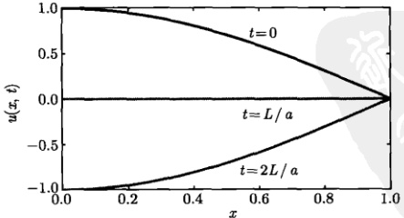

图 6.7 一般解 (6.2.39) 的曲线。
 

<!-- page: 160 -->

例 6 (1) 求解下列定解问题

$$  \left\{\begin{array}{l l}{\displaystyle\frac{\partial^{2}u}{\partial t^{2}}=a^{2}\frac{\partial^{2}u}{\partial x^{2}}\qquad}&{\qquad\quad(0<x<L,~t>0)}\end{array}\right.   \tag*{(6.2.40a)}$$

$$  u|_{t=0}=\phi(x),\quad\left.\frac{\partial u}{\partial t}\right|_{t=0}=\psi(x)\quad(0\leqslant x\leqslant L)   \tag*{(6.2.40b)}$$

$$  u|_{x=0}=0,\left.\frac{\partial u}{\partial x}\right|_{x=L}=0\quad(t>0)   \tag*{(6.2.40c)}$$

(2) 求解 5.5.4 节例 4 关于高频传输线的定解问题 (5.5.42);

(3) 对于初始条件

$$  u\vert_{t=0}=x^{2}-2L x,\quad\left.\frac{\partial u}{\partial t}\right|_{t=0}=\frac{a\pi}{2L}\sin\frac{\pi x}{2L}   \tag*{(6.2.41)}$$

求解定解问题(6.2.40)。

解 (1) 这里 x=0 端是第一类齐次边界条件，x=L 端是第二类齐次边界条件，可以用分离变量法求解。令  $ u(x,t)=X(x)T(t) $，其中  $ X(x) $ 构成本征值问题

$$  \int X^{\prime\prime}(x)+\lambda X(x)=0   \tag*{(6.2.42a)}$$

$$  \left\{\begin{array}{l}X(0)=0,\quad X^{\prime}(L)=0\end{array}\right.   \tag*{(6.2.42b)}$$

而  $ T(t) $ 满足方程

$$  T^{\prime\prime}(t)+\lambda a^{2}T(t)=0   \tag*{(6.2.43)}$$

与例5的过程类似，在 $ \lambda>0 $时，得到本征值和本征函数

$$  \lambda_{n}=\left[\frac{(2n+1)\pi}{2L}\right]^{2},\quad X_{n}(x)=B\sin\frac{(2n+1)\pi}{2L}x\quad(n=0,\;1,\;2,\cdots)   \tag*{(6.2.44)}$$

将  $ \lambda_{n} $ 代入式 (6.2.43)，解出时间函数  $ T_{n}(t) $，由此得到一般解

$$  u(x,t)=\sum_{n=0}^{\infty}\left(C_{n}\cos\frac{(2n+1)\pi a}{2L}t+D_{n}\sin\frac{(2n+1)\pi a}{2L}t\right)\sin\frac{(2n+1)\pi a}{2L}x   \tag*{(6.2.45)}$$

其中， $ C_{n} $ 和  $ D_{n} $ 分别是  $ \phi(x) $ 和  $ \psi(x) $ 的半幅傅里叶级数的展开系数。由初始条件 (6.2.40b) 及式 (2.2.11) 得到

$$  C_{n}=\frac{2}{L}\int_{0}^{L}\phi(x)\sin\frac{(2n+1)\pi}{2L}x\mathrm{d}x   \tag*{(6.2.46a)}$$

$$  D_{n}=\frac{4}{(2n+1)\pi a}\int_{0}^{L}\psi(x)\sin\frac{(2n+1)\pi}{2L}x\mathrm{d}x   \tag*{(6.2.46b)}$$

<!-- page: 161 -->

(2) 对于高频传输线的定解问题 (5.5.42)，将  $ \phi(x) = E $， $ \psi(x) = 0 $ 代入式 (6.2.46)，得到展开系数

$$  C_{n}=\frac{2}{L}\int_{0}^{L}E\sin\frac{(2n+1)\pi}{2L}x\mathrm{d}x=\frac{4E}{\pi}\frac{1}{2n+1},\quad D_{n}=0   \tag*{(6.2.47)}$$

这样

$$  u(x,t)=\frac{4E}{\pi}\sum_{n=0}^{\infty}\frac{1}{2n+1}\cos\frac{(2n+1)\pi a}{2L}t\sin\frac{(2n+1)\pi a}{2L}x   \tag*{(6.2.48)}$$

这就是关于高频传输线的定解问题（5.5.42）的一般解。

(3) 对于初始条件 (6.2.41)，展开系数为

 $$ C_{n}=\frac{2}{L}\int_{0}^{L}(x^{2}-2L x)\sin\frac{(2n+1)\pi}{2L}x\mathrm{d}x=-\frac{32L^{2}}{(2n+1)^{3}\pi^{3}} $$ 

 $$ \begin{aligned}D_{n}&=\frac{4}{(2n+1)\pi a}\int_{0}^{L}\frac{a\pi}{2L}\sin\frac{\pi}{2L}x\sin\frac{(2n+1)\pi}{2L}x\mathrm{d}x\\&=\frac{2}{(2n+1)L}\int_{0}^{L}\sin\frac{(2\cdot0+1)\pi}{2L}x\sin\frac{(2n+1)\pi}{2L}x\mathrm{d}x\\&=\delta_{n0}\\ \end{aligned} $$ 

将  $ C_{n} $ 和  $ D_{n} $ 代入式 (6.2.45)，得到

 $$ \begin{align*}u(x,t)&=\sum_{n=0}^{\infty}\left[-\frac{32L^{2}}{(2n+1)^{3}\pi^{3}}\cos\frac{(2n+1)\pi a}{2L}t+\delta_{n0}\sin\frac{(2n+1)\pi a}{2L}t\right]\sin\frac{(2n+1)\pi}{2L}x\\&=\left(-\frac{32L^{2}}{\pi^{3}}\cos\frac{\pi a}{2L}t+\sin\frac{\pi a}{2L}t\right)\sin\frac{\pi}{2L}x\\&\quad-\sum_{n=1}^{\infty}\frac{32L^{2}}{(2n+1)^{3}\pi^{3}}\cos\frac{(2n+1)\pi a}{2L}t\sin\frac{(2n+1)\pi}{2L}x\end{align*} $$ 

它可以写成更简单的形式

$$  u(x,t)=\sin\frac{\pi a}{2L}t\sin\frac{\pi}{2L}x-\sum_{n=0}^{\infty}\frac{32L^{2}}{(2n+1)^{3}\pi^{3}}\cos\frac{(2n+1)\pi a}{2L}t\sin\frac{(2n+1)\pi}{2L}x   \tag*{(6.2.49)}$$

该一般解在不同时刻 t 的曲线如图 6.8 所示。

例 7 考虑一维的热传导系统 (有界杆)，设杆的长度为 L，其两端保持绝热，杆的初始温度分布为  $ \phi(x) $。

(1) 求解有界杆任意时刻温度分布的定解问题;

(2) 求系统的稳态温度分布及任意时刻的平均温度;

(3) 设  $ \phi(x)=x $，求系统任意时刻的温度分布；

<!-- page: 162 -->

(4) 设  $ \phi(x)=1+\cos\frac{2\pi x}{L} $，求系统任意时刻的温度分布。

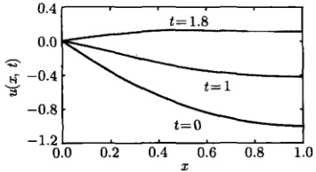

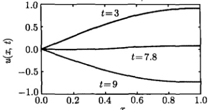

图 6.8 一般解 (6.2.49) 的部分和 (前 20 项) 的曲线，这里取  $ L=1, a\pi=1 $。图中的曲线显示了一般解在一个周期内的不同行为，任意 t 时刻曲线在后端的斜率为 0
 

解 (1) 设有界杆的两个端点处于 x=0 和 x=L。杆的两端保持绝热，因此从两端进入的热量为零。根据热传导的傅里叶定律 [式 (5.2.1)]，两端的温度梯度均为零，故定解问题为

$$  \left\{\begin{array}{l l}{\displaystyle\frac{\partial u}{\partial t}=a^{2}\frac{\partial^{2}u}{\partial x^{2}}}&{\qquad\quad(0<x<L,\;t>0)}\end{array}\right.   \tag*{(6.2.50a)}$$

$$  u|_{t=0}=\phi(x)\quad(0\leqslant x\leqslant L)   \tag*{(6.2.50b)}$$

$$  \left|\begin{array}{c c}\left.\frac{\partial u}{\partial x}\right|_{x=0}=0,&\left.\frac{\partial u}{\partial x}\right|_{x=L}=0\quad(t>0)\end{array}\right.   \tag*{(6.2.50c)}$$

两端都是第二类齐次边界条件，可以用分离变量法求解。设泛定方程(4.2.50a)有变量分离的形式解  $ u(x,t)=X(x)T(t) $，其中  $ X(x) $ 构成本征值问题

$$  \left\{\begin{array}{l}X^{\prime\prime}(x)+\lambda X(x)=0\\ X^{\prime}(0)=0,X^{\prime}(L)=0\end{array}\right.   \tag*{(6.2.51a)}$$

而  $ T(t) $ 满足方程

$$  T^{\prime}(t)+\lambda a^{2}T(t)=0   \tag*{(6.2.52)}$$

与波动方程的情况不同，现在时间函数  $ T(t) $ 服从一阶常微分方程，这是由于泛定方程 (6.2.50a) 中关于时间的微商是一阶的。我们首先求解本征值问题 (6.2.51)，考虑三种情况。

①  $ \lambda = 0 $，这时方程 (6.2.50a) 的通解为  $ X(x) = A + Bx(X'(x) = B) $，其中 A 和 B 为任意常数。边界条件  $ X'(0) = 0 $ 要求 B = 0，于是  $ X(x) = A $。这个结果表示  $ X'(x) = 0 $，即任意 x 处的导数为零，当然满足  $ X'(L) = 0 $。这样我们看到，在边界条件 (6.2.51b) 之下，本征值问题 (6.2.51) 的解为： $ \lambda_0 = 0 $， $ X_0(x) = A $。

<!-- page: 163 -->

②  $ \lambda<0 $，这时方程(6.2.51a)的通解为 [式(1.1.34)]

$$  X(x)=A\cosh kx+B\sinh kx   \tag*{(6.2.53a)}$$

其中， $ k = \sqrt{-\lambda} $。它的导数为

$$  X^{\prime}(x)=k A\sinh k x+kB\cosh k x   \tag*{(6.2.53b)}$$

边界条件  $ X'(0) = 0 $ 要求 B = 0，于是  $ X(x) = A \cosh kx $。而  $ X'(L) = 0 $ 要求  $ kA \sinh kL = 0 $，但  $ \sinh kL \neq 0 $，故 A = 0。这样  $ \lambda < 0 $ 时只有零解。

③  $ \lambda>0 $ ，这时方程 (6.2.51a) 的通解为 [式 (1.1.23)]

$$  X(x)=A\cos kx+B\sin kx   \tag*{(6.2.54a)}$$

其中， $ k = \sqrt{\lambda} $。它的导数为

$$  X^{\prime}(x)=-k A\sin k x+k B\cos k x   \tag*{(6.2.54b)}$$

边界条件  $ X'(0) = 0 $ 要求 B = 0，于是  $ X(x) = A \cos kx $。而  $ X'(L) = 0 $ 要求  $ \sin kL = 0 $。这样

$$  k=k_{n}=\frac{n\pi}{L}\quad(n=1,\ 2,\ 3,\cdots)   \tag*{(6.2.55)}$$

这里 n 不取零与负值是由于 k > 0。于是本征值与本征函数为

$$  \lambda_{n}=\left(\frac{n\pi}{L}\right)^{2},\quad X_{n}(x)=A_{n}\cos\frac{n\pi}{L}x   \tag*{(6.2.56)}$$

将上述所有的本征值  $ \lambda_{n} $ (n=0,1,2, $ \cdots $) 代入方程 (6.2.52)，得到时间函数 T(t) 的方程

$$  T_{n}^{\prime}(t)+\left(\frac{n a\pi}{L}\right)^{2}T_{n}(t)=0\quad(n=0,1,2,\cdots)   \tag*{(6.2.57)}$$

它的解为

$$  T_{0}=c_{0},\quad T_{n}(t)=c_{n}\exp\left[-\left(\frac{n a\pi}{L}\right)^{2}t\right]\quad(n=1,2,3,\cdots)   \tag*{(6.2.58)}$$

其中， $ T_{0}=c_{0} $ 相应于  $ \lambda_{0}=0 $ 。于是由式 (6.2.56) 和式 (6.2.58) 得到满足泛定方程 (6.2.50a) 和边界条件 (6.2.50c) 的本征解

$$  u_{n}(x,t)=C_{0}+C_{n}\exp\left[-\left(\frac{na\pi}{L}\right)^{2}t\right]\cos\frac{n\pi}{L}x   \tag*{(6.2.59)}$$

其中， $ C_{0}=A_{0}c_{0} $ 和  $ C_{n}=A_{n}c_{n} $ 是任意常数。由于泛定方程（6.2.50a）是线性齐次的，故由叠加原理得到一般解

$$  u(x,t)=C_{0}+\sum_{n=1}^{\infty}C_{n}\exp\left[-\left(\frac{na\pi}{L}\right)^{2}t\right]\cos\frac{n\pi}{L}x   \tag*{(6.2.60)}$$

<!-- page: 164 -->

现在利用初始条件（6.2.50b）确定其中的系数  $ C_{0} $ 和  $ C_{n} $，我们有

$$  \phi(x)=C_{0}+\sum_{n=1}^{\infty}C_{n}\cos\frac{n\pi}{L}x   \tag*{(6.2.61)}$$

式（6.2.61）显示， $ C_{0} $ 和  $ C_{n} $ 是半幅傅里叶余弦级数（2.2.3）的展开系数，式（2.2.4）给出

$$  C_{0}=\frac{1}{L}\int_{0}^{L}\phi(x)\mathrm{d}x   \tag*{(6.2.62a)}$$

$$  C_{n}=\frac{2}{L}\int_{0}^{L}\phi(x)\cos\frac{n\pi x}{L}\mathrm{d}x\quad(n=1,2,3,\cdots)   \tag*{(6.2.62b)}$$

式(6.2.60)就是该定解问题的解，其中的展开系数  $ C_{0} $ 和  $ C_{n} $ 由(6.2.62)表示。

(2) 关于系统的稳态温度，我们可以从三个角度进行讨论。

首先一般解 (6.2.60) 在  $ t \to \infty $ 时给出稳态温度  $ u(x, \infty) = C_0 $，再利用式 (6.2.62a) 得到

$$  u(x,\infty)=\frac{1}{L}\int_{0}^{L}\phi(x)\mathrm{d}x   \tag*{(6.2.63)}$$

式（6.2.63）表示，系统的稳态温度是初始温度的平均值。

另外，从热力学的角度进行分析，系统 t=0 时刻的温度分布是函数  $ u(x,0)=\phi(x) $，然后温度随时空变化。当  $ t\to\infty $ 时，热量在空间均匀分布，因此  $ u(x,\infty)= $ 常数，如图 6.9 所示。由于  $ t=0\sim\infty $ 的演化过程中是绝热的，热量保持守恒，即图 6.9 中两条曲线下的面积相等： $ \int_{0}^{L}\phi(x)\mathrm{d}x=u(x,\infty)L $，它给出稳态温度式 (6.2.63)。

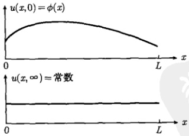

图 6.9 绝热系统在于 t=0 和  $ t \to \infty $ 的温度分布。
 

我们还可以从热传导方程的稳态解 [式 (5.2.11)] 考虑，在任何条件下，热传导方程的稳态解由

$$  u(x,\infty)=A+Bx   \tag*{(6.2.64a)}$$

<!-- page: 165 -->

表示。利用边界条件(6.2.50c)，式(6.2.64a)变为 $ u(x,\infty)=A $。再利用初始条件(6.2.50b)得到稳态温度：

$$  A=\frac{1}{L}\int_{0}^{L}\phi(x)\mathrm{d}x   \tag*{(6.2.64b)}$$

系统在任意时刻的平均温度定义为  $ u(x,t) $ 对空间的积分除以系统的长度 L，即

$$  U(t)=\frac{1}{L}\int_{0}^{L}u(x,t)\mathrm{d}x   \tag*{(6.2.65)}$$

由于现在的系统是绝热的，系统的平均温度应该不随时间变化，事实上，将式(6.2.60)代入式(6.2.65)给出

 $$ \begin{aligned}U(t)&=\frac{1}{L}\int_{0}^{L}\left\{C_{0}+\sum_{n=1}^{\infty}C_{n}\exp\left[-\left(\frac{n a\pi}{L}\right)^{2}t\right]\cos\frac{n\pi}{L}x\right\}\mathrm{d}x\\&=C_{0}+\frac{1}{L}\sum_{n=1}^{\infty}C_{n}\exp\left[-\left(\frac{n a\pi}{L}\right)^{2}t\right]\underbrace{\int_{0}^{L}\cos\frac{n\pi}{L}x\mathrm{d}x}_{=0}\\&=C_{0}\\ \end{aligned} $$ 

它就是系统的稳态温度。

(3) 初始温度  $ \phi(x)=x $ 时

 $$ C_{0}=\frac{1}{L}\int_{0}^{L}x\mathrm{d}x=\frac{L}{2} $$ 

 $$ \begin{aligned}C_{n}&=\frac{2}{L}\int_{0}^{L}x\cos\frac{n\pi}{L}x\mathrm{d}x=\frac{2}{L}\left[\frac{\cos\frac{n\pi}{L}x}{\left(\frac{n\pi}{L}\right)^{2}}+\frac{x\sin\frac{n\pi}{L}x}{\frac{n\pi}{L}}\right]_{0}^{L}\\&=\frac{2}{L}\left(\frac{L}{n\pi}\right)^{2}(\cos n\pi-1)=\frac{2L}{n^{2}\pi^{2}}\left[(-1)^{n}-1\right]\end{aligned} $$ 

将  $ C_{0} $ 和  $ C_{n} $ 代入式 (6.2.60) 得到一般解

$$  u(x,t)=\frac{L}{2}+\frac{2L}{\pi^{2}}\sum_{n=1}^{\infty}\frac{(-1)^{n}-1}{n^{2}}\exp\left[-\left(\frac{n\pi}{L}\right)^{2}t\right]\cos\frac{n\pi}{L}x   \tag*{(6.2.66)}$$

(4) 初始温度  $ \phi(x)=1+\cos\frac{2\pi x}{L} $ 时

$$  C_{0}=\frac{1}{L}\int_{0}^{L}\left(1+\cos\frac{2\pi x}{L}\right)\mathrm{d}x=1   \tag*{(6.2.67)}$$

<!-- page: 166 -->

$$ \begin{aligned}C_{n}&=\frac{2}{L}\int_{0}^{L}\left(1+\cos\frac{2\pi x}{L}\right)\cos\frac{n\pi x}{L}\mathrm{d}x\\&=\frac{2}{L}\int_{0}^{L}\cos\frac{2\pi x}{L}\cos\frac{n\pi x}{L}\mathrm{d}x\quad[ 利用式 (2.2.8)]\\&=\delta_{2n}\\ \end{aligned} $$ 

将  $ C_{0} $ 和  $ C_{n} $ 代入式 (6.2.60) 得到一般解

$$  \begin{aligned}u(x,t)&=C_{0}+\sum_{n=1}^{\infty}\delta_{2n}\exp\left[-\left(\frac{na\pi}{L}\right)^{2}t\right]\cos\frac{n\pi}{L}x\\&=1+\exp\left[-\left(\frac{2a\pi}{L}\right)^{2}t\right]\cos\frac{2\pi}{L}x\end{aligned}   \tag*{(6.2.68)}$$

系统在不同 t 时刻的温度分布如图 6.10 所示。

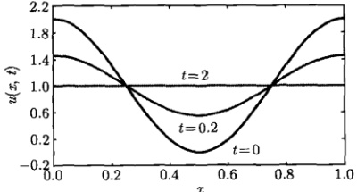

图 6.10 一般解 (6.2.68) 的曲线，这里取 L=1,  $ a\pi=1 $。系统在 t=2 时已经趋于稳态温度  $ C_{0}=1 $
 

从以上例题可以总结出用分离变量法求解基本定解问题的要点：

(1) 对于有界空间  $ (0 \leq x \leq L) $ 的波动方程与热传导方程的定解问题，其泛定方程具有变量分离的形式解  $ u(x, t) = X(x)T(t) $，其中空间函数  $ X(x) $ 所满足的方程在一般情况下具有确定的形式  $ X''(x) + \lambda X(x) = 0 $，并与 x = 0 和 x = L 两端的齐次边界条件结合，构成相关的本征值问题。本征值问题的解依赖于分离常数  $ \lambda $ 的取值，在  $ \lambda > 0 $ 情况下，有通解

$$  X(x)=A\cos kx+B\sin kx   \tag*{(6.2.69)}$$

(2) 通解 (6.2.69) 在不同的边界条件下，约化成两种特解。如果 x = 0 端是第一类边界条件，则特解为正弦项；反之，如果 x = 0 端是第二类边界条件，则特解为余弦项，即

$$  u\mid_{x=0}=0\longrightarrow X(x)=B\sin kx   \tag*{(6.2.70a)}$$

$$  \left.\frac{\partial u}{\partial x}\right|_{x=0}=0\longrightarrow X(x)=A\cos kx   \tag*{(6.2.70b)}$$

<!-- page: 167 -->

简言之，x=0 端的边界条件决定本征函数，而 x=L 端的边界条件进一步决定本征值。

(3) 边界条件有 4 种不同的组合，相应的本征值与本征函数列于表 6.2 中。

表 6.2 本征方程  $ X''(x) + \lambda X(x) = 0 $ 的本征值与本征函数
 

 $$ u|_{x=0}=0,\;u|_{x=L}=0:\lambda_{n}=\left(\frac{n\pi}{L}\right)^{2},\quad X_{n}(x)=B_{n}\operatorname{s i n}\frac{n\pi}{L}x,\ n=1,\;2,\;3,\cdots $$ 

 $$ \left.\frac{\partial u}{\partial x}\right|_{x=0}=0,\ \left.\frac{\partial u}{\partial x}\right|_{x=L}=0:\lambda_{n}=\left(\frac{n\pi}{L}\right)^{2},\qquad X_{n}(x)=A_{n}\cos\frac{n\pi}{L}x,\ n=0,\ 1,\ 2,\cdots $$ 

 $$ u|_{x=0}=0,\quad\left.{\frac{\partial u}{\partial x}}\right|_{x=L}=0:\lambda_{n}=\left[{\frac{(2n+1)\pi}{2L}}\right]^{2},\quad X_{n}(x)=B_{n}\sin{\frac{(2n+1)\pi}{2L}}x,\quad n=0,1,2,\cdots $$ 

 $$ \left.\frac{\partial u}{\partial x}\right|_{x=0}=0,\quad u|_{x=L}=0:\lambda_{n}=\left[\frac{(2n+1)\pi}{2L}\right]^{2},\quad X_{n}(x)=A_{n}\cos\frac{(2n+1)\pi}{2L}x,\quad n=0,1,2,\cdots $$ 

### 6.3 二维泛定方程的定解问题

本节讨论二维波动方程与热传导方程的定解问题，如果方程与边界条件都是齐次的，也可以用分离变量法求解。与一维情形不同的是，由于空间变量是两个，所以在时空变量分离后，需要对两个空间变量进行进一步的分离。

#### 6.3.1 二维波动方程

考虑膜振动问题：一个边长为 a 和 b 的矩形膜置于 x-y 平面的第一象限，其四周被固定，膜的初始位移与初始速度为任意函数，确定任意点  $ (x,y) $ 在任意时刻 t 的位移  $ u(x,y,t) $，即求解下面的定解问题

$$  \left\{\begin{array}{l}\frac{\partial^{2}u}{\partial t^{2}}=c^{2}\left(\frac{\partial^{2}u}{\partial x^{2}}+\frac{\partial^{2}u}{\partial y^{2}}\right)\\\end{array}\right.\qquad\left(0<x<a,\;0<y<b,t>0\right)   \tag*{(6.3.1a)}$$

$$  \left\{\begin{array}{l}u\big|_{t=0}=\phi(x,y),\quad\frac{\partial u}{\partial t}\bigg|_{t=0}=\psi(x,y)\quad(0\leqslant x\leqslant a,0\leqslant y\leqslant b)\end{array}\right.   \tag*{(6.3.1b)}$$

$$  \left\{\begin{array}{ll}u|_{x=0}=u|_{x=a}=0&\quad(0\leqslant y\leqslant b,\ t>0)\\ u|_{y=0}=u|_{y=b}=0&\quad(0\leqslant x\leqslant a,\ t>0)\end{array}\right.   \tag*{(6.3.1d)}$$

其中，c 为二维情况下的波速， $ \phi(x,y) $ 和  $ \psi(x,y) $ 是膜的初始位移和初始速度。

设方程(6.3.1a)有形式解

$$  u(x,y,t)=V(x,y)T(t)   \tag*{(6.3.2)}$$

<!-- page: 168 -->

代入方程(6.3.1a)得到

$$  \frac{T^{\prime\prime}}{c^{2}T}=\frac{1}{V}\left(\frac{\partial^{2}V}{\partial x^{2}}+\frac{\partial^{2}V}{\partial y^{2}}\right)=-\lambda   \tag*{(6.3.3)}$$

其中， $ \lambda $ 是分离常数，由式 (6.3.3) 得到

$$  \frac{\partial^{2}V}{\partial x^{2}}+\frac{\partial^{2}V}{\partial y^{2}}+\lambda V=0   \tag*{(6.3.4a)}$$

$$  T^{\prime\prime}+\lambda c^{2}T=0   \tag*{(6.3.4b)}$$

方程（6.3.4a）是二维拉普拉斯算符的本征方程。再令

$$  V(x,y)=X(x)Y(y)   \tag*{(6.3.5)}$$

代入式(6.3.4a)得到

$$  \frac{X^{\prime \prime}}{X}=-\frac{Y^{\prime \prime}+\lambda Y}{Y}=-\mu   \tag*{(6.3.6)}$$

 $ \mu $ 是又一个分离常数。由式 (6.3.6) 及边界条件 (6.3.1c) 和式 (6.3.1d) 得到

$$  X^{\prime \prime}+\mu X=0\quad(0<x<a)   \tag*{(6.3.7a)}$$

$$  X(0)=X(a)=0   \tag*{(6.3.7b)}$$

$$  \left\{\begin{array}{l}Y^{\prime\prime}+\nu Y=0\quad(0<y<b)\\ Y(0)=Y(b)=0\end{array}\right.   \tag*{(6.3.8a)}$$

其中， $ \lambda=\mu+\nu $。我们看到，式(6.3.7)和式(6.3.8)都是6.1节所讨论的弦振动空间函数的本征值问题[方程(6.1.12)]。它们在 $ \mu>0 $和 $ \nu>0 $情况下有非零解

$$  \mu=\mu_{m}=\left(\frac{m\pi}{a}\right)^{2}\quad 和 \quad\nu=\nu_{n}=\left(\frac{n\pi}{b}\right)^{2}\quad(m,n=1,2,3,\cdots)   \tag*{(6.3.9)}$$

$$  X_{m}(x)=\sin\frac{m\pi}{a}x\quad 和 \quad Y_{n}(y)=\sin\frac{n\pi}{b}y   \tag*{(6.3.10)}$$

这样本征方程（6.3.4a）的解为

$$  \lambda=\lambda_{mn}=\left(\frac{m\pi}{a}\right)^{2}+\left(\frac{n\pi}{b}\right)^{2}   \tag*{(6.3.11a)}$$

$$  V_{mn}(x,y)=\sin\frac{m\pi}{a}x\sin\frac{n\pi}{b}y   \tag*{(6.3.11b)}$$

将式（6.3.11a）代入式（6.3.4b）解出时间函数

$$  T(t)=T_{m n}(t)=C_{m n}\cos\omega_{m n}t+D_{m n}\sin\omega_{m n}t   \tag*{（6.3.12）}$$

<!-- page: 169 -->

其中， $ C_{mn} $ 和  $ D_{mn} $ 是待定系数，而

$$  \omega_{mn}=c\pi\sqrt{\left(\frac{m}{a}\right)^{2}+\left(\frac{n}{b}\right)^{2}}   \tag*{(6.3.13)}$$

是膜振动的特征频率，其中基频为

$$  \omega_{11}=c\pi\sqrt{\left(\frac{1}{a}\right)^{2}+\left(\frac{1}{b}\right)^{2}}   \tag*{(6.3.14)}$$

与一维弦振动情况不同， $ \omega_{mn} $ 不是基频的整数倍。进而，本征解(6.3.2)为

$$  u_{mn}(x,y,t)=(C_{mn}\cos\omega_{mn}t+D_{mn}\sin\omega_{mn}t)\sin\frac{m\pi}{a}x\sin\frac{n\pi}{b}y\quad(m,n=1,2,3\cdots)   \tag*{(6.3.15)}$$

为了表征任意的初始条件，我们将所有的本征解叠加起来，得到一般解

$$  u(x,y,t)=\sum_{m=1}^{\infty}\sum_{n=1}^{\infty}\left(C_{mn}\cos\omega_{mn}t+D_{mn}\sin\omega_{mn}t\right)\sin\frac{m\pi}{a}x\sin\frac{n\pi}{b}y   \tag*{(6.3.16)}$$

它表示任意时刻 t 的位移，而任意时刻 t 的速度为

$$  \frac{\partial u(x,y,t)}{\partial t}=\sum_{m=1}^{\infty}\sum_{n=1}^{\infty}\left(-\omega_{mn}C_{mn}\sin\omega_{mn}t+\omega_{mn}D_{mn}\cos\omega_{mn}t\right)\sin\frac{m\pi}{a}x\sin\frac{n\pi}{b}y   \tag*{(6.3.17)}$$

利用初始条件(6.3.1b)，我们有

$$  \phi(x,y)=\sum_{m=1}^{\infty}\sum_{n=1}^{\infty}C_{mn}\sin\frac{m\pi}{a}x\sin\frac{n\pi}{b}y   \tag*{(6.3.18a)}$$

$$  \psi(x,y)=\sum_{m=1}^{\infty}\sum_{n=1}^{\infty}\omega_{mn}D_{mn}\sin\frac{m\pi}{a}x\sin\frac{n\pi}{b}y   \tag*{(6.3.18b)}$$

现在我们利用式(6.3.18)确定系数  $ C_{mn} $ 和  $ D_{mn} $。首先考查本征函数(6.3.11b)的正交性

 $$ \begin{aligned}&\int_{0}^{b}\int_{0}^{a}V_{mn}(x,y)V_{m^{\prime}n^{\prime}}(x,y)\mathrm{d}x\mathrm{d}y\\=&\int_{0}^{b}\int_{0}^{a}\sin\frac{m\pi}{a}x\sin\frac{n\pi}{b}y\sin\frac{m^{\prime}\pi}{a}x\sin\frac{n^{\prime}\pi}{b}y\mathrm{d}x\mathrm{d}y\\=&\left(\int_{0}^{a}\sin\frac{m\pi}{a}x\sin\frac{m^{\prime}\pi}{a}x\mathrm{d}x\right)\left(\int_{0}^{b}\sin\frac{n\pi}{b}y\sin\frac{n^{\prime}\pi}{b}y\mathrm{d}y\right)\end{aligned} $$ 

[利用式(2.2.6)]

<!-- page: 170 -->

$$  =\frac{ab}{4}\delta_{mm^{\prime}}\delta_{nn^{\prime}}   \tag*{(6.3.19)}$$

可见本征函数（6.3.11b）是正交的。这样用  $ \sin\frac{m' \pi}{a} x \sin\frac{n' \pi}{b} y $ 乘以式（6.3.18a）两端，然后对 x 和 y 积分，并利用式（6.3.19），得到

$$  C_{m n}=\frac{4}{a b}\int_{0}^{b}\int_{0}^{a}\phi(x,y)\sin\frac{m\pi}{a}x\sin\frac{n\pi}{b}y\mathrm{d}x\mathrm{d}y   \tag*{(6.3.20a)}$$

同理

$$  D_{mn}=\frac{4}{ab\omega_{mn}}\int_{0}^{b}\int_{0}^{a}\psi(x,y)\sin\frac{m\pi}{a}x\sin\frac{n\pi}{b}y\mathrm{d}x\mathrm{d}y   \tag*{(6.3.20b)}$$

式 (6.3.16) 就是定解问题 (6.3.1) 的解，其中  $ C_{mn} $ 和  $ D_{mn} $ 由式 (6.3.20) 确定。应该指出，与弦振动的情况不同，膜振动的时间行为不是周期性的，这是因为特征频率  $ \omega_{mn} $ 不是基频的整数倍，因此由各种频率成分叠加而成的一般解没有确定的周期。

通过这个问题的求解，我们得到了本征方程（6.3.4a）的一套本征函数集

$$  \left\{\sin\frac{m\pi}{a}x\sin\frac{n\pi}{b}y\right\}\quad(m,\ n=1,\ 2,\ 3,\cdots)   \tag*{(6.3.21)}$$

这样一来，对于一个定义在 0 < x < a, 0 < y < b 的函数  $ f(x, y) $，可以将它按该本征函数集展开，即

$$  f(x,y)=\sum_{m=1}^{\infty}\sum_{n=1}^{\infty}C_{mn}\sin\frac{m\pi}{a}x\sin\frac{n\pi}{b}y   \tag*{(6.3.22a)}$$

而展开系数  $ C_{mn} $ 由

$$  C_{mn}=\frac{4}{ab}\int_{0}^{b}\int_{0}^{a}f(x,y)\sin\frac{m\pi}{a}x\sin\frac{n\pi}{b}y\mathrm{d}x\mathrm{d}y   \tag*{(6.3.22b)}$$

确定。很明显，式(6.3.22a)是一个二重傅里叶级数。

另外在定解问题 (6.3.1) 中，边界条件式 (6.3.1c) 和式 (6.3.1d) 还可以取其他的形式，如表 6.2 所示的各种组合，由此引出更多的本征函数集。比如，对于边界条件

$$  u|_{x=0}=0,\quad\left.\frac{\partial u}{\partial x}\right|_{x=a}=0\quad(0\leqslant y\leqslant b,\ t>0)   \tag*{(6.3.23a)}$$

$$  \frac{\partial u}{\partial x}\bigg|_{y=0}=0,\quad\left.u\right|_{y=b}=0\quad(0\leqslant x\leqslant a,\ t>0)   \tag*{(6.3.23b)}$$

方程(6.3.4a)的本征函数集为

$$  \left\{\sin\frac{(2m+1)\pi}{2a}x\cos\frac{(2n+1)\pi}{2b}y\right\}\quad(m,n=0,1,2,\cdots)   \tag*{(6.3.24)}$$

<!-- page: 171 -->

例 1 设矩形膜的边长为 a = b = 1,  $ c = 1/\pi $，膜的初始位移为函数  $ \phi(x, y) = x(x - 1)y(y - 1) $，初始速度  $ \psi(x, y) = 0 $，确定膜上任意点  $ (x, y) $ 在任意 t 时刻的位移。

解 由式(6.3.20b)得到 $ D_{mn}=0 $，而

 $$ \begin{aligned}C_{mn}&=4\int_{0}^{1}\int_{0}^{1}x(x-1)y(y-1)\sin m\pi x\sin n\pi y\mathrm{d}x\mathrm{d}y\\&=4\left[\int_{0}^{1}x(x-1)\sin m\pi x\mathrm{d}x\right]\left[\int_{0}^{1}y(y-1)\sin n\pi y\mathrm{d}y\right]\\&=4\frac{2\left[(-1)^{m}-1\right]}{\pi^{3}m^{3}}\frac{2\left[(-1)^{n}-1\right]}{\pi^{3}n^{3}}\\ \end{aligned} $$ 

当 m, n 中任意一个为偶数时， $ C_{mn}=0 $。如果 m 和 n 均为奇数，则  $ C_{mn}=\frac{64}{\pi^{6}m^{3}n^{3}} $ 于是

 $$ \begin{aligned}u(x,y,t)&=\sum_{m=1,3\cdots}\sum_{n=1,3\cdots}\frac{64}{\pi^{6}m^{3}n^{3}}\cos\left(\sqrt{m^{2}+n^{2}}t\right)\sin m\pi x\sin n\pi y\\&=\sum_{k=0}^{\infty}\sum_{l=0}^{\infty}\frac{64}{\pi^{6}(2k+1)^{3}(2l+1)^{3}}\cos\left[\sqrt{(2k+1)^{2}+(2l+1)^{2}}t\right]\\&\quad\times\sin(2k+1)\pi x\sin(2l+1)\pi y\end{aligned} $$ 

这就是定解问题的结果，我们看到特征频率  $ \sqrt{(2k+1)^2+(2l+1)^2} $ 不是基频  $ \sqrt{2} $ 的整数倍，所以这个解的时间变化不是周期性的。我们进一步考虑膜中心点  $ (1/2, 1/2) $ 的位移

$$  \begin{aligned}{u(1/2,\;1/2,\;t)}&{{}=\sum_{k=0}^{\infty}\sum_{l=0}^{\infty}\frac{64}{\pi^{6}(2k+1)^{3}(2l+1)^{3}}\operatorname{c o s}\left[\sqrt{(2k+1)^{2}+(2l+1)^{2}}t\right]}\\ {}&{{}\quad\times\operatorname{s i n}(2k+1)\frac{\pi}{2}\operatorname{s i n}(2l+1)\frac{\pi}{2}\quad(6.3)}\\ \end{aligned}   \tag*{(6.3.25)}$$

图 6.11 显示了中心点位移的时间演化，可以看出，它不是严格周期性的。

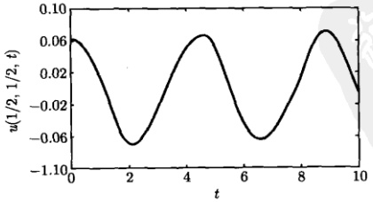

图 6.11 膜中心位移的时间演化 [式 (6.3.25)] 的部分和，k 和 l 的求和均取前 30 项
 

<!-- page: 172 -->

#### 6.3.2 二维热传导方程

考虑二维热传导问题：一个边长为 a 和 b 的矩形薄片置于 x-y 平面的第一象限，其周边温度为零，薄片的初始温度分布为任意函数  $ \phi(x,y) $，确定薄片在任意 t 时刻的温度分布  $ u(x,y,t) $，即求解下面的定解问题

$$  \left\{\begin{array}{l}\frac{\partial u}{\partial t}=c^{2}\left(\frac{\partial^{2}u}{\partial x^{2}}+\frac{\partial^{2}u}{\partial y^{2}}\right)\quad(0<x<a,\;0<y<b,t>0)\end{array}\right.   \tag*{(6.3.26a)}$$

$$  u|_{t=0}=\phi(x,y)\quad(0\leqslant x\leqslant a,\;0\leqslant y\leqslant b)   \tag*{(6.3.26b)}$$

$$  u|_{x=0}=u|_{x=a}=0\qquad(0\leqslant y\leqslant b,\ t>0)   \tag*{(6.3.26c)}$$

$$  u|_{y=0}=u|_{y=b}=0\quad(0\leqslant x\leqslant a,\ t>0)   \tag*{(6.3.26d)}$$

其中，c 为二维情况下的热扩散系数。这个问题的解法与 6.3.1 节的二维波动方程类似。设方程 (6.3.26a) 有形式解

$$  u(x,y,t)=V(x,y)T(t)   \tag*{(6.3.27)}$$

其中，空间函数  $ V(x,y) $ 与时间函数  $ T(t) $ 的方程是

$$  \frac{\partial^{2}V}{\partial x^{2}}+\frac{\partial^{2}V}{\partial y^{2}}+\lambda V=0   \tag*{(6.3.28a)}$$

$$  T^{\prime}+c^{2}\lambda T=0   \tag*{(6.3.28b)}$$

在边界条件式（6.3.26c）和式（6.3.26d）之下，本征方程（6.3.28a）的解为

$$  \lambda_{mn}=\left(\frac{m\pi}{a}\right)^{2}+\left(\frac{n\pi}{b}\right)^{2},\quad V_{mn}(x,y)=\sin\frac{m\pi}{a}x\sin\frac{n\pi}{b}y   \tag*{(6.3.29)}$$

由方程（6.3.28b）得到时间函数的解为

$$  T_{m n}(t)=\mathrm{e}^{-\omega_{m n}^{2}t}   \tag*{(6.3.30)}$$

其中

$$  \omega_{mn}=c\pi\sqrt{\left(\frac{m}{a}\right)^{2}+\left(\frac{n}{b}\right)^{2}}   \tag*{(6.3.31)}$$

一般解为

$$  u(x,y,t)=\sum_{m=1}^{\infty}\sum_{n=1}^{\infty}C_{mn}\mathrm{e}^{-\omega_{mn}^{2}t}\sin\frac{m\pi}{a}x\sin\frac{n\pi}{b}y   \tag*{(6.3.32)}$$

展开系数为

$$  C_{mn}=\frac{4}{ab}\int_{0}^{b}\int_{0}^{a}\phi(x,y)\sin\frac{m\pi}{a}x\sin\frac{n\pi}{b}y\mathrm{d}x\mathrm{d}y   \tag*{(6.3.33)}$$

<!-- page: 173 -->

例 2 设矩形薄片的边长为 a = b = 1,  $ c\pi = 1 $，薄片的初始温度分布为  $ \phi(x, y) = x(x - 1)y(y - 1) $，求薄片在任意 t 时刻的温度分布  $ u(x, y, t) $ 并讨论薄片中心温度的时间演化。

解 按照 6.3.1 节的方法，从式 (6.3.32) 得到

$$  \begin{aligned}{u(x,y,t)}&{{}=\sum_{k=0}^{\infty}\sum_{l=0}^{\infty}\frac{64}{\pi^{6}(2k+1)^{3}(2l+1)^{3}}\mathrm{e}^{-\left[(2k+1)^{2}+(2l+1)^{2}\right]t}}\\ {}&{{}\quad\times\operatorname{s i n}(2k+1)\pi x\operatorname{s i n}(2l+1)\pi y}\\ \end{aligned}   \tag*{(6.3.34)}$$

薄片中心温度为

$$  \begin{aligned}{u(1/2,~1/2,~t)}&{{}=\sum_{k=0}^{\infty}\sum_{l=0}^{\infty}\frac{64}{\pi^{6}(2k+1)^{3}(2l+1)^{3}}\mathrm{e}^{-\left[(2k+1)^{2}+(2l+1)^{2}\right]t}}\\ {}&{{}\quad\times\operatorname{s i n}(2k+1)\frac{\pi}{2}\operatorname{s i n}(2l+1)\frac{\pi}{2}}\\ \end{aligned}   \tag*{(6.3.35)}$$

它随时间的演化显示在图 6.12。

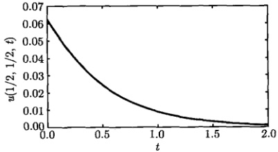

图 6.12 薄片中心温度的时间演化 [式 (6.3.35)] 的部分和，k 和 l 的求和均取前 30 项
 

例 3 设矩形薄片的边长为 a = b = 1,  $ c\pi = 1 $，薄片的初始温度分布为  $ \phi(x, y) = \sin\pi x \sin\pi y $，求任意 t 时刻薄片的温度分布  $ u(x, y, t) $ 及薄片中的心温度。

解 将  $ \phi(x,y)=\sin\pi x\sin\pi y $ 代入式 (6.3.33)，并利用式 (6.3.19) 得到

$$  \begin{aligned}C_{mn}&=4\int_{0}^{1}\int_{0}^{1}\sin\pi x\sin\pi y\sin m\pi x\sin n\pi y\mathrm{d}x\mathrm{d}y\\&=\left(2\int_{0}^{1}\sin\pi x\sin m\pi x\mathrm{d}x\right)\left(2\int_{0}^{1}\sin\pi y\sin n\pi y\mathrm{d}y\right)\\&=\delta_{1m}\delta_{1n}\\ \end{aligned}   \tag*{(6.3.36)}$$

代入式(6.3.32)得到一般解

$$  u(x,y,t)=\sum_{m=1}^{\infty}\sum_{n=1}^{\infty}\delta_{1m}\delta_{1n}\mathrm{e}^{-\omega_{mn}^{2}t}\sin m\pi x\sin n\pi y=\mathrm{e}^{-2t}\sin\pi x\sin\pi y   \tag*{(6.3.37)}$$

<!-- page: 174 -->

这就是任意 t 时刻薄片的温度分布。薄片中的心温度为

$$  u(1/2,\ 1/2,\ t)=\mathrm{e}^{-2t}   \tag*{(6.3.38)}$$

### 6.4 第三类边界条件下的定解问题

#### 6.4.1 本征函数的正交性

上述的定解问题只涉及第一类、第二类边界条件，本节通过具体的例题进一步讨论第三类边界条件下的定解问题。为此我们首先讨论有关本征函数正交性的一般问题。假定一个定义在有界区间 [0, L] 上的函数  $ X(x) $ 满足本征值问题

$$  X^{\prime\prime}(x)+\lambda X(x)=0   \tag*{(6.4.1a)}$$

$$  f|_{x=0}=0,\quad g|_{x=L}=0   \tag*{(6.4.1b)}$$

其中， $ \lambda=\lambda_{n} $ 是第 n 个本征值， $ X(x)=X_{n}(x) $ 是相应的本征函数  $ (n=1,2,3,\cdots) $。式 (6.4.1b) 表示  $ X_{n}(x) $ 在 x=0 和 x=L 的齐次边界条件（可以是各类边界条件）。

现在讨论本征函数的正交性，即计算积分  $ \int_{0}^{L} X_{m}(x) X_{n}(x) \mathrm{d}x \ (m \neq n) $

方程(6.4.1a)给出

$$  \frac{\mathrm{d}^{2}}{\mathrm{d}x^{2}}X_{n}=-\lambda_{n}X_{n}   \tag*{(6.4.2a)}$$

因此我们有

$$  \frac{\mathrm{d}}{\mathrm{d}x}\left(X_{n}^{\prime}\right)=-\lambda_{n}X_{n}\quad 和 \quad\frac{\mathrm{d}}{\mathrm{d}x}\left(X_{m}^{\prime}\right)=-\lambda_{m}X_{m}\quad(m\neq n)   \tag*{(6.4.2b)}$$

给上二式两边分别乘以  $ X_{m} $ 和  $ X_{n} $，得到

$$  \dot{X}_{m}\frac{\mathrm{d}}{\mathrm{d}x}\left(X_{n}^{\prime}\right)=-\lambda_{n}X_{m}X_{n}\quad 和 \quad X_{n}\frac{\mathrm{d}}{\mathrm{d}x}\left(X_{m}^{\prime}\right)=-\lambda_{m}X_{m}X_{n}   \tag*{(6.4.3)}$$

式(6.4.3)两式两边相减再积分，得到

$$  \int_{0}^{L}\left[X_{m}\frac{\mathrm{d}}{\mathrm{d}x}\left(X_{n}^{\prime}\right)-X_{n}\frac{\mathrm{d}}{\mathrm{d}x}\left(X_{m}^{\prime}\right)\right]\mathrm{d}x=\int_{0}^{L}\left(\lambda_{m}X_{m}X_{n}-\lambda_{n}X_{m}X_{n}\right)\mathrm{d}x   \tag*{(6.4.4)}$$

计算式（6.4.4）左边的积分

 $$ \begin{align*}&\int_{0}^{L}\left[X_{m}\frac{\mathrm{d}}{\mathrm{d}x}\left(X_{n}^{\prime}\right)-X_{n}\frac{\mathrm{d}}{\mathrm{d}x}\left(X_{m}^{\prime}\right)\right]\mathrm{d}x\\=&\int_{0}^{L}X_{m}\mathrm{d}\left(X_{n}^{\prime}\right)-\int_{0}^{L}X_{n}\mathrm{d}\left(X_{m}^{\prime}\right)\end{align*} $$

<!-- page: 175 -->

$$ \begin{align*}&=\left[X_{m}X^{\prime}_{n}\right]_{0}^{L}-\int_{0}^{L}X^{\prime}_{n}\mathrm{d}X_{m}-\left[X_{n}X^{\prime}_{m}\right]_{0}^{L}+\int_{0}^{L}X^{\prime}_{m}\mathrm{d}X_{n}\\&=X_{m}(L)X^{\prime}_{n}(L)-X_{m}(0)X^{\prime}_{n}(0)-\int_{0}^{L}X^{\prime}_{n}\frac{\mathrm{d}X_{m}}{\mathrm{d}x}\mathrm{d}x\\&\quad-X_{n}(L)X^{\prime}_{m}(L)+X_{n}(0)X^{\prime}_{m}(0)+\int_{0}^{L}X^{\prime}_{m}\frac{\mathrm{d}X_{n}}{\mathrm{d}x}\mathrm{d}x\\&=\left[X_{n}(0)X^{\prime}_{m}(0)-X_{m}(0)X^{\prime}_{n}(0)\right]-\left[X_{n}(L)X^{\prime}_{m}(L)-X_{m}(L)X^{\prime}_{n}(L)\right]\\&\quad-\underbrace{\left(\int_{0}^{L}X^{\prime}_{n}X^{\prime}_{m}\mathrm{d}x-\int_{0}^{L}X^{\prime}_{m}X^{\prime}_{n}\mathrm{d}x\right)}_{=0}\\&=\left[X_{n}(0)X^{\prime}_{m}(0)-X_{m}(0)X^{\prime}_{n}(0)\right]-\left[X_{n}(L)X^{\prime}_{m}(L)-X_{m}(L)X^{\prime}_{n}(L)\right]\end{align*} $$ 

式(6.4.4)右边的积分为

$$  \int_{0}^{L}\left(\lambda_{m}X_{m}X_{n}-\lambda_{n}X_{m}X_{n}\right)\mathrm{d}x=\left(\lambda_{m}-\lambda_{n}\right)\int_{0}^{L}X_{m}X_{n}\mathrm{d}x   \tag*{(6.4.5)}$$

 $$ \int_{0}^{L}X_{m}X_{n}\mathrm{d}x=\frac{Q}{\lambda_{m}-\lambda_{n}}\quad(m\neq n) $$ 

这样

其中

$$  Q=\left[X_{n}(0)X_{m}^{\prime}(0)-X_{m}(0)X_{n}^{\prime}(0)\right]-\left[X_{n}(L)X_{m}^{\prime}(L)-X_{m}(L)X_{n}^{\prime}(L)\right]   \tag*{(6.4.7)}$$

称为 Q 因子。式 (6.4.6) 是关于本征值问题 (6.4.1) 的一般性的结果，适用于该方程的任何形式的本征值与本征函数，它依赖于本征函数及其导数在两个端点 x=0 和 x=L 的取值。式 (6.4.6) 表示，只要系统的边界条件满足 Q=0，则相应的本征函数  $ X_{1}, X_{2}, X_{3}, \cdots $ 在  $ (0, L) $ 上是正交的。

#### 6.4.2 热辐射定解问题

现在利用 6.4.1 节的知识，讨论第三类边界条件下的热传导定解问题。我们首先求解 5.5.4 节例 6 关于有界杆热传导的定解问题

$$  \left\{\begin{array}{l l}{\displaystyle\frac{\partial u}{\partial t}=a^{2}\frac{\partial^{2}u}{\partial x^{2}}}&{(0<x<L,\;t>0)}\\ {{}}&{{}}\\ {u|_{t=0}=\phi(x)}&{(0\leqslant x\leqslant L)}\\ {{}}&{{}}\\ {u|_{x=0}=0,\quad\left[u+h\frac{\partial u}{\partial x}\right]_{x=L}=0}&{(t>0)}\\ \end{array}\right.   \tag*{(6.4.8b)}$$

有界杆的两个端点 x=0 和 x=L 的边界条件分别为第一类、第三类，但都是齐次的，符合分离变量法的使用条件。在 x=L 端的边界条件中，当 h>0 时，该端是辐射热量的 [式(5.5.50)]，而辐射强度与端点的温度成正比。

<!-- page: 176 -->

设泛定方程 (6.4.8a) 有变量分离的形式解  $ u(x,t)=X(x)T(t) $，其中  $ X(x) $ 构成本征值问题

$$  \int X^{\prime\prime}(x)+\lambda X(x)=0   \tag*{(6.4.9a)}$$

$$  X(0)=0,\quad X(L)+h X^{\prime}(L)=0   \tag*{(6.4.9b)}$$

而  $ T(t) $ 满足方程

$$  T^{\prime}(t)+\lambda a^{2}T(t)=0   \tag*{(6.4.10)}$$

我们首先求解本征值问题 (6.4.9)，考虑以下三种情况：

(1)  $ \lambda=0 $，这时方程(6.4.9a)的通解为  $ X(x)=A+Bx(X'(x)=B) $。边界条件  $ X(0)=0 $ 要求 A=0，于是  $ X(x)=Bx $ (那么  $ X(L)=BL $)，即  $ X'(x)=B $，因此  $ X'(L)=B $。这样边界条件  $ X(L)+hX'(L)=0 $ 导致  $ BL+hB=0 $，即 B=0。可见  $ \lambda=0 $ 时，只有平庸解。

(2)  $ \lambda < 0 $，这时方程(6.4.9a)的通解为[式(1.1.34)]

$$  X(x)=A\cosh kx+B\sinh kx   \tag*{(6.4.11a)}$$

其中， $ k = \sqrt{-\lambda} $。它的导数为

$$  X^{\prime}(x)=k A\sinh k x+k B\cosh k x   \tag*{(6.4.11b)}$$

这时边界条件  $ X(0)=0 $ 要求 A=0，于是  $ X(x)=B\sinh kx $。而  $ X(L)+hX^{\prime}(L)=0 $ 要求  $ B\sinh kL+Bh k\cosh kL=0 $，它导致 B=0。这样  $ \lambda<0 $ 时只有平庸解。

(3)  $ \lambda > 0 $，这时方程(6.4.9a)的通解为[式(1.1.23)]

$$  X(x)=A\cos kx+B\sin kx   \tag*{(6.4.12a)}$$

其中， $ k = \sqrt{\lambda} $。它的导数为

$$  X^{\prime}(x)=-k A\sin k x+k B\cos k x   \tag*{(6.4.12b)}$$

这时，边界条件  $ X(0)=0 $ 要求 A=0，于是  $ X(x)=B\sin kx $。进而利用边界条件  $ X(L)+hX'(L)=0 $ 得到

$$  \sin k L+h k\cos k L=0   \tag*{(6.4.13)}$$

这是本征值所满足的超越方程，我们用曲线法求解，为此将式（6.4.13）写为

$$  \tan\mu=-\alpha\mu   \tag*{(6.4.14)}$$

其中

$$  \mu=kL,\quad\alpha=h/L   \tag*{(6.4.15)}$$

<!-- page: 177 -->

我们作出曲线  $ y = \tan \mu $ 和  $ y = -\alpha \mu $，如图 6.13 所示，二者交点的横坐标就是超越方程 (6.4.14) 的解

$$  \mu_{1},\;\mu_{2},\;\mu_{3},\cdots,\mu_{n},\cdots   \tag*{(6.4.16)}$$

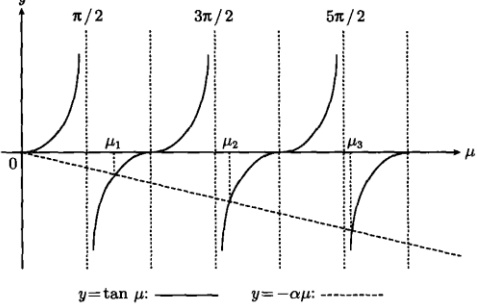

图 6.13 超越方程（6.4.14）的曲线解
 

在图 6.13 中没有作出  $ \mu < 0 $ 部分的曲线是因为 k > 0 (因此  $ \mu > 0 $)。这样本征值和本征函数为

$$  \lambda_{n}=\frac{\mu_{n}^{2}}{L^{2}},\quad X_{n}(x)=B_{n}\sin\frac{\mu_{n}}{L}x\quad(n=1,2,3,\cdots)   \tag*{(6.4.17)}$$

可以看出，函数  $ \sin\frac{\mu_{n}}{L}x $ 不同于先前的  $ \sin\frac{r}{L}x $， $ \mu_{n} $ 的变化不是  $ \pi $ 的整数倍。图 6.13 显示  $ \mu_{2}-\mu_{1}<\mu_{3}-\mu_{2}<\pi $。可以看出，随着 n 的增加，间隔  $ \mu_{n+1}-\mu_{n} $ 越来越接近于  $ \pi $；在极限  $ n\to\infty $ 时， $ \mu_{n+1}-\mu_{n}=\pi $。所以集合

$$  \left\{\sin\frac{\mu_{n}}{L}x\right\}\quad(n=1,2,3,\cdots)   \tag*{(6.4.18)}$$

在  $ n \to \infty $ 时可以构成傅里叶级数。相应的，时间函数  $ T(t) $ 的方程为

$$  T^{\prime}(t)+\left(\frac{\mu_{n}a}{L}\right)^{2}T(t)=0   \tag*{(6.4.19)}$$

它的通解为

$$  T_{n}(t)=c_{n}\exp\left[-\left(\frac{\mu_{n}a}{L}\right)^{2}t\right]   \tag*{(6.4.20)}$$

其中， $ c_{n} $ 是任意常数。于是由式 (6.4.17) 和式 (6.4.20) 得到满足泛定方程 (6.4.9a) 和边界条件 (6.4.9c) 的本征解

$$  u_{n}(x,t)=C_{n}\exp\left[-\left(\frac{\mu_{n}a}{L}\right)^{2}t\right]\sin\frac{\mu_{n}}{L}x   \tag*{(6.4.21)}$$

<!-- page: 178 -->

其中， $ C_{n}=B_{n}c_{n} $ 是任意常数。由于泛定方程 (6.4.9a) 是线性齐次的，由叠加原理得到一般解

$$  u(x,t)=\sum_{n=1}^{\infty}C_{n}\exp\left[-\left(\frac{\mu_{n}a}{L}\right)^{2}t\right]\sin\frac{\mu_{n}}{L}x   \tag*{(6.4.22)}$$

现在利用初始条件确定式（6.4.22）中的系数  $ C_{n} $，我们有

$$  \phi(x)=\sum_{n=1}^{\infty}C_{n}\sin\frac{\mu_{n}}{L}x   \tag*{(6.4.23)}$$

注意，式(6.4.23)不是通常的傅里叶级数。但我们将会看出，它非常接近傅里叶级数，因此可以称为广义傅里叶级数（generalized Fourier series）。为求系数  $ C_{n} $，给(6.4.23)两边同乘以  $ \sin \frac{\mu_{m} x}{L} (m = 1, 2, 3, \cdots) $，然后积分，得到

 $$ \begin{aligned}\int_{0}^{L}\sin\frac{\mu_{m}x}{L}\phi(x)\mathrm{d}x&=\int_{0}^{L}\sin\frac{\mu_{m}x}{L}\left(\sum_{n=1}^{\infty}C_{n}\sin\frac{\mu_{n}x}{L}\right)\mathrm{d}x\\&=\sum_{n=1}^{\infty}C_{n}\int_{0}^{L}\sin\frac{\mu_{m}x}{L}\sin\frac{\mu_{n}x}{L}\mathrm{d}x\\&=\sum_{n=1}^{\infty}C_{n}\frac{L}{2}\left(1-\frac{\sin2\mu_{n}}{2\mu_{n}}\right)\delta_{mn}\\&=C_{m}\frac{L}{2}\left(1-\frac{\sin2\mu_{m}}{2\mu_{m}}\right)\end{aligned} $$ 

其中，运算中用到了正交性关系式

$$  \int_{0}^{L}\sin\frac{\mu_{m}x}{L}\sin\frac{\mu_{n}x}{L}\mathrm{d}x=\frac{L}{2}\left(1-\frac{\sin2\mu_{n}}{2\mu_{n}}\right)\delta_{mn}   \tag*{(6.4.24)}$$

这样

$$  C_{n}=\frac{2}{L\left(1-\frac{\sin2\mu_{n}}{2\mu_{n}}\right)}\int_{0}^{L}\phi(x)\sin\frac{\mu_{n}}{L}x\mathrm{d}x   \tag*{(6.4.25)}$$

式(6.3.22)就是定解问题的一般解，其中  $ \mu_{n} $ 是超越方程(6.4.14)的解，而展开系数  $ C_{n} $ 由式(6.4.25)确定。

现在证明积分表达式(6.4.24)。

方法一：直接计算积分

 $$ \begin{aligned}&\int_{0}^{L}\sin\frac{\mu_{m}x}{L}\sin\frac{\mu_{n}x}{L}\mathrm{d}x\\=&\frac{1}{2}\int_{0}^{L}\left[\cos\frac{\left(\mu_{m}-\mu_{n}\right)x}{L}-\cos\frac{\left(\mu_{m}+\mu_{n}\right)x}{L}\right]\mathrm{d}x\end{aligned} $$

<!-- page: 179 -->

$$ \begin{aligned}&=\frac{L}{2}\left[\frac{\sin\left(\mu_{m}-\mu_{n}\right)}{\mu_{m}-\mu_{n}}-\frac{\sin\left(\mu_{m}+\mu_{n}\right)}{\mu_{m}+\mu_{n}}\right]\\&=\frac{L}{\mu_{m}^{2}-\mu_{n}^{2}}\left(\mu_{n}\sin\mu_{m}\cos\mu_{n}-\mu_{m}\cos\mu_{m}\sin\mu_{n}\right)\\&\quad\quad\quad\quad( 利用 \tan\mu_{n}=-\alpha\mu_{n})\\&=\frac{L}{\mu_{m}^{2}-\mu_{n}^{2}}\left[\mu_{n}\left(-\alpha\mu_{m}\right)\cos\mu_{m}\cos\mu_{n}-\mu_{m}\cos\mu_{m}\cos\mu_{n}\left(-\alpha\mu_{n}\right)\right]\\&=0\quad(m\neq n)\end{aligned} $$ 

当 m=n 时

$$  \int_{0}^{L}\sin\frac{\mu_{m}x}{L}\sin\frac{\mu_{n}x}{L}\mathrm{d}x=\int_{0}^{L}\sin^{2}\frac{\mu_{n}x}{L}\mathrm{d}x=\frac{L}{2}\left(1-\frac{\sin2\mu_{n}}{2\mu_{n}}\right)   \tag*{(6.4.26)}$$

于是式(6.4.24)得证。

方法二：我们根据一般性结果式 (6.4.6) 考查本征函数 (6.4.17) 的正交性，为此将边界条件 (6.4.9b) 代入式 (6.4.7)，计算 Q 因子，得到

$$  \begin{aligned}Q&=[X_{n}(0)X_{m}^{\prime}(0)-X_{m}(0)X_{n}^{\prime}(0)]-[X_{n}(L)X_{m}^{\prime}(L)-X_{m}(L)X_{n}^{\prime}(L)]\\&=-\left[X_{n}(L)\frac{X_{m}(L)}{-h}-X_{m}(L)\frac{X_{n}(L)}{-h}\right]=0\end{aligned}   \tag*{(6.4.27)}$$

于是式(6.4.6)化为

$$  \int_{0}^{L}\sin\frac{\mu_{m}x}{L}\sin\frac{\mu_{n}x}{L}\mathrm{d}x=0\quad(m\neq n)   \tag*{(6.4.28)}$$

最后我们讨论系统的平均温度，它由式（6.2.65）表示。将式（6.4.22）代入式(6.2.65)得到

 $$ \begin{aligned}U(t)&=\frac{1}{L}\int_{0}^{L}u(x,t)\mathrm{d}x\\&=\frac{1}{L}\sum_{n=1}^{\infty}C_{n}\exp\left[-\left(\frac{\mu_{n}a}{L}\right)^{2}t\right]\int_{0}^{L}\sin\frac{\mu_{n}}{L}x\mathrm{d}s\\&=\sum_{n=1}^{\infty}C_{n}\frac{1-\cos\mu_{n}}{\mu_{n}}\exp\left[-\left(\frac{\mu_{n}a}{L}\right)^{2}t\right]\\ \end{aligned} $$ 

例 1 对于上述有界杆热传导的定解问题，设 L=1, a=1, h=1，系统的初始温度分布为  $ \phi(x)=x(1-x) $。用数值方法计算出前 5 个  $ \mu_{n} $ 值；由此讨论该定解问题的数值解。

解 我们有  $ \alpha = h/L = 1 $，超越方程 (6.4.14) 现在为  $ \tan\mu = -\mu $，用数值计算得到前 5 个  $ \mu_n $ 值

$$  \mu_{1}=2.0288,\quad\mu_{2}=4.9132,\quad\mu_{3}=7.9787,\quad\mu_{4}=11.0855,\quad\mu_{5}=14.2074   \tag*{(6.4.29)}$$

<!-- page: 180 -->

首先我们利用这些  $ \mu_{n} $ 值将函数集合  $ \left\{\sin\frac{\mu_{n}}{L}x\right\} $ 与傅里叶级数的函数集合  $ \left\{\sin\frac{n\pi}{L}x\right\} $ 相比较，为此作出  $ \mu_{n} $ 与  $ n\pi $ 随 n 的变化曲线，如图 6.14 所示。可以看出， $ \mu_{n} $ 几乎是线性变化的，所以构成的级数与傅里叶级数非常接近。进而我们利用

$$  C_{n}=\frac{2}{1-\frac{\sin2\mu_{n}}{2\mu_{n}}}\int_{0}^{1}x(1-x)\sin\mu_{n}x\mathrm{d}x   \tag*{6.4.30}$$

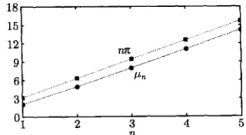

图 6.14  $ \sin\frac{n\pi}{L}x $ 中的  $ n\pi $ 与  $ \sin\frac{\mu_{n}}{L}x $ 中的  $ \mu_{n} $ 相比较，后者来自式 (6.4.29)
 

计算出展开系数

$$  C_{1}=0.2133,\quad C_{2}=0.1040,\quad C_{3}=-0.0220,\quad C_{4}=0.0187,\quad C_{5}=-0.0083   \tag*{(6.4.31)}$$

现在利用部分和表示初始温度分布

$$  x(1-x)\approx\sum_{n=1}^{5}C_{n}\sin\mu_{n}x   \tag*{(6.4.32)}$$

图 6.15 显示了二者的比较，在 x = L 处有明显的拟合偏差，这是部分和的近似性造成的。进而利用部分和表示一般解

$$  u(x,t)\approx\sum_{n=1}^{5}C_{n}\sin\mu_{n}x\exp(-\mu_{n}^{2}t)   \tag*{(6.4.33)}$$

图 6.16 显示了系统不同时刻的温度分布：由最初的对称性分布，逐渐塌缩，在  $ t \to 1 $ 时，趋于稳态值  $ u(x,1) \to 0 $。

最后我们用部分和表示系统的平均温度

$$  U(t)\approx\sum_{n=1}^{5}C_{n}\frac{1-\cos\mu_{n}}{\mu_{n}}\mathrm{e}^{-\mu_{n}^{2}t}   \tag*{(6.4.34)}$$

图 6.17 显示平均温度的时间演化，可以看出，当 t = 1 时，系统已经趋于稳态值： $ U(1) \to 0 $。

<!-- page: 181 -->

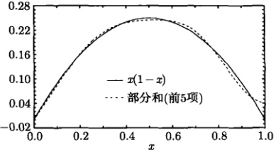

图 6.15 式 (6.4.32) 两边的比较
 

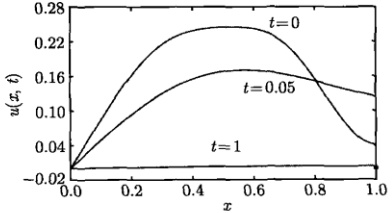

图 6.16 不同时刻的温度分布，来自式（6.4.33）
 

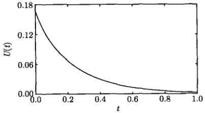

图 6.17 平均温度的时间演化，来自式 (6.4.34)
 

下面我们将定解问题 (6.4.8) 中 x=0 端的边界条件改成第二类，求解相应的定解问题，即

$$  \left\{\begin{array}{l l}{\displaystyle\frac{\partial u}{\partial t}=a^{2}\frac{\partial^{2}u}{\partial x^{2}}}&{\qquad\quad(0<x<L,\;t>0)}\end{array}\right.   \tag*{(6.4.35a)}$$

$$  \left\{\begin{array}{r}u|_{t=0}=\phi(x)\quad(0\leqslant x\leqslant L)\end{array}\right.   \tag*{(6.4.35b)}$$

$$  \left\{\begin{array}{l}\left.\frac{\partial u}{\partial x}\right|_{x=0}=0,\quad\left[u+h\frac{\partial u}{\partial x}\right]_{x=L}=0\quad(t>0)\end{array}\right.   \tag*{(6.4.35c)}$$

现在有界杆的两个端点 x=0 和 x=L 的边界条件分别为第二类、第三类，但都是齐次的，符合分离变量法的使用条件。式 (6.4.35c) 所示的边界条件意味着，x=0

<!-- page: 182 -->

端保持绝热，而后端 x = L 辐射热量，辐射强度与该端的温度成正比。

设泛定方程 (6.4.35a) 有变量分离的形式解  $ u(x,t)=X(x)T(t) $，其中  $ X(x) $ 构成本征值问题

$$  \int X^{\prime\prime}(x)+\lambda X(x)=0   \tag*{(6.4.36a)}$$

$$  \left\{\begin{array}{l}X^{\prime}(0)=0,\quad X(L)+h X^{\prime}(L)=0\end{array}\right.   \tag*{(6.4.36b)}$$

而  $ T(t) $ 满足方程

$$  T^{\prime}(t)+\lambda a^{2}T(t)=0   \tag*{(6.4.37)}$$

容易证明当  $ \lambda \leqslant 0 $ 时，只有平庸解。当  $ \lambda > 0 $ 时，方程 (6.4.36a) 有非零解

$$  X(x)=A\cos kx+B\sin kx   \tag*{(6.4.38)}$$

其中， $ k = \sqrt{\lambda} $。边界条件 (6.4.36b) 导致

$$  \cos k L-h k\sin k L=0   \tag*{(6.4.39)}$$

这是本征值所满足的超越方程，它可以写为

$$  \cot\mu=\alpha\mu   \tag*{(6.4.40)}$$

其中， $ \mu $ 和  $ \alpha $ 的定义与式 (6.4.15) 相同。我们作出曲线  $ y = \cot \mu $ 和  $ y = \alpha \mu $，如图 6.18 所示，二者交点的横坐标就是超越方程 (6.4.40) 的解。

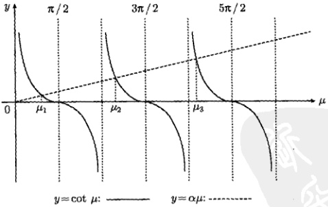

图 6.18 超越方程（6.4.40）的曲线解
 

故本征值和本征函数为

$$  \lambda_{n}=\frac{\mu_{n}^{2}}{L^{2}},\quad X_{n}(x)=A_{n}\cos\frac{\mu_{n}}{L}x\quad(n=1,2,3,\cdots)   \tag*{(6.4.41)}$$

<!-- page: 183 -->

将  $ \lambda_{n} $ 代入时间函数 T(t) 的方程 (6.4.37)，按照定解问题 (6.4.8) 的求解过程，最终得到一般解

$$  u(x,t)=\sum_{n=1}^{\infty}C_{n}\exp\left[-\left(\frac{\mu_{n}a}{L}\right)^{2}t\right]\cos\frac{\mu_{n}}{L}x   \tag*{(6.4.42)}$$

初始条件为

$$  \phi(x)=\sum_{n=1}^{\infty}C_{n}\cos\frac{\mu_{n}}{L}x   \tag*{(6.4.43)}$$

式(6.4.43)两边同乘以  $ \cos\frac{\mu_{m}x}{I_{r}}\left(m=1,2,3,\cdots\right) $，然后积分，并利用

$$  \int_{0}^{L}\cos\frac{\mu_{m}x}{L}\cos\frac{\mu_{n}x}{L}\mathrm{d}x=\frac{L}{2}\left(1+\frac{\sin2\mu_{n}}{2\mu_{n}}\right)\delta_{mn}   \tag*{(6.4.44)}$$

得到

$$  C_{n}=\frac{2}{L\left(1+\frac{\sin2\mu_{n}}{2\mu_{n}}\right)}\int_{0}^{L}\phi(x)\cos\frac{\mu_{n}}{L}x\mathrm{d}x   \tag*{(6.4.45)}$$

式(6.4.42)就是定解问题(6.4.35)的一般解，其中 $ \mu_{n} $是超越方程(6.4.40)的解，而展开系数 $ C_{n} $由式(6.4.45)确定。

关于正交性表达式(6.4.44)的证明，也有类似的两种方法，方法一是直接计算积分

 $$ \begin{aligned}&\int_{0}^{L}\cos\frac{\mu_{m}x}{L}\cos\frac{\mu_{n}x}{L}\mathrm{d}x\\=&\frac{1}{2}\int\limits_{0}^{L}\left[\cos\frac{\left(\mu_{m}+\mu_{n}\right)x}{L}+\cos\frac{\left(\mu_{m}-\mu_{n}\right)x}{L}\right]\mathrm{d}x\\=&\frac{L}{\mu_{m}^{2}-\mu_{n}^{2}}\left(\mu_{m}\sin\mu_{m}\cos\mu_{n}-\mu_{n}\cos\mu_{m}\sin\mu_{n}\right)\\&\quad\text{( 利用 }\cot\mu_{n}=\alpha\mu_{n}\text{)}\\=&\frac{L}{\mu_{m}^{2}-\mu_{n}^{2}}\left[\mu_{m}\sin\mu_{m}\sin\mu_{n}\left(\alpha\mu_{n}\right)-\mu_{n}\sin\mu_{m}\left(\alpha\mu_{m}\right)\sin\mu_{n}\right]\\=&0\quad(m\neq n)\end{aligned} $$ 

当 m=n 时

$$  \int_{0}^{L}\cos\frac{\mu_{m}x}{L}\cos\frac{\mu_{n}x}{L}\mathrm{d}x=\int_{0}^{L}\cos^{2}\frac{\mu_{n}x}{L}\mathrm{d}x=\frac{L}{2}\left(1+\frac{\sin2\mu_{n}}{2\mu_{n}}\right)   \tag*{(6.4.46)}$$

于是式(6.4.44)得证。

<!-- page: 184 -->

方法二是将边界条件（6.4.36b）代入式（6.4.7）计算 Q 因子，得到

 $$ \begin{aligned}Q&=[\boldsymbol{X}_{n}(0)\boldsymbol{X}_{m}^{\prime}(0)-\boldsymbol{X}_{m}(0)\boldsymbol{X}_{n}^{\prime}(0)]-[\boldsymbol{X}_{n}(L)\boldsymbol{X}_{m}^{\prime}(L)-\boldsymbol{X}_{m}(L)\boldsymbol{X}_{n}^{\prime}(L)]\\&=-\left[\boldsymbol{X}_{n}(L)\frac{\boldsymbol{X}_{m}(L)}{-h}-\boldsymbol{X}_{m}(L)\frac{\boldsymbol{X}_{n}(L)}{-h}\right]=0\end{aligned} $$ 

最后，系统的平均温度为

 $$ \begin{aligned}U(t)&=\frac{1}{L}\sum_{n=1}^{\infty}C_{n}\exp\left[-\left(\frac{\mu_{n} a}{\bar{L}}\right)^{2}t\right]\int_{0}^{L}\cos\frac{\mu_{n}}{\bar{L}}x\mathrm{d}s\\&=\sum_{n=1}^{\infty}C_{n}\frac{\sin\mu_{n}}{\mu_{n}}\exp\left[-\left(\frac{\mu_{n} a}{\bar{L}}\right)^{2}t\right]\end{aligned} $$ 

例2 对于上述有界杆热传导的定解问题，设 L=1, a=1, h=1，系统的初始温度分布为  $ \phi(x)=x(1-x) $。用数值方法计算出前5个  $ \mu_{n} $ 值；由此讨论该定解问题的数值解。

解 现在超越方程为  $ \cot\mu=\mu $，用数值计算得到前 5 个  $ \mu_{n} $ 值

$$  \mu_{1}=0.860,\quad\mu_{2}=3.426,\quad\mu_{3}=6.437,\quad\mu_{4}=9.529,\quad\mu_{5}=12.645   \tag*{(6.4.47)}$$

为了比较  $ \left\{\cos\frac{\mu_{n}}{L}x\right\} $ 与  $ \left\{\cos\frac{n\pi}{L}x\right\} $，我们作出  $ \mu_{n} $ 与  $ n\pi $ 随 n 的变化曲线，如图 6.19 所示。与本节例 1 的情况相比， $ \mu_{n} $ 的取值较小，但仍然是近线性变化的，所以构成的级数与傅里叶级数非常接近。进而我们利用

$$  C_{n}=\frac{2}{1+\frac{\sin2\mu_{n}}{2\mu_{n}}}\int_{0}^{1}x(1-x)\cos\mu_{n}x\mathrm{d}x   \tag*{(6.4.48)}$$

计算出展开系数

$$  C_{1}=0.189,\quad C_{2}=-0.032,\quad C_{3}=-0.091,\quad C_{4}=-0.001,\quad C_{5}=-0.025   \tag*{(6.4.49)}$$

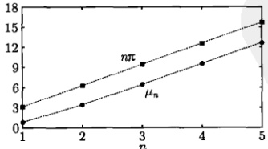

图 6.19  $ \cos\frac{n\pi}{L}x $ 中的  $ n\pi $ 与  $ \cos\frac{\mu_n}{L}x $ 中的  $ \mu_n $ 相比较，后者来自式 (6.4.47)
 

<!-- page: 185 -->

现在利用部分和表示初始温度分布

$$  x(1-x)\approx\sum_{n=1}^{5}C_{n}\cos\mu_{n}x   \tag*{(6.4.50)}$$

图 6.20 显示了二者的比较，在 x=0 和 x=L 处均有明显的拟合偏差。进而利用部分和表示一般解

$$  u(x,t)\approx\sum_{n=1}^{5}C_{n}\cos\mu_{n}x\exp(-\mu_{n}^{2}t)   \tag*{(6.4.51)}$$

图 6.21 显示了不同时刻的温度分布，由最初的对称性分布逐渐塌缩，但是与图 6.16 的情况相比，塌缩比较缓慢，当 t=1 时，仍有明显的分布曲线。

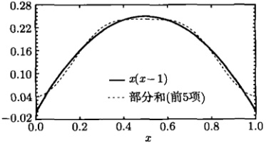

图 6.20 式 (6.4.50) 两边的比较
 

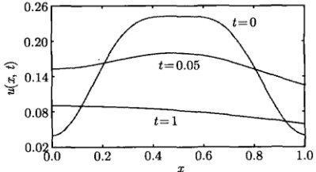

图 6.21 不同时刻的温度分布，来自式（6.4.51）
 

最后我们用部分和表示平均温度

$$  U(t)\approx\sum_{n=1}^{5}C_{n}\frac{\sin\mu_{n}}{\mu_{n}}\mathrm{e}^{-\mu_{n}^{2}t}   \tag*{(6.4.52)}$$

图6.22 显示了系统平均温度的时间演化。可以看出，当 t=5 时，温度趋于稳态值  $ U(5) \rightarrow 0 $。这个结果与例2的情况是不同的，在那里系统的前端被保持在零度，实际上是散失热量的，所以当 t=1 时，系统已经趋于稳态（图6.16）。但是现在系统的前端是绝热的，没有热量从前端散失，因此在较长时间后才趋于稳态。

<!-- page: 186 -->

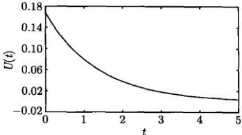

图 6.22 系统平均温度的时间演化，来自式（6.4.52）
 

上述两种热传导情况的共同点是后端的边界条件相同，这决定了系统都是散失热量的，因此在  $ t \to \infty $ 时，平均温度  $ U(\infty) \to 0 $。这类问题可以称为热辐射问题。随后我们将讨论热吸收问题，它是由另类边界条件引起的。

本节的讨论显示，本征方程  $ X''(x) + \lambda X(x) = 0 $ 除了有表 6.2 的本征函数之外还有

$$  \sin\frac{\mu_{n}}{L}x\quad(n=1,2,3,\cdots)   \tag*{(6.4.53)}$$

其中， $ \mu_{n} $ 是超越方程  $ \tan\mu = -\alpha\mu $ 的第 n 个正根，以及

$$  \cos\frac{\mu_{n}}{L}x\quad(n=1,\;2,\;3,\cdots)   \tag*{(6.4.54)}$$

其中， $ \mu_{n} $ 是超越方程  $ \cot\mu = \alpha\mu $ 的第 n 个正根。

这两套本征函数集不是构成傅里叶级数的普通三角函数，但它们之间是正交的，而且与后者非常接近，因此可以利用它们将定义在区间 $ (0,L) $上的一个函数展开。第7章我们将对该本征方程引入更多本征函数集。

