# 07-第7章 分离变量法的应用

[返回全书目录](../../README.md)

> PDF 页码：187–235

<!-- page: 187 -->

### 第7章 分离变量法的应用

第6章用分离变量法所讨论的定解问题具有两个特点：①只有当分离常数 $ \lambda>0 $时才有非零解；②相应的本征函数 $ X(x) $只包含正弦函数或余弦函数一项。作为分离变量法的应用，本章将讨论较为复杂的定解问题。我们将会看到，对于某些边界条件，分离常数取正值和负值时都有非零解，另外本征函数也将涉及正弦函数和余弦函数的组合，以及别的函数形式。而关于热传导定解问题，除6.4.2节的热辐射之外，我们还将讨论热吸收的情况，以及对称边界条件与反对称边界条件下的综合问题。另外我们还将讨论拉普拉斯方程的定解问题。

### 7.1 热吸收定解问题

在 6.4.2 节所讨论的热传定解问题式 (6.4.8) 和式 (6.4.35) 中，我们取  $ h > 0 $，这表示 x = L 端是辐射热量的。事实上，在物理上还存在后端吸收热量的情况，它相应于 h < 0。这样的定解问题不能简单地将上述问题中的 h 换成 -h 而得到结论，因为边界条件不同，必须重新求解。作为分离变量法的进一步应用，本节将求解热吸收定解问题，并对本征方程  $ X''(x) + \lambda X(x) = 0 $ 引出新的本征函数集。

#### 7.1.1 吸收-耗散系统

考虑下面热传导的定解问题

$$  \left\{\begin{array}{l}\displaystyle\frac{\partial u}{\partial t}=a^{2}\frac{\partial^{2}u}{\partial x^{2}}\end{array}\right.\qquad(0<x<L,t>0)   \tag*{(7.1.1a)}$$

$$  (0\leq x\leq L)   \tag*{(7.1.1b)}$$

$$  \left\{\begin{array}{c}u\mid_{x=0}=0\ ,\left[u-\eta\frac{\partial u}{\partial x}\right]_{x=L}=0\quad(t>0)\end{array}\right.   \tag*{(7.1.1c)}$$

其中， $ \eta>0 $。式中的边界条件意味着x=0保持为零度，而x=L端吸收热量，吸收能力与端点的温度成正比。

设泛定方程（7.1.1a）有变量分离的形式解

 $$ u(x,t)=X(x)T(t), $$ 

其中， $ X(x) $ 构成本征值问题

<!-- page: 188 -->

$$  X^{\prime \prime}(x)+\lambda X(x)=0   \tag*{(7.1.2a)}$$

$$  X(0)=0,\quad X(L)-\eta X^{\prime}(L)=0   \tag*{(7.1.2b)}$$

而  $ T(t) $ 满足方程

$$  T^{\prime}(t)+\lambda a^{2}T(t)=0   \tag*{(7.1.3)}$$

其中， $ \lambda $ 是分离常数。

首先求解空间函数  $ X(x) $ 的本征值问题。按三种情况讨论。

(1) $ \lambda=0 $时，只有平庸解A=0，B=0。

(2) $ \lambda<0 $时，方程(7.1.2a)的通解为

$$  X(x)=A\cosh kx+B\sinh kx   \tag*{(7.1.4a)}$$

其中， $ k = \sqrt{-\lambda} $，它的导数为

$$  X^{\prime}(x)=k A\sinh k x+kB\cosh k x   \tag*{(7.1.4b)}$$

由边界条件  $ X(0)=0 $ 得到 A=0，因此

$$  X(x)=B\sinh k x,\quad X^{\prime}(x)=kB\cosh k x   \tag*{(7.1.5)}$$

由边界条件  $ X(L)-\eta X'(L)=0 $ 和  $ B\neq0 $ 得到

 $$ \sinh k L-\eta k\cosh k L=0 $$ 

它可以写成

$$  \tanh\mu=\beta\mu   \tag*{(7.1.7)}$$

其中

$$  \mu=kL,\quad\beta=\eta/L   \tag*{(7.1.8)}$$

超越方程(7.1.7)在 $ \beta<1 $条件下有一个非零解(图7.1)，记为 $ \mu_{0} $，则相应的本征值与本征函数为

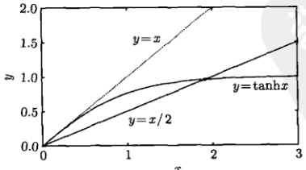

图 7.1 超越方程  $ \tanh x = \beta x $ 在  $ \beta = 1 $ 时有一个零解，在  $ \beta < 1 $ 时有一个非零解。例如，当  $ \beta = 1/2 $ 时，非零解为 x = 1.9130
 

<!-- page: 189 -->

$$  \lambda_{0}=-\frac{\mu_{0}^{2}}{L^{2}},\quad X_{0}(x)=B_{0}\sinh\frac{\mu_{0}}{L}x   \tag*{(7.1.9)}$$

对于相应的时间函数，由方程（7.1.3）得到

$$  T_{0}^{\prime}(t)-\left(\frac{\mu_{0}a}{L}\right)^{2}T_{0}(t)=0\Rightarrow T_{0}(t)=C_{0}\exp\left[\left(\frac{\mu_{0}a}{L}\right)^{2}t\right]   \tag*{(7.1.10)}$$

函数  $ T_{0}(t) $ 随时间按指数增加。这样， $ \lambda<0 $ 情况下的本征解为

$$  u_{0}(x,t)=c_{0}\exp\left[\left(\frac{\mu_{0}a}{L}\right)^{2}t\right]\sinh\frac{\mu_{0}}{L}x   \tag*{(7.1.11)}$$

其中， $ c_{0}=C_{0}B_{0} $。我们看到，对于现在的边界条件，在 $ \lambda $为负值的情况下也存在非零的本征解。

(3) $ \lambda>0 $时，方程(7.1.2a)的通解为

$$  X(x)=A\cos kx+B\sin kx   \tag*{(7.1.12a)}$$

其中， $ k = \sqrt{\lambda} $，它的导数为

$$  X^{\prime}(x)=-k A\sin k x+k B\cos k x   \tag*{(7.1.12b)}$$

由边界条件  $ X(0)=0 $ 得到 A=0，因此

$$  X(x)=B\sin k x,\quad X^{\prime}(x)=kB\cos k x   \tag*{(7.1.13)}$$

由边界条件  $ X(L)-\eta X'(L)=0 $ 和  $ B\neq0 $ 得到

$$  \sin k L-\eta k\cos k L=0   \tag*{(7.1.14)}$$

即

$$  \tan\mu=\beta\mu   \tag*{(7.1.15)}$$

其中， $ \mu $ 和  $ \beta $ 的定义与式(7.1.8)相同。超越方程(7.1.15)的解显示在图7.2，当 $ \beta\leq1 $ 时，第一个非零解 $ \mu_{1} $ 处于 $ \pi<\mu_{1}<3\pi/2 $ 范围；当 $ \beta>1 $ 时，则在 $ 0<\mu_{1}<\pi/2 $ 范围，如图7.3所示。由此，本征值和本征函数为

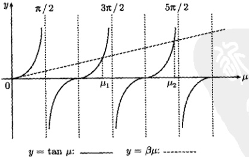

图 7.2 超越方程  $ \tan\mu=\beta\mu $ 的非零解  $ (\beta\leq1) $
 

<!-- page: 190 -->

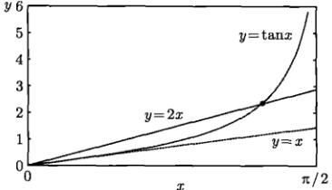 1) $ 的第一个非零解 $ x_{1} (0" width="38%" />

图 7.3 超越方程  $ \tan x = \beta x (\beta > 1) $ 的第一个非零解  $ x_{1} (0 < x_{1} < \pi/2) $
 

$$  \lambda_{n}=\frac{\mu_{n}^{2}}{L^{2}},\quad X_{n}(x)=B_{n}\sin\frac{\mu_{n}}{L}x\quad(n=1,2,3,\cdots)   \tag*{(7.1.16)}$$

对于相应的时间函数，由方程（7.1.3）得到

$$  T_{n}^{\prime}(t)+\left(\frac{\mu_{n}a}{L}\right)^{2}T_{n}(t)=0\Rightarrow T_{n}(t)=C_{n}\exp\left[-\left(\frac{\mu_{n}a}{L}\right)^{2}t\right]   \tag*{(7.1.17)}$$

因此本征解为

$$  u_{n}(x,t)=c_{n}\exp\left[-\left(\frac{\mu_{n}a}{L}\right)^{2}t\right]\sin\frac{\mu_{n}}{L}x\quad(n=1,2,3,\cdots)   \tag*{(7.1.18)}$$

其中， $ c_{n}=C_{n}b_{n} $。现在我们将  $ \lambda<0 $ 时的本征解 (7.1.11) 与  $ \lambda>0 $ 的本征解 (7.1.18) 叠加起来得到一般解

$$  u(x,t)=c_{0}\exp\left[\left(\frac{\mu_{0}a}{L}\right)^{2}t\right]\sinh\frac{\mu_{0}}{L}x+\sum_{n=1}^{\infty}c_{n}\exp\left[-\left(\frac{\mu_{n}a}{L}\right)^{2}t\right]\sin\frac{\mu_{n}}{L}x   \tag*{(7.1.19)}$$

下面利用初始条件（7.1.1b）确定式（7.1.19）中的系数  $ c_{0} $ 和  $ c_{n} $，我们有

$$  \phi(x)=c_{0}\sinh\frac{\mu_{0}}{L}x+\sum_{n=1}^{\infty}c_{n}\sin\frac{\mu_{n}}{L}x   \tag*{(7.1.20)}$$

为求  $ c_{0} $ 和  $ c_{n} $，必须首先考查本征函数  $ X_{0}, X_{1}, X_{2}, \cdots $ 在区间  $ (0, L) $ 上的正交性，首先计算

 $$ \begin{aligned}&\int_{0}^{L}X_{0}(x)X_{n}(x)\mathrm{d}x=\int_{0}^{L}\sinh\frac{\mu_{0}}{L}x\sin\frac{\mu_{n}}{L}x\mathrm{d}x\\=&\frac{L^{2}}{\mu_{0}^{2}+\mu_{n}^{2}}\left[\frac{\mu_{0}}{L}\cosh\frac{\mu_{0}}{L}x\sin\frac{\mu_{n}}{L}x-\frac{\mu_{n}}{L}\sinh\frac{\mu_{0}}{L}x\cos\frac{\mu_{n}}{L}x\right]_{0}^{L}\\=&\frac{L^{2}}{\mu_{0}^{2}+\mu_{n}^{2}}\left(\frac{\mu_{0}}{L}\cosh\mu_{0}\sin\mu_{n}-\frac{\mu_{n}}{L}\sinh\mu_{0}\cos\mu_{n}\right)\\&\left( 利用 \tanh\mu_{0}=\beta\mu_{0},\quad\tan\mu_{n}=\beta\mu_{n}\right)\\=&\frac{L^{2}}{\mu_{0}^{2}+\mu_{n}^{2}}\left[\frac{\mu_{0}}{L}\cosh\mu_{0}\left(\beta\mu_{n}\cos\mu_{n}\right)-\frac{\mu_{n}}{L}\left(\beta\mu_{0}\cosh\mu_{0}\right)\cos\mu_{n}\right]\\=&0\end{aligned} $$

<!-- page: 191 -->

可见  $ X_{0} $ 与  $ X_{n}(n=1,2,3,\cdots) $ 是正交的。另外  $ X_{n}(n=1,2,3,\cdots) $ 中任意两个是正交的，事实上，按照证明式(6.4.24)的方法一，同样可以得到

$$  \int_{0}^{L}\sin\frac{\mu_{m}x}{L}\sin\frac{\mu_{n}x}{L}\mathrm{d}x=\frac{L}{2}\left(1-\frac{\sin2\mu_{n}}{2\mu_{n}}\right)\delta_{mn}   \tag*{(7.1.21)}$$

其中， $ \mu_{n} $ 是超越方程  $ \tan\mu=\beta\mu $ 的解 [式(7.1.15)]。综合上述证明： $ X_{0}, X_{1}, X_{2},\cdots $ 中任意两个是相互正交的。证明正交性的另一个方法是将边界条件 (7.1.2b) 代入式 (6.4.7) 计算 Q 因子，我们有

 $$ \begin{aligned}Q&=[X_{n}(0)X_{m}^{\prime}(0)-X_{m}(0)X_{n}^{\prime}(0)]-[X_{n}(L)X_{m}^{\prime}(L)-X_{m}(L)X_{n}^{\prime}(L)]\\&=-\left[X_{n}(L)\frac{X_{m}(L)}{\eta}-X_{m}(L)\frac{X_{n}(L)}{\eta}\right]=0\end{aligned} $$ 

我们还需要模值

$$  \int_{0}^{L}X_{0}(x)X_{0}(x)\mathrm{d}x=\int_{0}^{L}\sinh^{2}\frac{\mu_{0}}{L}x\mathrm{d}x=\frac{L}{2}\left(\frac{\sinh2\mu_{0}}{2\mu_{0}}-1\right)   \tag*{(7.1.22)}$$

至此我们已经完全证明了本征函数  $ X_{0}, X_{1}, X_{2}, \cdots $ 的正交性，并计算出了相应的模值。现在可以计算式 (7.1.20) 中的系数  $ c_{0} $ 和  $ c_{n} $，为此首先给式 (7.1.20) 两边同乘以  $ \sinh \frac{\mu_{0}}{L} x $ 并积分，我们有

 $$ \begin{aligned}\int_{0}^{L}\phi(x)\sinh\frac{\mu_{0}}{L}x\mathrm{d}x&=\int_{0}^{L}\sinh\frac{\mu_{0}}{L}x\left[c_{0}\sinh\frac{\mu_{0}}{L}x+\sum_{n=1}^{\infty}c_{n}\sin\frac{\mu_{n}}{L}x\right]\mathrm{d}x\\&=c_{0}\int_{0}^{L}\sinh\frac{\mu_{0}}{L}x\sinh\frac{\mu_{0}}{L}x\mathrm{d}x+\sum_{n=1}^{\infty}c_{n}\underbrace{\int_{0}^{L}\sinh\frac{\mu_{0}}{L}x\sin\frac{\mu_{n}}{L}x\mathrm{d}x}_{=0}\\&=c_{0}\frac{L}{2}\left(\frac{\sinh2\mu_{0}}{2\mu_{0}}-1\right)\\ \end{aligned} $$ 

故

$$  c_{0}=\frac{2}{L\left(\frac{\sinh2\mu_{0}}{2\mu_{0}}-1\right)}\int_{0}^{L}\phi(x)\sinh\frac{\mu_{0}}{L}x\mathrm{d}x   \tag*{(7.1.23a)}$$

另外，式(7.1.20)两边同乘以 $ X_{m}(x)=\sin\frac{\mu_{m}}{L}x(m=1,2,3,\cdots) $并积分，我们有

 $$ \begin{aligned}\int_{0}^{L}\phi(x)X_{m}(x)\mathrm{d}x&=\int_{0}^{L}\left[c_{0}\sinh\frac{\mu_{0}}{L}x+\sum_{n=1}^{\infty}c_{n}X_{n}(x)\right]X_{m}(x)\mathrm{d}x\\&=c_{0}\underbrace{\int_{0}^{L}\sinh\frac{\mu_{0}}{L}x\sin\frac{\mu_{m}}{L}x\mathrm{d}x}_{}+\sum_{n=1}^{\infty}c_{n}\int_{0}^{L}X_{n}(x)X_{m}(x)\mathrm{d}x\end{aligned} $$

<!-- page: 192 -->

$$ \begin{aligned}&=\sum_{n=1}^{\infty}c_{n}\int_{0}^{L}X_{n}(x)X_{m}(x)\mathrm{d}x=\sum_{n=1}^{\infty}c_{n}\frac{L}{2}\left(1-\frac{\sin2\mu_{n}}{2\mu_{n}}\right)\delta_{mn}\\&=c_{m}\frac{L}{2}\left(1-\frac{\sin2\mu_{m}}{2\mu_{m}}\right)\\ \end{aligned} $$ 

即

$$  c_{n}=\frac{2}{L\left(1-\frac{\sin2\mu_{n}}{2\mu_{n}}\right)}\int_{0}^{L}\phi(x)\sin\frac{\mu_{n}}{L}x\mathrm{d}x\quad(n=1,2,3,\cdots)   \tag*{(7.1.23b)}$$

式（7.1.19）就是定解问题（7.1.1）的解，其中展开系数由式（7.1.23）确定。最后由式（7.1.19）得到系统的平均温度

 $$ \begin{aligned}U(t)&=\frac{1}{L}\int_{0}^{L}u(x,t)\mathrm{d}x\\&=\frac{1}{L}\left[c_{0}\exp\left(\frac{\mu_{0}^{2}a^{2}}{L^{2}}t\right)\int_{0}^{L}\sinh\frac{\mu_{0}}{L}x\mathrm{d}x+\sum_{n=1}^{\infty}c_{n}\exp\left(-\frac{\mu_{n}^{2}a^{2}}{L^{2}}t\right)\int_{0}^{L}\sin\frac{\mu_{n}}{L}x\mathrm{d}x\right]\\&=c_{0}\frac{\cosh\mu_{0}-1}{\mu_{0}}\exp\left(\frac{\mu_{0}^{2}a^{2}}{L^{2}}t\right)+\sum_{n=1}^{\infty}c_{n}\frac{1-\cos\mu_{n}}{\mu_{n}}\exp\left(-\frac{\mu_{n}^{2}a^{2}}{L^{2}}t\right)\\ \end{aligned} $$ 

通过求解这个定解问题，我们看到，除了表6.2、式(6.4.53)及式(6.4.54)的本征函数集之外，本征方程 $ X''(x)+\lambda X(x)=0 $还存在本征函数集

$$  \sinh\frac{\mu_{0}}{L}x,\quad\sin\frac{\mu_{n}}{L}x\quad(n=1,2,3,\cdots)   \tag*{(7.1.24)}$$

其中， $ \mu_{0} $ 是  $ \tanh\mu=\beta\mu $ 的解，而  $ \mu_{n} $ 是  $ \tan\mu=\beta\mu $ 的第 n 个正根。利用它们可以将一个定义在区间  $ (0,L) $ 上的函数展开，式 (7.1.24) 所示的本征函数集的确是很有趣的。

例 1 对于上面讨论的有界杆热传导的定解问题，设 L=1, a=1,  $ \eta=1/2 $，系统的初始温度分布为  $ \phi(x)=x(1-x) $。用数值方法计算出  $ \mu_{0} $ 和  $ \mu_{n}(n=1,\cdots,5) $ 值，由此讨论该定解问题的数值解。

解 对于给定的条件，有  $ \beta=\eta/L=1/2 $，故  $ \mu_{0} $ 所满足的超越方程 (7.1.15) 变为  $ \tanh\mu_{0}=\mu_{0}/2 $，由图 7.1 得到

$$  \mu_{0}=1.9130   \tag*{(7.1.25a)}$$

另一方面， $ \mu_{n} $ 满足  $ \tan\mu_{n}=\mu_{n}/2 $，用数值计算得到前5个 $ \mu_{n} $值

$$  \mu_{1}=4.2748,\quad\mu_{2}=7.5965,\quad\mu_{3}=10.8127,\quad\mu_{4}=13.9952,\quad\mu_{5}=17.1628   \tag*{(7.1.25b)}$$

展开系数式（7.1.23）给出

<!-- page: 193 -->

$$  c_{0}=\frac{2}{\underbrace{\sinh2\mu_{0}}_{2\mu_{0}}-1}\int_{0}^{1}x(1-x)\sinh\mu_{0}x\mathrm{d}x   \tag*{(7.1.26a)}$$

$$  c_{n}=\frac{2}{1-\frac{\sin2\mu_{n}}{2\mu_{n}}}\int_{0}^{1}x(1-x)\sin\mu_{n}x\mathrm{d}x\quad(n=1,2,3,\cdots)   \tag*{(7.1.26b)}$$

将式（7.1.25）的数值代入式（7.1.26），算出

$$  c_{0}=0.081   \tag*{(7.1.27a)}$$

$$  c_{1}=0.189,\quad c_{2}=-0.028,\quad c_{3}=0.021,\quad c_{4}=-0.009,\quad c_{5}=0.008   \tag*{(7.1.27b)}$$

可以看出， $ \left|c_{n}\right| $ 随着 n 的增大而减小，这是一个相当普遍的情况，正如式 (6.4.31) 所示。

这样初始温度用部分和近似表示为

$$  x(1-x)\approx c_{0}\sinh\mu_{0}x+\sum_{n=1}^{5}c_{n}\sin\mu_{n}x   \tag*{(7.1.28)}$$

图 7.4 显示了初始温度分布  $ \phi(x)=x(1-x) $ 与部分和的比较。在端点 x=1 有明显的拟合偏差，这是部分和的不精确性造成的。利用部分和，任意时刻 t 的温度分布和系统平均温度表示为

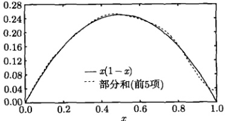

图 7.4 式(7.1.28)两边的比较
 

$$  u(x,t)\approx c_{0}\exp(\mu_{0}^{2}t)\sinh\mu_{0}x+\sum_{n=1}^{5}c_{n}\exp(-\mu_{n}^{2}t)\sin\mu_{n}x   \tag*{(7.1.29a)}$$

和

$$  U(t)\approx c_{0}\frac{\cosh\mu_{0}-1}{\mu_{0}}\exp(\mu_{0}^{2}t)+\sum_{n=1}^{5}c_{n}\frac{1-\cos\mu_{n}}{\mu_{n}}\exp(-\mu_{n}^{2}t)   \tag*{(7.1.29b)}$$

式（7.1.29a）的曲线对于不同的时间 t 被显示在图 7.5。可以看出，温度分布由初始的有峰分布逐渐演化成随空间 x 单调升高的分布。为了比较式（7.1.29a）中第一项与求和部分对温度的贡献，我们分别做出

<!-- page: 194 -->

$$  u_{1}(x,t)=c_{0}\exp(\mu_{0}^{2}t)\sinh\mu_{0}x   \tag*{(7.1.30a)}$$

$$  u_{2}(x,t)=\sum_{n=1}^{5}c_{n}\exp(-\mu_{n}^{2}t)\sin\mu_{n}x   \tag*{(7.1.30b)}$$

的曲线，如图 7.6 所示。可以看出，在 $t$ 较小时，$u_2(x,t)$ 对温度的贡献起主要作用；但随着 $t$ 的增加，$u_1(x,t)$ 的作用越来越大，这是由于式 (7.1.30a) 中指数因子 $\exp(\mu_0^2 t)$ 的作用。当 $t \to \infty$ 时，$u_2 \to 0$，系统的温度分布完全由 $u_1$ 确定，成为 $\sinh \mu_0 x$ 的函数形式。

系统后端温度以及系统平均温度随时间  $ t $ 的变化显示在图 7.7。随着  $ t $ 的增加，后端温度持续升高，这是由边界条件 (7.1.1c) 所决定的：系统吸收的热量与后端温度成正比。但在后端吸收热量的同时，系统固有的耗散作用 [表现为式 (7.1.29) 中的  $ \exp(-\mu_n^2t) $ 因子] 导致热量的散失。所以在  $ t $ 较小时，后端温度的升高比较缓慢，系统的平均温度甚至降低。这个过程中既有后端的吸收热量，也有系统固有的散失热量，因此是一个吸收-耗散过程。随着  $ t $ 的增加，热吸收作用变得越来越强，即式 (7.1.29) 中的  $ \exp(\mu_0^2t) $ 因子越来越大，而  $ \exp(-\mu_n^2t) $ 因子越来越小，所以在  $ t $ 较大时，系统温度按指数规律升高。

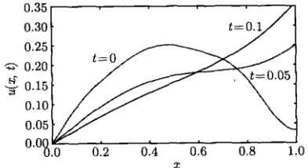

图 7.5 系统在不同时刻的温度分布，来自式（7.1.29a）
 

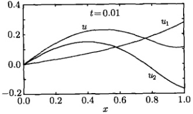

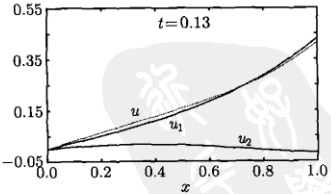

图 7.6 式 (7.1.30) 中  $ u_{1}(x,t) $ 和  $ u_{2}(x,t) $ 的比较
 

最后需要说明，按照给定的初始温度分布，在初始 t = 0 时刻，后端的温度应该为零，但图 7.7 所示的  $ u(1, t) $ 曲线不是这样的，这是因为部分和的近似性所致，如图 7.4 所示。下面的例题将把求和  $ u_2(x, t) $ 变成一个简单的函数，即给出一

<!-- page: 195 -->

个  $ u(x,t) $ 的“精确解”，这样将会消除部分和造成的误差。

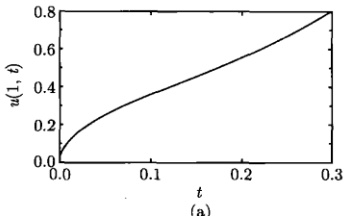

(a)
 

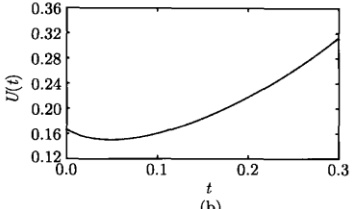

(b)
 

图 7.7 (a) 后端温度的时间演化, 来自式 (7.1.29a); (b) 平均温度的时间演化, 来自式 (7.1.29b)
 

例2 对于上例的有界杆热传导的定解问题，设 L=1, a=1,  $ \eta=1/2 $，系统的初始温度分布为  $ \sinh u_{0} $

$$  \phi(x)=\sinh\mu_{0}x-\frac{\sinh\mu_{0}}{\sin\mu_{1}}\sin\mu_{1}x   \tag*{(7.1.31)}$$

这里  $ \frac{\sinh\mu_{0}}{\sin\mu_{1}}=-3.66 $，求解该定解问题。

解 现在的初始温度分布如图 7.8 所示，它与例 1 类似。但它可以使一般解(7.1.19)约化为非常简单的形式，这是利用了本征函数的正交性。事实上展开系数为

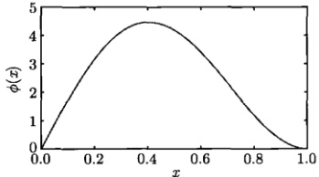

图 7.8 系统的初始温度分布式（7.1.31）
 

$$  c_{0}=\frac{2}{\underbrace{\sinh2\mu_{0}}_{2\mu_{0}}-1}\int_{0}^{1}\left(\sinh\mu_{0}x-\frac{\sinh\mu_{0}}{\sin\mu_{1}}\sin\mu_{1}x\right)\sinh\mu_{0}x\mathrm{d}x=1   \tag*{(7.1.32a)}$$

 $$ c_{n}=\frac{2}{1-\frac{\sin2\mu_{n}}{2\mu_{n}}}\int_{0}^{1}\left(\sinh\mu_{0}x-\frac{\sinh\mu_{0}}{\sin\mu_{1}}\sin\mu_{1}x\right)\sin\mu_{n}x\mathrm{d}x=-\frac{\sin\mu_{0}}{\sin\mu_{1}}\delta_{1n} $$ 

由此，一般解为

<!-- page: 196 -->

$$  u(x,t)=\exp(\mu_{0}^{2}t)\sinh\mu_{0}x-\frac{\sinh\mu_{0}}{\sin\mu_{1}}\exp(-\mu_{1}^{2}t)\sin\mu_{1}x   \tag*{(7.1.33)}$$

而平均温度为

$$  U(t)=\frac{\cosh\mu_{0}-1}{\mu_{0}}\exp(\mu_{0}^{2}t)-\frac{\sinh\mu_{0}\tan(\mu_{1}/2)}{\mu_{1}}\exp(-\mu_{1}^{2}t)   \tag*{(7.1.34)}$$

现在式(7.1.33)和式(7.1.34)不是求和形式，而是简单的初等函数。后端温度 $ u(1,t) $和平均温度随时间的演化如图7.9所示，它们的行为与图7.7类似，但是严格地有 $ u(1,0)=0 $。

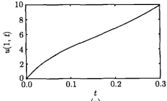

(a)
 

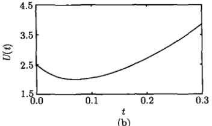

(b)
 

图 7.9 系统后端温度和平均温度的时间演化
 

#### 7.1.2 吸收-绝热系统

本节讨论一个吸收-绝热的热传导系统，即求解下面的定解问题

$$  \left\{\begin{array}{l l}{\displaystyle\frac{\partial u}{\partial t}=a^{2}\frac{\partial^{2}u}{\partial x^{2}}}&{\qquad\quad(0<x<L,\;t>0)}\end{array}\right.   \tag*{(7.1.35a)}$$

$$  (0\leq x\leq L)   \tag*{(7.1.35b)}$$

$$  \left\{\begin{array}{l}\left.\frac{\partial u}{\partial x}\right|_{x=0},\quad\left[u-\eta\frac{\partial u}{\partial x}\right]_{x=L}=0\quad(t>0)\end{array}\right.   \tag*{(7.1.35c)}$$

其中， $ \eta>0 $。

式中的边界条件意味着 x=0 端保持绝热，而后端 x=L 吸收热量，吸收能力与该端的温度成正比。物理上的预言是：系统的温度将随时间升高，特别在  $ t \to \infty $ 时， $ U(\infty) \to \infty $。

设泛定方程 (7.1.35a) 有变量分离的形式解  $ u(x,t)=X(x)T(t) $，其中  $ X(x) $ 构成本征值问题

$$  X^{\prime\prime}(x)+\lambda X(x)=0   \tag*{(7.1.36a)}$$

$$  \left\{\begin{array}{l}X^{\prime}(0)=0,\quad X(L)-\eta X^{\prime}(L)=0\end{array}\right.   \tag*{(7.1.36b)}$$

而  $ T(t) $ 满足方程

$$  T^{\prime}(t)+\lambda a^{2}T(t)=0   \tag*{(7.1.37)}$$

<!-- page: 197 -->

下面按三种情况讨论（讨论中将略去不重要的常数）。

(1) $ \lambda=0 $时，只有平庸解A=0,B=0。

(2) $ \lambda<0 $时，本征值问题(7.1.36)的解为

$$  \lambda_{0}=-\frac{\mu_{0}^{2}}{L^{2}},\quad X_{0}(x)=\cosh\frac{\mu_{0}}{L}x   \tag*{(7.1.38)}$$

其中， $ \mu_{0} $ 是超越方程

$$  \coth\mu=\beta\mu   \tag*{(7.1.39)}$$

的解，这里  $ \mu $ 与  $ \beta $ 的定义与式(7.1.8)相同。对于任何  $ \beta>0 $，方程(7.1.39)有一个非零解，如图7.10所示。相应的时间函数为

$$  T_{0}(t)=\exp\left[\left(\frac{\mu_{0}a}{L}\right)^{2}t\right]   \tag*{(7.1.40)}$$

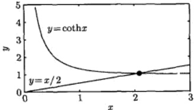

图 7.10 超越方程  $ \coth x = \beta x $ 在  $ \beta > 0 $ 时有一个非零解。当  $ \beta = 1/2 $ 时，非零解为 x = 2.0667

(3)  $ \lambda > 0 $ 时，本征值问题 (7.1.36) 的解为

$$  \lambda_{n}=\frac{\mu_{n}^{2}}{L^{2}},\quad X_{n}(x)=\cos\frac{\mu_{n}}{L}x\quad(n=1,2,3,\cdots)   \tag*{(7.1.41)}$$

其中， $ \mu_{n} $ 是超越方程

$$  \cot\mu=-\beta\mu   \tag*{(7.1.42)}$$

的解，如图 7.11 所示。相应的时间函数为

$$  T_{n}(t)=\exp\left[-\left(\frac{\mu_{0}a}{L}\right)^{2}t\right]   \tag*{(7.1.43)}$$

将  $ \lambda < 0 $ 与  $ \lambda > 0 $ 两种情况下的本征解叠加起来得到一般解

$$  u(x,t)=c_{0}\exp\left[\left(\frac{\mu_{0}a}{L}\right)^{2}t\right]\cosh\frac{\mu_{0}}{L}x+\sum_{n=1}^{\infty}c_{n}\exp\left[-\left(\frac{\mu_{n}a}{L}\right)^{2}t\right]\cos\frac{\mu_{n}}{L}x   \tag*{(7.1.44)}$$

<!-- page: 198 -->

初始温度分布为

$$  \phi(x)=c_{0}\cosh\frac{\mu_{0}}{L}x+\sum_{n=1}^{\infty}c_{n}\cos\frac{\mu_{n}}{L}x   \tag*{(7.1.45)}$$

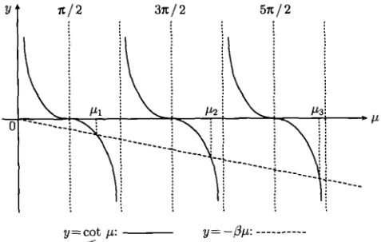

图 7.11 超越方程（7.1.42）的解
 

关于本征函数的正交性，利用边界条件式（7.1.36b）中，计算式（6.4.7）的 Q 因子

 $$ \begin{aligned}Q&=[\boldsymbol{X}_{n}(0)\boldsymbol{X}_{m}^{\prime}(0)-\boldsymbol{X}_{m}(0)\boldsymbol{X}_{n}^{\prime}(0)]-[\boldsymbol{X}_{n}(L)\boldsymbol{X}_{m}^{\prime}(L)-\boldsymbol{X}_{m}(L)\boldsymbol{X}_{n}^{\prime}(L)]\\&=-\left[\boldsymbol{X}_{n}(L)\frac{\boldsymbol{X}_{m}(L)}{\eta}-\boldsymbol{X}_{m}(L)\frac{\boldsymbol{X}_{n}(L)}{\eta}\right]=0\end{aligned} $$ 

可见本征函数  $ X_{0}, X_{1}, X_{2}, \cdots $ 在区间  $ (0, L) $ 上是正交的。按照证明式 (6.4.44) 的方法一，同样可以得到

$$  \int_{0}^{L}\cos\frac{\mu_{m}x}{L}\cos\frac{\mu_{n}x}{L}\mathrm{d}x=\frac{L}{2}\left(1+\frac{\sin2\mu_{n}}{2\mu_{n}}\right)\delta_{mn}   \tag*{(7.1.46)}$$

这里， $ \mu_{n} $ 是超越方程（7.1.42）的解。我们还需要模值

$$  \int_{0}^{L}\cosh^{2}\frac{\mu_{n}x}{L}\mathrm{d}x=\frac{L}{2}\left(1+\frac{\sinh2\mu_{n}x}{2\mu_{n}}\right)   \tag*{(7.1.47)}$$

现在我们对式 (7.1.45) 两边分别乘以  $ \cosh\frac{\mu_{0}}{L}x $ 和  $ \cos\frac{\mu_{m}x}{L} $ 然后积分，并利用式 (7.1.46) 和式 (7.1.47)，得到

$$  c_{0}=\frac{2}{L\left(1+\frac{\sinh2\mu_{0}}{2\mu_{0}}\right)}\int_{0}^{L}\phi(x)\cosh\frac{\mu_{0}}{L}x\mathrm{d}x   \tag*{(7.1.48a)}$$

$$  c_{n}=\frac{2}{L\left(1+\frac{\sin2\mu_{n}}{2\mu_{n}}\right)}\int_{0}^{L}\phi(x)\cos\frac{\mu_{n}}{L}x\mathrm{d}x\quad(n=1,2,3,\cdots)   \tag*{(7.1.48b)}$$

<!-- page: 199 -->

式（7.1.44）就是定解问题（7.1.35）的解，其中的展开系数  $ c_{0} $ 和  $ c_{n} $ 由式（7.1.48）表示。最后，我们给出平均温度

$$  U(t)=c_{0}\frac{\sinh\mu_{0}}{\mu_{0}}\exp\left(\frac{\mu_{0}^{2}a^{2}}{L^{2}}t\right)+\sum_{n=1}^{\infty}c_{n}\frac{\sin\mu_{n}}{\mu_{n}}\exp\left(-\frac{\mu_{n}^{2}a^{2}}{L^{2}}t\right)   \tag*{(7.1.49)}$$

我们看到，本征方程  $ X''(x) + \lambda X(x) = 0 $ 又有一套新的本征函数集

$$  \cosh\frac{\mu_{0}}{L}x,\quad\cos\frac{\mu_{n}}{L}x\quad(n=1,2,3,\cdots)   \tag*{(7.1.50)}$$

其中， $ \mu_{0} $ 是  $ \coth \mu = \beta \mu $ 的解；而  $ \mu_{n} $ 是  $ \cot \mu = -\beta \mu $ 的第 n 个正根。利用它们可以将一个定义在区间  $ (0, L) $ 上的函数展开。

例 1 对于上面讨论的有界杆热传导的定解问题，设 L=1, a=1,  $ \eta=1/2 $，系统的初始温度分布为  $ \phi(x)=x(1-x) $。用数值方法计算出前 5 个  $ \mu_{n} $ 值；由此讨论该定解问题的数值解。

解 对于给定的条件，有  $ \beta = 1/2 $，故  $ \mu_{0} $ 所满足的超越方程（7.1.39）变为  $ \coth \mu_{0} = \mu_{0}/2 $，由图7.10得到

$$  \mu_{0}=2.0667   \tag*{(7.1.51a)}$$

另一方面， $ \mu_{n} $ 满足  $ \cot\mu_{n}=-\mu_{n}/2 $，用数值计算得到前5个 $ \mu_{n} $值

$$  \mu_{1}=2.4600,\quad\mu_{2}=5.9595,\quad\mu_{3}=9.2110,\quad\mu_{4}=12.4065,\quad\mu_{5}=15.5803   \tag*{(7.1.51b)}$$

展开系数式（7.1.48）为

$$  c_{0}=\frac{2}{1+\frac{\sinh2\mu_{0}}{2\mu_{0}}}\int_{0}^{1}x(1-x)\cosh\mu_{0}x\mathrm{d}x   \tag*{(7.1.52a)}$$

$$  c_{n}=\frac{2}{1+\frac{\sin2\mu_{n}}{2\mu_{n}}}\int_{0}^{1}x(1-x)\cos\mu_{n}x\mathrm{d}x\quad(n=1,2,3,\cdots)   \tag*{(7.1.52b)}$$

初始温度用部分和近似表示为

$$  x(1-x)\approx c_{0}\cosh\mu_{0}x+\sum_{n=1}^{5}c_{n}\cos\mu_{n}x   \tag*{(7.1.53)}$$

图 7.12 显示了初始温度分布  $ \phi(x) = x(1 - x) $ 与部分和的比较。在端点 x = 0 和 x = 1 都有明显的拟合偏差（与图 6.2 类似）。进而用部分和表示任意时刻的温度分布及平均温度

$$  u(x,t)\approx c_{0}\exp(\mu_{0}^{2}t)\cosh\mu_{0}x+\sum_{n=1}^{5}c_{n}\exp(-\mu_{n}^{2}t)\cos\mu_{n}x   \tag*{(7.1.54)}$$

<!-- page: 200 -->

$$  U(t)\approx c_{0}\frac{\sinh\mu_{0}}{\mu_{0}}\exp(\mu_{0}^{2}t)+\sum_{n=1}^{5}c_{n}\frac{\sin\mu_{n}}{\mu_{n}}\exp(-\mu_{n}^{2}t)   \tag*{(7.1.55)}$$

系统在不同时刻 t 的温度分布如图 7.13 所示。可以看出，温度分布由初始的有峰分布逐渐演化成随空间 x 单调升高的分布，由最初的对称性分布逐渐演化为  $ \cosh\mu_{0}x $ 形式的分布。

系统两端温度及平均温度随时间  $ t $ 的变化显示在图 7.14。由于系统后端吸收热量，而前端保持绝热（不散失热量），因此随着  $ t $ 的增加，两端温度都持续升高。特别是，式 (7.1.51a) 所示的  $ \mu_0 $ 值相当大 [与 (7.1.25a) 相比较]，因此吸收作用  $ \exp(\mu_0^2t) $ 很强；而系统的固有耗散  $ \exp(-\mu_n^2t) $ 则因式 (7.1.51b) 中较大的  $ \mu_n $ 值而作用甚微。当  $ t \to \infty $ 时， $ \exp(-\mu_n^2t) \to 0 $，系统的温度分布完全由式 (7.1.54) 中的第一项确定，成为  $ \cosh\mu_0x $ 的形式。与上述吸收-耗散系统不同，这是一个吸收-绝热系统，只吸收而不散失热量，其平均温度没有图 7.9(b) 所示的下降过程，而是指数地升高。这是一种非常有效的热吸热过程。

需要说明，图 7.12 中端点 x=0 和 x=1 的数值拟合存在明显的偏差，这是部分和的不精确造成的，下面的例题将显示温度分布的“精确解”。

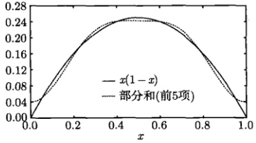

图 7.12 式(7.1.53)两边的比较
 

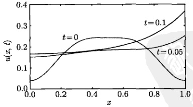

图 7.13 系统在不同时刻的温度分布，来自式（7.1.54）
 

例 2 对于上例的有界杆热传导的定解问题，设 L=1, a=1,  $ \eta=1/2 $，系统的初始温度分布为

$$  \phi(x)=\cosh\mu_{0}x-\frac{\cosh\mu_{0}}{\cos\mu_{1}}\cos\mu_{1}x   \tag*{(7.1.56)}$$

<!-- page: 201 -->

这里  $ \frac{\cosh\mu_{0}}{\cos\mu_{1}} = -5.17 $，求解该定解问题。

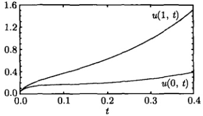

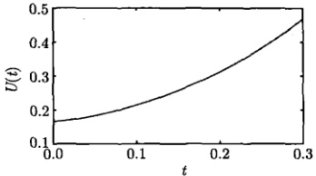

图 7.14 系统两端温度及平均温度的时间演化，来自式（7.1.54）和式（7.1.55）
 

解 初始温度分布如图 7.15 所示，它可以使一般解 (7.1.54) 约化为非常简单的形式，这是利用了本征函数的正交性。展开系数式 (7.1.48) 为

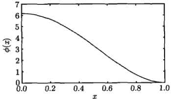

图 7.15 系统的初始温度分布式（7.1.56）
 

$$  c_{0}=\frac{2}{1+\frac{\sinh2\mu_{0}}{2\mu_{0}}}\int_{0}^{1}\left(\cosh\mu_{0}x-\frac{\cosh\mu_{0}}{\cos\mu_{1}}\cos\mu_{1}x\right)\cosh\mu_{0}x\mathrm{d}x=1   \tag*{(7.1.57a)}$$

$$  c_{n}=\frac{2}{1+\frac{\sin2\mu_{n}}{2\mu_{n}}}\int_{0}^{1}\left(\cosh\mu_{0}x-\frac{\cosh\mu_{0}}{\cos\mu_{1}}\cos\mu_{1}x\right)\cos\mu_{n}x dx=-\frac{\cosh\mu_{0}}{\cos\mu_{1}}\delta_{1n}   \tag*{(7.1.57b)}$$

由此，任意时刻的温度分布和平均温度为

$$  u(x,t)=\exp(\mu_{0}^{2}t)\cosh\mu_{0}x-\frac{\cosh\mu_{0}}{\cos\mu_{1}}\exp(-\mu_{1}^{2}t)\cos\mu_{1}x   \tag*{(7.1.58)}$$

和

$$  U(t)=\frac{\sinh\mu_{0}}{\mu_{0}}\exp(\mu_{0}^{2}t)-\cosh\mu_{0}\frac{\tan\mu_{1}}{\mu_{1}}\exp(-\mu_{1}^{2}t)   \tag*{(7.1.59)}$$

系统两端温度及平均温度随时间的演化显示在图7.16。后端的初始温度较低，所以吸热后温度持续升高。前端的初始温度较高，t 较小时，在维持绝热过程中将热量

<!-- page: 202 -->

传向内部，致使本身温度降低；但 $t$ 较大时，获得后端传来的热量，温度转为升高。再看系统的平均温度，由于式 (7.1.59) 中的固有耗散项 $\exp(-\mu_1^2t)$ 在 $t$ 较大时作用甚微，平均温度的变化基本由 $\exp(\mu_0^2t)$ 项确定。作为一个吸收-绝热系统，其平均温度按指数规律升高。这里的“精确解”确保后端的初始温度为 $u(1,0)=0$。

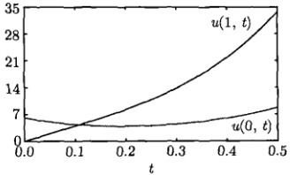

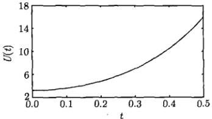

图 7.16 系统两端温度及平均温度随时间的演化，来自式（7.1.58）和式（7.1.59）
 

至此，我们已经详细讨论了热辐射与热吸收问题，从数学的角度，还可以进一步讨论一些相关的定解问题。例如，x=0 端取为第三类边界条件，而 x=L 维持零度或绝热。但是物理上，我们更想探讨综合性的热传导问题。

### 7.2 综合热传导定解问题

本节进一步讨论热传导定解问题，与热辐射与热吸收问题一样，这些问题不但是分离变量法的应用，并且将方程  $ X''(x) + \lambda X(x) = 0 $ 的本征函数的类型不断扩大，理论上很有意义。下面我们将按第三类边界条件的不同组合讨论综合性热传导问题。

#### 7.2.1 对称边界条件

首先考虑下列热传导定解问题

$$  \left\{\begin{array}{l l}\displaystyle\frac{\partial u}{\partial t}=a^{2}\frac{\partial^{2}u}{\partial x^{2}}&(0<x<L,t>0)\\ \left.u\right|_{t=0}=\phi(x)&(0\leqslant x\leqslant L)\\ \left[u+h\frac{\partial u}{\partial x}\right]_{x=0}=0,\left[u+h\frac{\partial u}{\partial x}\right]_{x=L}=0&(t>0)\end{array}\right.   \tag*{(7.2.1a)}$$

其中，h>0。

该定解问题中的边界条件在 x=0 与 x=L 两端具有相同的形式，我们称之为对称边界条件。它表示 x=0 端吸收热量而 x=L 端辐射热量，而吸收能力和辐射强度分别与两端的温度成正比。

<!-- page: 203 -->

简单起见，我们取 a=1, L=1, h=1。设方程 (7.2.1a) 具有变量分离的形式解  $ u(x,t)=X(x)T(t) $，其中  $ X(x) $ 构成本征值问题

$$  \left\{\begin{array}{l}X^{\prime\prime}(x)+\lambda X(x)=0\end{array}\right.   \tag*{(7.2.2a)}$$

$$  \left\{\begin{array}{l}X(0)+X^{\prime}(0)=0,\quad X(1)+X^{\prime}(1)=0\end{array}\right.   \tag*{(7.2.2b)}$$

而  $ T(t) $ 满足方程

$$  T^{\prime}(t)+\lambda T(t)=0   \tag*{(7.2.3)}$$

其中， $ \lambda $ 是分离常数。首先求解空间函数  $ X(x) $ 的本征值问题。按三种情况讨论。

(1) $ \lambda=0 $时，只有平庸解A=B=0。

(2)  $ \lambda < 0 $ 时，方程 (7.2.2a) 的通解为 [见式 (1.1.32)]

$$  X(x)=A\mathrm{e}^{kx}+B\mathrm{e}^{-kx}   \tag*{(7.2.4a)}$$

其中， $ k=\sqrt{-\lambda} $，A 和 B 是任意常数。它的导数为

$$  X^{\prime}(x)=k A\mathrm{e}^{kx}-k B\mathrm{e}^{-kx}   \tag*{(7.2.4b)}$$

边界条件式（7.2.2b）要求

$$  \boldsymbol{A}(1+k)+\boldsymbol{B}(1-k)=0   \tag*{(7.2.5a)}$$

$$  A(1+k)\mathrm{e}^{k}+B(1-k)\mathrm{e}^{-k}=0   \tag*{(7.2.5b)}$$

式(7.2.5)是关于 A 和 B 的线性齐次方程组，它有非零解的必要充分条件是

$$  \left|\begin{array}{l l}1+k&1-k\\ (1+k)\mathrm{e}^{k}&(1-k)\mathrm{e}^{-k}\end{array}\right|=0   \tag*{(7.2.6)}$$

即

$$  (1-k^{2})\mathrm{e}^{-k}-(1-k^{2})\mathrm{e}^{k}=0   \tag*{(7.2.7)}$$

它的解为 k=1 (不取 k=-1 是因为  $ \lambda<0 $)。进而由式 (7.2.5a) 得到 A=0，故本征值问题 (7.2.2) 的解为

$$  \lambda_{0}=-1,X_{0}(x)=b_{0}\mathrm{e}^{-x}   \tag*{(7.2.8)}$$

其中， $ b_{0}=B $ 。对于相应的时间函数，由方程(7.2.3)得到

$$  T_{0}^{\prime}(t)-T_{0}(t)=0\Rightarrow T_{0}(t)=C_{0}\mathrm{e}^{t}   \tag*{(7.2.9)}$$

由此本征解为

$$  u_{0}(x,t)=c_{0}\mathrm{e}^{t}\mathrm{e}^{-x}   \tag*{(7.2.10)}$$

<!-- page: 204 -->

其中， $ c_{0}=C_{0}b_{0} $。我们再次看到，对于现在的边界条件，在 $ \lambda<0 $情况下也存在非零解。

(3) $ \lambda>0 $时，方程(7.2.2a)的通解为

$$  X(x)=A\cos kx+B\sin kx   \tag*{(7.2.11a)}$$

其中， $ k = \sqrt{\lambda} $，它的导数为

$$  X^{\prime}(x)=-k A\sin k x+k B\cos k x   \tag*{(7.2.11b)}$$

边界条件（7.2.2b）要求

$$  \boldsymbol{A}+k\boldsymbol{B}=0   \tag*{(7.2.12a)}$$

$$  A(\cos k-k\sin k)+B(\sin k+k\cos k)=0   \tag*{(7.2.12b)}$$

由式(7.2.12a)解出 A = -kB，代入式(7.2.12b)，由  $ B \neq 0 $ 得到  $ \sin k = 0 $，所以

$$  k=n\pi\quad(n=1,2,3,\cdots)   \tag*{(7.2.13)}$$

这里，n 不取零与负值是因为  $ \lambda > 0 $。这样本征值问题（7.2.2）的解为

$$  \lambda_{n}=(n\pi)^{2},\quad X_{n}(x)=b_{n}\left(n\pi\cos n\pi x-\sin n\pi x\right)\quad(n=1,2,3,\cdots)   \tag*{(7.2.14)}$$

这里， $ b_{n} = -B $。我们看到，现在的本征函数是正弦函数与余弦函数的组合。

对于相应的时间函数，由方程（7.2.3）得到

$$  T_{n}^{\prime}(t)+(n\pi)^{2}T_{n}(t)=0   \tag*{(7.2.15)}$$

它的通解为

$$  T_{n}(t)=C_{n}\mathrm{e}^{-(n\pi)^{2}t}   \tag*{(7.2.16)}$$

由此，本征解为

$$  u_{n}(x,t)=c_{n}\mathrm{e}^{-(n\pi)^{2}t}\left(n\pi\cos n\pi x-\sin n\pi x\right)\quad(n=1,2,3,\cdots)   \tag*{(7.2.17)}$$

其中， $ c_{n}=C_{n}b_{n} $。我们将  $ \lambda<0 $ 时的本征解 (7.2.10) 与  $ \lambda>0 $ 的本征解 (7.2.17) 叠加起来得到一般解

$$  u(x,t)=c_{0}\mathrm{e}^{t}\mathrm{e}^{-x}+\sum_{n=1}^{\infty}c_{n}\mathrm{e}^{-(n\pi)^{2}t}\left(n\pi\cos n\pi x-\sin n\pi x\right)   \tag*{(7.2.18)}$$

现在利用初始条件（7.2.1b）确定系数  $ c_{0} $ 和  $ c_{n} $，我们有

$$  \phi(x)=c_{0}\mathrm{e}^{-x}+\sum_{n=1}^{\infty}c_{n}\left(n\pi\cos n\pi x-\sin n\pi x\right)   \tag*{(7.2.19)}$$

<!-- page: 205 -->

为求  $ c_{0} $ 和  $ c_{n} $，必须首先考查本征函数  $ X_{0}, X_{1}, X_{2}, \cdots $ 在区间  $ (0,1) $ 上的正交性，略去不重要的系数后，本征函数为

$$  X_{0}(x)=\mathrm{e}^{-x}   \tag*{(7.2.20a)}$$

$$  X_{n}(x)=n\pi\cos n\pi x-\sin n\pi x\quad(n=1,2,3,\cdots)   \tag*{(7.2.20b)}$$

首先计算

 $$ \begin{aligned}\int_{0}^{1}X_{0}(x)X_{n}(x)\mathrm{d}x&=\int_{0}^{1}\mathrm{e}^{-x}\left(n\pi\cos n\pi x-\sin n\pi x\right)\mathrm{d}x\\&=\frac{n\pi}{1+(n\pi)^{2}}\left[\mathrm{e}^{-x}\left(-\cos n\pi x+n\pi\sin n\pi x\right)\right]_{0}^{1}\\&\quad-\frac{1}{1+(n\pi)^{2}}\left[\mathrm{e}^{-x}\left(-\sin n\pi x-n\pi\cos n\pi x\right)\right]_{0}^{1}\\&=\frac{n\pi}{1+(n\pi)^{2}}\left[\mathrm{e}^{-1}\left(-\cos n\pi\right)+1+\mathrm{e}^{-1}\cos n\pi-1\right]=0\end{aligned} $$ 

可见本征函数式（7.2.20a）与式（7.2.20b）是正交的。而式（7.2.20b）中的任意两个本征函数也是正交的，事实上

 $$ \begin{aligned}\int_{0}^{1}X_{m}(x)X_{n}(x)\mathrm{d}x&=\int_{0}^{1}\left(m\pi\cos m\pi x-\sin m\pi x\right)\left(n\pi\cos n\pi x-\sin n\pi x\right)\mathrm{d}x\\&=m n\pi^{2}\underbrace{\int_{0}^{1}\cos m\pi x\cos n\pi x\mathrm{d}x}_{=0(m\neq n)}+\underbrace{\int_{0}^{1}\sin m\pi x\sin n\pi x\mathrm{d}x}_{=0(m\neq n)}-\\&\underbrace{\left(m\pi\int_{0}^{1}\cos m\pi x\sin n\pi x\mathrm{d}x+n\pi\int_{0}^{1}\cos n\pi x\sin m\pi x\mathrm{d}x\right)}_{=0(m\neq n,m=n)}\\&=0(m\neq n)\end{aligned} $$ 

可见  $ X_{0}, X_{1}, X_{2}, \cdots $ 中任意两个都是正交的。其实正交性的证明还有下面的方法，即利用边界条件 (7.2.2b) 计算式 (6.4.7) 的 Q 因子，我们有

 $$ \begin{aligned}Q&=[X_{n}(0)X^{\prime}_{m}(0)-X_{m}(0)X^{\prime}_{n}(0)]-[X_{n}(L)X^{\prime}_{m}(L)-X_{m}(L)X^{\prime}_{n}(L)]\\&=\{X_{n}(0)\left[-X_{m}(0)\right]-X_{m}(0)\left[-X_{n}(0)\right]\}-\{X_{n}(L)\left[-X_{m}(L)\right]-X_{m}(L)\left[-X_{n}(L)\right]\}\\&=0\\ \end{aligned} $$ 

模值为

$$  \int_{0}^{1}X_{n}^{2}(x)\mathrm{d}x=(n\pi)^{2}\int_{0}^{1}\cos^{2}n\pi x\mathrm{d}x+\int_{0}^{1}\sin^{2}n\pi x\mathrm{d}x=\frac{(n\pi)^{2}+1}{2}   \tag*{(7.2.21)}$$

<!-- page: 206 -->

这样一来，我们有

$$  \int_{0}^{1}X_{n}(x)X_{m}(x)\mathrm{d}x=\frac{(n\pi)^{2}+1}{2}\delta_{nm}   \tag*{(7.2.22)}$$

另一个模值为

$$  \int_{0}^{1}X_{0}^{2}(x)\mathrm{d}x=\int_{0}^{1}\mathrm{e}^{-2x}\mathrm{d}x=\frac{\mathrm{e}^{2}-1}{2\mathrm{e}^{2}}   \tag*{(7.2.23)}$$

至此我们已经完全证明了本征函数(7.2.20)的正交性，并计算出了相应的模值。现在可以计算式(7.2.19)中的系数 $ c_{0} $和 $ c_{n} $，首先给式(7.2.19)两边同乘以 $ e^{-x} $并积分，然后利用 $ X_{0} $与 $ X_{n} $的正交性以及模值式(7.2.23)，得到

$$  c_{0}=\frac{2\mathrm{e}^{2}}{\mathrm{e}^{2}-1}\int_{0}^{1}\phi(x)\mathrm{e}^{-x}\mathrm{d}x   \tag*{(7.2.24a)}$$

进而给式(7.2.19)两边同乘以 $ X_{m}(x)(m=1,2,3,\cdots) $并积分，然后利用 $ X_{0} $与 $ X_{m} $的正交性以及式(7.2.22)，得到

$$  c_{n}=\frac{2}{(n\pi)^{2}+1}\int_{0}^{1}\phi(x)X_{n}(x)\mathrm{d}x\quad(n=1,2,3,\cdots)   \tag*{(7.2.24b)}$$

式（7.2.18）就是定解问题（7.2.1）的解，其展开系数由式（7.2.24）确定。最后我们按照式（7.2.18）计算系统的平均温度

 $$ \begin{aligned}U(t)&=\int_{0}^{1}u(x,t)\mathrm{d}x\\&=c_{0}\mathrm{e}^{t}\int_{0}^{1}\mathrm{e}^{-x}\mathrm{d}x+\sum_{n=1}^{\infty}c_{n}\mathrm{e}^{-(n\pi)^{2}t}\int_{0}^{1}\left(n\pi\cos n\pi x-\sin n\pi x\right)\mathrm{d}x\\&=c_{0}\frac{\mathrm{e}-1}{\mathrm{e}}\mathrm{e}^{t}-\frac{1}{\pi}\sum_{n=1}^{\infty}\frac{c_{n}}{n}\left(1-\cos n\pi\right)\mathrm{e}^{-(n\pi)^{2}t}\\ \end{aligned} $$ 

利用

 $$ 1-\cos n\pi=\left\{\begin{array}{l l}2&(n=1,3,5,\cdots)\\ 0&(n=0,2,4,\cdots)\end{array}\right. $$ 

得到

$$  U(t)=c_{0}\frac{\mathrm{e}-1}{\mathrm{e}}\mathrm{e}^{t}-\frac{2}{\pi}\sum_{k=0}^{\infty}\frac{c_{2k+1}}{2k+1}\mathrm{e}^{-(2k+1)^{2}\pi^{2}t}   \tag*{(7.2.25)}$$

我们看到，通过求解这个定解问题，本征方程  $ X''(x) + \lambda X(x) = 0 $ 又多了一套本征函数集

$$  \mathrm{e}^{-x},\quad n\pi\cos n\pi x-\sin n\pi x\quad(n=1,2,3,\cdots)   \tag*{(7.2.26)}$$

利用它们可以将一个定义在区间（0,1）上的函数展开。

<!-- page: 207 -->

例 1 设系统初始温度分布为  $ \phi(x)=x $，对上面的结果进行讨论。

解 首先计算展开系数式 (7.2.24)，我们有

$$  c_{0}=\frac{2\mathrm{e}^{2}}{\mathrm{e}^{2}-1}\int_{0}^{1}x\mathrm{e}^{-x}\mathrm{d}x=2\mathrm{e}\frac{\mathrm{e}-2}{\mathrm{e}^{2}-1}   \tag*{(7.2.27a)}$$

$$  c_{n}=\frac{2}{n^{2}\pi^{2}+1}\int_{0}^{1}x\left(n\pi\cos n\pi x-\sin n\pi x\right)\mathrm{d}x=\frac{2\left[2(-1)^{n}-1\right]}{n\pi\left(n^{2}\pi^{2}+1\right)}   \tag*{(7.2.27b)}$$

将  $ c_{0} $ 和  $ c_{n} $ 分别代入式 (7.2.18) 和式 (7.2.25)，得到

$$  u(x,t)=2\mathrm{e}\frac{\mathrm{e}-2}{\mathrm{e}^{2}-1}\mathrm{e}^{t}\mathrm{e}^{-x}+\frac{2}{\pi}\sum_{n=1}^{\infty}\frac{\left[2(-1)^{n}-1\right]}{n\left(n^{2}\pi^{2}+1\right)}\mathrm{e}^{-(n\pi)^{2}t}\left(n\pi\cos n\pi x-\sin n\pi x\right)   \tag*{(7.2.28)}$$

$$  U(t)=2\frac{\mathrm{e}-2}{\mathrm{e}+1}\mathrm{e}^{t}-\frac{4}{\pi^{2}}\sum_{k=0}^{\infty}\frac{\left[2(-1)^{2k+1}-1\right]}{(2k+1)^{2}\left[(2k+1)^{2}\pi^{2}+1\right]}\mathrm{e}^{-(2k+1)^{2}\pi^{2}t}   \tag*{(7.2.29)}$$

系统在不同时刻的温度分布显示在图 7.17。可以看出，温度分布由初始的  $ \phi(x)=x $ 形式，向相反的方向变化。较长时间后，式 (7.2.28) 中的求和为零，温度分布成为指数形式  $ e^{-x} $。为了比较式 (7.2.28) 中第一项 [记为  $ u_{1}(x,t) $] 与求和部分 [记为  $ u_{2}(x,t) $] 的相对大小，我们分别作出它们的曲线，如图 7.18 所示。可以看出，在 t 较小时  $ u_{2}(x,t) $ 部分对温度的贡献起主要作用；但随着 t 的增加， $ u_{1}(x,t) $ 的作用越来越大，这是由于  $ u_{1}(x,t) $ 中指数因子  $ e^{t} $ 的作用。当  $ t \to \infty $ 时， $ u_{2} \to 0 $，系统温度分布由  $ u_{1} $ 确定。

系统两端温度随时间 t 的变化显示在图 7.19(a)。在初始 t=0 时刻，x=0 端温度为 0 而 x=1 端温度为 1。之后前端温度上升，后端温度下降，这是因为前端吸收热量，而后端辐射热量。当 t 较大时，由于  $ u_{1}(x,t) $ 中指数因子  $ e^{t} $ 的作用，前端的温度快速上升。后端虽然一直在辐射热量，但在辐射的同时不断吸收前端传导过来的热量，当吸收的热量多于辐射的热量时，温度转为升高，但没有前端升高得那么快。

系统的平均温度随时间的演化显示在图 7.19(b)。可以看出，在最初阶段，平均温度下降，这意味着后端辐射热量 [即系统的固有耗散  $ e^{-(n\pi)^2t} $] 起主要作用。随着 t 的增长，耗散作用下降，而吸收作用  $ e^t $ 上升，最终导致平均温度按指数规律上升。形成上述温度变化的根本原因是式 (7.2.9) 所显示的时间函数  $ T_0(t) $ 的指数增长，而它是由边界条件 (7.2.1c) 推导出来的。我们自然会问，如果系统前端辐射而后端吸收，情况将会如何？这就是下面所讨论的具有另一类对称边界条件的定解问题。

<!-- page: 208 -->

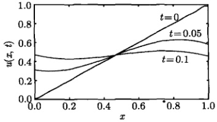

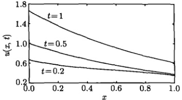

图 7.17 系统在不同时刻 t 的温度分布，曲线来自式（7.2.28）的部分和（前 20 项）
 

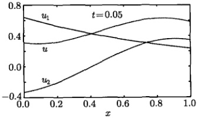

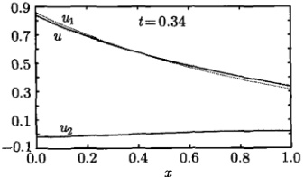

图 7.18  $ u_{1}(x,t) $ 和  $ u_{2}(x,t) $ 的比较，曲线来自式 (7.2.28) 的部分和 (前 20 项)
 

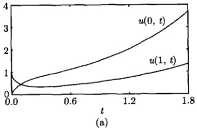

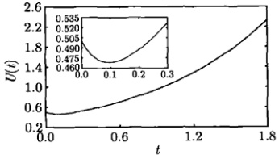

(b)
 

图 7.19 系统两端温度及平均温度随时间的变化，曲线来自式（7.2.28）和式（7.2.29）的部分和（前 20 项）
 

现在我们进一步讨论下列热传导问题

 $$ \frac{\partial u}{\partial t}=\frac{\partial^{2}u}{\partial x^{2}} $$ 

$$  (0<x<1,t>0)   \tag*{(7.2.30a)}$$

 $$ u|_{t=0}=\phi(x) $$ 

$$  (0\leq x\leq1)   \tag*{(7.2.30b)}$$

$$  \left\{\begin{array}{l}\left[u-\frac{\partial u}{\partial x}\right]_{x=0}=0,\left[u-\frac{\partial u}{\partial x}\right]_{x=1}=0\quad(t>0)\end{array}\right.   \tag*{(7.2.30c)}$$

这个热传导问题也具有对称边界条件，它表示前端辐射热量而后端吸收热量，而辐射强度与吸收能力分别与前后端的温度成正比。这个问题不能由式（7.2.1）问

<!-- page: 209 -->

题中取 h = -1 得到结果，因为边界条件不同，将给出不同的本征函数，必须重新求解。设方程 (7.2.30a) 的形式解为  $ u(x, t) = X(x)T(t) $，其中  $ X(x) $ 构成本征值问题

$$  \int X^{\prime\prime}(x)+\lambda X(x)=0   \tag*{(7.2.31a)}$$

$$  \left\{\begin{array}{l}X(0)-X^{\prime}(0)=0,\quad X(1)-X^{\prime}(1)=0\end{array}\right.   \tag*{(7.2.31b)}$$

而  $ T(t) $ 满足方程

$$  T^{\prime}(t)+\lambda T(t)=0   \tag*{(7.2.32)}$$

下面按三种情况讨论（讨论中将略去不重要的常数）。

(1) $ \lambda=0 $ 时只有平庸解。

(2) $ \lambda<0 $ 情况下的解为

$$  \lambda_{0}=-1,\quad X_{0}(x)=\mathrm{e}^{x}   \tag*{(7.2.33)}$$

$$  T_{0}(t)=\mathbf{e}^{t}   \tag*{(7.2.34)}$$

(3) $ \lambda>0 $ 情况下的解为

$$  \lambda_{n}=(n\pi)^{2},\quad X_{n}(x)=n\pi\cos n\pi x+\sin n\pi x\quad(n=1,2,3,\cdots)   \tag*{(7.2.35)}$$

$$  T_{n}(t)=\mathrm{e}^{-(n\pi)^{2}t}   \tag*{(7.2.36)}$$

一般解为

$$  u(x,t)=c_0\mathrm{e}^t\mathrm{e}^x+\sum_{n=1}^{\infty}c_n\mathrm{e}^{-(n\pi)^2t}(n\pi\cos n\pi x+\sin n\pi x)   \tag*{(7.2.37)}$$

平均温度为

$$  U(t)=c_{0}(e-1)e^{t}+\frac{2}{\pi}\sum_{k=0}^{\infty}\frac{c_{2k+1}}{2k+1}e^{-(2k+1)^{2}\pi^{2}t}   \tag*{(7.2.38)}$$

本征函数  $ X_{0} $， $ X_{1} $， $ X_{2} $，… 在区间  $ (0,1) $ 上是正交的，即

$$  \int_{0}^{1}X_{i}(x)X_{j}(x)\mathrm{d}x=0\quad(i\neq j)   \tag*{(7.2.39)}$$

这是因为利用边界条件（7.2.31b）计算式（6.4.7）的 Q 因子，得到

 $$ \begin{aligned}Q&=[X_{n}(0)X_{m}^{\prime}(0)-X_{m}(0)X_{n}^{\prime}(0)]-[X_{n}(L)X_{m}^{\prime}(L)-X_{m}(L)X_{n}^{\prime}(L)]\\&=\{X_{n}(0)\left[X_{m}(0)\right]-X_{m}(0)\left[X_{n}(0)\right]\}-\{X_{n}(L)\left[X_{m}(L)\right]-X_{m}(L)\left[X_{n}(L)\right]\}\\&=0\\ \end{aligned} $$ 

利用初始条件

$$  \phi(x)=c_{0}\mathrm{e}^{x}+\sum_{n=1}^{\infty}c_{n}\left(n\pi\cos n\pi x+\sin n\pi x\right)   \tag*{(7.2.40)}$$

<!-- page: 210 -->

及本征函数的正交性式(7.2.39)，得到展开系数

$$  c_{0}=\frac{2}{\mathrm{e}^{2}-1}\int_{0}^{1}\phi(x)\mathrm{e}^{x}\mathrm{d}x   \tag*{(7.2.41a)}$$

$$  c_{n}=\frac{2}{(n\pi)^{2}+1}\int_{0}^{1}\phi(x)X_{n}(x)\mathrm{d}x\quad(n=1,2,3,\cdots)   \tag*{(7.2.41b)}$$

至此我们已经完成了这个定解问题的求解，求解中引入了  $ X''(x) + \lambda X(x) = 0 $ 的新的本征函数集

$$  \mathrm{e}^{x},\quad n\pi\cos n\pi x+\sin n\pi x\quad(n=1,2,3,\cdots)   \tag*{(7.2.42)}$$

它与式（7.2.26）在形式上是对称的。

例2 设初始温度分布为  $ \phi(x)=x $，对上面的结果进行讨论。

解 首先计算展开系数式 (7.2.41)，我们有

$$  c_{0}=\frac{2}{\mathrm{e}^{2}-1},c_{n}=-\frac{2}{n\pi(n^{2}\pi^{2}+1)}   \tag*{(7.2.43)}$$

代入式 (7.2.37) 和式 (7.2.38) 进行计算。系统在不同时刻 t 的温度分布  $ u(x,t) $、前后端点温度  $ u(0,t) $、 $ u(1,t) $ 和平均温度  $ U(t) $ 随时间的演化显示在图 7.20。可以看出，系统温度由最初的  $ \phi(x)=x $ 分布迅速演化为指数  $ e^{x} $ 分布，这是式 (7.2.37) 中指数因子  $ e^{t} $ 的作用，系统后端 x=1 是吸收热量的，其温度按指数规律快速升高。前端 x=0 是辐射热量的，但由于吸收了后端传导过来的热量，因此温度也随时间升高，但较为缓慢。整个系统平均温度的时间演化可以近似为  $ u(0,t) $ 与  $ u(1,t) $ 的平均，它是单调上升的。这里的结果与图 7.19(b) 不同，在那里后端温度在初始阶段是下降的，因此平均温度出现一个极小值。

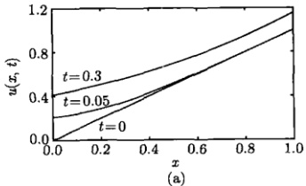

(a)
 

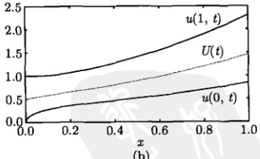

(b)
 

图 7.20 (a) 系统在不同时刻 t 的温度分布，来自式 (7.2.37) 的部分和 (前 20 项)；(b) 两端温度及平均温度的时间演化，来自式 (7.2.37) 和式 (7.2.38) 的部分和 (前 20 项)
 

#### 7.2.2 反对称边界条件

本节讨论具有反对称边界条件的热传导问题，即系统前后端的边界条件在形

<!-- page: 211 -->

式上是相反的，由此引出新的本征函数。首先考虑下面的定解问题：

$$  \left\{\begin{array}{l l}{\displaystyle\frac{\partial u}{\partial t}=\frac{\partial^{2}u}{\partial x^{2}}}&{\qquad\quad(0<x<1,t>0)}\end{array}\right.   \tag*{(7.2.44a)}$$

$$  (0\leq x\leq1)   \tag*{(7.2.44b)}$$

$$  \left[u-\frac{\partial u}{\partial x}\right]_{x=0}=0,\quad\left[u+\frac{\partial u}{\partial x}\right]_{x=1}=0\quad(t>0)   \tag*{(7.2.44c)}$$

现在的边界条件表示两端都辐射热量，而且辐射强度分别与两端的温度成正比。从物理上可以预言，它的稳态解为  $ u(x,\infty)\rightarrow0 $。设式(7.2.44a)的形式解为  $ u(x,t)=X(x)T(t) $，其中， $ X(x) $ 构成本征值问题

$$  \int X^{\prime\prime}(x)+\lambda X(x)=0   \tag*{(7.2.45a)}$$

$$  X(0)-X^{\prime}(0)=0,X(1)+X^{\prime}(1)=0   \tag*{(7.2.45b)}$$

而  $ T(t) $ 满足方程

$$  T^{\prime}(t)+\lambda T(t)=0   \tag*{(7.2.46)}$$

其中， $ \lambda $ 是分离常数。

首先求解空间函数  $ X(x) $ 的本征值问题，容易证明在  $ \lambda \leq 0 $ 时只有平庸解。当  $ \lambda > 0 $ 时，方程  $ (7.2.45a) $ 的通解为

$$  X(x)=A\cos\mu x+B\sin\mu x   \tag*{(7.2.47)}$$

其中， $ \mu=\sqrt{\lambda} $。边界条件(7.2.45b)要求

$$  \boldsymbol{A}-\mu\boldsymbol{B}=\boldsymbol{0}   \tag*{(7.2.48a)}$$

$$  A(\cos\mu-k\sin\mu)+B(\sin\mu+k\cos\mu)=0   \tag*{(7.2.48b)}$$

由式(7.2.48a)解出 $ A=\mu B $，代入式(7.2.48b)，利用 $ B\neq0 $，得到

$$  \tan\mu=\frac{2\mu}{\mu^{2}-1}   \tag*{(7.2.49)}$$

这是本征值所满足的超越方程，我们作出曲线  $ y = \tan \mu $ 和  $ y = \frac{2\mu}{\mu^2 - 1} $，如图 7.21 所示，二者交点的横坐标  $ \mu_n $ 就是超越方程 (7.2.49) 的解。这样本征值问题 (7.2.45) 的解为

$$  \lambda_{n}=\mu_{n}^{2},\quad X_{n}(x)=\mu_{n}\cos\mu_{n}x+\sin\mu_{n}x\quad(n=1,2,3,\cdots)   \tag*{(7.2.50)}$$

<!-- page: 212 -->

对于相应的时间函数，从式（7.2.46）得到

$$  T_{n}^{\prime}(t)+\mu_{n}^{2}T_{n}(t)=0\Rightarrow T_{n}(t)\simeq\mathrm{e}^{-\mu_{n}^{2}t}   \tag*{(7.2.51)}$$

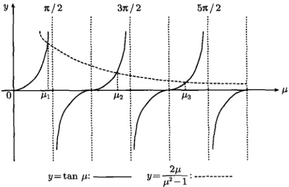

图 7.21 超越方程（7.2.49）的曲线解
 

将本征解叠加起来得到一般解

$$  u(x,t)=\sum_{n=1}^{\infty}c_{n}\mathrm{e}^{-\mu_{n}^{2}t}\left(\mu_{n}\cos\mu_{n}x+\sin\mu_{n}x\right)   \tag*{(7.2.52)}$$

现在利用初始条件式（7.2.44b）确定系数，我们有

$$  \phi(x)=\sum_{n=1}^{\infty}c_{n}\left(\mu_{n}\cos\mu_{n}x+\sin\mu_{n}x\right)   \tag*{(7.2.53)}$$

为确定  $ c_{n} $，必须首先考查本征函数  $ X_{n}(x) $ 在区间  $ (0,1) $ 上的正交性，为此利用边界条件式 (7.2.45b) 计算式 (6.4.7) 的 Q 因子，我们有

 $$ \begin{aligned}Q&=[X_{n}(0)X^{\prime}_{m}(0)-X_{m}(0)X^{\prime}_{n}(0)]-[X_{n}(L)X^{\prime}_{m}(L)-X_{m}(L)X^{\prime}_{n}(L)]\\&=\{X_{n}(0)\left[X_{m}(0)\right]-X_{m}(0)\left[X_{n}(0)\right]\}-\{X_{n}(L)\left[-X_{m}(L)\right]-X_{m}(L)\left[-X_{n}(L)\right]\}\\&=0\\ \end{aligned} $$ 

可见，式(7.2.50)的本征函数是正交的。而模值为

 $$ \begin{aligned}M_{n}&\equiv\int_{0}^{1}X_{n}^{2}(x)\mathrm{d}x\\&=\frac{\mu_{n}^{2}}{2}\left(1+\frac{\sin2\mu_{n}}{2\mu_{n}}\right)-\frac{2\mu_{n}\cos2\mu_{n}+\sin2\mu_{n}}{4\mu_{n}}+1\end{aligned} $$

<!-- page: 213 -->

故

$$  \int_{0}^{1}X_{m}(x)X_{n}(x)\mathrm{d}x=M_{n}\delta_{mn}   \tag*{(7.2.54)}$$

利用式（7.2.53）和式（7.2.54）得到展开系数

$$  c_{n}=\frac{1}{M_{n}}\int_{0}^{1}\phi(x)X_{n}(x)\mathrm{d}x   \tag*{(7.2.55)}$$

而平均温度为

$$  U(t)=\sum_{n=1}^{\infty}c_{n}\left(\sin\mu_{n}+\frac{1-\cos\mu_{n}}{\mu_{n}}\right)\mathrm{e}^{-\mu_{n}^{2}t}   \tag*{(7.2.56)}$$

至此我们已经完成了这个定解问题的求解。求解中引入了  $ X''(x) + \lambda X(x) = 0 $ 的新的本征函数集

$$  \mu_{n}\cos\mu_{n}x+\sin\mu_{n}x\quad(n=1,2,3,\cdots)   \tag*{(7.2.57)}$$

其中， $ \mu_{n} $ 是超越方程  $ \tan\mu=\frac{2\mu}{\mu^{2}-1} $ 的第 n 个正根。

例 1 设初始温度分布为  $ \phi(x)=x $，对上面的结果进行讨论。

解 首先求出超越方程（7.2.49）的前5个根

$$  \mu_{1}=1.3066,\quad\mu_{2}=3.6735,\quad\mu_{3}=6.5850,\quad\mu_{4}=9.6320,\quad\mu_{5}=12.7230   \tag*{(7.2.58)}$$

展开系数为

$$  c_{n}=\frac{-\frac{1}{\mu_{n}}+\sin\mu_{n}+\frac{\sin\mu_{n}}{\mu_{n}^{2}}}{\frac{\mu_{n}^{2}}{2}\left(1+\frac{\sin2\mu_{n}}{2\mu_{n}}\right)-\frac{2\mu_{n}\cos2\mu_{n}+\sin2\mu_{n}}{4\mu_{n}}+1}   \tag*{(7.2.59)}$$

初始温度用部分和近似表示为

$$  x\approx\sum_{n=1}^{5}c_{n}\left(\mu_{n}\cos\mu_{n}x+\sin\mu_{n}x\right)   \tag*{(7.2.60)}$$

图 7.22 显示了式 (7.2.60) 两边的比较。可以看出，在端点 x=0 和 x=1 都有明显的拟合偏差，式 (7.2.60) 右边的求和可以称为准线性分布。系统在任意时刻 t 的温度分布与平均温度用部分和表示为

$$  u(x,t)\approx\sum_{n=1}^{5}c_{n}\left(\mu_{n}\cos\mu_{n}x+\sin\mu_{n}x\right)\mathrm{e}^{-\mu_{n}^{2}t}   \tag*{(7.2.61a)}$$

$$  U(t)\approx\sum_{n=1}^{5}c_{n}\left(\sin\mu_{n}+\frac{1-\cos\mu_{n}}{\mu_{n}}\right)\mathrm{e}^{-\mu_{n}^{2}t}   \tag*{(7.2.61b)}$$

<!-- page: 214 -->

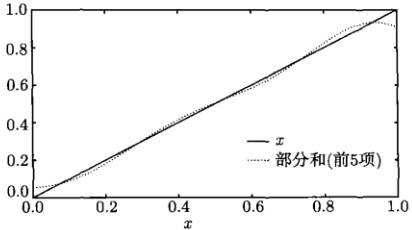

图 7.22 式(7.2.60)两边的比较
 

图 7.23(a) 显示了不同时刻 t 的温度分布，可以看出，温度由最初的准线性分布变为有峰分布，并逐渐塌缩，最终趋于  $ u(x, \infty) \to 0 $。

系统两端温度及平均温度随时间 t 的变化显示在图 7.23(b)。系统后端是散热的，此端的温度从  $ u(1,0)=1 $ 开始一直单调下降。系统前端也是散热的，但初始时刻温度为  $ u(0,0)=0 $，此刻无热可散。在 t>0 时，后端在散热的同时，还向前端传热，故前端的温度由零度上升，而一旦高于零度，便随即出现散热。在 t 较小时，前端从后端吸收的热量多于散失的热量，因此温度不断升高。在  $ t_{0} $ 时刻前端的温度升到极大值，在  $ t_{0} $ 之后，散失的热量多于吸收的热量，因此温度下降，并一直延续下去。系统平均温度在  $ t_{0} $ 之前，一直处于前后端温度之间，但在  $ t_{0} $ 之后高于两端的温度。这个现象并不奇怪，因为  $ U(t) $ 是整个系统的平均温度，而不是前后端的平均。由于系统温度在 t>0 时为有峰分布，因此温度在整个空间的平均会高于两端的平均，这个问题中温度的分布特性及时间演化都是很有趣的。

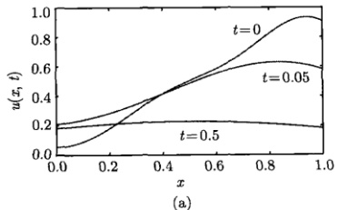

(a)
 

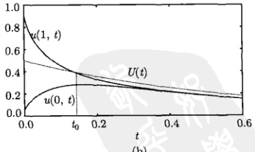

(b)
 

图 7.23 (a) 系统在不同时刻 t 的温度分布，来自式 (7.2.61a)；(b) 两端温度及平均温度的时间演化，来自式 (7.2.61a) 和式 (7.2.61b)
 

下面讨论另一类具有反对称边界条件的热传导问题

<!-- page: 215 -->

$$  \left\{\begin{array}{l l}\displaystyle\frac{\partial u}{\partial t}=\frac{\partial^{2}u}{\partial x^{2}}&(0<x<1,t>0)\\ u|_{t=0}=\phi(x)&(0\leqslant x\leqslant1)\\ {\left[u+\frac{\partial u}{\partial x}\right]_{x=0}=0,\left[u-\frac{\partial u}{\partial x}\right]_{x=1}=0}&(t>0)\end{array}\right.   \tag*{(7.2.62a)}$$

式 (7.2.62c) 表示系统前后端都吸收热量，而吸收能力分别与两端的温度成正比。我们从物理上可以预言，系统的稳态分布为  $ u(x,\infty) \to \infty $。设式 (7.2.62a) 的形式解为  $ u(x,t) = X(x)T(t) $，其中  $ X(x) $ 构成本征值问题

$$  \left\{\begin{array}{l}X^{\prime\prime}(x)+\lambda X(x)=0\\ X(0)+X^{\prime}(0)=0,X(1)-X^{\prime}(1)=0\end{array}\right.   \tag*{(7.2.63a)}$$

而  $ T(t) $ 满足方程

$$  T^{\prime}(t)+\lambda T(t)=0   \tag*{(7.2.64)}$$

其中， $ \lambda $ 是分离常数。

(1) $ \lambda=0 $时，只有平庸解。

(2) $ \lambda<0 $时，方程(7.2.63a)的通解为

$$  X(x)=A\cosh\mu x+B\sinh\mu x   \tag*{(7.2.65)}$$

其中， $ \mu=\sqrt{-\lambda} $。边界条件式（7.2.63b）要求

$$  \boldsymbol{A}+\mu\boldsymbol{B}=\boldsymbol{0}   \tag*{(7.2.66a)}$$

$$  A\cosh\mu+B\sinh\mu-\mu A\sinh\mu-\mu B\cosh\mu=0   \tag*{(7.2.66b)}$$

式（7.2.66）是关于 A 和 B 的线性齐次方程组，它导致非零解

$$  \lambda_{0}=-\mu_{0}^{2},\quad X_{0}(x)=\mu_{0}\cosh\mu_{0}x-\sinh\mu_{0}x   \tag*{(7.2.67)}$$

其中， $ \mu_{0} $ 是超越方程

$$  \tanh\mu=\frac{2\mu}{\mu^{2}+1}   \tag*{(7.2.68)}$$

的解，如图 7.24(a) 所示。而此时式 (7.2.67) 的  $ X_{0}(x) $ 曲线显示在图 7.24(b)。

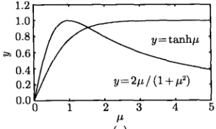

(a)
 

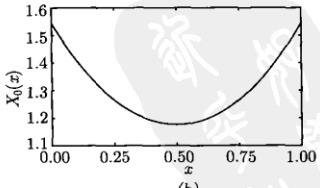

(b)
 

图 7.24 (a) 超越方程 (7.2.68) 的解： $ \mu_{0}=1.5440 $; (b)  $ X_{0}(x) $ 函数 [来自式 (7.2.67)]
 

<!-- page: 216 -->

对于相应的时间函数，由式（7.2.64）得到

$$  T_{0}^{\prime}(t)-\mu_{0}^{2}T_{0}(t)=0\Rightarrow T_{0}(t)=\exp(\mu_{0}^{2}t)   \tag*{(7.2.69)}$$

(3) $ \lambda>0 $时，方程(7.2.63a)的通解为

$$  X(x)=A\cos\mu x+B\sin\mu x   \tag*{(7.2.70)}$$

其中， $ \mu=\sqrt{\lambda} $。边界条件(7.2.63b)要求

$$  \boldsymbol{A}+\mu\boldsymbol{B}=\boldsymbol{0}   \tag*{(7.2.71a)}$$

$$  A\cos\mu+B\sin\mu+\mu A\sin\mu-\mu B\cos\mu=0   \tag*{(7.2.71b)}$$

式（7.2.71）是关于 A 和 B 的线性齐次方程组，它导致非零解

$$  \lambda_{n}=\mu_{n}^{2},\quad X_{n}(x)=\mu_{n}\cos\mu_{n}x-\sin\mu_{n}x\quad(n=1,2,3,\cdots)   \tag*{(7.2.72)}$$

其中， $ \mu_{n} $ 是超越方程

$$  \tan\mu=-\frac{2\mu}{\mu^{2}-1}   \tag*{(7.2.73)}$$

的第 n 个根，如图 7.25 所示。

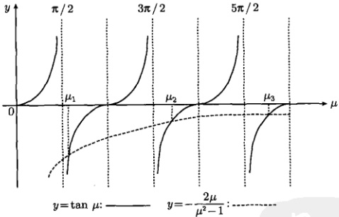

图 7.25 超越方程（7.2.73）的曲线解
 

对于相应的时间函数  $ T(t) $

$$  T_{n}^{\prime}(t)+\mu_{n}^{2}T_{n}(t)=0\Rightarrow T_{n}(t)=\exp(-\mu_{n}^{2}t)   \tag*{(7.2.74)}$$

将  $ \lambda<0 $ 和  $ \lambda>0 $ 情况下的本征解叠加起来，给出一般解

$$  u(x,t)=c_{0}T_{0}(t)X_{0}(x)+\sum_{n=1}^{\infty}c_{n}T_{n}(t)X_{n}(x)   \tag*{(7.2.75)}$$

<!-- page: 217 -->

现在利用初始条件式（7.2.62b）确定系数  $ c_{0} $ 和  $ c_{n} $，我们有

$$  \phi(x)=\mathrm{c}_{0}X_{0}(x)+\sum_{n=1}^{\infty}\mathrm{c}_{n}X_{n}(x)   \tag*{(7.2.76)}$$

为确定  $ c_{0} $ 和  $ c_{n} $，必须首先考查本征函数  $ X_{0}(x) $， $ X_{1}(x) $， $ X_{2}(x) $，… 在区间  $ (0,1) $ 上的正交性，为此利用边界条件式 (7.2.63b) 计算式 (6.4.7) 的 Q 因子，我们有

 $$ \begin{aligned}Q&=[X_{n}(0)X^{\prime}_{m}(0)-X_{m}(0)X^{\prime}_{n}(0)]-[X_{n}(L)X^{\prime}_{m}(L)-X_{m}(L)X^{\prime}_{n}(L)]\\&=\{X_{n}(0)\left[-X_{m}(0)\right]-X_{m}(0)\left[-X_{n}(0)\right]\}-\{X_{n}(L)\left[X_{m}(L)\right]-X_{m}(L)\left[X_{n}(L)\right]\}\\&=0\\ \end{aligned} $$ 

可见，本征函数  $ X_{0}(x), X_{1}(x), X_{2}(x), \cdots $ 在区间  $ (0,1) $ 上是相互正交的。在此基础上，利用式 (7.2.76)，得到展开系数

$$  c_{0}=\frac{1}{M_{0}}\int_{0}^{1}\phi(x)X_{0}(x)\mathrm{d}x   \tag*{(7.2.77a)}$$

$$  c_{n}=\frac{1}{M_{n}}\int_{0}^{1}\phi(x)X_{n}(x)\mathrm{d}x   \tag*{(7.2.77b)}$$

其中

$$  M_{0}=\frac{\mu_{0}^{2}}{2}\left(1+\frac{\sinh2\mu_{0}}{2\mu_{0}}\right)-\frac{2\mu_{0}\cosh2\mu_{0}-\sinh2\mu_{0}}{4\mu_{0}}   \tag*{(7.2.78a)}$$

$$  M_{n}=\frac{\mu_{n}^{2}}{2}\left(1+\frac{\sin2\mu_{n}}{2\mu_{n}}\right)+\frac{2\mu_{n}\cos2\mu_{n}-\sin2\mu_{n}}{4\mu_{n}}   \tag*{(7.2.78b)}$$

至此这个定解问题的求解已经全部完成。求解中引入了  $ X''(x) + \lambda X(x) = 0 $ 的新的本征函数集

 $$ \mu_{0}\cosh\mu_{0}x-\sinh\mu_{0}x,\quad\mu_{n}\cos\mu_{n}x-\sin\mu_{n}x\quad(n=1,2,3,\cdots) $$ 

其中， $ \mu_{0} $ 是  $ \tanh\mu=\frac{2\mu}{\mu^{2}+1} $ 的解，而  $ \mu_{n} $ 是  $ \tan\mu=-\frac{2\mu}{\mu^{2}-1} $ 的第 n 个根。

例2 设初始温度分布为  $ \phi(x)=x $，对上面的结果进行讨论。

解 首先从图 7.24(a) 得到

$$  \mu_{0}=1.5440   \tag*{(7.2.80a)}$$

并求出超越方程（7.2.73）的前5个根

$$  \mu_{1}=2.3315,\quad\mu_{2}=5.9500,\quad\mu_{3}=9.2080,\quad\mu_{4}=14.4055,\quad\mu_{5}=15.5800   \tag*{(7.2.80b)}$$

利用式(7.2.77)和式(7.2.78)计算展开系数，然后利用部分和表示初始温度，即

<!-- page: 218 -->

$$  x\approx c_{0}\left(\mu_{0}\cosh\mu_{0}x-\sinh\mu_{0}x\right)+\sum_{n=1}^{5}c_{n}\left(\mu_{n}\cos\mu_{n}x-\sin\mu_{n}x\right)   \tag*{(7.2.81)}$$

式（7.2.81）两边的比较显示在图7.26。二者基本吻合很好（只在x=0处略有偏差）。进一步用部分和表示任意时刻的温度分布及平均温度

$$  u(x,t)\approx c_{0}\left(\mu_{0}\cosh\mu_{0}x-\sinh\mu_{0}x\right)\mathrm{e}^{\mu_{0}^{2}t}+\sum_{n=1}^{5}c_{n}\left(\mu_{n}\cos\mu_{n}x-\sin\mu_{n}x\right)\mathrm{e}^{-\mu_{n}^{2}t}   \tag*{(7.2.82)}$$

$$  U(t)\approx c_{0}\frac{\mu_{0}\operatorname{s i n h}\mu_{0}-\operatorname{c o s h}\mu_{0}+1}{\mu_{0}}\mathrm{e}^{\mu_{0}^{2}t}+\sum_{n=1}^{5}c_{n}\frac{\mu_{n}\operatorname{s i n}\mu_{n}+\operatorname{c o s}\mu_{n}-1}{\mu_{n}}\mathrm{e}^{-\mu_{n}^{2}t}   \tag*{(7.2.83)}$$

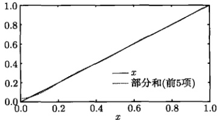

图 7.26 式（7.2.81）两边的比较
 

系统在不同 t 时刻的温度分布显示在图 7.27(a)。可以看出，温度由初始的线性分布演化成具有极小值的分布；在 t 较大时呈对称分布，这是因为在 t 较大时式(7.2.82)趋于分布

$$  X_{0}(x)\doteq\mu_{0}\operatorname{c o s h}\mu_{0}x-\operatorname{s i n h}\mu_{0}x   \tag*{(7.2.84)}$$

式(7.2.84)的曲线显示在图7.24(b)。对函数 $ X_{0}(x) $求导数，得到

$$  \frac{\mathrm{d}X_{0}(x)}{\mathrm{d}x}=\mu_{0}^{2}\sinh\mu_{0}x-\mu_{0}\cosh\mu_{0}x=0   \tag*{(7.2.85)}$$

这样  $ X_{0}(x) $ 的极小值位置 x 由  $ \coth\mu_{0}x=\mu_{0} $ 确定，结果为 x=0.5。

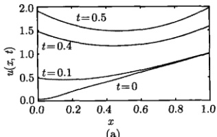

(a)
 

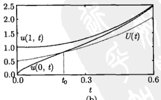

(b)
 

图 7.27 (a) 系统在不同时刻 t 的温度分布，来自式 (7.2.82)；(b) 两端温度及平均温度的时间演化，来自式 (7.2.82) 和式 (7.2.83)
 

<!-- page: 219 -->

系统两端温度及平均温度的时间演化显示在图 7.27(b)。在 t=0 时，温度为线性分布  $ \phi(x)=x $，系统平均温度为  $ U(0)=0.5 $。之后，由于两端都吸收热量，其温度均单调上升。在时间 t 较小时， $ U(t) $ 介于低温  $ u(0,t) $ 和高温  $ u(1,t) $ 之间。随着 t 的增加，两端温度升高，吸收的热量增加。所吸收的热量还引起系统中间区域的温度升高，但中间区域从两端吸收的热量少于两端从外界吸收的热量，因此两端的温度高于中间区域，形成极小值分布 [图 7.24(b) 和图 7.27(a)]，这样平均温度越来越接近低温  $ u(0,t) $。在时间  $ t_0 $ 之后，甚至出现  $ U(t) < u(0,t)(t > t_0) $ 的情况，即系统的平均温度低于两端的温度。当 t 较大时，极小值分布 (7.2.84) 导致平均温度与两端温度相差越来越大。在  $ t \to \infty $ 时。式 (7.2.82) 给出前后端的温度分别为

$$  u(0,\infty)=c_{0}\mathrm{e}^{\mu_{0}^{2}t}\mu_{0}   \tag*{(7.2.86a)}$$

$$  u(1,\infty)=c_{0}\mathrm{e}^{\mu_{0}^{2}t}\left(\mu_{0}\cosh\mu_{0}-\sinh\mu_{0}\right)   \tag*{(7.2.86b)}$$

利用式(7.2.68)，得到

 $$ \begin{aligned}\mu_{0}\cosh\mu_{0}-\sinh\mu_{0}&=\mu_{0}\cosh\mu_{0}-\frac{2\mu_{0}}{\mu_{0}^{2}+1}\cosh\mu_{0}\\&=\mu_{0}\frac{\mu_{0}^{2}-1}{\mu_{0}^{2}+1}\cosh\mu_{0}=\mu_{0}\frac{\mu_{0}^{2}-1}{\mu_{0}^{2}+1}\frac{1}{\sqrt{1-\tanh^{2}\mu_{0}}}\\&=\mu_{0}\frac{\mu_{0}^{2}-1}{\mu_{0}^{2}+1}\frac{1}{\sqrt{1-\left(\frac{2\mu_{0}}{\mu_{0}^{2}+1}\right)}}=\mu_{0}\end{aligned} $$ 

故  $ u(0,\infty)=u(1,\infty)=c_0e^{\mu_0^2t}\mu_0\approx1.5c_0e^{\mu_0^2t} $，即前后端的温度相等，而这个值高于系统的平均温度  $ U(\infty)=c_0e^{\mu_0^2t}\frac{2}{\mu_0}\approx1.3c_0e^{\mu_0^2t} $。

在上述相关章节中，我们用分离变量法详细讨论了具有第三类边界条件的热传导定解问题。我们看到，其中的数学模型和物理分析是完全吻合的。特别是分析系统在不同边界条件下的温度分布与温度演化细节是很有趣的。另一个很有意义的理论结果是方程  $ X''(x) + \lambda X(x) = 0 $ 的本征函数集的多样性。除了表6.2所示的傅里叶级数的基底函数之外，还有许多本征数集，如表7.1所示。每一套本征函数集都可以用来将一个定义在  $ (0,1) $ 区间上的任意函数展开。本征函数的知识不仅是数学物理方法的核心内容之一，也是许多科学与技术领域的重要思想和工具。下一章我们将利用本征函数的知识和方法，求解非齐次方程和非齐次边界条件的定解问题。而本章的最后一节，我们讨论拉普拉斯方程的定解问题。

<!-- page: 220 -->

表 7.1 方程  $ X''(x) + \lambda X(x) = 0 $ 的本征值与本征函数  $ (L = 1, n = 1, 2, 3, \cdots) $

 $$ u|_{x=0}=0,\quad\left[u+\frac{\partial u}{\partial x}\right]_{x=1}=0:\quad\lambda_{n}=\mu_{n}^{2},\quad X_{n}=\sin\mu_{n}x $$ 

 $$ \left.\frac{\partial u}{\partial x}\right|_{x=0}=0,\left[u+\frac{\partial u}{\partial x}\right]_{x=1}=0:\quad\lambda_{n}=\mu_{n}^{2},\quad X_{n}=\cos\mu_{n}x $$ 

 $$ u|_{x=0}=0,\quad\left[u-\frac{1}{2}\frac{\partial u}{\partial x}\right]_{x=1}=0:\quad\lambda_{0}=-\mu_{0}^{2},\quad\lambda_{n}=\mu_{n}^{2};\quad X_{0}=\sinh\mu_{0}x,\quad X_{n}=\sin\mu_{n}x $$ 

 $$ \left.\frac{\partial u}{\partial x}\right|_{x=0}=0,\left[u-\frac{1}{2}\frac{\partial u}{\partial x}\right]_{x=1}=0:\quad\lambda_{0}=-\mu_{0}^{2},\quad\lambda_{n}=\mu_{n}^{2};\quad X_{0}=\cosh\mu_{0}x,\quad X_{n}=\cos\mu_{n}x $$ 

 $$ \coth\mu_{0}=\mu_{0}/2,\quad\cot\mu_{n}=-\mu_{n}/2 $$ 

 $$ \left[u+\frac{\partial u}{\partial x}\right]_{x=0}=0,\left[u+\frac{\partial u}{\partial x}\right]_{x=1}=0:\lambda_{0}=-1,\quad\lambda_{n}=(n\pi)^{2} $$ 

 $$ X_{0}=e^{-x},\quad X_{n}=n\pi\cos n\pi x-\sin n\pi x $$ 

 $$ \left[u-\frac{\partial u}{\partial x}\right]_{x=0}=0,\ \left[u-\frac{\partial u}{\partial x}\right]_{x=1}=0:\ \lambda_{0}=-1,\ \ \lambda_{n}=(n\pi)^{2} $$ 

 $$ X_{0}=e^{x},\quad X_{n}=n\pi\cos n\pi x+\sin n\pi x $$ 

 $$ \left[u-\frac{\partial u}{\partial x}\right]_{x=0}=0,\ \left[u+\frac{\partial u}{\partial x}\right]_{x=1}=0:\ \lambda_{n}=\mu_{n}^{2},\quad X_{n}=\mu_{n}\cos\mu_{n}x+\sin\mu_{n}x $$ 

 $$ \tan\mu_{n}=\frac{2\mu_{n}}{\mu_{n}^{2}-1} $$ 

 $$ \left[u+\frac{\partial u}{\partial x}\right]_{x=0}=0,\left[u-\frac{\partial u}{\partial x}\right]_{x=1}=0:\lambda_{0}=-\mu_{0}^{2},\lambda_{n}=\mu_{n}^{2} $$ 

 $$ X_{0}=\mu_{0}\cosh\mu_{0}x-\sinh\mu_{0}x,\quad X_{n}=\mu_{n}\cos\mu_{n}x-\sin\mu_{n}x $$ 

 $$ \tanh\mu_{0}=\frac{2\mu_{0}}{\mu_{0}^{2}+1},\quad\tan\mu_{n}=-\frac{2\mu_{n}}{\mu_{n}^{2}-1} $$ 

### 7.3 拉普拉斯方程的求解

#### 7.3.1 直角坐标系的拉普拉斯方程

考虑一个二维的薄片（图 7.28），热量在其中传播，薄片上任意点  $ (x,y) $ 在任意时刻 t 的温度  $ u(x,y,t) $ 服从二维热传导方程 [见式 (5.2.13)]

$$  \frac{\partial u}{\partial t}=a^{2}\left(\frac{\partial^{2}u}{\partial x^{2}}+\frac{\partial^{2}u}{\partial y^{2}}\right)\quad(0<x<a,\ 0<y<b)   \tag*{(7.3.1)}$$

在  $ t \to \infty $ 时，系统达到恒稳状态，温度不再随时间变化，即  $ \partial u/\partial t = 0 $。稳态温度由拉普拉斯方程

 $$ \frac{\partial^{2}u}{\partial x^{2}}+\frac{\partial^{2}u}{\partial y^{2}}=0\quad(0<x<a,0<y<b) $$ 

确定。

<!-- page: 221 -->

稳态的二维热传导问题也是无源静电场的电位问题 [见式 (5.3.16)]，因为它们有相同的数学模型，因此求解拉普拉斯方程也可以理解为求解无源静电场的电位分布。

本节讨论直角坐标系中的拉普拉斯方程的求解，所涉及的区域为矩形，其边界条件为

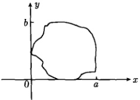

图 7.28 二维热传导系统
 

$$  u(x,0)=f_{1}(x),\quad u(x,b)=f_{2}(x)\quad(0\leqslant x\leqslant a)   \tag*{(7.3.2b)}$$

$$  u(0,y)=g_{1}(y),\quad u(a,y)=g_{2}(y)\quad(0\leqslant y\leqslant b)   \tag*{(7.3.2c)}$$

如图 7.29 所示。求解式 (7.3.2a)，式 (7.3.2b) 和式 (7.3.2c) 构成的边值问题是本节的主要内容。我们首先考虑一个基本的边值问题

$$  \frac{\partial^{2}u}{\partial x^{2}}+\frac{\partial^{2}u}{\partial y^{2}}=0\quad(0<x<a,\;0<y<b)   \tag*{(7.3.3a)}$$

$$  u(x,0)=0,u(x,b)=f_{2}(x)\quad(0\leqslant x\leqslant a)   \tag*{(7.3.3b)}$$

$$  u(0,y)=0,u(a,y)=0\qquad(0\leqslant y\leqslant b)   \tag*{(7.3.3c)}$$

 $$ u(0,y)=g_{1}(y)\begin{aligned}&y\\ &\quad b\\ &\quad\quad\nabla^{2}u=0\\ &\quad u(x,0)=f_{1}(x)\quad&a\end{aligned}\quad\begin{aligned}&u(x,b)=f_{2}(x)\\ &\quad u(a,y)=g_{2}(y)\end{aligned} $$ 

图 7.29 矩形域内拉普拉斯方程的定解问题
 

这个定解问题可以这样思考，将式(7.3.3b)视为弦振动与热传导问题中的“初始条件”，而将式(7.3.3c)视为齐次边界条件，故可以用分离变量法求出本征解，再叠加起来满足条件(7.3.3b)。因此设泛定方程(7.3.3a)有变量分离的形式解 $ u(x,t)=X(x)Y(y) $，代入式(7.3.3a)得到

$$  \boldsymbol{X}^{\prime\prime}+\lambda\boldsymbol{X}=\boldsymbol{0}   \tag*{(7.3.4a)}$$

$$  Y^{\prime\prime}-\lambda Y=0   \tag*{(7.3.4b)}$$

其中， $ \lambda $ 是分离常数。这里  $ X(x) $ 相当于波动方程与热传导方程中的空间函数，而  $ Y(y) $ 相当于时间函数。利用式 (7.3.3c)，我们得到

$$  X(0)Y(y)=0,\quad X(a)Y(y)=0   \tag*{(7.3.5)}$$

<!-- page: 222 -->

在式(7.3.5)中， $ Y(y) \neq 0 $ [否则给出平庸解  $ u(x, y) \equiv 0 $]，因此

$$  X(0)=0,\quad X(a)=0,   \tag*{(7.3.6)}$$

现在式（7.3.4a）与式（7.3.6）构成一个本征值问题（与式（6.1.12）相同）。于是本征值和本征函数为

$$  \lambda_{n}=\left(\frac{n\pi}{a}\right)^{2},X_{n}(x)=b_{n}\sin\frac{n\pi}{a}x\quad(n=1,2,3,\cdots)   \tag*{(7.3.7)}$$

其中， $ b_{n} $ 是任意常数。将  $ \lambda_{n} $ 代入式 (7.3.4b) 给出函数  $ Y(y) $ 的通解

$$  Y_{n}(y)=c_{n}\cosh\frac{n\pi}{a}y+d_{n}\sinh\frac{n\pi}{a}y   \tag*{(7.3.8)}$$

在波动方程与热传导方程情况下，时间函数没有相应的约束条件，因此它的通解不能简化。而对于  $ Y(y) $ 函数，存在条件  $ X(x)Y(0)=0 $，由于  $ X(x)\neq0 $ [否则给出平庸解  $ u(x,y)=0 $]，因此  $ Y(0)=0 $。这样由式 (7.3.8) 得到  $ c_{n}=0 $，因此，式 (7.3.8) 简化为

$$  Y_{n}(y)=d_{n}\sinh\frac{n\pi}{a}y   \tag*{(7.3.9)}$$

于是本征解为

$$  u_{n}(x,t)=X_{n}(x)Y_{n}(y)=B_{n}\sin\frac{n\pi}{a}x\sinh\frac{n\pi}{a}y   \tag*{(7.3.10)}$$

其中， $ B_{n}=b_{n}d_{n} $ 是任意常数。由于方程（7.3.3a）是线性齐次的，我们利用叠加原理将本征解（7.3.10）叠加起来，构成一般解

$$  u(x,y)=\sum_{n=1}^{\infty}B_{n}\sin\frac{n\pi}{a}x\sinh\frac{n\pi}{a}y   \tag*{(7.3.11)}$$

最后利用边界条件  $ u(x,b)=f_{2}(x) $ 确定式 (7.3.11) 中的系数  $ B_{n} $，我们有

$$  f_{2}(x)=\sum_{n=1}^{\infty}B_{n}\sinh\frac{n\pi b}{a}\sin\frac{n\pi x}{a}   \tag*{(7.3.12)}$$

其中， $ B_{n}\sinh\frac{n\pi b}{a} $ 是函数  $ f_{2}(x) $ 的半幅傅里叶级数的展开系数。由式 (2.2.2) 得到

$$  B_{n}=\frac{2}{a}\operatorname{csch}\frac{n\pi b}{a}\int_{0}^{a}f_{2}(x)\sin\frac{n\pi}{a}x\mathrm{d}x   \tag*{(7.3.13)}$$

式（7.3.11）就是定解问题（7.3.3）的一般解，其中， $ B_{n} $ 由式（7.3.13）表示。

例 1 (1) 散热片的横截面为矩形 (边长为 a 和 b)，它的一边 (y = b) 处于较高的温度 T，其他三边处于冷却介质中保持较低的零度。求出这个横截面上的稳态温度分布。(2) 如果 a = b = 1，计算散热片中心点的稳态温度。

<!-- page: 223 -->

解 (1) 设横截面上的稳态温度分布为  $ u(x,y) $，则  $ u(x,y) $ 满足下面边值问题

$$  \left\{\begin{array}{l}\frac{\partial^{2}u}{\partial x^{2}}+\frac{\partial^{2}u}{\partial y^{2}}=0\\ \end{array}\right.\qquad(0<x<a,0<y<b)   \tag*{(7.3.14a)}$$

$$  u(x,0)=0,\quad u(x,b)=T\quad(0\leqslant x\leqslant a)   \tag*{(7.3.14b)}$$

$$  u(0,y)=0,\quad u(a,y)=0\quad(0\leqslant y\leqslant b)   \tag*{(7.3.14c)}$$

利用式(7.3.12)，我们有

$$  T=\sum_{n=1}^{\infty}B_{n}\sinh\frac{n\pi b}{a}\sin\frac{n\pi}{a}x   \tag*{(7.3.15)}$$

其中， $ B_{n}\sinh\frac{n\pi}{a}b $ 是函数 T 的半幅傅里叶级数的展开系数，故由式（7.3.13）得到

 $$ \begin{aligned}B_{n}\sinh\frac{n\pi b}{a}&=\frac{2}{a}\int_{0}^{a}T\sin\frac{n\pi x}{a}\mathrm{d}x\\&=\frac{2T}{n\pi}(1-\cos n\pi)=\left\{\begin{array}{ll}0&(n=0,2,4,\cdots)\\\frac{4T}{n\pi}&(n=1,3,5,\cdots)\end{array}\right.\end{aligned} $$ 

这样

$$  B_{n}=\frac{4T}{n\pi}\mathrm{csch}\frac{n\pi b}{a}\quad(n=1,3,5,\cdots)   \tag*{(7.3.16)}$$

代入一般解(7.3.11)得到

 $$ \begin{aligned}u(x,y)&=\frac{4T}{\pi}\sum_{n=1,3,5,\cdots}^{\infty}\frac{\sin\frac{n\pi}{a}x\sinh\frac{n\pi}{a}y}{n\sinh\frac{n\pi}{a}b}\\&=\frac{4T}{\pi}\sum_{k=0}^{\infty}\frac{\sin\frac{(2k+1)\pi}{a}x\sinh\frac{(2k+1)\pi}{a}y}{(2k+1)\sinh\frac{(2k+1)\pi b}{a}}\end{aligned} $$ 

由此，定解问题（7.3.14）的解为

$$  u(x,y)=\frac{4T}{\pi}\sum_{k=0}^{\infty}\frac{\sin\frac{(2k+1)\pi}{a}x\sinh\frac{(2k+1)\pi}{a}}{(2k+1)\sinh\frac{(2k+1)\pi b}{a}}   \tag*{(7.3.17)}$$

(2) 如果 a = b = 1，中心点  $ \left(\frac{1}{2}, \frac{1}{2}\right) $ 的稳态温度由式 (7.3.17) 给出，即

<!-- page: 224 -->

$$ \begin{aligned}u\left(\frac{1}{2},\frac{1}{2}\right)&=\frac{4T}{\pi}\sum_{k=0}^{\infty}\frac{\sinh\frac{(2k+1)\pi}{2}\sin\frac{(2k+1)\pi}{2}}{(2k+1)\sinh(2k+1)\pi}\\&\quad\left\lbrack 利用 \sinh2x=2\sinh x\cosh x,\sin\frac{(2k+1)\pi}{2}=(-1)^{k}\right\rbrack\\&=\frac{2T}{\pi}\sum_{k=0}^{\infty}\frac{(-1)^{k}}{(2k+1)\cosh\frac{(2k+1)\pi}{2}}\\&=\frac{2T}{\pi}\sum_{k=0}^{\infty}\frac{(-1)^{k}}{(2k+1)}\sec h\frac{(2k+1)\pi}{2}\end{aligned} $$ 

计算出上式的求和

$$  \sum_{k=0}^{\infty}\frac{(-1)^{k}}{(2k+1)}\sec h\frac{(2k+1)\pi}{2}=0.393   \tag*{(7.3.18)}$$

于是中心点的稳态温度为

$$  u\left(\frac{1}{2},\frac{1}{2}\right)=0.25T   \tag*{(7.3.19)}$$

例如，如果 T = 100K，则中心点稳态温度为 25K。

例 2 (1) 求解边值问题 (7.3.2); (2) 如果 a = b = 1，四边的初始温度均为 T，计算散热片中心点的稳态温度。

解 (1) 由于边值问题 (7.3.2) 的线性性质，它是如下四个边值问题之和 (图7.30)，即

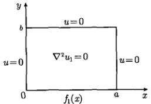

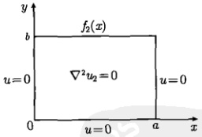

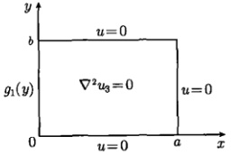

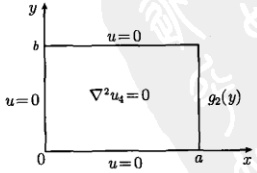

图 7.30 图中的四个边值问题之和是式（7.3.2）的解
 

$$  u=u_{1}+u_{2}+u_{3}+u_{4}   \tag*{(7.3.20)}$$

<!-- page: 225 -->

其中， $ u_{2}(x,y) $ 已经在例1中求出

$$  u_{2}(x,t)=\sum_{n=1}^{\infty}B_{n}\sin\frac{n\pi}{a}x\sinh\frac{n\pi}{a}y   \tag*{(7.3.21)}$$

其中

$$  B_{n}=\frac{2}{a}\operatorname{csch}\frac{n\pi b}{a}\int_{0}^{a}f_{2}(x)\sin\frac{n\pi}{a}x\mathrm{d}x   \tag*{(7.3.22)}$$

其他的解能被类似地求出。特别是， $ u_{4} $ 与  $ u_{2} $ 是对称的，作代换  $ x \to y $， $ a \to b $ 后，得到

$$  u_{4}(x,t)=\sum_{n=1}^{\infty}D_{n}\sinh\frac{n\pi}{b}x\sin\frac{n\pi}{b}y   \tag*{(7.3.23)}$$

其中

$$  D_{n}=\frac{2}{b}\mathrm{csch}\frac{n\pi a}{b}\int_{0}^{b}g_{2}(y)\sin\frac{n\pi}{b}y\mathrm{d}y   \tag*{(7.3.24)}$$

而  $ u_{1} $ 与  $ u_{2} $ 的结果为

$$  u_{1}(x,t)=\sum_{n=1}^{\infty}A_{n}\sin\frac{n\pi}{a}x\sin\frac{n\pi}{a}(b-y)   \tag*{(7.3.25)}$$

$$  u_{3}(x,t)=\sum_{n=1}^{\infty}C_{n}\sinh\frac{n\pi}{b}(a-x)\sin\frac{n\pi}{b}y   \tag*{(7.3.26)}$$

其中

$$  A_{n}=\frac{2}{a}\operatorname{csch}\frac{n\pi b}{a}\int_{0}^{a}f_{1}(x)\sin\frac{n\pi}{a}x\mathrm{d}x   \tag*{(7.3.27)}$$

$$  C_{n}=\frac{2}{b}\mathrm{csch}\frac{n\pi a}{b}\int_{0}^{b}g_{1}(y)\sin\frac{n\pi}{b}y\mathrm{d}y   \tag*{(7.3.28)}$$

将式(7.3.21)、式(7.3.23)、式(7.3.25)和式(7.3.26)代入式(7.3.20)，即得定解问题(7.3.2)的解

$$  \begin{aligned}u(x,t)=&\sum_{n=1}^{\infty}A_{n}\sin\frac{n\pi}{a}x\sinh\frac{n\pi}{a}(b-y)+\sum_{n=1}^{\infty}B_{n}\sin\frac{n\pi}{a}x\sinh\frac{n\pi}{a}y\\&+\sum_{n=1}^{\infty}C_{n}\sinh\frac{n\pi}{b}(a-x)\sin\frac{n\pi}{b}y+\sum_{n=1}^{\infty}D_{n}\sinh\frac{n\pi}{b}x\sin\frac{n\pi}{b}y\end{aligned}   \tag*{(7.3.29)}$$

其中的展开系数  $ A_{n} $,  $ B_{n} $,  $ C_{n} $,  $ D_{n} $ 分别由式 (7.3.27)、式 (7.3.22)、式 (7.3.28)、式 (7.3.24) 表示。式 (7.3.29) 是一个一般性的结果，适于初始边界温度  $ f_{1}(x) $,  $ f_{2}(x) $,  $ f_{3}(x) $,  $ f_{4}(x) $ 取能展开成傅里叶级数任何函数。

<!-- page: 226 -->

(2) 如果 a = b = 1，且四边的初始温度均为 T，利用式 (7.3.29) 和式 (7.3.19) 得到中心点  $ \left(\frac{1}{2}, \frac{1}{2}\right) $ 的稳态温度

$$  u\left(\frac{1}{2},\frac{1}{2}\right)=u_{1}\left(\frac{1}{2},\frac{1}{2}\right)+u_{2}\left(\frac{1}{2},\frac{1}{2}\right)+u_{3}\left(\frac{1}{2},\frac{1}{2}\right)+u_{4}\left(\frac{1}{2},\frac{1}{2}\right)=4u_{2}\left(\frac{1}{2},\frac{1}{2}\right)=T   \tag*{(7.3.30)}$$

作为一个例子，如果 T = 100K，则中心点稳态温度为 100K，即中心点与四边的温度相等。

例 3 求解上半平面拉普拉斯方程的边值问题

$$  \left\{\begin{array}{l}\frac{\partial^{2}u}{\partial x^{2}}+\frac{\partial^{2}u}{\partial y^{2}}=0\quad(y>0,-\infty<x<+\infty)\end{array}\right.   \tag*{(7.3.31a)}$$

$$  u\mid_{y=0}=f(x)\qquad(-\infty<x<+\infty)   \tag*{(7.3.31b)}$$

$$  \lim_{y\to\infty}u= 有限值 \quad(-\infty<x<+\infty)   \tag*{(7.3.31c)}$$

解 设泛定方程  $ (7.3.31a) $ 有变量分离的形式解  $ u(x,t)=X(x)Y(y) $，代入式  $ (7.3.31a) $ 得到

$$  \boldsymbol{X}^{\prime\prime}+\lambda\boldsymbol{X}=0   \tag*{(7.3.32a)}$$

$$  Y^{\prime\prime}-\lambda Y=0   \tag*{(7.3.32b)}$$

其中， $ \lambda $ 是分离常数。当  $ \lambda > 0 $ 时，方程 (7.3.32a) 的通解为

$$  X(x)=a\cos\omega x+b\sin\omega x   \tag*{(7.3.33)}$$

其中， $ \omega=\sqrt{\lambda} $，而 a，b 是任意常数。相应的，方程（7.3.32b）的通解为

$$  Y(y)=c\mathrm{e}^{\omega y}+d\mathrm{e}^{-\omega y}   \tag*{(7.3.34)}$$

其中，c，d 为任意常数。

条件式 $  (7.3.31c)  $要求 c=0，于是我们得到满足式 $  (7.3.31a)  $和式 $  (7.3.31c)  $的解

$$  u_{\omega}(x,y)=\left[A(\omega)\cos\omega x+B(\omega)\sin\omega x\right]\mathrm{e}^{-\omega y}   \tag*{(7.3.35)}$$

其中， $ A(\omega) = ad $， $ B(\omega) = bd $。为了进一步满足边界函数  $ f(x) $，需要对式（7.3.35）进行叠加构成一般解。现在变量  $ \omega $ 的变化是连续的，因此一般解是对  $ \omega $ 的积分，即

$$  u(x,y)=\int_{0}^{\infty}\left[A(\omega)\cos\omega x+B(\omega)\sin\omega x\right]\mathrm{e}^{-\omega y}\mathrm{d}\omega   \tag*{(7.3.36)}$$

由条件式（7.3.31b）得到

$$  f(x)=\int_{0}^{\infty}\left[A(\omega)\cos\omega x+B(\omega)\sin\omega x\right]\mathrm{d}\omega   \tag*{(7.3.37)}$$

<!-- page: 227 -->

它是边界函数  $ f(x) $ 的傅里叶积分表示式，由式(2.3.11)得到展开系数

$$  A(\omega)=\frac{1}{\pi}\int_{-\infty}^{\infty}f(x)\cos\omega x\mathrm{d}x   \tag*{(7.3.38a)}$$

$$  B(\omega)=\frac{1}{\pi}\int_{-\infty}^{\infty}f(x)\sin\omega x\mathrm{d}x   \tag*{(7.3.38b)}$$

式(7.3.36)就是定解问题(7.3.31)的解，其中的展开系数 $ A(\omega) $和 $ B(\omega) $由式(7.3.38)表示。确保 $ A(w) $和 $ B(w) $存在的条件是函数 $ f(x) $绝对可积(图2.7)。这个例题的另一个解法见11.1.2节例4。

例 4 对于下列三个边界函数  $ f(x) $，求解定解问题 (7.3.31):

(1) 2.3 节例 1 的函数  $ f(x)=\left\{\begin{array}{ll}1 & (|x|\leq1) \\ 0 & (|x|>1)\end{array}\right. $

(2) 3.3 节例 3 的函数  $ f(x)=\frac{1}{x^{2}+1} $

(3) 3.3 节例 15 的函数  $ f(x)=\frac{x}{x^{2}+1} $

解

(1) 由式(2.3.13) 得

$$  A(\omega)=\frac{1}{\pi}\int_{-1}^{1}\cos\omega t\mathrm{d}t=\frac{2\sin\omega}{\pi\omega},\quad B(\omega)=0   \tag*{(7.3.39)}$$

一般解(7.3.36)为

$$  u(x,y)=\frac{2}{\pi}\int_{0}^{\infty}\frac{\sin\omega\cos\omega x}{\omega}\mathrm{e}^{-\omega y}\mathrm{d}\omega=\frac{1}{\pi}\left[\arctan\left(\frac{1+x}{y}\right)+\arctan\left(\frac{1-x}{y}\right)\right]   \tag*{(7.3.40)}$$

它满足方程(7.3.31a)和条件式(7.3.31c)。当y=0时，利用式(2.3.15)，从式(7.3.40)得到

$$  u(x,0)=\frac{2}{\pi}\int_{0}^{\infty}\frac{\sin\omega\cos\omega x}{\omega}\mathrm{d}\omega=\left\{\begin{array}{ll}1&(|x|\leqslant1)\\ 0&(|x|>1)\end{array}\right.   \tag*{(7.3.41)}$$

它正是题目给定的边界函数。可见式（7.3.40）是该定解问题的解。

(2) 利用给定的边界函数，得到

$$  A(\omega)=\frac{2}{\pi}\int_{0}^{\infty}\frac{\cos\omega x}{x^{2}+1}\mathrm{d}x=\mathrm{e}^{-\omega},\quad B(\omega)=0   \tag*{(7.3.42)}$$

一般解为

 $$ u(x,y)=\int_{0}^{\infty}\mathrm{e}^{-\omega}\cos\omega x\mathrm{e}^{-\omega y}\mathrm{d}\omega $$

<!-- page: 228 -->

$$  \begin{aligned}&=\int_{0}^{\infty}\cos\omega x\cdot\mathrm{e}^{-\omega(y+1)}\mathrm{d}\omega\\&=\frac{y+1}{(y+1)^{2}+x^{2}}\end{aligned}   \tag*{(7.3.43a)}$$

它满足方程（7.3.31a）和条件式（7.3.31c）。当 y = 0 时，式给（7.3.43a）出

$$  u(x,0)=\frac{1}{x^{2}+1}   \tag*{(7.3.43b)}$$

它正是题目给定的边界函数。可见式（7.3.43a）是该定解问题的解。

(3) 利用 3.3 节例 15 的结果，得到

$$  A(\omega)=0,\quad B(\omega)=\frac{1}{\pi}\int_{-\infty}^{\infty}\frac{x\sin\omega x}{x^{2}+1}\mathrm{d}x=\mathrm{e}^{-\omega}   \tag*{(7.3.44)}$$

一般解为

$$  \begin{aligned}u(x,y)&=\int_{0}^{\infty}\mathrm{e}^{-\omega}\sin\omega x\mathrm{e}^{-\omega y}\mathrm{d}\omega\\&=\int_{0}^{\infty}\sin\omega x\cdot\mathrm{e}^{-\omega(y+1)}\mathrm{d}\omega\\&=\frac{x}{(y+1)^{2}+x^{2}}\end{aligned}   \tag*{(7.3.45a)}$$

它满足方程（7.3.31a）和条件（7.3.31c）。当 y = 0 时，上式给出

$$  u(x,0)=\frac{x}{x^{2}+1}   \tag*{(7.3.45b)}$$

它正是题目给定的边界函数。可见式（7.3.45a）是该定解问题的解。

#### 7.3.2 极坐标系的拉普拉斯方程

考虑一个半径为 a 的薄圆片 (图 7.31)，它是一个二维的热传导系统，热量在其中传播。当系统达到恒稳状态时，圆片上的温度分布  $ u(r,\theta) $ 服从极坐标系的拉普拉斯方程 [见式 (1.2.31)]

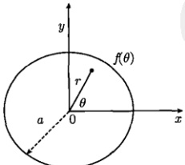

图 7.31 半径为 a 的薄圆片， $ f(\theta) $ 为边缘的温度分布
 

<!-- page: 229 -->

$$  \frac{1}{r}\frac{\partial}{\partial r}\left(r\frac{\partial u}{\partial r}\right)+\frac{1}{r^{2}}\frac{\partial^{2}u}{\partial\theta^{2}}=0\quad(0<r<a,0<\theta<2\pi)   \tag*{(7.3.46a)}$$

设圆盘边缘的温度分布为

$$  u(a,\theta)=f(\theta)\quad(0\leqslant\theta\leqslant2\pi)   \tag*{(7.3.46b)}$$

式(7.3.46)是一个圆域内拉普拉斯方程的定解问题，我们用分离变量法进行求解，设方程(7.3.46a)有径向变量r和角向变量 $ \theta $分离的形式解

$$  u(r,\theta)=R(r)\theta(\theta)   \tag*{(7.3.47)}$$

将式（7.3.47）代入式（7.3.46a），分离变量后得到

$$  \frac{r^{2}R^{\prime\prime}+rR^{\prime}}{R}=-\frac{\theta^{\prime\prime}}{\theta}=\lambda   \tag*{(7.3.48)}$$

其中， $ \lambda $ 是分离常数。由此得到径向和角向方程

$$  \boldsymbol{r}^{2}\boldsymbol{R}^{\prime\prime}+\boldsymbol{r}\boldsymbol{R}^{\prime}-\lambda\boldsymbol{R}=0   \tag*{(7.3.49a)}$$

$$  \theta^{\prime\prime}+\lambda\theta=0   \tag*{(7.3.49b)}$$

现在仅有定解条件 (7.3.46b)，即  $ R(a)\Theta(\theta)=f(\theta) $，它不能分离成关于 R 和  $ \theta $ 的两个独立的边界条件，不能构成关于 R 和  $ \theta $ 的常微分方程的定解问题。我们必须寻找物理上的边界条件。事实上，该定解问题存在以下两个定解条件。

(1) 很明显， $ (r,\theta) $ 与  $ (r,\theta+2\pi) $ 在物理上代表系统的同一个点，具有相同的温度

$$  u(r,\theta)=u(r,\theta+2\pi)   \tag*{(7.3.50)}$$

这意味着函数  $ u(r,\theta) $ 是关于  $ \theta $ 的周期函数，周期为  $ 2\pi $。条件式 (7.3.50) 称为“周期性边界条件”。

(2) 物理上认定，圆盘中心的温度是有限的

$$  u(0,\theta)= 有限值   \tag*{(7.3.51)}$$

条件式（7.3.51）称为“自然边界条件”。

这样一来，这两个条件分别与角向方程（7.3.49b）与径向方程（7.3.49a）结合，构成两个独立的定解问题

$$  \left\{\begin{array}{l}\theta^{\prime\prime}+\lambda\theta=0\\ \\ \theta(\theta+2\pi)=\theta(\theta)\end{array}\right.   \tag*{(7.3.52a)}$$

<!-- page: 230 -->

$$  r^{2}R^{\prime\prime}+r R^{\prime}-\lambda R=0   \tag*{(7.3.53a)}$$

$$  R(0)= 有限值   \tag*{(7.3.53b)}$$

接下来我们将逐一求解角向和径向的定解问题，至于边界条件（7.3.46b），将像弦振动和热传递问题中的初始条件一样，最后再去考虑。

我们首先求解本征值问题（7.3.52），考虑三种情况：

(1)  $ \lambda=0 $，这时方程(7.3.52a)的通解为  $ \theta(\theta)=A+B\theta $，其中A和B为任意常数。这时常数解  $ \theta(\theta)=A $ 满足边界条件(7.3.52b)。故将此时本征值问题(7.3.52)的解记为  $ \lambda_{0}=0,\theta_{0}(\theta)=A_{0} $。

(2) $ \lambda<0 $，这时方程（7.3.52a）的通解为

$$  \Theta(\theta)=A\cosh k\theta+B\sinh k\theta   \tag*{(7.3.54)}$$

其中， $ k=\sqrt{-\lambda} $，这个解不能满足周期性边界条件(7.3.52b)，除非 A=B=0。

(3)  $ \lambda > 0 $，这时方程（7.3.52a）的通解为

$$  \Theta(\theta)=A\cos k\theta+B\sin k\theta   \tag*{(7.3.55)}$$

其中， $ k = \sqrt{\lambda} $，A 和 B 是任意常数。解 (7.3.55) 满足周期性边界条件 (7.3.52b) 的条件是

$$  k=n\quad(n=1,2,3,\cdots)   \tag*{(7.3.56)}$$

这里 n 不取零和负值是因为 k > 0。于是本征值问题 (7.3.52) 的解为

$$  \lambda_{n}=n^{2},\quad\Theta_{n}(\theta)=A_{n}\cos n\theta+B_{n}\sin n\theta\quad(n=1,2,3,\cdots)   \tag*{(7.3.57)}$$

将上述所有的本征值  $ \lambda_{n}(n=0,1,2,\cdots) $ 代入方程 (7.3.53a) 得到径向函数  $ R(r) $ 的方程

$$  r^{2}R_{n}^{\prime\prime}+rR_{n}^{\prime}-n^{2}R_{n}=0\quad(n=0,1,2,\cdots)   \tag*{(7.3.58)}$$

这是一个欧拉方程。它的一般形式是

$$  x^{2}y^{\prime\prime}+\alpha x y^{\prime}+\beta y=0   \tag*{(7.3.59)}$$

欧拉方程的特征方程为

$$  \rho^{2}+\left(\alpha-1\right)\rho+\beta=0   \tag*{(7.3.60)}$$

它有两个根  $ \rho_{1} $ 和  $ \rho_{1} $。如果  $ \rho_{1} \neq \rho_{2} $，则式 (7.3.59) 的通解为  $ y = cx^{\rho_{1}} + dx^{\rho_{2}} $；如果  $ \rho_{1} = \rho_{2} = \rho $，则通解为  $ y = cx^{\rho} + dx^{\rho} \ln x $。现在式 (7.3.58) 的特征方程为

$$  \rho^{2}-n^{2}=0   \tag*{(7.3.61)}$$

<!-- page: 231 -->

当 n=0 时， $ \rho=0 $，方程(7.3.58)的解为

$$  R_{0}(r)=c_{0}+d_{0}\ln r   \tag*{(7.3.62)}$$

当 n=1,2,3,\cdots 时， $ \rho_{1}=n,\rho_{2}=-n $，方程(7.3.58)的解可以写为

$$  R_{n}(r)=c_{n}\left(\frac{r}{a}\right)^{n}+d_{n}\left(\frac{r}{a}\right)^{-n}   \tag*{(7.3.63)}$$

注意到当  $ r \to 0 $ 时，式 (7.3.62) 和式 (7.3.63) 给出  $ R_{0}(r) \to \infty $， $ R_{n}(r) \to \infty $。为了满足自然边界条件 (7.3.53b)，必须取  $ d_{0} = 0 $， $ d_{n} = 0 $，这样

$$  R_{0}=c_{0},\quad R_{n}(r)=c_{n}\left(\frac{r}{a}\right)^{n}   \tag*{(7.3.64)}$$

于是我们由式（7.3.47）得到本征解

$$  u_{0}(r,\theta)=a_{0}   \tag*{(7.3.65)}$$

$$  u_{n}(r,\theta)=\left(\frac{r}{a}\right)^{n}(a_{n}\cos n\theta+b_{n}\sin n\theta)\quad(n=1,2,3,\cdots)   \tag*{(7.3.66)}$$

这里， $ a_{0}=A_{0}c_{0} $， $ a_{n}=A_{n}c_{n} $， $ b_{n}=B_{n}c_{n} $。而一般解为

$$  u(r,\theta)=a_{0}+\sum_{n=1}^{\infty}\left(\frac{r}{a}\right)^{n}(a_{n}\cos n\theta+b_{n}\sin n\theta)   \tag*{(7.3.67)}$$

现在我们考虑边界条件（7.3.46b），由式（7.3.67）得到

$$  f(\theta)=a_{0}+\sum_{n=1}^{\infty}(a_{n}\cos n\theta+b_{n}\sin n\theta)   \tag*{(7.3.68)}$$

式(7.3.68)是函数 $ f(\theta) $的傅里叶级数。其中， $ a_{0} $， $ a_{n} $和 $ b_{n} $由式(2.1.2)和式(2.1.6)确定，即

$$  a_{0}=\frac{1}{2\pi}\int_{0}^{2\pi}f(\theta)\mathrm{d}\theta   \tag*{(7.3.69a)}$$

$$  a_{n}=\frac{1}{\pi}\int_{0}^{2\pi}f(\theta)\cos n\theta\mathrm{d}\theta   \tag*{(7.3.69b)}$$

$$  b_{n}=\frac{1}{\pi}\int_{0}^{2\pi}f(\theta)\sin n\theta\mathrm{d}\theta   \tag*{(7.3.69c)}$$

式(7.3.69a)显示了 $ a_{0} $的物理意义，它是圆盘边缘温度的平均值。式(7.3.67)就是定解问题(7.3.46)的解，它给出圆盘上任意点 $ (r,\theta) $的温度。而圆盘中心r=0的温度为 $ u(0,\theta)=a_{0} $，它等于圆盘边缘温度的平均值。

例 1 设圆盘边缘的温度分布为  $ f(x)=A\cos\theta $，求解边值问题 (7.3.46)。

<!-- page: 232 -->

解　这是定解问题（7.3.46）的一个具体例子，按照式（7.3.69）计算展开系数，得到

$$  a_{0}=\frac{1}{2\pi}\int_{0}^{2\pi}A\cos\theta\mathrm{d}\theta=0   \tag*{(7.3.70a)}$$

$$  a_{n}=\frac{1}{\pi}\int_{0}^{2\pi}A\cos\theta\cos n\theta\mathrm{d}\theta=A\delta_{1n}   \tag*{(7.3.70b)}$$

这里的运算用到式(2.1.3)，而

$$  b_{n}=\frac{1}{\pi}\int_{0}^{2\pi}A\cos\theta\sin n\theta\mathrm{d}\theta=0   \tag*{(7.3.70c)}$$

于是一般解为

$$  u(r,\theta)=\sum_{n=1}^{\infty}\left(\frac{r}{a}\right)^{n}A\delta_{1n}\cos n\theta=A\frac{r}{a}\cos\theta   \tag*{(7.3.71)}$$

圆盘中心的温度为  $ u(0,\theta)=0 $。

例 2 设圆盘的半径 a = 1，边缘的温度分布为

$$  f(\theta)=\left\{\begin{array}{c l}1&\left(0<\theta<\pi\right)\\ 0&(\pi<\theta<2\pi)\end{array}\right.   \tag*{(7.3.72)}$$

如图 7.32 所示，求解边值问题 (7.3.46)。

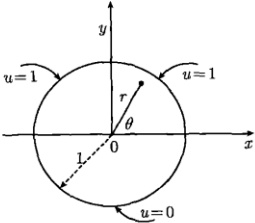

图 7.32 半径为 1 的薄圆盘，边缘的温度分布为函数（7.3.72）
 

解　这是定解问题（7.3.46）的一个具体例子，按照式（7.3.69）计算展开系数，得到

$$  a_{0}=\frac{1}{2\pi}\int_{0}^{\pi}\mathrm{d}\theta=\frac{1}{2}   \tag*{(7.3.73a)}$$

$$  a_{n}=\frac{1}{\pi}\int_{0}^{\pi}\cos n\theta\mathrm{d}\theta=0   \tag*{(7.3.73b)}$$

$$  b_{n}=\frac{1}{\pi}\int_{0}^{\pi}\sin n\theta\mathrm{d}\theta=\frac{1}{n\pi}\left(1-\cos n\pi\right)=\left\{\begin{array}{r}0\quad(n=0,2,4,\cdots)\\ \displaystyle\frac{2}{n\pi}\quad(n=1,3,5,\cdots)\end{array}\right.   \tag*{(7.3.73c)}$$

<!-- page: 233 -->

代入式(7.3.67)得到一般解

$$  u(r,\theta)=\frac{1}{2}+\frac{2}{\pi}\sum_{k=0}^{\infty}\frac{r^{2k+1}}{2k+1}\sin(2k+1)\theta   \tag*{(7.3.74)}$$

圆盘中心的温度为  $ u(0,\theta)=\frac{1}{2} $，它等于圆盘边缘温度的平均值。在 r=1 时，式 (7.3.74) 给出

$$  u(1,\theta)=\frac{1}{2}+\frac{2}{\pi}\sum_{k=0}^{\infty}\frac{1}{2k+1}\sin(2k+1)\theta   \tag*{(7.3.75)}$$

按照给定的边界条件，级数（7.3.75）应该表示函数（7.3.72）。为了搞清楚二者的关系，我们考查函数（7.3.72）。它作为圆盘边缘的温度分布，满足周期性边界条件： $ f(\theta + 2\pi) = f(\theta) $，如图7.33所示。这样它可以展开成傅里叶级数[式(2.1.1)]，其中的展开系数由式(2.1.2)和式(2.1.6)确定。事实上，对于函数(7.3.72)计算其展开系数时，正如式(7.3.73)所示，可见式(7.3.75)是函数(7.3.72)的傅里叶级数。为了说明这一结论，我们作出式(7.3.75)的部分和，如图7.34所示。可以看出当求和项数增加时，曲线趋于函数(7.3.72)。

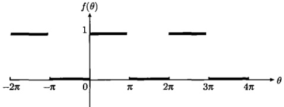

图 7.33 函数（7.3.72）是一个以  $ 2\pi $ 为周期的函数
 

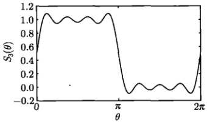

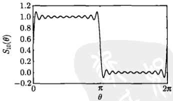

图 7.34 傅里叶级数（7.3.75）的部分和（前 3 项及前 10 项）
 

#### 例 3 求定解问题

$$  \left\{\begin{array}{l}\displaystyle\frac{\partial^{2}u}{\partial x^{2}}+\frac{\partial^{2}u}{\partial y^{2}}=0\quad\left(x^{2}+y^{2}<1\right)\\ \\ u\mid_{x^{2}+y^{2}=1}=x+y\end{array}\right.   \tag*{(7.3.76a)}$$

<!-- page: 234 -->

并解释结果的物理含义。

解 这是一个圆域的拉普拉斯方程的定解问题，在极坐标系表示为

$$  \left\{\begin{array}{l l}\frac{1}{r}\frac{\partial}{\partial r}\left(r\frac{\partial u}{\partial r}\right)+\frac{1}{r^{2}}\frac{\partial^{2}u}{\partial\theta^{2}}=0&\left(0<r<1,0<\theta<2\pi\right)\\ u(1,\theta)=\cos\theta+\sin\theta&\left(0\leqslant\theta\leqslant2\pi\right)\end{array}\right.   \tag*{(7.3.77a)}$$

这是定解问题（7.3.46）的一个具体例子，按照式（7.3.69）计算展开系数，得到

 $$ a_{0}=\frac{1}{2\pi}\int_{0}^{2\pi}(\cos\theta+\sin\theta)\mathrm{d}\theta=0 $$ 

 $$ \begin{aligned}a_{n}&=\frac{1}{\pi}\int_{0}^{2\pi}\left(\cos\theta+\sin\theta\right)\cos n\theta\mathrm{d}\theta\\&=\frac{1}{\pi}\int_{0}^{2\pi}\cos\theta\cos n\theta\mathrm{d}\theta+\frac{1}{\pi}\underbrace{\int_{0}^{2\pi}\sin\theta\cos n\theta\mathrm{d}\theta}_{=0}\\&=\frac{1}{\pi}\int_{0}^{2\pi}\cos\theta\cos n\theta\mathrm{d}\theta=\delta_{1n}\end{aligned} $$ 

 $$ \begin{aligned}b_{n}&=\frac{1}{\pi}\int_{0}^{2\pi}\left(\cos\theta+\sin\theta\right)\sin n\theta\mathrm{d}\theta\\&=\frac{1}{\pi}\underbrace{\int_{0}^{2\pi}\cos\theta\sin n\theta\mathrm{d}\theta}_{=0}+\frac{1}{\pi}\int_{0}^{2\pi}\sin\theta\sin n\theta\mathrm{d}\theta\\&=\frac{1}{\pi}\int_{0}^{2\pi}\sin\theta\sin n\theta\mathrm{d}\theta=\delta_{1n}\end{aligned} $$ 

代入式(7.3.67)得到一般解

 $$ \begin{array}{r l}{u(r,\theta)}&{=a_{0}+\displaystyle\sum_{n=1}^{\infty}r^{n}\delta_{1n}\left(\cos n\theta+\sin n\theta\right)}\\ &{=r\left(\cos\theta+\sin\theta\right)}\end{array} $$ 

转换到直角坐标系

$$  u(x,y)=x+y   \tag*{(7.3.78)}$$

我们从温度分布的角度解释这个结果的物理含义。所讨论的热传导系统是一个单位圆盘，定解问题的结果是：内部温度分布  $ u(x,y)=x+y $ 与边界条件  $ u|_{x^2+y^2=1}=x+y $ 是相同的。这表示圆盘内部与边缘的温度分布服从相同的规律，即任意一点的温度（不管是内部还是边缘）都等于该点的纵、横坐标之和。

<!-- page: 235 -->

我们进一步讨论系统的等温线，圆盘上具有相同温度的点 $ (x,y) $满足

$$  x+y=c, 即 y=-x+c   \tag*{(7.3.79)}$$

其中，c 是常数。式 (7.3.79) 就是系统的等温线，如图 7.35 所示，它是一族斜率为 -1 的平行线。特别是，图中的实线是等温线  $ x + y = 1 $，线上所有点的温度均为 1，包括边界上的两个点： $ A(1,0) $ 和  $ B(0,1) $；图中的虚线是等温线  $ x + y = 0 $，线上所有点的温度均为 0，包括边界上的两个点： $ C(1/\sqrt{2}, -1/\sqrt{2}) $ 和  $ D(-1/\sqrt{2}, 1/\sqrt{2}) $。总之，圆盘上斜率为 -1 的直线所覆盖的点（包括内部与边缘）具有相同的温度 c[c 是该直线在 y 轴（或 x 轴）上的截距]。

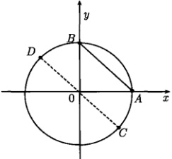

图 7.35 圆盘内部与边缘的温度分布服从相同的规律
 

需要说明，对于热传导问题，由于温度  $ c \geq 0 $，所以实际问题的解限于 CD 右上方的半圆区域。但是定解问题 (7.3.76) 是一般性的，没有限定具体的物理系统，问题的解遍及整个单位圆盘。

