# 08-第8章 本征函数法

[返回全书目录](../../README.md)

> PDF 页码：236–277

<!-- page: 236 -->

### 第8章 本征函数法

第6、7章所讨论的分离变量法主要解决由齐次方程和齐次边界条件构成的定解问题，本章我们要处理非齐次方程的问题。由于不能使用叠加原理，所以先前的求解方法（分离变量 → 求本征解 → 叠加 → 确定系数）不能使用，必须采用新的方法。一个可以处理非齐次方程定解问题的方法称为“本征函数法”。这种方法不需要分离变量，而是按照相应的齐次问题的边界条件，选择适当的本征函数集合，直接写出级数形式解，再利用泛定方程和初始条件确定级数中的展开系数。这是一种具有“综合”思路的方法，可以处理多种类型的定解问题。

### 8.1 本征函数法的引入

我们在求解两端固定弦振动的定解问题（6.1.1）时，最后得到的一般解为式(6.1.24)。可以看出，这个解及相应的初始条件式(6.1.26)都是按本征函数集

$$  \left\{\sin\frac{n\pi}{L}x\right\}\quad(n=1,2,3,\cdots)   \tag*{(8.1.1)}$$

展开的。这给我们一个启示，能否一开始就将定解问题(6.1.1)的一般解写成这个本征函数集的展开式。当然，一般解 $ u(x,t) $既包含空间变量x，也包含时间变量t，因此展开系数一定是时间t的函数。我们可以按这样的思考，重新试解定解问题(6.1.1)，设它的形式解为

$$  u(x,t)=\sum_{n=1}^{\infty}T_{n}(t)\sin\frac{n\pi}{L}x   \tag*{(8.1.2)}$$

其中，展开系数  $ T_{n}(t) $ 是时间 t 的函数。这个解满足边界条件式 (6.1.1c)，因为最初取空间函数为  $ \sin(n\pi x/L) $ 是由边界条件决定的（见 6.1.1 的求解过程）。事实上，在解 (8.1.2) 中取 x=0 和 x=L 确实给出边界条件式 (6.1.1c)。下面我们让式 (8.1.2) 进一步满足泛定方程 (6.1.1a) 和初始条件式 (6.1.1b)，为此将形式解 (8.1.2) 代入方程 (6.1.1a) 得到

$$  \sum_{n=1}^{\infty}\left[T_{n}^{\prime\prime}(t)+\left(\frac{na\pi}{L}\right)^{2}T_{n}(t)\right]\sin\frac{n\pi}{L}x=0   \tag*{(8.1.3)}$$

求和中的各项是相互独立的，式 (8.1.3) 成立的必要充分条件是左边级数的每一项

<!-- page: 237 -->

为零，而  $ \sin(n\pi x/L) \neq 0 $ (否则导致平庸解)，因此

$$  T_{n}^{\prime\prime}(t)+\left(\frac{n a\pi}{L}\right)^{2}T_{n}(t)=0   \tag*{(8.1.4)}$$

这正是分离变量法中的时间函数 T(t) 的方程 (6.1.21)，它的通解为式 (6.1.22)。将式 (6.1.22) 代入式 (8.1.2) 立即得到

$$  u(x,t)=\sum_{n=1}^{\infty}\left(C_{n}\cos\frac{na\pi}{L}t+D_{n}\sin\frac{na\pi}{L}t\right)\sin\frac{n\pi}{L}x   \tag*{(8.1.5)}$$

这正是定解问题(6.1.1)的一般解。至于利用初始条件式(6.1.1b)确定展开系数 $ C_{n} $与 $ D_{n} $的过程，与6.1.1节完全相同。

上述这种求解定解问题的方法称为本征函数法，它的思路是直截了当的：按本征函数集写出级数形式解（8.1.2）之后，只需要利用泛定方程（6.1.1a）和初始条件（6.1.1b）来确定其中的展开系数  $ T(t) $ 即可

本征函数法的关键在于选择本征函数集，而本征函数集的选择完全由定解问题的边界条件而定。应用最为广泛的方程  $ X''(x) + \lambda X(x) = 0 $ 的本征函数集列在表 6.2 和表 7.1 之中。对于未知的齐次泛定方程和齐次边界条件构成的定解问题，可以求解相应的本征值问题

$$  \left\{\begin{array}{l}F X_{n}=\lambda_{n}X_{n}\\  边界条件 \end{array}\right.   \tag*{(8.1.6a)}$$

从而得到本征函数集 $ \{X_{n}\} $。

下面我们用一个简单的例子说明本征函数法的应用。

例 用本征函数法求解下列热传导的定解问题

$$  \left\{\begin{array}{l}\displaystyle\frac{\partial u}{\partial t}=a^{2}\frac{\partial^{2}u}{\partial x^{2}}\quad\left(0<x<L,t>0\right)\end{array}\right.   \tag*{(8.1.7a)}$$

$$  u\big|_{t=0}=\cos\frac{3\pi}{2L}x   \tag*{(8.1.7b)}$$

$$  \left.\frac{\partial u}{\partial x}\right|_{x=0}=0,\quad u\mid_{x=L}=0\quad(t>0)   \tag*{(8.1.7c)}$$

解 按照边界条件式 (8.1.7c)，从表 6.2 选出本征函数集

$$  \left\{\cos\frac{(2n+1)\pi}{2L}x\right\}\quad(n=0,\;1,\;2,\cdots)   \tag*{(8.1.8)}$$

设定解问题（8.1.7）的形式解为

$$  u(x,t)=\sum_{n=0}^{\infty}T_{n}(t)\cos\frac{(2n+1)\pi}{2L}x   \tag*{(8.1.9)}$$

<!-- page: 238 -->

其中， $ T_{n}(t) $ 是时间 t 依赖的展开系数，将式 (8.1.9) 代入泛定方程 (8.1.7a) 得到

$$  \sum_{n=0}^{\infty}\left\{T_{n}^{\prime}(t)+\left[\frac{(2n+1)\pi a}{2L}\right]^{2}T_{n}(t)\right\}\cos\frac{(2n+1)\pi}{2L}x=0   \tag*{(8.1.10)}$$

于是

$$  T_{n}^{\prime}(t)+\left[\frac{(2n+1)\pi a}{2L}\right]^{2}T_{n}(t)=0   \tag*{(8.1.11)}$$

它的通解为

$$  T_{n}(t)=C_{n}\exp\left\{-\left[\frac{(2n+1)\pi a}{2L}\right]^{2}t\right\}   \tag*{(8.1.12)}$$

将式（8.1.12）代入式（8.1.9）得到

$$  u(x,t)=\sum_{n=0}^{\infty}C_{n}\exp\left\{-\left[\frac{(2n+1)\pi a}{2L}\right]^{2}t\right\}\cos\frac{(2n+1)\pi}{2L}x   \tag*{(8.1.13)}$$

现在利用初始条件确定展开系数  $ C_{n} $，设初始温度分布为  $ \phi(x) $，我们有

$$  \phi(x)=\sum_{n=0}^{\infty}C_{n}\cos\frac{(2n+1)\pi}{2L}x   \tag*{(8.1.14a)}$$

利用式(2.2.12)得到

$$  C_{n}=\frac{2}{L}\int_{0}^{L}\phi(x)\cos\frac{(2n+1)\pi}{2L}x\mathrm{d}x   \tag*{(8.1.14b)}$$

式(8.1.13)就是定解问题的一般解，其中，展开系数  $ C_{n} $ 由式(8.1.14b)确定。现在将式(8.1.7b)中的初始温度  $ \cos\frac{3\pi}{2L}x $ 代入式(8.1.14b)，得到

 $$ \begin{aligned}C_{n}&=\frac{2}{L}\int_{0}^{L}\cos\frac{3\pi}{2L}x\cos\frac{(2n+1)\pi}{2L}x\mathrm{d}x\\&=\frac{2}{L}\int_{0}^{L}\cos\frac{(2\cdot1+1)\pi}{2L}x\cos\frac{(2n+1)\pi}{2L}x\mathrm{d}x=\delta_{1n}\end{aligned} $$ 

进而将  $ C_{n} $ 代入式 (8.1.13) 得到

 $$ \begin{aligned}u(x,t)&=\sum_{n=0}^{\infty}\delta_{1n}\exp\left\{-\left[\frac{(2n+1)\pi a}{2L}\right]^{2}t\right\}\cos\frac{(2n+1)\pi}{2L}x\\&=\exp\left[-\left(\frac{3\pi a}{2L}\right)^{2}t\right]\cos\frac{3\pi}{2L}x\end{aligned} $$ 

这就是定解问题 (8.1.7) 的一般解，它是一个简单的初等函数，其空间部分是余弦函数，而时间部分是指数衰减函数。

<!-- page: 239 -->

### 8.2 非齐次方程的解法

利用本征函数法求解定解问题的要点是：①根据边界条件选择本征函数集，写出定解问题的级数形式解；②将它代入泛定方程得到展开系数  $ T_{n}(t) $ 所满足的常微分方程；③解出  $ T_{n}(t) $ 后，将它代入形式解并利用初始条件确定其中的系数。这个方法的优点是思路简洁、运算简便，更重要的是它可以用来求解非齐次方程的定解问题。

#### 8.2.1 一分为二法

现在求解如下非齐次波动方程（即强迫弦振动方程）的定解问题

$$  \frac{\partial^{2}v}{\partial t^{2}}=a^{2}\frac{\partial^{2}v}{\partial x^{2}}+f(x,t)\qquad(0<x<L,t>0)   \tag*{(8.2.1a)}$$

$$  v\vert_{x=0}=0,\quad v\vert_{x=L}=0\quad(t>0)   \tag*{(8.2.1b)}$$

$$  v\big|_{t=0}=0,\quad\left.\frac{\partial v}{\partial t}\right|_{t=0}=0\quad(0\leqslant x\leqslant L)   \tag*{(8.2.1c)}$$

首先选择本征函数集，它由相应的齐次方程  $ \left(即\frac{\partial^{2}v}{\partial t^{2}}=a^{2}\frac{\partial^{2}v}{\partial x^{2}}\right) $ 和现定的齐次边界条件式 (8.2.1b) 确定。由表 6.2 查出相应的本征函数集，即式 (8.1.1)，然后写出形式解为

$$  v(x,t)=\sum_{n=1}^{\infty}g_{n}(t)\sin\frac{n\pi}{L}x   \tag*{(8.2.2)}$$

其中， $ g_{n}(t) $ 是时间依赖的展开系数。作为函数  $ v(x,t) $ 的半幅傅里叶级数的展开系数，它应该满足式 (2.2.2)，即

$$  g_{n}(t)=\frac{2}{L}\int_{0}^{L}v(x,t)\sin\frac{n\pi x}{L}\mathrm{d}x   \tag*{(8.2.3a)}$$

为了后面的需要，写出它的时间导数

$$  g_{n}^{\prime}(t)=\frac{2}{L}\int_{0}^{L}\frac{\partial v(x,t)}{\partial t}\sin\frac{n\pi x}{L}\mathrm{d}x   \tag*{(8.2.3b)}$$

将式 (8.2.2) 代入式 (8.2.1a) 得到

$$  \sum_{n=1}^{\infty}\left[g_{n}^{\prime\prime}(t)+\left(\frac{na\pi}{L}\right)^{2}g_{n}(t)\right]\sin\frac{n\pi}{L}x=f(x,t)   \tag*{(8.2.4)}$$

<!-- page: 240 -->

其中的驱动项  $ f(x,t) $ 是已知函数，也按该本征函数集展开

$$  f(x,t)=\sum_{n=1}^{\infty}f_{n}(t)\sin\frac{n\pi}{L}x   \tag*{(8.2.5)}$$

式（8.2.5）是函数  $ f(x,t) $ 的半幅傅里叶级数，由式（2.2.2）得到展开系数

$$  f_{n}(t)=\frac{2}{L}\int_{0}^{L}f(x,t)\sin\frac{n\pi}{L}x\mathrm{d}x   \tag*{(8.2.6)}$$

现在将式（8.2.5）代入式（8.2.4），整理后得

$$  \sum_{n=1}^{\infty}\left[g_{n}^{\prime\prime}(t)+\left(\frac{na\pi}{L}\right)^{2}g_{n}(t)-f_{n}(t)\right]\sin\frac{n\pi}{L}x=0   \tag*{(8.2.7)}$$

由此得

$$  g_{n}^{\prime\prime}(t)+\left(\frac{na\pi}{L}\right)^{2}g_{n}(t)-f_{n}(t)=0   \tag*{(8.2.8)}$$

由初始条件式（8.2.1c）与式（8.2.3）得到

$$  g_{n}(0)=0,\quad g_{n}^{\prime}(0)=0   \tag*{(8.2.9)}$$

现在方程(8.2.8)与初始条件式(8.2.9)构成了常微分方程的初值问题，我们用拉普拉斯变换法求解。为此对式(8.2.8)两边取拉普拉斯变换，并利用式(8.2.9)，得到象函数的代数方程

$$  p^{2}G_{n}(p)+\left(\frac{na\pi}{L}\right)^{2}G_{n}(p)-F_{n}(p)=0   \tag*{(8.2.10)}$$

其中， $ G_{n}(p) = \mathcal{L}\{g_{n}(t)\} $， $ F_{n}(p) = \mathcal{L}\{f_{n}(t)\} $ 分别是  $ g_{n}(t) $ 和  $ f_{n}(t) $ 的象函数。解代数方程 (8.2.10) 得到

$$  G_{n}(p)=\frac{F_{n}(p)}{p^{2}+\left(\frac{na\pi}{L}\right)^{2}}   \tag*{(8.2.11)}$$

现在对式 (8.2.11) 反演，按照卷积定理 (4.1.26)，并利用式 (4.2.2a)，得到

$$  g_{n}(t)=\frac{L}{na\pi}\int_{0}^{t}f_{n}(\tau)\sin\frac{na\pi}{L}(t-\tau)\mathrm{d}\tau   \tag*{(8.1.12)}$$

将式 (8.2.12) 代入式 (8.2.2)，得到

$$  v(x,t)=\sum_{n=1}^{\infty}\left[\frac{L}{na\pi}\int_{0}^{t}f_{n}(\tau)\sin\frac{na\pi}{L}(t-\tau)\mathrm{d}\tau\right]\sin\frac{n\pi}{L}x   \tag*{(8.2.13)}$$

这就是定解问题 (8.2.1) 的解，其中， $ f_{n}(t) $ 由式 (8.2.6) 表示。

<!-- page: 241 -->

例 设  $ f(x,t)=\sin\frac{2\pi x}{L}\sin\frac{2a\pi t}{L} $，求解定解问题 (8.2.1)。

解 由式(8.2.6)得到

 $$ \begin{aligned}f_{n}(t)&=\frac{2}{L}\int_{0}^{L}\sin\frac{2\pi x}{L}\sin\frac{2a\pi t}{L}\sin\frac{n\pi}{L}x\mathrm{d}x\\&=\frac{2}{L}\sin\frac{2a\pi t}{L}\int_{0}^{L}\sin\frac{2\pi x}{L}\sin\frac{n\pi}{L}x\mathrm{d}x\\&=\sin\frac{2a\pi t}{L}\delta_{2n}\\ \end{aligned} $$ 

代入式(8.2.13)，得到

 $$ \begin{aligned}v(x,t)&=\sum_{n=1}^{\infty}\delta_{2n}\left[\frac{L}{na\pi}\int_{0}^{t}\sin\frac{2a\pi\tau}{L}\sin\frac{na\pi}{L}(t-\tau)\mathrm{d}\tau\right]\sin\frac{n\pi}{L}x\\&=\frac{L}{2a\pi}\left[\int_{0}^{t}\sin\frac{2a\pi\tau}{L}\sin\frac{2a\pi}{L}(t-\tau)\mathrm{d}\tau\right]\sin\frac{2\pi}{L}x\\&=\frac{L}{4a\pi}\left(\frac{L}{2a\pi}-t\cos\frac{2a\pi}{L}t\right)\sin\frac{2\pi}{L}x\\ \end{aligned} $$ 

这就是定解问题（8.2.1）在给定外热源之下的解。

接下来我们进一步求解定解问题

$$  \frac{\partial^{2}w}{\partial t^{2}}=a^{2}\frac{\partial^{2}w}{\partial x^{2}}+f(x,t)\quad(0<x<L,t>0)   \tag*{(8.2.14a)}$$

$$  w|_{x=0}=0,\quad w|_{x=L}=0\quad(t>0)   \tag*{(8.2.14b)}$$

$$  w\vert_{t=0}=\phi(x),\quad\left.\frac{\partial w}{\partial t}\right|_{t=0}=\psi(x)\quad(0\leqslant x\leqslant L)   \tag*{(8.2.14c)}$$

由于方程和定解条件都是线性的，我们令

$$  w(x,t)=u(x,t)+v(x,t)   \tag*{(8.2.15)}$$

其中， $ u(x,t) $ 和  $ v(x,t) $ 分别满足式 (6.1.1) 和式 (8.2.1)。这样定解问题 (8.2.14) 就是  $ u(x,t) $ 和  $ v(x,t) $ 两个定解问题相加。事实上，将式 (8.2.15) 代入式 (8.2.14a) 有

$$  \frac{\partial^{2}u}{\partial t^{2}}+\frac{\partial^{2}v}{\partial t^{2}}=a^{2}\frac{\partial^{2}u}{\partial x^{2}}+a^{2}\frac{\partial^{2}v}{\partial x^{2}}+f(x,t)   \tag*{(8.2.16)}$$

当  $ \frac{\partial^{2}u}{\partial t^{2}} = a^{2}\frac{\partial^{2}u}{\partial x^{2}} $ 时，有  $ \frac{\partial^{2}v}{\partial t^{2}} = a^{2}\frac{\partial^{2}v}{\partial x^{2}} + f(x,t) $。可见关于  $ w(x,t) $ 的定解问题 (8.2.14) 是  $ u(x,t) $ 和  $ v(x,t) $ 两个定解问题之和。

我们的结论是，对于非齐次方程的定解问题 (8.2.14)，可以将  $ w(x,t) $ 分成  $ u(x,t) $ 和  $ v(x,t) $ 两个定解问题，前者用分离变量法求解，后者用本征函数法求解。然后

<!-- page: 242 -->

将两个结果相加就得到关于  $ w(x,t) $ 的结果，我们将这种方法称为“一分为二法”。这是求解非齐次方程定解问题的一个基本方法。下面我们将会看到，这样的定解问题也可以用本征函数法一次性求解，不必分成两个定解问题，其思路和计算都更加简单。

#### 8.2.2 合二为一法

考查 6.1.1 节关于  $ u(x,t) $ 的定解问题和 8.2.1 节关于  $ v(x,t) $ 的定解问题的结果

 $$ u(x,t)=\sum_{n=1}^{\infty}\left(C_{n}\cos\frac{na\pi}{L}t+D_{n}\sin\frac{na\pi}{L}t\right)\sin\frac{n\pi}{L}x=\sum_{n=1}^{\infty}g_{n}^{(u)}(t)\sin\frac{n\pi}{L}x $$ 

 $$ v(x,t)=\sum_{n=1}^{\infty}\left[\frac{L}{na\pi}\int_{0}^{t}f_{n}(\tau)\sin\frac{na\pi}{L}(t-\tau)\mathrm{d}\tau\right]\sin\frac{n\pi}{L}x=\sum_{n=1}^{\infty}g_{n}^{(v)}\sin\frac{n\pi}{L}x $$ 

而关于  $ w(x,t) $ 的定解问题的结果为

 $$ \begin{aligned}w(x,t)&=u(x,t)+v(x,t)\\&=\sum_{n=1}^{\infty}g_{n}^{(u)}(t)\sin\frac{n\pi}{L}x+\sum_{n=1}^{\infty}g_{n}^{(v)}\sin\frac{n\pi}{L}x\\&=\sum_{n=1}^{\infty}\left[g_{n}^{(u)}(t)+g_{n}^{(v)}\right]\sin\frac{n\pi}{L}x\\&=\sum_{n=1}^{\infty}g_{n}(t)\sin\frac{n\pi}{L}x\\ \end{aligned} $$ 

我们看到，结果仍然是该本征函数集的展开式。这意味着关于  $ w(x,t) $ 的定解问题不必分成  $ u(x,t) $ 和  $ v(x,t) $，一开始就可以写出上式的形式解，然后再利用泛定方程与初始条件确定其中的系数  $ g_{n}(t) $，这就是所谓“合二为一法”。现在我们按照这样的思路，求解下面热传导的定解问题

$$  \left\{\begin{array}{l}\frac{\partial u}{\partial t}=a^{2}\frac{\partial^{2}u}{\partial x^{2}}+f(x,t)\qquad(0<x<L,t>0)\end{array}\right.   \tag*{(8.2.17a)}$$

$$  u|_{t=0}=\phi(x)\quad(0\leqslant x\leqslant L)   \tag*{(8.2.17b)}$$

$$  u\vert_{x=0}=0,\quad u\vert_{x=L}=0\quad(t>0)   \tag*{(8.2.17c)}$$

其中， $ f(x,t) $ 表示热源。由相应的齐次方程与边界条件式 (8.2.17c)，按照表 6.2 选出本征函数集

$$  \left\{\sin\frac{n\pi}{L}x\right\}\quad(n=1,2,3,\cdots)   \tag*{(8.2.18)}$$

<!-- page: 243 -->

故一般解设为

$$  u(x,t)=\sum_{n=1}^{\infty}g_{n}(t)\sin\frac{n\pi}{L}x   \tag*{(8.2.19)}$$

其中， $ g_{n}(t) $ 作为函数  $ u(x,t) $ 的半幅傅里叶级数的展开系数，应该满足式 (2.2.2)，即

$$  g_{n}(t)=\frac{2}{L}\int_{0}^{L}u(x,t)\sin\frac{n\pi}{L}x\mathrm{d}x   \tag*{(8.2.20)}$$

将驱动项  $ f(x,t) $ 也按该本征函数集展开：

$$  f(x,t)=\sum_{n=1}^{\infty}f_{n}(t)\sin\frac{n\pi}{L}x   \tag*{(8.2.21)}$$

其中

$$  f_{n}(t)=\frac{2}{L}\int_{0}^{L}f(x,t)\sin\frac{n\pi}{L}x\mathrm{d}x   \tag*{(8.2.22)}$$

将式（8.2.19）和式（8.2.21）代入式（8.2.17a）和式（8.2.17b），得到

$$  \sum_{n=1}^{\infty}\left[g_{n}^{\prime}(t)+\left(\frac{na\pi}{L}\right)^{2}g_{n}(t)-f_{n}(t)\right]\sin\frac{n\pi}{L}x=0   \tag*{(8.2.23)}$$

$$  \sum_{n=1}^{\infty}g_{n}(0)\sin\frac{n\pi}{L}x=\phi(x)   \tag*{(8.2.24)}$$

由式(8.2.23)得到

$$  g_{n}^{\prime}(t)+\left(\frac{na\pi}{L}\right)^{2}g_{n}(t)=f_{n}(t)   \tag*{(8.2.25a)}$$

式（8.2.24）表示  $ g_{n}(0) $ 是函数  $ \phi(x) $ 的半幅傅里叶级数的展开系数，故记

$$  g_{n}(0)\equiv C_{n}   \tag*{(8.2.25b)}$$

其中

$$  C_{n}=\frac{2}{L}\int_{0}^{L}\phi(x)\sin\frac{n\pi}{L}x\mathrm{d}x   \tag*{(8.2.26)}$$

方程 (8.2.25a) 与初始条件式 (8.2.25b) 构成一个常微分方程的初值问题。用拉普拉斯变换法得到象函数的代数方程

$$  pG_{n}(p)-C_{n}+\left(\frac{na\pi}{L}\right)^{2}G_{n}(p)=F_{n}(p)   \tag*{(8.2.27)}$$

解之得

$$  G_{n}(p)=\frac{C_{n}+F_{n}(p)}{p+\left(\frac{na\pi}{L}\right)^{2}}   \tag*{(8.2.28)}$$

<!-- page: 244 -->

反演后，得到

$$  \begin{array}{r}{g_{n}(t)=C_{n}\mathrm{e}^{-\left(\frac{n a\pi}{L}\right)^{2}t}+\displaystyle\int_{0}^{t}f_{n}(\tau)\mathrm{e}^{-\left(\frac{n a\pi}{L}\right)^{2}(t-\tau)}\mathrm{d}\tau}\end{array}   \tag*{(8.2.29)}$$

将式（8.2.29）代入式（8.2.19）得到一般解

$$  u(x,t)=\sum_{n=1}^{\infty}\mathrm{e}^{-\left(\frac{n\pi}{L}\right)^{2}t}\left[C_{n}+\int_{0}^{t}f_{n}(\tau)\mathrm{e}^{\left(\frac{n\pi}{L}\right)^{2}\tau}\mathrm{d}\tau\right]\sin\frac{n\pi}{L}x   \tag*{(8.2.30)}$$

式（8.2.30）就是定解问题（8.2.17）的解。由式（8.2.30）得到系统的平均温度

$$  U(t)=\sum_{n=1}^{\infty}\frac{1-\cos n\pi}{n\pi}\left[C_{n}\mathrm{e}^{-\left(\frac{n\alpha\pi}{L}\right)^{2}t}+\int_{0}^{t}f_{n}(\tau)\mathrm{e}^{-\left(\frac{n\alpha\pi}{L}\right)^{2}(t-\tau)}\mathrm{d}\tau\right]   \tag*{(8.2.31)}$$

当 t=0 时，式 (8.2.30) 给出

$$  u(x,0)=\sum_{n=1}^{\infty}C_{n}\sin\frac{n\pi}{L}x=\phi(x)   \tag*{(8.2.32)}$$

它与式(8.2.24)是自洽的。当  $ f(x,t)=0 $ 时，式(8.2.30)给出

$$  u(x,t)=\sum_{n=1}^{\infty}C_{n}\mathrm{e}^{-\left(\frac{n\pi}{L}\right)^{2}t}\sin\frac{n\pi}{L}x   \tag*{(8.2.33)}$$

这是相应的无源热传导问题的解。当初始温度  $ \phi(x)=0 $ 时， $ C_{n}=0 $，式(8.2.30)约化为

$$  u(x,t)=\sum_{n=1}^{\infty}\mathrm{e}^{-\left(\frac{n\alpha\pi}{L}\right)^{2}t}\left[\int_{0}^{t}f_{n}(\tau)\mathrm{e}^{\left(\frac{n\alpha\pi}{L}\right)^{2}\tau}\mathrm{d}\tau\right]\sin\frac{n\pi}{L}x   \tag*{(8.2.34)}$$

相应的平均温度为

 $$ * \quad \dot{\gamma} $$ 

$$  U(t)=\sum_{n=1}^{\infty}\frac{1-\cos n\pi}{n\pi}\mathrm{e}^{-\left(\frac{n\pi n}{L}\right)^{2}t}\left[\int_{0}^{t}f_{n}(\tau)\mathrm{e}^{\left(\frac{n\pi n}{L}\right)^{2}\tau}\mathrm{d}\tau\right]   \tag*{(8.2.35)}$$

下面我们通过例题进一步讨论上述结果。

例 1 有界杆的长度为 L，其两端温度为零，已知杆内初始温度分布为常数 T。求解具有放射性衰变的热传导方程的定解问题

$$  \left\{\begin{array}{l l}\displaystyle\frac{\partial^{2}u}{\partial x^{2}}-a^{2}\frac{\partial u}{\partial t}+A\mathrm{e}^{-\alpha x}=0&\left(0<x<L,t>0\right)\\ \left.u\right|_{t=0}=T&\left(0\leqslant x\leqslant L\right)\\ \left.u\right|_{x=0}=0,\left.u\right|_{x=L}=0&\left(t>0\right)\end{array}\right.   \tag*{(8.2.36a)}$$

其中，A 和  $ \alpha $ 均是常数。

<!-- page: 245 -->

解　这个问题是定解问题（8.2.17）的特殊情况，在变换  $ a = 1/b, A = Ba^{2} $ 之下，泛定方程（8.2.36a）化成标准的形式

$$  \frac{\partial u}{\partial t}=b^{2}\frac{\partial^{2}u}{\partial x^{2}}+B\mathrm{e}^{-\alpha x}   \tag*{(8.2.37)}$$

展开系数式（8.2.22）和式（8.2.26）给出

$$  f_{n}(t)=\frac{2}{L}\int_{0}^{L}B\mathrm{e}^{-\alpha x}\sin\frac{n\pi}{L}x\mathrm{d}x=\frac{2n\pi B\left[1-(-1)^{n}\mathrm{e}^{-\alpha L}\right]}{n^{2}\pi^{2}+\alpha^{2}L^{2}}   \tag*{(8.2.38)}$$

$$  C_{n}=\frac{2}{L}\int_{0}^{L}T\sin\frac{n\pi}{L}x\mathrm{d}x=\frac{2T}{n\pi}\left[1-(-1)^{n}\right]   \tag*{(8.2.39)}$$

由此得到

$$  g_{n}(t)=\frac{2T}{n\pi}\left[1-(-1)^{n}\right]e^{-\left(\frac{n\pi}{a L}\right)^{2}t}+\frac{2A L^{2}}{n\pi}\frac{\left[1-(-1)^{n}e^{-\alpha L}\right]}{n^{2}\pi^{2}+\alpha^{2}L^{2}}\left[1-e^{-\left(\frac{n\pi}{a L}\right)^{2}t}\right]   \tag*{(8.2.40)}$$

将式 (8.2.40) 代入式 (8.2.19) 即得任意时刻的温度分布。图 8.1 显示了系统在不同时刻的温度分布及衰变常数 A 对温度分布的影响。图 8.2 显示了系统在不同衰变常数 A 下的平均温度。

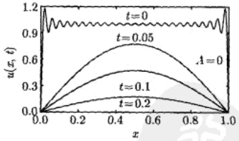

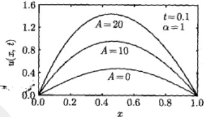

图 8.1 系统在不同 t 时刻、不同衰变常数 A 下的温度分布，曲线为部分和的前 50 项
 

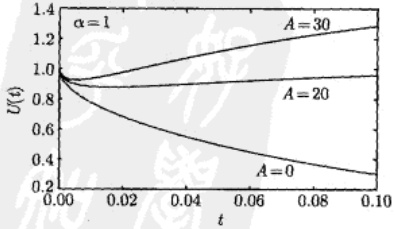

图 8.2 系统在不同衰变常数 A 下的平均温度，曲线为部分和的前 50 项
 

<!-- page: 246 -->

例 2 设  $ a=1, L=\pi, \phi(x)=0, f(x,t)=xe^{-t} $，讨论一般解式 (8.2.34) 和平均温度式 (8.2.35)。

解 这时式 (8.2.34) 变为

$$  u(x,t)=\sum_{n=1}^{\infty}\mathrm{e}^{-n^{2}t}\left[\int_{0}^{t}f_{n}(\tau)\mathrm{e}^{n^{2}\tau}\mathrm{d}\tau\right]\sin nx   \tag*{(8.2.41)}$$

其中

$$  f_{n}(t)=\frac{2}{\pi}\mathrm{e}^{-t}\int_{0}^{\pi}x\sin nx\mathrm{d}x   \tag*{(8.2.42)}$$

式(8.2.42)中的积分为

$$  \int_{0}^{\pi}x\sin nx\mathrm{d}x=\left[\frac{1}{n^{2}}\sin nx-\frac{x}{n}\cos nx\right]_{0}^{\pi}=-\frac{\pi}{n}\cos n\pi=\frac{\pi}{n}(-1)^{n+1}   \tag*{(8.2.43)}$$

这样式（8.2.42）变成

$$  f_{n}(t)=\frac{2}{\pi}\mathrm{e}^{-t}\frac{\pi}{n}(-1)^{n+1}=\frac{2}{n}(-1)^{n+1}\mathrm{e}^{-t}   \tag*{(8.2.44)}$$

于是式(8.2.41)中的积分为

$$  \int_{0}^{t}f_{n}(\tau)\mathrm{e}^{n^{2}\tau}\mathrm{d}\tau=\int_{0}^{t}\left[\frac{2}{n}(-1)^{n+1}\mathrm{e}^{-\tau}\right]\mathrm{e}^{n^{2}\tau}\mathrm{d}\tau=\frac{2}{n}(-1)^{n+1}\int_{0}^{t}\mathrm{e}^{\left(n^{2}-1\right)\tau}\mathrm{d}\tau   \tag*{(8.2.45)}$$

而其中的积分为

$$  \int_{0}^{t}\mathrm{e}^{\left(n^{2}-1\right)\tau}\mathrm{d}\tau=\left\{\begin{matrix}t&(n=1)\\ \mathrm{e}^{t}-1&\\ \frac{\tau}{n^{2}-1}&\left(n>1\right)\end{matrix}\right.   \tag*{(8.2.46)}$$

这样式（8.2.41）中求和的第一项需要单独写出来，整理后得到

$$  u(x,t)=2t\mathrm{e}^{-t}\sin x+2\left(\mathrm{e}^{t}-1\right)\sum_{n=2}^{\infty}\frac{(-1)^{n+1}}{n(n^{2}-1)}\mathrm{e}^{-n^{2}t}\sin nx   \tag*{(8.2.47)}$$

这就是系统在任意 t 时刻的温度分布。下面我们对它进行具体讨论，为叙述方便，将式（8.2.47）写成

$$  u(x,t)=u_{1}(x,t)+u_{2}(x,t)   \tag*{(8.2.48)}$$

其中

$$  u_{1}(x,t)=2t\mathrm{e}^{-t}\sin x   \tag*{(8.2.49a)}$$

$$  u_{2}(x,t)=2(\mathrm{e}^{t}-1)\sum_{n=2}^{\infty}\frac{(-1)^{n+1}}{n(n^{2}-1)}\mathrm{e}^{-n^{2}t}\sin nx   \tag*{(8.2.49b)}$$

<!-- page: 247 -->

首先可以看出，t=0 时， $ u_{1}(x,0)=0 $ 和  $ u_{2}(x,0)=0 $，因此  $ u(x,0)=0 $，这与题目给出的条件相符合。不同时刻 t 的温度分布  $ u(x,t) $ 显示在图 8.3。可以看出，在任意时刻 t， $ u(x,t) $ 呈现有峰分布。峰的高度先随 t 的增大而上升，在 t=1 达到最高，之后又随 t 的增大而下降。在上升阶段，峰的位置逐渐趋于  $ x=\pi/2 $；在下降阶段，峰的位置维持在  $ x=\pi/2 $。图 8.4 显示了系统中央  $ (x=\pi/2) $ 的温度  $ u(\pi/2,t) $ 随时间 t 的变化，可以看出， $ u(\pi/2,t) $ 在时刻 t=1 取极大值，计算给出  $ u(\pi/2,1)=0.736 $。

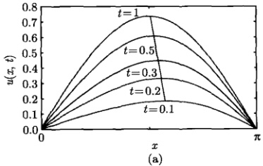

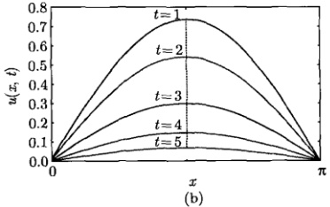

图 8.3 系统在不同 t 时刻的温度分布，式 (8.2.47) 的求和部分取前 20 项之和
 

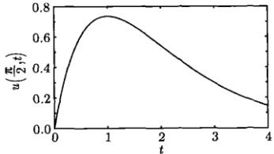

图 8.4 系统中央  $ (x=\pi/2) $ 温度随时间 t 的变化曲线，式 (8.2.47) 的求和部分取前 20 项之和
 

为了解释上述结果，我们在图8.5中显示了 $ u_{1}(x,t) $和 $ u_{2}(x,t) $的比较。可以看出：

(1)  $ u_1(x,t) $ 在任何时刻  $ t $ 呈现正弦曲线 [见式 (8.2.49a)]，在区间  $ [0,\pi] $ 上呈对称分布； $ u_2(x,t) $ 作为  $ \sin nx $ 的求和，应该显示振荡行为，但求和式 (8.2.49b) 中  $ n=2 $ 以后的项急速衰减，所以求和的结果只有  $ u_2(x,t) \sim \sin 2x $ 项有明显的贡献。

(2)  $ u_1(x,t) $ 对总温度的贡献大于  $ u_2(x,t) $。在  $ t $ 较小的情况下， $ u_2(x,t) $ 的贡献尚可观察：它与  $ u_1(x,t) $ 叠加的结果使  $ u(x,t) $ 的峰出现在  $ x > \pi/2 $ 一侧 (图 8.3a)。从物理上讲，这是由于热源  $ x\mathrm{e}^{-t} $ 在较大的  $ x $ 位置有较强的传热作用。随着  $ t $ 的增加，式 (8.2.49b) 中的因子  $ \mathrm{e}^{-n^2t} $ 迅速减小，因此  $ u_2(x,t) $ 的贡献越来越小。当  $ t = 1 $ 时， $ u_2(x,t) \to 0 $，以致  $ u_1(x,t) \approx u(x,t) $。当  $ t > 1 $ 时， $ u(x,t) $ 的峰一直维持在中心位置  $ \pi/2 $ (图 8.3b)。

<!-- page: 248 -->

(3) 由于 t 较大时  $ u_{1}(x,t) \approx u(x,t) $，因此  $ u(x,t) $ 随时间 t 的变化关系基本上可以用式 (8.2.49a) 描述，进一步求导数

$$  \frac{\mathrm{d}u_{1}}{\mathrm{d}t}\sim(1-t)\mathrm{e}^{-t}=0   \tag*{(8.2.50)}$$

由式 (8.2.50) 可以看出，当 t = 1 时，温度出现极大值 (图 8.5)。也正是基于式 (8.2.49a)，我们能够预言系统的稳态温度为  $ u(x, \infty) \to 0 $。

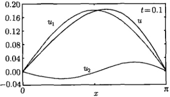

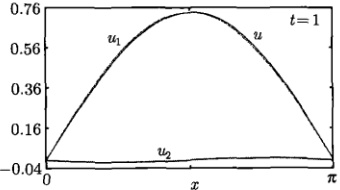

图 8.5 温度分量  $ u_{1}(x,t) $ 和  $ u_{2}(x,t) $ 的比较， $ u_{2}(x,t) $ 的求和部分取前 20 项之和
 

由上述例题可以看出，利用本征函数法求解定解问题时，方程可以是非齐次的，初始条件也可以是任意函数，关键是边界条件必须是齐次的。这样，可以选择出恰当的本征函数集，从而写出级数形式上的一般解，然后利用方程与初始条件确定级数中的展开系数即可。下面我们再讨论一些典型的问题，它们将涉及更多类型的本征函数集。

### 8.3 有源热传导定解问题

本节利用本征函数法进一步讨论不同类型的非齐次方程的定解问题，主要涉及外热源作用下的热传导问题。

#### 8.3.1 绝热系统

考虑外热源作用下的绝热系统的热传导问题

$$  \left\{\begin{array}{l l}{\displaystyle\frac{\partial u}{\partial t}=a^{2}\frac{\partial^{2}u}{\partial x^{2}}+f(x,t)\qquad}&{(0<x<L,t>0)}\end{array}\right.   \tag*{(8.3.1a)}$$

$$  u|_{t=0}=\phi(x)\quad(0\leqslant x\leqslant L)   \tag*{(8.3.1b)}$$

$$  \left\{\begin{array}{l}\left.\frac{\partial u}{\partial x}\right|_{x=0}=0,\quad\left.\frac{\partial u}{\partial x}\right|_{x=L}=0\quad(t>0)\end{array}\right.   \tag*{(8.3.1c)}$$

其中， $ f(x,t) $ 表示时空依赖的外热源。

<!-- page: 249 -->

首先由相应的齐次方程问题 (6.2.50) 与边界条件 (8.3.1c)，按照表 6.2 选出本征函数集

$$  \left\{\cos\frac{n\pi}{L}x\right\}\quad(n=0,1,2,\cdots)   \tag*{(8.3.2)}$$

故一般解设为

$$  u(x,t)=\sum_{n=0}^{\infty}g_{n}(t)\cos\frac{n\pi}{L}x   \tag*{(8.3.3)}$$

其中， $ g_{n}(t) $ 作为函数  $ u(x,t) $ 的半幅傅里叶级数的展开系数，应该满足式 (2.2.4)，即

$$  g_{0}(t)=\frac{1}{L}\int_{0}^{L}u(x,t)\mathrm{d}x   \tag*{(8.3.4a)}$$

$$  g_{n}(t)=\frac{2}{L}\int_{0}^{L}u(x,t)\cos\frac{n\pi}{L}x\mathrm{d}x\quad(n=1,2,3,\cdots)   \tag*{(8.3.4b)}$$

将驱动项  $ f(x,t) $ 也按该本征函数集展开

$$  f(x,t)=\sum_{n=0}^{\infty}f_{n}(t)\cos\frac{n\pi}{L}x   \tag*{(8.3.5)}$$

其中

$$  f_{0}(t)=\frac{1}{L}\int_{0}^{L}f(x,t)\mathrm{d}x   \tag*{(8.3.6a)}$$

$$  f_{n}(t)=\frac{2}{L}\int_{0}^{L}f(x,t)\cos\frac{n\pi}{L}x\mathrm{d}x\quad(n=1,2,3,\cdots)   \tag*{(8.3.6b)}$$

将式 (8.3.3) 和式 (8.3.5) 代入式 (8.3.1a) 和式 (8.3.1b)，得到

$$  \sum_{n=0}^{\infty}\left[g_{n}^{\prime}(t)+\left(\frac{na\pi}{L}\right)^{2}g_{n}(t)-f_{n}(t)\right]\cos\frac{n\pi}{L}x=0   \tag*{(8.3.7)}$$

$$  \sum_{n=0}^{\infty}g_{n}(0)\cos\frac{n\pi}{L}x=\phi(x)   \tag*{(8.3.8)}$$

由式(8.3.7)得到

$$  g_{n}^{\prime}(t)+\left(\frac{na\pi}{L}\right)^{2}g_{n}(t)=f_{n}(t)   \tag*{(8.3.9a)}$$

式(8.3.8)表示 $ g_{n}(0) $是函数 $ \phi(x) $的半幅傅里叶级数的展开系数，故记

$$  g_{n}(0)\equiv C_{n}\quad(n=0,1,2,\cdots)   \tag*{(8.3.9b)}$$

其中

$$  C_{0}=\frac{1}{L}\int_{0}^{L}\phi(x)\mathrm{d}x   \tag*{(8.3.10a)}$$

<!-- page: 250 -->

$$  C_{n}=\frac{2}{L}\int_{0}^{L}\phi(x)\cos\frac{n\pi}{L}x\mathrm{d}x\quad(n=1,2,3,\cdots)   \tag*{(8.3.10b)}$$

式（8.3.9）是一个常微分方程的初值问题。我们用拉普拉斯变换法求解，象函数的代数方程为

$$  pG_{n}(p)-C_{n}+\left(\frac{na\pi}{L}\right)^{2}G_{n}(p)=F_{n}(p)   \tag*{(8.3.11)}$$

解之得

$$  G_{n}(p)=\frac{C_{n}+F_{n}(p)}{p+\left(\frac{na\pi}{L}\right)^{2}}   \tag*{(8.3.12)}$$

反演后，得到

$$  g_{n}(t)=C_{n}\mathrm{e}^{-\left(\frac{n a\pi}{L}\right)^{2}t}+\int_{0}^{t}f_{n}(\tau)\mathrm{e}^{-\left(\frac{n a\pi}{L}\right)^{2}(t-\tau)}\mathrm{d}\tau   \tag*{(8.3.13)}$$

将式（8.3.13）代入式（8.3.3）得到一般解

$$  u(x,t)=\sum_{n=0}^{\infty}\mathrm{e}^{-\left(\frac{n\alpha\pi}{L}\right)^{2}t}\left[C_{n}+\int_{0}^{t}f_{n}(\tau)\mathrm{e}^{\left(\frac{n\alpha\pi}{L}\right)^{2}\tau}\mathrm{d}\tau\right]\cos\frac{n\pi}{L}x   \tag*{(8.3.14)}$$

式(8.3.14)就是定解问题(8.3.1)的解。当 $ f(x,t)=0 $时，式(8.3.14)给出

$$  u(x,t)=C_{0}+\sum_{n=1}^{\infty}C_{n}\exp\left[-\left(\frac{na\pi}{L}\right)^{2}t\right]\cos\frac{n\pi}{L}x   \tag*{(8.3.15)}$$

其中， $ C_{0} $ 和  $ C_{n} $ 由式 (8.3.10) 表示，这与相应的无源热传导问题 (6.2 节例 7) 的结果是相同的。

例 1 求解绝热系统的具有放射性衰变的热传导方程的定解问题 (8.3.1)，设  $ f(x, t) = A e^{-\alpha x} $， $ \phi(x) = T $，其中 A,  $ \alpha $, T 均是正常数。

解 当 n=0 时，展开系数为

$$  f_{0}(t)=\frac{1}{L}\int_{0}^{L}f(x,t)\mathrm{d}x=\frac{A}{L\alpha}\left(1-\mathrm{e}^{-\alpha L}\right)   \tag*{(8.3.16a)}$$

$$  C_{0}=\frac{1}{L}\int_{0}^{L}\phi(x)\mathrm{d}x=T   \tag*{(8.3.16b)}$$

初值问题(8.3.9)给出

$$  \left\{\begin{array}{l}g_{0}^{\prime}(t)=\frac{A}{L\alpha}\left(1-\mathrm{e}^{-\alpha L}\right)\\ g_{0}(0)=T\end{array}\right.   \tag*{(8.3.17b)}$$

它的解为

$$  g_{0}(t)=T+\frac{A}{L\alpha}\left(1-\mathrm{e}^{-\alpha L}\right)t   \tag*{(8.3.18)}$$

<!-- page: 251 -->

当 n=1,2,3,\cdots 时，展开系数为

$$  f_{n}(t)=\frac{2A}{L}\int_{0}^{L}\mathrm{e}^{-\alpha x}\cos\frac{n\pi}{L}x\mathrm{d}x=2\alpha A L\frac{1-\mathrm{e}^{-\alpha L}\cos n\pi}{\left(\alpha L\right)^{2}+\left(n\pi\right)^{2}}   \tag*{(8.3.19)}$$

$$  C_{n}=\frac{2}{L}\int_{0}^{L}T\cos\frac{n\pi}{L}x\mathrm{d}x=0\quad(n=1,2,3,\cdots)   \tag*{(8.3.20)}$$

式（8.3.13）给出

$$  g_{n}(t)=\frac{2\alpha A L^{3}}{\left(n a\pi\right)^{2}}\frac{1-\mathrm{e}^{-\alpha L}\cos n\pi}{\left(\alpha L\right)^{2}+\left(n\pi\right)^{2}}\left[1-\mathrm{e}^{-\left(\frac{n a\pi}{L}\right)^{2}t}\right]   \tag*{(8.3.21)}$$

由式（8.3.18）和式（8.3.21）得到定解问题的解

$$  \begin{aligned}{u(x,t)=}&{{}T+\frac{A}{L\alpha}\left(1-\mathrm{e}^{-\alpha L}\right)t}\\ {}&{{}\quad+\frac{2\alpha A L^{3}}{\left(a\pi\right)^{2}}\sum_{n=1}^{\infty}\frac{1}{n^{2}}\frac{1-\mathrm{e}^{-\alpha L}\operatorname{c o s}n\pi}{\left(\alpha L\right)^{2}+\left(n\pi\right)^{2}}\left[1-\mathrm{e}^{-\left(\frac{n\pi L}{L}\right)^{2}t}\right]\operatorname{c o s}\frac{n\pi}{L}x}\\ \end{aligned}   \tag*{(8.3.22)}$$

由式(8.3.22)得到： $ u(x,0)=T $，而 $ u(x,\infty)\to\infty $。

例2 设  $ f(x,t)=A\sin\omega t,\phi(x)=0 $ ，求解定解问题 (8.3.1)。

解 展开系数为

$$  f_{0}(t)=\frac{1}{L}\int_{0}^{L}A\sin\omega t\mathrm{d}x=A\sin\omega t   \tag*{(8.3.23a)}$$

$$  f_{n}(t)=\frac{2}{L}\int_{0}^{L}A\sin\omega t\cos\frac{n\pi}{L}x\mathrm{d}x=0\quad(n=1,2,3,\cdots)   \tag*{(8.3.23b)}$$

$$  C_{n}=0\quad(n=0,1,2,\cdots)   \tag*{(8.3.23c)}$$

当 n=0 时，初值问题 (8.3.9) 给出

$$  \left\{\begin{array}{l}g_{0}^{\prime}(t)=A\sin\omega t\\ \\ g_{0}(0)=0\end{array}\right.   \tag*{(8.3.24b)}$$

它的解为

$$  g_{0}(t)=\frac{A}{\omega}(1-\cos\omega t)   \tag*{(8.3.25)}$$

当 n=1,2,3,\cdots 时，初值问题 (8.3.9) 给出

$$  \left\{\begin{array}{l}g_{n}^{\prime}(t)+\left(\frac{n a\pi}{L}\right)^{2}g_{n}(t)=0\\ g_{n}(0)=0\end{array}\right.   \tag*{(8.3.26a)}$$

<!-- page: 252 -->

它的解为

$$  g_{n}(t)=g_{n}(0)\exp\left[-\left(\frac{na\pi}{L}\right)^{2}t\right]=0   \tag*{(8.3.27)}$$

由式（8.3.25）和式（8.3.27）得到本定解问题的解

$$  u(x,t)=\sum_{n=0}^{\infty}g_{n}(t)\cos\frac{n\pi}{L}x=\frac{A}{\omega}(1-\cos\omega t)   \tag*{(8.3.28)}$$

结果表明，系统的温度以  $ \omega $ 为角频率做简谐振荡，与空间变量没有关系。

#### 8.3.2 绝热—耗散系统

考虑外热源作用下的绝热-耗散系统的热传导问题

$$  \frac{\partial u}{\partial t}=a^{2}\frac{\partial^{2}u}{\partial x^{2}}+f(x,t)\qquad\quad(0<x<L,t>0)   \tag*{(8.3.29a)}$$

 $$ u|_{t=0}=\phi(x) $$ 

$$  (0\leq x\leq L)   \tag*{(8.3.29b)}$$

$$  u\vert_{x=0}=0,\quad\left.\frac{\partial u}{\partial x}\right|_{x=L}=0\quad(t>0)   \tag*{(8.3.29c)}$$

其中， $ f(x,t) $ 表示时空依赖的外热源。

由相应的齐次方程与边界条件式 (8.3.29c)，按照表 6.2 选出本征函数集

$$  \left\{\sin\frac{(2n+1)\pi}{2L}x\right\}\quad(n=0,1,2,\cdots)   \tag*{(8.3.30)}$$

故一般解设为

$$  u(x,t)=\sum_{n=0}^{\infty}g_{n}(t)\sin\frac{(2n+1)\pi}{2L}x   \tag*{(8.3.31)}$$

其中， $ g_{n}(t) $ 满足初值问题

$$  \left\{\begin{array}{l}g_{n}^{\prime}(t)+\left[\frac{(2n+1)\pi a}{2L}\right]^{2}g_{n}(t)=f_{n}(t)\end{array}\right.   \tag*{(8.3.32a)}$$

 $$ g_{n}(0)\equiv C_{n} $$ 

其中

$$  f_{n}(t)=\frac{2}{L}\int_{0}^{L}f(x,t)\sin\frac{(2n+1)\pi}{2L}x\mathrm{d}x   \tag*{(8.3.33a)}$$

$$  C_{n}=\frac{2}{L}\int_{0}^{L}\phi(x)\sin\frac{(2n+1)\pi}{2L}x\mathrm{d}x   \tag*{(8.3.33b)}$$

用拉普拉斯变换法解初值问题 (8.3.32)，得到

<!-- page: 253 -->

$$  g_{n}(t)=C_{n}\mathrm{e}^{-\left[\frac{(2n+1)\pi a}{2L}\right]^{2}t}+\int_{0}^{t}f_{n}(\tau)\mathrm{e}^{-\left[\frac{(2n+1)\pi a}{2L}\right]^{2}(t-\tau)}\mathrm{d}\tau   \tag*{(8.3.34)}$$

将式（8.3.34）代入式（8.3.31）得到一般解

$$  u(x,t)=\sum_{n=0}^{\infty}\mathrm{e}^{-\left[\frac{(2n+1)\pi a}{2L}\right]^{2}t}\left\{C_{n}+\int_{0}^{t}f_{n}(\tau)\mathrm{e}^{\left[\frac{(2n+1)\pi a}{2L}\right]^{2}\tau}\mathrm{d}\tau\right\}\sin\frac{(2n+1)\pi a}{2L}x   \tag*{(8.3.35)}$$

式（8.3.35）就是定解问题（8.3.29）的解。

例 3 设  $ a=1, L=\pi, \phi(x)=\sin\frac{x}{2}, f(x,t)=\sin\frac{x}{2} $，求解定解问题 (8.3.29)。

解 展开系数为

$$  f_{n}(t)=\frac{2}{\pi}\int_{0}^{\pi}\sin\frac{(2\cdot0+1)}{2}x\sin\frac{(2n+1)}{2}x\mathrm{d}x=\delta_{0n}   \tag*{(8.3.36a)}$$

$$  C_{n}=\frac{2}{\pi}\int_{0}^{\pi}\sin\frac{(2\cdot0+1)}{2}x\sin\frac{(2n+1)}{2}x\mathrm{d}x=\delta_{0n}   \tag*{(8.3.36b)}$$

式（8.3.35）给出任意时刻的温度

 $$ \begin{aligned}u(x,t)&=\sum_{n=0}^{\infty}\delta_{0n}\mathrm{e}^{-\frac{(2n+1)^{2}}{4}t}\sin\frac{(2n+1)}{2}x+\int_{0}^{t}\mathrm{d}\tau\sum_{n=0}^{\infty}\delta_{0n}\mathrm{e}^{-\frac{(2n+1)^{2}}{4}(t-\tau)}\sin\frac{(2n+1)}{2}x\\&=\mathrm{e}^{-t/4}\sin\frac{x}{2}+\sin\frac{x}{2}\mathrm{e}^{-t/4}\int_{0}^{t}\mathrm{e}^{\tau/4}\mathrm{d}\tau\\&=\mathrm{e}^{-t/4}\sin\frac{x}{2}+4\left(1-\mathrm{e}^{-t/4}\right)\sin\frac{x}{2}\\&=\left(4-3\mathrm{e}^{-t/4}\right)\sin\frac{x}{2}\\ \end{aligned} $$ 

这个结果是容易理解的，如果不存在外热源  $ [f(x,t)=0] $，则系统的状态为  $ T_{0}(t)X_{0}(x)=\mathrm{e}^{-t/4}\sin\frac{x}{2} $，它不是叠加态，而是系统的第一个本征态（即基态 n=0）。这时系统将按固有的指数衰减方式  $ \mathrm{e}^{-t/4} $ 耗散热量，而任意 t 时刻的温度分布为  $ \sin\frac{x}{2} $。如果存在外热源但它的供热方式与系统的本征行为无关，它对系统温度的贡献来自式 (8.3.34) 的第二项。而现在的热源  $ 4(1-\mathrm{e}^{-t/4})\sin\frac{x}{2} $ 与系统的本征态具有相同的“位相”，是可以“相干叠加”的。其结果，系统处于自身行为与外界作用的叠加态  $ (4-3\mathrm{e}^{-t/4})\sin\frac{x}{2} $。这是一种“相长干涉”，随着时间 t 的增加，系统温度的分布  $ \sin\frac{x}{2} $ 不变，但每一点的温度都按  $ 4(1-\mathrm{e}^{-t/4}) $ 规律升高，如图 8.6 所示。

<!-- page: 254 -->

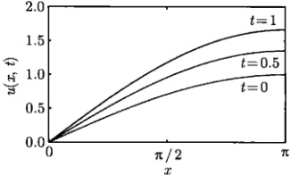

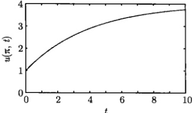

图 8.6 系统在不同时刻的温度分布及后端温度的时间演化
 

#### 8.3.3 绝热—辐射系统

考虑外热源作用下的绝热-辐射系统的热传导问题

$$  \left\{\begin{array}{l l}{\displaystyle\frac{\partial u}{\partial t}=a^{2}\frac{\partial^{2}u}{\partial x^{2}}+f(x,t)}&{\qquad\quad(0<x<L,\;t>0)}\end{array}\right.   \tag*{(8.3.37a)}$$

$$  \left\{\begin{array}{r}u|_{t=0}=\phi(x)\quad(0\leqslant x\leqslant L)\end{array}\right.   \tag*{(8.3.37b)}$$

$$  \left\lfloor\quad\frac{\partial u}{\partial x}\right|_{x=0}=0,\quad\left[u+h\frac{\partial u}{\partial x}\right]_{x=L}=0\quad(t>0)   \tag*{(8.3.37c)}$$

其中， $ f(x,t) $ 表示热源。

由相应的齐次方程问题（6.4.35）及边界条件（8.3.37c）选出本征函数集

$$  \left\{\cos\frac{\mu_{n}}{L}x\right\}\quad(n=1,2,3,\cdots)   \tag*{(8.3.38)}$$

其中， $ \mu_{n} $ 是超越方程  $ \cot\mu=\alpha\mu $ 的第 n 个根（见 6.4.2 节），故一般解设为

$$  u(x,t)=\sum_{n=1}^{\infty}g_{n}(t)\cos\frac{\mu_{n}}{L}x   \tag*{(8.3.39)}$$

其中， $ g_{n}(t) $ 满足初值问题

$$  \left\{\begin{array}{l}g_{n}^{\prime}(t)+\left(\frac{\mu_{n}a}{L}\right)^{2}g_{n}(t)=f_{n}(t)\\ (0)=C\end{array}\right.   \tag*{(8.3.40a)}$$

$$  g_{n}(0)\equiv C_{n}   \tag*{(8.3.40b)}$$

其中

$$  f_{n}(t)=\frac{2}{L\left(1+\frac{\sin2\mu_{n}}{2\mu_{n}}\right)}\int_{0}^{L}f(x,t)\cos\frac{\mu_{n}}{L}x\mathrm{d}x   \tag*{(8.3.41a)}$$

$$  C_{n}=\frac{2}{L\left(1+\frac{\sin2\mu_{n}}{2\mu_{n}}\right)}\int_{0}^{L}\phi(x)\cos\frac{\mu_{n}}{L}x\mathrm{d}x   \tag*{(8.3.41b)}$$

<!-- page: 255 -->

式（8.3.40）是一个常微分方程的初值问题，用拉普拉斯变换法解之，得到

$$  \begin{array}{r}{g_{n}(t)=C_{n}\mathrm{e}^{-\left(\frac{\mu_{n}a}{L}\right)^{2}t}+\displaystyle\int_{0}^{t}f_{n}(\tau)\mathrm{e}^{-\left(\frac{\mu_{n}a}{L}\right)^{2}(t-\tau)}\mathrm{d}\tau}\end{array}   \tag*{(8.3.42)}$$

将式（8.3.42）代入式（8.3.39）得到一般解

$$  u(x,t)=\sum_{n=1}^{\infty}\mathrm{e}^{-\left(\frac{\mu_{n}a}{L}\right)^{2}t}\left[C_{n}+\int_{0}^{t}f_{n}(\tau)\mathrm{e}^{\left(\frac{\mu_{n}a}{L}\right)^{2}\tau}\mathrm{d}\tau\right]\cos\frac{\mu_{n}x}{L}   \tag*{(8.3.43)}$$

式(8.3.43)就是定解问题(8.3.37)的解。当 $ f(x,t)=0 $时，式(8.3.43)给出

$$  u(x,t)=\sum_{n=1}^{\infty}C_{n}\exp\left[-\left(\frac{\mu_{n}a}{L}\right)^{2}t\right]\cos\frac{\mu_{n}}{L}x   \tag*{(8.3.44)}$$

其中， $ C_{n} $ 由式 (8.3.41b) 表示，这与相应的无源热传导问题的结果式 (6.4.42) 是相同的。

例 4 设 a = 1, L = 1,  $ \phi(x) = x(1 - x) $,  $ f(x, t) = \cos \mu_1 x \cos t $, 求解定解问题 (8.3.37)。

解 展开系数为

$$  f_{n}(t)=\frac{\cos t\int_{0}^{1}\cos\mu_{1}x\cos\mu_{n}x\mathrm{d}x}{\frac{L}{2}\left[1+\frac{\sin2\mu_{n}}{2\mu_{n}}\right]}=\delta_{1n}\cos t   \tag*{(8.3.45)}$$

一般解式(8.3.43)给出

 $$ \begin{aligned}u(x,t)&=\int_{0}^{t}\cos\tau\left[\sum_{n=1}^{\infty}\delta_{1n}\mathrm{e}^{-\mu_{n}^{2}(t-\tau)}\cos\mu_{n}x\right]\mathrm{d}\tau+\sum_{n=1}^{\infty}C_{n}\mathrm{e}^{-\mu_{n}^{2}t}\cos\mu_{n}x\\&=\mathrm{e}^{-\mu_{1}^{2}t}\left[\int_{0}^{t}\cos\tau\mathrm{e}^{\mu_{1}^{2}\tau}\mathrm{d}\tau\right]\cos\mu_{1}x+\sum_{n=1}^{\infty}C_{n}\mathrm{e}^{-\mu_{n}^{2}t}\cos\mu_{n}x\\&=\frac{\sin t+\mu_{1}^{2}\cos t-\mu_{1}^{2}\mathrm{e}^{-\mu_{1}^{2}t}}{1+\mu_{1}^{4}}\cos\mu_{1}x+\sum_{n=1}^{\infty}C_{n}\mathrm{e}^{-\mu_{n}^{2}t}\cos\mu_{n}x\\ \end{aligned} $$ 

利用部分和（前5项）表示一般解

$$  u(x,t)\approx\frac{\sin t+\mu_{1}^{2}\cos t-\mu_{1}^{2}\mathrm{e}^{-\mu_{1}^{2}t}}{1+\mu_{1}^{4}}\cos\mu_{1}x+\sum_{n=1}^{5}C_{n}\mathrm{e}^{-\mu_{n}^{2}t}\cos\mu_{n}x   \tag*{(8.3.46)}$$

其中， $ \mu_{n} $ 和  $ C_{n} $ 分别由式 (6.4.47) 和式 (6.4.49) 给出。而平均温度为

$$  U(t)\approx\frac{\sin\mu_{1}}{\mu_{1}}\frac{\sin t+\mu_{1}^{2}\cos t-\mu_{1}^{2}\mathrm{e}^{-\mu_{1}^{2}t}}{1+\mu_{1}^{4}}+\sum_{n=1}^{5}C_{n}\frac{\sin\mu_{n}}{\mu_{n}}\mathrm{e}^{-\mu_{n}^{2}t}   \tag*{(8.3.47)}$$

<!-- page: 256 -->

利用式(8.3.46)和式(8.3.47)作出系统在不同时刻的温度分布及平均温度的时间演化，如图8.7所示。与相应的无源热传导问题（图6.21与图6.22）不同，现在系统的温度随时间上升，这是外热源作用的结果。

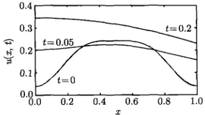

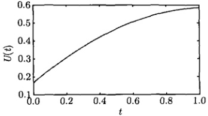

图 8.7 系统在不同时刻的温度分布及平均温度随时间的演化
 

#### 8.3.4 吸收-耗散系统

考虑外热源作用下的吸收-耗散系统的热传导问题

$$  \left\{\begin{array}{l}\frac{\partial w}{\partial t}=\frac{\partial^{2}w}{\partial x^{2}}+f(x,t)\end{array}\right.\qquad(0<x<1,t>0)   \tag*{(8.3.48a)}$$

 $$ w\vert_{t=0}=\phi(x) $$ 

$$  (0\leq x\leq1)   \tag*{(8.3.48b)}$$

$$  \left\{\begin{array}{c}w\mid_{x=0}=0,\quad\left[w-\eta\frac{\partial w}{\partial x}\right]_{x=L}=0\quad(t>0)\end{array}\right.   \tag*{(8.3.48c)}$$

其中， $ \eta>0 $,  $ f(x,t) $ 表示时空依赖的外热源。

我们用 “一分为二法” 处理这个问题，令

$$  w(x,t)=u(x,t)+v(x,t)   \tag*{(8.3.49)}$$

其中， $ u(x,t) $ 的定解问题 (7.1.1) 在第 7 章已经讨论过，而  $ v(x,t) $ 的定解问题为

$$  \left\{\begin{array}{l}\frac{\partial v}{\partial t}=\frac{\partial^{2}v}{\partial x^{2}}+f(x,t)\\\end{array}\right.\qquad(0<x<1,t>0)   \tag*{(8.3.50a)}$$

 $$ \left.v\right|_{t=0}=0 $$ 

$$  (0\leq x\leq1)   \tag*{(8.3.50b)}$$

$$  \left\{\begin{array}{c}v\mid_{x=0}=0\;,{\left[v-\eta\frac{\partial v}{\partial x}\right]}_{x=L}=0\quad(t>0)\end{array}\right.   \tag*{(8.3.50c)}$$

由相应的齐次方程问题(7.1.1)和边界条件式(8.3.50c)，选出本征函数集[式(7.1.24)]：

$$  \sinh\mu_{0}x,\quad\left\{\sin\mu_{n}x\right\}\quad(n=1,2,3,\cdots)   \tag*{(8.3.51)}$$

其中， $ \mu_{0} $ 是  $ \tanh\mu=\beta\mu $ 的解，而  $ \mu_{n} $ 是  $ \tan\mu=\beta\mu $ 的第 n 个正根。设式 (8.3.50a) 的形式解为

$$  v(x,t)=g_{0}(t)\sinh\mu_{0}x+\sum_{n=1}^{\infty}g_{n}(t)\sin\mu_{n}x   \tag*{(8.3.52)}$$

<!-- page: 257 -->

其中， $ g_{0}(t) $ 和  $ g_{n}(t) $ 相当于式 (7.1.20) 中的展开系数  $ c_{0} $ 和  $ c_{n} $，从式 (7.1.23) 得到

$$  g_{0}(t)=\frac{2}{\frac{\sinh2\mu_{0}}{2\mu_{0}}-1}\int_{0}^{1}v(x,t)\sinh\mu_{0}x\mathrm{d}x   \tag*{(8.3.53a)}$$

$$  g_{n}(t)=\frac{2}{1-\frac{\sin2\mu_{n}}{2\mu_{n}}}\int_{0}^{1}v(x,t)\sin\mu_{n}x\mathrm{d}x\quad(n=1,2,3,\cdots)   \tag*{(8.3.53b)}$$

将源项  $ f(x,t) $ 也按该本征函数集展开

$$  f(x,t)=f_{0}(t)\sinh\mu_{0}x+\sum_{n=1}^{\infty}f_{n}(t)\sin\mu_{n}x   \tag*{(8.3.54)}$$

其中，展开系数为

$$  f_{0}(t)=\frac{2}{\frac{\sinh2\mu_{0}}{2\mu_{0}}-1}\int_{0}^{1}f(x,t)\sinh\mu_{0}x\mathrm{d}x   \tag*{(8.3.55a)}$$

$$  f_{n}(t)=\frac{2}{1-\frac{\sin2\mu_{n}}{2\mu_{n}}}\int_{0}^{1}f(x,t)\sin\mu_{n}x\mathrm{d}x\quad(n=1,2,3,\cdots)   \tag*{(8.3.55b)}$$

将形式解式（8.3.52）及式（8.3.54）代入式（8.3.50a），得到

$$  \begin{aligned}&g_{0}^{\prime}(t)\sinh\mu_{0}x+\sum_{n=1}^{\infty}g_{n}^{\prime}(t)\sin\mu_{n}x\\ =&\mu_{0}^{2}g_{0}(t)\sinh\mu_{0}x-\sum_{n=1}^{\infty}\mu_{n}^{2}g_{n}(t)\sin\mu_{n}x+f_{0}(t)\sinh\mu_{0}x+\sum_{n=1}^{\infty}f_{n}(t)\sin\mu_{n}x\\ \end{aligned}   \tag*{(8.3.56)}$$

式（8.3.56）两边比较  $ \sinh\mu_{0}x $ 的系数，并利用式（8.3.53a）和式（8.3.50b）得到

$$  g_{0}^{\prime}(t)=\mu_{0}^{2}g_{0}(t)+f_{0}(t)   \tag*{(8.3.57a)}$$

$$  g_{0}(0)=0   \tag*{(8.3.57b)}$$

式（8.3.56）两边比较  $ \sin\mu_{n}x $ 的系数，并利用式（8.3.53b）和式（8.3.50b），得到

$$  g_{n}^{\prime}(t)=-\mu_{n}^{2}g_{n}(t)+f_{n}(t)   \tag*{(8.3.58a)}$$

$$  g_{n}(0)=0\quad(n=1,2,3,\cdots)   \tag*{(8.3.58b)}$$

用拉普拉斯变换法分别求解初值问题（8.3.57）和式（8.3.58），得到

$$  g_{0}(t)=\int_{0}^{t}f_{0}(\tau)\mathrm{e}^{\mu_{0}^{2}(t-\tau)}\mathrm{d}\tau   \tag*{(8.3.59a)}$$

<!-- page: 258 -->

$$  g_{n}(t)=\int_{0}^{t}f_{n}(\tau)\mathrm{e}^{-\mu_{n}^{2}(t-\tau)}\mathrm{d}\tau\quad(n=1,2,3,\cdots)   \tag*{(8.3.59b)}$$

将式（8.3.59）代入形式解式（8.3.52）得到

$$  v(x,t)=\left[\int_{0}^{t}f_{0}(\tau)\mathrm{e}^{\mu_{0}^{2}(t-\tau)}\mathrm{d}\tau\right]\sinh\mu_{0}x+\sum_{n=1}^{\infty}\left[\int_{0}^{t}f_{n}(\tau)\mathrm{e}^{-\mu_{n}^{2}(t-\tau)}\mathrm{d}\tau\right]\sin\mu_{n}x   \tag*{(8.3.60)}$$

因此，定解问题（8.3.48）的解为式（7.1.19）与式（8.3.60）相加，即

$$  \begin{aligned}w(x,t)&=c_{0}\mathrm{e}^{\mu_{0}^{2}t}\sinh\mu_{0}x+\sum_{n=1}^{\infty}c_{n}\mathrm{e}^{-\mu_{n}^{2}t}\sin\mu_{n}x\\&\quad+\left[\int_{0}^{t}f_{0}(\tau)\mathrm{e}^{\mu_{0}^{2}(t-\tau)}\mathrm{d}\tau\right]\sinh\mu_{0}x+\sum_{n=1}^{\infty}\left[\int_{0}^{t}f_{n}(\tau)\mathrm{e}^{-\mu_{n}^{2}(t-\tau)}\mathrm{d}\tau\right]\sin\mu_{n}x\\&=\left[c_{0}\mathrm{e}^{\mu_{0}^{2}t}+\int_{0}^{t}f_{0}(\tau)\mathrm{e}^{\mu_{0}^{2}(t-\tau)}\mathrm{d}\tau\right]\sinh\mu_{0}x\\&\quad+\sum_{n=1}^{\infty}\left[c_{n}\mathrm{e}^{-\mu_{n}^{2}t}+\int_{0}^{t}f_{n}(\tau)\mathrm{e}^{-\mu_{n}^{2}(t-\tau)}\mathrm{d}\tau\right]\sin\mu_{n}x\quad(8.3.6)\end{aligned}   \tag*{(8.3.61)}$$

其中， $ c_{0} $ 和  $ c_{n} $ 由式(7.1.23)给出。在式(8.3.61)中，当源项  $ f(x,t)=0 $ 时，约化为定解问题(7.1.1)的结果式(7.1.19)。

例 5 在定解问题 (8.3.48) 中，设  $ \eta = 1/2 $，初始温度分布 [见式 (7.1.31)] 为

$$  \phi(x)=\sinh\mu_{0}x-\frac{\sinh\mu_{0}}{\sin\mu_{1}}\sin\mu_{1}x   \tag*{(8.3.62)}$$

源项为

$$  f(x)=A\sinh\mu_{0}x   \tag*{(8.3.63)}$$

其中，A 是常数，求解该定解问题。

解 由式(8.3.55)得到展开系数

$$  f_{0}(t)=A,\quad f_{n}(t)=0\quad(n=1,2,3,\cdots)   \tag*{(8.3.64)}$$

由此式（8.3.61）变成

$$  w(x,t)=\left(c_{0}\mathrm{e}^{\mu_{0}^{2}t}+A\frac{\mathrm{e}^{\mu_{0}^{2}t}-1}{\mu_{0}^{2}}\right)\sinh\mu_{0}x+\sum_{n=1}^{\infty}c_{n}\mathrm{e}^{-\mu_{n}^{2}t}\sin\mu_{n}x   \tag*{(8.3.65)}$$

由式（8.3.65）得到平均温度

$$  U(t)=\frac{\cosh\mu_{0}-1}{\mu_{0}}\left(c_{0}\mathrm{e}^{\mu_{0}^{2}t}+A\frac{\mathrm{e}^{\mu_{0}^{2}t}-1}{\mu_{0}^{2}}\right)+\sum_{n=1}^{\infty}c_{n}\frac{1-\cos\mu_{n}}{\mu_{n}}\mathrm{e}^{-\mu_{n}^{2}t}   \tag*{(8.3.66)}$$

<!-- page: 259 -->

式(8.3.65)和式(8.3.66)在A=0时约化为无源热传导的结果（见7.1.1节）。对于初始温度分布(8.3.62)，由式(7.1.32)有 $ c_{0}=1,c_{n}=-\frac{\sinh\mu_{0}}{\sin\mu_{1}}\delta_{1n} $，于是式(8.3.65)和式(8.3.66)变为

$$  w(x,t)=\left(\mathrm{e}^{\mu_{0}^{2}t}+A\frac{\mathrm{e}^{\mu_{0}^{2}t}-1}{\mu_{0}^{2}}\right)\sinh\mu_{0}x-\frac{\sinh\mu_{0}}{\sin\mu_{1}}\exp(-\mu_{1}^{2}t)\sin\mu_{1}x   \tag*{(8.3.67)}$$

$$  U(t)=\frac{\operatorname{c o s h}\mu_{0}-1}{\mu_{0}}\left(\mathrm{e}^{\mu_{0}^{2}t}+A\frac{\mathrm{e}^{\mu_{0}^{2}t}-1}{\mu_{0}^{2}}\right)-\frac{\operatorname{s i n h}\mu_{0}\operatorname{t a n}(\mu_{1}/2)}{\mu_{1}}\exp(-\mu_{1}^{2}t)   \tag*{(8.3.68)}$$

式(8.3.67)和式(8.3.68)在A=0时约化为相应无源热传导的结果，即式(7.1.33)与式(7.1.34)。利用式(7.1.25)的 $ \mu_{0} $和 $ \mu_{1} $值，作出平均温度(8.3.68)在不同热源常数A下随时间演化的曲线，如图8.8所示。当A=0时，约化为图7.9(b)，当A>0时，源项使系统的温度升高，当A<0时，源项使系统的温度降低。

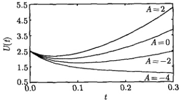

图 8.8 平均温度在不同热源常数 A 下随时间演化的曲线
 

### 8.4 泊松方程的定解问题

考虑有源的稳态二维热传导问题：一个边长为 a 和 b 的矩形薄片置于 x-y 平面的第一象限，其周边温度为零，外热源为任意函数  $ f(x,y) $。确定薄片上的温度分布  $ u(x,y) $，即求解下面泊松方程的定解问题

$$  \left\{\begin{array}{l}\frac{\partial^{2}u}{\partial x^{2}}+\frac{\partial^{2}u}{\partial y^{2}}=f(x,y)\quad(0<x<a,0<y<b)\end{array}\right.   \tag*{(8.4.1a)}$$

$$  u(x,0)=0,\quad u(x,b)=0\quad(0\leqslant x\leqslant a)   \tag*{(8.4.1b)}$$

$$  u(0,y)=0,\quad u(a,y)=0\quad(0\leqslant y\leqslant b)   \tag*{(8.4.1c)}$$

我们用本征函数法求解这一定解问题。首先注意到，函数

$$  V_{mn}(x,y)=\sin\frac{m\pi}{a}x\sin\frac{n\pi}{b}y\quad(m,n=1,2,3,\cdots)   \tag*{(8.4.2)}$$

<!-- page: 260 -->

是二维拉普拉斯算符的本征函数，事实上

 $$ \begin{aligned}\nabla^{2}V_{mn}(x,y)&=\left(\frac{\partial^{2}}{\partial x^{2}}+\frac{\partial^{2}}{\partial y^{2}}\right)\sin\frac{m\pi}{a}x\sin\frac{n\pi}{b}y\\&=\sin\frac{n\pi}{b}y\frac{\partial^{2}}{\partial x^{2}}\left(\sin\frac{m\pi}{a}x\right)+\sin\frac{m\pi}{a}x\frac{\partial^{2}}{\partial y^{2}}\left(\sin\frac{n\pi}{b}y\right)\\&=-\left(\frac{m\pi}{a}\right)^{2}\sin\frac{n\pi}{b}y\sin\frac{m\pi}{a}x-\left(\frac{n\pi}{b}\right)^{2}\sin\frac{m\pi}{a}x\sin\frac{n\pi}{b}y\\&=-\left[\left(\frac{m\pi}{a}\right)^{2}+\left(\frac{n\pi}{b}\right)^{2}\right]\sin\frac{m\pi}{a}x\sin\frac{n\pi}{b}y\\ \end{aligned} $$ 

其中

$$  \lambda_{mn}=\left(\frac{m\pi}{a}\right)^{2}+\left(\frac{n\pi}{b}\right)^{2}   \tag*{(8.4.3)}$$

是本征值。这样我们可以将方程（8.4.1a）的解写成该本征函数集的展开式

$$  u(x,y)=\sum_{m=1}^{\infty}\sum_{n=1}^{\infty}A_{mn}\sin\frac{m\pi}{a}x\sin\frac{n\pi}{b}y   \tag*{(8.4.4)}$$

为了确定展开系数  $ A_{mn} $，我们将式 (8.4.4) 代入式 (8.4.1a)，并利用式 (8.4.3)，得到

$$  \sum_{m=1}^{\infty}\sum_{n=1}^{\infty}-A_{mn}\lambda_{mn}\sin\frac{m\pi}{a}x\sin\frac{n\pi}{b}y=f(x,y)   \tag*{(8.4.5)}$$

式（8.4.5）是函数  $ f(x,y) $ 的二元傅里叶级数，由式（6.3.22b）得到展开系数

$$  A_{mn}=-\frac{4}{ab\lambda_{mn}}\int_{0}^{b}\int_{0}^{a}f(x,y)\sin\frac{m\pi}{a}x\sin\frac{n\pi}{b}y\mathrm{d}x\mathrm{d}y   \tag*{(8.4.6)}$$

式 (8.4.4) 不但满足泛定方程 (8.4.1a)，也满足边界条件式 (8.4.1b) 和式 (8.4.1c)，它就是定解问题 (8.4.1) 的解，其中， $ A_{mn} $ 由式 (8.4.6) 表示。

我们进而考虑定解问题

$$  \left\{\begin{array}{l}\frac{\partial^{2}u}{\partial x^{2}}+\frac{\partial^{2}u}{\partial y^{2}}=f(x,y)\\\end{array}\right.\quad(0<x<a,\;0<y<b)   \tag*{(8.4.7a)}$$

$$  u(x,0)=f_{1}(x),\quad u(x,b)=f_{2}(x)\quad(0\leqslant x\leqslant a)   \tag*{(8.4.7b)}$$

$$  u(0,y)=g_{1}(y),\quad u(a,y)=g_{2}(y)\quad(0\leqslant y\leqslant b)   \tag*{(8.4.7c)}$$

这个问题是图 8.9 所示两个定解问题的相加，它们的结果分别显示在式（8.4.4）和式（7.3.29）。

<!-- page: 261 -->

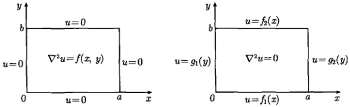

图 8.9 两个定解问题
 

例 1 设 a = b = 1,  $ f(x, y) = T_{0} $，求解定解问题 (8.4.1)。

解 首先利用式（8.4.6）求出展开系数

$$  A_{mn}=-\frac{4T_{0}}{\lambda_{mn}}\int_{0}^{1}\int_{0}^{1}\sin\frac{m\pi}{a}x\sin\frac{n\pi}{b}y\mathrm{d}x\mathrm{d}y=-\frac{4T_{0}}{\lambda_{mn}}\frac{\left[1-(-1)^{m}\right]}{\pi m}\frac{\left[1-(-1)^{n}\right]}{\pi n}   \tag*{(8.4.8)}$$

其中

$$  \lambda_{mn}=(m\pi)^{2}+(n\pi)^{2}   \tag*{(8.4.9)}$$

由式 $ （8.4.4） $得到

 $$ \begin{aligned}u(x,y)&=-\frac{16T_{0}}{\pi^{4}}\sum_{m=1,3,\cdots}\sum_{n=1,3,\cdots}\frac{\sin m\pi x\sin n\pi y}{mn(m^{2}+n^{2})}\\&=-\frac{16T_{0}}{\pi^{4}}\sum_{k=0}^{\infty}\sum_{l=0}^{\infty}\frac{\sin(2k+1)\pi x\sin(2l+1)\pi y}{(2k+1)(2l+1)\left[(2k+1)^{2}+(2l+1)^{2}\right]}\end{aligned} $$ 

这就是定解问题的解。

例 2 求解定解问题

$$  \left\{\begin{array}{l}\frac{\partial^{2}u}{\partial x^{2}}+\frac{\partial^{2}u}{\partial y^{2}}=T_{0}\end{array}\right.\qquad(0<x<1,0<y<1)   \tag*{(8.4.10a)}$$

$$  u(x,0)=0,\quad u(x,b)=T\quad(0\leqslant x\leqslant1)   \tag*{(8.4.10b)}$$

$$  u(0,y)=0,\quad u(a,y)=0\quad(0\leqslant y\leqslant1)   \tag*{(8.4.10c)}$$

解　它是定解问题（7.3.14）和本节例1定解问题的相加，结果为

 $$ \begin{aligned}u(x,y)=&\frac{4T}{\pi}\sum_{k=0}^{\infty}\frac{\sin(2k+1)\pi x\sinh(2k+1)\pi y}{(2k+1)\sinh(2k+1)\pi}\\ &-\frac{16T_{0}}{\pi^{4}}\sum_{k=0}^{\infty}\sum_{l=0}^{\infty}\frac{\sin(2k+1)\pi x\sin(2l+1)\pi y}{(2k+1)(2l+1)\left[(2k+1)^{2}+(2l+1)^{2}\right]}\end{aligned} $$

<!-- page: 262 -->

利用式(7.3.19)，中心点温度为

 $$ \begin{aligned}u\left(\frac{1}{2},\frac{1}{2}\right)&=\frac{2T}{\pi}\sum_{k=0}^{\infty}\frac{(-1)^{k}}{(2k+1)}\mathrm{sech}\frac{(2k+1)\pi}{2}\\&\quad-\frac{16T_{0}}{\pi^{4}}\sum_{k=0}^{\infty}\sum_{l=0}^{\infty}\frac{(-1)^{k+l}}{(2k+1)(2l+1)\left[(2k+1)^{2}+(2l+1)^{2}\right]}\\&=0.25T-0.074T_{0}\end{aligned} $$ 

例 3 在单位圆内求解泊松方程的定解问题

$$  \left\{\begin{array}{l}\frac{\partial^{2}u}{\partial x^{2}}+\frac{\partial^{2}u}{\partial y^{2}}=-2x\quad(x^{2}+y^{2}<1)\end{array}\right.   \tag*{(8.4.11a)}$$

$$  u\mid_{x^{2}+y^{2}=1}=0   \tag*{(8.4.11b)}$$

解　这是圆域内泊松方程的定解问题，我们采用极坐标系，则式（8.4.11）变为

$$  \left\{\begin{array}{l}\frac{1}{r}\frac{\partial}{\partial r}\left(r\frac{\partial u}{\partial r}\right)+\frac{1}{r^{2}}\frac{\partial^{2}u}{\partial\theta^{2}}=-2r\cos\theta\quad(0<r<1)\\ u|_{r=1}=0\end{array}\right.   \tag*{(8.4.12a)}$$

由7.3.2节的讨论中可知，与式(8.4.12)相应的齐次问题在周期性边界条件之下有角向本征函数

$$  \theta_{n}(\theta)=A_{n}\cos n\theta+B_{n}\sin n\theta\quad(n=0,1,2,\cdots)   \tag*{(8.4.13)}$$

设方程（8.4.12a）的解可以按该本征函数集展开，即

$$  u(r,\theta)=\sum_{n=0}^{\infty}g_{n}(r)\left(A_{n}\cos n\theta+B_{n}\sin n\theta\right)   \tag*{(8.4.14a)}$$

式（8.4.14a）也可以写成

$$  u(r,\theta)=\sum_{n=0}^{\infty}A_{n}(r)\cos n\theta+B_{n}(r)\sin n\theta   \tag*{(8.4.14b)}$$

其中， $ A_{n}(r) $ 和  $ B_{n}(r) $ 是 r 依赖的展开系数。将式 (8.4.14b) 代入式 (8.4.12a)，得到

$$  \sum_{n=0}^{\infty}\left\{\begin{array}{l}{\left[A_{n}^{\prime\prime}(r)+\frac{1}{r}A_{n}^{\prime}(r)-\frac{n^{2}}{r^{2}}A_{n}(r)\right]\cos n\theta}\\ {+\left[B_{n}^{\prime\prime}(r)+\frac{1}{r}B_{n}^{\prime}(r)-\frac{n^{2}}{r^{2}}B_{n}(r)\right]\sin n\theta}\end{array}\right\}=-2r\cos\theta   \tag*{(8.4.15)}$$

<!-- page: 263 -->

两边分别比较  $ \cos n\theta $,  $ \sin n\theta $ 的系数，得到

$$  A_{1}^{\prime\prime}(r)+\frac{1}{r}A_{1}^{\prime}(r)-\frac{1}{r^{2}}A_{1}(r)=-2r   \tag*{(8.4.16a)}$$

$$  A_{n}^{\prime\prime}(r)+\frac{1}{r}A_{n}^{\prime}(r)-\frac{n^{2}}{r^{2}}A_{n}(r)=0\quad(n\neq1)   \tag*{(8.4.16b)}$$

$$  B_{n}^{\prime\prime}(r)+\frac{1}{r}B_{n}^{\prime}(r)-\frac{n^{2}}{r^{2}}B_{n}(r)=0\quad(n=0,1,2,\cdots)   \tag*{(8.4.16c)}$$

边界条件(8.4.12b)给出

$$  A_{n}(1)=0,\quad B_{n}(1)=0   \tag*{(8.4.17a)}$$

而自然边界条件要求

$$  A_{n}(0)= 有限值 ,\quad B_{n}(0)= 有限值   \tag*{(8.4.17b)}$$

我们首先求解 (8.4.16a)，相应的齐次方程是 n = 1 的欧拉方程 [见 (7.3.58)]，通解为  $ C_1r + C_2r^{-1} $；而非齐次方程 (8.4.16a) 有特解  $ -r^3/4 $，故方程 (8.4.16a) 的通解为

$$  A_{1}(r)=C_{1}r+C_{2}r^{-1}-\frac{1}{4}r^{3}   \tag*{(8.4.18)}$$

由  $ A_{1}(0)= $ 有限值，得  $ C_{2}=0 $，再由  $ A_{1}(1)=0 $ 得  $ C_{1}=1/4 $，故

$$  A_{1}(r)=\frac{1}{4}r-\frac{1}{4}r^{3}   \tag*{(8.4.19)}$$

而方程(8.4.16b)的解为

$$  A_{0}(r)=c_{0}+d_{0}\ln r   \tag*{(8.4.20a)}$$

$$  A_{n}(r)=c_{n}r^{n}+d_{n}r^{-n}\quad(n=2,3,4,\cdots)   \tag*{(8.4.20b)}$$

由  $ A_{0}(0)= $ 有限值，得  $ d_{0}=0 $，由  $ A_{n}(0)= $ 有限值，得  $ d_{n}=0 $；由  $ A_{0}(1)=0 $ 得  $ c_{0}=0 $，由  $ A_{n}(1)=0 $ 得  $ c_{n}=0 $，故式 (8.4.16b) 的解为  $ A_{n}(r)=0(n\neq1) $。同理可证式 (8.4.16c) 中  $ B_{n}(r)=0 $。这样只有  $ A_{1}(r)\neq0 $，将式 (8.4.19) 代入式 (8.4.14b)，得到定解问题 (8.4.12) 的解

$$  u(r,\theta)=A_{1}(r)\cos\theta=\frac{1}{4}\left(1-r^{2}\right)r\cos\theta   \tag*{(8.4.21)}$$

化成直角坐标即为

$$  u(x,y)=\frac{1}{4}x\left[1-\left(x^{2}+y^{2}\right)\right]   \tag*{(8.4.22)}$$

这个问题还可以用观察法求解。从原定解问题（8.4.11）看，对解  $ u(x,y) $ 求 x,y 的二阶导数后得到 x 的一次方，所以解含有因子  $ x^{3} $。另外在边界上要满足  $ x^{2}+y^{2}=1 $，解中应含有因子  $ (x^{2}+y^{2}-1) $。综合起来可以设

$$  u(x,y)=A x\left(x^{2}+y^{2}-1\right)   \tag*{(8.4.23)}$$

<!-- page: 264 -->

代入原方程得

$$  \left(\frac{\partial^{2}}{\partial x^{2}}+\frac{\partial^{2}}{\partial y^{2}}\right)\left[Ax\left(x^{2}+y^{2}-1\right)\right]=8Ax=-2x   \tag*{(8.4.24)}$$

故 A = -1/4，代入式 (8.4.23)，即得解 (8.4.22)。

本节用本征函数法求解了一些典型的定解问题。我们看到，求解非齐次方程定解问题的关键是根据相应的齐次问题，选择本征函数集，继而求解初始条件为零的定解问题，然后将结果与相应齐次问题的解相加即可。关于本征函数集的选择，我们已经得到许多有意义的结果。如果遇到新的本征值问题，则首先求解本征方程，得到本征函数，再用它的集合表示相应定解问题的形式解。下面我们讨论如何用本征函数法处理具有非齐次边界条件的定解问题。

### 8.5 非齐次边界条件的处理

本征函数法能够用来进一步处理具有非齐次边界条件的定解问题。处理这类问题的思想方法是把边界条件齐次化。具体而言，就是选择一个适当的辅助函数 $ \Omega(x,t) $

$$  u(x,t)=v(x,t)+\varOmega(x,t)   \tag*{(8.5.1)}$$

使得关于  $ v(x,t) $ 的定解问题具有齐次边界条件。而对于这样的定解问题，我们有上述的一分为二与合二为一的方法予以求解。我们先举两个简单的例子。

对于定解问题

$$  \frac{\partial u}{\partial t}=a^{2}\frac{\partial^{2}u}{\partial x^{2}}   \tag*{(8.5.2a)}$$

$$  u|_{t=0}=\phi(x)   \tag*{8.5.2b)}$$

$$  u\vert_{x=0}=T,\quad\left.\frac{\partial u}{\partial x}\right|_{x=L}=0   \tag*{(8.5.2c)}$$

这里 x = 0 端为非齐次边界条件。选辅助函数  $ \Omega = T $，则关于  $ v(x, t) $ 的定解问题是

$$  \frac{\partial v}{\partial t}=a^{2}\frac{\partial^{2}v}{\partial x^{2}}   \tag*{(8.5.3a)}$$

$$  v\vert_{t=0}=\phi(x)-T   \tag*{(8.5.3b)}$$

$$  v\vert_{x=0}=0,\left.\frac{\partial v}{\partial x}\right|_{x=L}=0   \tag*{(8.5.3c)}$$

现在边界条件已经被齐次化，初始条件仍是任意函数。这个问题可以用分离变量法解决。再比如，对于边界条件为

$$  u\vert_{x=0}=T_{1},\quad u\vert_{x=L}=T_{2}   \tag*{(8.5.4a)}$$

<!-- page: 265 -->

的热传导问题，选

$$  \Omega=\frac{T_{2}-T_{1}}{L}x+T_{1}   \tag*{(8.5.4b)}$$

则边界条件变为  $ v|_{x=0}=0 $,  $ v|_{x=L}=0 $。

一般情况下，边界条件的表达式是时间的函数，因此辅助函数在包含空间变量的同时也是时间的函数。对于一维波动方程(5.1.6)与一维热传导方程(5.2.10)，存在与表6.2相应的4类非齐次边界条件的组合(表8.1)。容易验证，对于每一种组合，都存在相应的辅助函数  $ \Omega(x,t) $，使边界条件齐次化。

表 8.1 不同非齐次边界条件组合下的辅助函数
 

 $$ u|_{x=0}=u_{1}(t),\quad u|_{x=L}=u_{2}(t):\quad\Omega=\frac{u_{2}(t)-u_{1}(t)}{L}x+u_{1}(t) $$ 

 $$ u|_{x=0}=u_{1}(t),\quad\left.\frac{\partial u}{\partial x}\right|_{x=L}=u_{2}(t):\quad\varOmega=u_{2}(t)x+u_{1}(t) $$ 

 $$ \frac{\partial u}{\partial x}\bigg|_{x=0}=u_{1}(t),~u|_{x=L}=u_{2}(t):\quad\mathit{\Omega}=u_{1}(t)x+u_{2}(t)-L u_{1}(t) $$ 

 $$ \left.\frac{\partial u}{\partial x}\right|_{x=0}=u_{1}(t),\left.\frac{\partial u}{\partial x}\right|_{x=L}=u_{2}(t);\qquad\Omega=\frac{u_{2}(t)-u_{1}(t)}{2L}x^{2}+u_{1}(t)x $$ 

边界条件被齐次化之后，新的定解问题可以按照本章所述的本征函数法予以解决。特别要指出的是，如果非齐次方程中的自由项 f 和边界条件的表达式都不含时间 t，则可以选择适当的辅助函数  $ \Omega(x) $，使得方程与边界条件同时齐次化，这就是所谓“辅助函数法”。我们以下列定解问题为例说明

$$  \frac{\partial^{2}u}{\partial t^{2}}=a^{2}\frac{\partial^{2}u}{\partial x^{2}}+f(x)\quad(0<x<L,\ t>0)   \tag*{(8.5.5a)}$$

$$  u|_{x=0}=b,\,u|_{x=L}=c\quad(t>0)   \tag*{(8.5.5b)}$$

$$  u\vert_{t=0}=\phi(x),\quad\left.\frac{\partial u}{\partial t}\right|_{t=0}=\psi(x)\quad(0\leqslant x\leqslant L)   \tag*{(8.5.5c)}$$

其中， $ f(x) $ 不含时间，而 b 和 c 都是常数。将  $ u(x,t)=v(x,t)+\Omega(x) $ 代入式 (8.5.5a) 和式 (8.5.5b)，得到

$$  \left\{\begin{array}{l}\frac{\partial^{2}v}{\partial t^{2}}=a^{2}\frac{\partial^{2}v}{\partial x^{2}}+a^{2}\frac{\partial^{2}\Omega}{\partial x^{2}}+f(x)\end{array}\right.   \tag*{(8.5.6a)}$$

$$  v(0)+\varOmega(0)=b,v(L)+\varOmega(L)=c   \tag*{(8.5.6b)}$$

为使关于  $ v(x,t) $ 的方程和边界条件都变成齐次的，按下列条件选取辅助函数

$$  \left\{\begin{array}{l}a^{2}\frac{\partial^{2}\Omega}{\partial x^{2}}+f(x)=0\end{array}\right.   \tag*{(8.5.7a)}$$

$$  \left\{\begin{array}{l}\Omega(0)=b,\Omega(L)=c\end{array}\right.   \tag*{(8.5.7b)}$$

<!-- page: 266 -->

解式（8.5.7）得到

$$  \Omega(x)=b+\frac{c-b}{L}x+F(x)+\frac{F(0)-F(L)}{L}x-F(0)   \tag*{(8.5.8)}$$

其中

$$  F(x)=-\frac{1}{a^{2}}\int\int f(x)\mathrm{d}x\mathrm{d}x   \tag*{(8.5.9)}$$

对于具体的问题，将  $ f(x) $ 代入式 (8.5.9)，完成积分后将  $ F(x) $ 代入式 (8.5.8) 即可确定  $ \Omega(x) $，从而  $ v(x,t) $ 的定解问题为

$$  \frac{\partial^{2}v}{\partial t^{2}}=a^{2}\frac{\partial^{2}v}{\partial x^{2}}   \tag*{(8.5.10a)}$$

$$  v\vert_{x=0}=0,v\vert_{x=L}=0   \tag*{(8.5.10b)}$$

$$  v\vert_{t=0}=\phi(x)-\Omega(x),\quad\left.\frac{\partial v}{\partial t}\right|_{t=0}=\psi(x)   \tag*{(8.5.10c)}$$

这里方程与边界条件都已经齐次化，它是熟知的两端固定的弦振动问题（见 6.1.1 节）。

例1 设  $ f(x)=A, b=0, \phi(x)=0, \psi(x)=0 $ ，求解定解问题 (8.5.5)。

解 首先求出式（8.5.9）的函数

$$  F(x)=-\frac{1}{a^{2}}\int\left[\int A\mathrm{d}x\right]\mathrm{d}x=-\frac{A}{a^{2}}\int x\mathrm{d}x=-\frac{A}{2a^{2}}x^{2}   \tag*{(8.5.11)}$$

辅助函数为

$$  \begin{aligned}\Omega(x)&=b+\frac{c-b}{L}x+F(x)+\frac{F(0)-F(L)}{L}x-F(0)\\&=-\frac{A}{2a^{2}}x^{2}+\left(\frac{AL}{2a^{2}}+\frac{c}{L}\right)x\end{aligned}   \tag*{(8.5.12)}$$

关于  $ v(x,t) $ 的定解问题是式 (8.5.10)，它的一般解为

$$  v(x,t)=\sum_{n=1}^{\infty}\left(C_{n}\cos\frac{na\pi}{L}t+D_{n}\sin\frac{na\pi}{L}t\right)\sin\frac{n\pi}{L}x   \tag*{(8.5.13)}$$

其中，展开系数为

 $$ \begin{aligned}C_{n}&=\frac{2}{L}\int_{0}^{L}\left[\phi(x)-\varOmega(x)\right]\sin\frac{n\pi}{L}x\mathrm{d}x\\&=-\frac{2}{L}\int_{0}^{L}\left[-\frac{A}{2a^{2}}x^{2}+\left(\frac{AL}{2a^{2}}+\frac{c}{L}\right)x\right]\sin\frac{n\pi}{L}x\mathrm{d}x\\&=-\frac{2AL^{2}}{a^{2}n^{3}\pi^{3}}+\frac{2}{n\pi}\left(\frac{AL^{2}}{a^{2}n^{2}\pi^{2}}+c\right)\cos n\pi\\ \end{aligned} $$

<!-- page: 267 -->

$$  =(-1)^{n}\frac{2}{n\pi}\left(\frac{AL^{2}}{a^{2}n^{2}\pi^{2}}+c\right)-\frac{2AL^{2}}{a^{2}n^{3}\pi^{3}}   \tag*{(8.5.14a)}$$

$$  D_{n}=0   \tag*{(8.5.14b)}$$

于是原定解问题的解为

$$  u(x,t)=-\frac{A}{2a^{2}}x^{2}+\left(\frac{AL}{2a^{2}}+\frac{c}{L}\right)x+\sum_{n=1}^{\infty}C_{n}\cos\frac{na\pi}{L}t\sin\frac{n\pi}{L}x   \tag*{(8.5.15)}$$

其中， $ C_{n} $ 由式 (8.5.14a) 表示。

例 2 求解下列有源热传导的定解问题

$$  \left\{\begin{array}{l}\frac{\partial u}{\partial t}=a^{2}\frac{\partial^{2}u}{\partial x^{2}}+\cos\frac{x}{2}\end{array}\right.\qquad(0<x<\pi,t>0)   \tag*{(8.5.16a)}$$

$$  u\vert_{t=0}=x+\cos\frac{x}{2}\quad(0\leqslant x\leqslant\pi)   \tag*{(8.5.16b)}$$

$$  \left\{\begin{array}{l}\left.\frac{\partial u}{\partial x}\right|_{x=0}=1,\quad u|_{x=\pi}=\pi\quad(t>0)\end{array}\right.   \tag*{(8.5.16c)}$$

解 这个定解问题中，泛定方程 (8.5.16a) 的自由项以及边界条件式 (8.5.16c) 都不含时间 t，可以用辅助函数法求解。设  $ u(x,t)=v(x,t)+\Omega(x) $，我们有

$$  \int\frac{\partial v}{\partial t}=a^{2}\frac{\partial^{2}v}{\partial x^{2}}+a^{2}\frac{\partial^{2}\Omega}{\partial x^{2}}+\cos\frac{x}{2}   \tag*{(8.5.17a)}$$

$$  \left\{\begin{array}{l}\left.\frac{\partial v}{\partial x}\right|_{x=0}+\Omega^{\prime}(0)=1,\quad v|_{x=\pi}+\Omega(\pi)=\pi\end{array}\right.   \tag*{(8.5.17b)}$$

为使关于  $ v(x,t) $ 的方程和边界条件都变成齐次的，按下列条件选取辅助函数  $ \Omega(x) $

$$  a^{2}\frac{\partial^{2}\Omega}{\partial x^{2}}+\cos\frac{x}{2}=0   \tag*{(8.5.18a)}$$

$$  \Omega^{\prime}(0)=1,\quad\Omega(\pi)=\pi   \tag*{(8.5.18b)}$$

解边值问题（8.5.18）得到

$$  \Omega(x)=x+\frac{4}{a^{2}}\cos\frac{x}{2}   \tag*{(8.5.19)}$$

从而  $ v(x,t) $ 的定解问题为

$$  \frac{\partial v}{\partial t}=a^{2}\frac{\partial^{2}v}{\partial x^{2}}   \tag*{(8.5.20a)}$$

$$  v\vert_{t=0}=\left(1-\frac{4}{a^{2}}\right)\cos\frac{x}{2}   \tag*{(8.5.20b)}$$

$$  \left.\frac{\partial v}{\partial x}\right|_{x=0}=0,\quad\left.v\right|_{x=\pi}=0   \tag*{(8.5.20c)}$$

<!-- page: 268 -->

这个定解问题本质上与式(8.1.7)相同，其解为

$$  v(x,t)=\sum_{n=0}^{\infty}C_{n}\exp\left\{-\left[\frac{(2n+1)a}{2}\right]^{2}t\right\}\cos\frac{(2n+1)}{2}x   \tag*{(8.5.21)}$$

其中，展开系数为

 $$ \begin{aligned}C_{n}&=\frac{2}{\pi}\int_{0}^{\pi}\phi(x)\cos\frac{2n+1}{2}x\mathrm{d}x\\&=\frac{2}{\pi}\left(1-\frac{4}{a^{2}}\right)\int_{0}^{\pi}\cos\frac{x}{2}\cos\frac{2n+1}{2}x\mathrm{d}x\\&=\left(1-\frac{4}{a^{2}}\right)\delta_{0n}\\ \end{aligned} $$ 

代入式（8.5.21）得到

 $$ \begin{aligned}v(x,t)&=\sum_{n=0}^{\infty}\left(1-\frac{4}{a^{2}}\right)\delta_{0n}\exp\left\{-\left[\frac{(2n+1)a}{2}\right]^{2}t\right\}\cos\frac{(2n+1)}{2}x\\&=\left(1-\frac{4}{a^{2}}\right)\exp\left(\frac{a^{2}}{4}t\right)\cos\frac{x}{2}\end{aligned} $$ 

于是定解问题（8.5.16）的解为

$$  u(x,t)=x+\frac{4}{a^{2}}\cos\frac{x}{2}+\left(1-\frac{4}{a^{2}}\right)\exp\left(\frac{a^{2}}{4}t\right)\cos\frac{x}{2}   \tag*{(8.5.22)}$$

### 8.6 综合定解问题的求解

本节讨论两个综合性定解问题，它们涉及用分离变量法与本征函数法求解定解问题的全过程。

例 1 (1) 求解下列热传导的定解问题

$$  \left\{\begin{array}{l l}{\displaystyle\frac{\partial u}{\partial t}=a^{2}\frac{\partial^{2}u}{\partial x^{2}}-b^{2}u}&{\qquad(0<x<L,t>0)}\end{array}\right.   \tag*{(8.6.1a)}$$

$$  u|_{t=0}=\frac{c}{L^{2}}x^{2}\quad(0\leqslant x\leqslant L)   \tag*{(8.6.1b)}$$

$$  \left\{\begin{array}{l}\left.\frac{\partial u}{\partial x}\right|_{x=0}=0,\left.u\right|_{x=L}=c\quad(t>0)\end{array}\right.   \tag*{(8.6.1c)}$$

其中，a，b 和 c 都是常数。

(2) 设 a = b = c = 1,  $ L = \pi/2 $, 讨论所得结果。

解 (1) 这里泛定方程是线性齐次的，边界条件是非齐次的，我们用不同的方法解之。

<!-- page: 269 -->

方法1(一分为二法): 令

$$  u(x,t)=v(x,t)+c   \tag*{(8.6.2)}$$

得到关于  $ v(x,t) $ 的定解问题

$$  \frac{\partial v}{\partial t}=a^{2}\frac{\partial^{2}v}{\partial x^{2}}-b^{2}v-b^{2}c   \tag*{(8.6.3a)}$$

$$  v\vert_{t=0}=\frac{c}{L^{2}}x^{2}-c   \tag*{(8.6.3b)}$$

$$  \left.\frac{\partial v}{\partial x}\right|_{x=0}=0,\quad\left.v\right|_{x=L}=0   \tag*{(8.6.3c)}$$

现在边界条件已经齐次化，但方程变成非齐次的。它可以分成两个定解问题，令 $ v(x,t)=v_{1}(x,t)+v_{2}(x,t) $，我们有

$$  \frac{\partial v_{1}}{\partial t}=a^{2}\frac{\partial^{2}v_{1}}{\partial x^{2}}-b^{2}v_{1}   \tag*{(8.6.4a)}$$

$$  v_{1}|_{t=0}=\frac{c}{L^{2}}x^{2}-c   \tag*{(8.6.4b)}$$

$$  \left.\frac{\partial v_{1}}{\partial x}\right|_{x=0}=0,\quad\left.v_{1}\right|_{x=L}=0   \tag*{(8.6.4c)}$$

$$  \frac{\partial v_{2}}{\partial t}=a^{2}\frac{\partial^{2}v_{2}}{\partial x^{2}}-b^{2}v_{2}-b^{2}c   \tag*{(8.6.5a)}$$

$$  v_{2}\vert_{t=0}=0   \tag*{(8.6.5b)}$$

$$  \left.\frac{\partial v_{2}}{\partial x}\right|_{x=0}=0,\left.v_{2}\right|_{x=L}=0   \tag*{(8.6.5c)}$$

现在关于  $ v_{1}(x,t) $ 的问题可以用分离变量法，而关于  $ v_{2}(x,t) $ 的问题可以用本征函数法。首先求解式 (8.6.4)，设变量分离的形式解为  $ v_{1}(x,t)=X(x)T(t) $，代入式 (8.6.4a)，得到

$$  \frac{X^{\prime\prime}}{X}=\frac{T^{\prime}+b^{2}T}{a^{2}T}=-\lambda   \tag*{(8.6.6)}$$

其中， $ \lambda $ 是分离常数。由此得到空间函数的本征值问题

$$  X^{\prime\prime}+\lambda X=0   \tag*{(8.6.7a)}$$

$$  X^{\prime}(0)=0,X(L)=0   \tag*{(8.6.7b)}$$

与时间函数的方程

$$  T^{\prime}+(b^{2}+\lambda a^{2})T=0   \tag*{(8.6.8)}$$

本征值问题（8.6.7）的解为 [见（6.2.35）]

$$  \lambda_{n}=\frac{(2n+1)^{2}\pi^{2}}{4L^{2}},\quad X_{n}(x)=\cos\frac{(2n+1)\pi}{2L}x\quad(n=0,1,2,\cdots)   \tag*{(8.6.9)}$$

<!-- page: 270 -->

相应的时间函数为

$$  T_{n}(t)=C_{n}\mathrm{e}^{-\left[b^{2}+\frac{(2n+1)^{2}\pi^{2}a^{2}}{4L^{2}}\right]t}   \tag*{(8.6.10)}$$

于是一般解为

$$  v_{1}(x,t)=\sum_{n=0}^{\infty}C_{n}\mathrm{e}^{-\left[b^{2}+\frac{(2n+1)^{2}\pi^{2}a^{2}}{4L^{2}}\right]t}\cos\frac{(2n+1)\pi}{2L}x   \tag*{(8.6.11)}$$

初始条件式（8.6.4b）给出

$$  \sum_{n=0}^{\infty}C_{n}\cos\frac{(2n+1)\pi}{2L}x=\frac{c}{L^{2}}x^{2}-c   \tag*{(8.6.12)}$$

由此

$$  C_{n}=\frac{2}{L}\int_{0}^{L}\left(\frac{c}{L^{2}}x^{2}-c\right)\cos\frac{(2n+1)\pi}{2L}x\mathrm{d}x=\frac{32c}{\pi^{3}}\frac{(-1)^{n+1}}{(2n+1)^{3}}   \tag*{(8.6.13)}$$

式（8.6.11）就是定解问题（8.6.4）的解，其中  $ C_{n} $ 由式（8.6.13）确定。

现在用本征函数法求解式(8.6.5)，从表6.2选出本征函数集，进而写出形式解

$$  v_{2}(x,t)=\sum_{n=0}^{\infty}g_{n}(t)\cos\frac{(2n+1)\pi}{2L}x\quad(n=0,1,2,\cdots)   \tag*{(8.6.14)}$$

将式（8.6.14）代入方程（8.6.5a）和初始条件式（8.6.5b），得到

$$  \sum_{n=0}^{\infty}\left\{g_{n}^{\prime}(t)+\left[\frac{(2n+1)a\pi}{2L}\right]^{2}g_{n}(t)+b^{2}g_{n}(t)\right\}\cos\frac{(2n+1)\pi}{2L}x=-b^{2}c   \tag*{(8.6.15)}$$

$$  \sum_{n=0}^{\infty}g_{n}(0)\cos\frac{(2n+1)\pi}{2L}x=0   \tag*{(8.6.16)}$$

将式（8.6.15）右边的常数也按该本征函数展开

$$  -b^{2}c=\sum_{n=0}^{\infty}B_{n}\cos\frac{(2n+1)\pi}{2L}x   \tag*{(8.6.17a)}$$

其中

$$  B_{n}=\frac{2}{L}\int_{0}^{L}\left(-b^{2}c\right)\cos\frac{(2n+1)\pi}{2L}x\mathrm{d}x=\frac{4b^{2}c}{\pi}\frac{(-1)^{n+1}}{2n+1}   \tag*{(8.6.17b)}$$

故

$$  -b^{2}c=\frac{4b^{2}c}{\pi}\sum_{n=0}^{\infty}\frac{(-1)^{n+1}}{2n+1}\cos\frac{(2n+1)\pi}{2L}x   \tag*{(8.6.18)}$$

<!-- page: 271 -->

进而得到关于  $ g_{n}(t) $ 的初值问题

$$  \left\{\begin{array}{l}g_{n}^{\prime}(t)+\left\{b^{2}+\left[\frac{(2n+1)a\pi}{2L}\right]^{2}\right\}g_{n}(t)=\frac{4b^{2}c}{\pi}\frac{(-1)^{n+1}}{2n+1}\\ g_{n}(0)=0\end{array}\right.   \tag*{(8.6.19a)}$$

用拉普拉斯变换法解式(8.6.19)，得到

$$  g_{n}(t)=D_{n}\left\{\mathrm{e}^{-\left[b^{2}+\frac{(2n+1)^{2}a^{2}\pi^{2}}{4L^{2}}\right]t}-1\right\}   \tag*{(8.6.20)}$$

其中

$$  D_{n}=\frac{(-1)^{n}16b^{2}c L^{2}}{(2n+1)\pi[4b^{2}L^{2}+(2n+1)^{2}a^{2}\pi^{2}]}   \tag*{(8.6.21)}$$

定解问题（8.6.5）的解为

$$  v_{2}(x,t)=\sum_{n=0}^{\infty}D_{n}\left\{\mathrm{e}^{-\left[b^{2}+\frac{(2n+1)^{2}a^{2}\pi^{2}}{4L^{2}}\right]t}-1\right\}\cos\frac{(2n+1)\pi}{2L}x\quad(n=0,1,2,\cdots)   \tag*{(8.6.22)}$$

其中， $ D_{n} $ 由式(8.6.21)确定。最后，定解问题(8.6.1)的解由  $ u(x,t)=c+v_{1}(x,t)+v_{2}(x,t) $ 表示。

方法2(合二为一法)：由于定解问题(8.6.4)和式(8.6.5)先前都未遇到过，必须求解 $ v_{1}(x,t) $和 $ v_{2}(x,t) $才能得到 $ v(x,t) $的解。简单起见，可以用合二为一法，直接求解(8.6.3)。首先按照相应的齐次问题的边界条件，从表6.2选出本征函数集，并写出形式解

$$  v(x,t)=\sum_{n=0}^{\infty}g_{n}(t)\cos\frac{(2n+1)\pi}{2L}x\quad(n=0,1,2,\cdots)   \tag*{(8.6.23)}$$

将式（8.6.23）代入方程（8.6.3a）和初始条件式（8.6.3b），得到

$$  \sum_{n=0}^{\infty}\left\{g_{n}^{\prime}(t)+\left\lbrack\frac{(2n+1)a\pi}{2L}\right\rbrack^{2}g_{n}(t)+b^{2}g_{n}(t)\right\}\cos\frac{(2n+1)\pi}{2L}x=-b^{2}c   \tag*{(8.6.24a)}$$

$$  \sum_{n=0}^{\infty}g_{n}(0)\cos\frac{(2n+1)\pi}{2L}x=\frac{c}{L^{2}}x^{2}-c   \tag*{(8.6.24b)}$$

其中， $ g_{n}(0) $ 是函数  $ \frac{c}{L^{2}}x^{2}-c $ 的半幅傅里叶级数的展开系数，写为

$$  g_{n}(0)\equiv C_{n}   \tag*{(8.6.25)}$$

<!-- page: 272 -->

这里  $ C_{n} $ 由式 (8.6.13) 确定。用式 (8.6.18) 代换式 (8.6.24a) 右边，并与式 (8.6.25) 结合起来，构成关于  $ g_{n}(t) $ 的初值问题

$$  \left\{\begin{array}{l}g_{n}^{\prime}(t)+\left\{b^{2}+\left[\frac{(2n+1)a\pi}{2L}\right]^{2}\right\}g_{n}(t)=\frac{4b^{2}c}{\pi}\frac{(-1)^{n+1}}{2n+1}\\ g_{n}(0)=C_{n}\end{array}\right.   \tag*{(8.6.26a)}$$

用拉普拉斯变换法解式 (8.6.26)，得到

$$  g_{n}(t)=C_{n}\mathrm{e}^{-\left[b^{2}+\frac{(2n+1)^{2}a^{2}\pi^{2}}{4L^{2}}\right]t}+D_{n}\left\{\mathrm{e}^{-\left[b^{2}+\frac{(2n+1)^{2}a^{2}\pi^{2}}{4L^{2}}\right]t}-1\right\}   \tag*{(8.6.27)}$$

由此，定解问题（8.6.3）的解为

$$  u(x,t)=c+\sum_{n=0}^{\infty}g_{n}(t)\cos\frac{(2n+1)\pi}{2L}x   \tag*{(8.6.28)}$$

其中， $ g_{n}(t) $ 由式(8.6.27)表示，而所含的  $ C_{n} $ 和  $ D_{n} $ 分别由式(8.6.13)和式(8.6.21)确定。显然这个方法与方法一的结果是相同的，它的优点在于利用本征函数法一次性地得到了结果。

方法 3(辅助函数法)：原定解问题 (8.6.1) 显示，自由项与边界条件都不含时间，这样令

$$  u(x,t)=v(x,t)+\Omega(x)   \tag*{(8.6.29)}$$

我们得到

$$  \left\{\begin{array}{l}\frac{\partial v}{\partial t}=a^{2}\frac{\partial^{2}v}{\partial x^{2}}+a^{2}\frac{\partial^{2}\Omega}{\partial x^{2}}-b^{2}v-b^{2}\Omega\end{array}\right.   \tag*{(8.6.30a)}$$

$$  \left\{\begin{array}{l}\left.\frac{\partial v}{\partial x}\right|_{x=0}+\Omega^{\prime}(0)=0,\quad\left.v\right|_{x=L}+\Omega(L)=c\end{array}\right.   \tag*{(8.6.30b)}$$

让  $ \Omega(x) $ 服从边值问题

$$  \left\{\begin{array}{l}a^{2}\displaystyle\frac{\partial^{2}\Omega}{\partial x^{2}}-b^{2}\Omega=0\\ \Omega^{\prime}(0)=0,\quad\Omega(L)=c\end{array}\right.   \tag*{(8.6.31b)}$$

则  $ v(x,t) $ 的问题化为

$$  \frac{\partial v}{\partial t}=a^{2}\frac{\partial^{2}v}{\partial x^{2}}-b^{2}v   \tag*{(8.6.32a)}$$

$$  v\vert_{t=0}=\frac{c}{L^{2}}x^{2}-\Omega(x)   \tag*{(8.6.32b)}$$

$$  \left.\frac{\partial v}{\partial x}\right|_{x=0}=0,\quad\left.v\right|_{x=L}=0   \tag*{(8.6.32c)}$$

<!-- page: 273 -->

方程 (8.6.32a) 与边界条件式 (8.6.32c) 都是齐次的，可以用分离变量法求解。不过我们需要首先求解边值问题 (8.6.31)。方程 (8.6.31a) 的通解为

$$  \Omega(x)=\alpha\cosh kx+\beta\sinh kx   \tag*{(8.6.33)}$$

其中， $ \alpha $ 和  $ \beta $ 是任意常数，k = b/a。边界条件式 (8.6.31b) 要求

$$  \beta=0,\quad\alpha\cosh k L=c   \tag*{(8.6.34)}$$

故辅助函数为

$$  \Omega(x)=\frac{c}{\cosh kL}\cosh kx=c\operatorname{sech} kL\cosh kx   \tag*{(8.6.35)}$$

现在求解定解问题 (8.6.32)，它与定解问题 (8.6.4) 是本质上相同的，只是初始温度由式 (8.6.4b) 变为式 (8.6.32b)，于是一般解式 (8.6.11) 变为

$$  v(x,t)=\sum_{n=0}^{\infty}A_{n}\mathrm{e}^{-\left[b^{2}+\frac{(2n+1)^{2}\pi^{2}a^{2}}{4L^{2}}\right]t}\cos\frac{(2n+1)\pi}{2L}x   \tag*{(8.6.36)}$$

其中

 $$ \begin{aligned}A_{n}&=\frac{2}{L}\int_{0}^{L}\left(\frac{c}{L^{2}}x^{2}-\varOmega(x)\right)\cos\frac{(2n+1)\pi}{2L}x\mathrm{d}x\\&=\frac{2c}{L^{3}}\int_{0}^{L}x^{2}\cos\frac{(2n+1)\pi}{2L}x\mathrm{d}x-\frac{2c\operatorname{sech}k L}{L}\int_{0}^{L}\cosh k x\cos\frac{(2n+1)\pi}{2L}x\mathrm{d}x\\&=(-1)^{n}\left[\frac{4c(2n+1)^{2}\pi^{2}-32c}{(2n+1)^{3}\pi^{3}}-\frac{4a^{2}c(2n+1)\pi}{4b^{2}L^{2}+(2n+1)^{2}\pi^{2}a^{2}}\right]\\ \end{aligned} $$ 

最终结果为

$$  u(x,t)=c\mathrm{sech}\left(\frac{b}{a}L\right)\cosh\left(\frac{b}{a}x\right)+\sum_{n=0}^{\infty}A_{n}\mathrm{e}^{-\left[b^{2}+\frac{(2n+1)^{2}L^{2}a^{2}}{4L^{2}}\right]t}\cos\frac{(2n+1)\pi}{2L}x   \tag*{(8.6.37)}$$

可以看出，式(8.6.37)比式(8.6.28)更加简明（读者可以验证二者的等价性）。显然这里的辅助函数法比前两种方法更加简捷。

(2) 在 a = b = c = 1,  $ L = \pi/2 $ 情况下，式 (8.6.37) 变为

$$  \begin{aligned}u(x,t)=\operatorname{sech}\left(\frac{\pi}{2}\right)\cosh x\\+\sum_{n=0}^{\infty}A_{n}\mathrm{e}^{-\left[1+(2n+1)^{2}\right]t}\cos(2n+1)x\end{aligned}   \tag*{(8.6.38)}$$

而其中的展开系数为

<!-- page: 274 -->

$$  A_{n}=(-1)^{n}\frac{4}{\pi}\left[\frac{(2n+1)^{2}\pi^{2}-8}{(2n+1)^{3}\pi^{2}}-\frac{2n+1}{1+(2n+1)^{2}}\right]   \tag*{(8.6.39)}$$

平均温度为

$$  \begin{align*}U(t)&=\frac{2}{\pi}\int_{0}^{\frac{2}{\pi}}u(x,t)\mathrm{d}x\\&=\frac{2}{\pi}\left\{\tanh\left(\frac{\pi}{2}\right)+\sum_{n=0}^{\infty}\frac{(-1)^{n} A_{n}}{2n+1}\mathrm{e}^{-\left[1+(2n+1)^{2}\right]t}\right\}\end{align*}   \tag*{(8.6.40)}$$

图 8.10(a) 显示了不同时刻的温度分布。在  $ t = 0 $ 时，温度为式 (8.6.1b) 所示的抛物线分布，之后  $ x = 0 $ 端的温度持续升高，在  $ t \to \infty $ 时，式 (8.6.38) 给出稳态分布  $ u(x, \infty) = \operatorname{sech}(\pi/2) \cosh x $。另外，前端点温度  $ u(0, t) $、中点温度  $ u(\pi/4, t) $ 以及系统的平均温度  $ U(t) $ 的时间演化显示在图 8.10(b)，在  $ t \to \infty $ 时，它们分别趋于稳态值

$$  u(0,\infty)=\operatorname{sech}(\pi/2)=0.40   \tag*{(8.6.41a)}$$

$$  u(\pi/4,\infty)=\operatorname{sech}\left(\frac{\pi}{2}\right)\cosh\left(\frac{\pi}{4}\right)=0.53   \tag*{(8.6.41b)}$$

$$  U(\infty)=\frac{2}{\pi}\operatorname{t a n h}\left(\frac{\pi}{2}\right)=0.58   \tag*{(8.6.41c)}$$

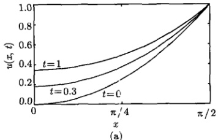

(a)
 

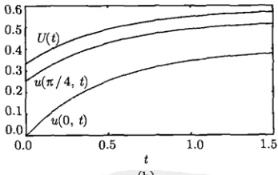

图 8.10 (a) 系统在不同时刻的温度分布; (b) 前端点温度 u(0,t)、中点温度 u( $ \pi/4 $,t) 以及系统的平均温度 U(t) 的时间演化
 

(b)
 

现在我们可以将综合定解问题的求解思路总结如下：

(1) 如果自由项和边界条件不含时间，选取适当的辅助函数使方程和边界条件同时齐次化。

(2) 如果不满足上述条件，选取适当的辅助函数（表 8.1）使边界条件齐次化。

(3) 选择适当的本征函数集，用 “合二为一法”(本征函数法) 一次性求解。

(4) 用“一分为二法”(分离变量法与本征函数法) 求解，再将二者相加。

<!-- page: 275 -->

在结束本节之前，我们再举一个具有含时边界条件的综合性定解问题。

#### 例2

(1) 求解下列有源热传导定解问题

$$  \left\{\begin{array}{l l}{\displaystyle\frac{\partial u}{\partial t}=a^{2}\frac{\partial^{2}u}{\partial x^{2}}+f(x,t)}&{\qquad\quad(0<x<L,t>0)}\end{array}\right.   \tag*{(8.6.42a)}$$

$$  u|_{t=0}=\phi(x)\quad(0\leqslant x\leqslant L)   \tag*{(8.6.42b)}$$

$$  u|_{x=0}=A(t),\quad u|_{x=L}=B(t)\quad(t>0)   \tag*{(8.6.42c)}$$

其中， $ A(t) $ 和  $ B(t) $ 是系统两端调制热源的温度，均是时间 t 的函数， $ f(x,t) $ 表示时空依赖的外热源。

(2) 设  $ a = 1, L = \pi, \phi(x) = 0, f(x, t) = 0, A(t) = te^{-t}, B(t) = 0 $，讨论所得到的结果。

解 (1) 从表 8.1 选出辅助函数

$$  \Omega(x,t)=\frac{B(t)-A(t)}{L}x+A(t)   \tag*{(8.6.43)}$$

将

$$  u(x,t)=v(x,t)+\frac{B(t)-A(t)}{L}x+A(t)   \tag*{(8.6.44)}$$

代入式(8.6.42)，得到

$$  \left\{\begin{array}{l}\frac{\partial v}{\partial t}=a^{2}\frac{\partial^{2}v}{\partial x^{2}}+f(x,t)-\frac{B^{\prime}(t)-A^{\prime}(t)}{L}x-A^{\prime}(t)\quad(0<x<L,t>0)\end{array}\right.   \tag*{(8.6.45a)}$$

$$  \left|\begin{array}{r}v\vert_{t=0}=\phi(x)-\frac{B(0)-A(0)}{L}x-A(0)\end{array}\right.\qquad(0\leqslant x\leqslant L)   \tag*{(8.6.45b)}$$

$$  \left(v\vert_{x=0}=0,\quad v\vert_{x=L}=0\right.   \tag*{(8.6.45c)}$$

这个问题的边界条件已经齐次化，形式上与式（8.2.17）相同，它的解为

$$  v(x,t)=\sum_{n=1}^{\infty}\left[C_{n}\mathrm{e}^{-\left(\frac{n\alpha\pi}{L}\right)^{2}t}+\int_{0}^{t}f_{n}(\tau)\mathrm{e}^{-\left(\frac{n\alpha\pi}{L}\right)^{2}(t-\tau)}\mathrm{d}\tau\right]\sin\frac{n\pi}{L}x   \tag*{(8.6.46)}$$

其中

$$  f_{n}(t)=\frac{2}{L}\int_{0}^{L}\left[f(x,t)-\frac{B^{\prime}(t)-A^{\prime}(t)}{L}x-A^{\prime}(t)\right]\sin\frac{n\pi}{L}x\mathrm{d}x   \tag*{(8.6.47)}$$

$$  C_{n}=\frac{2}{L}\int_{0}^{L}\left[\phi(x)-\frac{B(0)-A(0)}{L}x-A(0)\right]\sin\frac{n\pi}{L}x\mathrm{d}x   \tag*{(8.6.48)}$$

式(8.6.46)就是定解问题(8.6.42)的解，其中， $ f_{n}(t) $ 和  $ C_{n} $ 分别由式(8.6.47)和式(8.6.48)表示。

<!-- page: 276 -->

(2) 我们有  $ A(t)=te^{-t} $， $ A'(t)=(1-t)e^{-t} $， $ C_{n}=0 $，辅助函数（8.6.43）变为

$$  \Omega(x,t)=\left(1-\frac{x}{\pi}\right)t\mathrm{e}^{-t}   \tag*{(8.6.49)}$$

式（8.6.47）给出

 $$ \begin{aligned}f_{n}(t)&=\frac{2}{\pi}\int_{0}^{\pi}\left[\frac{A^{\prime}(t)}{\pi}x-A^{\prime}(t)\right]\sin nx\mathrm{d}x\\&=\frac{2}{\pi}A^{\prime}(t)\left[\frac{1}{\pi}\int_{0}^{\pi}x\sin nx\mathrm{d}x-\int_{0}^{\pi}\sin nx\mathrm{d}x\right]\\&=\frac{2}{n\pi}\left(t-1\right)\mathrm{e}^{-t}\\ \end{aligned} $$ 

代入式(8.6.46)，得

$$  v(x,t)=\frac{2}{\pi}\sum_{n=1}^{\infty}\frac{1}{n}\mathrm{e}^{-n^{2}t}\sin nx\left[\int_{0}^{t}(\tau-1)\mathrm{e}^{(n^{2}-1)\tau}\mathrm{d}\tau\right]   \tag*{(8.6.50)}$$

其中，积分为

$$  \int_{0}^{t}(\tau-1)\mathrm{e}^{(n^{2}-1)\tau}d\tau=\left\{\begin{array}{ll}t\left(\frac{t}{2}-1\right)&(n=1)\\ \frac{n^{2}\left[1-\mathrm{e}^{(n^{2}-1)t}\right]}{\left(n^{2}-1\right)^{2}}+\frac{t\mathrm{e}^{(n^{2}-1)t}}{n^{2}-1}&(n>1)\end{array}\right.   \tag*{(8.6.51)}$$

将式（8.6.51）代入（8.6.50）式（将 n=1 项单独写出），再代入式（8.6.44），最终结果为

$$  \begin{align*}u(x,t)=&\frac{2}{\pi}\sum_{n=1}^{\infty}\frac{1}{n}e^{-n^{2}t}\sin nx\left[\int_{0}^{t}(\tau-1)\mathrm{e}^{(n^{2}-1)\tau}\mathrm{d}\tau\right]+\Omega(x,t)\\=&\frac{2}{\pi}t\left(\frac{t}{2}-1\right)\mathrm{e}^{-t}\sin x+\left(1-\frac{x}{\pi}\right)t\mathrm{e}^{-t}\\&+\frac{2}{\pi}\sum_{n=2}^{\infty}\frac{1}{n}\mathrm{e}^{-n^{2}t}\left[\frac{n^{2}\left[1-\mathrm{e}^{(n^{2}-1)t}\right]}{(n^{2}-1)^{2}}+\frac{t\mathrm{e}^{(n^{2}-1)t}}{n^{2}-1}\right]\sin nx\end{align*}   \tag*{(8.6.52)}$$

进而系统平均温度为

$$  \begin{align*}U(t)=&\frac{4}{\pi^{2}}t\left(\frac{t}{2}-1\right)\mathrm{e}^{-t}+\frac{1}{2}t\mathrm{e}^{-t}\\&+\frac{2}{\pi^{2}}\sum_{n=2}^{\infty}\frac{1}{n^{2}}\mathrm{e}^{-n^{2}t}\left[\frac{n^{2}\left[1-\mathrm{e}^{(n^{2}-1)t}\right]}{\left(n^{2}-1\right)^{2}}+\frac{t\mathrm{e}^{(n^{2}-1)t}}{n^{2}-1}\right](1-\cos n\pi)\end{align*}   \tag*{(8.6.53)}$$

<!-- page: 277 -->

图 8.11 显示了不同时刻 t 的温度分布。而系统中心点温度  $ u(\pi/2, t) $、平均温度  $ U(t) $，以及调制热源的温度  $ A(t) $ 的时间演化显示在图 8.12。在初始时刻 t = 0，系统温度分布  $ u(x, 0) = 0 $。当 t > 0 时，凭借前端  $ (x = 0) $ 的边界条件，即调制热源

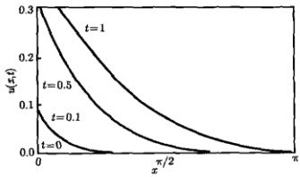

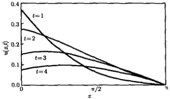

图 8.11 系统在不同时刻的温度分布
 

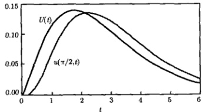

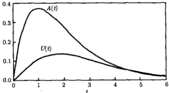

图 8.12 系统中心点温度  $ u\left(\frac{\pi}{2}, t\right) $、平均温度  $ U(t) $ 及热调制温度  $ A(t) $ 随时间的演化

 $ A(t)=te^{-t} $ 的作用，系统温度上升 [后端维持  $ u(\pi,t)=0 $]。到  $ t\approx1.8 $ 时，系统的平均温度达到最高。之后平均温度下降，在  $ t\to\infty $ 时， $ U(\infty)\to0 $。比较系统中心点温度与平均温度的时间演化可以看出，在 t 较小时，中心点温度低于平均温度；而 t 较大时，中心点温度高于平均温度。这是因为前者相应于温度单调变化的分布，而后者则是有峰分布。另一个有趣的现象是，调制热源的温度  $ A(t) $ 的最大值出现在 t=1 时，而系统平均温度的最大值出现在  $ t\approx1.8 $ 时，这在物理上是热惰性的表现。

