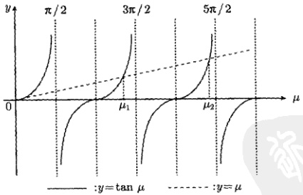
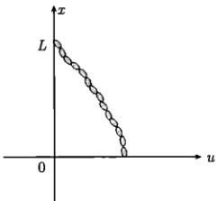
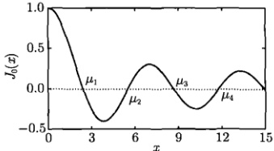
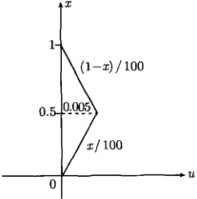
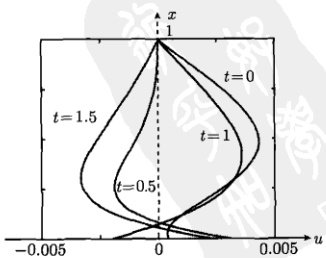

# 09-第9章 施图姆—刘维尔理论及应用

[返回全书目录](../../README.md)

> PDF 页码：278–289

<!-- page: 278 -->

### 第9章 施图姆—刘维尔理论及应用

在前几章所讨论的分离变量法与本征函数法中，我们多次遇到本征值问题。所谓本征值问题，指常微分方程或偏微分方程在一定边界条件下的解是一系列的本征值和相应的本征函数。傅里叶级数是最基本的本征函数集，方程  $ X''(x) + \lambda X(x) = 0 $ 的本征函数集有非常广泛的应用，我们还遇到过二维拉普拉斯算符的本征方程 [见式 (6.3.4a)] 及相应的二维本征函数集 [式 (6.3.21)]。本征值问题是数学物理方法和许多科学与技术领域的理论基础与重要工具。本章讨论一般的二阶常微分方程的本征值问题，并与厄米算符的本征值问题相比较。

### 9.1 施图姆-刘维尔本征值问题

任何一个二阶线性常微分方程都可以化成如下的形式

$$  \frac{\mathrm{d}}{\mathrm{d}x}\left[k(x)\frac{\mathrm{d}y}{\mathrm{d}x}\right]-q(x)y+\lambda\rho(x)y=0\quad(0<x<L)   \tag*{(9.1.1)}$$

其中， $ k(x) $、 $ q(x) $ 和  $ \rho(x) $ 是 x 的函数； $ \lambda $ 是参数。方程 (9.1.1) 称为施图姆-刘维尔 (Sturm-Liouville) 型方程。这里我们不失一般性地考虑变量 x 的有限区间  $ (0 < x < L) $。在实际问题中除方程 (9.1.1) 外，通常还带有边界条件，它们可以是第一、第二、第三类齐次边界条件，还可以是周期性边界条件 [如式 (7.3.52b)] 和自然边界条件 [如式 (7.3.53b)] 等。满足这些边界条件的非平庸解往往在  $ \lambda $ 取某些特定值时才存在，这些值称为本征值，相应的非平庸解称为本征函数。

我们将一般性地讨论施图姆-刘维尔本征值问题。为此首先对式 (9.1.1) 中的函数系数作如下假定： $ k(x) $、 $ k'(x) $、 $ q(x) $ 和  $ \rho(x) $ 在开区间 0 < x < L 是连续的，且在这个开区间上， $ k(x) > 0 $， $ \rho(x) > 0 $。在这样的条件下，存在无穷多个实的本征值，并构成一个递增序列

$$  \lambda_{1}<\lambda_{2}<\lambda_{3}<\cdots   \tag*{(9.1.2)}$$

当  $ i \to \infty $ 时， $ \lambda_{i} \to \infty $。

现在我们按照 6.4.1 节的方法，讨论本征函数的正交性。假定  $ \lambda_{m} $ 和  $ \lambda_{n} $ 是两个不同的本征值，相应的本征函数分别为  $ y_{m}(x) $ 和  $ y_{n}(x) $，则它们分别满足

$$  \frac{\mathrm{d}}{\mathrm{d}x}\left(k y_{m}^{\prime}\right)-q y_{m}+\lambda_{m}\rho y_{m}=0   \tag*{(9.1.3)}$$

<!-- page: 279 -->

$$  \frac{\mathrm{d}}{\mathrm{d}x}\left(k y_{n}^{\prime}\right)-q y_{n}+\lambda_{n}\rho y_{n}=0   \tag*{(9.1.4)}$$

式(9.1.3)和式(9.1.4)两边分别乘以 $ y_{n} $和 $ y_{m} $，然后相减，得到

$$  y_{n}\frac{\mathrm{d}}{\mathrm{d}x}\left(k y_{m}^{\prime}\right)-y_{m}\frac{\mathrm{d}}{\mathrm{d}x}\left(k y_{n}^{\prime}\right)+\left(\lambda_{m}-\lambda_{n}\right)\rho y_{m}y_{n}=0   \tag*{(9.1.5)}$$

式(9.1.5)对x从0到L积分，得到

 $$ \begin{aligned}&\int_{0}^{L}\left[y_{n}\frac{\mathrm{d}}{\mathrm{d}x}\left(k y_{m}^{\prime}\right)-y_{m}\frac{\mathrm{d}}{\mathrm{d}x}\left(k y_{n}^{\prime}\right)\right]\mathrm{d}x+\left(\lambda_{m}\stackrel{\cdot}{,}-\lambda_{n}\right)\int_{0}^{L}\rho y_{m}y_{n}\mathrm{d}x\\=&\int_{0}^{L}\frac{\mathrm{d}}{\mathrm{d}x}\left(k y_{n}y_{m}^{\prime}-k y_{m}y_{n}^{\prime}\right)\mathrm{d}x+\left(\lambda_{m}-\lambda_{n}\right)\int_{0}^{L}\rho y_{m}y_{n}\mathrm{d}x\\=&\left[k y_{n}y_{m}^{\prime}-k y_{m}y_{n}^{\prime}\right]_{0}^{L}+\left(\lambda_{m}-\lambda_{n}\right)\int_{0}^{L}\rho y_{m}y_{n}\mathrm{d}x\\=&k(0)\left[y_{m}(0)y_{n}^{\prime}(0)-y_{n}(0)y_{m}^{\prime}(0)\right]-k(L)\left[y_{m}(L)y_{n}^{\prime}(L)-y_{n}(L)y_{m}^{\prime}(L)\right]\\&+\left(\lambda_{m}-\lambda_{n}\right)\int_{0}^{L}\rho y_{m}y_{n}\mathrm{d}x=0\end{aligned} $$ 

这样

$$  \int_{0}^{L}\rho(x)y_{m}(x)y_{n}(x)\mathrm{d}x=\frac{Q}{\lambda_{m}-\lambda_{n}}\quad(m\neq n)   \tag*{(9.1.6)}$$

其中

$$  Q=k(0)\left[y_{n}(0)y_{m}^{\prime}(0)-y_{m}(0)y_{n}^{\prime}(0)\right]-k(L)\left[y_{n}(L)y_{m}^{\prime}(L)-y_{m}(L)y_{n}^{\prime}(L)\right]   \tag*{(9.1.7)}$$

称为 Q 因子。式 (9.1.6) 是关于本征方程 (9.1.1) 的本征函数正交性的一般性结果，适用于该方程的任何形式的本征函数，它依赖于本征函数及其导数在两个端点 x = 0 和 x = L 的取值。式 (9.1.7) 表示，只要边界条件的取值满足 Q = 0，则相应的本征函数  $ y_1, y_2, y_3 \cdots $ 在区间  $ [0, L] $ 上是带权重  $ \rho(x) $ 正交的。这里的结论在  $ k(x) = 1 $,  $ q(x) = 0 $,  $ \rho(x) = 1 $ 时约化为 6.4.1 节所讨论的关于本征方程  $ X''(x) + \lambda X(x) = 0 $ 的结果。

我们进一步讨论本征函数集  $ \{y_n(x)\} $ 的完备性，若函数  $ f(x) $ 在区间 [0, L] 内具有连续二阶导数并满足与本征函数集  $ \{y_n(x)\} $ 相同的边界条件，则  $ f(x) $ 可以展开成绝对且一致收敛的级数

$$  f(x)=\sum_{n}C_{n}y_{n}(x)   \tag*{(9.1.8)}$$

式 (9.1.8) 中的展开系数  $ C_{n} $ 与 x 无关。本征函数  $ y_{n}(x) $ 的这种性质称为完备性。现在我们利用正交性表达式 (9.1.6) 来计算式 (9.1.8) 中的  $ C_{n} $。式 (9.1.6) 两边同乘以  $ \rho(x)y_{m}(x)(m=1,2,3\cdots) $，并在区间  $ [0,L] $ 积分，得到

<!-- page: 280 -->

$$ \begin{aligned}\int_{0}^{L}\rho(x)y_{m}(x)f(x)\mathrm{d}x&=\int_{0}^{L}\rho(x)y_{m}(x)\left[\sum_{n}C_{n}y_{n}(x)\right]\mathrm{d}x\\&=\sum_{n}C_{n}\int_{0}^{L}\rho(x)y_{m}(x)y_{n}(x)\mathrm{d}x\\&=\sum_{n}C_{n}I_{n}(L)\delta_{mn}\\&=C_{m}I_{m}(L)\\ \end{aligned} $$ 

其中

$$  I_{n}(L)=\int_{0}^{L}\rho(x)y_{n}^{2}(x)\mathrm{d}x   \tag*{(9.1.9)}$$

于是

 $$ C_{n}=\frac{1}{I_{n}(L)}\int_{0}^{L}\rho(x)y_{n}(x)f(x)\mathrm{d}x $$ 

例 1 对于施图姆-刘维尔本征值问题

$$  \left\{\begin{array}{l}\frac{\mathrm{d}}{\mathrm{d}x}\left[k(x)\frac{\mathrm{d}y}{\mathrm{d}x}\right]-q(x)y+\lambda\rho(x)y=0\quad(0<x<L)\\ \alpha_{1}y(0)+\alpha_{2}y^{\prime}(0)=0,\quad\beta_{1}y(L)+\beta_{2}y^{\prime}(L)=0\end{array}\right.   \tag*{(9.1.11a)}$$

假定  $ k(x) $,  $ q(x) $,  $ \rho(x) $ 均为实函数,  $ \alpha_{1}, \alpha_{2}, \beta_{1}, \beta_{2} $ 均为实常数, 证明:

(1) 本征值  $ \lambda $ 是实的。

(2) 本征函数  $ y(x) $ 是正交的。

##### 证明

(1) 对式(9.1.11) 取复共轭得到

$$  \left\{\begin{array}{l}\frac{\mathrm{d}}{\mathrm{d}x}\left[k(x)\frac{\mathrm{d}y^{*}}{\mathrm{d}x}\right]-q(x)y^{*}+\lambda^{*}\rho(x)y^{*}=0\quad(0<x<L)\\ \alpha_{1}y^{*}(0)+\alpha_{2}y^{\prime*}(0)=0,\quad\beta_{1}y^{*}(L)+\beta_{2}y^{\prime*}(L)=0\end{array}\right.   \tag*{(9.1.12a)}$$

方程 (9.1.11a) 两边乘以  $ y^{*} $，方程 (9.1.12a) 两边乘以 y，然后相减，化简后得到

$$  \frac{\mathrm{d}}{\mathrm{d}x}\left[k(x)\left(y y^{\prime*}-y^{*}y^{\prime}\right)\right]=\left(\lambda-\lambda^{*}\right)\rho(x)y y^{*}   \tag*{(9.1.13)}$$

对式 (9.1.13) 从 0 到 L 积分，利用条件式 (9.1.11b) 和式 (9.1.12b)，得到

$$  \left(\lambda-\lambda^{*}\right)\int_{0}^{L}\rho(x)\left|y\right|^{2}\mathrm{d}x=\left[k(x)\left(y y^{\prime}^{*}-y^{*}y^{\prime}\right)\right]_{0}^{L}=0   \tag*{(9.1.14)}$$

因为  $ \rho(x) \geq 0 $，且在  $ (0, L) $ 不恒等于 0，式 (9.1.14) 左边的积分是正的，所以  $ \lambda - \lambda^* = 0 $，或  $ \lambda = \lambda^* $，即  $ \lambda $ 是实的。

<!-- page: 281 -->

(2) 利用式 (9.1.11b) 计算式 (9.1.7) 的 Q 因子，我们有

 $$ \begin{aligned}{Q=}&{{}k(0)\left[y_{n}(0)\left(-\frac{\alpha_{1}}{\alpha_{2}}y_{m}(0)\right)-y_{m}(0)\left(-\frac{\alpha_{1}}{\alpha_{2}}y_{n}(0)\right)\right]^{z}}\\ {}&{{}-k(L)\left[y_{n}(L)\left(-\frac{\beta_{1}}{\beta_{2}}y_{m}(L)\right)-y_{m}(L)\left(-\frac{\beta_{1}}{\beta_{2}}y_{n}(L)\right)\right]}\\ {=}&{{}k(0)\left(-\frac{\alpha_{1}}{\alpha_{2}}\right)\left[y_{n}(0)y_{m}(0)-y_{m}(0)y_{n}(0)\right]}\\ {}&{{}-k(L)\left(-\frac{\beta_{1}}{\beta_{2}}\right)\left[y_{n}(L)y_{m}(L)-y_{m}(L)y_{n}(L)\right]}\\ {=}&{{}0}\\ \end{aligned} $$ 

因此，本征函数  $ y(x) $ 是正交的。

例 2 求解本征值问题

$$  \left\{\begin{array}{l}X^{\prime\prime}(x)+\lambda X(x)=0\quad(0<x<2\pi)\end{array}\right.   \tag*{(9.1.15a)}$$

$$  X(0)=X(2\pi)   \tag*{(9.1.15b)}$$

$$  X^{\prime}(0)=X^{\prime}(2\pi)   \tag*{(9.1.15c)}$$

并证明本征函数的正交性。

解　容易看出，当  $ \lambda < 0 $ 时，式 (9.1.15) 只有平庸解。当  $ \lambda = 0 $ 时，式 (9.1.15a) 的通解为  $ X(x) = A + Bx $，其中，A 和 B 为任意常数。满足边界条件式 (9.1.15b) 和式 (9.1.15c) 的解为： $ \lambda_0 = 0 $， $ X_0(x) = A $。当  $ \lambda > 0 $ 时，式 (9.1.15a) 的通解为

$$  X(x)=A\cos kx+B\sin kx   \tag*{(9.1.16)}$$

其中， $ k=\sqrt{\lambda} $; A 和 B 是任意常数。式 (9.1.16) 满足周期性边界条件 (9.1.15b) 和 (9.1.15c) 的条件是

$$  k=n\quad(n=0,1,2\cdots)   \tag*{(9.1.17)}$$

这里已经包含了  $ \lambda = 0 $ 时的解。于是本征值问题 (9.1.15) 的解为

$$  \lambda_{n}=n^{2},\quad X_{n}(x)=A_{n}\cos nx+B_{n}\sin nx\quad(n=0,1,2,\cdots)   \tag*{(9.1.18)}$$

我们进一步考查本征函数  $ X_{n}(x) $ 的正交性，将边界条件式 (9.1.15b) 和式 (9.1.15c) 代入式 (9.1.7) 得到

 $$ \begin{align*}Q&=[X_{n}(0)X_{m}^{\prime}(0)-X_{m}(0)X_{n}^{\prime}(0)]-[X_{n}(2\pi)X_{m}^{\prime}(2\pi)-X_{m}(2\pi)X_{n}^{\prime}(2\pi)]\\&=[X_{n}(0)X_{m}^{\prime}(0)-X_{m}(0)X_{n}^{\prime}(0)]-[X_{n}(0)X_{m}^{\prime}(0)-X_{m}(0)X_{n}^{\prime}(0)]=0\end{align*} $$ 

可见本征函数  $ X_{n}(x) $ 在区间  $ [0,2\pi] $ 上是正交的。

<!-- page: 282 -->

#### 例 3 求解本征值问题

$$  \frac{\mathrm{d}^{4}y}{\mathrm{d}x^{4}}+\lambda\frac{\mathrm{d}^{2}y}{\mathrm{d}x^{2}}=0\quad(0<x<L)   \tag*{(9.1.19a)}$$

$$  y(0)=0,\quad y^{\prime}(0)=0   \tag*{(9.1.19b)}$$

$$  y(L)=0,\quad y^{\prime}(L)=0   \tag*{(9.1.19c)}$$

的本征值  $ \lambda_{1}, \lambda_{2}, \lambda_{3} \cdots $ 及第一个本征函数  $ y_{1} $

解　容易验证，当  $ \lambda \leq 0 $ 时，式 (9.1.19) 只有平庸解，我们只需要考虑  $ \lambda > 0 $ 的情况。设  $ \beta = \sqrt{\lambda} $，式 (9.1.19a) 的特征方程为

$$  r^{4}+\beta^{2}r^{2}=r^{2}(r^{2}+\beta^{2})=0   \tag*{(9.1.20)}$$

它有二重根 r = 0 及虚数根  $ r = \pm i\beta $，由此方程 (9.1.19a) 的一般解为

$$  y=A+Bx+C\cos\beta x+D\sin\beta x   \tag*{(9.1.21a)}$$

它的导数为

$$  y^{\prime}=B-\beta C\sin\beta x+\beta D\cos\beta x   \tag*{(9.1.21b)}$$

由边界条件式（9.1.19b）和式（9.1.19c）得到

$$  \boldsymbol{A}+\boldsymbol{C}=\boldsymbol{0}   \tag*{(9.1.22a)}$$

$$  \boldsymbol{B}+\boldsymbol{\beta}\boldsymbol{D}=\boldsymbol{0}   \tag*{(9.1.22b)}$$

$$  \begin{aligned}A+BL+C\cos\beta L+D\sin\beta L&=0\end{aligned}   \tag*{(9.1.22c)}$$

$$  \boldsymbol{B}-\boldsymbol{\beta}\boldsymbol{C}\sin\boldsymbol{\beta}\boldsymbol{L}+\boldsymbol{\beta}\boldsymbol{D}\cos\boldsymbol{\beta}\boldsymbol{L}=\boldsymbol{0}   \tag*{(9.1.22d)}$$

这是一个关于 A, B, C, D 的线性齐次方程组，它有非零解的必要充分条件是系数行列式为零，即

$$  \left|\begin{array}{c c c c}{1}&{0}&{1}&{0}\\ {0}&{1}&{0}&{\beta}\\ {1}&{L}&{\cos\beta L}&{\sin\beta L}\\ {0}&{1}&{-\beta\sin\beta L}&{\beta\cos\beta L}\end{array}\right|=0   \tag*{(9.1.23)}$$

计算左边的行列式，给出

$$  \sin\frac{\beta L}{2}\left(2\sin\frac{\beta L}{2}-\beta L\cos\frac{\beta L}{2}\right)=0   \tag*{(9.1.24)}$$

即

$$  \sin\frac{\beta L}{2}=0   \tag*{(9.1.25)}$$

<!-- page: 283 -->

和

$$  2\sin\frac{\beta L}{2}-\beta L\cos\frac{\beta L}{2}=0   \tag*{（9.1.26）}$$

式(9.1.25)给出本征值

$$  \beta_{n}=\frac{2\pi n}{L}\quad(n=1,2,3\cdots)   \tag*{(9.1.27)}$$

式（9.1.26）给出本征值所满足的超越方程

$$  \tan\frac{\beta L}{2}=\frac{\beta L}{2}   \tag*{(9.1.28)}$$

它的根由图9.1确定为

$$  \beta_{n}=\frac{2\mu_{n}}{L}\quad(n=1,2,3\cdots)   \tag*{(9.1.29)}$$

其中， $ \mu_{n} $ 是超越方程  $ \tan\mu=\mu $ 的第 n 个根。故本征值问题 (9.1.19) 的本征值为

$$  \lambda_{n}=\left(\frac{2\pi n}{L}\right)^{2},\quad\lambda_{n}=\left(\frac{2\mu_{n}}{L}\right)^{2}\quad(n=1,2,3\cdots)   \tag*{(9.1.30)}$$

为了确定第一个本征值，由计算机算出  $ \mu_{1}=4.49 $，可见由式(9.1.30)第一式所确定的  $ \beta_{1}=\frac{2\pi}{L} $ [即  $ \lambda_{1}=(2\pi/L)^{2} $] 是第一个本征值。利用  $ \beta_{1} $ 值和式(9.1.22a~c)，得到 B=D=0。进而由式(9.1.22a)和式(9.1.21a)给出 (取 A=1)

$$  y_{1}=1-\cos\frac{2\pi}{L}x   \tag*{(9.1.31)}$$

这就是本征值问题（9.1.19）的第一个本征函数。

图 9.1 超越方程  $ \tan\mu=\mu $ 的根： $ \mu_{1},\mu_{2},\mu_{3} $
 

### 9.2 施图姆-刘维尔理论的应用：吊摆问题

讨论了施图姆-刘维尔理论之后，我们用它来研究一个重要的定解问题，即吊

<!-- page: 284 -->

链的摆动（简称吊摆）。这个问题所以重要，是因为它在常微分方程理论发展中，扮演过一个核心的角色。正是基于这个问题的求解，丹尼尔·伯努利（Daniel Bernoulli）于1732年最先发现了贝塞尔函数。我们的叙述强调施图姆-刘维尔理论的应用，但同时也自然地触及到贝塞尔函数的性质。

图 9.2 吊链的摆动
 

考虑如图 9.2 所示的长度为 L 的柔性吊链的摆动，吊链上端点固定在 x = L，假定吊链在横向摆动时，始终处于一个铅直面内，且吊链摆动的幅度很小，以致其下端在摆动时始终维持在同一水平线上。我们来确定任意时刻吊链上任意点 x 离开铅直线（吊链的平衡位置）的位移 u(x,t)。

吊链的横向小幅摆动由下面的定解问题描述

$$  \left\{\begin{array}{l}\frac{\partial^{2}u}{\partial t^{2}}=g\left(x\frac{\partial^{2}u}{\partial x^{2}}+\frac{\partial u}{\partial x}\right)\end{array}\right.\qquad(0<x<L,t>0)   \tag*{(9.2.1a)}$$

$$  u|_{t=0}=f(x),\left.\frac{\partial u}{\partial t}\right|_{t=0}=v(x)\quad(0\leqslant x\leqslant L)   \tag*{(9.2.1b)}$$

 $$ u\big|_{x=L}=0 $$ 

$$  (t>0)   \tag*{(9.2.1c)}$$

其中，g 是重力加速度； $ f(x) $ 和  $ v(x) $ 是吊链的初始位移与初始速度。我们将用分离变量法求解这个问题，它的一般解将涉及贝塞尔级数，而其中的空间函数是一个施图姆-刘维尔本征值问题。

设方程  $ (9.2.1a) $ 有变量分离的形式解  $ u(x,t)=X(x)T(t) $，代入方程  $ (9.2.1a) $，得到

$$  XT^{\prime \prime}=gT(xX^{\prime \prime}+X^{\prime})   \tag*{(9.2.2)}$$

即

$$  \frac{1}{g}\frac{T^{\prime \prime}}{T}=\frac{x X^{\prime \prime}+X^{\prime}}{X}   \tag*{(9.2.3)}$$

由此得到时间函数和空间函数的方程

$$  \frac{1}{g}\frac{T^{\prime \prime}}{T}=\beta,\quad\frac{x X^{\prime \prime}+X^{\prime}}{X}=\beta   \tag*{(9.2.4)}$$

其中， $ \beta $ 是分离常数。边界条件式 (9.2.1c) 给出  $ X(L)T(t)=0 $，由此  $ X(L)=0 $。于是我们得到

$$  T^{\prime\prime}-\beta gT=0\  和 \ xX^{\prime\prime}+X^{\prime}-\beta X=0,\quad X(L)=0   \tag*{（9.2.5）}$$

如果  $ \beta \geqslant 0 $， $ T(t) $ 的解是线性或指数函数，物理上显然不存在这样的情况。 $ \beta $ 必须是负值，于是我们令  $ \lambda = \sqrt{-\beta} $，得到

<!-- page: 285 -->

$$  T^{\prime\prime}+\lambda^{2}g T=0   \tag*{(9.2.6)}$$

$$  xX^{\prime\prime}+X^{\prime}+\lambda^{2}X=0   \tag*{(9.2.7a)}$$

$$  X(L)=0   \tag*{(9.2.7b)}$$

方程(9.2.6)的通解为

$$  T(t)=A\cos\left(\sqrt{g}\lambda t\right)+B\sin\left(\sqrt{g}\lambda t\right)   \tag*{(9.2.8)}$$

下面我们利用施图姆-刘维尔理论研究本征值问题 (9.2.7)，首先将式 (9.2.7a) 写成式 (9.1.1) 的形式，即

$$  \left(x X^{\prime}\right)^{\prime}+\lambda^{2}X=0   \tag*{(9.2.9)}$$

方程式 (9.2.9) 与式 (9.1.1) 相比较，有  $ k(x)=x $,  $ q(x)=0 $,  $ \rho(x)=1 $。我们将会显示，空间函数 X 的本征值问题有无穷多个本征值，相应于一套本征函数集，这些本征函数在区间  $ [0,L] $ 上是正交的。这样，定解问题 (9.2.1) 的一般解作为本征解的叠加，能够表征任意的初始条件。事实上，式 (9.2.7) 的解给出本征值与本征函数 (参阅第 13 章)

$$  \lambda_{m}=\frac{\mu_{m}}{2\sqrt{L}},\quad X_{m}(2\sqrt{x})=J_{0}\left(\mu_{m}\sqrt{\frac{x}{L}}\right)\quad(m=1,2,3\cdots)   \tag*{(9.2.10)}$$

其中， $ \mu_{m} $ 是零阶贝塞尔函数  $ J_{0} $ 的第 m 个零点，如图 9.3 所示。本征函数的正交性关系式为

$$  \int_{0}^{L}J_{0}\left(\mu_{m}\sqrt{\frac{x}{L}}\right)J_{0}\left(\mu_{n}\sqrt{\frac{x}{L}}\right)=\frac{1}{L J_{1}^{2}(\mu_{m})}\delta_{mn}   \tag*{(9.2.11)}$$

其中， $ J_{1} $ 为一阶贝塞尔函数。定解问题 (9.2.1) 的本征解为

$$  u_{m}(x,t)=J_{0}\left(\mu_{m}\sqrt{\frac{x}{L}}\right)\left[A_{m}\cos\left(\sqrt{\frac{g}{L}}\frac{\mu_{m}}{2}t\right)+B_{m}\sin\left(\sqrt{\frac{g}{L}}\frac{\mu_{m}}{2}t\right)\right]   \tag*{(9.2.12)}$$

它的一般解为

$$  u(x,t)=\sum_{m=1}^{\infty}J_{0}\left(\mu_{m}\sqrt{\frac{x}{L}}\right)\left[A_{m}\cos\left(\sqrt{\frac{g}{L}}\frac{\mu_{m}}{2}t\right)+B_{m}\sin\left(\sqrt{\frac{g}{L}}\frac{\mu_{m}}{2}t\right)\right]   \tag*{(9.2.13)}$$

进而利用初始条件式(9.2.1b)与正交性关系式(9.2.11)确定系数，它们是

$$  A_{m}=\frac{1}{L J_{1}^{2}(\mu_{m})}\int_{0}^{L}f(x)J_{0}\left(\mu_{m}\sqrt{\frac{x}{L}}\right)\mathrm{d}x   \tag*{(9.2.14a)}$$

$$  B_{m}=\frac{2}{L J_{1}^{2}(\mu_{m})}\frac{1}{\sqrt{gL}}\int_{0}^{L}v(x)J_{0}\left(\mu_{m}\sqrt{\frac{x}{L}}\right)\mathrm{d}x   \tag*{(9.2.14b)}$$

至此，我们已经完全确定了定解问题 (9.2.1) 的解，它由式 (9.2.13) 表示，其中的系数  $ A_{m} $ 和  $ B_{m} $ 由式 (9.2.14) 给出。

<!-- page: 286 -->

图 9.3 零阶贝塞尔函数  $ J_{0}(x) $ 与它的零点  $ \mu_{m} $
 

例 设吊链的长度为 L = 1m，其初始状态如图 9.4 所示，初始速度  $ v(0) = 0 $，利用  $ J_{0} $ 的前三个零点值对式 (9.2.13) 作数值计算，取  $ g = 9.8 \, m/s^{2} $。

解  $ J_{0} $ 的前三个零点值为

$$  \mu_{1}=2.40483,\quad\mu_{2}=5.52008,\quad\mu_{3}=8.65373   \tag*{(9.2.15)}$$

展开系数为

$$  A_{m}=\frac{1}{J_{1}^{2}(\mu_{m})}\left[\int_{0}^{1/2}\frac{x}{100}J_{0}\left(\mu_{m}\sqrt{x}\right)\mathrm{d}x+\int_{1/2}^{1}\frac{1-x}{100}J_{0}\left(\mu_{m}\sqrt{x}\right)\mathrm{d}x\right]   \tag*{(9.2.16a)}$$

$$  B_{m}=0   \tag*{(9.2.16b)}$$

这样式(9.2.13)变为

 $$ \begin{aligned}u(x,t)\approx&\sum_{m=1}^{3}A_{m}J_{0}\left(\mu_{m}x\right)\cos\left(\sqrt{9.8}\frac{\mu_{m}}{2}t\right)\\=&0.003847J_{0}(2.40480\sqrt{x})\cos(3.76415t)\\&-0.005787J_{0}(5.52008\sqrt{x})\cos(8.64029t)\\&+0.002371J_{0}(8.65373\sqrt{x})\cos(13.5452t)\end{aligned} $$ 

按照上式作出图 9.5，它显示了吊链在不同时刻的状态。由于上式的近似性，初始 t=0 时刻的状态与图 9.4 有一定的偏差。

图 9.4 吊链的初始状态
 

图 9.5 吊链在不同时刻的状态
 

<!-- page: 287 -->

### 9.3 厄米算符本征函数的正交性

本节讨论与施图姆-刘维尔理论有关的厄米算符的本征函数问题。如果对于任意两个复变函数  $ \psi $ 和  $ \phi $，算符 F 满足下列等式

$$  \int\psi^{*}F\phi\mathrm{d}x=\int(F\psi)^{*}\phi\mathrm{d}x   \tag*{(9.3.1)}$$

则称 F 为厄米算符。其中，x 代表所有的变量，积分范围是所有变量变化的整个区域。现在我们证明，由式(9.3.1)所定义的厄米算符的本征值为实数。

证明 由于式 (9.3.1) 中的函数  $ \psi $ 和  $ \phi $ 可以任意取，现取  $ \psi \equiv \phi $，且取它们为 F 的本征函数，相应的本征值为  $ \lambda $，则  $ F\psi = \lambda\psi $，这样式 (9.3.1) 的两边分别成为

$$  \int\psi^{*}F\phi\mathrm{d}x=\int\psi^{*}F\psi\mathrm{d}x=\lambda\int\psi^{*}\psi\mathrm{d}x   \tag*{(9.3.2a)}$$

$$  \int\left(F\psi\right)^{*}\psi\mathrm{d}x=\int\left(\lambda\psi\right)^{*}\psi\mathrm{d}x=\lambda^{*}\int\psi^{*}\psi\mathrm{d}x   \tag*{(9.3.2b)}$$

式（9.3.2a）和式（9.3.2b）的左边相等，故

$$  \lambda=\lambda^{*}   \tag*{(9.3.3)}$$

因此，厄米算符的本征值是实数。

下面我们推导厄米算符的一个等价定义。首先，算符 F 的厄米共轭  $ \hat{F}^{+} $ 由

$$  (F\psi)^{*}\equiv\psi^{*}F^{+}   \tag*{(9.3.4)}$$

定义，其中， $ \psi $ 是任意函数。式 (9.3.4) 两边同乘以任意函数  $ \phi $，然后在变量变化的整个区域积分，并利用式 (9.3.1)，我们有

$$  \int\psi^{*}F\phi\mathrm{d}x=\int\psi^{*}F^{+}\phi\mathrm{d}x   \tag*{(9.3.5)}$$

由于式(9.3.5)中的 $ \psi $和 $ \phi $都是任意的，式(9.3.5)给出

$$  \boldsymbol{F}=\boldsymbol{F}^{+}   \tag*{(9.3.6)}$$

定义式 (9.3.6) 与式 (9.3.1) 是等价的：即一个算符如果等于它的厄米共轭，则该算符为厄米算符。

我们进一步证明厄米算符的归一化本征函数是正交的，即

$$  \int\psi_{m}^{*}\hat{\psi}_{n}\mathrm{d}x=\delta_{m n}   \tag*{(9.3.7)}$$

<!-- page: 288 -->

证明 设  $ \psi_{1},\psi_{2},\cdots,\psi_{n}\cdots $ 是厄米算符 F 的归一化本征函数，即

$$  \int\psi_{n}^{*}\psi_{n}\mathrm{d}x=\int|\psi_{n}|^{2}\mathrm{d}x=1   \tag*{(9.3.8)}$$

相应的本征值为  $ \lambda_{1},\lambda_{2},\cdots,\lambda_{n}\cdots $ 考虑其中任意两个不同的本征函数  $ \psi_{m} $ 和  $ \psi_{n} $，利用本征方程

$$  F\psi_{m}=\lambda_{m}\psi_{m},\quad F\psi_{n}=\lambda_{n}\psi_{n}   \tag*{(9.3.9)}$$

我们有

 $$ \begin{aligned}0&=\int\psi_{m}^{*}F\psi_{n}\mathrm{d}x-\int\psi_{m}^{*}F^{+}\psi_{n}\mathrm{d}x\quad( 因为 F 是厄米的：F=F^{+}\\&=\int\psi_{m}^{*}F\psi_{n}\mathrm{d}x-\int(F\psi_{m})^{*}\psi_{n}\mathrm{d}x\quad( 定义式 (\hat{F}\psi)^{*}\equiv\psi^{*}\hat{F}^{+})\\&=\int\psi_{m}^{*}\lambda_{n}\psi_{n}\mathrm{d}x-\int(\lambda_{m}\psi_{m})^{*}\psi_{n}\mathrm{d}x\quad( 利用 F\psi_{m}=\lambda_{m}\psi_{m})\\&=\int\psi_{m}^{*}\lambda_{n}\psi_{n}\mathrm{d}x-\int\psi_{m}^{*}\lambda_{m}^{*}\psi_{n}\mathrm{d}x\\&=\int\psi_{m}^{*}\lambda_{n}\psi_{n}\mathrm{d}x-\int\psi_{m}^{*}\lambda_{m}\psi_{n}\mathrm{d}x\quad( 本征值为实数：\lambda_{m}^{*}=\lambda_{m})\\&=(\lambda_{n}-\lambda_{m})\int\psi_{m}^{*}\psi_{n}\mathrm{d}x\quad(\lambda_{n}\neq\lambda_{m})\\&=\int\psi_{m}^{*}\psi_{n}\mathrm{d}x\end{aligned} $$ 

进而考虑到式(9.3.8)，故式(9.3.7)得证。

我们进一步讨论厄米算符本征函数的完备性。设 F 是一个满足条件式 (9.3.6) 的厄米算符，它的正交归一本征函数是  $ \psi_{n}(x) $，相应的本征值是  $ \lambda_{n} $，则任一函数  $ f(x) $ 可以按  $ \{\psi_{n}(x)\} $ 展开为级数

$$  f(x)=\sum_{n}C_{n}\psi_{n}(x)   \tag*{(9.3.10)}$$

式(9.3.10)中的展开系数  $ C_{n} $ 可以由  $ f(x) $ 和  $ \psi_{n}(x) $ 求得。以  $ \psi_{m}^{*}(x) $ 乘以式(9.3.10)两端，并对 x 变化的整个区域积分，由  $ \psi_{n}(x) $ 的正交归一性表达式(9.3.7)，我们有

 $$ \begin{aligned}\int\psi_{m}^{*}(x)f(x)\mathrm{d}x&=\int\psi_{m}^{*}(x)\left[\sum_{n}C_{n}\psi_{n}(x)\right]\mathrm{d}x\\&=\sum_{n}C_{n}\int\psi_{m}^{*}(x)\psi_{n}(x)\mathrm{d}x\\&=\sum_{n}C_{n}\delta_{mn}=C_{m}\end{aligned} $$

<!-- page: 289 -->

即

$$  C_{n}=\int\psi_{n}^{*}(x)f(x)\mathrm{d}x   \tag*{(9.3.11)}$$

最后我们分析厄米算符理论与施图姆-刘维尔理论的共性与区别。共性是二者的本征值都是实数，本征函数都具有正交性，完备性。而区别是：

(1) 施图姆-刘维尔理论中的本征函数的正交性依赖于本征函数的定义范围  $ [0, L] $ 和相应的边界条件，厄米算符的本征函数的正交性没有涉及本征函数的定义范围和边界条件。

(2) 厄米算符是一个抽象的概念，除了厄米性  $ (F = F^{+}) $ 之外，没有具体的限制，因此与施图姆-刘维尔理论中的算符

$$  \frac{\mathrm{d}}{\mathrm{d}x}\left[k(x)\frac{\mathrm{d}}{\mathrm{d}x}\right]-q(x)   \tag*{(9.3.12)}$$

相比，更具有一般性。

(3) 施图姆-刘维尔理论中存在一个权函数  $ \rho(x) $，而在厄米算符理论中该函数为 1。

(4) 施图姆-刘维尔理论中，将一个任意函数  $ f(x) $ 按照本征函数集  $ \{y_{n}(x)\} $ 展开时，要求  $ f(x) $ 与本征函数集有相同的边界条件，而厄米算符理论中没有这样的要求。

上述分析表明，施图姆-刘维尔理论与厄米算符理论属于不同的理论体系，各有特点，但具有内在的相通性。

