# 10-第10章 行波法

[返回全书目录](../../README.md)

> PDF 页码：290–322

<!-- page: 290 -->

### 第10章 行波法

前几章所讨论的分离变量法与本征函数法是求解有限域内定解问题的一个常用方法，其思想是将偏微分方程的定解问题化成常微分方程的初值问题和边值问题，它们不但适用于齐次方程与齐次边界条件构成的基本定解问题，还可以处理非齐次方程与非齐次边界条件构成的综合性问题。本章所讨论的行波法，主要用来解决无界域波动方程的定解问题。其基本思想是首先求出偏微分方程的通解（指包含任意函数的解），然后用定解条件确定函数的具体形式。这一思想与常微分方程的解法是类似的。求解的关键步骤是通过变量代换，将泛定方程化为混合偏微分形式，便于积分后得到通解。我们还进一步讨论双曲型方程的定解问题，一阶线性偏微分方程的特征线法，非齐次波动方程和三维波动方程的解法。最后讨论旁轴波动方程，并将相关结果用于傅里叶光学。

### 10.1 一维波动方程的通解

本节我们一般性地求解波动方程

$$  \frac{\partial^{2}u}{\partial t^{2}}=a^{2}\frac{\partial^{2}u}{\partial x^{2}}   \tag*{(10.1.1)}$$

在 5.4.2 节例 2 中，我们将方程（10.1.1）化成了标准形式 (5.4.57)。其实该过程也可以按下面的方法直接进行，令

$$  \xi=x+at,\quad\eta=x-at   \tag*{(10.1.2)}$$

利用复合函数微分法则，得到

$$  \begin{aligned}\frac{\partial u}{\partial x}&=\frac{\partial u}{\partial\xi}\frac{\partial\xi}{\partial x}+\frac{\partial u}{\partial\eta}\frac{\partial\eta}{\partial x}=\frac{\partial u}{\partial\xi}+\frac{\partial u}{\partial\eta}\\\frac{\partial^{2}u}{\partial x^{2}}&=\frac{\partial}{\partial\xi}\left(\frac{\partial u}{\partial\xi}+\frac{\partial u}{\partial\eta}\right)\frac{\partial\xi}{\partial x}+\frac{\partial}{\partial\eta}\left(\frac{\partial u}{\partial\xi}+\frac{\partial u}{\partial\eta}\right)\frac{\partial\eta}{\partial x}\\&=\frac{\partial}{\partial\xi}\left(\frac{\partial u}{\partial\xi}+\frac{\partial u}{\partial\eta}\right)+\frac{\partial}{\partial\eta}\left(\frac{\partial u}{\partial\xi}+\frac{\partial u}{\partial\eta}\right)\\&=\frac{\partial^{2}u}{\partial\xi^{2}}+2\frac{\partial^{2}u}{\partial\xi\partial\eta}+\frac{\partial^{2}u}{\partial\eta^{2}}\end{aligned}   \tag*{(10.1.3a)}$$

同理可得

<!-- page: 291 -->

$$  \frac{\partial^{2}u}{\partial t^{2}}=a^{2}\left(\frac{\partial^{2}u}{\partial\xi^{2}}-2\frac{\partial^{2}u}{\partial\xi\partial\eta}+\frac{\partial^{2}u}{\partial\eta^{2}}\right)   \tag*{(10.1.3b)}$$

将式（10.1.3）代入式（10.1.1）得到

$$  \frac{\partial^{2}u}{\partial\xi\partial\eta}=0   \tag*{(10.1.4)}$$

现在求方程（10.1.4）的通解，首先对  $ \eta $ 积分得到

$$  \frac{\partial u}{\partial\xi}=C_{1}   \tag*{(10.1.5)}$$

其中， $ C_1 $ 是对  $ \eta $ 积分而出现的积分常数，因此  $ C_1 $ 不含  $ \eta $。但  $ C_1 $ 必须包含  $ \xi $ [否则方程 (10.1.5) 仅给出  $ u(\xi, \eta) \propto \xi $ 形式的结果]，于是式 (10.1.5) 可以写为

$$  \frac{\partial u}{\partial\xi}=f(\xi)   \tag*{(10.1.6)}$$

其中， $ f(\xi) $ 是  $ \xi $ 的任意可微函数。再将式 (10.1.6) 对  $ \xi $ 积分，得到

$$  u(\xi,\eta)=\int f(\xi)\mathrm{d}\xi+C_{2}   \tag*{(10.1.7)}$$

其中， $ C_{2} $ 是对  $ \xi $ 积分而出现的积分常数，因此  $ C_{2} $ 不含  $ \xi $。但  $ C_{2} $ 必须包含  $ \eta $ [否则方程 (10.1.7) 给出的结果只包含  $ u(\xi,\eta) $ 对  $ \xi $ 的依赖性，与  $ \eta $ 无关]。这样式 (10.1.7) 可以写为

$$  u(\xi,\eta)=f_{1}(\xi)+f_{2}(\eta)   \tag*{(10.1.8)}$$

即

$$  u(x,t)=f_{1}(x+at)+f_{2}(x-at)   \tag*{(10.1.9)}$$

这就是方程(10.1.1)的解，其中， $ f_{1}, f_{2} $都是任意二次连续可微函数。我们看到，式(10.1.9)的得出没有任何限制条件，因此它是波动方程(10.1.1)的通解(包含有两个任意函数的解)。上述推导过程给出的另一个重要结论是，混合偏微分形式的方程(10.1.4)有通解(10.1.8)。

例 1 求解定解问题

$$  \frac{\partial^{2}u}{\partial x\partial y}=x^{2}y\quad(x>1,y>0)   \tag*{(10.1.10a)}$$

$$  u|_{y=0}=x^{2}   \tag*{(10.1.10b)}$$

$$  u|_{x=1}=\cos y   \tag*{(10.1.10c)}$$

解 对方程(10.1.10a)关于 x 和 y 积分，容易得到

$$  u(x,t)=\frac{1}{6}x^{3}y^{2}+f_{1}(y)+f_{2}(x)   \tag*{(10.1.11)}$$

<!-- page: 292 -->

下面我们确定式(10.1.11)中的任意函数  $ f_{1}(y) $ 和  $ f_{2}(x) $，为此在式(10.1.11)中令 y=0，并利用式(10.1.10b)得到

$$  f_{1}(0)+f_{2}(x)=x^{2}   \tag*{(10.1.12a)}$$

即

$$  f_{2}(x)=x^{2}-f_{1}(0)   \tag*{(10.1.12b)}$$

在式 $  (10.1.11)  $中令x=1，并利用式 $  (10.1.10c)  $得到

$$  \frac{1}{6}y^{2}+f_{1}(y)+f_{2}(1)=\cos y   \tag*{(10.1.13)}$$

在式（10.1.12b）中令 x=1，得到  $ f_{2}(1)=1-f_{1}(0) $，然后代入式（10.1.13），得到

$$  f_{1}(y)=\cos y-\frac{1}{6}y^{2}-1+f_{1}(0)   \tag*{(10.1.14)}$$

将式（10.1.12b）和式（10.1.14）代入式（10.1.11），得到

$$  u(x,t)=x^{2}+\cos y-\frac{1}{6}y^{2}-1   \tag*{(10.1.15)}$$

这就是定解问题（10.1.10）的解。

例 2 求下列 Goursat 问题的解

$$  \frac{\partial^{2}u}{\partial t^{2}}=a^{2}\frac{\partial^{2}u}{\partial x^{2}}\quad(-at<x<at,t>0)   \tag*{(10.1.16a)}$$

$$  u|_{x-at=0}=\phi(x)   \tag*{(10.1.16b)}$$

$$  u|_{x+at=0}=\psi(x)   \tag*{(10.1.16c)}$$

其中， $ \phi(0)=\psi(0) $。

解 引入变换

$$  \left\{\begin{array}{l}\xi=x+a t\\ \eta=x-a t\end{array}\right.\quad\Rightarrow\quad\left\{\begin{array}{l}x=\frac{\xi+\eta}{2}\\ t=\frac{\xi-\eta}{2a}\end{array}\right.   \tag*{(10.1.17)}$$

定解问题（10.1.16）变为

$$  \frac{\partial^{2}u}{\partial\xi\partial\eta}=0\quad(\xi>0,\eta<0)   \tag*{(10.1.18a)}$$

$$  u|_{\eta=0}=\phi\left(\frac{\xi}{2}\right)   \tag*{(10.1.18b)}$$

$$  u|_{\xi=0}=\psi\left(\frac{\eta}{2}\right)   \tag*{(10.1.18c)}$$

<!-- page: 293 -->

方程(10.1.18a)的通解为

$$  u(\xi,\eta)=f_{1}(\xi)+f_{2}(\eta)   \tag*{(10.1.19)}$$

其中， $ f_{1} $ 和  $ f_{2} $ 是任意函数。由此，式 (10.1.18b) 和式 (10.1.18c) 变为

$$  \phi\left(\frac{\xi}{2}\right)=f_{1}(\xi)+f_{2}(0)   \tag*{(10.1.20a)}$$

$$  \psi\left(\frac{\eta}{2}\right)=f_{1}(0)+f_{2}(\eta)   \tag*{(10.1.20b)}$$

式（10.1.20a）和式（10.1.20b）相加得到

$$  f_{1}(\xi)+f_{2}(\eta)=\phi\left(\frac{\xi}{2}\right)+\psi\left(\frac{\eta}{2}\right)-[f_{1}(0)+f_{2}(0)]   \tag*{(10.1.21)}$$

在式(10.1.20)中分别令 $ \xi=0 $和 $ \eta=0 $，得到

$$  \phi\left(0\right)=f_{1}(0)+f_{2}(0)   \tag*{(10.1.22a)}$$

$$  \psi\left(0\right)=f_{1}(0)+f_{2}(0)   \tag*{(10.1.22b)}$$

故

$$  f_{1}(0)+f_{2}(0)=\frac{\phi(0)+\psi(0)}{2}=\phi(0)   \tag*{(10.1.23)}$$

代入式(10.1.21)，给出

$$  u(x,t)=\phi\left(\frac{x+at}{2}\right)+\psi\left(\frac{x-at}{2}\right)-\phi(0)   \tag*{(10.1.24)}$$

这就是定解问题（10.1.16）的解。

### 10.2 一维波动方程的达朗贝尔公式

上节我们得到了波动方程的通解(10.1.9)，本节将根据定解条件，确定其中的函数 $ f_{1} $和 $ f_{2} $的具体形式。为此我们考虑无界弦的自由振动，即下面的定解问题

$$  \left\{\begin{array}{l l}\displaystyle\frac{\partial^{2}u}{\partial t^{2}}=a^{2}\frac{\partial^{2}u}{\partial x^{2}}&\left(-\infty<x<+\infty,t>0\right)\\ \\ \left.u\right|_{t=0}=\phi(x),\left.\quad\frac{\partial u}{\partial t}\right|_{t=0}=\psi(x)&\left(-\infty<x<+\infty\right)\end{array}\right.   \tag*{(10.2.1a)}$$

其中， $ \phi(x) $ 和  $ \psi(x) $ 分别是弦的初始位移与初始速度。利用初始条件 (10.2.1b)，从式 (10.1.9) 得到

$$  f_{1}(x)+f_{2}(x)=\phi(x)   \tag*{(10.2.2a)}$$

<!-- page: 294 -->

$$  a f_{1}^{\prime}(x)-a f_{2}^{\prime}(x)=\psi(x)   \tag*{(10.2.2b)}$$

式(10.2.2b)两端对x积分，积分区间为 $ [0,x] $，得到

$$  \int_{f_{1}(0)}^{f_{1}(x)}\mathrm{d}f_{1}(x)-\int_{f_{2}(0)}^{f_{2}(x)}\mathrm{d}f_{2}(x)=\frac{1}{a}\int_{0}^{x}\psi(x)\mathrm{d}x   \tag*{(10.2.3)}$$

即

$$  f_{1}(x)-f_{2}(x)=\frac{1}{a}\int_{0}^{x}\psi(\xi)\mathrm{d}\xi+C   \tag*{(10.2.4)}$$

其中， $ C = f_{1}(0) + f_{2}(0) $。式（10.2.2a）与式（10.2.4）联立解出

$$  f_{1}(x)=\frac{1}{2}\phi(x)+\frac{1}{2a}\int_{0}^{x}\psi(\xi)\mathrm{d}\xi+\frac{C}{2}   \tag*{(10.2.5a)}$$

$$  f_{2}(x)=\frac{1}{2}\phi(x)-\frac{1}{2a}\int_{0}^{x}\psi(\xi)\mathrm{d}\xi-\frac{C}{2}   \tag*{(10.2.5b)}$$

将式（10.2.5）代入通解式（10.1.9）得

 $$ \begin{align*}u(x,t)&=\frac{1}{2}\phi(x+at)+\frac{1}{2a}\int_{0}^{x+at}\psi(\xi)\mathrm{d}\xi+\frac{1}{2}\phi(x-at)-\frac{1}{2a}\int_{0}^{x-at}\psi(\xi)\mathrm{d}\xi\\&=\frac{1}{2}\left[\phi(x+at)+\phi(x-at)\right]+\frac{1}{2a}\left[\int_{x-at}^{0}\psi(\xi)\mathrm{d}\xi+\int_{0}^{x+at}\psi(\xi)\mathrm{d}\xi\right]\end{align*} $$ 

即

$$  u(x,t)=\frac{1}{2}\left[\phi(x+at)+\phi(x-at)\right]+\frac{1}{2a}\int_{x-at}^{x+at}\psi(\xi)\mathrm{d}\xi   \tag*{(10.2.6)}$$

这就是无界弦自由振动的达朗贝尔（d'Alembert）公式。将给定的初始位移  $ \phi(x) $ 和初始速度  $ \psi(x) $ 代入式 (10.2.6)，即可得到弦上任意点 x 在任意 t 时刻的位移  $ u(x,t) $。

现在我们来说明达朗贝尔公式的物理意义。由于达朗贝尔公式 (10.2.6) 是由式 (10.1.9) 得来的，所以我们只须说明式 (10.1.9) 的物理意义。首先考虑其中  $ f_{2}(x-at) $ 项的物理意义。假定一个观察者在初始 t=0 时刻处于 x=D 位置，其看到的波形为  $ f_{2}(x-at)=f_{2}(D) $，如图 10.1 所示。然后观察者以速度 a 沿 x 轴正向运动，运动一段时间 t 之后，到达 x=D+at 位置，此时看到的波形为  $ f_{2}(x-at)=f_{2}(D+at-at)=f_{2}(D) $。这里 t 是一个任意的时间间隔，表示观察者在任意时刻看到的波形都是  $ f_{2}(D) $，因此波形以相同的速度 a 运动。所以  $ f_{2}(x-at) $ 表示一个以速度 a 沿 x 轴正向传播的行波，称为右行波。同样道理， $ f_{1}(x+at) $ 表示一个以速度 a 沿 x 轴负向传播的行波，称为左行波。

<!-- page: 295 -->

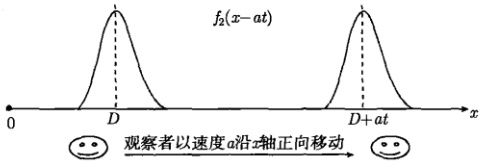

图 10.1 波形  $ f_{2}(x-at) $ 的物理意义
 

这样我们看到，波动方程的通解式(10.1.9)表示左行波  $ f_{1}(x+at) $ 和右行波  $ f_{2}(x-at) $ 的叠加，如图10.2所示。在初始 t=0 时刻，两个波有不同的函数形式  $ f_{1}(x) $ 和  $ f_{2}(x) $，然后以相等的速度 a，分别沿 x 轴的负向和正向传播。

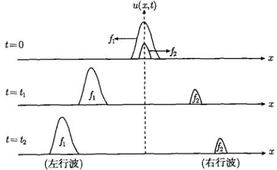

图 10.2 波动方程的通解是左行波  $ f_{1}(x+at) $ 和右行波  $ f_{2}(x-at) $ 的叠加
 

对于给定的初始位移  $ \phi(x) $ 和初始速度  $ \psi(x)=0 $，达朗贝尔公式 (10.2.6) 给出

$$  u(x,t)=\frac{1}{2}\left[\phi(x+at)+\phi(x-at)\right]   \tag*{(10.2.7)}$$

这是波形相同速度相等的左行波  $ \phi(x+at) $ 和右行波  $ \phi(x-at) $ 的叠加。但在初始速度不为零的情况下，达朗贝尔公式包含正、反行波及“干涉项” $ \int_{x-at}^{x+at}\psi(\xi)\mathrm{d}\xi $，后者的出现能使波形发生畸变（甚至变成单个的行波），如下面的例题。

例 1 求解下面无界波动方程的定解问题

$$  \left\{\begin{array}{l l}\displaystyle\frac{\partial^{2}u}{\partial t^{2}}=a^{2}\frac{\partial^{2}u}{\partial x^{2}}&(-\infty<x<+\infty,t>0)\\ &\\ \left.u\right|_{t=0}=\mathrm{e}^{-x^{2}},\left.\frac{\partial u}{\partial t}\right|_{t=0}=2a x\mathrm{e}^{-x^{2}}&(-\infty<x<+\infty)\end{array}\right.   \tag*{(10.2.8a)}$$

解 将初始条件 $  (10.2.8b)  $代入达朗贝尔公式 $  (10.2.6)  $，得到

<!-- page: 296 -->

$$  u(x,t)=\frac{1}{2}\left[\mathrm{e}^{-(x+at)^{2}}+\mathrm{e}^{-(x-at)^{2}}\right]+\frac{1}{2a}\int_{x-at}^{x+at}2a\xi\mathrm{e}^{-\xi^{2}}\mathrm{d}\xi   \tag*{(10.2.9)}$$

其中的干涉项为

 $$ \begin{aligned}&\frac{1}{2a}\int_{x-at}^{x+at}2a\xi\mathrm{e}^{-\xi^{2}}\mathrm{d}\xi\\=&\int_{x-at}^{x+at}\xi\mathrm{e}^{-\xi^{2}}\mathrm{d}\xi=\frac{1}{2}\int_{x-at}^{x+at}\mathrm{e}^{-\xi^{2}}d\left(\xi^{2}\right)\\=&-\frac{1}{2}\left[\mathrm{e}^{-\xi^{2}}\right]_{x-at}^{x+at}=-\frac{1}{2}\left[\mathrm{e}^{-(x+at)^{2}}-\mathrm{e}^{-(x-at)^{2}}\right]\\=&\frac{1}{2}\left[\mathrm{e}^{-(x-at)^{2}}-\mathrm{e}^{-(x+at)^{2}}\right]\end{aligned} $$ 

这一干涉项抵消了左行波，结果变成单个的右行波

$$  u(x,t)=\mathrm{e}^{-(x-\alpha t)^{2}}   \tag*{(10.2.10)}$$

这是一个沿 x 轴正向传播的高斯波包。

例 2 求解下面无界波动方程的定解问题

$$  \left\{\begin{array}{l l}\displaystyle\frac{\partial^{2}u}{\partial t^{2}}=\frac{\partial^{2}u}{\partial x^{2}}&\left(-\infty<x<+\infty,t>0\right)\\ &\\ \left.u\right|_{t=0}=0,\left.\frac{\partial u}{\partial t}\right|_{t=0}=\sin x&\left(-\infty<x<+\infty\right)\end{array}\right.   \tag*{(10.2.11a)}$$

解 将初始条件（10.2.11b）代入达朗贝尔公式（10.2.6），得到

 $$ \begin{aligned}u(x,t)&=\frac{1}{2}\int_{x-t}^{x+t}\sin\xi\mathrm{d}\xi\\&=-\frac{1}{2}\left[\cos(x+t)-\cos(x-t)\right]\\&=\sin x\sin t\end{aligned} $$ 

这是一个振幅周期性变化的驻波。

#### 10.2.2 达朗贝尔公式的讨论

达朗贝尔公式 (10.2.6) 中的积分值只依赖于初始速度  $ \psi(x) $ 在区间  $ [x-at, x+at] $ 内的变化行为，这意味着特解  $ u(x, t) $ 只依赖于该区间的初始条件，而与其他点上的初始条件无关。下面我们考查这个区间的边界，为此，设 X 是该区间内的任意一点，则

$$  x-at\leqslant X\leqslant x+at   \tag*{(10.2.12)}$$

设 X 的最小值为  $ X_{1} $，最大值为  $ X_{2} $，则区间的边界为

<!-- page: 297 -->

$$  x-at=X_{1},\quad x+at=X_{2}   \tag*{(10.2.13)}$$

式（10.2.13）可以改写为

$$  t=\frac{x}{a}-\frac{X_{1}}{a},\quad t=-\frac{x}{a}+\frac{X_{2}}{a}   \tag*{(10.2.14)}$$

在 t-x 平面上，式 (10.2.14) 表示斜率为  $ \pm\frac{1}{a} $，截距分别为  $ -\frac{X_{1}}{a} $ 和  $ \frac{X_{2}}{a} $ 的两条直线，它们与直线 t=0 围成一个三角形，该三角形内部的点的集合相应于达朗贝尔公式 (10.2.6) 中的积分区域，因此决定了定解问题 (10.1.10) 的解，称为“决定区域”，如图 10.3(a) 所示。而这个区域的边界线段  $ X_{1}X_{2} $ 相应于朗贝尔公式 (10.2.6) 中 t=0 时的积分区间，称为“依赖区间”。在 t=0 时刻，依赖区间上任意点 x 的变化范围是

$$  X_{1}\leqslant x\leqslant X_{2}   \tag*{(10.2.15)}$$

经过 t 时间后，任意点 x 的变化范围是

$$  X_{1}-at\leqslant x\leqslant X_{2}+at   \tag*{(10.2.16)}$$

该区域的边界为

$$  x=X_{1}-at,\quad x=X_{2}+at   \tag*{(10.2.17)}$$

这两条直线与直线 t = 0 围成的区域相应于初始扰动作用 t 时间后所影响到的区域，称为“影响区域”，它是定解问题 (10.2.1) 的求解区域，如图 10.3(b) 所示。

现在平移式（10.2.14）的两条直线，给出两族平行线

$$  t=\frac{x}{a}-\frac{C_{1}}{a}(C_{1}\geqslant X_{1})   \tag*{(10.2.18a)}$$

$$  t=-\frac{x}{a}+\frac{C_{2}}{a}(C_{2}\leqslant X_{2})   \tag*{(10.2.18b)}$$

它们称为“特征线”，如图10.3(c)所示。式(10.2.18)可以写为

$$  x+at=C_{1},\quad x-at=C_{2}   \tag*{(10.2.19)}$$

式 (10.2.19) 所示的特征线，对一维波动方程 (10.1.1) 的研究有重要的作用。由 5.4 节的讨论知道，正是基于式 (10.1.19) 的特征线，才得到式 (10.1.2) 的特征变换，波动方程 (10.1.1) 才化成标准形式 (10.1.4)，并继而得到通解 (10.1.9)。另一方面，在特征线  $ x - at = C_2 $ 上，右行波  $ f_2(x - at) $ 的振幅取常数值  $ f_2(C_2) $；在特征线  $ x + at = C_1 $ 上，左行波  $ f_1(x + at) $ 的振幅取常数值  $ f_1(C_1) $，且这两个常数值随特征线的移动（即  $ C_1 $ 和  $ C_2 $ 的改变）而改变，所以我们看出，波动实际上是沿特征线传播的。这是波动方程的一个重要特点。

<!-- page: 298 -->

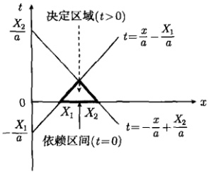

(a)
 

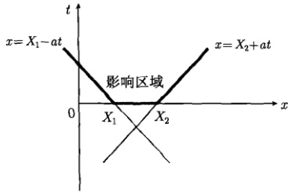

(b)
 

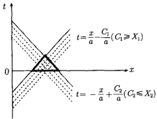

(c)
 

图 10.3 “决定区域”，“依赖区间”，“影响区域”及“特征线”
 

### 10.3 双曲型方程的定解问题

我们在 5.4.2 节例 1 中讨论过方程

$$  \frac{\partial^{2}u}{\partial x^{2}}-(A+B)\frac{\partial^{2}u}{\partial x\partial y}+AB\frac{\partial^{2}u}{\partial y^{2}}=0   \tag*{(10.3.1)}$$

其中，A 和 B 均是常数，且  $ A \neq B $。我们知道它是一个双曲型方程，在变换

$$  \xi=y+A x,\quad\eta=y+B x   \tag*{(10.3.2)}$$

之下，化成标准形式(10.1.4)，而它的通解为(10.1.8)。本节我们通过例题进一步讨论双曲型方程的定解问题。

#### 例 1 求解定解问题

$$  \left\{\begin{array}{l l}\displaystyle\frac{\partial^{2}u}{\partial x^{2}}+2\frac{\partial^{2}u}{\partial x\partial y}-3\frac{\partial^{2}u}{\partial y^{2}}=0&(-\infty<x<+\infty,y>0)\\ u\left|_{y=0}\right.=3x^{2},&\left.\frac{\partial u}{\partial y}\right|_{y=0}=0\quad(-\infty<x<+\infty)\end{array}\right.   \tag*{(10.3.3a)}$$

<!-- page: 299 -->

解 由于  $ \Delta > 0 $，泛定方程 (10.3.3a) 是一个双曲型方程，由

$$  \begin{array}{l}A+B=-2,\quad AB=-3\end{array}   \tag*{(10.3.4)}$$

得到 A = -3, B = 1，故特征变换为

$$  \xi=y-3x,\quad\eta=y+x   \tag*{(10.3.5)}$$

在变换式（10.3.5）之下，式（10.3.3a）化成标准形式

$$  \frac{\partial^{2}u}{\partial\xi\partial\eta}=0   \tag*{(10.3.6)}$$

它的通解为

$$  u(\xi,\eta)=f_{1}(\xi)+f_{2}(\eta)   \tag*{(10.3.7)}$$

其中， $ f_{1} $ 和  $ f_{2} $ 是两个任意的二次连续可微的函数，由特征变换式 (10.3.5) 得到通解

$$  u(x,y)=f_{1}(y-3x)+f_{2}(y+x)   \tag*{(10.3.8)}$$

由条件 $  (10.3.3b)  $得到

$$  f_{1}(-3x)+f_{2}(x)=3x^{2}   \tag*{(10.3.9)}$$

$$  f_{1}^{\prime}(-3x)+f_{2}^{\prime}(x)=0   \tag*{(10.3.10)}$$

对式 $ （10.3.10） $积分得

$$  -\frac{1}{3}f_{1}(-3x)+f_{2}(x)=C   \tag*{(10.3.11)}$$

方程式（10.3.9）与式（10.3.11）联立解得

$$  f_{1}(-3x)=\frac{9}{4}x^{2}-\frac{3}{4}C=\frac{1}{4}(-3x)^{2}-\frac{3}{4}C   \tag*{(10.3.12a)}$$

$$  f_{2}(x)=\frac{3}{4}x^{2}+\frac{3}{4}C   \tag*{(10.3.12b)}$$

将式（10.3.12）代入式（10.3.8）得到

$$  u(x,y)=\frac{1}{4}(y-3x)^{2}+\frac{3}{4}(y+x)^{2}=3x^{2}+y^{2}   \tag*{(10.3.13)}$$

这就是定解问题（10.3.3）的解。

例 2 求解定解问题

$$  \left\{\begin{array}{l}\frac{\partial^{2}u}{\partial x^{2}}-\frac{\partial^{2}u}{\partial x\partial y}-2\frac{\partial^{2}u}{\partial y^{2}}+\frac{\partial u}{\partial x}-2\frac{\partial u}{\partial y}=0\quad(-\infty<x<+\infty,y>0)\end{array}\right.   \tag*{(10.3.14a)}$$

 $$ u\mid_{y=0}=2x^{2} $$ 

$$  (-\infty<x<+\infty)   \tag*{(10.3.14b)}$$

 $$ \left\lfloor\left.{\frac{\partial u}{\partial y}}\right|_{y=0}=x\right. $$ 

$$  (-\infty<x<+\infty)   \tag*{(10.3.14c)}$$

<!-- page: 300 -->

解 由于  $ \Delta > 0 $，泛定方程 (10.3.14a) 是一个双曲型方程，它可以写为

$$  \begin{aligned}&\frac{\partial^{2}u}{\partial x^{2}}-\frac{\partial^{2}u}{\partial x\partial y}-2\frac{\partial^{2}u}{\partial y^{2}}+\frac{\partial u}{\partial x}-2\frac{\partial u}{\partial y}\\=&\left(\frac{\partial}{\partial x}+\frac{\partial}{\partial y}+1\right)\left(\frac{\partial}{\partial x}-2\frac{\partial}{\partial y}\right)u=0\end{aligned}   \tag*{(10.3.15)}$$

令

$$  v\doteq\left(\frac{\partial}{\partial x}-2\frac{\partial}{\partial y}\right)u   \tag*{(10.3.16a)}$$

则方程(10.3.15)变成

$$  \left(\frac{\partial}{\partial x}+\frac{\partial}{\partial y}+1\right)v=0   \tag*{(10.3.16b)}$$

方程 (10.3.16) 是关于 u 和 v 的一阶偏微分方程。我们首先对 v 求解，为此考查  $ v|_{y=0} $ 值，利用式 (10.3.16a) 和式 (10.3.14c) 得到

$$  v\mid_{y=0}=\left[\frac{\partial u}{\partial x}-2\frac{\partial u}{\partial y}\right]_{y=0}=\left.\frac{\partial u}{\partial x}\right|_{y=0}-2x   \tag*{(10.3.17)}$$

另外，从式（10.3.14b）得到

$$  \left.\frac{\partial u}{\partial x}\right|_{y=0}=\frac{\partial u(x,0)}{\partial x}=4x   \tag*{(10.3.18)}$$

将式（10.3.18）代入式（10.3.17）得到

$$  v\mid_{y=0}=2x   \tag*{(10.3.19)}$$

求解式 $  (10.3.16b)  $与式(10.3.19)组成的定解问题，得到

$$  v(x,y)=2(x-y)\mathrm{e}^{-y}   \tag*{(10.3.20)}$$

将式（10.3.20）代入式（10.3.16a）得到

$$  \frac{\partial u}{\partial x}-2\frac{\partial u}{\partial y}=2(x-y)\mathrm{e}^{-y}   \tag*{(10.3.21)}$$

求解式（10.3.21）与式（10.3.14b）组成的定解问题，得到

$$  u(x,y)=\frac{3}{2}-x-\frac{y}{2}+2x^{2}+2xy+\frac{y^{2}}{2}+(x-y-\frac{3}{2})\mathrm{e}^{-y}   \tag*{(10.3.22)}$$

求解过程见第10.4节例2。式(10.3.22)就是定解问题(10.3.14)的解。

<!-- page: 301 -->

### 10.4 一阶线性偏微分方程的特征线法

考虑下列一阶线性偏微分方程的定解问题

$$  \left\{\begin{array}{l l}{\displaystyle\frac{\partial u}{\partial t}+a(x,t)\frac{\partial u}{\partial x}+b(x,t)u=f(x,t)}&{(-\infty<x<+\infty,t>0)}\\ {{}}&{{}}\\ {\displaystyle u|_{t=0}=\phi(x)}&{(-\infty<x<+\infty)}\end{array}\right.   \tag*{(10.4.1a)}$$

其中， $ a(x,t) $ 和  $ b(x,t) $ 是与 x,t 有关的系数， $ f(x,t) $ 是任意函数。式 (10.4.1b) 表示初始条件，我们将用特征线法求解 (10.4.1)。求解的思路是：希望将这个偏微分方程问题化成常微分方程问题来求解。一般而言， $ u(x,t) $ 中的两个变量 x,t 是相互独立的。如果 x 是 t 的函数，即  $ x = x(t) $，则函数

$$  u(x,t)=u[x(t),t]\equiv U(t)   \tag*{(10.4.2)}$$

满足常微分方程。现在我们建立  $ U(t) $ 的方程，为此求导数

$$  \frac{\mathrm{d}U}{\mathrm{d}t}=\frac{\partial u}{\partial x}\frac{\partial x}{\partial t}+\frac{\partial u}{\partial t}\frac{\partial t}{\partial t}=\frac{\partial u}{\partial t}+\frac{\partial u}{\partial x}\frac{\mathrm{d}x}{\mathrm{d}t}   \tag*{(10.4.3)}$$

假定  $ x(t) $ 对 t 的依赖关系可以表示为

$$  \frac{\mathrm{d}x}{\mathrm{d}t}=a[x(t),t]   \tag*{(10.4.4)}$$

则式 $  (10.4.3)  $变为

$$  \frac{\mathrm{d}U}{\mathrm{d}t}=\frac{\partial u}{\partial t}+a[x(t),t]\frac{\partial u}{\partial x}   \tag*{(10.4.5)}$$

由该方程写出  $ \frac{\partial u}{\partial t} $，然后代入式 (10.4.1a)，得到

$$  \frac{\mathrm{d}U}{\mathrm{d}t}+b[x(t),t]U=f[x(t),t]   \tag*{(10.4.6)}$$

设曲线  $ x(t) \sim t $ 的起点为  $ x(0) = c $ (c 是一个参量)。它与式 (10.4.4) 结合构成关于  $ x(t) $ 的初值问题

$$  \left\{\begin{array}{l}\frac{\mathrm{d}x}{\mathrm{d}t}=a[x(t),t]\end{array}\right.   \tag*{(10.4.7a)}$$

$$  x(0)=c   \tag*{(10.4.7b)}$$

另一方面，初始条件  $ (10.4.1\mathrm{b}) $ 给出  $ U|_{t=0}=\phi[x(0)]=\phi(c) $，它与方程  $ (10.4.6) $ 结合构成关于  $ U(t) $ 的初值问题

$$  \left\{\begin{array}{l}\frac{\mathrm{d}U}{\mathrm{d}t}+b[x(t),t]U=f[x(t),t]\end{array}\right.   \tag*{(10.4.8a)}$$

$$  U|_{t=0}=\phi(c)   \tag*{(10.4.8b)}$$

<!-- page: 302 -->

初值问题（10.4.7）的解为特征线  $ x = x(t, c) $，它与式（10.4.8）的解联立消去参量 c，即得原定解问题（10.4.1）的解  $ u(x, t) $。

例 1 求解定解问题

$$  \left\{\begin{array}{l l}\displaystyle\frac{\partial u}{\partial t}+(x+t)\frac{\partial u}{\partial x}+u=x&(-\infty<x<+\infty,t>0)\\ &\\ \left.u\right|_{t=0}=x&(-\infty<x<+\infty)\end{array}\right.   \tag*{(10.4.9a)}$$

解 定解问题 (10.4.9) 与 (10.4.1) 相比，有  $ a(x, t) = x + t $, b = 1,  $ f(x, t) = x $。首先求特征线，由式 (10.4.7) 得到

$$  \left\{\begin{array}{l}\frac{\mathrm{d}x}{\mathrm{d}t}=x+t\\ \\ x(0)=c\end{array}\right.   \tag*{(10.4.10a)}$$

用拉普拉斯变换法求解该初值问题得到特征线

$$  x(t)=\mathrm{e}^{t}-t-1+c\mathrm{e}^{t}   \tag*{(10.4.11)}$$

它被显示在图 10.4。而关于  $ U(t) $ 的问题 (10.4.8) 现在变为

$$  \left\{\begin{array}{l}\frac{\mathrm{d}U}{\mathrm{d}t}+U=\mathrm{e}^{t}-t-1+c\mathrm{e}^{t}\end{array}\right.   \tag*{(10.4.12a)}$$

$$  U(0)=c   \tag*{(10.4.12b)}$$

用拉普拉斯变换法求解方程（10.4.12）得到

$$  U(t)=-t+\frac{1}{2}\left(\mathrm{e}^{t}-\mathrm{e}^{-t}\right)+\frac{c}{2}\left(\mathrm{e}^{t}-\mathrm{e}^{-t}\right)   \tag*{(10.4.13)}$$

由式（10.4.11）解出

$$  c=\left(x+t+1\right)\mathrm{e}^{-t}-1   \tag*{(10.4.14)}$$

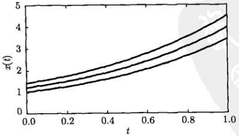

图 10.4 式(10.4.11)得出的特征线
 

<!-- page: 303 -->

代入式(10.4.13)得到

$$  u(x,t)=\frac{1}{2}(x-t+1)-\mathrm{e}^{-t}+\frac{1}{2}(x+t+1)\mathrm{e}^{-2t}   \tag*{(10.4.15)}$$

这就是定解问题（10.4.9）的解。

#### 例 2 求解定解问题

$$  \left\{\begin{array}{l l}\displaystyle\frac{\partial u}{\partial y}-\frac{1}{2}\frac{\partial u}{\partial x}=(y-x)\mathrm{e}^{-y}&(-\infty<x<+\infty,y>0)\\ \\ u|_{y=0}=2x^{2}&(-\infty<x<+\infty)\end{array}\right.   \tag*{(10.4.16a)}$$

解 定解问题 (10.4.16) 与定解问题 (10.4.1) 相比较，有  $ a(x,t) = -1/2 $, b = 0,  $ f(x,t) = (y - x)\mathrm{e}^{-y} $。我们首先求特征线，由式 (10.4.7) 得到

$$  \left\{\begin{array}{l}\frac{\mathrm{d}x}{\mathrm{d}y}=-\frac{1}{2}\\ x(0)=c\end{array}\right.   \tag*{(10.4.17b)}$$

解式（10.4.17）得到特征线

$$  x=c-\frac{y}{2}   \tag*{(10.4.18)}$$

该特征线为一族平行线。关于  $ U(y) $ 的问题 (10.4.8) 变为

$$  \left\{\begin{array}{l}\frac{\mathrm{d}U}{\mathrm{d}y}=\left(\frac{3y}{2}-c\right)\mathrm{e}^{-y}\end{array}\right.   \tag*{(10.4.19a)}$$

$$  U\mid_{y=0}=2c^{2}   \tag*{(10.4.19b)}$$

对式 (10.4.19a) 积分，并利用式 (10.4.19b)，得到

$$  U-2c^{2}=\frac{3}{2}\left[1-\left(1+y\right)\mathrm{e}^{-y}\right]+c\left(\mathrm{e}^{-y}-1\right)   \tag*{(10.4.20)}$$

由式(10.4.18)解出  $ c = x + \frac{y}{2} $，代入式(10.4.20)，得到

$$  u(x,y)=\frac{3}{2}\left[1-\left(1+y\right)\mathrm{e}^{-y}\right]+\left(x+\frac{y}{2}\right)\left(\mathrm{e}^{-y}-1\right)+2\left(x+\frac{y}{2}\right)^{2}   \tag*{(10.4.21)}$$

这就是式(10.3.22)。

### 10.5 非齐次波动方程：齐次化原理

本节将利用齐次化原理求解非齐次波动方程的定解问题。为此我们首先介绍积分微商定理，设

$$  U(x)=\int_{a}^{x}f(x,\tau)\mathrm{d}\tau   \tag*{(10.5.1a)}$$

<!-- page: 304 -->

其中，a 是一个确定的常数，则

$$  \frac{\mathrm{d}}{\mathrm{d}x}U(x)=f(x,x)+\int_{a}^{x}\frac{\partial}{\partial x}f(x,\tau)\mathrm{d}\tau   \tag*{(10.5.1b)}$$

证明 引入一个双变量函数

$$  \Omega(x,y)=\int_{a}^{y}f(x,\tau)\mathrm{d}\tau   \tag*{(10.5.2)}$$

按照基本的微分运算，我们有

$$  \frac{\partial}{\partial y}\varOmega(x,y)=\frac{\partial}{\partial y}\int_{a}^{y}f(x,\tau)\mathrm{d}\tau=f(x,y)   \tag*{(10.5.3)}$$

另一方面，按照积分号下求微分的法则，由式（10.5.2）得到

$$  \frac{\partial}{\partial x}\varOmega(x,y)=\frac{\partial}{\partial x}\int_{a}^{y}f(x,\tau)\mathrm{d}\tau=\int_{a}^{y}\frac{\partial}{\partial x}f(x,\tau)\mathrm{d}\tau   \tag*{(10.5.4)}$$

现在假定 y 是 x 的函数，记为  $ y = y(x) $。按照复合函数求微商的法则，由式 (10.5.4) 和式 (10.5.3) 得到

 $$ \begin{align*}\frac{\mathrm{d}}{\mathrm{d}x}\varOmega\left[x,y(x)\right]&=\frac{\partial}{\partial x}\varOmega\left[x,y(x)\right]\frac{\mathrm{d}x}{\mathrm{d}x}+\frac{\partial}{\partial y}\varOmega\left[x,y(x)\right]\frac{\mathrm{d}y}{\mathrm{d}x}\\&=\int_{a}^{y(x)}\frac{\partial}{\partial x}f(x,\tau)\mathrm{d}\tau+f\left[x,y(x)\right]\frac{\mathrm{d}y}{\mathrm{d}x}\end{align*} $$ 

在上式中取  $ y(x)=x $，得到

$$  \frac{\mathrm{d}}{\mathrm{d}x}\Omega(x)=f(x,x)+\int_{a}^{x}\frac{\partial}{\partial x}f(x,\tau)\mathrm{d}\tau   \tag*{(10.5.5a)}$$

而式 $  (10.5.2)  $变为

$$  \Omega(x)=\int_{a}^{x}f(x,\tau)\mathrm{d}\tau   \tag*{(10.5.5b)}$$

现在我们考虑无界弦强迫振动的定解问题：

$$  \left\{\begin{array}{l}\left.\frac{\partial^{2}u}{\partial t^{2}}=a^{2}\frac{\partial^{2}u}{\partial x^{2}}+f(x,t)\quad(-\infty<x<+\infty,t>0)\right.\\ \left.u|_{t=0}=0,\left.\frac{\partial u}{\partial t}\right|_{t=0}=0\quad(-\infty<x<+\infty)\right.\end{array}\right.   \tag*{(10.5.6b)}$$

为了求解此问题，我们利用齐次化原理。它表述为：设  $ \Omega(x,t,\tau) $ 是下列初值问题的解

$$  \left\{\begin{array}{l l}\displaystyle\frac{\partial^{2}\Omega}{\partial t^{2}}=a^{2}\frac{\partial^{2}\Omega}{\partial x^{2}}&(-\infty<x<+\infty,t>\tau)\\ &\\\left.\Omega\right|_{t=\tau}=0,\left.\frac{\partial\Omega}{\partial t}\right|_{t=\tau}=f(x,\tau)&(-\infty<x<+\infty)\end{array}\right.   \tag*{(10.5.7a)}$$

<!-- page: 305 -->

则定解问题（10.5.6）的解为

$$  u(x,t)=\int_{0}^{t}\Omega(x,t,\tau)\mathrm{d}\tau   \tag*{(10.5.8)}$$

其中， $ \tau $ 为参数。

证明 表达式 (10.5.8) 直接给出

 $$ u|_{t=0}=\left[\int_{0}^{t}\varOmega(x,t,\tau)\mathrm{d}\tau\right]_{t=0}=0 $$ 

利用定理式（10.5.1）及式（10.5.7b）中的第一式，我们有

 $$ \left.\frac{\partial u}{\partial t}\right|_{t=0}=\Omega(x,t,t)+\left[\int_{0}^{t}\frac{\partial}{\partial t}\Omega(x,t,\tau)\mathrm{d}\tau\right]_{t=0}=0 $$ 

可见解（10.5.8）满足初始条件（10.5.6b）。我们再来考查式（10.5.8）是否满足方程（10.5.6a）。事实上，利用定理式（10.5.1）和式（10.7.5b）中的第二式，以及式（10.5.7a）我们有

 $$ \begin{aligned}\frac{\partial^{2}u}{\partial t^{2}}&=\frac{\partial}{\partial t}\int_{0}^{t}\frac{\partial}{\partial t}\varOmega(x,t,\tau)\mathrm{d}\tau\\&=\left[\frac{\partial}{\partial t}\varOmega(x,t,\tau)\right]_{\tau=t}+\int_{0}^{t}\frac{\partial^{2}}{\partial t^{2}}\varOmega(x,t,\tau)\mathrm{d}\tau\\&=f(x,t)+a^{2}\int_{0}^{t}\frac{\partial^{2}}{\partial x^{2}}\varOmega(x,t,\tau)\mathrm{d}\tau\\&=f(x,t)+a^{2}\frac{\partial^{2}}{\partial x^{2}}\int_{0}^{t}\varOmega(x,t,\tau)\mathrm{d}\tau\\&=f(x,t)+a^{2}\frac{\partial^{2}u}{\partial x^{2}}\\ \end{aligned} $$ 

可见式（10.5.8）也满足方程(10.5.6a)，故式(10.5.8)是方程(10.5.6)的解。

下面求解初值问题 (10.5.7)，为此令 T = t -  $ \tau $，则式 (10.5.7) 化为

$$  \left\{\begin{array}{l l}\displaystyle\frac{\partial^{2}\varOmega}{\partial T^{2}}=a^{2}\frac{\partial^{2}\varOmega}{\partial x^{2}}&\left(-\infty<x<+\infty,T>0\right)\\ &\\ \left.\varOmega\right|_{T=0}=0,\left.\frac{\partial\varOmega}{\partial T}\right|_{T=0}=f(x,\tau)&\left(-\infty<x<+\infty\right)\end{array}\right.   \tag*{(10.5.9a)}$$

达朗贝尔公式给出式（10.5.9）的解

$$  \Omega(x,t,\tau)=\frac{1}{2a}\int_{x-aT}^{x+aT}f(\xi,\tau)\mathrm{d}\xi=\frac{1}{2a}\int_{x-a(t-\tau)}^{x+a(t-\tau)}f(\xi,\tau)\mathrm{d}\xi   \tag*{(10.5.10)}$$

<!-- page: 306 -->

将式（10.5.10）代入式（10.5.8）得到式（10.5.6）的解

$$  u(x,t)=\frac{1}{2a}\int_{0}^{t}\int_{x-a(t-\tau)}^{x+a(t-\tau)}f(\xi,\tau)\mathrm{d}\xi\mathrm{d}\tau   \tag*{(10.5.11)}$$

其中的积分区域显示在图 10.5，它是过点  $ (x,t) $ 的两条特征线  $ \xi = x \pm a(t - \tau) $ 与  $ \tau = 0 $ 直线所围成的三角形区域。

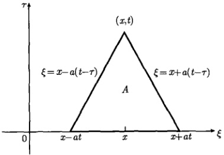

图 10.5 式 (10.5.11) 积分的区域 A
 

现在我们进一步求解具有任意初始条件的无界弦强迫振动的定解问题

$$  \left\{\begin{array}{l l}{\displaystyle\frac{\partial^{2}w}{\partial t^{2}}=a^{2}\frac{\partial^{2}u}{\partial x^{2}}+f(x,t)\qquad}&{\quad(-\infty<x<+\infty,\ t>0)}\end{array}\right.   \tag*{(10.5.12a)}$$

$$  w_{t=0}=\phi(x),\left.\frac{\partial w}{\partial t}\right|_{t=0}=\psi(x)\quad(-\infty<x<+\infty)   \tag*{(10.5.12b)}$$

按照叠加原理，令  $ w = u + v $，其中 u 是定解问题 (10.5.6) 的解，而 v 是达朗贝尔问题 (10.1.10) 的解，故式 (10.5.12) 的解为式 (10.5.12) 与式 (10.1.15) 的相加，即

$$  \begin{align*}w(x,t)=&\frac{1}{2}\left[\phi(x+at)+\phi(x-at)\right]+\frac{1}{2a}\int_{x-at}^{x+at}\psi(\xi)\mathrm{d}\xi\\&+\frac{1}{2a}\int_{0}^{t}\int_{x-a(t-\tau)}^{x+a(t-\tau)}f(\xi,\tau)\mathrm{d}\xi\mathrm{d}\tau\end{align*}   \tag*{(10.5.13)}$$

这就是非齐次波动方程的初值问题（10.5.12）的解，与齐次情况下的达朗贝尔公式相比，多出了第三项，即自由项  $ f(x,t) $ 对时间和空间的积分。

例 1 求解定解问题

$$  \left\{\begin{array}{l l}\displaystyle\frac{\partial^{2}u}{\partial t^{2}}=a^{2}\frac{\partial^{2}u}{\partial x^{2}}+\frac{x}{\left(1+x^{2}\right)^{2}}&\left(-\infty<x<+\infty,t>0\right)\\ &\\ \left.u\right|_{t=0}=0,\left.\frac{\partial u}{\partial t}\right|_{t=0}=0&\left(-\infty<x<+\infty\right)\end{array}\right.   \tag*{(10.5.14a)}$$

<!-- page: 307 -->

解 该定解问题属于式(10.5.6)的形式，而相应的关于  $ \Omega(x,t,\tau) $ 的定解问题属于式(10.5.7)的形式，即

$$  \left\{\begin{array}{l l}\displaystyle\frac{\partial^{2}\Omega}{\partial t^{2}}=a^{2}\frac{\partial^{2}\Omega}{\partial x^{2}}&\left(-\infty<x<+\infty,t>\tau\right)\\ &\\\left.\Omega\right|_{t-\tau=0}=0,\left.\frac{\partial\Omega}{\partial t}\right|_{t-\tau=0}=\frac{x}{\left(1+x^{2}\right)^{2}}\quad\left(-\infty<x<+\infty\right)\end{array}\right.   \tag*{(10.5.15a)}$$

它的解属于式(10.5.10)的形式，即

 $$ \begin{aligned}\Omega(x,t,\tau)&=\frac{1}{2a}\int_{x-a(t-\tau)}^{x+a(t-\tau)}\frac{\xi}{\left(1+\xi^{2}\right)^{2}}\mathrm{d}\xi\\&=\frac{1}{4a}\left\{\frac{1}{1+[x-a(t-\tau)]^{2}}-\frac{1}{1+[x+a(t-\tau)]^{2}}\right\}\end{aligned} $$ 

按照式(10.5.8)对  $ \Omega(x,t,\tau) $ 积分得到

 $$ \begin{aligned}u(x,t)&=\int_{0}^{t}\varOmega(x,t,\tau)\mathrm{d}\tau\\&=\frac{1}{4a}\int_{0}^{t}\left\{\frac{1}{1+[x-a(t-\tau)]^{2}}-\frac{1}{1+[x+a(t-\tau)]^{2}}\right\}\mathrm{d}\tau\\&=\frac{1}{4a^{2}}[2\arctan x-\arctan(x+at)-\arctan(x-at)]\\ \end{aligned} $$ 

这就是定解问题（10.5.14）的解。

例 2 求解定解问题

$$  \left\{\begin{array}{l l}\displaystyle\frac{\partial^{2}u}{\partial t^{2}}=\frac{\partial^{2}u}{\partial x^{2}}+\mathrm{e}^{-t}\cos x&\left(-\infty<x<+\infty,t>0\right)\\ &\\ \left.u\right|_{t=0}=0,\left.\frac{\partial u}{\partial t}\right|_{t=0}=0\quad\left(-\infty<x<+\infty\right)\end{array}\right.   \tag*{(10.5.16a)}$$

解 与式 (10.5.6) 相比较，有  $ f(x,t)=\mathrm{e}^{-t}\cos x $，故式 (10.5.10) 变为

$$  \Omega(x,t,\tau)=\frac{1}{2}\int_{x-(t-\tau)}^{x+(t-\tau)}\mathrm{e}^{-\tau}\cos\xi\mathrm{d}\xi=\mathrm{e}^{-\tau}\cos x\sin(t-\tau)   \tag*{(10.5.17)}$$

于是式(10.5.8)给出

 $$ \begin{aligned}u(x,t)&=\int_{0}^{t}\Omega(x,t,\tau)\mathrm{d}\tau\\&=\int_{0}^{t}\mathrm{e}^{-\tau}\cos x\sin(t-\tau)\mathrm{d}\tau\end{aligned} $$

<!-- page: 308 -->

$$ =\frac{1}{2}\cos x\left(\mathrm{e}^{-t}-\cos t+\sin t\right) $$ 

这就是定解问题（10.4.16）的解。

例 3 求解定解问题

$$  \left\{\begin{array}{l l}\displaystyle\frac{\partial^{2}u}{\partial t^{2}}=a^{2}\frac{\partial^{2}u}{\partial x^{2}}+k x&\left(-\infty<x<+\infty,t>0\right)\\ &\\ \left.u\right|_{t=0}=\cos x,\left.\frac{\partial u}{\partial t}\right|_{t=0}=0\quad\left(-\infty<x<+\infty\right)\end{array}\right.   \tag*{(10.5.18a)}$$

解 与式 (10.5.12) 比较，有  $ f(x,t)=kx $， $ \phi(x)=\cos x $， $ \psi(x)=0 $，故式 (10.5.13) 变为

$$  u(x,t)=\frac{1}{2}\left[\phi(x+at)+\phi(x-at)\right]+\frac{1}{2a}\int_{0}^{t}\int_{x-a(t-\tau)}^{x+a(t-\tau)}f(\xi,\tau)\mathrm{d}\xi\mathrm{d}\tau   \tag*{(10.5.19)}$$

其中

 $$ \begin{align*}\frac{1}{2}\left[\phi(x+at)+\phi(x-at)\right]&=\frac{1}{2}\left[\cos(x+at)+\cos(x-at)\right]=\cos x\cos t\\\frac{1}{2a}\int_{0}^{t}\int_{x-a(t-\tau)}^{x+a(t-\tau)}f(\xi,\tau)\mathrm{d}\xi\mathrm{d}\tau&=\frac{k}{4a}\int_{0}^{t}\left[\xi^{2}\right]_{x-a(t-\tau)}^{x+a(t-\tau)}\mathrm{d}\tau=\frac{k}{2}x t^{2}\end{align*} $$ 

故

$$  u(x,t)=\cos x\cos t+\frac{k}{2}x t^{2}   \tag*{(10.5.20)}$$

这就是定解问题（10.5.18）的解。

### 10.6 三维波动方程

以上我们讨论了无边界一维波动方程和相关双曲型方程的定解问题，得到了达朗贝尔公式(10.2.6)及非齐次问题的解(10.5.13)，但一维波动方程还不能满足相关科学研究与工程技术的需要。例如，有关电磁波与电磁场的时空变化问题常常涉及三维波动方程。本节考虑三维无限空间中的波动问题，即求解下列定解问题

$$  \left\{\begin{array}{l}\frac{\partial^{2}u}{\partial t^{2}}=a^{2}\left(\frac{\partial^{2}u}{\partial x^{2}}+\frac{\partial^{2}u}{\partial y^{2}}+\frac{\partial^{2}u}{\partial z^{2}}\right)\quad(-\infty<x,y,z<+\infty,t>0)\end{array}\right.   \tag*{(10.6.0a)}$$

$$  \left\{\begin{array}{l}u|_{t=0}=\phi(x,y,z)\end{array}\right.\quad(-\infty<x,y,z<+\infty)   \tag*{(10.6.0b)}$$

$$  \left\lfloor\begin{array}{r|r}{\displaystyle\frac{\partial u}{\partial t}\Bigr|_{\substack{t=0}}=\psi(x,y,z)}&{\qquad}&{(-\infty<x,y,z<+\infty)}\end{array}\right.   \tag*{(10.6.0c)}$$

<!-- page: 309 -->

其中，式(10.6.0b)和式(10.6.0c)分别表示初始位移和初始速度，这里的初始条件表示一个立体区域(二维初始条件表示一个曲面，一维初始条件表示一条曲线)。由于方程(10.6.0a)包含三个坐标变量，不能将一维的结果直接推广到三维，但仍然可以用行波法求解。我们首先考虑一个特殊情况。

#### 10.6.1 三维波动方程的球对称解

取球坐标系

$$  x=r\sin\theta\cos\phi,\quad y=r\sin\theta\sin\phi,\quad z=r\cos\theta   \tag*{(10.6.1)}$$

波动方程（10.6.0a）在球坐标系中表示为 [式（1.2.49）]

$$  \frac{1}{r^{2}}\frac{\partial}{\partial r}\left(r^{2}\frac{\partial u}{\partial r}\right)+\frac{1}{r^{2}\sin\theta}\frac{\partial}{\partial\theta}\left(\sin\theta\frac{\partial u}{\partial\theta}\right)+\frac{1}{r^{2}\sin^{2}\theta}\frac{\partial^{2}u}{\partial\phi^{2}}=\frac{1}{a^{2}}\frac{\partial^{2}u}{\partial t^{2}}   \tag*{(10.6.2)}$$

当 u 不依赖于角向变量  $ \theta,\phi $ 时，方程 (10.6.2) 化简为

$$  \frac{1}{r^{2}}\frac{\partial}{\partial r}\left(r^{2}\frac{\partial u}{\partial r}\right)=\frac{1}{a^{2}}\frac{\partial^{2}u}{\partial t^{2}}   \tag*{(10.6.3)}$$

由于

$$  \frac{1}{r^{2}}\frac{\partial}{\partial r}\left(r^{2}\frac{\partial u}{\partial r}\right)=\frac{\partial^{2}u}{\partial r^{2}}+\frac{2}{r}\frac{\partial u}{\partial r}=\frac{1}{r}\frac{\partial^{2}(ru)}{\partial r^{2}}   \tag*{(10.6.4)}$$

方程(10.6.3)可以写为

$$  \frac{\partial^{2}\left(ru\right)}{\partial t^{2}}=a^{2}\frac{\partial^{2}(ru)}{\partial r^{2}}   \tag*{(10.6.5)}$$

这是一个以 ru 为变量的一维波动方程，其通解为

$$  u(r,t)=\frac{f_{1}(r+at)}{r}+\frac{f_{2}(r-at)}{r}   \tag*{(10.6.6)}$$

这就是三维波动方程的球对称解，其中， $ f_{1} $ 和  $ f_{2} $ 是两个任意二次连续可微的函数，它们由给定的初始条件来确定。

#### 10.6.2 三维波动方程的泊松公式

考虑三维波动方程的一般情况，我们的目的是求任意 t 时刻在空间任意点  $ M(x,y,z) $ 的波函数  $ u(x,y,z,t)=u(M,t) $。对于 10.6.1 节讨论的球对称情况，波函数 u 只是 r 与 t 的函数，ru 满足一维波动方程 (10.6.5)。但在一般情况下 u 不能写成 r 与 t 的函数，而是 x,y,z,t 的函数，所以 ru 不可能满足三维波动方程。但是，如果我们不去考虑波函数 u 本身，而是考虑 u 在以  $ M(x,y,z) $ 为球心，以 r 为半径的球面上的平均值，则这个平均值在 x,y,z 暂时固定之后就只与 r,t 有关了。

<!-- page: 310 -->

为此，以 M 点为中心，以 r 为半径作一个球面  $ S_{r}^{M} $，如图 10.6 所示，则波函数在球面上的平均值为

$$  \langle u(r,t)\rangle\equiv\frac{1}{4\pi r^{2}}\iint\limits_{S_{r}^{M}}u(M^{\prime},t)\mathrm{d}S   \tag*{(10.6.7)}$$

其中， $ M'(\xi,\eta,\delta) $ 是球面  $ S_{r}^{M} $ 上的动点

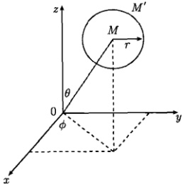

$$  \begin{array}{c c}{\xi=x+r\operatorname{s i n}\theta\operatorname{c o s}\phi,}&{\eta=y+r\operatorname{s i n}\theta\operatorname{s i n}\phi,}\\ {}&{}\\ {\delta=z+r\operatorname{c o s}\theta}&{(10.)}\\ \end{array}   \tag*{(10.6.8)}$$

dS 是球面  $ S_{r}^{M} $ 上的面积元素。进而在  $ r \rightarrow 0 $ 情况下求极限

图 10.6 波函数的球面平均示意图
 

$$  \lim_{r\to0}\left\langle u(r,t)\right\rangle=u(M,t)   \tag*{(10.6.9)}$$

它就是任意 t 时刻在空间任意点  $ M(x,y,z) $ 的波函数。利用上述思路求解三维波动方程初值问题  $ (10.6.0) $ 的方法称为球面平均法。

用球面平均法求解式(10.6.0)，通常是先建立 $ \langle u(r,t)\rangle $的微分方程，求解后再取 $ r\to0 $的极限。我们这里介绍一个简单的方法，其出发点是一维波动方程定解问题的达朗贝尔公式(10.2.6)，它可以改写为

$$  u(x,t)=\frac{\partial}{\partial t}\left[\frac{t}{2at}\int_{x-at}^{x+at}\phi(\xi)\mathrm{d}\xi\right]+\frac{t}{2at}\int_{x-at}^{x+at}\psi(\xi)\mathrm{d}\xi   \tag*{(10.6.10)}$$

注意到积分  $ \langle F(x,t)\rangle\equiv\frac{1}{2at}\int_{x-at}^{x+at}F(\xi)\mathrm{d}\xi $ 是函数  $ F(\xi) $ 在区间  $ [x-at,x+at] $ 上的平均值，这样式 (10.6.10) 可以写为

$$  u(x,t)=\frac{\partial}{\partial t}\left[t\left\langle\phi(x,t)\right\rangle\right]+t\left\langle\psi(x,t)\right\rangle   \tag*{(10.6.11)}$$

其中

$$  \langle\phi(x,t)\rangle=\frac{1}{2at}\int_{x-at}^{x+at}\phi(\xi)\mathrm{d}\xi   \tag*{(10.6.12a)}$$

$$  \langle\psi(x,t)\rangle=\frac{1}{2a t}\int_{x-at}^{x+at}\psi(\xi)\mathrm{d}\xi   \tag*{(10.6.12b)}$$

分别是初始位移  $ \phi $ 和初始速度  $ \psi $ 在区间  $ [x-at, x+at] $ 上的平均值。

式 (10.6.12) 所示一维的区间平均容易推广到三维的球面平均，二者之间的对应关系如表 10.1 所示。特别是，一维求平均时的区间长度 2at 对应三维求平均时

<!-- page: 311 -->

的球面面积  $ 4\pi(at)^{2} $。这样，与一维平均位移式（10.6.12a）与平均速度式（10.6.12b）对应的三维结果为

$$  \langle\phi(x,y,z,t)\rangle=\frac{1}{4\pi(a t)^{2}}\iint\limits_{S_{a t}^{M}}\phi(\xi,\eta,\delta)\mathrm{d}S   \tag*{(10.6.13a)}$$

$$  \langle\psi(x,y,z,t)\rangle=\frac{1}{4\pi(a t)^{2}}\iint\limits_{S_{a t}^{M}}\psi(\xi,\eta,\delta)\mathrm{d}S   \tag*{(10.6.13b)}$$

式(10.6.13)中的积分遍及以 $ M(x,y,z) $为中心，以at为半径的整个球面 $ S_{at}^{M} $。进而，与式(10.6.11)对应的三维波函数为

$$  u(x,y,z,t)=\frac{\partial}{\partial t}\left[t\left\langle\phi(x,y,z,t)\right\rangle\right]+t\left\langle\psi(x,y,z,t)\right\rangle   \tag*{(10.6.14)}$$

将式（10.6.13）代入式（10.6.14），整理后得到

$$  u(x,y,z,t)=\frac{1}{4\pi a}\frac{\partial}{\partial t}\iint\limits_{S_{a t}^{M}}\frac{\phi(M^{\prime})}{a t}\mathrm{d}S+\frac{1}{4\pi a}\iint\limits_{S_{a t}^{M}}\frac{\psi(M^{\prime})}{a t}\mathrm{d}S   \tag*{(10.6.15)}$$

式(10.6.15)称为三维波动方程的泊松公式。不难验证，当  $ \phi(x,y,z) $ 是三次连续可微的函数， $ \psi(x,y,z) $ 是二次连续可微的函数时，由式(10.6.15)所确定的函数  $ u(x,y,z,t) $ 确实是定解问题(10.6.0)的解。在第12章，我们还将利用格林函数法推导出三维波动方程的泊松公式(10.6.15)。

表 10.1 一维区间平均与三维球面平均的比较
 

<table border=1 style='margin: auto; word-wrap: break-word;'><tr><td style='text-align: center; word-wrap: break-word;'>区间： $ [x - at, x + at] $</td><td style='text-align: center; word-wrap: break-word;'>球面： $ ( \xi - x)^2 + (\eta - y)^2 + (\delta - z)^2 = (at)^2 $</td></tr><tr><td style='text-align: center; word-wrap: break-word;'>区间中心：x</td><td style='text-align: center; word-wrap: break-word;'>球面中心： $ (x, y, z) $</td></tr><tr><td style='text-align: center; word-wrap: break-word;'>区间半宽：at</td><td style='text-align: center; word-wrap: break-word;'>球面半径：at</td></tr><tr><td style='text-align: center; word-wrap: break-word;'>区间长度：2at</td><td style='text-align: center; word-wrap: break-word;'>球面面积： $ 4\pi(at)^2 $</td></tr></table>

下面举一个例子说明泊松公式（10.6.15）的用法。

例 1 设已知  $ \phi(x,y,z)=x+y+z,\psi(x,y,z)=0 $ ，求解定解问题 (10.6.0)。

解 将给定的初始条件代入式(10.6.15)，得到所要求的解为

 $$ \begin{aligned}&u(x,y,z,t)\\=&\frac{1}{4\pi a^{2}}\frac{\partial}{\partial t}\left[\frac{1}{t}\iint\limits_{S_{at}^{M}}\phi(M^{\prime})\mathrm{d}S\right]\\=&\frac{1}{4\pi a}\frac{\partial}{\partial t}\Biggl\{\frac{1}{at}\iint\left[(x+at\sin\theta\cos\phi)+(y+at\sin\theta\sin\phi)\right.\Biggr]\end{aligned} $$

<!-- page: 312 -->

$$ \begin{aligned}&\left.+\left(z+at\cos\theta\right)\right]\left(at\right)^{2}\sin\theta\mathrm{d}\theta\mathrm{d}\phi\Bigg\}\\=&\frac{1}{4\pi a}\frac{\partial}{\partial t}\Bigg\{at\iint\left[\left(x+y+z\right)+at\left(\sin\theta\cos\phi+\sin\theta\sin\phi\right)+at\cos\theta\right]\sin\theta\mathrm{d}\theta\mathrm{d}\phi\Bigg\}\\=&\frac{1}{4\pi a}\frac{\partial}{\partial t}\left\{at\left[\left(x+y+z\right)\int_{\phi=0}^{2\pi}\mathrm{d}\phi\int_{\theta=0}^{\pi}\sin\theta\mathrm{d}\theta\right]\right.\\&\left.+\left(at\right)^{2}\underbrace{\left[\int_{\phi=0}^{2\pi}(\cos\phi+\sin\phi)\mathrm{d}\phi\int_{\theta=0}^{\pi}\sin^{2}\theta\mathrm{d}\theta+\int_{\phi=0}^{2\pi}\mathrm{d}\phi\int_{\theta=0}^{\pi}\cos\theta\sin\theta\mathrm{d}\theta\right]}_{=0}\right\}\\=&\frac{1}{4\pi a}\frac{\partial}{\partial t}\left[at\left(x+y+z\right)4\pi\right]=x+y+z\end{aligned} $$ 

这个结果意味着系统在时间演化中维持初始的位移不变。

#### 10.6.3 泊松公式的物理意义

我们进一步讨论泊松公式 (10.6.15) 的物理意义。设初始条件限于三维区域  $ T_0 $, d 和 D 分别是考查点 M 点到  $ T_0 $ 的最小和最大距离。式 (10.6.15) 表示, t 时刻  $ M(x, y, z) $ 点的波函数  $ u(x, y, z, t) $ 是由以 M 为中心、at 为半径的球面  $ S_{at}^M $ 上的初始条件决定的。当 at < d, 即 t < d/a 时,  $ u(x, y, z, t) = 0 $, 这表明扰动的“前锋”还未到达, 如图 10.7(a) 所示; 当  $ d \leq at \leq D $, 即  $ d/a \leq t \leq D/a $ 时,  $ u(x, y, z, t) \neq 0 $, 这表明扰动发生作用, 如图 10.7(b) 所示; 当 at > D, 即 t > D/a 时,  $ u(x, y, z, t) = 0 $, 这表明扰动的“阵尾”已经过去, 如图 10.7(c) 所示。因此, 当初始扰动限制在空间某局部范围内时, 扰动有清晰的“前锋”和“阵尾”, 这种现象在物理学中称为惠更斯原理或无后效现象。由于在点  $ (\xi, \eta, \delta) $ 的初始扰动是向各方向传播的, 在时间 t 它的影响是在以  $ (\xi, \eta, \delta) $ 为中心, at 为半径的一个球面上, 因此解 (10.6.15) 称为球面波。

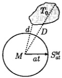

(a) 扰动前锋未到
 

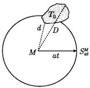

(b) 扰动发生作用
 

图 10.7
 

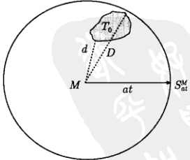

(c) 扰动阵尾已过
 

<!-- page: 313 -->

从式(10.6.15)我们也可以得到二维波动方程始值问题的解。事实上，如果u 与z无关，则 $ \partial u/\partial z=0 $，这时三维波动方程的始值问题就变成二维波动方程的始值问题

$$  \left\{\begin{array}{l}\frac{\partial^{2}u}{\partial t^{2}}=a^{2}\left(\frac{\partial^{2}u}{\partial x^{2}}+\frac{\partial^{2}u}{\partial y^{2}}\right)\quad(-\infty<x,y<+\infty,t>0)\end{array}\right.   \tag*{(10.6.16a)}$$

$$  u|_{t=0}=\phi(x,y)\quad(-\infty<x,y<+\infty)   \tag*{(10.6.16b)}$$

$$  \left\{\begin{array}{l}\left.\frac{\partial u}{\partial t}\right|_{t=0}=\psi(x,y)\end{array}\right.\qquad(-\infty<x,y<+\infty)   \tag*{(10.6.16c)}$$

为得式 $  (10.6.16)  $解的表达式，将式 $  (10.6.15)  $中两个沿球面的积分转化成沿圆域

$$  \varSigma_{a t}^{M}:(\xi-x)^{2}+(\eta-y)^{2}\leqslant(a t)^{2}   \tag*{(10.6.17)}$$

内的积分，下面以式（10.6.15）的第二项为例说明这个转化方法。先将这个积分拆成两部分

$$  \frac{1}{4\pi a}\iint\limits_{S_{a t}^{M}}\frac{\psi(M^{\prime})}{a t}\mathrm{d}S=\frac{1}{4\pi a}\iint\limits_{S_{1}}\frac{\psi(M^{\prime})}{a t}\mathrm{d}S+\frac{1}{4\pi a}\iint\limits_{S_{2}}\frac{\psi(M^{\prime})}{a t}\mathrm{d}S   \tag*{(10.6.18)}$$

其中， $ S_{1} $ 和  $ S_{2} $ 分别表示球面  $ S_{at}^{M} $ 的上半球面和下半球面。由于被积函数不依赖于变量 z，所以式 (10.6.18) 右端两个积分是相等的，即

$$  \frac{1}{4\pi a}\iint\limits_{S_{at}^{M}}\frac{\psi(M^{\prime})}{at}\mathrm{d}S=\frac{1}{2\pi a}\iint\limits_{S_{1}}\frac{\psi(M^{\prime})}{at}\mathrm{d}S   \tag*{(10.6.19)}$$

把右端的积分化为二重积分，并注意到球面  $ S_{at}^{M} $ 上的面积元素 dS 与它在圆域  $ \Sigma_{at}^{M} $ 上的投影元素  $ d\xi d\eta $ 的关系 (图 10.8)

$$  \mathrm{d}\xi\mathrm{d}\eta=\mathrm{d}S\cos\beta=\frac{\sqrt{(at)^{2}-(\xi-x)^{2}-(\eta-y)^{2}}}{at}\mathrm{d}S   \tag*{(10.6.20)}$$

其中， $ \beta $ 是这两个面积元素法线方向之间的夹角，由此得到

$$  \begin{align*}\frac{1}{4\pi a}\iint\limits_{S_{at}^{M}}\frac{\psi(M^{\prime})}{at}\mathrm{d}S&=\frac{1}{2\pi a}\iint\limits_{\Sigma_{at}^{M}}\frac{\psi(\xi,\eta)}{at}\frac{at}{\sqrt{(at)^{2}-(\xi-x)^{2}-(\eta-y)^{2}}}\mathrm{d}\xi\mathrm{d}\eta\\&=\frac{1}{2\pi a}\iint\limits_{\Sigma_{at}^{M}}\frac{\psi(\xi,\eta)}{\sqrt{(at)^{2}-(\xi-x)^{2}-(\eta-y)^{2}}}\mathrm{d}\xi\mathrm{d}\eta\qquad(10.\end{align*}   \tag*{(10.6.21a)}$$

按相同的方法对式（10.6.15）的第一项进行转化，得到

$$  \frac{1}{4\pi a}\iint\limits_{S_{at}^{M}}\frac{\phi(M^{\prime})}{at}\mathrm{d}S=\frac{1}{2\pi a}\iint\limits_{\Sigma_{at}^{M}}\frac{\phi(\xi,\eta)}{\sqrt{(at)^{2}-(\xi-x)^{2}-(\eta-y)^{2}}}\mathrm{d}\xi\mathrm{d}\eta   \tag*{(10.6.21b)}$$

<!-- page: 314 -->

将式（10.6.21）代入式（10.6.15）得到

$$  \begin{align*}u(x,y,t)=&\frac{1}{2\pi a}\frac{\partial}{\partial t}\iint\limits_{\Sigma_{at}^{M}}\frac{\phi(\xi,\eta)}{\sqrt{(at)^{2}-(\xi-x)^{2}-(\eta-y)^{2}}}\mathrm{d}\xi\mathrm{d}\eta\\&+\frac{1}{2\pi a}\iint\limits_{\Sigma_{at}^{M}}\frac{\psi(\xi,\eta)}{\sqrt{(at)^{2}-(\xi-x)^{2}-(\eta-y)^{2}}}\mathrm{d}\xi\mathrm{d}\eta\end{align*}   \tag*{(10.6.22)}$$

这就是初值问题（10.6.16）的解。

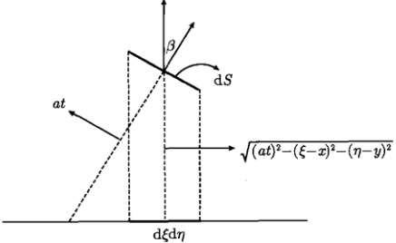

图 10.8 dS 与  $ d\xi d\eta $ 的关系
 

例2 设已知  $ \phi(x,y)=x^{2}(x+y) $， $ \psi(x,y)=0 $，求解定解问题（10.6.16）。

解 在极坐标系中

$$  \xi=x+r\cos\theta,\quad\eta=y+r\sin\theta   \tag*{(10.6.23)}$$

故

$$  (\xi-x)^{2}+(\eta-y)^{2}=r^{2}   \tag*{(10.6.24)}$$

代入式(10.6.22)得到

 $$ \begin{aligned}u(x,y,t)&=\frac{1}{2\pi a}\frac{\partial}{\partial t}\int_{0}^{at}\int_{0}^{2\pi}\frac{\phi(x+r\cos\theta,y+r\sin\theta)}{\sqrt{(at)^{2}-r^{2}}}r\mathrm{d}r\mathrm{d}\theta\\&=\frac{1}{2\pi a}\frac{\partial}{\partial t}\int_{0}^{at}\int_{0}^{2\pi}\frac{(x+r\cos\theta)^{2}(x+r\cos\theta+y+r\sin\theta)}{\sqrt{(at)^{2}-r^{2}}}r\mathrm{d}r\mathrm{d}\theta\\&=\frac{1}{2\pi a}\frac{\partial}{\partial t}\int_{0}^{at}\frac{r}{\sqrt{(at)^{2}-r^{2}}}\left\{\int_{0}^{2\pi}\left[x^{2}(x+y)+(3x+y)r^{2}\cos^{2}\theta\right]\mathrm{d}\theta\right\}\mathrm{d}r\\&=\frac{1}{2\pi a}\frac{\partial}{\partial t}\int_{0}^{at}\frac{r}{\sqrt{(at)^{2}-r^{2}}}\left[2\pi x^{2}(x+y)+\pi(3x+y)r^{2}\right]\mathrm{d}r\\&=\frac{1}{2\pi a}\frac{\partial}{\partial t}\left[2\pi x^{2}(x+y)at+\frac{\pi}{2}(3x+y)\frac{4}{3}(at)^{3}\right]\\ \end{aligned} $$

<!-- page: 315 -->

$$ =x^{2}(x+y)+(3x+y)(at)^{2} $$ 

这就是所求定解问题的结果，当 t=0 时，给出初始条件  $ \phi(x,y)=x^{2}(x+y) $。

我们进一步讨论泊松公式 (10.6.22) 的物理意义。设初始条件限于二维区域  $ T_0 $, d 和 D 分别是 M 点到  $ T_0 $ 的最小和最大距离。式 (10.6.22) 表示,  $ t $ 时刻  $ M(x,y) $ 点的波函数  $ u(x,y,t) $ 是由以 M 为中心、at 为半径的圆域  $ \Sigma_{at}^M $ 上的初始条件决定的 (波函数  $ u(x,y,t) $ 依赖于整个圆域  $ \Sigma_{at}^M $ 上的初始条件)。当 at < d 时,  $ u(x,y,t) = 0 $; 当  $ d \leq at \leq D $ 时,  $ u(x,y,t) \neq 0 $; 当 at > D 时, 由于圆域  $ \Sigma_{at}^M $ 包含了区域  $ T_0 $, 所以  $ u(x,y,t) $ 仍不为零, 即在  $ d/a \leq t < +\infty $ 时段, 式 (10.6.22) 的积分值不为零。这种现象称为波的弥散 (后效现象), 其含义是局部范围内的初始扰动, 具有长期的连续的后效特性, 扰动有清晰的 “前锋” 而无 “阵尾”, 这一点与球面波不同。

平面上以点 $ (\xi,\eta) $为中心的圆周的方程 $ (x-\xi)^{2}+(y-\eta)^{2}=r^{2} $在空间坐标系内表示母线平行于z轴的圆柱面，所以在过 $ (\xi,\eta) $点平行于z轴的无限长直线上的初始扰动，在时间t后的影响是在以该直线为轴，at为半径的圆柱面内，因此解式(10.6.22)称为柱面波。

### 10.7 旁轴波动方程：格林算子法

#### 10.7.1 旁轴波动方程的解

本节讨论三维波动方程

$$  \frac{\partial^{2}u}{\partial t^{2}}=a^{2}\left(\frac{\partial^{2}u}{\partial x^{2}}+\frac{\partial^{2}u}{\partial y^{2}}+\frac{\partial^{2}u}{\partial z^{2}}\right)   \tag*{(10.7.1)}$$

在旁轴近似下的解及其应用，着重考虑自由传播的单色光。一列沿 z 轴正向自由传播的单色光束可以表示为

$$  u(\mathbf{r},z,t)=\psi(\mathbf{r},z)\exp\left[\mathrm{i}(kz-\omega t)\right]   \tag*{(10.7.2)}$$

其中， $ k $ 和  $ \omega $ 分别是光波的波数与角频率； $ r = xi + yk $ 是  $ z $ 处的横向位置矢径。将式 (10.7.2) 代入式 (10.7.1)，因为振幅  $ \psi(r, z) $ 在一个光频波长内变化很小，可以略去二阶微商项  $ \partial^2 \psi / \partial z^2 $，从而得到

$$  \mathrm{i}\beta\frac{\partial}{\partial z}\psi(\boldsymbol{r},z)=\hat{H}\psi(\boldsymbol{r},z)   \tag*{(10.73)}$$

这里

$$  \beta=-2k   \tag*{(10.7.4)}$$

$$  \hat{H}=\frac{\partial^{2}}{\partial x^{2}}+\frac{\partial^{2}}{\partial y^{2}}   \tag*{(10.7.5)}$$

<!-- page: 316 -->

方程(10.7.3)称为旁轴波动方程，它与量子力学的薛定谔方程有相似的形式，其中z代替了薛定谔方程中的时间t，而 $ \beta $相当于普朗克常数 $ \hbar $。

于是可以按照量子力学的表述，把式（10.7.3）写成抽象态矢量  $ \left|\psi(z)\right\rangle $ 的形式

$$  \mathrm{i}\beta\frac{\partial}{\partial z}\left|\psi(z)\right\rangle=\hat{H}\left|\psi(z)\right\rangle   \tag*{(10.7.6)}$$

由于  $ \hat{H} $ 不含 z，对式 (10.7.6) 积分，有

 $$ \int_{|\psi(z_{0})\rangle}^{|\psi(z)\rangle}\frac{\mathrm{d}|\psi(z)\rangle}{|\psi(z)\rangle}=-\frac{\mathrm{i}}{\beta}\hat{H}\int_{z_{0}}^{z}\mathrm{d}z $$ 

得到

$$  \left|\psi(z)\right\rangle=\hat{G}_{L}\left|\psi(z_{0})\right\rangle   \tag*{(10.7.7)}$$

其中

$$  \hat{G}_{L}=\exp\left(-\mathrm{i}\frac{L}{\beta}\hat{H}\right)=\exp\left(\mathrm{i}\frac{L}{2k}\hat{H}\right)   \tag*{(10.7.8)}$$

称为格林算子，它决定态矢量  $ |\psi(z)\rangle $ 随 z 的演化，而 L 是演化的距离

$$  L=z-z_{0}   \tag*{(10.7.9)}$$

按量子力学的知识，二维坐标本征态  $ |r\rangle $ 构成连续谱，并有完备性关系式

$$  \int_{-\infty}^{\infty}\left|\boldsymbol{r}\right\rangle\left\langle\boldsymbol{r}\right|\mathrm{d}\boldsymbol{r}=1   \tag*{(10.7.10)}$$

态矢量 (10.7.7) 向二维坐标表象  $ \{|r\rangle\} $ 投影，并利用式 (10.7.7) 和式 (10.7.10)，得到

 $$ \begin{aligned}\langle\boldsymbol{r}|\psi(z)\rangle&=\langle\boldsymbol{r}|\hat{G}_{L}|\psi(z_{0})\rangle\rangle\\&=\left\langle\boldsymbol{r}\left|\hat{G}_{L}\int_{-\infty}^{\infty}|\boldsymbol{r}_{0}\rangle\langle\boldsymbol{r}_{0}|\mathrm{d}\boldsymbol{r}_{0}|\psi(z_{0})\rangle\right.\right\rangle\\&=\int_{-\infty}^{\infty}\left\langle\boldsymbol{r}\right|\hat{G}_{L}\left|\boldsymbol{r}_{0}\right\rangle\left\langle\boldsymbol{r}_{0}|\psi(z_{0})\right\rangle\mathrm{d}\boldsymbol{r}_{0}\end{aligned} $$ 

而  $ \langle\mathbf{r}|\psi(z)\rangle=\psi(\mathbf{r},z) $ 是坐标表象的波函数，故

$$  \psi(\boldsymbol{r},z)=\int_{-\infty}^{\infty}G_{L}(\boldsymbol{r},\boldsymbol{r}_{0})\psi(\boldsymbol{r}_{0},z_{0})\mathrm{d}\boldsymbol{r}_{0}   \tag*{(10.7.11)}$$

其中，矩阵元

$$  G_{L}(\boldsymbol{r},\boldsymbol{r}_{0})=\langle\boldsymbol{r}|\hat{G}_{L}|\boldsymbol{r}_{0}\rangle   \tag*{(10.7.12)}$$

称为格林函数。

<!-- page: 317 -->

式 (10.7.11) 的物理意义是很清楚的，如图 10.9 所示，一列沿 z 轴传播的旁轴单色光束，如果在输入平面  $ (x_0, y_0) $ 的振幅为  $ \psi(r_0, z_0) $，在自由空间传播 L 距离到输出平面  $ (x, y) $ 时，振幅演化为  $ \psi(r, z) $，它由式 (10.7.11) 的积分表示。其中，格林函数  $ G_L(r, r_0) $ 是输入平面上位于  $ r_0 $ 的一个点源在输出平面的 r 点产生的场分布，现在我们来计算它。

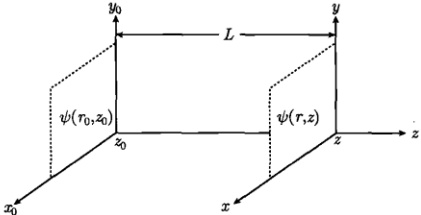

图 10.9 光场  $ \psi(r_{0}, z_{0}) $ 传播自由空间 L 后变成  $ \psi(r, z) $
 

二维动量本征态  $ |K\rangle $ 是拉普拉斯算符式 (10.7.5) 的本征态，即

$$  \hat{H}\left|\mathbf{K}\right\rangle=-K^{2}\left|\mathbf{K}\right\rangle   \tag*{(10.7.13)}$$

它构成连续谱，并有完备性关系式

$$  \int_{-\infty}^{\infty}\left|\boldsymbol{K}\right\rangle\left\langle\boldsymbol{K}\right|\mathrm{d}\boldsymbol{K}=1   \tag*{(10.7.14)}$$

它在坐标表象表示为

$$  \langle\pmb{r}|\pmb{K}\rangle=\frac{1}{2\pi}\exp\left(\mathrm{i}\pmb{K}\cdot\pmb{r}\right)   \tag*{(10.7.15)}$$

将完备性关系式（10.7.10）插入式（10.7.12）的矩阵元，并利用式（10.7.8）和式（10.7.5），得到

 $$ \begin{aligned}G_{L}(\boldsymbol{r},\boldsymbol{r}_{0})&=\left\langle\boldsymbol{r}\right|\hat{G}_{L}\left|\boldsymbol{r}_{0}\right\rangle\\&=\left\langle\boldsymbol{r}\right|\hat{G}_{L}\int_{-\infty}^{\infty}\left|\boldsymbol{K}\right\rangle\left\langle\boldsymbol{K}\right|\mathrm{d}\boldsymbol{K}\left|\boldsymbol{r}_{0}\right\rangle\\&=\int_{-\infty}^{\infty}\left\langle\boldsymbol{r}\right|\exp\left(-\mathrm{i}\frac{L}{\beta}\hat{H}\right)\left|\boldsymbol{K}\right\rangle\left\langle\boldsymbol{K}\right|\boldsymbol{r}_{0}\rangle\mathrm{d}\boldsymbol{K}\\&=\int_{-\infty}^{\infty}\exp\left(\mathrm{i}\frac{L}{\beta}K^{2}\right)\left\langle\boldsymbol{r}\left|\boldsymbol{K}\right\rangle\left\langle\boldsymbol{K}\right|\boldsymbol{r}_{0}\right\rangle\mathrm{d}\boldsymbol{K}\\&=\frac{1}{(2\pi)^{2}}\int_{-\infty}^{\infty}\exp\left(\frac{\mathrm{i}}{\beta}K^{2}L\right)\mathrm{e}^{\mathrm{i}\boldsymbol{K}\cdot(\boldsymbol{r}-\boldsymbol{r}_{0})}\mathrm{d}\boldsymbol{K}\\ \end{aligned} $$ 

完成积分后，利用式 $  (10.7.4)  $，得到

<!-- page: 318 -->

$$  G_{L}(\boldsymbol{r},\boldsymbol{r}_{0})=\frac{1}{\mathrm{i}\lambda L}\mathrm{e}^{\mathrm{i}\frac{k}{2L}|\boldsymbol{r}_{0}-\boldsymbol{r}|^{2}}   \tag*{(10.7.16)}$$

其中， $ \lambda=\frac{2\pi}{k} $ 是单色光的波长。将式(10.7.16)代入式(10.7.11)得到

$$  \psi(\boldsymbol{r},z)=\frac{1}{\mathrm{i}\lambda L}\int_{-\infty}^{\infty}\psi(\boldsymbol{r}_{0},z_{0})\mathrm{e}^{\mathrm{i}\frac{k}{2L}|\boldsymbol{r}_{0}-\boldsymbol{r}|^{2}}\mathrm{d}\boldsymbol{r}_{0}   \tag*{(10.7.17)}$$

式 (10.7.17) 就是旁轴波动方程 (10.7.3) 的解，它表示熟知的旁轴近似的菲涅耳衍射积分。其中，格林函数  $ G_{L}(r,r_{0}) $ 可以称为菲涅耳核，它就是通常所说的“脉冲响应”。

#### 10.7.2 光学元件与光学系统的格林算子

设一个光学元件对于垂直入射的旁轴光束的透过率函数为  $ G_{F}(r) $，则该光学元件的格林算子定义为  $ G_{F}(r) $ 的相应的算子形式。例如，一个球面薄透镜对垂直入射的旁轴光束的透过率函数为

$$  G_{F}(\boldsymbol{r})=\mathrm{e}^{-\mathrm{i}\frac{k}{2f}r^{2}}   \tag*{(10.7.18)}$$

其中，f 是透镜的焦距，于是该透镜的格林算子为

$$  \hat{G}_{F}=\mathrm{e}^{-\mathrm{i}\frac{k}{2f}\hat{r}^{2}}   \tag*{(10.7.19)}$$

一般光学系统是由若干个分立元件和它们之间的自由空间组成的。例如，图10.10所示的光学系统，是由位于 $ z_0 $的球面薄透镜 $ F_1 $，透过率函数为 $ T(r) $的物 $ F_2 $，两段自由空间（长度分别为 $ L_1 $和 $ L_2 $）组成的。对于整个系统来说，如果输入、输出态矢量分别为 $ \left|\psi(z_0)\right\rangle $和 $ \left|\psi(z)\right\rangle $，则在它们之间也存在一个格林算子 $ \hat{G} $，显然它是系统中各个分立元件及各段自由空间格林算子的有序乘积。对于图10.10所示的系统， $ \hat{G} $写为

$$  \hat{G}=\hat{G}_{L_{2}}\hat{G}_{T}\hat{G}_{L_{1}}\hat{G}_{F}   \tag*{(10.7.20)}$$

其中， $ \hat{G}_{T}=T(\hat{\boldsymbol{r}}) $ 是物的透过率算子。

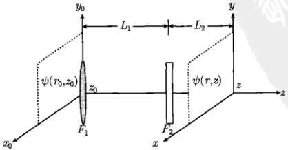

图 10.10 光场  $ \psi(r_{0}, z_{0}) $ 在系统中传播后变成  $ \psi(r, z) $
 

<!-- page: 319 -->

对于一般光学系统，其格林算子可以表示为

$$  \hat{G}=\Pi_{i}\hat{G}_{i}   \tag*{(10.7.21)}$$

其中， $ \hat{G}_{i} $ 是第  $ i $ 个元件（包括自由空间）的格林算子。若式 (10.7.21) 的格林算子将输入态矢量  $ |\psi(z_{0})\rangle $ 与输出态矢量  $ |\psi(z)\rangle $ 相联系，即

$$  \left|\psi(z)\right\rangle=\hat{G}\left|\psi(z_{0})\right\rangle   \tag*{(10.7.22)}$$

则按照得到式（10.7.11）的过程可得

$$  \psi(\boldsymbol{r},z)=\int_{-\infty}^{\infty}G(\boldsymbol{r},\boldsymbol{r}_{0})\psi(\boldsymbol{r}_{0},z_{0})\mathrm{d}\boldsymbol{r}_{0}   \tag*{(10.7.23)}$$

其中，矩阵元

$$  G(\boldsymbol{r},\boldsymbol{r}_{0})=\langle\boldsymbol{r}|\hat{G}|\boldsymbol{r}_{0}\rangle   \tag*{(10.7.24)}$$

是整个系统的格林函数。这样一来，对于一个给定的光学系统，如果求得其格林函数  $ G(r, r_0) $，就可以代入式 (10.7.23)，由任意的输入光场  $ \psi(r_0, z_0) $ 求得相应的输出光场  $ \psi(r, z) $。因此，利用上述的格林算子法，原则上可以处理傅里叶光学和相关领域的全部理论问题。而上述方法的优越性在于，对于给定的光学系统，恰当地插入完备性关系式 (10.7.10)，可以简化运算过程。

#### 10.7.3 格林算子法的应用

作为格林算子法的应用，我们讨论如图10.10所示的光学系统。简单起见，设输入平面 $ (x_{0},y_{0}) $的光场为单位振幅的平面波，即

$$  \psi(\boldsymbol{r}_{0},z_{0})=1   \tag*{(10.7.25)}$$

现在求输出平面  $ (x,y) $ 上的光场分布  $ \psi(r,z) $。将系统的格林算子式 (10.7.20) 在二维坐标表象取矩阵元，给出系统的格林函数

$$  \begin{array}{r}{G(\boldsymbol{r},\boldsymbol{r}_{0})=\langle\boldsymbol{r}|\hat{G}_{L_{2}}T(\boldsymbol{\hat{r}})\hat{G}_{L_{1}}\hat{G}_{F}|\boldsymbol{r}_{0}\rangle}\end{array}   \tag*{(10.7.26)}$$

计算式 (10.7.26) 最简单的方法是在算子  $ T(\hat{r}) $ 之后插入完备性关系式  $ \int_{-\infty}^{\infty} |r'\rangle $  $ \langle r'| dr' = 1 $，这样可以利用本征方程

$$  T(\hat{\boldsymbol{r}})\left|\boldsymbol{r}^{\prime}\right\rangle=T(\boldsymbol{r}^{\prime})\left|\boldsymbol{r}^{\prime}\right\rangle   \tag*{(10.7.27a)}$$

$$  \hat{G}_{F}\left|\pmb{r}_{0}\right\rangle=\mathrm{e}^{-\mathrm{i}\frac{k}{2f}\tau_{0}^{2}}\left|\pmb{r}_{0}\right\rangle   \tag*{(10.7.27b)}$$

<!-- page: 320 -->

得到

$$  \begin{aligned}G(\boldsymbol{r},\boldsymbol{r}_{0})&=\int_{-\infty}^{\infty}\left\langle\boldsymbol{r}\right|\hat{G}_{L_{2}}T(\hat{\boldsymbol{r}})\left|\boldsymbol{r}^{\prime}\right\rangle\left\langle\boldsymbol{r}^{\prime}\right|\hat{G}_{L_{1}}\hat{G}_{F}\left|\boldsymbol{r}_{0}\right\rangle\mathrm{d}\boldsymbol{r}^{\prime}\\&=\int_{-\infty}^{\infty}\left\langle\boldsymbol{r}\right|\hat{G}_{L_{2}}\left|\boldsymbol{r}^{\prime}\right\rangle T(\boldsymbol{r}^{\prime})\left\langle\boldsymbol{r}^{\prime}\right|\hat{G}_{L_{1}}\left|\boldsymbol{r}_{0}\right\rangle\mathrm{e}^{-\mathrm{i}\frac{k}{2f}r_{0}^{2}}\mathrm{d}\boldsymbol{r}^{\prime}\\&=\int_{-\infty}^{\infty}G_{L_{2}}(\boldsymbol{r},\boldsymbol{r}^{\prime})T(\boldsymbol{r}^{\prime})G_{L_{1}}(\boldsymbol{r}^{\prime},\boldsymbol{r}_{0})\mathrm{e}^{-\mathrm{i}\frac{k}{2f}r_{0}^{2}}\mathrm{d}\boldsymbol{r}^{\prime}\\ \end{aligned}   \tag*{(10.7.28)}$$

将式（10.7.28）代入式（10.7.23），并利用式（10.7.25）和式（10.7.16）得到

$$  \begin{aligned}\psi(\boldsymbol{r},z)&=\int_{-\infty}^{\infty}\int_{-\infty}^{\infty}G_{L_{2}}(\boldsymbol{r},\boldsymbol{r}^{\prime})T(\boldsymbol{r}^{\prime})G_{L_{1}}(\boldsymbol{r}^{\prime},\boldsymbol{r}_{0})\mathrm{e}^{-\mathrm{i}\frac{k}{2f}r_{0}^{2}}\mathrm{d}\boldsymbol{r}^{\prime}\mathrm{d}\boldsymbol{r}_{0}\\&=-\frac{1}{\lambda^{2}L_{1}L_{2}}\int_{-\infty}^{\infty}\int_{-\infty}^{\infty}T(\boldsymbol{r}^{\prime})\mathrm{e}^{\mathrm{i}\frac{k}{2L_{2}}\left|\boldsymbol{r}-\boldsymbol{r}^{\prime}\right|^{2}}\mathrm{e}^{\mathrm{i}\frac{k}{2L_{1}}\left|\boldsymbol{r}^{\prime}-\boldsymbol{r}_{0}\right|^{2}}\mathrm{e}^{-\mathrm{i}\frac{k}{2f}r_{0}^{2}}\mathrm{d}\boldsymbol{r}^{\prime}\mathrm{d}\boldsymbol{r}_{0}\\&=-\frac{1}{\lambda^{2}L_{1}L_{2}}\int_{-\infty}^{\infty}I(\boldsymbol{r}^{\prime})T(\boldsymbol{r}^{\prime})\mathrm{e}^{\mathrm{i}\frac{k}{2L_{2}}\left|\boldsymbol{r}-\boldsymbol{r}^{\prime}\right|^{2}}\mathrm{d}\boldsymbol{r}^{\prime}\tag{10}\end{aligned}   \tag*{(10.7.29)}$$

其中

$$  \begin{array}{r}{I(\boldsymbol{r}^{\prime})=\int_{-\infty}^{\infty}\mathrm{e}^{\mathrm{i}\frac{k}{2L_{1}}\left|\boldsymbol{r}^{\prime}-\boldsymbol{r}_{0}\right|^{2}}\mathrm{e}^{-\mathrm{i}\frac{k}{2f}r_{0}^{2}}\mathrm{d}\boldsymbol{r}_{0}}\end{array}   \tag*{(10.7.30)}$$

积分式（10.7.30）的结果为

$$  I(\boldsymbol{r}^{\prime})=\frac{\mathrm{i}\lambda}{\frac{1}{L_{1}}-\frac{1}{f}}\exp\left[\left(\mathrm{i}\frac{k}{2L_{1}}r^{\prime2}\right)\left(-\mathrm{i}\frac{k}{2L_{1}^{2}}\frac{1}{\frac{1}{L_{1}}-\frac{1}{f}}r^{\prime2}\right)\right]   \tag*{(10.7.31)}$$

将式（10.7.31）代入式（10.7.29）得

$$  \psi(r,z)=\frac{f}{\mathrm{i}\lambda L_{2}(f-L_{1})}\mathrm{e}^{\mathrm{i}\frac{k}{2L_{2}}r^{2}}\int_{-\infty}^{\infty}T(r^{\prime})\mathrm{e}^{\mathrm{i}\frac{k}{2}\frac{f-(L_{1}+L_{2})}{L_{2}(f-L_{1})}r^{\prime2}}\mathrm{e}^{-\mathrm{i}2\pi r^{\prime}\cdot\frac{r}{\lambda L_{2}}}\mathrm{d}r^{\prime}   \tag*{(10.7.32)}$$

这就是图 10.10 所示光学系统的一般结果。当  $ L_{1} + L_{2} = f $ 时，式 (10.7.32) 变为

$$  \psi(\boldsymbol{r},z)=\frac{f}{\mathrm{i}\lambda L_{2}^{2}}\mathrm{e}^{\mathrm{i}\frac{k}{2L_{2}}r^{2}}\int_{-\infty}^{\infty}T(\boldsymbol{r}^{\prime})\mathrm{e}^{-\mathrm{i}2\pi\boldsymbol{r}^{\prime}\cdot\frac{\boldsymbol{r}}{\lambda L_{2}}}\mathrm{d}\boldsymbol{r}^{\prime}   \tag*{(10.7.33)}$$

式(10.7.33)中的积分恰好表示物 $ T(r) $的二维傅里叶变换，而“空间频率”为

$$  \nu=\frac{r}{\lambda L_{2}}=\left\{\frac{x}{\lambda L_{2}},\frac{y}{\lambda L_{2}}\right\}   \tag*{(10.7.34)}$$

也就是说，在透镜的后焦面上得到了物的傅里叶频谱，而且改变  $ L_{2} $ 时，可以得到不同尺度的频谱。

<!-- page: 321 -->

在傅里叶光学及相关领域中，讨论光束在系统中传播的通常方法是逐段求菲涅耳积分，这样的计算过程往往比较复杂。上述的格林算子法不是逐段求积分，而是着眼整个光学系统，着力求系统的格林算子  $ \hat{G} = \Pi_i \hat{G}_i $ 和相应的格林函数  $ G(r, r_0) = \langle r | \hat{G} | r_0 \rangle $。在计算过程中可以灵活地插入一个（或多个）完备性关系式  $ \int_{-\infty}^{\infty} |r\rangle \langle r| \, \mathrm{d}r = 1 $，利用相应的本征方程使计算简化。这种方法的另一个特点是只要具体给出系统中诸元件的透过率函数，原则上就可以由任意输入求得输出，没有附加的限制条件（如对透过率函数的限制、对元件排列的限制等）。有的情况下即使不知道元件透过率的函数形式，也能定性地判断输出的特征。例如，在上述的例子中，虽然不知道输出的函数表示式，但知道它是物的傅里叶变换。

这种方法能被期待处理傅里叶光学与相关领域中的一些较复杂的光传输问题。

### 10.8 非线性波动方程：光学孤立子

本节简要介绍有关非线性波动方程和光学孤立子的概念。按照辐射与物质相互作用的半经典理论，可以得到一个非线性波动方程（见 Qiao Gu. Radiation and Bioinformation. Science Press, 2003: 262–287）

$$  \frac{\partial^{2}\theta}{\partial\tau^{2}}-\frac{\partial^{2}\theta}{\partial\xi^{2}}=-\sin\theta   \tag*{(10.8.1)}$$

其中， $ \xi $ 和  $ \tau $ 分别是无量纲的坐标与时间

$$  \xi=\omega_{n}t-\frac{2\omega_{n}}{c}x,\quad\tau=\omega_{n}t   \tag*{(10.8.2)}$$

其中， $ \omega_{n} $ 是系统的特征频率；x 和 t 是通常的坐标与时间变量。式 (10.8.1) 中的  $ \theta $ 是布洛赫角，它与光场振幅 E 之间有如下关系

$$  \frac{\mathrm{d}\theta}{\mathrm{d}t}=\frac{\mu}{\hbar}E   \tag*{(10.8.3)}$$

这里  $ \mu $ 是原子的偶极矩阵元， $ \hbar $ 是普朗克常数 h 除以  $ 2\pi $。式 (10.8.1) 称为 Sine-Gordon 方程，它有解

$$  \theta=4\arctan[\exp(\xi\sqrt{1+\alpha^{2}}-\alpha\tau)]   \tag*{(10.8.4)}$$

其中， $ \alpha $ 是一个不含时间的常数，但与系统的初始条件有关。这个解对时间微商后给出一个光脉冲，它是一个双曲正割函数

$$  E(x,t)=E_0\mathrm{sech}\left(\frac{x-at}{at_{D}}\right)   \tag*{(10.8.5)}$$

<!-- page: 322 -->

其中

$$  E_{0}\equiv E(0,0)=2\frac{\hbar}{\mu}\omega_{n}\left(\sqrt{1+\alpha^{2}}-\alpha\right)   \tag*{(10.8.6)}$$

是脉冲的振幅，a 和  $ t_{D} $ 分别是脉冲的速度和宽度，它们能在脉冲振幅的意义上表示为

$$  a=\frac{c}{1+\left(2\frac{\hbar}{\mu}\frac{\omega_{n}}{E_{0}}\right)^{2}}   \tag*{(10.8.7a)}$$

$$  t_{D}=2\frac{\hbar}{\mu}\frac{1}{E_{0}}   \tag*{(10.8.7b)}$$

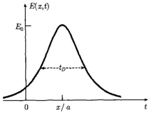

表达式 (10.8.5) 表示了一个孤立子解。孤立子是沿 x 轴正向传播的波包，它的特征是脉冲的振幅越大传播越快，而且宽度越窄。图 10.11 显示了孤立子在任意位置 x 的波形 (见图 5.5)。

图 10.11 孤立子式 (10.8.5) 在任意位置 x 的波形
 

孤立子脉冲的时间积分（脉冲面积）给出它在空间任意位置 x 的能量

 $$ \begin{aligned}\theta&=\frac{\mu}{\hbar}\int_{-\infty}^{\infty}E(x,t)\mathrm{d}t\\&=\frac{\mu}{\hbar}\int_{-\infty}^{\infty}E_{0}\mathrm{sech}\left(\frac{x-at}{at_{D}}\right)\mathrm{d}t\\&=\frac{\mu}{\hbar}E_{0}t_{D}\left[\arctan\left(\sinh\xi\right)\right]_{-\infty}^{\infty}=2\pi\end{aligned} $$ 

这个常数结果意味着孤立子脉冲在空间传播时，其能量与空间位置 x 没有关系，即在任意位置孤立子脉冲具有相同的能量（能量守恒）。换言之，孤立子在介质中传播时不损失它的能量，这是由 sech 波形所决定的。其物理机制是面积为  $ 2\pi $ 的孤立子光脉冲进入介质之初，原子处于低能态。孤立子通过介质时将原子从低能态激发到高能态，在这个过程中孤立子失去了一定的能量。随后，当孤立子离开介质时，高能态的原子跃迁回低能态又将等量的能量“退还”给孤立子，如图 10.12 所示。这样孤立子在穿过介质的全过程中没有将自身的能量消耗在原子系统中。所以孤立子脉冲是一个所谓的“自感应透明”(self-induced transparency) 脉冲。

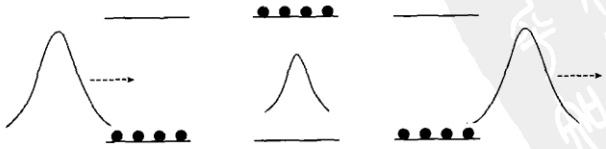

图 10.12 孤立子传播不损失能量的物理机制
 

