# 11-第11章 积分变换法

[返回全书目录](../../README.md)

> PDF 页码：323–360

<!-- page: 323 -->

### 第11章 积分变换法

我们在第3章、第4章中介绍了傅里叶变换与拉普拉斯变换在求解常微分方程中的应用，求解中通过取积分变换将未知函数的常微分方程化成了象函数的代数方程，消去了对自变量求导数的运算。解出代数方程后，再进行反演就得到了原来常微分方程的解。基于这一事实，我们自然会想到，积分变换法也能用于求解偏微分方程。事实上，在偏微分方程两端对某个变量取变换就能消去未知函数对该自变量求偏导数的运算，使象函数的微分方程变得较为简单。如果原来的偏微分方程只包含两个自变量，经过一次变换则得到象函数的常微分方程。积分变换法在求解数学物理方程中具有广泛的用途，特别是对于非齐次泛定方程及非齐次边界条件，用经典的分离变量法求解比较烦琐，而积分变换法为这类问题提供了一种系统规范的解决方法，具有固定的程序。本章将用傅里叶变换法、拉普拉斯变换法以及联合变换法处理不同类型的定解问题。

### 11.1 傅里叶变换法

用分离变量法求解有限空间的定解问题时，所得到的本征值谱是分立的，所得到的一般解表示为本征函数的叠加。对于无限空间，所得到的本征值谱一般是连续的，一般解可表示为对连续本征值的积分形式。因此，对于无限空间的定解问题，傅里叶变换是一种很适用的求解方法。本节将通过几个典型例子说明运用傅里叶变换求解无界空间定界问题的基本过程。

我们将二元函数  $ u(x,t) $ 关于变量 x 的傅里叶变换记为

$$  \mathcal{F}\left\{u(x,t)\right\}=U(\omega,t)=\int_{-\infty}^{\infty}u(x,t)\mathrm{e}^{-\mathrm{i}\omega x}\mathrm{d}x   \tag*{(11.1.1)}$$

在对  $ \frac{\partial u}{\partial t} $ 关于 x 作傅里叶变换时，我们有

$$  \mathcal{F}\left\{\frac{\partial u}{\partial t}\right\}=\int_{-\infty}^{\infty}\frac{\partial u}{\partial t}\mathrm{e}^{-\mathrm{i}\omega x}\mathrm{d}\omega=\frac{\partial}{\partial t}\int_{-\infty}^{\infty}u\mathrm{e}^{-\mathrm{i}\omega x}\mathrm{d}\omega=\frac{\mathrm{d}U(\omega,t)}{\mathrm{d}t}   \tag*{(11.1.2a)}$$

同理

$$  \mathcal{F}\left\{\frac{\partial^{2}u}{\partial t^{2}}\right\}=\frac{\mathrm{d}^{2}U(\omega,t)}{\mathrm{d}t^{2}}   \tag*{(11.1.2b)}$$

<!-- page: 324 -->

#### 11.1.1 热传导问题与高斯核

作为傅里叶变换法的应用，我们首先求解下列无限长细杆的热传导问题

$$  \left\{\begin{array}{l}\displaystyle\frac{\partial u}{\partial t}=a^{2}\frac{\partial^{2}u}{\partial x^{2}}\quad(-\infty<x<\infty,t>0)\end{array}\right.   \tag*{(11.1.3a)}$$

$$  u|_{t=0}=\phi(x)\quad(-\infty<x<\infty)   \tag*{(11.1.3b)}$$

其中，a 是热扩散系数； $ \phi(x) $ 是初始温度分布。这个问题的求解将引出一个重要的概念——“高斯核”(Gauss kernel)。

我们对（11.1.3）关于 x 作傅里叶变换，考虑到式（11.1.2a）并利用式（3.1.16），得到

$$  \left\{\begin{array}{l}\frac{\mathrm{d}U(\omega,t)}{\mathrm{d}t}=-a^{2}\omega^{2}U(\omega,t)\end{array}\right.   \tag*{(11.1.4a)}$$

$$  U\vert_{t=0}=\varPhi(\omega)   \tag*{(11.1.4b)}$$

其中

$$  \Phi(\omega)=\int_{-\infty}^{\infty}\phi(x)\mathrm{e}^{-\mathrm{i}\omega x}\mathrm{d}x   \tag*{(11.1.5)}$$

是初始温度  $ \phi(x) $ 的傅里叶变换。常微分方程问题 (11.1.4) 的解为

$$  U(\omega,t)=\Phi(\omega)\mathrm{e}^{-a^{2}\omega^{2}t}   \tag*{(11.1.6)}$$

利用傅里叶反变换式(3.1.4)，得到

$$  u(x,t)=\frac{1}{2\pi}\int_{-\infty}^{\infty}\Phi(\omega)\mathrm{e}^{-\omega^{2}a^{2}t}\mathrm{e}^{\mathrm{i}\omega x}\mathrm{d}\omega   \tag*{(11.1.7)}$$

这就是无限长热传导定解问题 (11.1.4) 的形式解，它是一种积分的形式，其中的  $ \Phi(\omega) $ 由式 (11.1.5) 确定。

现在我们进一步计算式(11.1.7)的积分，为此将式(11.1.5)代入式(11.1.7)，得到

$$  \begin{aligned}u(x,t)&=\frac{1}{2\pi}\int_{-\infty}^{\infty}\left[\int_{-\infty}^{\infty}\phi(\xi)\mathrm{e}^{-\mathrm{i}\omega\xi}\mathrm{d}\xi\right]\mathrm{e}^{-\omega^{2}a^{2}t}\mathrm{e}^{\mathrm{i}\omega x}\mathrm{d}\omega\\&=\frac{1}{2\pi}\int_{-\infty}^{\infty}\phi(\xi)\left[\int_{-\infty}^{\infty}\exp\left(-\omega^{2}a^{2}t\right)\mathrm{e}^{-\mathrm{i}\omega(\xi-x)}\mathrm{d}\omega\right]\mathrm{d}\xi\\&\quad(\xi-x=X)\\&=\frac{1}{2\pi}\int_{-\infty}^{\infty}\phi(\xi)\left[\int_{-\infty}^{\infty}\exp\left(-\omega^{2}a^{2}t\right)\mathrm{e}^{-\mathrm{i}\omega X}\mathrm{d}\omega\right]\mathrm{d}\xi\end{aligned}   \tag*{(11.1.8)}$$

其中，关于  $ \omega $ 的积分正是高斯函数  $ \exp\left(-\omega^{2}a^{2}t\right) $ 的傅里叶变换。在第 3.3 节例 4 中，我们得到结论：高斯函数的傅里叶变换仍是高斯函数。利用这一性质，从式

<!-- page: 325 -->

(3.3.9) 推导出

$$  \int_{-\infty}^{\infty}\exp\left(-a^{2}\omega^{2}t\right)\mathrm{e}^{-\mathrm{i}\omega X}\mathrm{d}\omega=\sqrt{\frac{\pi}{a^{2}t}}\exp\left(-\frac{X^{2}}{4a^{2}t}\right)   \tag*{(11.1.9)}$$

代入式(11.1.8)得到

$$  u(x,t)=\frac{1}{2a\sqrt{\pi t}}\int_{-\infty}^{\infty}\phi(\xi)\exp\left[-\frac{(x-\xi)^2}{4a^2t}\right]\mathrm{d}\xi   \tag*{(11.1.10)}$$

这个结果值得进一步讨论，我们将式(11.1.10)写成卷积形式

$$  u(x,t)=\phi(x)*K(x,t)   \tag*{(11.1.11)}$$

其中

$$  K(x,t)=\left\{\begin{array}{ll}\displaystyle\frac{1}{2a\sqrt{\pi t}}\exp\left(-\frac{x^{2}}{4a^{2}t}\right)&(t>0)\\0&(t\leq0)\end{array}\right.   \tag*{(11.1.12)}$$

就是所谓高斯核，它是应用数学和统计学中最重要的函数之一。我们首先分析它的物理含义，如果初始温度分布为  $ \phi(x)=\delta(x) $，则式(11.1.10)立即给出

 $$ \begin{aligned}u(x,t)&=\frac{1}{2a\sqrt{\pi t}}\int_{-\infty}^{\infty}\delta(\xi)\exp\left[-\frac{(x-\xi)^{2}}{4a^{2}t}\right]\mathrm{d}\xi\\&=\frac{1}{2a\sqrt{\pi t}}\exp\left(-\frac{x^{2}}{4a^{2}t}\right)\end{aligned} $$ 

可见高斯核是初始 t=0 时刻位于 x=0 的点源在任意时刻 t 引起的温度分布。

下面进一步分析高斯核的性质，为此我们将它与普通的高斯分布

$$  G(x)=\frac{1}{\sqrt{2\pi}\sigma}\exp\left(-\frac{x^{2}}{2\sigma^{2}}\right)   \tag*{(11.1.13)}$$

相比较。可以看出，高斯核是一个标准差为  $ \sigma = a\sqrt{2t} $ 的高斯分布函数。这意味着在任何时刻 t，高斯核  $ K(x,t) $ 均为关于 x 的高斯函数，当 t 增大时，它的峰值  $ K(0,t) = 1/(2a\sqrt{\pi t}) $ 下降，分布变宽，但在任意时刻都维持单位面积，即

$$  \int_{-\infty}^{\infty}\frac{1}{2a\sqrt{\pi t}}\exp\left(-\frac{x^{2}}{4a^{2}t}\right)\mathrm{d}x=1   \tag*{(11.1.14)}$$

高斯核式(11.1.12)的曲线如图11.1所示。当t逐渐变小时，高斯核的峰值不断升高，而在极限 $ t\to0 $，峰值趋于无穷大，于是高斯核的极限形式是 $ \delta $函数，即

$$  \lim_{t\to0}\frac{1}{2a\sqrt{\pi t}}\exp\left(-\frac{x^{2}}{4a^{2}t}\right)=\delta(x)   \tag*{(11.1.15)}$$

<!-- page: 326 -->

因此，图 11.1 就是初始点源  $ \delta(x) $ 在任意时刻 t 引起的温度分布。x=0 处温度随时间下降的物理机制是由于系统的热扩散作用。

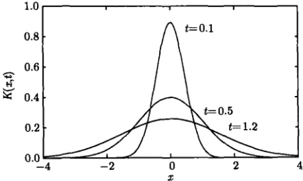

图 11.1 高斯核曲线 (11.1.12) (a = 1)
 

另外，由式 $  (11.1.9)  $可以得到

$$  \frac{1}{2\pi}\int_{-\infty}^{\infty}\mathrm{e}^{-\omega^{2}a^{2}t}\mathrm{e}^{\mathrm{i}\omega x}\mathrm{d}\omega=\frac{1}{2a\sqrt{\pi t}}\exp\left(-\frac{x^{2}}{4a^{2}t}\right)   \tag*{(11.1.16)}$$

这意味着

$$  \mathcal{F}^{-1}\left\{\mathrm{e}^{-\omega^{2}a^{2}t}\right\}=\frac{1}{2a\sqrt{\pi t}}\exp\left(-\frac{x^{2}}{4a^{2}t}\right)=K(x,t)   \tag*{(11.1.17a)}$$

或

$$  \mathcal{F}\left\{K(x,t)\right\}=\mathcal{F}\left\{\frac{1}{2a\sqrt{\pi t}}\exp\left(-\frac{x^{2}}{4a^{2}t}\right)\right\}=\mathrm{e}^{-\omega^{2}a^{2}t}   \tag*{(11.1.17b)}$$

即高斯核的傅里叶变换是  $ \exp\left(-\omega^{2}a^{2}t\right) $，这也是一个重要的结论，与第3.3节例4的结论相吻合。

例 1 设热传导问题 (11.1.3) 的初始温度分布为归一化的高斯函数

$$  \phi(x)=\frac{1}{\sqrt{\pi}}\mathrm{e}^{-x^{2}}   \tag*{(11.1.18)}$$

讨论系统任意时刻的温度分布。

解 首先将式（11.1.18）代入式（11.1.5）得到

$$  \Phi(\omega)=\int_{-\infty}^{\infty}\frac{1}{\sqrt{\pi}}\mathrm{e}^{-x^{2}}\mathrm{e}^{-\mathrm{i}\omega x}\mathrm{d}x=\exp\left(-\frac{\omega^{2}}{4}\right)   \tag*{(11.1.19)}$$

再代入式 $  (11.1.7)  $，得到

 $$ u(x,t)=\frac{1}{2\pi}\int_{-\infty}^{\infty}\mathrm{e}^{-\frac{\omega^{2}}{4}}\mathrm{e}^{-\omega^{2}a^{2}t}\mathrm{e}^{\mathrm{i}\omega x}\mathrm{d}\omega $$

<!-- page: 327 -->

$$  \begin{aligned}&=\frac{1}{2\pi}\int_{-\infty}^{\infty}\mathrm{e}^{-\frac{(4a^{2}t+1)}{4}\omega^{2}}\mathrm{e}^{\mathrm{i}\omega x}\mathrm{d}\omega\\&=\frac{1}{\sqrt{\pi(4a^{2}t+1)}}\exp\left(-\frac{x^{2}}{4a^{2}t+1}\right)\end{aligned}   \tag*{(11.1.20)}$$

这就是所求的结果。

这个问题的求解还可以从式 $  (11.1.11)  $出发

 $$ \begin{aligned}u(x,t)&=\phi(x)*K(x,t)\\&=\frac{1}{\sqrt{\pi}}\mathrm{e}^{-x^{2}}*\frac{1}{2a\sqrt{\pi t}}\exp\left(-\frac{x^{2}}{4a^{2}t}\right)\end{aligned} $$ 

可见问题的解是两个高斯函数的卷积。为了计算这个卷积，我们求它的傅里叶变换，利用式(11.1.11)，得到

 $$ \begin{aligned}{}&{{}\mathcal{F}\left\{\frac{1}{\sqrt{\pi}}\mathrm{e}^{-x^{2}}*\frac{1}{2a\sqrt{\pi t}}\operatorname{e x p}\left(-\frac{x^{2}}{4a^{2}t}\right)\right\}}\\ {=}&{{}\mathcal{F}\left\{\frac{1}{\sqrt{\pi}}\mathrm{e}^{-x^{2}}\right\}\mathcal{F}\left\{\frac{1}{2a\sqrt{\pi t}}\operatorname{e x p}\left(-\frac{x^{2}}{4a^{2}t}\right)\right\}}\\ {=}&{{}\mathrm{e}^{-\omega^{2}/4}\mathrm{e}^{-\omega^{2}a^{2}t}=\mathrm{e}^{-\frac{\omega^{2}(4a^{2}t+1)}{4}}}\\ \end{aligned} $$ 

再取它的傅里叶反变换，利用式 $  (11.1.17a)  $，得到

 $$ \begin{aligned}u(x,t)&=\mathcal{F}^{-1}\left\{\mathrm{e}^{-\frac{\omega^{2}(4a^{2}t+1)}{4}}\right\}\\&=\frac{1}{\sqrt{\pi(4a^{2}t+1)}}\exp\left(-\frac{x^{2}}{4a^{2}t+1}\right)\end{aligned} $$ 

当 t=0 时， $ u(x,0)=\exp\left(-x^{2}\right)/\sqrt{\pi} $。而温度分布  $ u(x,t) $ 随时间的演化与点源情况（图 11.1）相似。

最后需要指出，高斯核的演化是一个普遍的现象，存在于许多系统之中。它反映一个点源函数在系统自身的扩散作用之下，其分布变得越来越宽。除了上述的热量扩散之外，还有物质浓度的扩散，比如半导体载流子浓度的扩散等。但是在这种扩散作用之下，分布不会发生迁移，峰值始终维持在确定的位置。随后我们将会进一步讨论系统在扩散与迁移双重作用下的演化行为。

#### 11.1.2 傅里叶变换法的应用

下面我们通过各种例题进一步讨论傅里叶变换法在求解定解问题中的应用。

例 1 用傅里叶变换法求解无边界波动方程的初值问题

<!-- page: 328 -->

$$  \int\frac{\partial^{2}u}{\partial t^{2}}=a^{2}\frac{\partial^{2}u}{\partial x^{2}}\quad(-\infty<x<\infty,t>0)   \tag*{(11.1.21a)}$$

$$  \left\{\begin{array}{c}u|_{t=0}=\phi(x),\left.\frac{\partial u}{\partial t}\right|_{t=0}=\psi(x)\quad(-\infty<x<\infty)\end{array}\right.   \tag*{(11.1.21b)}$$

假定初始位移  $ \phi(x) $ 和初始速度  $ \psi(x) $ 的傅里叶变换均存在。

解 对式  $ (11.1.21a) $ 两边关于 x 作傅里叶变换，利用式  $ (11.1.2b) $ 和式  $ (3.1.16) $，有

$$  \frac{\mathrm{d}^{2}U(\omega,t)}{\mathrm{d}t^{2}}=-a^{2}\omega^{2}U(\omega,t)   \tag*{(11.1.22)}$$

进而对边界条件（11.1.21b）关于 x 作傅里叶变换，我们有

$$  \int_{-\infty}^{\infty}u(x,0)\mathrm{e}^{-\mathrm{i}\omega x}\mathrm{d}x=U(\omega,0)=\Phi(\omega)   \tag*{(11.1.23a)}$$

$$  \int_{-\infty}^{\infty}\left.\frac{\partial u}{\partial t}\right|_{t=0}\mathrm{e}^{-\mathrm{i}\omega x}\mathrm{d}x=\left.\frac{\mathrm{d}U}{\mathrm{d}t}\right|_{t=0}=\Psi(\omega)   \tag*{(11.1.23b)}$$

其中

$$  \Phi(\omega)=\int_{-\infty}^{\infty}\phi(x)\mathrm{e}^{-\mathrm{i}\omega x}\mathrm{d}x,\quad\bar{\Psi}(\omega)=\int_{-\infty}^{\infty}\psi(x)\mathrm{e}^{-\mathrm{i}\omega x}\mathrm{d}x   \tag*{(11.1.24)}$$

分别是初始位移和初始速度的傅里叶变换。

方程(11.1.22)的通解为

$$  U(\omega,t)=A\cos\left(a\omega t\right)+B\sin\left(a\omega t\right)   \tag*{(11.1.25)}$$

利用初始条件(11.1.23)确定出： $ A=\Phi(\omega),B=\frac{\Psi(\omega)}{a\omega} $，故

$$  U(\omega,t)=\varPhi(\omega)\cos\left(a\omega t\right)+\frac{\varPsi(\omega)}{a\omega}\sin\left(a\omega t\right)   \tag*{(11.1.26)}$$

我们利用傅里叶反变换（3.1.4），由式（11.1.26）得到

$$  u(x,t)=\frac{1}{2\pi}\int_{-\infty}^{\infty}\left[\Phi(\omega)\cos(a\omega t)+\frac{\psi(\omega)}{a\omega}\sin(a\omega t)\right]\mathrm{e}^{\mathrm{i}\omega x}\mathrm{d}\omega   \tag*{(11.1.27)}$$

这就是无边界定解问题(11.1.21)的解，它是一种积分的形式，其中的 $ \Phi(\omega) $和 $ \Psi(\omega) $由式(11.1.24)确定。

我们可以进一步完成式 $  (11.1.27)  $中的积分，为此将它写成两项

$$  u(x,t)=u_{1}(x,t)+u_{2}(x,t)   \tag*{(11.1.28)}$$

其中

$$  u_{1}(x,t)=\frac{1}{2\pi}\int_{-\infty}^{\infty}\Phi(\omega)\cos\left(a\omega t\right)\mathrm{e}^{\mathrm{i}\omega x}\mathrm{d}\omega   \tag*{(11.1.29a)}$$

<!-- page: 329 -->

$$  u_{2}(x,t)=\frac{1}{2\pi}\int_{-\infty}^{\infty}\frac{\bar{\psi}(\omega)}{a\omega}\sin\left(a\omega t\right)\mathrm{e}^{\mathrm{i}\omega x}\mathrm{d}\omega   \tag*{(11.1.29b)}$$

首先计算  $ u_{1}(x,t) $，一个基本的方法如下

 $$ \begin{aligned}u_{1}(x,t)&=\frac{1}{2\pi}\int_{-\infty}^{\infty}\frac{\bar{\varPhi}(\omega)}{2}\left(\mathrm{e}^{\mathrm{i}\omega t}+\mathrm{e}^{-\mathrm{i}\omega t}\right)\mathrm{e}^{\mathrm{i}\omega x}\mathrm{d}\omega\\&=\frac{1}{2}\left[\frac{1}{2\pi}\int_{-\infty}^{\infty}\bar{\varPhi}(\omega)\mathrm{e}^{\mathrm{i}\omega(x+at)}\mathrm{d}\omega+\frac{1}{2\pi}\int_{-\infty}^{\infty}\bar{\varPhi}(\omega)\mathrm{e}^{\mathrm{i}\omega(x-at)}\mathrm{d}\omega\right]\\&\quad\quad\left( 令 \xi=x+at,\quad\eta=x-at\right)\\&=\frac{1}{2}\left[\frac{1}{2\pi}\int_{-\infty}^{\infty}\bar{\varPhi}(\omega)\mathrm{e}^{\mathrm{i}\omega\xi}\mathrm{d}\omega+\frac{1}{2\pi}\int_{-\infty}^{\infty}\bar{\varPhi}(\omega)\mathrm{e}^{\mathrm{i}\omega\eta}\mathrm{d}\omega\right]\\&=\frac{1}{2}\left[\phi(\xi)+\phi(\eta)\right]=\frac{1}{2}\left[\phi(x+at)+\phi(x-at)\right]\\ \end{aligned} $$ 

另一个方法是

 $$ \begin{aligned}u_{1}(x,t)&=\frac{1}{2\pi}\int_{-\infty}^{\infty}\frac{\bar{\varPhi}(\omega)}{2}\left(\mathrm{e}^{\mathrm{i}\omega t}+\mathrm{e}^{-\mathrm{i}\omega t}\right)\mathrm{e}^{\mathrm{i}\omega x}\mathrm{d}\omega\\&=\frac{1}{2}\left[\frac{1}{2\pi}\int_{-\infty}^{\infty}\mathrm{e}^{\mathrm{i}\omega a t}\bar{\varPhi}(\omega)\mathrm{e}^{\mathrm{i}\omega x}\mathrm{d}\omega+\frac{1}{2\pi}\int_{-\infty}^{\infty}\mathrm{e}^{-\mathrm{i}\omega a t}\bar{\varPhi}(\omega)\mathrm{e}^{\mathrm{i}\omega x}\mathrm{d}\omega\right]\\&\quad\left[ 利用 f(x+\xi)\longleftrightarrow\mathrm{e}^{\mathrm{i}\omega\xi}F(\omega)\right]\\&=\frac{1}{2}\left[\phi(x+at)+\phi(x-at)\right]\end{aligned} $$ 

计算  $ u_{2}(x,t) $ 的基本方法如下

 $$ \begin{aligned}u_{2}(x,t)=&\frac{1}{2\pi}\int_{-\infty}^{\infty}\frac{\bar{\psi}(\omega)}{2\mathrm{i}\alpha\omega}\left(\mathrm{e}^{\mathrm{i}\alpha\omega t}-\mathrm{e}^{-\mathrm{i}\alpha\omega t}\right)\mathrm{e}^{\mathrm{i}\omega x}\mathrm{d}\omega\\=&\frac{1}{2a}\left[\frac{1}{2\pi}\int_{-\infty}^{\infty}\frac{\bar{\psi}(\omega)}{\mathrm{i}\omega}\mathrm{e}^{\mathrm{i}\omega(x+at)}\mathrm{d}\omega-\frac{1}{2\pi}\int_{-\infty}^{\infty}\frac{\bar{\psi}(\omega)}{\mathrm{i}\omega}\mathrm{e}^{\mathrm{i}\omega(x-at)}\mathrm{d}\omega\right]\\&\quad\left( 利用 \xi=x+at,\quad\eta=x-at\right)\\=&\frac{1}{2a}\left[\frac{1}{2\pi}\int_{-\infty}^{\infty}\frac{\bar{\psi}(\omega)}{\mathrm{i}\omega}\mathrm{e}^{\mathrm{i}\omega\xi}\mathrm{d}\omega-\frac{1}{2\pi}\int_{-\infty}^{\infty}\frac{\bar{\psi}(\omega)}{\mathrm{i}\omega}\mathrm{e}^{\mathrm{i}\omega\eta}\mathrm{d}\omega\right]\\&\quad\left[\mathrm{ 利用 }\int_{0}^{x}f(x)\mathrm{d}x\longleftrightarrow\frac{F(\omega)}{\mathrm{i}\omega}\right]\\=&\frac{1}{2a}\left[\int_{0}^{\xi}\psi(\xi)\mathrm{d}\xi-\int_{0}^{\eta}\psi(\eta)\mathrm{d}\eta\right]\\=&\frac{1}{2a}\left[\int_{0}^{x+at}\psi(\xi)\mathrm{d}\xi-\int_{0}^{x-at}\psi(\xi)\mathrm{d}\xi\right]=\frac{1}{2a}\int_{x-at}^{x+at}\psi(\xi)\mathrm{d}\xi\end{aligned} $$ 

另一个方法是

 $$ u_{2}(x,t)=\frac{1}{2\pi}\int_{-\infty}^{\infty}\frac{\bar{\Psi}(\omega)}{2\mathrm{i}a\omega}\left(\mathrm{e}^{\mathrm{i}a\omega t}-\mathrm{e}^{-\mathrm{i}a\omega t}\right)\mathrm{e}^{\mathrm{i}\omega x}\mathrm{d}\omega $$

<!-- page: 330 -->

$$ \begin{aligned}&=\frac{1}{2a}\cdot\frac{1}{2\pi}\int_{-\infty}^{\infty}\bar{\psi}(\omega)\left[\frac{\mathrm{e}^{\mathrm{i}(x+at)\omega}-\mathrm{e}^{\mathrm{i}(x-at)\omega}}{\mathrm{i}\omega}\right]\mathrm{d}\omega\\&=\frac{1}{2a}\cdot\frac{1}{2\pi}\int_{-\infty}^{\infty}\bar{\psi}(\omega)\left[\frac{\mathrm{e}^{\mathrm{i}\omega\xi}}{\mathrm{i}\omega}\right]_{x=at}^{x+at}\mathrm{d}\omega\\&=\frac{1}{2a}\cdot\frac{1}{2\pi}\int_{-\infty}^{\infty}\bar{\psi}(\omega)\left[\int_{x=at}^{x+at}\mathrm{e}^{\mathrm{i}\omega\xi}\mathrm{d}\xi\right]\mathrm{d}\omega\\&=\frac{1}{2a}\int_{x=at}^{x+at}\left[\frac{1}{2\pi}\int_{-\infty}^{\infty}\bar{\psi}(\omega)\mathrm{e}^{\mathrm{i}\omega\xi}\mathrm{d}\omega\right]\mathrm{d}\xi\\&=\frac{1}{2a}\int_{x=at}^{x+at}\psi(\xi)\mathrm{d}\xi\end{aligned} $$ 

最简单的方法是将式（11.1.26）写成

 $$ U(\omega,t)=\frac{1}{2}\left[\mathrm{e}^{\mathrm{i}a\omega t}\varPhi(\omega)+\mathrm{e}^{-\mathrm{i}a\omega t}\varPhi(\omega)\right]+\frac{1}{2a}\left[\mathrm{e}^{\mathrm{i}a\omega t}\frac{\varPsi(\omega)}{\mathrm{i}\omega}-\mathrm{e}^{-\mathrm{i}a\omega t}\frac{\varPsi(\omega)}{\mathrm{i}\omega}\right] $$ 

然后利用式（3.1.22）和式（3.1.19），直接得到

 $$ \begin{align*}u(x,t)&=\frac{1}{2}\left[\phi(x+at)+\phi(x-at)\right]+\frac{1}{2a}\left[\int_{0}^{x+at}\psi(\xi)\mathrm{d}\xi-\int_{0}^{x-at}\psi(\xi)\mathrm{d}\xi\right]\\&=\frac{1}{2}\left[\phi(x+at)+\phi(x-at)\right]+\frac{1}{2a}\int_{x-at}^{x+at}\psi(\xi)\mathrm{d}\xi\end{align*} $$ 

以上，我们用不同的反演方法得到了定解问题(11.1.21)的达朗贝尔公式。至此，我们可以总结出用傅里叶变换法求解偏微分方程定解问题的步骤：

(1) 如果变量  $ x \in (-\infty, \infty) $，对  $ u(x, t) $ 的偏微分方程问题关于 x 作傅里叶变换，得到象函数  $ U(\omega, t) $ 的常微分方程问题；

(2) 求解该常微分方程问题得到  $ U(\omega, t) $;

(3) 对  $ U(\omega,t) $ 反演 (注意选择最简洁的方式) 得到  $ u(x,t) $。

例 2 用傅里叶变换法求解混合微分的定解问题

$$  \left\{\begin{array}{l}\frac{\partial^{2}u}{\partial t\partial x}=\frac{\partial^{2}u}{\partial x^{2}}\quad(-\infty<x<\infty,t>0)\\ u\mid_{t=0}=\sqrt{\frac{\pi}{2}}\mathrm{e}^{-|x|}\quad(-\infty<x<\infty)\end{array}\right.   \tag*{(11.1.30a)}$$

解 对式 $  (11.1.30a)  $左边关于 x 作傅里叶变换，得到

$$  \mathcal{F}\left\{\frac{\partial^{2}u}{\partial t\partial x}\right\}=\mathcal{F}\left\{\frac{\partial}{\partial t}\frac{\partial u}{\partial x}\right\}=\frac{\mathrm{d}}{\mathrm{d}t}\mathcal{F}\left\{\frac{\partial u}{\partial x}\right\}=\mathrm{i}\omega\frac{\mathrm{d}U(\omega,t)}{\mathrm{d}t}   \tag*{(11.1.31a)}$$

对式(11.1.30a)右边关于x作傅里叶变换，利用式(3.1.16)，得到

<!-- page: 331 -->

$$  \mathcal{F}\left\{\frac{\partial^{2}u}{\partial x^{2}}\right\}=-\omega^{2}U(\omega,t)   \tag*{(11.1.31b)}$$

再对式（11.1.30b）两边关于 x 作傅里叶变换，得到

$$  \mathcal{F}\left\{u\mid_{t=0}\right\}=U(\omega,0)=\mathcal{F}\left\{\sqrt{\frac{\pi}{2}}\mathrm{e}^{-|x|}\right\}=\frac{\sqrt{2\pi}}{1+\omega^{2}}   \tag*{(11.1.32)}$$

这里利用了第3.3节例2的结果。这样我们就得到关于 $ U(\omega,t) $的常微分方程问题

$$  \left\{\begin{array}{l}\frac{\mathrm{d}U(\omega,t)}{\mathrm{d}t}=\mathrm{i}\omega U(\omega,t)\end{array}\right.   \tag*{(11.1.33a)}$$

$$  U(\omega,0)=\frac{\sqrt{2\pi}}{1+\omega^{2}}   \tag*{(11.1.33b)}$$

它的解为

$$  U(\omega,t)=\frac{\sqrt{2\pi}}{1+\omega^{2}}e^{\mathrm{i}\omega t}   \tag*{(11.1.34)}$$

现在对式 $  (11.1.34)  $反演，利用式 $  (3.1.22)  $得到

$$  u(x,t)=\sqrt{\frac{\pi}{2}}\mathrm{e}^{-|x+t|}   \tag*{(11.1.35)}$$

这就是定解问题（11.1.30）的解，它的曲线如图11.2所示。

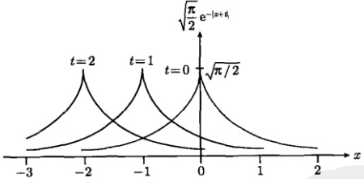

图 11.2 解式 (11.1.35) 在不同时刻的曲线
 

例 3 用傅里叶变换法求解下列非常数系数（nonconstant coefficient）方程的定解问题

$$  \left\{\begin{array}{l}t\frac{\partial u}{\partial x}+\frac{\partial u}{\partial t}=0\quad(-\infty<x<\infty,t>0)\\ \\ u\mid_{t=0}=f(x)\quad(-\infty<x<\infty)\end{array}\right.   \tag*{(11.1.36a)}$$

并分析该定解问题对  $ f(x) $ 的要求。

解 对式 $  (11.1.36a)  $左边第一项关于 x 作傅里叶变换 (视 t 为常数)，得到

<!-- page: 332 -->

$$  \mathcal{F}\left\{t\frac{\partial u}{\partial x}\right\}=t\mathcal{F}\left\{\frac{\partial u}{\partial x}\right\}=\mathrm{i}\omega t U(\omega,t)   \tag*{(11.1.37)}$$

这样我们得到关于  $ U(\omega,t) $ 的常微分方程问题

$$  \left\{\begin{array}{l}\mathrm{i}\omega t U(\omega,t)+\frac{\mathrm{d}U(\omega,t)}{\mathrm{d}t}=0\end{array}\right.   \tag*{(11.1.38a)}$$

$$  U(\omega,0)=F(\omega)   \tag*{(11.1.38b)}$$

对式 $  (11.1.38a)  $积分，并利用式 $  (11.1.38b)  $，有

$$  \int_{F(\omega)}^{U(\omega,t)}\frac{\mathrm{d}U}{U}=-\mathrm{i}\omega\int_{0}^{t}t\mathrm{d}t   \tag*{(11.1.39)}$$

式(11.1.39)给出

$$  U(\omega,t)=F(\omega)\exp\left(-\mathrm{i}\frac{t^{2}}{2}\omega\right)   \tag*{(11.1.40)}$$

现在对式 (11.1.40) 反演，利用式 (3.1.22)，得到

$$  u(x,t)=f\left(x-\frac{t^{2}}{2}\right)   \tag*{(11.1.41)}$$

我们可以检验这个解，代入式(11.1.36a)有

$$  \frac{\partial u(x,t)}{\partial x}=f^{\prime}\left(x-\frac{t^{2}}{2}\right),\frac{\partial u(x,t)}{\partial t}=-tf^{\prime}\left(x-\frac{t^{2}}{2}\right)   \tag*{(11.1.42)}$$

满足方程(11.1.36a)，式(11.1.41)显然也满足初始条件 $ u(x,0)=f(x) $，故式(11.1.41)是定解问题(11.1.36)的解。由此我们也看到定解问题(11.1.36)对 $ f(x) $的要求是一次可微。

例 4 用傅里叶变换法求解第 7.3.1 节例 3 关于上半平面拉普拉斯方程的定解问题

$$  \int\frac{\partial^{2}u}{\partial x^{2}}+\frac{\partial^{2}u}{\partial y^{2}}=0\qquad(y>0,-\infty<x<+\infty)   \tag*{(11.1.43a)}$$

$$  u\mid_{y=0}=f(x)\qquad(-\infty<x<+\infty)   \tag*{(11.1.43b)}$$

$$  \lim_{y\to\infty}u= 有限值 \quad(-\infty<x<+\infty)   \tag*{(11.1.43c)}$$

其中，式 $  (11.1.43c)  $是一个自然边界条件。

解 对式 (11.1.43) 关于 x 作傅里叶变换，得到

$$  -\omega^{2}U(\omega,y)+\frac{\mathrm{d}^{2}U(\omega,y)}{\mathrm{d}y^{2}}=0   \tag*{(11.1.44a)}$$

$$  U\vert_{y=0}=F(\omega)   \tag*{(11.1.44b)}$$

$$  \lim\limits_{y\to\infty}U= 有限值   \tag*{(11.1.44c)}$$

<!-- page: 333 -->

方程(11.1.44a)的通解为

$$  U(\omega,y)=C_{1}\mathrm{e}^{-\omega y}+C_{2}\mathrm{e}^{\omega y}   \tag*{(11.1.45)}$$

自然边界条件 (11.1.44c) 要求  $ C_1 = 0 $ (如果  $ \omega < 0 $) 或者  $ C_2 = 0 $ (如果  $ \omega > 0 $)。因此，我们可以将式 (11.1.45) 写为  $ U(\omega, y) = Ce^{-|\omega|y} $，再利用式 (11.1.44b) 得到

$$  U(\omega,y)=F(\omega)\mathrm{e}^{-|\omega|y}   \tag*{(11.1.46)}$$

现在对  $ U(\omega,y) $ 反演，由式 (3.1.4) 得到

 $$ \begin{aligned}u(x,y)&=\frac{1}{2\pi}\int_{-\infty}^{\infty}F(\omega)\mathrm{e}^{-|\omega|y}\mathrm{e}^{\mathrm{i}\omega x}\mathrm{d}\omega\\&=\frac{1}{2\pi}\int_{-\infty}^{\infty}\left[\int_{-\infty}^{\infty}f(\xi)\mathrm{e}^{-\mathrm{i}\omega\xi}\mathrm{d}\xi\right]\mathrm{e}^{-|\omega|y}\mathrm{e}^{\mathrm{i}\omega x}\mathrm{d}\omega\\&=\frac{1}{2\pi}\int_{-\infty}^{\infty}f(\xi)\left[\int_{-\infty}^{\infty}\mathrm{e}^{-|\omega|y}\mathrm{e}^{-\mathrm{i}\omega(\xi-x)}\mathrm{d}\omega\right]\mathrm{d}\xi\\ \end{aligned} $$ 

利用第3.3节例9的傅里叶变换关系，即

$$  \mathcal{F}\left\{\mathrm{e}^{-\beta|t|}\right\}=\int_{-\infty}^{\infty}\mathrm{e}^{-\beta|t|}\mathrm{e}^{-\mathrm{i}\omega x}\mathrm{d}x=\frac{2\beta}{\beta^{2}+\omega^{2}}   \tag*{(11.1.47)}$$

得到

$$  u(x,y)=\frac{1}{\pi}\int_{-\infty}^{\infty}f(\xi)\frac{y}{(x-\xi)^{2}+y^{2}}\mathrm{d}\xi   \tag*{(11.1.48)}$$

这就是定解问题（11.1.43）的解。

值得注意的是，解式（11.1.48）还可以写成类似于式（11.1.11）的卷积形式

$$  u(x,y)=f(x)*P(x,y)   \tag*{(11.1.49)}$$

其中

$$  P(x,y)=\frac{1}{\pi}\frac{y}{x^{2}+y^{2}}   \tag*{(11.1.50)}$$

称为泊松核 (Poisson kernel)。它是点源引起的分布，事实上，当式(11.1.48)中的边界函数取  $ f(x)=\delta(x) $ 时，式(11.1.48)给出

$$  u(x,y)=\frac{1}{\pi}\int_{-\infty}^{\infty}\delta(\xi)\frac{y}{(x-\xi)^{2}+y^{2}}\mathrm{d}\xi=\frac{1}{\pi}\frac{y}{x^{2}+y^{2}}   \tag*{(11.1.51)}$$

可见点源引起的分布正是泊松核(11.1.50)。关于泊松核的傅里叶变换，由式(3.3.26)给出：

$$  \mathcal{F}\left\{\frac{1}{\pi}\frac{y}{x^{2}+y^{2}}\right\}=\mathrm{e}^{-|\omega|y}   \tag*{(11.1.52)}$$

<!-- page: 334 -->

最后顺便指出，自然边界条件(11.1.43c)对于定解问题(11.1.43)是很重要的。如果没有它，由式(11.1.43a)和式(11.1.43b)构成的定解问题的解不是唯一的。显然

$$  y+\frac{1}{\pi}\int_{-\infty}^{\infty}f(\xi)\frac{y}{(x-\xi)^{2}+y^{2}}\mathrm{d}\xi   \tag*{(11.1.53)}$$

也满足式(11.1.43a)和式(11.1.43b)。但是这个解不满足自然边界条件(11.1.43c)。我们的结论是：附有自然边界条件(11.1.43c)时，定解问题(11.1.43)的解才是唯一的，它就是式(11.1.48)。这个结果与式(7.3.36)的等价性见下面的例题。

例 5 例 4 的结果式 (11.1.48) 可以表示二维热传导系统的稳态温度分布，设边界函数  $ f(x) $ 为

 $$ f_{1}(x)=\left\{\begin{aligned}1\left(|x|\leqslant1\right)\\ 0(|x|>1)\end{aligned}\right.;\quad f_{2}(x)=\frac{1}{x^{2}+1};\quad f_{3}(x)=\frac{x}{x^{2}+1} $$ 

分别计算上半平面的温度  $ u(x,y) $，并确定相应的等温线。

解 (1) 将  $ f_{1}(x) $ 代入式 (11.1.48)，得到

$$  u(x,y)=\frac{1}{\pi}\int_{-1}^{1}\frac{y}{(x-\xi)^{2}+y^{2}}\mathrm{d}\xi=\frac{1}{\pi}\left[\arctan\left(\frac{1+x}{y}\right)+\arctan\left(\frac{1-x}{y}\right)\right]   \tag*{(11.1.54)}$$

这与第 7.3.1 节例 4 所用方法的结果是相同的。

等温线  $ u(x,y)=T $ (常数) 为

$$  \arctan\left(\frac{1+x}{y}\right)+\arctan\left(\frac{1-x}{y}\right)=\pi T   \tag*{(11.1.55)}$$

对式 (11.1.55) 两边取余割函数平方，即  $ \csc^{2}(\cdots) $，并利用三角函数公式

$$  \csc^{2}\alpha=1+\cot^{2}\alpha\quad 和 \quad\cot\left(\alpha+\beta\right)=\frac{1-\tan\alpha\tan\beta}{\tan\alpha+\tan\beta}   \tag*{(11.1.56)}$$

得到

$$  x^{2}+[y-\cot(\pi T)]^{2}=\csc^{2}(\pi T)   \tag*{(11.1.57)}$$

式 (11.1.57) 在数学上表示以  $ [0, \cot(\pi T)] $ 为圆心，以  $ \csc(\pi T) $ 为半径的圆周。图 11.3 显示了上半平面的等温线，它们是圆心位于  $ y $ 轴的弧线。当  $ T = 1/2 $ 时，式 (11.1.57) 变为  $ x^2 + y^2 = 1 $。等温线是圆心为  $ (0,0) $，半径为 1 的半圆。当  $ 0 < T < 1/2 $ 时， $ \cot(\pi T) > 0 $，圆心在  $ x $ 轴的上方，等温线是多半圆。当  $ 1/2 < T < 1 $ 时， $ \cot(\pi T) < 0 $，圆心在  $ x $ 轴的下方，但  $ \csc(\pi T) > |\cot(\pi T)| $ (半径大于圆心到原点的距离)，所以在上半平面仍存在等温线 (少半圆)。

<!-- page: 335 -->

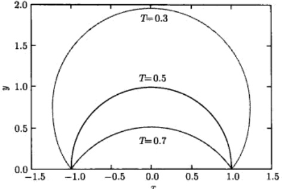

图 11.3 等温线式 (11.1.57) 是圆心位于 y 轴的弧线 (三个 T 值分别相应于多半圆、半圆、少半圆)
 

(2) 将  $ f_{2}(x) $ 代入式 (11.1.48)，得到

$$  u(x,y)=\frac{1}{\pi}\int_{-\infty}^{\infty}\frac{1}{\xi^{2}+1}\frac{y}{(x-\xi)^{2}+y^{2}}\mathrm{d}\xi   \tag*{(11.1.58)}$$

它是两个泊松核的卷积，即

$$  u(x,y)=\frac{1}{x^{2}+1}*\frac{1}{\pi}\frac{y}{x^{2}+y^{2}}   \tag*{(11.1.59)}$$

对式 $  (11.1.59)  $右边取傅里叶变换，利用式 $  (11.1.52)  $，得到

 $$ \begin{aligned}\mathcal{F}\left\{\frac{1}{x^{2}+1}*\frac{1}{\pi}\frac{y}{x^{2}+y^{2}}\right\}&=\mathcal{F}\left\{\frac{1}{x^{2}+1}\right\}\mathcal{F}\left\{\frac{1}{\pi}\frac{y}{x^{2}+y^{2}}\right\}\\&=\pi\mathrm{e}^{-|\omega|}\mathrm{e}^{-|\omega|y}=\pi\mathrm{e}^{-|\omega|(y+1)}\end{aligned} $$ 

对它取傅里叶反变换，利用式(11.1.47)，得到

$$  u(x,y)=\frac{1}{2}\int_{-\infty}^{\infty}\mathrm{e}^{-|w|(y+1)}\mathrm{e}^{\mathrm{i}\omega x}\mathrm{d}\omega=\frac{y+1}{x^{2}+(y+1)^{2}}   \tag*{(11.1.60)}$$

这与第3.2节例4所用方法的结果是相同的。

等温线为

$$  x^{2}+\left[y-\left(\frac{1}{2T}-1\right)\right]^{2}=\left(\frac{1}{2T}\right)^{2}   \tag*{(11.1.61)}$$

式(11.1.61)在数学上表示以 $ \left(0,\frac{1}{2T}-1\right) $为圆心，以 $ \frac{1}{2T} $为半径的圆周。等温线(11.1.61)的特征与图11.3相似，它们是圆心位于y轴的弧线。当 $ T=1/2 $

<!-- page: 336 -->

时，式(11.1.58)变为 $ x^{2}+y^{2}=1 $，等温线是圆心为 $ (0,0) $，半径为1的半圆。当0<T<1/2时， $ \frac{1}{2T}-1>0 $，圆心在x轴的上方，等温线是多半圆。当 $ \frac{1}{2}<T<1 $时， $ \frac{1}{2T}-1<0 $，圆心在x轴的下方，但 $ \frac{1}{2T}>\left|\frac{1}{2T}-1\right| $（半径大于圆心到原点的距离），所以在上半平面仍有等温线（少半圆）。

(3) 将  $ f_{3}(x) $ 代入式 (11.1.48)，按照得到式 (11.1.60) 的过程，我们有

$$  u(x,y)=\frac{1}{\pi}\int_{-\infty}^{\infty}\frac{\xi}{\xi^{2}+1}\frac{y}{(x-\xi)^{2}+y^{2}}\mathrm{d}\xi=\frac{x}{x^{2}+(y+1)^{2}}   \tag*{(11.1.62)}$$

这与7.3.2节例4所用方法的结果是相同的。现在 $ u(x,y) $表示温度，因此式(11.1.62)中不允许x<0。

等温线为

$$  \left(x-\frac{1}{2T}\right)^{2}+\left(y+1\right)^{2}=\left(\frac{1}{2T}\right)^{2}   \tag*{(11.1.63)}$$

式(11.1.63)在x>0的条件下表示以 $ \left(\frac{1}{2T},-1\right) $为圆心，以 $ \frac{1}{2T} $为半径的圆周。对于不同的T，圆心始终在y=-1直线上，因此等温线必须满足半径 $ \frac{1}{2T}>1 $，即0<T<1/2。不同T值的等温线如图11.4所示，它们是圆心位于y=-1直线上的弧线(少半圆)。

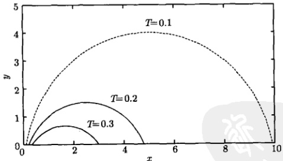

图 11.4 等温线式 (11.1.63) 是圆心位于 y = -1 线上的弧线 (均为少半圆)
 

### 11.2 拉普拉斯变换法

我们在第4章介绍过用拉普拉斯变换法求解常微分方程的初值问题。用这个方法，不需要考虑方程是否齐次，解题步骤都是一样的，变换后得到象函数的代数

<!-- page: 337 -->

方程（包含了初始条件），解出象函数之后再反演便得到常微分方程的解，这种方法往往比经典的方法（先求通解，再利用初始条件确定常数）更加优越。

本节我们用拉普拉斯变换法求解偏微分方程的定解问题。我们将会看到，不管问题的边界条件是否齐次，不管方程是否齐次，不管方程定义在无界还是有界区域，不管是时间还是空间变量，只要自变量范围为  $ x \in [0, \infty) $，并知道该变量的相关条件，原则上都可以用拉普拉斯变换法求解，而求解思路与傅里叶变换法相同，即

(1) 对原定解问题施行变换，得到象函数的常微分方程问题：

(2) 求解该常微分方程问题得到象函数：

(3) 对象函数反演得到原函数。

我们将二元函数  $ u(x,t) $ 关于变量 t 的拉普拉斯变换记为

$$  \mathcal{L}\left\{u(x,t)\right\}=U(x,p)=\int_{0}^{\infty}u(x,t)\mathrm{e}^{-p t}\mathrm{d}t   \tag*{(11.2.1)}$$

对导数  $ \frac{\partial u}{\partial x} $ 关于 t 作拉普拉斯变换时

$$  \mathcal{L}\left\{\frac{\partial u}{\partial x}\right\}=\frac{\mathrm{d}U(x,p)}{\mathrm{d}x},\quad\mathcal{L}\left\{\frac{\partial^{2}u}{\partial x^{2}}\right\}=\frac{\mathrm{d}^{2}U(x,p)}{\mathrm{d}x^{2}}   \tag*{(11.2.2)}$$

另外我们将需要两个重要的拉普拉斯变换公式 [式（4.1.11）和式（4.1.12）]

$$  \mathcal{L}\left\{\frac{\partial u}{\partial t}\right\}=p U(x,p)-u(x,0)   \tag*{(11.2.3a)}$$

$$  \mathcal{L}\left\{\frac{\partial^{2}u}{\partial t^{2}}\right\}=p^{2}U(x,p)-p u(x,0)-\left.\frac{\partial u}{\partial t}\right|_{t=0}   \tag*{(11.2.3b)}$$

下面我们通过不同例题说明拉普拉斯变换法在求解各种定解问题中的应用。

例 1 用拉普拉斯变换法求解半无限

长细杆热传导的定解问题

$$  \left\{\begin{aligned}{}&{{}\frac{\partial u}{\partial t}=a^{2}\frac{\partial^{2}u}{\partial x^{2}}}&{}&{{}(x>0,t>0)}\\ {}&{{}u|_{t=0}=0}&{}&{{}(x\geqslant0)}\\ {}&{{}u|_{x=0}=f(t)}&{}&{{}(t>0)}\\ \end{aligned}\right.   \tag*{(11.2.4b)}$$

这个问题如图 11.5 所示。

解 首先我们注意到，式(11.2.4c)表示系统边缘 $ (x=0) $的热库温度，它是一个非齐次边界条件，这对于拉普拉斯变换

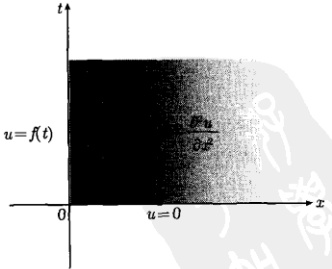

图 11.5 定解问题 (11.2.4) 的示意图
 

<!-- page: 338 -->

法来说，求解过程与齐次问题是一样的。对式(11.2.4a)两边关于t作拉普拉斯变换，并利用式(11.2.3a)，得到

$$  pU(x,p)-u(x,0)=a^{2}\frac{\mathrm{d}^{2}U(x,p)}{\mathrm{d}x^{2}}   \tag*{(11.2.5)}$$

利用式 $  (11.2.4b)  $，方程(11.2.5)变为

$$  \frac{\mathrm{d}^{2}U(x,p)}{\mathrm{d}x^{2}}-\frac{p}{a^{2}}U(x,p)=0   \tag*{(11.2.6)}$$

对式 $  (11.2.4c)  $两边关于t作拉普拉斯变换，得到

$$  U(0,p)=\mathcal{L}\left\{f(t)\right\}=F(p)   \tag*{(11.2.7)}$$

方程(11.2.6)的通解为

$$  U(x,p)=C_{1}\exp\left(\frac{\sqrt{p}}{a}x\right)+C_{2}\exp\left(-\frac{\sqrt{p}}{a}x\right)   \tag*{(11.2.8)}$$

当  $ x \to \infty $ 时，温度  $ u(x, t) $ 应该满足自然边界条件，即  $ u(\infty, t) = $ 有限值，因而作为线性变换的  $ U(x, p) $ 也应该满足这一条件，即  $ U(\infty, p) = $ 有限值，故  $ C_{1} = 0 $。再由式 (11.2.7) 得到  $ C_{2} = F(p) $，从而得

$$  U(x,p)=F(p)\exp\left(-\frac{x}{a}\cdot\sqrt{p}\right)   \tag*{(11.2.9)}$$

现在对  $ U(x,p) $ 反演，利用

$$  \mathcal{L}^{-1}\left\{-\frac{x}{a}\sqrt{p}\right\}=\frac{x}{2a\sqrt{\pi}t^{3/2}}\exp\left(-\frac{x^{2}}{4a^{2}t}\right)   \tag*{(11.2.10)}$$

及拉普拉斯变换的卷积性质，得到

$$  \begin{aligned}u(x,t)&=\mathcal{L}^{-1}\left\{F(p)\exp\left(-\frac{x}{a}\sqrt{p}\right)\right\}\\&=f(t)*\frac{x}{2a\sqrt{\pi}t^{3/2}}\exp\left(-\frac{x^{2}}{4a^{2}t}\right)\\&=\frac{x}{2a\sqrt{\pi}}\int_{0}^{t}f(\tau)\frac{1}{(t-\tau)^{3/2}}\exp\left[-\frac{x^{2}}{4a^{2}(t-\tau)}\right]\mathrm{d}\tau\\ \end{aligned}   \tag*{(11.2.11)}$$

这就是定解问题 (11.2.4) 的解。这个解只依赖于  $ f(\tau) $ 在  $ 0 < \tau < t $ 范围内的取值。这是所期待的，因为热库温度在  $ \tau > t $ 的值不能影响目前 t 时刻的系统温度。

我们可以思考一个问题，可否对坐标变量  $ x $ 进行拉普拉斯变换来求解定解问题 (11.2.4)。从变量  $ x \in [0, \infty) $ 来看，原则上是可以的，让我们试着对方程 (11.2.4a) 两边取拉普拉斯变换，我们有

$$  \frac{\mathrm{d}U(p,t)}{\mathrm{d}t}=a^{2}\left[p^{2}U(p,t)-pu(0,t)-\left.\frac{\partial u}{\partial x}\right|_{x=0}\right]   \tag*{(11.2.12)}$$

<!-- page: 339 -->

考查方程 (11.2.12) 右边： $ u(0,t)=f(t) $ 是已知的，但是  $ \left.\frac{\partial u}{\partial x}\right|_{x=0} $ 是未知的，因此该方程无法求解。

例 2 例 1 中，设热库温度  $  f(t) = T  $ (常数)，对结果式 (11.2.11) 进行数值计算。

解 在计算之前，我们首先从物理上分析系统温度分布随时间变化的趋势。现在系统的初始条件和边界条件为

$$  u|_{t=0}=0\quad(x\geqslant0)   \tag*{(11.2.13a)}$$

$$  u|_{x=0}=T\quad(t>0)   \tag*{(11.2.13b)}$$

在 t=0 时刻，整个系统的初始温度为零，即  $ u(x,0)=0(x\geq0) $，如式 (11.2.13a) 所示。然后热库开始作用，系统 x=0 端的温度开始升高。在 t 较小时，系统中离热库足够远的地方，温度仍维持接近初始温度。随着时间的推移，热量在系统中传播的范围逐渐扩大。当  $ t\to\infty $ 时，热量在系统中均匀分布， $ u(x,\infty)=T $，因此系统的温度分布随时间的变化应该有如图 11.6 所示的趋势。

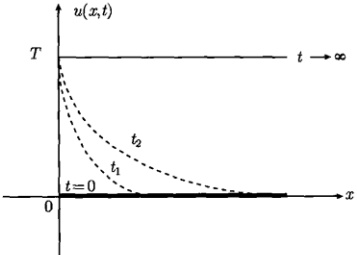

图 11.6 系统温度分布随时间变化的趋势： $ 0 < t_{1} < t_{2} < \infty $
 

现在我们进一步求解，将  $ f(t)=T $ 代入式 (11.2.11)，并用变量代换

$$  y=\frac{x}{2a\sqrt{t-\tau}},\quad\frac{\mathrm{d}y}{\mathrm{d}\tau}=\frac{x}{4a\left(t-\tau\right)^{3/2}}   \tag*{(11.2.14)}$$

得到

$$  u(x,t)=\frac{2T}{\sqrt{\pi}}\int_{x/\left(2a\sqrt{t}\right)}^{\infty}\mathrm{e}^{-y^{2}}\mathrm{d}y=T\mathrm{erfc}\left(\frac{x}{2a\sqrt{t}}\right)   \tag*{(11.2.15)}$$

其中

$$  \mathrm{e r f c}(x)=\frac{2}{\sqrt{\pi}}\int_{x}^{\infty}\mathrm{e}^{-y^{2}}\mathrm{d}y   \tag*{(11.2.16)}$$

是余误差函数。首先由式(11.2.15)讨论初始温度分布，当t=0时，式(11.2.15)中的积分下限为无穷大，故 $ u(x,0)=0 $。另一方面，当 $ t\to\infty $时，积分下限为零，故

<!-- page: 340 -->

$ u(x,\infty)=T $ 。图11.7显示了温度分布式(11.2.15)在不同时刻的曲线。所有计算结果都与图11.6的物理分析相吻合。

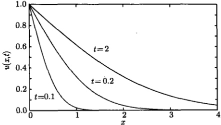

图 11.7 温度分布式 (11.2.15) 在不同时刻的曲线 (a = 1, T = 1)
 

例 3 用拉普拉斯变换法求解有界杆热传导的定解问题

$$  \left\{\begin{array}{l l}{\displaystyle\frac{\partial u}{\partial t}=a^{2}\frac{\partial^{2}u}{\partial x^{2}}}&{\qquad\quad(0<x<L,t>0)}\end{array}\right.   \tag*{(11.2.17a)}$$

$$  u|_{x=0}=0,\ u|_{x=L}=0\quad(t>0)   \tag*{(11.2.17b)}$$

$$  \left\{\begin{array}{l}u\mid_{t=0}=\sin\frac{\pi x}{L}\quad(x\geqslant0)\end{array}\right.   \tag*{(11.2.17c)}$$

解 对式  $ (11.2.17a) $ 两边取 t 的拉普拉斯变换，并利用式  $ (11.2.17c) $ 和式  $ (11.2.17b) $，得到

$$  \left\{\begin{array}{l}\frac{\mathrm{d}^{2}U(x,p)}{\mathrm{d}x^{2}}-\frac{p}{a^{2}}U(x,p)=-\frac{1}{a^{2}}\sin\frac{\pi x}{L}\\ U(0,p)=0,U(L,p)=0\end{array}\right.   \tag*{(11.2.18a)}$$

这是一个非齐次常微分方程问题，我们首先求式(11.2.18a)的通解。我们知道，非齐次常微分方程的通解等于相应齐次方程的通解加上非齐次方程的一个特解。相应的齐次方程为(11.2.6)，它的通解是式(11.2.8)。另外，我们用观察法容易看出非齐次方程(11.2.18a)的一个特解

$$  U(x,p)=C\sin\frac{\pi x}{L}   \tag*{(11.2.19)}$$

为了确定其中的系数 C，将式 (11.2.19) 代入式 (11.2.18a)，有

$$  -C\left(\frac{\pi}{L}\right)^{2}\sin\frac{\pi x}{L}-C\frac{p}{a^{2}}\sin\frac{\pi x}{L}=-\frac{1}{a^{2}}\sin\frac{\pi x}{L}   \tag*{(11.2.20)}$$

上式两边比较  $ \sin\frac{\pi x}{L} $ 的系数，得到

<!-- page: 341 -->

$$  -C\left(\frac{\pi}{L}\right)^{2}-C\frac{p}{a^{2}}=-\frac{1}{a^{2}}   \tag*{(11.2.21)}$$

即

$$  C=\frac{1}{p+\left(\frac{a\pi}{L}\right)^{2}}   \tag*{(11.2.22)}$$

将式（11.2.22）代入式（11.2.19），并与齐次通解（11.2.8）相加，便得到非齐次方程（11.2.18a）的通解：

$$  U(x,p)=C_{1}\exp\left(\frac{\sqrt{p}}{a}x\right)+C_{2}\exp\left(-\frac{\sqrt{p}}{a}x\right)+\frac{1}{p+\left(\frac{a\pi}{L}\right)^{2}}\sin\frac{\pi x}{L}   \tag*{(11.2.23)}$$

利用边界条件(11.2.18b)，得到  $ C_{1}=C_{2}=0 $，这样常微分方程问题(11.2.18)的解为

$$  U(x,p)=\frac{1}{p+\left(\frac{a\pi}{L}\right)^{2}}\sin\frac{\pi x}{L}   \tag*{(11.2.24)}$$

现在对  $ U(x,p) $ 进行反演，利用式 (4.1.7c) 直接得到

$$  u(x,t)=\sin\frac{\pi x}{L}\exp\left[-\left(\frac{a\pi}{L}\right)^{2}t\right]   \tag*{(11.2.25)}$$

这就是定解问题(11.2.17)的解。该问题也可以用分离变量法求解，结果与式(11.2.25)相同。

例 4 用拉普拉斯变换法求解混合微分方程的定解问题：

$$  \frac{\partial^{2}u}{\partial x\partial t}=1\quad(x>0,t>0)   \tag*{(11.2.26a)}$$

$$  u|_{x=0}=t+1\quad(t>0)   \tag*{(11.2.26b)}$$

$$  u|_{t=0}=1\quad(x\geqslant0)   \tag*{(11.2.26c)}$$

解

方法 1 由于变量  $ t \in [0, \infty) $，我们对式 (11.2.26a) 两边取  $ t $ 的拉普拉斯变换，左边的变换给出

 $$ \begin{aligned}\mathcal{L}\left\{\frac{\partial^{2}u}{\partial x\partial t}\right\}&=\mathcal{L}\left\{\frac{\partial}{\partial x}\frac{\partial u}{\partial t}\right\}=\frac{\mathrm{d}}{\mathrm{d}x}\mathcal{L}\left\{\frac{\partial u}{\partial t}\right\}\\&=\frac{\mathrm{d}}{\mathrm{d}x}\left[p U(x,p)-u(x,0)\right]\left[ 利用式 (11.2.26\mathrm{c})\right]\\&=p\frac{\mathrm{d}U(x,p)}{\mathrm{d}x}\end{aligned} $$

<!-- page: 342 -->

对式 (11.2.26a) 右边进行变换，给出  $ \mathcal{L}\{1\} = 1/p $，于是

$$  p\frac{\mathrm{d}U(x,p)}{\mathrm{d}x}=\frac{1}{p}   \tag*{(11.2.27a)}$$

再对式（11.2.26b）两边关于 t 作拉普拉斯变换，利用式（4.1.7b）和式（4.1.7a），得到

$$  U(0,p)=\frac{1}{p^{2}}+\frac{1}{p}   \tag*{(11.2.27b)}$$

对式 $  (11.2.27a)  $两边积分，并利用式 $  (11.2.27b)  $，得到

$$  U(x,p)=\frac{x}{p^{2}}+\frac{1}{p^{2}}+\frac{1}{p}   \tag*{(11.2.28)}$$

对式(11.2.28)反演，并利用式(4.1.7b)和式(4.1.7a)，得到

$$  U(x,t)=xt+t+1   \tag*{(11.2.29)}$$

方法 2 由于变量  $ x \in [0, \infty) $，可以对式 (11.2.26a) 两边取 x 的拉普拉斯变换，左边的变换给出

 $$ \begin{aligned}\mathcal{L}\left\{\frac{\partial^{2}u}{\partial x\partial t}\right\}&=\mathcal{L}\left\{\frac{\partial}{\partial t}\frac{\partial u}{\partial x}\right\}=\frac{\mathrm{d}}{\mathrm{d}t}\mathcal{L}\left\{\frac{\partial u}{\partial x}\right\}\\&=\frac{\mathrm{d}}{\mathrm{d}t}\left[p U(p,t)-u(0,t)\right]\left[ 利用式 (11.2.26b)\right]\\&=p\frac{\mathrm{d}U(p,t)}{\mathrm{d}t}-1\end{aligned} $$ 

对式 (11.2.26a) 右边进行变换，给出  $ \mathcal{L}\{1\}=1/p $，于是

$$  p\frac{\mathrm{d}U(p,t)}{\mathrm{d}t}-1=\frac{1}{p}\Rightarrow\frac{\mathrm{d}U(p,t)}{\mathrm{d}t}=\frac{1}{p^{2}}+\frac{1}{p}   \tag*{(11.2.30a)}$$

再对式 $  (11.2.26c)  $两边关于x作拉普拉斯变换得

$$  U(p,0)=\frac{1}{p}   \tag*{(11.2.30b)}$$

对式 $  (11.2.30a)  $两边积分，并利用式 $  (11.2.30b)  $，得到

$$  U(p,t)=\frac{t}{p^{2}}+\frac{t}{p}+\frac{1}{p}   \tag*{(11.2.31)}$$

对式(11.2.31)反演，并利用式(4.1.7b)和式(4.1.7a)，得到

$$  U(x,t)=xt+t+1   \tag*{(11.2.32)}$$

<!-- page: 343 -->

#### 例 5 求解定解问题

$$  \frac{\partial u}{\partial t}+x\frac{\partial u}{\partial x}=x\quad\left(x>0,t>0\right)   \tag*{(11.2.33a)}$$

$$  u|_{x=0}=0\quad(t>0)   \tag*{(11.2.33b)}$$

$$  u|_{t=0}=0\quad(x\geqslant0)   \tag*{(11.2.33c)}$$

解 两个自变量 x 和 t 的变化范围都是  $ [0,\infty) $，而且都已知所需条件，可以对任一个变量取拉普拉斯变换。由于式 (11.2.33a) 中含有  $ x\frac{\partial u}{\partial x} $ 项，取 x 的拉普拉斯变换较为麻烦。我们对式 (11.2.33a) 作关于 t 的拉普拉斯变换，并利用式 (11.2.33c)，得到

$$  \frac{\mathrm{d}U(x,p)}{\mathrm{d}x}+\frac{p}{x}U(x,p)=\frac{1}{p}   \tag*{(11.2.34a)}$$

对式 $  (11.2.33b)  $两边关于t作拉普拉斯变换，得到

$$  U(0,p)=0   \tag*{(11.2.34b)}$$

一阶常微分方程（11.2.34a）的积分因子为

$$  \exp\left(\int\frac{p}{x}\mathrm{d}x\right)=\exp\left(p\ln x\right)=x^{p}   \tag*{(11.2.35)}$$

故式 $  (11.2.34a)  $具有解

$$  x^{p}U(x,p)=\int x^{p}\frac{1}{p}\mathrm{d}x=\frac{1}{p}\frac{x^{p+1}}{(p+1)}+C(p)   \tag*{(11.2.36)}$$

其中， $ C(p) $ 是包含 p 的积分常数，故

$$  U(x,p)=\frac{x}{p(p+1)}+\frac{C(p)}{x^{p}}   \tag*{(11.2.37)}$$

条件（11.2.34b）要求  $ C(p)=0 $，故式（11.2.37）变成

$$  U(x,p)=\frac{x}{p(p+1)}=x\left(\frac{1}{p}-\frac{1}{p+1}\right)   \tag*{(11.2.38)}$$

对式（11.2.38）反演，利用式（4.1.7a）和式（4.1.7c），得到

$$  U(x,t)=x\left(1-\mathrm{e}^{-t}\right)   \tag*{(11.2.39)}$$

这就是定解问题(11.2.33)的解。

例 6 求解半无界弦强迫振动的定解问题

<!-- page: 344 -->

$$  \frac{\partial^{2}u}{\partial t^{2}}=a^{2}\frac{\partial^{2}u}{\partial x^{2}}+f(t)\qquad(x>0,t>0)   \tag*{(11.2.40a)}$$

$$  u|_{x=0}=0\quad(t>0)   \tag*{(11.2.40b)}$$

$$  u|_{t=0}=0,\left.\frac{\partial u}{\partial t}\right|_{t=0}=0\quad(x\geqslant0)   \tag*{(11.2.40c)}$$

解 定解问题 (11.2.40) 显示，半无界弦初始处于平衡位置 x 轴且速度为零，一个端点始终固定在 x = 0，振动时受强迫力  $ f(t) $ 作用，它只是时间 t 的函数。我们用拉普拉斯变换法求解这一问题。注意到，虽然空间变量  $ x \in [0, \infty) $，但  $ [\partial u/\partial x]_{x=0} $ 是未知的，故不能对 x 作拉普拉斯变换。我们对式 (11.2.40a) 和式 (11.2.40b) 关于 t 作拉普拉斯变换，并利用初始条件式 (11.2.40c)，得到

$$  \left\{\begin{array}{l}-a^{2}\frac{\mathrm{d}^{2}U(x,p)}{\mathrm{d}x^{2}}+p^{2}U(x,p)=F(p)\end{array}\right.   \tag*{(11.2.41a)}$$

$$  U(0,p)=0   \tag*{(11.2.41b)}$$

式(11.2.41a)是一个非齐次常微分方程，但  $ F(p) $ 不含变量 x。相应的齐次方程的通解为

$$  U(x,p)=C_{1}\exp\left(\frac{p}{a}x\right)+C_{2}\exp\left(-\frac{p}{a}x\right)   \tag*{(11.2.42)}$$

而非齐次方程（11.2.41a）的一个特解显然是  $ F(p)/p^{2} $，故式（11.2.41a）的通解为

$$  U(x,p)=C_{1}\exp\left(\frac{p}{a}x\right)+C_{2}\exp\left(-\frac{p}{a}x\right)+\frac{F(p)}{p^{2}}   \tag*{(11.2.43)}$$

自然边界条件要求  $ C_{1}=0 $，进而从条件 (11.2.41b) 得到

$$  C_{2}=-\frac{F(p)}{p^{2}}   \tag*{(11.2.44)}$$

于是式(11.2.43)变为

$$  U(x,p)=F(p)\left(\frac{1}{p^{2}}-\frac{\mathrm{e}^{-\frac{p}{a}x}}{p^{2}}\right)   \tag*{(11.2.45)}$$

为了对式（11.2.45）反演，我们首先计算两个拉普拉斯反变换

$$  \mathcal{L}^{-1}\left\{\frac{1}{p^{2}}\right\}\quad 和 \quad\mathcal{L}^{-1}\left\{\frac{\mathrm{e}^{-\frac{p}{a}x}}{p^{2}}\right\}   \tag*{(11.2.46)}$$

利用式(4.1.7b)容易得到

$$  \mathcal{L}^{-1}\left\{\frac{1}{p^{2}}\right\}=t   \tag*{(11.2.47)}$$

另外，拉普拉斯变换式（4.1.21）给出

$$  \mathcal{L}^{-1}\left\{\mathrm{e}^{-a p}F(p)\right\}=u(t-a)f(t-a)   \tag*{(11.2.48)}$$

<!-- page: 345 -->

其中，a>0， $ u(t-a) $ 是如图4.2所示的单位阶跃函数。利用式(11.2.48)，我们有

$$  \mathcal{L}^{-1}\left\{\frac{\mathrm{e}^{-\frac{p}{a}x}}{p^{2}}\right\}=\left(t-\frac{x}{a}\right)u\left(t-\frac{x}{a}\right)   \tag*{(11.2.49)}$$

这样

$$  \mathcal{L}^{-1}\left\{\frac{1}{p^{2}}-\frac{\mathrm{e}^{-\frac{p}{a}x}}{p^{2}}\right\}=t-\left(t-\frac{x}{a}\right)u\left(t-\frac{x}{a}\right)   \tag*{(11.2.50)}$$

于是式(11.2.45)的反变换为

 $$ \begin{aligned}u(x,t)&=f(t)*\left[t-\left(t-\frac{x}{a}\right)u\left(t-\frac{x}{a}\right)\right]\\&=\int_{0}^{t}f(t-\tau)\left[\tau-\left(\tau-\frac{x}{a}\right)u\left(\tau-\frac{x}{a}\right)\right]\mathrm{d}\tau\\&=\int_{0}^{t}\tau f(t-\tau)\mathrm{d}\tau-\int_{0}^{t}\left(\tau-\frac{x}{a}\right)f(t-\tau)u\left(\tau-\frac{x}{a}\right)\mathrm{d}\tau\\ \end{aligned} $$ 

它可以写成

$$  u(x,t)=\left\{\begin{array}{ll}\displaystyle\int_{0}^{t}\tau f(t-\tau)\mathrm{d}\tau&\left(t<\frac{x}{a}\right)\\ \displaystyle\int_{0}^{t}\tau f(t-\tau)\mathrm{d}\tau-\int_{0}^{t}\left(\tau-\frac{x}{a}\right)f(t-\tau)\mathrm{d}\tau&\left(t\geq\frac{x}{a}\right)\end{array}\right.   \tag*{(11.2.51)}$$

这就是定解问题（11.2.40）的解。

例 7 在例 6 中若强迫力为弦的重力 mg，即泛定方程为

$$  \frac{\partial^{2}u}{\partial t^{2}}=a^{2}\frac{\partial^{2}u}{\partial x^{2}}-g\quad(x>0,t>0)   \tag*{(11.2.52)}$$

其中， $ g=9.8m/s^{2} $ 是重力加速度，计算弦的位移  $ u(x,t) $。

解 取  $ f(t) = -g $，由式 (11.2.51) 得到

$$  u(x,t)=\left\{\begin{array}{ll}-\frac{1}{2}g\left[t^{2}-\left(t-\frac{x}{a}\right)^{2}\right]&(x\leqslant at)\\ \\ -\frac{1}{2}g t^{2}&(x>at)\end{array}\right.   \tag*{(11.2.53)}$$

式(11.2.53)显示，当 $ x \leq at $时，弦的位移 $ u(x,t) $依赖于位置x和时间t。而x>at区域的弦则呈现自由落体运动(位移与x无关)。不过由于端点x=0是固定的，弦在x较小处的下落较慢，不是自由的。随着时间t的增大，自由落体区域 $ (x>at) $缩小。图11.8显示了弦在不同时刻的位置。

<!-- page: 346 -->

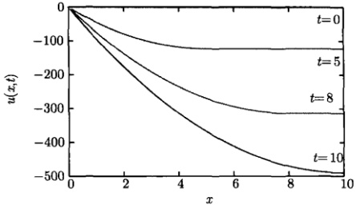

图 11.8 弦在不同时刻的位置 (a=1)
 

### 11.3 联合变换法

我们已经看到，使用傅里叶变换和拉普拉斯变换求解定解问题的条件是变量的变化范围分别为  $ (-\infty, \infty) $ 和  $ [0, \infty) $。实际上，在许多二阶偏微分方程问题中，为了求出结果  $ u(x, t) $，可以联合使用这两个变换，得到双重象函数  $ U(\omega, p) $，然后进行两次反变换即可。在这样的求解过程中，完全消去了对自变量求导数的运算，只需要求解一个代数方程。特别是，在许多问题中，坐标变量为  $ x \in (-\infty, \infty) $，而时间变量  $ t \in [0, \infty) $，正好适合傅里叶变换和拉普拉斯变换。本节将用联合变换法求解若干典型的定解问题。我们首先讨论含有对流机制的热传导问题，并引出相应的高斯核。

#### 11.3.1 对流热传导问题

考虑下列无界杆热传导的定解问题

$$  \left\{\begin{array}{l l}\displaystyle\frac{\partial u}{\partial t}=a^{2}\frac{\partial^{2}u}{\partial x^{2}}-k\frac{\partial u}{\partial x}&(-\infty<x<\infty,t>0)\\ \\ u|_{t=0}=\phi(x)&(-\infty<x<\infty)\end{array}\right.   \tag*{(11.3.1a)}$$

该系统含有对流的机制，借此与外界交换热量，它表现在函数 u 对空间变量的一阶微商项，k 是一个常数，称为对流系数（convection coefficient），而 a 仍是扩散系数。该问题包含了热量的扩散与迁移两重作用。

首先对式 (11.3.1a) 取关于 t 的拉普拉斯变换，并利用初始条件 (11.3.1b)，得到

$$  pU(x,p)-\phi(x)=a^{2}\frac{\mathrm{d}^{2}U(x,p)}{\mathrm{d}x^{2}}-k\frac{\mathrm{d}U(x,p)}{\mathrm{d}x}   \tag*{（11.3.2）}$$

对式（10.3.2）关于 x 作傅里叶变换，得到

$$  pU(\omega,p)-\Phi(\omega)=-a^{2}\omega^{2}U(\omega,p)-\mathrm{i}k\omega U(\omega,p)   \tag*{(11.3.3)}$$

<!-- page: 347 -->

其中

$$  \varPhi(\omega)=\int_{-\infty}^{\infty}\phi(x)\mathrm{e}^{-\mathrm{i}\omega x}\mathrm{d}x   \tag*{(11.3.4)}$$

从式(11.3.3)解出

$$  U(\omega,p)=\Phi(\omega)\frac{1}{p+(a^{2}\omega^{2}+\mathrm{i}k\omega)}   \tag*{(11.3.5)}$$

对它作拉普拉斯反变换，得到

$$  U(\omega,t)=\Phi(\omega)\mathrm{e}^{-\left(a^{2}\omega^{2}+\mathrm{i}k\omega\right)t}   \tag*{(11.3.6)}$$

再作傅里叶反变换，利用式(3.1.4)得到

$$  u(x,t)=\frac{1}{2\pi}\int_{-\infty}^{\infty}\Phi(\omega)\mathrm{e}^{-a^{2}\omega^{2}t}\mathrm{e}^{\mathrm{i}\omega Z}\mathrm{d}\omega\quad(Z=x-kt)   \tag*{(11.3.7)}$$

这就是定解问题（11.3.1）的积分解。我们看到，式（11.3.7）与无对流作用时的式(11.1.7)有相同的形式，因此只需要用 $ Z=x-kt $代替式(11.1.10)中的x，就可以得到现在问题的结果，即

$$  \begin{aligned}u(x,t)&=\frac{1}{2a\sqrt{\pi t}}\int_{-\infty}^{\infty}\phi(\xi)\exp\left[-\frac{(Z-\xi)^{2}}{4a^{2}t}\right]\mathrm{d}\xi\\&=\frac{1}{2a\sqrt{\pi t}}\int_{-\infty}^{\infty}\phi(\xi)\exp\left[-\frac{(x-kt-\xi)^{2}}{4a^{2}t}\right]\mathrm{d}\xi\end{aligned}   \tag*{(11.3.8)}$$

类似地，它可以写成卷积的形式

$$  u(x,t)=\phi(x)*K(x,t,k)   \tag*{(11.3.9)}$$

其中

$$  K(x,t,k)=\frac{1}{2a\sqrt{\pi t}}\exp\left(-\frac{Z^{2}}{4a^{2}t}\right)=\frac{1}{2a\sqrt{\pi t}}\exp\left[-\frac{(x-kt)^{2}}{4a^{2}t}\right]   \tag*{(11.3.10)}$$

是对流热传导问题的高斯核。当 k=0 时，它约化为式 (11.1.12)。高斯核式 (11.3.10) 具有式 (11.1.12) 的所有性质，只是它的峰值设在 x=kt 处。该高斯核仍然表示初始位于 x=0 的点源在任意时刻 t 引起的温度分布。但在任意 t 时刻，温度分布不但有展宽，而且出现了迁移，k>0 时，峰值向 x 轴正向迁移；k<0 时，峰值则向 x 轴负向迁移，如图 11.9 所示。这种具有扩散和迁移双重作用的演化行为存在于许多系统之中。

例 1 设系统初始温度为高斯分布函数式 (11.1.18)，对上面的结果进行讨论。

解 将式 (11.1.19) 代入式 (11.3.7) 得到

 $$ u(x,t)=\frac{1}{2\pi}\int_{-\infty}^{\infty}\mathrm{e}^{-\frac{\omega^{2}}{4}}\mathrm{e}^{-a^{2}\omega^{2}t}\mathrm{e}^{\mathrm{i}\omega(x-kt)}\mathrm{d}\omega $$

<!-- page: 348 -->

$$  \begin{aligned}&=\frac{1}{2\pi}\int_{-\infty}^{\infty}\mathrm{e}^{-\frac{4a^{2}t+1}{4}\omega^{2}}\mathrm{e}^{\mathrm{i}\omega(x-kt)}\mathrm{d}\omega\\&=\frac{1}{\sqrt{\pi\left(4a^{2}t+1\right)}}\exp\left[-\frac{(x-kt)^{2}}{4a^{2}t+1}\right]\end{aligned}   \tag*{(11.3.11)}$$

这就是对流热传导问题的结果。它的时间演化与高斯核的行为（图 11.9）相似。在无对流情况下，它变成式(11.1.20)。

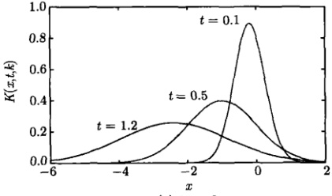

(a) k = -2
 

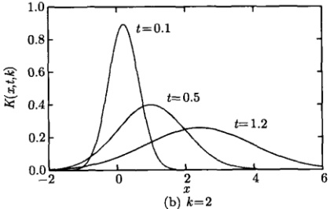

图 11.9 不同 t 时刻高斯核式 (11.3.10) 的曲线 (a = 1)
 

#### 11.3.2 线性衰变的影响

我们进一步在方程（11.3.1）中引入线性衰变机制，并研究它对温度分布的影响，即考虑下列无界杆热传导的定解问题

$$  \left\{\begin{array}{l l}\displaystyle\frac{\partial V}{\partial t}=a^{2}\frac{\partial^{2}V}{\partial x^{2}}-k\frac{\partial V}{\partial x}-\gamma V&(-\infty<x<\infty,t>0)\\ \\ V|_{t=0}=\phi(x)&(-\infty<x<\infty)\end{array}\right.   \tag*{(11.3.12a)}$$

其中， $ V = V(x, t) $ 是任意时刻 t 的温度分布； $ \gamma V $ 反映系统温度的线性衰变机制； $ \gamma $ 是衰变常数。

<!-- page: 349 -->

在定解问题 $  (11.3.1)  $的基础上，求解现在的问题是很简单的。事实上，按照下列变换

$$  V(x,t)=u(x,t)\exp(-\gamma t)   \tag*{(11.3.13)}$$

引入新的函数  $ u(x,t) $。然后将式 (11.3.13) 代入式 (11.3.12)，注意到  $ V(x,0)=u(x,0) $，我们得到关于  $ u(x,t) $ 的定解问题

$$  \left\{\begin{array}{l}\frac{\partial u}{\partial t}=a^{2}\frac{\partial^{2}u}{\partial x^{2}}-k\frac{\partial u}{\partial x}\quad(-\infty<x<\infty,t>0)\end{array}\right.   \tag*{(11.3.14a)}$$

$$  \left\lfloor\begin{array}{r}{u|_{t=0}=\phi(x)}\\ \end{array}\right.\qquad\quad(-\infty<x<\infty)   \tag*{(11.3.14b)}$$

这个问题与式(11.3.1)是完全相同的，于是从式(11.3.8)直接得到

$$  V(x,t)=\frac{\exp(-\gamma t)}{2a\sqrt{\pi t}}\int_{-\infty}^{\infty}\phi(\xi)\exp\left[-\frac{(x-kt-\xi)^2}{4a^2t}\right]\mathrm{d}\xi   \tag*{(11.3.15)}$$

这就是定解问题 (11.3.12) 的解。可以看出，线性衰变的机制表现在指数衰变因子  $ \exp(-\gamma t) $ 的出现。

例 1 设定解问题 (11.3.12) 的初始温度分布为  $ \phi(x) = \delta(x) $，对它的结果式 (11.3.15) 进行讨论。

解 现在解式 (11.3.15) 给出

 $$ \begin{aligned}V(x,t)&=\frac{\exp\left(-\gamma t\right)}{2a\sqrt{\pi t}}\int_{-\infty}^{\infty}\delta(\xi)\exp\left[-\frac{(x-kt-\xi)^{2}}{4a^{2}t}\right]\mathrm{d}\xi\\&=\frac{\exp\left(-\gamma t\right)}{2a\sqrt{\pi t}}\exp\left[-\frac{(x-kt)^{2}}{4a^{2}t}\right]\end{aligned} $$ 

如果不考虑迁移作用  $ (k=0) $，则上式变为

$$  V(x,t)=\frac{\exp\left(-\gamma t\right)}{2a\sqrt{\pi t}}\exp\left(-\frac{x^{2}}{4a^{2}t}\right)   \tag*{(11.3.16)}$$

图 11.10 显示了式 (11.3.16) 所示的不同时刻的温度分布。与无外热源的图 11.1 相

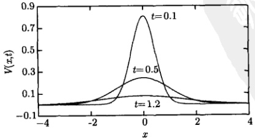

图 11.10 线性衰变对点源引起的温度分布的影响 (a = 1,  $ \gamma = 1 $)
 

<!-- page: 350 -->

比，在 t 较小时，线性衰变  $ \exp\left(-\gamma t\right) $ 对温度的影响不太显著，但随着 t 的增加，影响越来越大，系统的温度迅速趋于零。

例 2 求解下列无界杆热传导的定解问题

$$  \left\{\begin{array}{l}\frac{\partial V}{\partial t}=a^{2}\frac{\partial^{2}V}{\partial x^{2}}-t V\quad(-\infty<x<\infty,t>0)\end{array}\right.   \tag*{(11.3.17a)}$$

$$  V|_{t=0}=\phi(x)\qquad\quad(-\infty<x<\infty)   \tag*{(11.3.17b)}$$

解 现在线性项的衰变系数不是常数，而是变数 t。取函数变换

$$  V(x,t)=u(x,t)\exp\left(-\frac{t^{2}}{2}\right)   \tag*{(11.3.18)}$$

则定解问题（11.3.17）变为

$$  \left\{\begin{array}{l l}{\displaystyle\frac{\partial u}{\partial t}=a^{2}\frac{\partial^{2}u}{\partial x^{2}}}&{(-\infty<x<\infty,t>0)}\\ {{}}&{{}}\\ {u|_{t=0}=\phi(x)}&{(-\infty<x<\infty)}\end{array}\right.   \tag*{(11.3.19a)}$$

这正是定解问题(11.1.3)，直接利用式(11.1.10)得到

$$  V(x,t)=\frac{\exp\left(-t^{2}/2\right)}{2a\sqrt{\pi t}}\int_{-\infty}^{\infty}\phi(\xi)\exp\left[-\frac{(x-\xi)^{2}}{4a^{2}t}\right]\mathrm{d}\xi   \tag*{(11.3.20)}$$

这就是定解问题 (11.3.12) 的解。现在线性衰变的机制表现在指数因子  $ \exp(-t^{2}/2) $ 的出现。

从上述例题可以看出，高斯核在热传导问题中有重要的作用。下面我们将会看到，高斯核在有源热传导问题中仍然扮演核心的角色。

#### 11.3.3 有源热传导问题

考虑无边界有源热传导定解问题

$$  \left\{\begin{array}{l l}\displaystyle\frac{\partial u}{\partial t}=a^{2}\frac{\partial^{2}u}{\partial x^{2}}+f(x,t)&(-\infty<x<\infty,t>0)\\ \\ u|_{t=0}=\phi(x)&(-\infty<x<\infty)\end{array}\right.   \tag*{(11.3.21b)}$$

其中， $ \phi(x) $ 是初始温度分布； $ f(x,t) $ 是时空依赖的外热源。

我们用联合变换法求解这一问题，先对式（11.3.21）作关于 x 的傅里叶变换，得到常微分方程问题

$$  \left\{\begin{array}{l}\frac{\mathrm{d}U(\omega,t)}{\mathrm{d}t}=-a^{2}\omega^{2}U(\omega,t)+F(\omega,t)\\ \\ U(\omega,0)=\varPhi(\omega)\end{array}\right.   \tag*{(11.3.22a)}$$

<!-- page: 351 -->

其中

$$  \Phi(\omega)=\int_{-\infty}^{\infty}\phi(x)\mathrm{e}^{-\mathrm{i}\omega x}\mathrm{d}x   \tag*{(11.3.23a)}$$

$$  F(\omega,t)=\int_{-\infty}^{\infty}f(x,t)\mathrm{e}^{-\mathrm{i}\omega x}\mathrm{d}x   \tag*{(11.3.23b)}$$

再对式（11.3.22）作关于 t 的拉普拉斯变换

$$  pU(\omega,p)-\Phi(\omega)=-a^{2}\omega^{2}U(\omega,p)+F(\omega,p)   \tag*{(11.3.24)}$$

解之得

$$  U(\omega,p)=\frac{\Phi(\omega)+F(\omega,p)}{p+a^{2}\omega^{2}}=\frac{\Phi(\omega)}{p+a^{2}\omega^{2}}+\frac{F(\omega,p)}{p+a^{2}\omega^{2}}   \tag*{(11.3.25)}$$

对式（11.3.25）作拉普拉斯反变换，得到

$$  \begin{align*}U(\omega,t)&=\varPhi(\omega)\mathrm{e}^{-a^{2}\omega^{2}t}+F(\omega,t)*\mathrm{e}^{-a^{2}\omega^{2}t}\\&=\varPhi(\omega)\mathrm{e}^{-a^{2}\omega^{2}t}+\int_{0}^{t}F(\omega,\tau)\mathrm{e}^{-a^{2}\omega^{2}(t-\tau)}\mathrm{d}\tau\end{align*}   \tag*{(11.3.26)}$$

再对式（11.3.26）作傅里叶反变换，利用式（3.1.4）得到

$$  u(x,t)=\frac{1}{2\pi}\int_{-\infty}^{\infty}\Phi(\omega)\mathrm{e}^{-a^{2}\omega^{2}t}\mathrm{e}^{\mathrm{i}\omega x}\mathrm{d}\omega+\mathcal{F}^{-1}\left\{\int_{0}^{t}F(\omega,\tau)\mathrm{e}^{-a^{2}\omega^{2}(t-\tau)}\mathrm{d}\tau\right\}   \tag*{(11.3.27)}$$

这就是定解问题(11.3.21)的积分解。式(11.3.27)中第一个积分就是式(11.1.7)，它给出解式(11.1.11)。现在我们计算式(11.3.27)的第二个积分

 $$ \begin{aligned}\mathcal{F}^{-1}\left\{\int_{0}^{t}F(\omega,\tau)\mathrm{e}^{-a^{2}\omega^{2}(t-\tau)}\mathrm{d}\tau\right\}&=\int_{0}^{t}\mathcal{F}^{-1}\left\{F(\omega,\tau)\mathrm{e}^{-a^{2}\omega^{2}(t-\tau)}\right\}\mathrm{d}\tau\\&=\int_{0}^{t}f(x,\tau)*\mathcal{F}^{-1}\left\{\mathrm{e}^{-a^{2}\omega^{2}(t-\tau)}\right\}\mathrm{d}\tau\\&=\int_{0}^{t}f(x,\tau)*K(x,t-\tau)\mathrm{d}\tau\end{aligned} $$ 

这里利用了式(11.1.17a)，其中， $ K(x,t-\tau) $是高斯核式(11.1.12)，即

$$  K(x,t-\tau)=\frac{1}{2a\sqrt{\pi(t-\tau)}}\exp\left[-\frac{x^{2}}{4a^{2}(t-\tau)}\right]   \tag*{(11.3.28)}$$

这样式(11.3.27)变为

$$  u(x,t)=\phi(x)*K(x,t)+\int_{0}^{t}f(x,\tau)*K(x,t-\tau)\mathrm{d}\tau   \tag*{(11.3.29)}$$

<!-- page: 352 -->

我们看到，这个解由两部分组成：一部分是初始温度  $ \phi(x) $ 与高斯核  $ K(x,t) $ 的卷积，另一部分则是外热源  $ f(x,t) $ 与高斯核  $ K(x,t-\tau) $ 的卷积对时间的积分。我们再次看到高斯核在热传导问题中的作用。进一步将式(11.3.29)写成

$$  u(x,t)=\int_{-\infty}^{\infty}\phi(\xi)K(x-\xi,t)\mathrm{d}\xi+\int_{0}^{t}\mathrm{d}\tau\int_{-\infty}^{\infty}f(\xi,\tau)K(x-\xi,t-\tau)\mathrm{d}\xi   \tag*{(11.3.30)}$$

将高斯核式(11.1.12)代入式(11.3.30)，得到

$$  \begin{aligned}u(x,t)=&\frac{1}{2a\sqrt{\pi t}}\int_{-\infty}^{\infty}\phi(\xi)\exp\left[-\frac{(x-\xi)^{2}}{4a^{2}t}\right]\mathrm{d}\xi\\ &+\frac{1}{2a\sqrt{\pi}}\int_{0}^{t}\frac{\mathrm{d}\tau}{\sqrt{t-\tau}}\int_{-\infty}^{\infty}f(\xi,\tau)\exp\left[-\frac{(x-\xi)^{2}}{4a^{2}(t-\tau)}\right]\mathrm{d}\xi\end{aligned}   \tag*{(11.3.31)}$$

这就是定解问题（11.3.21）的解的表达式。

在求解热传导问题中，我们看到高斯核扮演了一个核心的角色。式 (11.3.30) 通常称为泊松公式，称高斯核  $ K(x-\xi, t-\tau) $ 为热传导方程的基本解。基本解有明确的物理意义，我们在第 11.1.1 节的讨论中知道，高斯核  $ K(x, t) $ 是初始 t=0 时刻位于 x=0 的点源在任意时刻 t 引起的温度分布。因此  $ K(x-\xi, t) $ 就是初始 t=0 时刻位于  $ \xi $ 的点源引起的温度分布。而  $ \phi(\xi)K(x-\xi, t) $ 则表示初始热源的空间分布，对它的积分表示初始热源在任意时刻 t 引起的温度分布。同理，式 (11.3.30) 第二个积分中的高斯核  $ K(x-\xi, t-\tau) $ 表示  $ \tau $ 时刻位于  $ \xi $ 的点源引起的温度分布，而这个二重积分则表示外热源在 0 到 t 时间范围内的作用在时刻 t 引起的温度分布。热传导方程中的高斯核也称为点源影响函数，它与旁轴波动方程中的格林函数 [式 (10.7.23)] 在本质上是相同的。格林函数表示光学系统中输入平面上位于  $ r_0 $ 的一个点源在输出平面上引起的光场分布。

其实“核”是一个一般性的概念。事实上，积分变换式(3.0.1)中的 $ K(\beta,t) $就是一个核，当其中的分布 $ f(x) $缩成一个位于 $ x_{0} $的点源 $ \delta(x-x_{0}) $时，式(3.0.1)给出

$$  \int_{a}^{b}\delta(x-x_{0})K(\beta,x)\mathrm{d}x=K(\beta,x_{0})   \tag*{(11.3.32a)}$$

可见核就是点源引起的分布。具体而言，傅里叶变换 (3.1.3) 中的核是  $ e^{-i\omega x} $，当其中的分布  $ f(x) $ 缩成一个点源  $ \delta(x-x_0) $ 时，式 (3.1.3) 给出

$$  \int_{-\infty}^{\infty}\delta(x-x_{0})\mathrm{e}^{-\mathrm{i}\omega x}\mathrm{d}x=\mathrm{e}^{-\mathrm{i}\omega x_{0}}   \tag*{(11.3.32b)}$$

这正是式 (3.2.19a)。同样拉普拉斯变换式 (4.1.2) 中的核是  $ e^{-pt} $，当其中的函数  $ f(t) $ 缩成一个点源  $ \delta(t-t_0) $ 时，式 (4.1.2) 给出

$$  \int_{0}^{\infty}\delta(t-t_{0})\mathrm{e}^{-p t}\mathrm{d}t=\mathrm{e}^{-p t_{0}}   \tag*{(11.3.32c)}$$

<!-- page: 353 -->

这正是式 (4.1.27)。再看式 (3.2.54) 中的狄利克雷核  $ D_{m}(x)=\frac{1}{2\pi}\frac{\sin\left(m+\frac{1}{2}\right)x}{\sin\frac{1}{2}x} $，当其中的函数  $ f(t) $ 缩成一个点源  $ \delta(t) $ 时，式 (3.2.54) 给出

$$  \int_{-\pi}^{\pi}\delta(t)D_{m}(x-t)\mathrm{d}t=D_{m}(x)   \tag*{(11.3.32d)}$$

所有这些核的共同性质是，它们都表示一个点源产生的影响。

例 1 设系统的初始温度分布为  $ \phi(x)=\delta(x) $，外热源为  $ f(x,t)=\mathrm{e}^{-t^{2}} $，讨论结果式(11.3.31)。

解 这时式 $  (11.3.31)  $变为

$$  \begin{align*}u(x,t)=&\frac{1}{2a\sqrt{\pi t}}\int_{-\infty}^{\infty}\delta(\xi)\exp\left[-\frac{(x-\xi)^2}{4a^2t}\right]\mathrm{d}\xi\\&+\int_{0}^{t}\exp(-\tau^2)\mathrm{d}\tau\underbrace{\int_{-\infty}^{\infty}\frac{1}{2a\sqrt{\pi(t-\tau)}}\exp\left[-\frac{(x-\xi)^2}{4a^2(t-\tau)}\right]\mathrm{d}\xi}_{=1}\\=&\frac{1}{2a\sqrt{\pi t}}\exp\left(-\frac{x^2}{4a^2t}\right)+\frac{\sqrt{\pi}}{2}\mathrm{erf}(t)\tag{1}\end{align*}   \tag*{(11.3.33)}$$

其中， $ \mathrm{erf}(t)=\frac{2}{\sqrt{\pi}}\int_{0}^{t}\exp(-\tau^{2})\mathrm{d}\tau $ 是误差函数。注意，外热源  $ f(x,t)=\mathrm{e}^{-t^{2}} $ 与空间变量无关。与无外热源情况相比，系统在 t 时刻的附加温度为  $ \frac{\sqrt{\pi}}{2}\mathrm{erf}(t) $。这样一来，本问题式 (11.3.33) 中第一项所示的扩散作用使系统温度随时间下降，而第二项的外热源作用使系统温度随时间上升。如图 11.11 所示，外热源的作用大于系统的扩散作用，因此，系统温度呈上升趋势。

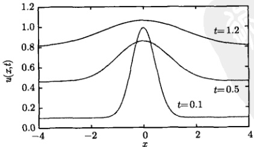

图 11.11 系统温度随时间上升 (a = 1)
 

<!-- page: 354 -->

#### 11.3.4 非齐次波动方程问题

下面我们通过几个例题讨论联合变换法在求解非齐次无边界波动方程的定解问题中的应用。

#### 例 1 求解定解问题

$$  \left\{\begin{array}{l}\frac{\partial^{2}u}{\partial t^{2}}=\frac{\partial^{2}u}{\partial x^{2}}+t\sin x\quad(-\infty<x<\infty,t>0)\end{array}\right.   \tag*{(11.3.34a)}$$

$$  u|_{t=0}=0\quad(-\infty<x<\infty)   \tag*{(11.3.34b)}$$

$$  \left\{\begin{array}{l}\left.\frac{\partial u}{\partial t}\right|_{t=0}=\sin x\end{array}\right.\qquad\left(-\infty<x<\infty\right)   \tag*{(11.3.34c)}$$

解 对式 $  (11.3.34)  $关于 t 作拉普拉斯变换，利用式 $  (4.1.7b)  $，得到

$$  p^{2}U(x,p)-\sin x=\frac{\mathrm{d}^{2}U(x,p)}{\mathrm{d}x^{2}}+\frac{\sin x}{p^{2}}   \tag*{(11.3.35)}$$

对式(11.3.35)再作关于x的傅里叶变换，利用式(3.3.1a)，即

$$  \mathcal{F}\left\{\sin x\right\}=\mathrm{i}\pi\left[\delta(\omega+1)-\delta(\omega-1)\right]   \tag*{(11.3.36)}$$

得到

$$  p^{2}U(\omega,p)=-\omega^{2}U(\omega,p)+\left(1+\frac{1}{p^{2}}\right)\mathrm{i}\pi\left[\delta(\omega+1)-\delta(\omega-1)\right]   \tag*{(11.3.37)}$$

从式(11.3.37)解出

$$  U(\omega,p)=\frac{\left(1+\frac{1}{p^{2}}\right)\mathrm{i}\pi\left[\delta(\omega+1)-\delta(\omega-1)\right]}{p^{2}+\omega^{2}}   \tag*{(11.3.38)}$$

式(11.3.38)取非零值的条件是 $ \omega=\pm1 $，在此条件下变为

$$  U(\omega,p)=\frac{\left(1+\frac{1}{p^{2}}\right)\mathrm{i}\pi\left[\delta(\omega+1)-\delta(\omega-1)\right]}{p^{2}+1}=\frac{\mathrm{i}\pi\left[\delta(\omega+1)-\delta(\omega-1)\right]}{p^{2}}   \tag*{(11.3.39)}$$

对式 (11.3.39) 作傅里叶反变换和拉普拉斯反变换，利用式 (11.3.36) 和式 (4.1.7b)，得到

$$  u(x,t)=t\sin x   \tag*{(11.3.40)}$$

这就是定解问题（11.3.34）的解，就是方程（11.3.34a）中的驱动项。

例 2 求解定解问题

<!-- page: 355 -->

$$  \left\{\begin{array}{l}\frac{\partial^{2}u}{\partial t^{2}}=\frac{\partial^{2}u}{\partial x^{2}}+\frac{x t}{\left(1+x^{2}\right)^{2}}\quad(-\infty<x<\infty,t>0)\end{array}\right.   \tag*{(11.3.41a)}$$

$$  u|_{t=0}=0\quad(-\infty<x<\infty)   \tag*{(11.3.41b)}$$

$$  \left\lfloor\begin{array}{r|r}\hline\frac{\partial u}{\partial t}\bigg|_{t=0}=\frac{1}{1+x^{2}}&\quad(-\infty<x<\infty)\end{array}\right.   \tag*{(11.3.41c)}$$

解令

$$  f(x)=\frac{1}{1+x^{2}}   \tag*{(11.3.42)}$$

则式 $  (11.3.41)  $变为

$$  \frac{\partial^{2}u}{\partial t^{2}}=\frac{\partial^{2}u}{\partial x^{2}}-\frac{t}{2}f^{\prime}(x)   \tag*{(11.3.43a)}$$

$$  u|_{t=0}=0\quad(-\infty<x<\infty)   \tag*{(11.3.43b)}$$

$$  \frac{\partial u}{\partial t}\bigg|_{t=0}=f(x)   \tag*{(11.3.43c)}$$

对式 (11.3.43) 关于 x 作傅里叶变换，得到

$$  \frac{\mathrm{d}^{2}U(\omega,t)}{\mathrm{d}t^{2}}=-\omega^{2}U(\omega,t)-\frac{\mathrm{d}\omega t}{2}F(\omega)   \tag*{(11.3.44a)}$$

$$  U|_{t=0}=0   \tag*{(11.3.44b)}$$

$$  \frac{\mathrm{d}U}{\mathrm{d}t}\bigg|_{t=0}=F(\omega)   \tag*{(11.3.44c)}$$

对式 (11.3.44) 关于 t 作拉普拉斯变换，得到

$$  p^{2}U(\omega,p)-F(\omega)=-\omega^{2}U(\omega,p)-\frac{\mathrm{i}\omega}{2p^{2}}F(\omega)   \tag*{(11.3.45)}$$

解出

$$  U(\omega,p)=\frac{F(\omega)}{p^{2}+\omega^{2}}\left(1-\frac{\mathrm{i}\omega}{2p^{2}}\right)   \tag*{(11.3.46)}$$

对它作拉普拉斯反变换，有

$$  \begin{aligned}U(\omega,t)&=\frac{F(\omega)}{\omega}\mathcal{L}^{-1}\left\{\frac{\omega}{p^{2}+\omega^{2}}\right\}-\mathrm{i}\frac{F(\omega)}{2}\mathcal{L}^{-1}\left\{\frac{\omega}{p^{2}+\omega^{2}}\cdot\frac{1}{p^{2}}\right\}\\&=\frac{F(\omega)}{\omega}\sin\omega t-\mathrm{i}\frac{F(\omega)}{2}\left(\sin\omega t*t\right)\\&=\frac{F(\omega)}{\omega}\sin\omega t-\mathrm{i}\frac{F(\omega)}{2}\left(\frac{t}{\omega}-\frac{\sin\omega t}{\omega^{2}}\right)\\&=\frac{F(\omega)}{2\mathrm{i}\omega}t+\frac{F(\omega)}{\omega}\sin\omega t-\frac{F(\omega)}{2\mathrm{i}\omega^{2}}\sin\omega t\\ \end{aligned}   \tag*{(11.3.47)}$$

<!-- page: 356 -->

现在我们对上式中的三项分别作傅里叶反变换，特别要利用关系式

$$  F(\omega)\mathrm{e}^{\mathrm{i}\omega t}\leftrightarrow f(x+t),\quad\frac{F(\omega)}{\mathrm{i}\omega}\leftrightarrow\int_{-\infty}^{x}f(x)\mathrm{d}x   \tag*{(11.3.48)}$$

(1)

$$  \frac{1}{\mathrm{i}\omega}F(\omega)\leftrightarrow\int_{-\infty}^{x}f(x)\mathrm{d}x=\int_{-\infty}^{x}\frac{1}{1+x^{2}}\mathrm{d}x=\arctan x   \tag*{(11.3.49)}$$

(2) 首先计算

$$  \begin{aligned}{F(\omega)\operatorname{s i n}\omega t}&{{}=\frac{1}{2\mathrm{i}}\left[F(\omega)\mathrm{e}^{\mathrm{i}\omega t}-F(\omega)\mathrm{e}^{-\mathrm{i}\omega t}\right]}\\ {}&{{}\longleftrightarrow\frac{1}{2\mathrm{i}}\left[\frac{1}{1+\left(x+t\right)^{2}}-\frac{1}{1+\left(x-t\right)^{2}}\right]}\\ \end{aligned}   \tag*{（11.3.50）}$$

这样

$$  \begin{aligned}\mathrm{i}\left[\frac{1}{\mathrm{i}\omega}F(\omega)\sin\omega t\right]&\longleftrightarrow\mathrm{i}\int_{-\infty}^{x}\frac{1}{2\mathrm{i}}\left[\frac{1}{1+\left(\xi+t\right)^{2}}-\frac{1}{1+\left(\xi-t\right)^{2}}\right]\mathrm{d}\xi\\&=\frac{1}{2}\left[\arctan(x+t)-\arctan(x-t)\right]\end{aligned}   \tag*{(11.3.51)}$$

(3) 利用式 (11.3.51)，我们有

$$  \begin{aligned}&\frac{1}{\mathrm{i}\omega}\left[\frac{1}{\omega}F(\omega)\sin\omega t\right]\longleftrightarrow\frac{1}{2}\int_{-\infty}^{x}\left[\arctan(\xi+t)-\arctan(\xi-t)\right]\mathrm{d}\xi\\=&\frac{1}{2}\left[(x+t)\arctan\left(x+t\right)-(x-t)\arctan\left(x-t\right)\right]-\frac{1}{4}\ln\frac{1+\left(x+t\right)^{2}}{1+\left(x-t\right)^{2}}\\ \end{aligned}   \tag*{(11.3.52)}$$

这里用到了积分公式

$$  \int\arctan\frac{x}{b}\mathrm{d}x=x\arctan\frac{x}{b}-\frac{b}{2}\ln(1+x^{2})+c   \tag*{(11.3.53)}$$

利用式(11.3.49)、式(11.3.51)和式(11.3.52)，对式(11.3.47)反演，得到

$$  \begin{aligned}u(x,t)=&\frac{1}{8}\ln\frac{1+(x+t)^{2}}{1+(x-t)^{2}}+\frac{t}{2}\arctan x+\frac{1}{4}(2-x-t)\arctan(x+t)\\&-\frac{1}{4}(2-x+t)\arctan(x-t)\end{aligned}   \tag*{(11.3.54)}$$

这就是定解问题（11.3.41）的解。

这个问题还可以用行波法求解，事实上利用式（10.5.13）得到

$$  u(x,t)=\frac{1}{2}\int_{x-t}^{x+t}\frac{1}{1+\xi^{2}}\mathrm{d}\xi+\frac{1}{2}\int_{0}^{t}\int_{x-(t-\tau)}^{x+(t-\tau)}\frac{\xi\tau}{(1+\xi^{2})^{2}}\mathrm{d}\xi\mathrm{d}\tau   \tag*{(11.3.55)}$$

完成式（10.3.55）中的积分后，结果与式（11.3.54）相同。

<!-- page: 357 -->

#### 11.3.5 无边界电报方程问题

考虑无限长传输线上的电报方程的定解问题

$$  \left\{\begin{array}{l}\frac{\partial^{2}V}{\partial t^{2}}-a^{2}\frac{\partial^{2}V}{\partial x^{2}}+2b\frac{\partial V}{\partial t}+c^{2}V=0\quad(-\infty<x<\infty,t>0)\end{array}\right.   \tag*{(11.3.56a)}$$

 $$ V|_{t=0}=\phi(x) $$ 

$$  (-\infty<x<\infty)   \tag*{(11.3.56b)}$$

 $$ \left.\frac{\partial V}{\partial t}\right|_{t=0}=\psi(x) $$ 

$$  (-\infty<x<\infty)   \tag*{(11.3.56c)}$$

方程 (11.3.56a) 来自传输线问题 [式 (5.1.21)]，其中 b > 0，c > 0。方程 (11.3.56a) 可以通过一个变换消去一阶时间微商项，事实上令

$$  V(x,t)=u(x,t)\exp(-bt)   \tag*{(11.3.57)}$$

代入式(11.3.56)，得到

$$  \frac{\partial^{2}u}{\partial t^{2}}-a^{2}\frac{\partial^{2}u}{\partial x^{2}}+B^{2}u=0\quad(-\infty<x<\infty,t>0)   \tag*{(11.3.58a)}$$

$$  (-\infty<x<\infty)   \tag*{(11.3.58b)}$$

$$  \left\lfloor\left.{\frac{\partial u}{\partial t}}\right|_{t=0}=\psi(x)+b\phi(x)\right.\qquad(-\infty<x<\infty)   \tag*{(11.3.58c)}$$

其中， $ B = \sqrt{c^2 - b^2} $ (假定 c > b)。对式 (11.3.58) 关于 x 作傅里叶变换，设  $ \phi(x) = 0 $，得到

$$  \frac{\mathrm{d}^{2}U(\omega,t)}{\mathrm{d}t^{2}}+\left(a^{2}\omega^{2}+B^{2}\right)U(\omega,t)=0   \tag*{(11.3.59a)}$$

$$  U|_{t=0}=0   \tag*{(11.3.59b)}$$

$$  \left\{\left.\frac{\mathrm{d}U}{\mathrm{d}t}\right|_{t=0}=\varPsi(\omega)\right.   \tag*{(11.3.59c)}$$

其中

$$  \bar{\psi}(\omega)=\int_{-\infty}^{\infty}\psi(x)\mathrm{e}^{-\mathrm{i}\omega x}\mathrm{d}x   \tag*{(11.3.60)}$$

再对式 (11.3.59) 作关于 t 的拉普拉斯变换，得到

$$  p^{2}U(\omega,p)-\Psi(\omega)+\left(a^{2}\omega^{2}+B^{2}\right)U(\omega,p)=0   \tag*{(11.3.61)}$$

解之得

$$  U(\omega,p)=\frac{\bar{\Psi}(\omega)}{p^{2}+(a^{2}\omega^{2}+B^{2})}   \tag*{(11.3.62)}$$

对式(11.3.62)取关于p的拉普拉斯反变换，有

<!-- page: 358 -->

$$  U(\omega,t)=\frac{\bar{\Psi}(\omega)}{\sqrt{a^{2}\omega^{2}+B^{2}}}\sin\left(t\sqrt{a^{2}\omega^{2}+B^{2}}\right)   \tag*{(11.3.63)}$$

利用傅里叶反变换式(3.1.4)，得到

$$  u(x,t)=\frac{1}{2\pi}\int_{-\infty}^{\infty}\frac{\bar{\Psi}(\omega)}{\sqrt{a^{2}\omega^{2}+B^{2}}}\sin\left(t\sqrt{a^{2}\omega^{2}+B^{2}}\right)\mathrm{e}^{\mathrm{i}\omega x}\mathrm{d}\omega   \tag*{(11.3.64)}$$

这就是定解问题（11.3.58）的积分形式的解，其中， $ \bar{\psi}(\omega) $ 由式（11.3.60）确定。

设初始速度为  $ \psi(x)=A $ (常数)，利用式(3.2.22)计算出式(11.3.60)中的傅里叶变换

$$  \bar{\psi}(\omega)=A\int_{-\infty}^{\infty}\mathrm{e}^{-\mathrm{i}\omega x}\mathrm{d}x=2\pi A\delta(\omega)   \tag*{(11.3.65)}$$

代入式(11.3.64)得到

$$  \begin{aligned}u(x,t)&=A\int_{-\infty}^{\infty}\frac{\delta(\omega)}{\sqrt{a^{2}\omega^{2}+B^{2}}}\sin\left(\sqrt{a^{2}\omega^{2}+B^{2}}t\right)\mathrm{e}^{\mathrm{i}\omega x}\mathrm{d}\omega\\&=\frac{A}{B}\sin B t\end{aligned}   \tag*{(11.3.66)}$$

代入式(11.3.57)得到

$$  V(x,t)=\frac{A}{\sqrt{c^{2}-b^{2}}}\exp(-bt)\sin\sqrt{c^{2}-b^{2}}t   \tag*{(11.3.67)}$$

这就是定解问题 (11.3.56) 在 c > b， $ \phi(x) = 0 $， $ \psi(x) = A $ 情况下的解。

### 11.4 半导体载流子的输运方程

作为本章的最后一节，我们讨论半导体物理中载流子的输运方程。假设 n 型半导体在初始 t=0 时刻，于 x=0 处存在一定数量的电子-空穴对。这样，载流子在任意时刻的浓度分布  $ V(x,t) $ 被下列输运方程的定解问题描述

$$  \left\{\begin{array}{l l}{\displaystyle\frac{\partial V}{\partial t}=D\displaystyle\frac{\partial^{2}V}{\partial x^{2}}-\mu E\displaystyle\frac{\partial V}{\partial x}-\displaystyle\frac{V}{\tau}}&{(-\infty<x<\infty,t>0)}\\ {\displaystyle V|_{t=0}=\delta(x)}&{\quad \mathrm{~}}\end{array}\right.   \tag*{(11.4.1a)}$$

其中， $ D $、 $ \mu $ 和  $ \tau $ 分别是载流子的扩散系数、迁移率和寿命；E 是外加的恒定电场。在初始 t=0 时刻，载流子只存在于 x=0 处，因此载流子的归一化初始浓度分布为  $ \delta(x) $ 函数。

定解问题式 (11.4.1) 是式 (11.3.12) 的特例，其中， $ a^{2} = D $， $ k = \mu E $， $ \gamma = 1/\tau $， $ \phi(x) = \delta(x) $。由式 (11.3.15) 得到它的解

<!-- page: 359 -->

$$  V(x,t)=\frac{\exp(-t/\tau)}{\sqrt{4\pi Dt}}\int_{-\infty}^{\infty}\delta(\xi)\exp\left[-\frac{(x-\mu Et-\xi)^2}{4Dt}\right]\mathrm{d}\xi   \tag*{(11.4.2)}$$

利用  $ \delta $ 函数的筛选性质得到

$$  V(x,t)=\frac{\exp{(-t/\tau)}}{\sqrt{4\pi D t}}\exp\left[-\frac{(x-\mu E t)^{2}}{4D t}\right]   \tag*{(11.4.3)}$$

这就是定解问题（11.4.1）的解。

下面我们用联合变换法进行详细求解。对式 $  (11.4.1)  $引入变换

$$  V(x,t)=u(x,t)\exp(-t/\tau)   \tag*{(11.4.4)}$$

注意到  $ V(x,0)=u(x,0) $，我们得到关于  $ u(x,t) $ 的定解问题

$$  \left\{\begin{array}{l}\displaystyle\frac{\partial u}{\partial t}=D\frac{\partial^{2}u}{\partial x^{2}}-\mu E\frac{\partial u}{\partial x}\quad(-\infty<x<\infty,t>0)\\ \\ u|_{t=0}=\delta(x)\end{array}\right.   \tag*{(11.4.5a)}$$

对式（11.4.5a）作关于 t 的拉普拉斯变换，并利用式（11.4.5b）得到

$$  pU(x,p)-\delta(x)=D\frac{\mathrm{d}^{2}U(x,p)}{\mathrm{d}x^{2}}-\mu E\frac{\mathrm{d}U(x,p)}{\mathrm{d}x}   \tag*{(11.4.6)}$$

再对式(11.4.6)作关于x的傅里叶变换，并利用 $ \delta(x) $函数的傅里叶变换[式(3.2.19b)]

$$  \int_{-\infty}^{\infty}\delta(x)\mathrm{e}^{-\mathrm{i}\omega x}\mathrm{d}x=1   \tag*{(11.4.7)}$$

方程式（11.4.6）变换为

$$  pU(\omega,p)-1=-\omega^{2}DU(\omega,p)-\mathrm{i}\omega\mu EU(\omega,p)   \tag*{(11.4.8)}$$

解之得

$$  U(\omega,p)=\frac{1}{p+\omega^{2}D+\mathrm{i}\omega\mu E}   \tag*{(11.4.9)}$$

先作关于 p 的拉普拉斯反变换，利用式 (4.1.7c) 得到

$$  U(\omega,t)=\mathrm{e}^{-\left(\omega^{2}D+\mathrm{i}\omega\mu E\right)t}=\mathrm{e}^{-\mathrm{i}\omega\mu E t}\mathrm{e}^{-\omega^{2}D t}   \tag*{（11.4.10）}$$

再作关于  $ \omega $ 的傅里叶反变换，为此首先利用式 (11.1.17a) 求出

$$  \mathcal{F}^{-1}\left\{\mathrm{e}^{-\omega^{2}D t}\right\}=\frac{1}{\sqrt{4\pi D t}}\exp\left(-\frac{x^{2}}{4D t}\right)   \tag*{(11.4.11)}$$

再利用傅里叶变换的平移性质，即  $ f(x+\xi)\longleftrightarrow\mathrm{e}^{\mathrm{i}\omega\xi}F(\omega) $，从式 (11.4.10) 得到

<!-- page: 360 -->

$$  u(x,t)=\frac{1}{\sqrt{4\pi Dt}}\exp\left[-\frac{(x-\mu Et)^2}{4Dt}\right]   \tag*{(11.4.12)}$$

它正是对流热传导问题的高斯核式(11.3.10)。得到式(11.4.12)的另一个思路是对式(11.4.10)作傅里叶反变换，利用式(3.2.19a)和式(11.4.11)，得到

 $$ \begin{aligned}u(x,t)&=\mathcal{F}^{-1}\left\{\mathrm{e}^{-\mathrm{i}\omega\mu E t}\right\}*\mathcal{F}^{-1}\left\{\mathrm{e}^{-\omega^{2}D t}\right\}\\&=\delta(x-\mu E t)*\frac{1}{\sqrt{4\pi D t}}\exp\left(-\frac{x^{2}}{4D t}\right)\\&=\int_{-\infty}^{\infty}\delta(\xi-\mu E t)\frac{1}{\sqrt{4\pi D t}}\left[\exp-\frac{\left(x-\xi\right)^{2}}{4D t}\right]\mathrm{d}\xi\\&=\frac{1}{\sqrt{4\pi D t}}\left[\exp-\frac{\left(x-\mu E t\right)^{2}}{4D t}\right]\\ \end{aligned} $$ 

它再次显示高斯核是点源引起的分布。将所得结果代入式（11.4.4）得到

$$  V(x,t)=\frac{\exp\left(-t/\tau\right)}{\sqrt{4\pi Dt}}\exp\left[-\frac{(x-\mu E t)^{2}}{4Dt}\right]   \tag*{(11.4.13)}$$

这个结果与式(11.4.3)相同。

我们按照实验数据作出不同时刻的空穴浓度分布，如图 11.12 所示。

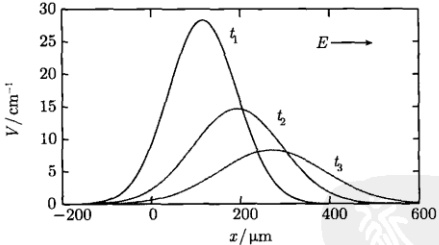

图 11.12 不同时刻的空穴浓度分布
 

实验数据为  $ \tau = 5\mu\text{s}, D = 10\text{cm}^2/\text{s}, \mu = 386\text{cm}^2/(\text{V}\cdot\text{s}), E = 10\text{V}/\text{cm} $，图中三条曲线对应的时间、峰值浓度和峰的位置分别为： $ t_1 = 3\mu\text{s}, V_1 = 28.3\text{cm}^{-1}, x_1 = 116\mu\text{m}; t_2 = 5\mu\text{s}, V_2 = 14.7\text{cm}^{-1}, x_2 = $

 $$ 193\upmu\mathrm{m};t_{3}=7\upmu\mathrm{s},V_{3}=8.3\mathrm{c m}^{-1},x_{3}=270\upmu\mathrm{m} $$

