# 12-第12章 格林函数法

[返回全书目录](../../README.md)

> PDF 页码：361–406

<!-- page: 361 -->

### 第12章 格林函数法

在第10章、第11章我们多次遇到“核”，如菲涅耳核(10.7.16)、高斯核(11.1.12)以及泊松核(11.1.50)等。这些“核”有一个共同的特征，它们都表示点源（即“核”）引起的场分布，因此，“核”也称为点源影响函数。“核”一般还被称为“格林函数”。

从物理上看，一个数学物理方程的解实际上表示点源与它所产生的“场”之间的关系。比如，旁轴波动方程的解式（10.7.17）表示输入平面上的点光源与输出平面上光场分布之间的关系；热传导方程的解式（11.1.10）表示初始点热源与任意时刻温度场之间的关系；拉普拉斯方程的解式（11.1.48）表示边界上的点源与空间场分布之间的关系。所有这些关系可以统一表示为

$$  u(x)=\int_{-\infty}^{\infty}\phi(\xi)G(\xi,x)\mathrm{d}\xi   \tag*{(12.0.1)}$$

其中， $ G(\xi,x) $ 是格林函数，它表示  $ \xi $ 域的点源在 x 域产生的场分布； $ \phi(\xi) $ 则是  $ \xi $ 域的源分布函数。式 (12.0.1) 称为解的积分公式，如果知道了格林函数  $ G(\xi,x) $，就可以通过式 (12.0.1) 求出场分布  $ u(x) $。显然，式 (12.0.1) 是对线性系统施用叠加原理的结果。

本章将一般性地阐述格林函数的概念，并用之于求解数学物理方法的定解问题，这就是所谓“格林函数法”。这种方法的特点是直接给出定解问题的解，而不是先求出一般解再利用相关条件确定系数。格林函数法有非常广泛的用途，可以求解无界域和有界域的问题，可以求解齐次和非齐次方程问题，可以求解一维和三维的问题，可以求解第一类、第二类、第三类齐次和非齐次边界条件的问题，甚至可以处理非线性方程问题。

### 12.1 无界域的格林函数

我们在第5章推导出了电位所满足的泊松方程

$$  \nabla^{2}u(\mathbf{r})=\frac{\partial^{2}u}{\partial x^{2}}+\frac{\partial^{2}u}{\partial y^{2}}+\frac{\partial^{2}u}{\partial z^{2}}=-\frac{\rho(\mathbf{r})}{\varepsilon}   \tag*{(12.1.1)}$$

其中， $ \varepsilon $ 是介质的介电常数； $ \rho(r) $ 是自由电荷密度，它一般情况下是空间变量 r

<!-- page: 362 -->

的函数； $ u(r) $ 是  $ \rho(r) $ 所引起的电位分布。现在我们按照格林函数的概念求解方程 (12.1.1)。

对于无界区域的自由电荷分布，按照静电学的理论，电荷分布中位于  $ r_{0} $ 的电量为 q 的点电荷在空间任意点 r 形成的电位为

$$  \frac{q}{4\pi\varepsilon\left|\boldsymbol{r}-\boldsymbol{r}_{0}\right|}   \tag*{(12.1.2)}$$

对于单位电荷 (q = 1)，则有

$$  G(\boldsymbol{r},\boldsymbol{r}_{0})=\frac{1}{4\pi\varepsilon\left|\boldsymbol{r}-\boldsymbol{r}_{0}\right|}   \tag*{(12.1.3)}$$

这就是系统的格林函数，它表示位于  $ r_{0} $ 的点源 (q=1 的点电荷) 在任意点 r 形成的电位。这样，按照积分公式 (12.0.1) 的三维形式，密度为  $ \rho(r_{0}) $ 的电荷分布在空间任意点 r 形成的电位为

$$  u(\boldsymbol{r})=\frac{1}{4\pi\varepsilon}\iint_{\infty}\frac{\rho(\boldsymbol{r}_{0})}{|\boldsymbol{r}-\boldsymbol{r}_{0}|}\mathrm{d}\boldsymbol{r}_{0}   \tag*{(12.1.4)}$$

这就是泊松方程（12.1.1）的解，称为泊松公式，它是静电学中熟知的公式。

上述问题的出发点是点电荷在空间的电位表达式(12.1.2)。现在我们进行反向思考，如果自由电荷分布是一个位于 $ r_{0} $的电量q=1的点电荷，那么它在空间任意点r的电位应该满足什么样的方程？这时电荷密度为 $ \rho(r)=\delta(r-r_{0}) $，则泊松方程(12.1.1)化为

$$  \nabla^{2}u=-\frac{1}{\varepsilon}\delta(\pmb{r}-\pmb{r}_{0})   \tag*{(12.1.5)}$$

这个方程的解应该是 q=1 的点电荷形成的电位，即式(12.1.3)，下面我们证明之。

简单起见设  $ r_0=0 $，于是方程 (12.1.5) 在直角坐标系中可以写成

$$  \frac{\partial^{2}u}{\partial x^{2}}+\frac{\partial^{2}u}{\partial y^{2}}+\frac{\partial^{2}u}{\partial z^{2}}=-\frac{1}{\varepsilon}\delta(x)\delta(y)\delta(z)   \tag*{(12.1.6)}$$

下面我们用傅里叶变换法求解方程 (12.1.6)。首先注意到，三维函数  $ u(x, y, z) $ 的傅里叶变换表示为

$$  \mathcal{F}\left\{u(x,y,z)\right\}=\iiint\limits_{\infty}u(x,y,z)\mathrm{e}^{-\mathrm{i}(\omega_{x}x+\omega_{y}y+\omega_{z}z)}\mathrm{d}x\mathrm{d}y\mathrm{d}z\equiv U(\omega_{x},\omega_{y},\omega_{z})   \tag*{(12.1.7)}$$

对方程(12.1.6)两边取三维傅里叶变换，得到

<!-- page: 363 -->

$$ \begin{align*}&-\left(\omega_{x}^{2}+\omega_{y}^{2}+\omega_{z}^{2}\right)U(\omega_{x},\omega_{y},\omega_{z})\\=&-\frac{1}{\varepsilon}\iiint\limits_{\infty}\delta(x)\delta(y)\delta(z)\mathrm{e}^{-\mathrm{i}(\omega_{x}x+\omega_{y}y+\omega_{z}z)}\mathrm{d}x\mathrm{d}y\mathrm{d}z\\=&-\frac{1}{\varepsilon}\int_{-\infty}^{\infty}\delta(x)\mathrm{e}^{-\mathrm{i}\omega_{x}x}\mathrm{d}x\int_{-\infty}^{\infty}\delta(y)\mathrm{e}^{-\mathrm{i}\omega_{y}y}\mathrm{d}y\int_{-\infty}^{\infty}\delta(z)\mathrm{e}^{-\mathrm{i}\omega_{z}z}\mathrm{d}z\\=&-\frac{1}{\varepsilon}\end{align*} $$ 

故傅里叶变换为

$$  U(\omega_{x},\omega_{y},\omega_{z})=\frac{1}{\varepsilon\left(\omega_{x}^{2}+\omega_{y}^{2}+\omega_{z}^{2}\right)}=\frac{1}{\varepsilon\omega^{2}}   \tag*{(12.1.8)}$$

它的傅里叶反变换为

 $$ \begin{aligned}u(x,y,z)&=\mathcal{F}^{-1}\left\{U(\omega_{x},\omega_{y},\omega_{z})\right\}\\&=\frac{1}{(2\pi)^{3}}\iiint\limits_{\infty}U(\omega_{x},\omega_{y},\omega_{z})\\&\quad\cdot\mathrm{e}^{\mathrm{i}(\omega_{x}x+\omega_{y}y+\omega_{z}z)}\mathrm{d}\omega_{x}\mathrm{d}\omega_{y}\mathrm{d}\omega_{z}\\&=\frac{1}{(2\pi)^{3}\varepsilon}\iiint\limits_{\infty}\frac{\mathrm{e}^{\mathrm{i}\omega\cdot\boldsymbol{r}}}{\omega^{2}}\mathrm{d}\omega\end{aligned} $$ 

现在我们在球坐标系 $ (\omega,\theta,\phi) $中计算这个积分。不失一般性地将位置矢径r取为极轴的方向(图12.1)。由于点电荷形成的电位具有球对称性(只是r的函数)，故上面的积分可以写为

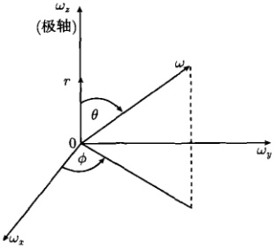

图 12.1 球坐标系  $ (\omega,\theta,\phi) $
 

 $$ \begin{aligned}u(r)&=\frac{1}{(2\pi)^{3}\varepsilon}\int_{0}^{\infty}\int_{0}^{\pi}\int_{0}^{2\pi}\left[\frac{\mathrm{e}^{\mathrm{i}\omega r\cos\theta}}{\omega^{2}}\right]\omega^{2}\sin\theta\mathrm{d}\omega\mathrm{d}\theta\mathrm{d}\phi\\&=\frac{1}{(2\pi)^{3}\varepsilon}\int_{0}^{\infty}\mathrm{d}\omega\int_{0}^{\pi}\mathrm{e}^{\mathrm{i}\omega r\cos\theta}\sin\theta\mathrm{d}\theta\int_{0}^{2\pi}\mathrm{d}\phi\\&=\frac{1}{2\pi^{2}\varepsilon r}\int_{0}^{\infty}\frac{\sin\omega r}{\omega}\mathrm{d}\omega[ 利用式 (3.1.12a)]\\&=\frac{1}{4\pi\varepsilon r}\\ \end{aligned} $$ 

这正是  $ r_{0}=0 $ 时的式 (12.1.3)，即位于坐标原点的点源的格林函数为

$$  G(r,0)=\frac{1}{4\pi\varepsilon r}   \tag*{(12.1.9)}$$

接下来我们通过例题求解二维情况下的格林函数。

<!-- page: 364 -->

例 1 求解二维无界域的点源方程

$$  \frac{\partial^{2}u}{\partial x^{2}}+\frac{\partial^{2}u}{\partial y^{2}}=-\frac{1}{\varepsilon}\delta(x)\delta(y)   \tag*{(12.1.10)}$$

解 方程 (12.1.10) 的解  $ u(x,y) $ 表示位于  $ (0,0) $ 的点源在任意点  $ (x,y) $ 的影响。物理上， $ u(x,y) $ 则表示位于 z 轴的无限长线电荷在 x-y 平面上任意点形成的电位。

我们用物理的方法求解方程(12.1.10)。根据静电场知识，无限长线电荷在空间的电场是轴对称的，电场的大小只与观察点到线电荷的距离 r 有关。为了求出 r 处的电场强度，通常作一个以线电荷为轴的封闭圆柱面 S，其高度为 L，半径为 r，如图12.2所示。根据高斯定理

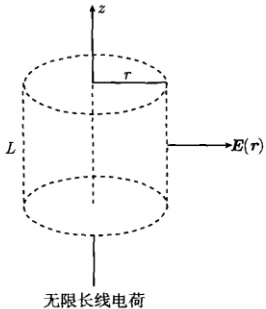

图 12.2 无限长线电荷形成的电场强度  $ E(r) $
 

$$  \iint\limits_{S}\boldsymbol{E}(\boldsymbol{r})\cdot\mathrm{d}\boldsymbol{S}=\frac{L\rho}{\varepsilon}   \tag*{(12.1.11)}$$

其中， $ \pmb{E}(r) $ 是电场强度； $ \rho $ 是线电荷密度。由于  $ E(r) $ 的方向与圆柱侧面垂直，所以式 (12.1.11) 在圆柱上、下底面的积分为零，而电场强度的大小在圆柱的侧面为常数  $ E(r) $，故式 (12.1.11) 给出

$$  E(r)2\pi r L=\frac{L\rho}{\varepsilon}\Rightarrow E(r)=\frac{\rho}{2\pi\varepsilon r}   \tag*{(12.1.12)}$$

而观察点的电位  $ u(x,y) $ 由

$$  E(r)=-\frac{\mathrm{d}u(r)}{\mathrm{d}r}   \tag*{(12.1.13)}$$

确定。将式(12.1.12)代入式(12.1.13)，取 r=1 处的电位为参考电位，即  $ u(1)=0 $，则式(12.1.13)给出

$$  \int_{0}^{u(r)}\mathrm{d}u(r)=-\int_{1}^{r}\frac{\rho}{2\pi\varepsilon r}\mathrm{d}r   \tag*{(12.1.14)}$$

结果为

$$  u(r)=\frac{\rho}{2\pi\varepsilon}\ln\frac{1}{r}   \tag*{(12.1.15)}$$

这就是线密度为  $ \rho $ 的无限长线电荷在 r 处形成的电位。如果  $ \rho = 1 $，式 (12.1.15) 变为

$$  u(r)=\frac{1}{2\pi\varepsilon}\ln\frac{1}{r}   \tag*{(12.1.16)}$$

<!-- page: 365 -->

这就是具有单位线密度的无限长线电荷在离它 r 处形成的电位。式 (12.1.16) 作为方程 (12.1.10) 的解表示二维情况下的格林函数。

### 12.2 三维波动方程问题

本节我们用格林函数法求解三维波动方程的定解问题 [见式（10.6.0）]

$$  \left\{\begin{array}{l}\frac{\partial^{2}w}{\partial t^{2}}=a^{2}\left(\frac{\partial^{2}w}{\partial x^{2}}+\frac{\partial^{2}w}{\partial y^{2}}+\frac{\partial^{2}w}{\partial z^{2}}\right)\quad(-\infty<x,y,z<+\infty,t>0)\end{array}\right.   \tag*{(12.2.1a)}$$

$$  \left\{\begin{array}{l}w\big|_{t=0}=\phi(x,y,z)\end{array}\right.\quad(-\infty<x,y,z<+\infty)   \tag*{(12.2.1b)}$$

$$  \left\lfloor\begin{array}{r}{\frac{\partial w}{\partial t}\bigg|_{t=0}=\psi(x,y,z)}\\ \end{array}\right.\qquad(-\infty<x,y,z<+\infty)   \tag*{(12.2.1c)}$$

首先求解初始位移  $ \phi(x,y,z)=0 $ 时的定解问题

$$  \left\{\begin{array}{l}\frac{\partial^{2}u}{\partial t^{2}}=a^{2}\left(\frac{\partial^{2}u}{\partial x^{2}}+\frac{\partial^{2}u}{\partial y^{2}}+\frac{\partial^{2}u}{\partial z^{2}}\right)\quad(-\infty<x,y,z<+\infty,t>0)\end{array}\right.   \tag*{(12.2.2a)}$$

$$  u\big|_{t=0}=0   \tag*{(12.2.2b)}$$

$$  \left\lfloor\begin{array}{r}{\left.{\frac{\partial u}{\partial t}}\right|_{t=0}=\psi(x,y,z)}\\ {\quad(-\infty<x,y,z<+\infty)}\end{array}\right.   \tag*{(12.2.2c)}$$

设式(12.2.2)的解为

$$  u(\boldsymbol{r},t)=\underset{\infty}{\iiint}\psi(\boldsymbol{r}_{0})G(\boldsymbol{r},\boldsymbol{r}_{0},t)\mathrm{d}\boldsymbol{r}_{0}   \tag*{(12.2.3)}$$

其中，格林函数  $ G(r, r_{0}, t) $ 是 t 时刻的瞬时点源。将式 (12.2.3) 代入式 (12.2.2) 得到关于格林函数  $ G(r, r_{0}, t) $ 的定解问题

$$  \frac{\partial^{2}G}{\partial t^{2}}=a^{2}\left(\frac{\partial^{2}G}{\partial x^{2}}+\frac{\partial^{2}G}{\partial y^{2}}+\frac{\partial^{2}G}{\partial z^{2}}\right)   \tag*{(12.2.4a)}$$

$$  G\big|_{t=0}=0   \tag*{(12.2.4b)}$$

$$  \left.\frac{\partial G}{\partial t}\right|_{t=0}=\delta(x-x_{0})\delta(y-y_{0})\delta(z-z_{0})   \tag*{(12.2.4c)}$$

格林函数的定解问题 (12.2.4) 与相应的式 (12.2.2) 相比较，方程是相同的，初始位移都是零，而初始速度变为  $ \delta(r-r_{0}) $ 函数。定解问题 (12.2.4) 的解  $ G(r,r_{0},t) $ 表示  $ r_{0} $ 处的点源引起的电位分布。简单起见，我们在式 (12.2.4) 中令  $ x_{0}=y_{0}=z_{0}=0 $。这样，式 (12.2.4) 的解表示坐标原点  $ r_{0}=0 $ 处的点源引起的电位分布，记为

<!-- page: 366 -->

$ G(r,0,t)\equiv G(r,t) $。由于 $ r_{0}=0 $处的点源引起电位分布有球对称性（只与r有关），又可以将格林函数写为 $ G(r,t) $。下面我们先求出 $ G(r,t) $，再推广到 $ G(r,r_{0},t) $。

对式（12.2.4）作傅里叶变换，令

$$  \mathcal{F}\left\{G(r,t)\right\}=\iiint\limits_{\infty}G(r,t)\mathrm{e}^{-\mathrm{i}\omega\cdot r}\mathrm{d}r\equiv g(\omega,t)   \tag*{(12.2.5)}$$

得到

$$  \frac{\mathrm{d}^{2}g}{\mathrm{d}t^{2}}+a^{2}\omega^{2}g=0   \tag*{(12.2.6a)}$$

$$  g\big|_{t=0}=0   \tag*{(12.2.6b)}$$

$$  \frac{\mathrm{d}g}{\mathrm{d}t}\bigg|_{t=0}=1   \tag*{(12.2.6c)}$$

这个常微分方程问题的解为

$$  g(\omega,t)=\frac{\sin(a\omega t)}{a\omega}   \tag*{(12.2.7)}$$

对上式取傅里叶反变换，按照图12.1的方式取矢径r的方向，给出

$$  \begin{aligned}G(r,t)&=\frac{1}{(2\pi)^{3}a}\iiint\limits_{\infty}\frac{\sin(a\omega t)}{\omega}\mathrm{e}^{\mathrm{i}\omega\cdot r}\mathrm{d}\omega\\&=\frac{1}{(2\pi)^{3}a}\int_{0}^{\infty}\int_{0}^{\pi}\int_{0}^{2\pi}\left[\frac{\sin(a\omega t)}{\omega}\mathrm{e}^{\mathrm{i}\omega r\cos\theta}\right]\omega^{2}\sin\theta\mathrm{d}\omega\mathrm{d}\theta\mathrm{d}\phi\\&=\frac{1}{(2\pi)^{3}a}\int_{0}^{\infty}\omega\sin(a\omega t)\mathrm{d}\omega\int_{0}^{\pi}\mathrm{e}^{\mathrm{i}\omega r\cos\theta}\sin\theta\int_{0}^{2\pi}\mathrm{d}\phi\\&=\frac{1}{2\pi^{2}a r}\int_{0}^{\infty}\sin(a\omega t)\sin(\omega r)\mathrm{d}\omega\\ \end{aligned}   \tag*{(12.2.8)}$$

现在计算其中的积分，我们有

 $$ \begin{aligned}&\int_{0}^{\infty}\sin(a\omega t)\sin\left(\omega r\right)\mathrm{d}\omega\\=&\frac{1}{2\mathrm{i}}\int_{0}^{\infty}\sin(a\omega t)\mathrm{e}^{\mathrm{i}\omega r}\mathrm{d}\omega-\frac{1}{2\mathrm{i}}\int_{0}^{\infty}\sin(a\omega t)\mathrm{e}^{-\mathrm{i}\omega r}\mathrm{d}\omega\quad( 令 \omega=-\varOmega)\\=&-\frac{1}{2\mathrm{i}}\int_{-\infty}^{0}\sin(a\varOmega t)\mathrm{e}^{-\mathrm{i}\varOmega r}\mathrm{d}\varOmega-\frac{1}{2\mathrm{i}}\int_{0}^{\infty}\sin(a\omega t)\mathrm{e}^{-\mathrm{i}\omega r}\mathrm{d}\omega\\=&\frac{\mathrm{i}}{2}\int_{-\infty}^{\infty}\sin(a\omega t)\mathrm{e}^{-\mathrm{i}\omega r}\mathrm{d}\omega\quad[ 利用式 (3.3.1a)]\\=&\frac{\pi}{2}\left[\delta(r-at)-\delta(r+at)\right]\end{aligned} $$

<!-- page: 367 -->

这个积分结果还可以用另一种方法得到，事实上

 $$ \begin{aligned}&\int_{0}^{\infty}\sin(a\omega t)\sin\left(\omega r\right)\mathrm{d}\omega=\frac{1}{2}\int_{-\infty}^{\infty}\sin(a\omega t)\sin\left(\omega r\right)\mathrm{d}\omega\\=&\frac{1}{2}\int_{-\infty}^{\infty}\frac{\mathrm{e}^{\mathrm{i}\omega t}-\mathrm{e}^{-\mathrm{i}a\omega t}}{2\mathrm{i}}\frac{\mathrm{e}^{\mathrm{i}\omega r}-\mathrm{e}^{-\mathrm{i}\omega r}}{2\mathrm{i}}\mathrm{d}\omega\quad\left[ 利用式 (3.2.23)\right]\\=&\frac{1}{4}\left[\int_{-\infty}^{\infty}\mathrm{e}^{-\mathrm{i}\omega(a t-r)}\mathrm{d}\omega-\int_{-\infty}^{\infty}\mathrm{e}^{-\mathrm{i}\omega(a t+r)}\mathrm{d}\omega\right]\quad\left[ 利用式 (3.2.22)\right]\\=&\frac{\pi}{2}\left[\delta(r-a t)-\delta(r+a t)\right]\end{aligned} $$ 

代入式(12.2.8)得到

$$  G(r,t)=\frac{1}{4\pi a r}\left[\delta(r-a t)-\delta(r+a t)\right]   \tag*{(12.2.9)}$$

当 t > 0 时，式 (12.2.9) 右端的  $ \delta(r + at) = 0 $ (因为 r > 0)，因此式 (12.2.9) 实际上为

$$  G(r,t)=\frac{1}{4\pi a}\frac{\delta(r-at)}{r}   \tag*{(12.2.10)}$$

式(12.2.10)表示 $ r_{0}=0 $处的点源引起的电位分布，于是位于 $ r_{0} $的点源引起的电位分布为

$$  G(\boldsymbol{r},\boldsymbol{r}_{0},t)=\frac{1}{4\pi a}\frac{\delta\left(|\boldsymbol{r}-\boldsymbol{r}_{0}|-a t\right)}{|\boldsymbol{r}-\boldsymbol{r}_{0}|}   \tag*{(12.2.11)}$$

将式（12.2.11）代入式（12.2.3）得到

$$  u(r,t)=\frac{1}{4\pi a}\iint\limits_{\infty}\psi(r_{0})\frac{\delta(|r-r_{0}|-at)}{|r-r_{0}|}\mathrm{d}r_{0}   \tag*{(12.2.12)}$$

这就是定解问题（12.2.4）的解。

下一步我们要求解初始速度  $ \psi(x,y,z)=0 $ 的定解问题

$$  \left\{\begin{array}{c}{\displaystyle\frac{\partial^{2}v}{\partial t^{2}}=a^{2}\left(\frac{\partial^{2}v}{\partial x^{2}}+\frac{\partial^{2}v}{\partial y^{2}}+\frac{\partial^{2}v}{\partial z^{2}}\right)\quad(-\infty<x,y,z<+\infty,t>0)}\end{array}\right.   \tag*{(12.2.13a)}$$

 $$ (-\infty<x,y,z<+\infty) $$ 

$$  \left\lfloor\left.{\frac{\partial v}{\partial t}}\right|_{t=0}=0\right.   \tag*{(12.2.13c)}$$

将它的解与式（12.2.12）相加才能得到式（12.2.1）的解。设定解问题

$$  \left\{\begin{array}{l l}\displaystyle\frac{\partial^{2}u}{\partial t^{2}}=a^{2}\left(\frac{\partial^{2}u}{\partial x^{2}}+\frac{\partial^{2}u}{\partial y^{2}}+\frac{\partial^{2}u}{\partial z^{2}}\right)&(-\infty<x,y,z<+\infty,t>0)\\ \left.u\right|_{t=0}=0&\\ \displaystyle\frac{\partial u}{\partial t}\bigg|_{t=0}=\phi(x,y,z)&(-\infty<x,y,z<+\infty)\end{array}\right.   \tag*{(12.2.14a)}$$

<!-- page: 368 -->

的解为  $ u(r,t) $，则式 (12.2.13) 的解为

$$  v(\boldsymbol{r},t)=\frac{\partial u(\boldsymbol{r},t)}{\partial t}   \tag*{(12.2.15)}$$

我们来验证这一结论。事实上，将式（12.2.15）代入式（12.2.13a）得到

 $$ \begin{aligned}\frac{\partial^{2}v}{\partial t^{2}}-a^{2}\left(\frac{\partial^{2}v}{\partial x^{2}}+\frac{\partial^{2}v}{\partial y^{2}}+\frac{\partial^{2}v}{\partial z^{2}}\right)&=\frac{\partial^{3}u}{\partial t^{3}}-a^{2}\frac{\partial}{\partial t}\left(\frac{\partial^{2}u}{\partial x^{2}}+\frac{\partial^{2}u}{\partial y^{2}}+\frac{\partial^{2}u}{\partial z^{2}}\right)\\&=\frac{\partial}{\partial t}\left[\frac{\partial^{2}u}{\partial t^{2}}-a^{2}\left(\frac{\partial^{2}u}{\partial x^{2}}+\frac{\partial^{2}u}{\partial y^{2}}+\frac{\partial^{2}u}{\partial z^{2}}\right)\right]\end{aligned} $$ 

将式（12.2.14a）代入上式，正好得到

$$  \frac{\partial^{2}v}{\partial t^{2}}=a^{2}\left(\frac{\partial^{2}v}{\partial x^{2}}+\frac{\partial^{2}v}{\partial y^{2}}+\frac{\partial^{2}v}{\partial z^{2}}\right)   \tag*{(12.2.16)}$$

可见解式 (12.2.15) 满足泛定方程 (12.2.13a)。另外将式 (12.2.15) 代入式 (12.2.13b) 的左端，并利用式 (12.2.14c)，得到

$$  v(x,y,z,0)=\frac{\partial u}{\partial t}\bigg|_{t=0}=\phi(x,y,z)   \tag*{(12.2.17)}$$

可见解式 (12.2.15) 满足条件式 (12.2.13b)。最后将式 (12.2.15) 代入式 (12.2.13c) 的左端，并利用式 (12.2.14a) 和式 (12.2.14b)，得到

 $$ \begin{aligned}\left.\frac{\partial v(x,y,z,t)}{\partial t}\right|_{t=0}&=\left.\frac{\partial^{2}u(x,y,z,t)}{\partial t^{2}}\right|_{t=0}\\&=\left.a^{2}\nabla^{2}u(x,y,z,t)\right|_{t=0}=\left.a^{2}\nabla^{2}u(x,y,z,0)\right.\\&=\left.a^{2}\nabla^{2}0=0\right.\end{aligned} $$ 

可见式(12.2.15)满足条件式(12.2.13c)。总之，式(12.2.15)满足式(12.2.13)的所有条件，是式(12.2.13)的解。

显然，关于  $ u(r,t) $ 的定解问题 (12.2.14) 与式 (12.2.2) 在形式上相同的，因此只需要将式 (12.2.3) 中的  $ \psi(r_{0}) $ 换成  $ \phi(r_{0}) $，再代入式 (12.2.15)，便得到定解问题 (12.2.13) 的解

$$  v(\boldsymbol{r},t)=\frac{\partial}{\partial t}\iiint\limits_{\infty}\phi(\boldsymbol{r}_{0})G(\boldsymbol{r},\boldsymbol{r}_{0},t)\mathrm{d}\boldsymbol{r}_{0}   \tag*{(12.2.18)}$$

最后将式（12.2.18）与式（12.2.12）相加得到

$$  w(\boldsymbol{r},t)=\frac{\partial}{\partial t}\iiint\limits_{\infty}\phi(\boldsymbol{r}_{0})G(\boldsymbol{r},\boldsymbol{r}_{0},t)\mathrm{d}\boldsymbol{r}_{0}+\iiint\limits_{\infty}\psi(\boldsymbol{r}_{0})G(\boldsymbol{r},\boldsymbol{r}_{0},t)\mathrm{d}\boldsymbol{r}_{0}   \tag*{(12.2.19)}$$

<!-- page: 369 -->

这就是定解问题 (12.2.1) 解的积分公式。这里格林函数  $ G(r, r_0, t) $ 表示点源产生的“场”，式 (12.2.19) 中的两个积分分别刻画初始位移  $ \phi(r_0) $ 和初始速度  $ \psi(r_0) $ 对任意 t 时刻“场分布”的贡献。利用  $ G(r, r_0, t) $ 的表达式 (12.2.11)，可将式 (12.2.19) 写为

$$  \begin{aligned}{w(\mathbf{r},t)=}&{{}\frac{1}{4\pi a}\frac{\partial}{\partial t}\iiint\displaylimits_{\infty}\phi(\mathbf{r}_{0})\frac{\delta\left(|\mathbf{r}-\mathbf{r}_{0}|-a t\right)}{|\mathbf{r}-\mathbf{r}_{0}|}\mathrm{d}\mathbf{r}_{0}}\\ {}&{{}+\frac{1}{4\pi a}\iiint\displaylimits_{\infty}\psi(\mathbf{r}_{0})\frac{\delta(|\mathbf{r}-\mathbf{r}_{0}|-a t)}{|\mathbf{r}-\mathbf{r}_{0}|}\mathrm{d}\mathbf{r}_{0}}\\ \end{aligned}   \tag*{(12.2.20)}$$

这就是定解问题(12.2.1)的解。它可以进一步被简化，可以看出，在解(12.2.20)中只有当

$$  |\boldsymbol{r}-\boldsymbol{r}_{0}|=a t   \tag*{(12.2.21)}$$

即

$$  (x-x_{0})^{2}+(y-y_{0})^{2}+(z-z_{0})^{2}=(a t)^{2}   \tag*{(12.2.22)}$$

时，其中的积分才是非零的。这表示只有在以 $ r=\{x,y,z\} $为中心、以at为半径的球面上的扰动 $ \phi(r_{0}) $和 $ \psi(r_{0}) $才对式(12.2.20)中的积分有贡献，如图12.3所示。这样式(12.2.20)可以写成

$$  w(\boldsymbol{r},t)=\frac{1}{4\pi a}\left[\frac{\partial}{\partial t}\iint\limits_{S_{a t}^{r}}\frac{\phi(\boldsymbol{r}_{0})}{a t}\mathrm{d}S+\iint\limits_{S_{a t}^{r}}\frac{\psi(\boldsymbol{r}_{0})}{a t}\mathrm{d}S\right]   \tag*{(12.2.23)}$$

其中， $ S_{at}^{r} $ 是以  $ r=\{x,y,z\} $ 为中心，以 at 为半径的球面。式 (12.2.23) 就是第 10.6.2 节所讨论的泊松公式。当初始扰动  $ \phi(r_{0}) $ 和  $ \psi(r_{0}) $ 在球面式 (12.2.21) 的外部和内部时， $ w(r,t)=0 $，如图 12.3 所示。

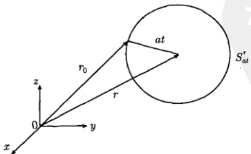

图 12.3 式 (12.2.23) 的积分在以  $ r = \{x, y, z\} $ 为中心、以 at 为半径的球面  $ S_{at}^{r} $ 上进行
 

<!-- page: 370 -->

### 12.3 一维有界热传导问题

本节我们用格林函数法求解一维有界域边值问题，考虑下列具有齐次边界条件的有源热传导问题

$$  \left\{\begin{array}{l}\frac{\partial w}{\partial t}=a^{2}\frac{\partial^{2}w}{\partial x^{2}}+f(x,t)\quad(0<x<L,t>0)\end{array}\right.   \tag*{(12.3.1a)}$$

$$  w\big|_{t=0}=\phi(x)\quad(0\leqslant x\leqslant L)   \tag*{(12.3.1b)}$$

$$  w\big|_{x=0}=0,w\big|_{x=L}=0\quad(t>0)   \tag*{(12.3.1c)}$$

首先求解无热源  $ [f(x,t)=0] $ 时的定解问题

$$  \left\{\begin{array}{l l}{\displaystyle\frac{\partial u}{\partial t}=a^{2}\frac{\partial^{2}u}{\partial x^{2}}\qquad}&{\qquad(0<x<L,~t>0)}\end{array}\right.   \tag*{(12.3.2a)}$$

$$  u\big|_{t=0}=\phi(x)\quad(0\leqslant x\leqslant L)   \tag*{(12.3.2b)}$$

$$  u\big|_{x=0}=0,u\big|_{x=L}=0\quad(t>0)   \tag*{(12.3.2c)}$$

设式(12.3.2)的解为

$$  u(x,t)=\int_{0}^{L}\phi(x_{0})G(x,x_{0},t)\mathrm{d}x_{0}   \tag*{(12.3.3)}$$

其中，格林函数  $ G(x,x_{0},t) $ 是 t 时刻瞬时点源。将式 (12.3.3) 代入式 (12.3.2) 得到关于  $ G(x,x_{0},t) $ 的定解问题

$$  \left\{\begin{array}{l l}{\displaystyle\frac{\partial G}{\partial t}=a^{2}\frac{\partial^{2}G}{\partial x^{2}}\qquad}&{(0<x<L,~t>0)}\end{array}\right.   \tag*{(12.3.4a)}$$

$$  G\big|_{t=0}=\delta(x-x_{0})\qquad\quad(0\leqslant x\leqslant L)   \tag*{(12.3.4b)}$$

$$  G|_{x=0}=0,G|_{x=L}=0\quad(t>0)   \tag*{(12.3.4c)}$$

格林函数的定解问题 (12.3.4) 与相应的定解问题 (12.3.2) 相比较，方程是相同的，边界条件是相同的，初始条件变为  $ \delta $ 函数。定解问题 (12.3.4) 的解  $ G(x, x_0, t) $ 表示  $ x_0 $ 处的点源引起的电位分布。

我们用第8章所讨论的特征函数法求解该定解问题，容易得到一般解

$$  G(x,x_{0},t)=\sum_{n=1}^{\infty}C_{n}\exp\left[-\left(\frac{na\pi}{L}\right)^{2}t\right]\sin\frac{n\pi}{L}x   \tag*{(12.3.5)}$$

其中

$$  C_{n}=\frac{2}{L}\int_{0}^{L}\delta(x-x_{0})\sin\frac{n\pi}{L}x\mathrm{d}x=\frac{2}{L}\sin\frac{n\pi}{L}x_{0}   \tag*{(12.3.6)}$$

<!-- page: 371 -->

将式(12.3.6)代入式(12.3.5)得到

$$  G(x,x_{0},t)=\frac{2}{L}\sum_{n=1}^{\infty}\mathrm{e}^{-\left(\frac{n\pi}{L}\right)^{2}t}\sin\frac{n\pi}{L}x\sin\frac{n\pi}{L}x_{0}   \tag*{(12.3.7)}$$

再将式（12.3.7）代入式（12.3.3）得到

$$  u(x,t)=\frac{2}{L}\int_{0}^{L}\left[\sum_{n=1}^{\infty}\mathrm{e}^{-\left(\frac{n\pi}{L}\right)^{2}t}\sin\frac{n\pi}{L}x\sin\frac{n\pi}{L}x_{0}\right]\phi(x_{0})\mathrm{d}x_{0}   \tag*{(12.3.8)}$$

这就是定解问题（12.3.2）的解，与本征函数法的结果[式（8.2.33）]相同。

下一步我们要求解非齐次方程的定解问题

$$  \left\{\begin{array}{l}\frac{\partial v}{\partial t}=a^{2}\frac{\partial^{2}v}{\partial x^{2}}+f(x,t)\quad(0<x<L,\;t>0)\end{array}\right.   \tag*{(12.3.9a)}$$

$$  v\big|_{t=0}=0\quad(0\leqslant x\leqslant L)   \tag*{(12.3.9b)}$$

$$  v\big|_{x=0}=0,v\big|_{x=L}=0\quad(t>0)   \tag*{(12.3.9c)}$$

将它的解与式（12.3.8）相加才能得到式（12.3.1）的解。设定解问题

$$  \left\{\begin{array}{l l}{\displaystyle\frac{\partial u}{\partial t}=a^{2}\frac{\partial^{2}u}{\partial x^{2}}\qquad}&{\qquad(0<x<L,\;t>0)}\end{array}\right.   \tag*{(12.3.10a)}$$

$$  u\big|_{t=\tau}=f(x,\tau)\quad(0\leqslant x\leqslant L)   \tag*{(12.3.10b)}$$

$$  u\big|_{x=0}=0,u\big|_{x=L}=0\quad(t>0)   \tag*{(12.3.10c)}$$

的解为  $ u(x,t,\tau) $，则式 (12.3.9) 的解为

$$  v(x,t)=\int_{0}^{t}u(x,t,\tau)\mathrm{d}\tau   \tag*{(12.3.11)}$$

注意这个解是积分形式，与 12.2 节微分形式的式 (12.2.15) 不同。我们来验证式 (12.3.11) 是式 (12.3.9) 的解。将式 (12.3.11) 代入式 (12.3.9c)，并利用式 (12.3.10c)，得到

$$  v(0,t)=\int_{0}^{t}u\big|_{x=0}\mathrm{d}\tau=0,\quad v(L,t)=\int_{0}^{t}u\big|_{x=L}\mathrm{d}\tau=0   \tag*{(12.3.12)}$$

可见解（12.3.11）满足边界条件式（12.3.9c）。另外将式（12.3.11）代入式（12.3.9b），得到

$$  v(x,0)=\int_{0}^{0}u\mathrm{d}\tau=0   \tag*{(12.3.13)}$$

<!-- page: 372 -->

可见解（12.3.11）满足初始条件式（12.3.9b）。最后将式（12.3.11）代入式（12.3.9a），并利用式（12.3.10a）和式（12.3.10b），我们有

 $$ \begin{aligned}\frac{\partial v}{\partial t}&=\int_{0}^{t}\frac{\partial u(x,t,\tau)}{\partial t}\mathrm{d}\tau+u\big|_{t=\tau}\left[ 利用式 (10.5.1)\right]\\&=\int_{0}^{t}a^{2}\frac{\partial^{2}u(x,t,\tau)}{\partial x^{2}}\mathrm{d}\tau+f(x,t)\\&=a^{2}\frac{\partial^{2}}{\partial x^{2}}\int_{0}^{t}u(x,t,\tau)\mathrm{d}\tau+f(x,t)\\&=a^{2}\frac{\partial^{2}v}{\partial x^{2}}+f(x,t)\end{aligned} $$ 

可见式（12.3.11）满足方程(12.3.9a)。总之，式(12.3.11)满足式(12.3.9)的所有条件，因此是式(12.3.9)的解。

显然，关于  $ u(x,t,\tau) $ 的定解问题 (12.3.10) 与式 (12.3.2) 是形式上相同的，因此只需要将式 (12.3.3) 中的  $ G(x,x_0,t) $ 换成  $ G(x,x_0,t-\tau) $，将  $ \phi(x_0) $ 换成  $ f(x_0,\tau) $，便得到

$$  u(x,t,\tau)=\int_{0}^{L}f(x_{0},\tau)G(x,x_{0},t-\tau)\mathrm{d}x_{0}   \tag*{(12.3.14)}$$

其中，格林函数由式（12.3.7）变为

$$  G(x,x_{0},t-\tau)=\frac{2}{L}\sum_{n=1}^{\infty}\mathrm{e}^{-\left(\frac{n\alpha\pi}{L}\right)^{2}(t-\tau)}\sin\frac{n\pi}{L}x\sin\frac{n\pi}{L}x_{0}   \tag*{(12.3.15)}$$

将式 (12.3.14) 代入式 (12.3.11) 得到  $ v(x,t) $ 的表达式

$$  v(x,t)=\int_{0}^{t}\int_{0}^{L}f(x_{0},\tau)G(x,x_{0},t-\tau)\mathrm{d}x_{0}\mathrm{d}\tau   \tag*{(12.3.16)}$$

将式（12.3.3）与式（12.3.16）相加得到

$$  w(x,t)=\int_{0}^{L}\phi(x_{0})G(x,x_{0},t)\mathrm{d}x_{0}+\int_{0}^{t}\int_{0}^{L}f(x_{0},\tau)G(x,x_{0},t-\tau)\mathrm{d}x_{0}\mathrm{d}\tau   \tag*{(12.3.17)}$$

这就是定解问题 (12.3.1) 解的积分公式。这里，格林函数  $ G(x, x_0, t) $ 表示 0 时刻点源产生的温度场，而  $ G(x, x_0, t - \tau) $ 表示  $ \tau $ 时刻点源产生的温度场。其中的两个积分分别刻画初始温度分布  $ \phi(x_0) $ 和外热源  $ f(x_0, \tau) $ 对任意 t 时刻温度场的贡献。注意到式 (12.3.17) 与无边界有源热传导问题的解 (11.3.30) 具有相同的表达形式，这表示用格林函数表示解的积分公式具有普遍意义。利用  $ G(x, x_0, t) $ 的表示式 (12.3.7) 和  $ G(x, x_0, t - \tau) $ 的表示式 (12.3.15)，式 (12.3.17) 写为

<!-- page: 373 -->

$$  \begin{align*}w(x,t)=&\frac{2}{L}\int_{0}^{L}\left[\sum_{n=1}^{\infty}\mathrm{e}^{-\left(\frac{n\pi\pi}{L}\right)^{2}t}\sin\frac{n\pi}{L}x\sin\frac{n\pi}{L}x_{0}\right]\phi(x_{0})\mathrm{d}x_{0}\\&+\frac{2}{L}\int_{0}^{t}\int_{0}^{L}\left[\sum_{n=1}^{\infty}\mathrm{e}^{-\left(\frac{n\pi\pi}{L}\right)^{2}(t-\tau)}\sin\frac{n\pi}{L}x\sin\frac{n\pi}{L}x_{0}\right]f(x_{0},\tau)\mathrm{d}x_{0}\mathrm{d}\tau\end{align*}   \tag*{(12.3.18)}$$

这就是定解问题（12.3.1）的解，与本征函数法的结果[式（8.2.30）]相同。

我们进一步求解下列具有非齐次边界条件的有源热传导问题

$$  \left\{\begin{array}{l l}{\displaystyle\frac{\partial w}{\partial t}=a^{2}\frac{\partial^{2}w}{\partial x^{2}}+f(x,t)\qquad}&{(0<x<L,\;t>0)}\end{array}\right.   \tag*{(12.3.19a)}$$

$$  \left\{\begin{array}{r}w|_{t=0}=\phi(x)\quad(0\leqslant x\leqslant L)\end{array}\right.   \tag*{(12.3.19b)}$$

$$  \left\{\begin{array}{c|c}{w|_{x=0}=u_{1}(t),w|_{x=L}=u_{2}(t)}&{(t>0)}\end{array}\right.   \tag*{(12.3.19c)}$$

其中， $ u_{1}(t) $ 和  $ u_{2}(t) $ 是系统 x=0 和 x=L 端的边界函数。为了把边界条件齐次化，取变换

$$  w(x,t)=u(x,t)+\varOmega(x,t)   \tag*{(12.3.20)}$$

其中辅助函数由表8.1查出为

$$  \Omega(x,t)=\frac{u_{2}(t)-u_{1}(t)}{L}x+u_{1}(t)   \tag*{(12.3.21)}$$

将式 (12.3.20) 代入式 (12.3.19) 得到关于  $ u(x,t) $ 的定解问题

$$  \frac{\partial u}{\partial t}=a^{2}\frac{\partial^{2}u}{\partial x^{2}}+F(x,t)\quad(0<x<L,t>0)   \tag*{(12.3.22a)}$$

$$  u\big|_{t=0}=\Phi(x)\quad(0\leqslant x\leqslant L)   \tag*{(12.3.22b)}$$

$$  u\big|_{x=0}=0,u\big|_{x=L}=0\qquad(t>0)   \tag*{(12.3.22c)}$$

其中

$$  \Phi(x)=\phi(x)-\Omega(x,0)   \tag*{(12.3.23a)}$$

$$  F(x,t)=f(x,t)-\left[\frac{\partial\Omega(x,t)}{\partial t}-a^{2}\frac{\partial^{2}\Omega(x,t)}{\partial x^{2}}\right]   \tag*{(12.3.23b)}$$

现在式（12.3.22）就是定解问题（12.3.1）。故式（12.3.19）的解由式（12.3.18）表示，而其中的初始温度分布及外热源由式（12.3.23）给出。

从 12.2 节和 12.3 节的讨论中可以领会到用格林函数法求解定解问题的主要步骤：① 建立格林函数 G 的定解问题 [式 (12.2.4) 和式 (12.3.4)]；② 求解该定解

<!-- page: 374 -->

问题得到格林函数 [式 (12.2.11) 和式 (12.3.7)]；③ 利用解的积分公式 [式 (12.2.19) 和式 (12.3.17)] 得到定解问题的解。

### 12.4 格林公式

从本节起，我们进一步用格林函数法求解拉普拉斯方程和泊松方程的定解问题。在这种情况下，解的积分公式可利用格林公式来求得。我们首先介绍有关格林公式的基础理论知识。

#### 12.4.1 格林定理

格林定理是关于多变量微积分的一个重要定理，它把一个沿封闭环的线积分与环所包围区域的面积分联系起来。

设 C 是一个分段光滑的封闭环，它所包围的区域为 D，设函数  $ M(x,y) $ 和  $ N(x,y) $ 在 C 和 D 上连续，且一阶偏导数连续，则有

$$  \int_{C}\left[M(x,y)\mathrm{d}x+N(x,y)\mathrm{d}y\right]=\iint\limits_{D}\left(\frac{\partial N}{\partial x}-\frac{\partial M}{\partial y}\right)\mathrm{d}x\mathrm{d}y   \tag*{(12.4.1)}$$

这就是格林定理（或称为平面格林定理）。我们首先用一个简单的例子验证它的正确性。设 C 是一个正向封闭环（图 12.4），它所包围的区域为 D。很明显，区域 D 的面积可以由下面的任一个积分表示

$$  \int_{C}-y\mathrm{d}x,\quad\int_{C}x\mathrm{d}y,\quad\frac{1}{2}\int_{C}\left(-y\mathrm{d}x+x\mathrm{d}y\right)   \tag*{(12.4.2)}$$

现在我们利用这个事实来验证格林定理 (12.4.1)。首先取  $ M(x,y) = -y $,  $ N(x,y) = 0 $, 代入式 (12.4.1), 得到

$$  \int_{C}-y\mathrm{d}x=\iint_{D}\mathrm{d}x\mathrm{d}y=D\text{ 的面积 }   \tag*{(12.4.3a)}$$

类似地，取  $ M(x,y)=0 $， $ N(x,y)=x $，代入式 (12.4.1)，得到

$$  \int_{C}x\mathrm{d}y=\iint_{D}\mathrm{d}x\mathrm{d}y=D\  的面积   \tag*{(12.4.3b)}$$

同样，我们取  $ M(x,y)=-y $， $ N(x,y)=x $，代入式(12.4.1)，得到

$$  \int_{C}\left(-y\mathrm{d}x+x\mathrm{d}y\right)=2\iint\limits_{D}\mathrm{d}x\mathrm{d}y   \tag*{(12.4.3c)}$$

<!-- page: 375 -->

即

$$  \frac{1}{2}\int_{C}\left(-y\mathrm{d}x+x\mathrm{d}y\right)=\iint\limits_{D}\mathrm{d}x\mathrm{d}y=D\  的面积   \tag*{(12.4.3d)}$$

式(12.4.3)验证了格林定理的正确性。

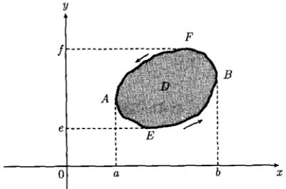

图 12.4 一个正向封闭环 C 和它所包围的区域 D
 

现在我们对于如图 12.4 所示的正向封闭环 C 和它所包围的区域 D 一般性地证明格林定理 (12.4.1)。

证明 设 C 是这样的封闭环，用任意平行于坐标轴的直线割 C 至多得两个交点。设曲线 AEB 和 AFB 分别由  $ y = Y_{1}(x) $ 和  $ y = Y_{2}(x) $ 表示，我们有

 $$ \begin{aligned}\iint\limits_{D}\frac{\partial M}{\partial y}\mathrm{d}x\mathrm{d}y&=\int_{x=a}^{b}\left[\int_{y=Y_{1}}^{Y_{2}}\frac{\partial M}{\partial y}\mathrm{d}y\right]\mathrm{d}x\\&=\int_{a}^{b}[M(x,y)]_{Y_{1}}^{Y_{2}}\mathrm{d}x=\int_{a}^{b}[M(x,Y_{2})-M(x,Y_{1})]\mathrm{d}x\\&=-\int_{a}^{b}M(x,Y_{1})\mathrm{d}x-\int_{b}^{a}M(x,Y_{2})\mathrm{d}x=-\int_{C}M\mathrm{d}x\end{aligned} $$ 

于是

$$  \int_{C}M\mathrm{d}x=-\iint\limits_{D}\frac{\partial M}{\partial y}\mathrm{d}x\mathrm{d}y   \tag*{(12.4.4)}$$

类似地，设曲线 EAF 和 EBF 的表示式分别为  $ x = X_{1}(y) $ 和  $ x = X_{2}(y) $，则

 $$ \begin{aligned}\iint\limits_{D}\frac{\partial N}{\partial x}\mathrm{d}x\mathrm{d}y&=\int_{y=e}^{f}\left[\int_{x=X_{1}}^{X_{2}}\frac{\partial N}{\partial x}\mathrm{d}x\right]\mathrm{d}y\\&=\int_{e}^{f}[N(X_{2},y)-N(X_{1},y)]\mathrm{d}y\end{aligned} $$

<!-- page: 376 -->

$$ =\int_{f}^{e}N(X_{1},y)\mathrm{d}y+\int_{e}^{f}N(X_{2},y)\mathrm{d}y=\int_{C}N\mathrm{d}y $$ 

于是

$$  \int_{C}N\mathrm{d}y=\iint\limits_{D}\frac{\partial N}{\partial x}\mathrm{d}x\mathrm{d}y   \tag*{(12.4.5)}$$

将式（12.4.4）与式（12.4.5）相加得

$$  \int_{C}\left(M\mathrm{d}x+N\mathrm{d}y\right)=\iint_{D}\left(\frac{\partial N}{\partial x}-\frac{\partial M}{\partial y}\right)\mathrm{d}x\mathrm{d}y   \tag*{(12.4.6)}$$

这个定理也可以推广到用平行于坐标轴的直线割 C 得到两个以上交点的情况。

#### 12.4.2 散度定理

设  $ \Gamma $ 是一个封闭曲面，它所包围的体积为  $ \Omega $，设曲面上任一点的外法线与 x 轴、y 轴、z 轴正向的夹角为  $ \alpha $、 $ \beta $、 $ \gamma $，设函数  $ M(x,y,z) $、 $ N(x,y,z) $、 $ R(x,y,z) $ 在  $ \Gamma $ 和  $ \Omega $ 上连续，且一阶偏导数连续，则有

$$  \iint\limits_{\Omega}\iint\left(\frac{\partial M}{\partial x}+\frac{\partial N}{\partial y}+\frac{\partial R}{\partial z}\right)\mathrm{d}V=\iint\limits_{T}\left(M\cos\alpha+N\cos\beta+R\cos\gamma\right)\mathrm{d}S   \tag*{(12.4.7)}$$

引入矢量函数  $ A(x,y,z) $ 和外法线矢量 n

$$  \boldsymbol{A}(x,y,z)=Mi+Nj+Rk\quad 和 \quad\boldsymbol{n}=\cos\alpha\boldsymbol{i}+\cos\beta\boldsymbol{j}+\cos\gamma\boldsymbol{k}   \tag*{(12.4.8)}$$

式（12.4.7）可以写成

$$  \iiint\limits_{\Omega}\nabla\cdot\boldsymbol{A}\mathrm{d}V=\iint\limits_{r}\boldsymbol{A}\cdot\boldsymbol{n}\mathrm{d}S   \tag*{(12.4.9)}$$

这个定理称为散度定理或空间格林定理。它表示矢量 A 在一个闭曲面 Γ 的外法向 n 上的分量沿 Γ 的面积分等于 A 的散度在 Γ 所包围的区域 Ω 内的体积分。它是格林定理 (12.4.6) 向三维情况的推广。

证明 设  $ \Gamma $ 是这样的闭曲面，用任意平行于坐标轴的直线割  $ \Gamma $ 至多得两个交点。考虑与图 12.4 相应的三维情况，设  $ \Gamma $ 的下半部分  $ \Gamma_{1} $ 和上半部分  $ \Gamma_{2} $ 分别由  $ z = Z_{1}(x, y) $ 和  $ z = Z_{2}(x, y) $ 表示，曲面  $ \Gamma $ 在 x - y 平面的投影为  $ \Sigma $。我们有

 $$ \begin{aligned}\iiint\limits_{\Omega}\frac{\partial R}{\partial z}\mathrm{d}V&=\iiint\limits_{\Omega}\frac{\partial R}{\partial z}\mathrm{d}x\mathrm{d}y\mathrm{d}z\\&=\iint\limits_{\Sigma}\left[\int_{z=Z_{1}}^{Z_{2}}\frac{\partial R}{\partial z}\mathrm{d}z\right]\mathrm{d}x\mathrm{d}y=\iint\limits_{\Sigma}\left[R(x,y,z)\right]_{Z_{1}}^{Z_{2}}\mathrm{d}x\mathrm{d}y\end{aligned} $$

<!-- page: 377 -->

$$ =\iint\limits_{\Sigma}[R(x,y,Z_{2})-R(x,y,Z_{1})]\mathrm{d}x\mathrm{d}y $$ 

对于闭曲面的上半部分  $ \Gamma_2 $， $ \mathrm{d}x\mathrm{d}y = (\cos\gamma_2)\mathrm{d}S_2 = k \cdot n_2\mathrm{d}S_2 $，这时， $ \mathrm{d}S_2 $ 的外法线  $ n_2 $ 与  $ k $ 方向构成锐角  $ \gamma_2 $，如图 12.5 所示。但是对于闭曲面的下半部分  $ \Gamma_1 $， $ \mathrm{d}S_1 $ 的外法线  $ n_1 $ 与  $ k $ 构成钝角  $ \gamma_1 (\cos\gamma_1 < 0) $，因此， $ \mathrm{d}x\mathrm{d}y = -(\cos\gamma_1)\mathrm{d}S_1 = -k \cdot n_1\mathrm{d}S_1 $。于是

$$  \begin{align*}\iint\limits_{\varSigma}R(x,y,Z_{2})\mathrm{d}x\mathrm{d}y&=\iint\limits_{\Gamma_{2}}R\boldsymbol{k}\cdot\boldsymbol{n}_{2}\mathrm{d}S_{2}\quad(12.4.\\\iint\limits_{\varSigma}R(x,y,Z_{1})\mathrm{d}x\mathrm{d}y&=-\iint\limits_{\Gamma_{1}}R\boldsymbol{k}\cdot\boldsymbol{n}_{1}\mathrm{d}S_{1}\end{align*}   \tag*{(12.4.10b)}$$

式（12.4.10a）与式（12.4.10b）相减，得到

 $$ \begin{aligned}&\iint\limits_{\Sigma}R(x,y,Z_{2})\mathrm{d}x\mathrm{d}y-\iint\limits_{\Sigma}R(x,y,Z_{1})\mathrm{d}x\mathrm{d}y\\=&\iint\limits_{F_{2}}R\boldsymbol{k}\cdot\boldsymbol{n}_{2}\mathrm{d}S_{2}+\iint\limits_{F_{1}}R\boldsymbol{k}\cdot\boldsymbol{n}_{1}\mathrm{d}S_{1}\\=&\iint\limits_{F}R\boldsymbol{k}\cdot\boldsymbol{n}\mathrm{d}S\end{aligned} $$ 

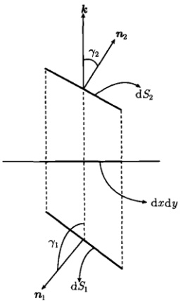

图 12.5 d $ S_{2} $ 的外法线  $ n_{2} $ 与 k 构成锐角  $ \gamma_{2} $，d $ S_{1} $ 的外法线  $ n_{1} $ 与 k 构成钝角  $ \gamma_{1} $
 

即

$$  \iint\limits_{\Omega}\int\limits_{\Omega}\frac{\partial R}{\partial z}\mathrm{d}V=\iint\limits_{r}R\boldsymbol{k}\cdot\boldsymbol{n}\mathrm{d}S   \tag*{(12.4.11a)}$$

同理可证

$$  \iint\limits_{\Omega}\frac{\partial M}{\partial x}\mathrm{d}V=\iint\limits_{R}M\boldsymbol{i}\cdot\boldsymbol{n}\mathrm{d}S   \tag*{(12.4.11b)}$$

$$  \iint\limits_{\Omega}\int\limits_{\Omega}\frac{\partial N}{\partial y}\mathrm{d}V=\iint\limits_{r}N\boldsymbol{j}\cdot\boldsymbol{n}\mathrm{d}S   \tag*{(12.4.11c)}$$

式（12.4.11）的三式相加得到

$$  \iint_{\Omega}\left(\frac{\partial M}{\partial x}+\frac{\partial N}{\partial y}+\frac{\partial R}{\partial z}\right)\mathrm{d}V=\iint_{\Gamma}\left(M\boldsymbol{i}+N\boldsymbol{j}+R\boldsymbol{k}\right)\cdot\boldsymbol{n}\mathrm{d}S   \tag*{(12.4.12a)}$$

<!-- page: 378 -->

注意到式(12.4.8)，它可以写成

$$  \iiint_{\Omega}\nabla\cdot\boldsymbol{A}\mathrm{d}V=\iint_{\Gamma}\boldsymbol{A}\cdot\boldsymbol{n}\mathrm{d}S   \tag*{(12.4.12b)}$$

这个定理也可以推广到用平行于坐标轴的直线割  $ \Gamma $ 得到两个以上交点的情况。

另外，散度定理可以约化为二维情况。事实上，设 C 是一个封闭环，它所包围的面积为 D，设函数  $ M(x,y) $、 $ N(x,y) $ 在 C 和 D 上连续，且一阶偏导数连续，在式 (12.4.8) 中取

$$  \boldsymbol{A}(x,y)=Mi+Nj\quad 和 \quad\boldsymbol{n}=\cos\alpha\boldsymbol{i}+\cos\beta\boldsymbol{j}   \tag*{(12.4.13)}$$

按照上述推导式（12.4.12b）的过程，最后得到

$$  \iint\limits_{D}\nabla\cdot\boldsymbol{A}\mathrm{d}\sigma=\int_{C}\boldsymbol{A}\cdot\boldsymbol{n}\mathrm{d}l   \tag*{(12.4.14)}$$

它表示二维矢量 A 在封闭环 C 的外法向 n 上的分量沿 C 的线积分等于 A 的散度在 C 所包围的区域 D 内的面积分。式 (12.4.14) 可以称为二维散度定理。

#### 12.4.3 格林公式

本节来推导散度定理式 (12.4.12) 的两个推论。设函数  $ u(x,y,z) $ 和  $ v(x,y,z) $ 在  $ \Gamma $ 和  $ \Omega $ 上具有连续的二阶偏导数，在式 (12.4.12) 中取

$$  M=u\frac{\partial v}{\partial x},\quad N=u\frac{\partial v}{\partial y},\quad R=u\frac{\partial v}{\partial z}   \tag*{(12.4.15)}$$

则式 $  (12.4.12a)  $的左边为

 $$ \begin{aligned}&\iiint\limits_{\Omega}\left(\frac{\partial M}{\partial x}+\frac{\partial N}{\partial y}+\frac{\partial R}{\partial z}\right)\mathrm{d}V\\=&\iiint\limits_{\Omega}\left(u\frac{\partial^{2}v}{\partial x^{2}}+u\frac{\partial^{2}v}{\partial y^{2}}+u\frac{\partial^{2}v}{\partial z^{2}}\right)\mathrm{d}V+\iiint\limits_{\Omega}\left(\frac{\partial u}{\partial x}\frac{\partial v}{\partial x}+\frac{\partial u}{\partial y}\frac{\partial v}{\partial y}+\frac{\partial u}{\partial z}\frac{\partial v}{\partial z}\right)\mathrm{d}V\\=&\iiint\limits_{\Omega}(u\nabla^{2}v)\mathrm{d}V+\iiint\limits_{\Omega}(\nabla u\cdot\nabla v)\mathrm{d}V\end{aligned} $$ 

而式 $  (12.4.12a)  $的右边为

 $$ \iint\limits_{\Gamma}(M\boldsymbol{i}+N\boldsymbol{j}+R\boldsymbol{k})\cdot\boldsymbol{n}\mathrm{d}S $$

<!-- page: 379 -->

$$ \begin{aligned}=&\iint\limits_{Γ}\left(u\frac{\partial v}{\partial x}\boldsymbol{i}+u\frac{\partial v}{\partial y}\boldsymbol{j}+u\frac{\partial v}{\partial z}\boldsymbol{k}\right)\cdot\boldsymbol{n}\mathrm{d}S\\=&\iint\limits_{Γ}u\nabla v\cdot\boldsymbol{n}\mathrm{d}S=\iint\limits_{Γ}u\frac{\partial v}{\partial n}\mathrm{d}S\end{aligned} $$ 

由此得到

$$  \iiint\displaylimits_{\Omega}\big(u\nabla^{2}v\big)\mathrm{d}V=\iint\displaylimits_{\Gamma}u\frac{\partial v}{\partial n}\mathrm{d}S-\iiint\displaylimits_{\Omega}(\nabla u\cdot\nabla v)\mathrm{d}V   \tag*{(12.4.16)}$$

式(12.4.16)称为第一格林公式。由于u和v是任意函数，在式(12.4.16)中交换它们的位置，则得

$$  \iiint\limits_{\Omega}\big(v\nabla^{2}u\big)\mathrm{d}V=\iint\limits_{\Gamma}v\frac{\partial u}{\partial n}\mathrm{d}S-\iiint\limits_{\Omega}(\nabla v\cdot\nabla u)\mathrm{d}V   \tag*{(12.4.17)}$$

将式（12.4.16）与式（12.4.17）相减得到

$$  \iiint\limits_{\Omega}\left(u\nabla^{2}v-v\nabla^{2}u\right)\mathrm{d}V=\iint\limits_{\Gamma}\left(u\frac{\partial v}{\partial n}-v\frac{\partial u}{\partial n}\right)\mathrm{d}S   \tag*{(12.4.18)}$$

式(12.4.17)称为第二格林公式，简称格林公式。它显示了函数u，v在闭曲面边界Γ上的面积分与它们在区域Ω内的体积分之间的关系。

显然，格林公式（12.4.18）可以约化为二维情况。事实上，如果在二维散度定理 $ (12.4.14) $中取

$$  M=u\frac{\partial v}{\partial x},\quad N=u\frac{\partial v}{\partial y}   \tag*{(12.4.19)}$$

按照推导式（12.4.18）的过程，最后得到

$$  \iint\limits_{D}\left(u\nabla^{2}v-v\nabla^{2}u\right)\mathrm{d}\sigma=\int_{C}\left(u\frac{\partial v}{\partial n}-v\frac{\partial u}{\partial n}\right)\mathrm{d}l   \tag*{(12.4.20)}$$

它显示了二维函数 u、v 在封闭环 C 上的线积分与它们在 C 所包围的区域 D 内的面积分之间的关系。式 (12.4.20) 可以称为二维格林公式。

### 12.5 拉普拉斯方程和泊松方程

#### 12.5.1 拉普拉斯方程的基本解

我们首先介绍拉普拉斯方程的基本解。三维拉普拉斯方程为

$$  \frac{\partial^{2}u}{\partial x^{2}}+\frac{\partial^{2}u}{\partial y^{2}}+\frac{\partial^{2}u}{\partial z^{2}}=0   \tag*{(12.5.1)}$$

<!-- page: 380 -->

它在球坐标系中表示为 [式 (1.2.49)]

$$  \frac{1}{r^{2}}\frac{\partial}{\partial r}\left(r^{2}\frac{\partial u}{\partial r}\right)+\frac{1}{r^{2}\operatorname{s i n}\theta}\frac{\partial}{\partial\theta}\left(\operatorname{s i n}\theta\frac{\partial u}{\partial\theta}\right)+\frac{1}{r^{2}\operatorname{s i n}^{2}\theta}\frac{\partial^{2}u}{\partial\phi^{2}}=0   \tag*{(12.5.2)}$$

考虑方程 (12.5.2) 的球对称解  $ u = u(r) $ (与变量  $ \theta $、 $ \phi $ 无关)，此时方程 (12.5.2) 约化为

$$  \frac{\partial}{\partial r}\left(r^{2}\frac{\partial u}{\partial r}\right)=0\quad(r\neq0)   \tag*{(12.5.3)}$$

它的解为

$$  u(r)=c_{1}\frac{1}{r}+c_{2}   \tag*{(12.5.4)}$$

其中， $ c_{1} $、 $ c_{2} $ 是任意常数。考虑到  $ u(r) $ 通常表示电位，应满足自然边界条件，即当  $ r \to \infty $ 时  $ u(r) \to 0 $，故有 c = 0；若取  $ c_{1} = 1/4\pi $，则有

$$  u(r)=\frac{1}{4\pi r}   \tag*{(12.5.5)}$$

二维拉普拉斯方程在极坐标系中表示为 [式（1.2.31）]

$$  \frac{1}{r}\frac{\partial}{\partial r}\left(r\frac{\partial u}{\partial r}\right)+\frac{1}{r^{2}}\frac{\partial^{2}u}{\partial\theta^{2}}=0   \tag*{(12.5.6)}$$

考虑方程 (12.5.6) 的轴对称解  $  u = u(r)  $ (与变量  $ \theta $ 无关)。此时方程 (12.5.6) 约化为

$$  \frac{\partial}{\partial r}\left(r\frac{\partial u}{\partial r}\right)=0\quad(r\neq0)   \tag*{(12.5.7)}$$

它的解为

$$  u(r)=c_{1}\ln r+c_{2}   \tag*{(12.5.8)}$$

其中， $ c_{1} $、 $ c_{2} $ 是任意常数。为使零电位处于 r=1，即  $ u(1)=0 $，要求  $ c_{2}=0 $；若取  $ c_{1}=-1/2\pi $，则有

$$  u(r)=\frac{1}{2\pi}\ln\frac{1}{r}   \tag*{(12.5.9)}$$

式（12.5.5）和式（12.5.9）称为三维和二维拉普拉斯方程的基本解，它们分别与式（12.1.9）和式（12.1.15）是一致的。可见基本解就是三维和二维拉普拉斯方程的点源影响函数，它们在拉普拉斯方程研究中具有重要的作用。

#### 12.5.2 泊松方程的基本积分公式

考虑电位  $ u(r) $ 的泊松方程

$$  \nabla^{2}u(\boldsymbol{r})=\frac{\partial^{2}u}{\partial x^{2}}+\frac{\partial^{2}u}{\partial y^{2}}+\frac{\partial^{2}u}{\partial z^{2}}=-f(\boldsymbol{r})   \tag*{(12.5.10)}$$

<!-- page: 381 -->

式(12.5.10)右边用负号是为了让 $ f(r) $表示自由电荷密度 $ \rho(r) $ [这里已取 $ \varepsilon=1 $，见式(12.1.1)]，从而为随后构建格林函数提供方便。相应的格林函数 $ G(r,r_{0}) $的方程为

$$  \nabla^{2}G=-\delta(\pmb{r}-\pmb{r}_{0})   \tag*{(12.5.11)}$$

这里  $  G(r, r_0)  $ 表示位于  $  r_0  $ 的点源（电量 q = 1 的点电荷）在 r 形成的电位。下面我们将建立电位分布  $  u(r)  $ 与格林函数  $  G(r, r_0)  $ 之间的关系。为此将格林公式 (12.4.18) 中的 u 视为电位分布，而将 v 取作格林函数 G，并利用式 (12.5.11) 和式 (12.5.10)，得到

 $$ \begin{aligned}\iiint\limits_{G}\Big(u\frac{\partial G}{\partial n}-G\frac{\partial u}{\partial n}\Big)\mathrm{d}S&=\iiint\limits_{\Omega}\big(u\nabla^{2}G-G\nabla^{2}u\big)\mathrm{d}V\\&=\iiint\limits_{\Omega}\left[-u\delta\left(\boldsymbol{r}-\boldsymbol{r}_{0}\right)-G\nabla^{2}u\right]\mathrm{d}V\\&=-u\left(\boldsymbol{r}_{0}\right)-\iiint\limits_{\Omega}G\nabla^{2}u\mathrm{d}V\\&=-u\left(\boldsymbol{r}_{0}\right)+\iiint\limits_{\Omega}G f(\boldsymbol{r})\mathrm{d}V\end{aligned} $$ 

即

$$  u\left(\boldsymbol{r}_{0}\right)=\iint_{\Omega}\iint_{G}\left(\boldsymbol{r}_{0},\boldsymbol{r}_{0}\right)f\left(\boldsymbol{r}\right)\mathrm{d}V+\iint_{G}\left[G\left(\boldsymbol{r}_{0},\boldsymbol{r}_{0}\right)\frac{\partial u\left(\boldsymbol{r}\right)}{\partial n}-u\left(\boldsymbol{r}\right)\frac{\partial G\left(\boldsymbol{r}_{0},\boldsymbol{r}_{0}\right)}{\partial n}\right]\mathrm{d}S   \tag*{(12.5.12)}$$

式(12.5.12)表示电位在  $ \Omega $ 内某一点上的值  $ u(r_0) $ 可以表示为两个积分的相加：一个是源项  $ f $ 在  $ \Omega $ 内的体积分，另一个是  $ u $ 及它的法向导数  $ \partial u/\partial n $ 沿  $ \Gamma $ 的面积分，在体积分与面积分中均含有格林函数。

我们知道格林函数  $ G(r, r_{0}) $ 表示  $ r_{0} $ 处的点源在一定边界条件下在 r 处产生的场。如果把点源移至 r，在相同的边界条件下，它在  $ r_{0} $ 处产生的场应该与前者相等。因此，格林函数满足  $ G(r, r_{0}) = G(r_{0}, r) $，这称为格林函数的对易性。按照这一性质，对式 (12.5.12) 中的 r 和  $ r_{0} $ 及相应的变量进行对换，可以得到

$$  u\left(\boldsymbol{r}\right)=\iint_{\Omega}\iint_{G\left(\boldsymbol{r},\boldsymbol{r}_{0}\right)}f\left(\boldsymbol{r}_{0}\right)\mathrm{d}V_{0}+\iint_{\Gamma}\left[G\left(\boldsymbol{r},\boldsymbol{r}_{0}\right)\frac{\partial u\left(\boldsymbol{r}_{0}\right)}{\partial n_{0}}-u\left(\boldsymbol{r}_{0}\right)\frac{\partial G\left(\boldsymbol{r},\boldsymbol{r}_{0}\right)}{\partial n_{0}}\right]\mathrm{d}S_{0}   \tag*{(12.5.13a)}$$

这就是泊松方程的基本积分公式。我们看到，利用格林公式(12.4.18)，可以巧妙地建立起泊松方程的解 $ u(r) $与相应的格林函数 $ G(r,r_{0}) $之间的关系。

<!-- page: 382 -->

显然，式(12.5.13a)可以约化为二维情况。事实上，如果最初考虑一个封闭环C和它所包围的区域D，在二维格林公式(12.4.20)中，将u视为二维电位分布，而将v取作二维格林函数G，按照推导式(12.5.13a)的过程，最后得到

$$  u\left(\boldsymbol{r}\right)=\iint\limits_{D}G\left(\boldsymbol{r},\boldsymbol{r}_{0}\right)f\left(\boldsymbol{r}_{0}\right)\mathrm{d}\sigma_{0}+\int_{C}\left[G\left(\boldsymbol{r},\boldsymbol{r}_{0}\right)\frac{\partial u\left(\boldsymbol{r}_{0}\right)}{\partial n_{0}}-u\left(\boldsymbol{r}_{0}\right)\frac{\partial G\left(\boldsymbol{r},\boldsymbol{r}_{0}\right)}{\partial n_{0}}\right]\mathrm{d}l_{0}   \tag*{(12.5.13b)}$$

这就是二维泊松方程的基本积分公式。注意式(12.5.13b)中的格林函数 $ G(r,r_{0}) $是 $ \nabla^{2}G=-\delta(x-x_{0})\delta(y-y_{0}) $的解，它表示位于 $ (x_{0},y_{0}) $的二维点源在任意点 $ (x,y) $形成的电位。

由式 $  (12.5.13)  $便能得出三维和二维泊松方程在相关条件下解的积分公式。

#### 12.5.3 泊松方程的边值问题

(1) 第一类边值问题：

$$  \left\{\begin{array}{l}\nabla^{2}u(\boldsymbol{r})=\frac{\partial^{2}u}{\partial x^{2}}+\frac{\partial^{2}u}{\partial y^{2}}+\frac{\partial^{2}u}{\partial z^{2}}=-f(\boldsymbol{r})\\ u(\boldsymbol{r})\big|_{\varGamma}=g(\boldsymbol{r})\end{array}\right.   \tag*{(12.5.14a)}$$

相应的格林函数  $  G(r_{0}-r)  $ 是

$$  \left\{\begin{array}{l}\nabla^{2}G=-\delta(\boldsymbol{r}-\boldsymbol{r}_{0})\\ G\big|_{\varGamma}=0\end{array}\right.   \tag*{(12.5.15a)}$$

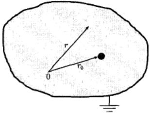

图 12.6 定解问题 (12.5.15) 的物理意义
 

的解。边值问题 (12.5.15) 有明确的物理意义，它表示在一个边界为  $ \Gamma $ 的接地的导体空腔内  $ r_{0} $ 处有一个 q = 1 的点电荷，如图 12.6 所示。 $ G(r, r_{0}) $ 则表示在空腔内任意点 r 的电位。现在 r 点的电位不仅是该点电荷形成的，还有它在导体内壁上的感应电荷所产生的电位。但是感应电荷的分布是未知的，只知道导体边界电位为零（接地）。

为了求解边值问题 (12.5.14)，将式(12.5.14b)和式(12.5.15b)代入式(12.5.13a)，得到

$$  u\left(\boldsymbol{r}\right)=\underset{\Omega}{\iiint}G\left(\boldsymbol{r},\boldsymbol{r}_{0}\right)f\left(\boldsymbol{r}_{0}\right)\mathrm{d}V_{0}-\underset{\Gamma}{\iint}g\left(\boldsymbol{r}_{0}\right)\frac{\partial G\left(\boldsymbol{r},\boldsymbol{r}_{0}\right)}{\partial n_{0}}\mathrm{d}S_{0}   \tag*{(12.5.16a)}$$

<!-- page: 383 -->

这就是边值问题 (12.5.14) 解的积分公式。其中，第一项表示在  $ \Gamma $ 所包围的区域  $ \Omega $ 内对电荷分布  $ f(r_0) $ 的体积分；而第二项表示对边界  $ \Gamma $ 上电位分布  $ g(r_0) $ 的面积分。

对于二维情况，式(12.5.16a) 约为

$$  u\left(\boldsymbol{r}\right)=\iint\limits_{D}G\left(\boldsymbol{r},\boldsymbol{r}_{0}\right)f\left(\boldsymbol{r}_{0}\right)\mathrm{d}\sigma_{0}-\int_{C}g\left(\boldsymbol{r}_{0}\right)\frac{\partial G\left(\boldsymbol{r},\boldsymbol{r}_{0}\right)}{\partial n_{0}}\mathrm{d}l_{0}   \tag*{(12.5.16b)}$$

其中，第一项表示在封闭环 C 所包围的区域 D 内对电荷分布  $ f(r_{0}) $ 的面积分，而第二项表示对环 C 上电位分布  $ g(r_{0}) $ 的线积分。

对于具体的问题，首先求出式(12.5.15)的解  $ G(r,r_{0}) $，再将 f 和 g 的表示式代入式(12.5.16a)或式(12.5.16b)，完成积分即可。

(2) 第二类边值问题：

$$  \left\{\begin{array}{l}\nabla^{2}u(\boldsymbol{r})=\frac{\partial^{2}u}{\partial x^{2}}+\frac{\partial^{2}u}{\partial y^{2}}+\frac{\partial^{2}u}{\partial z^{2}}=-f(\boldsymbol{r})\\ \\ \left.\frac{\partial u}{\partial\boldsymbol{n}}\right|_{\varGamma}=h(\boldsymbol{r})\end{array}\right.   \tag*{(12.5.17a)}$$

相应的格林函数  $ G(r, r_{0}) $ 是

$$  \nabla^{2}G=-\delta(\boldsymbol{r}-\boldsymbol{r}_{0})   \tag*{(12.5.18a)}$$

$$  \left\{\begin{array}{c}\left.\frac{\partial G}{\partial n}\right|_{r}=0\end{array}\right.   \tag*{(12.5.18b)}$$

的解。边值问题（12.5.18）的物理意义与式（12.5.15）相同，只是图12.6中空腔的边界条件变为电位梯度（即电场强度）为零。

将式 (12.5.17b) 和式 (12.3.18b) 代入式 (12.5.13a)，得到

$$  u\left(\boldsymbol{r}\right)=\underset{\Omega}{\iiint}G\left(\boldsymbol{r},\boldsymbol{r}_{0}\right)f\left(\boldsymbol{r}_{0}\right)\mathrm{d}V_{0}+\underset{\Gamma}{\iint}G\left(\boldsymbol{r},\boldsymbol{r}_{0}\right)h\left(\boldsymbol{r}_{0}\right)\mathrm{d}S_{0}   \tag*{(12.5.19a)}$$

这就是边值问题（12.5.17）解的积分公式。

对于二维情况，式(12.5.19a) 约为

$$  u\left(\boldsymbol{r}\right)=\iint\limits_{D}G\left(\boldsymbol{r},\boldsymbol{r}_{0}\right)f\left(\boldsymbol{r}_{0}\right)\mathrm{d}\sigma_{0}+\int_{C}G\left(\boldsymbol{r},\boldsymbol{r}_{0}\right)h\left(\boldsymbol{r}_{0}\right)\mathrm{d}l_{0}   \tag*{(12.5.19b)}$$

对于具体的问题，首先求出式 (12.5.18) 的解  $ G(r_0, r) $，再将  $ f $ 和  $ h $ 的表示式代入式 (12.5.19a) 或式 (12.5.19b)，完成积分即可。

<!-- page: 384 -->

(3) 第三类边值问题：

$$  \left\{\begin{array}{l}\nabla^{2}u(\boldsymbol{r})=\frac{\partial^{2}u}{\partial x^{2}}+\frac{\partial^{2}u}{\partial y^{2}}+\frac{\partial^{2}u}{\partial z^{2}}=-f(\boldsymbol{r})\\ \left[u+\alpha\frac{\partial u}{\partial n}\right]_{\varGamma}=z(\boldsymbol{r})\end{array}\right.   \tag*{(12.5.20a)}$$

相应的格林函数  $  G(r_{0}, r)  $ 是

$$  \left\{\begin{array}{l}\nabla^{2}G=-\delta(\boldsymbol{r}-\boldsymbol{r}_{0})\end{array}\right.   \tag*{(12.5.21a)}$$

$$  \left\{\begin{array}{l}\left[G+\alpha\frac{\partial G}{\partial n}\right]_{\Gamma}=0\end{array}\right.   \tag*{(12.5.21b)}$$

的解。边值问题(12.5.21)的物理意义与式(12.5.15)相同，只是图12.6中空腔的边界条件变为电位与电场的组合为零。为了得到边值问题(12.5.21)的解的积分公式，用 $ G(r,r_{0}) $乘以式(12.5.20b)，用 $ u(r) $乘以式(12.5.21b)，然后相减得到

$$  G(\boldsymbol{r},\boldsymbol{r}_{0})\frac{\partial u}{\partial n}-u(\boldsymbol{r})\frac{\partial G}{\partial n}=\frac{1}{\alpha}G(\boldsymbol{r},\boldsymbol{r}_{0})z(\boldsymbol{r})   \tag*{(12.5.22)}$$

将式（12.5.22）代入式（12.5.13a）得到

$$  u\left(\boldsymbol{r}\right)=\underset{\Omega}{\iiint}G(\boldsymbol{r},\boldsymbol{r}_{0})f(\boldsymbol{r}_{0})\mathrm{d}V_{0}+\frac{1}{\alpha}\underset{\Gamma}{\iint}G(\boldsymbol{r},\boldsymbol{r}_{0})z(\boldsymbol{r}_{0})\mathrm{d}S_{0}   \tag*{(12.5.23a)}$$

这就是边值问题（12.5.20）解的积分公式。

对于二维情况，式(12.5.23a) 约为

$$  u\left(\boldsymbol{r}\right)=\iint\limits_{D}G\left(\boldsymbol{r},\boldsymbol{r}_{0}\right)f\left(\boldsymbol{r}_{0}\right)\mathrm{d}\sigma_{0}+\frac{1}{\alpha}\int_{C}G\left(\boldsymbol{r},\boldsymbol{r}_{0}\right)z\left(\boldsymbol{r}_{0}\right)\mathrm{d}l_{0}   \tag*{(12.5.23b)}$$

对于具体的问题，首先求出式 (12.5.21) 的解  $ G(r,r_0) $，再将 f 和 z 的表示式代入式 (12.5.23a) 或式 (12.5.23b)，完成积分即可。

当空间不存在自由电荷时，即  $ f(r)=0 $，上述问题约化为拉普拉斯方程的边值问题，相应的三类边值问题解的积分公式为

$$  u\left(\boldsymbol{r}\right)=-\iint\limits_{\Gamma}g\left(\boldsymbol{r}_{0}\right)\frac{\partial G\left(\boldsymbol{r},\boldsymbol{r}_{0}\right)}{\partial n_{0}}\mathrm{d}S_{0}   \tag*{(12.5.24a)}$$

$$  u\left(\boldsymbol{r}\right)=\iint\limits_{\varGamma}G(\boldsymbol{r},\boldsymbol{r}_{0})h(\boldsymbol{r}_{0})\mathrm{d}S_{0}   \tag*{(12.5.24b)}$$

$$  u\left(\boldsymbol{r}\right)=\frac{1}{\alpha}\iint\limits_{r}G(\boldsymbol{r},\boldsymbol{r}_{0})z\left(\boldsymbol{r}_{0}\right)\mathrm{d}S_{0}   \tag*{(12.5.24c)}$$

<!-- page: 385 -->

在二维情况下，它们约化成相应的线积分

$$  u\left(\boldsymbol{r}\right)=-\int_{C}g\left(\boldsymbol{r}_{0}\right)\frac{\partial G\left(\boldsymbol{r},\boldsymbol{r}_{0}\right)}{\partial n_{0}}\mathrm{d}l_{0}   \tag*{(12.5.24d)}$$

$$  u\left(\boldsymbol{r}\right)=\int_{C}G(\boldsymbol{r},\boldsymbol{r}_{0})h(\boldsymbol{r}_{0})\mathrm{d}l_{0}   \tag*{(12.5.24e)}$$

$$  u\left(\boldsymbol{r}\right)=\frac{1}{\alpha}\int_{C}G\left(\boldsymbol{r},\boldsymbol{r}_{0}\right)z\left(\boldsymbol{r}_{0}\right)\mathrm{d}l_{0}   \tag*{(12.5.24f)}$$

作为上述解的积分公式的应用，我们首先讨论无界域的泊松方程问题。

例 1 求解三维无界域泊松方程

$$  \nabla^{2}u=\frac{\partial^{2}u}{\partial x^{2}}+\frac{\partial^{2}u}{\partial y^{2}}+\frac{\partial^{2}u}{\partial z^{2}}=-f(\boldsymbol{r})   \tag*{(12.5.25)}$$

解 相应的格林函数  $  G(r, r_{0})  $ 的方程为

$$  \nabla^{2}G=-\delta(\pmb{r}-\pmb{r}_{0})   \tag*{(12.5.26)}$$

 $ G(r,r_{0}) $ 表示  $ r_{0} $ 处的点源 (q=1 的点电荷) 在 r 形成的电位。在无界域情况下，泊松方程的基本积分公式 (12.5.13a) 中的封闭曲面  $ \Gamma $ 是整个三维空间的“边缘”，按照自然边界条件， $ \Gamma $ 上的电位 u 和格林函数 G 都为零。这样一来，式 (12.5.13a) 中的面积分为零，只有体积分，即

$$  u\left(\boldsymbol{r}\right)=\underset{\Omega}{\iiint}G(\boldsymbol{r},\boldsymbol{r}_{0})f(\boldsymbol{r}_{0})\mathrm{d}V_{0}   \tag*{(12.5.27)}$$

简单起见，我们考虑  $ r_{0}=0 $，则  $ G(r) $ 表示位于原点的点源在 r 形成的电位，它是球对称的（只是 r 的函数）。对式 (12.5.26) 在体积  $ \Omega $ 内（即整个三维空间）积分，得到

$$  \iiint_{\Omega}\nabla^{2}G(r)\mathrm{d}V=-\iiint_{\Omega}\delta(r)\mathrm{d}V=-1   \tag*{(12.5.28)}$$

利用散度定理（12.4.9），式（12.5.28）左边写为

$$  \iiint_{\Omega}\nabla^{2}G(r)\mathrm{d}V=\iiint_{\Omega}\nabla\cdot\nabla G(r)\mathrm{d}V=\iint_{\Gamma}\nabla G(r)\cdot\boldsymbol{n}\mathrm{d}S   \tag*{(12.5.29)}$$

由于  $ \nabla G(r) $ 与外法线 n 的方向相同 (同为三维径向)，而 dS 用 x-y 平面上的变量表示为  $ \mathrm{d}S = r^{2} \sin \theta \mathrm{d}\theta \mathrm{d}\phi $，故

$$  \iint\limits_{\Gamma}\nabla G(r)\cdot\boldsymbol{n}\mathrm{d}S=\iint\limits_{\Gamma}\frac{\partial G(r)}{\partial r}r^{2}\sin\theta\mathrm{d}\theta\mathrm{d}\phi=-1   \tag*{(12.5.30)}$$

<!-- page: 386 -->

因为  $ \int_{\theta=0}^{\pi}\int_{\phi=0}^{2\pi}\sin\theta d\theta d\phi=4\pi $，为使式（12.5.30）恒成立，必须有

$$  \frac{\partial G(r)}{\partial r}r^{2}=-\frac{1}{4\pi}   \tag*{(12.5.31)}$$

积分后得到

$$  G(r)=\frac{1}{4\pi r}+c   \tag*{(12.5.32)}$$

考虑到自然边界条件，当  $ r \to \infty $ 时  $ G(r) \to 0 $，有 c = 0，因此格林函数为

$$  G(r)=\frac{1}{4\pi r}   \tag*{(12.5.33)}$$

这就是处于原点的 q = 1 的点电荷在任意 r 处形成的电位，我们用泊松方程的基本积分公式 (12.5.13a) 得到了它，这与已知结果式 (12.1.9) 是相同的。如果点电荷处于  $ \pmb{r}_{0} $，则格林函数为

$$  G(\boldsymbol{r},\boldsymbol{r}_{0})=\frac{1}{4\pi|\boldsymbol{r}-\boldsymbol{r}_{0}|}   \tag*{(12.5.34)}$$

将式（12.5.34）代入式（12.5.27），注意到  $ \Omega $ 遍及整个三维空间，得到

$$  u(\boldsymbol{r})=\frac{1}{4\pi}\iint_{\infty}^{}\frac{f(\boldsymbol{r}_{0})}{|\boldsymbol{r}-\boldsymbol{r}_{0}|}\mathrm{d}V_{0}   \tag*{(12.5.35)}$$

这就是无界域泊松方程（12.5.25）的解，它与式（12.1.4）的结果是相同的。

例2 求解二维无界域泊松方程

$$  \nabla^{2}u=\frac{\partial^{2}u}{\partial x^{2}}+\frac{\partial^{2}u}{\partial y^{2}}=-f(\boldsymbol{r})   \tag*{(12.5.36)}$$

解 相应的格林函数  $  G(r, r_{0})  $ 的方程为

$$  \nabla^{2}G=-\delta(\boldsymbol{r}-\boldsymbol{r}_{0})   \tag*{(12.5.37)}$$

 $ G(r,r_{0}) $ 表示  $ r_{0} $ 处的点源 (线密度  $ \rho=1 $ 的垂直于 x-y 平面的无限长线电荷) 在 r 形成的电位。现在泊松方程的基本积分公式由式 (12.5.13b) 表示。在无界域情况下，式 (12.5.13b) 中的封闭环 C 是整个二维空间的“边界”。按照自然边界条件，C 上的电位 u 和格林函数 G 都为零，因此式 (12.5.13b) 中的线积分为零，只有面积分

$$  u\left(\boldsymbol{r}\right)=\iint\limits_{D}G(\boldsymbol{r},\boldsymbol{r}_{0})f(\boldsymbol{r}_{0})\mathrm{d}\sigma_{0}   \tag*{(12.5.38)}$$

<!-- page: 387 -->

简单起见，我们考虑  $ r_{0}=0 $，则格林函数  $ G(r) $ 是轴对称的（只是 r 的函数）。现在对式 (12.5.37) 积分，我们将积分区域 V 选为以 z 轴为轴线，以坐标原点为中心的具有单位高度的圆柱体（图 12.3），我们有

$$  \iiint\limits_{V}\nabla^{2}G(r)\mathrm{d}V=-\iiint\limits_{V}\delta(r)\mathrm{d}V=-1   \tag*{(12.5.39)}$$

利用散度定理（12.4.9）将式（12.5.39）左边写为

$$  \iiint\limits_{V}\nabla^{2}G(r)\mathrm{d}V=\iiint\limits_{V}\nabla\cdot\nabla G(r)\mathrm{d}V=\iint\limits_{S}\nabla G(r)\cdot\boldsymbol{n}\mathrm{d}S   \tag*{(12.5.40)}$$

其中，S 是区域 V 的边界曲面。由于  $ \nabla G(r) $ 与圆柱侧面外法线 n 的方向相同（同为二维径向），故式 (12.5.40) 在圆柱上、下底的面积分为零，只有沿侧面的积分。利用式 (12.5.39)，并注意到  $ \mathrm{d}S = r\mathrm{d}z\,\mathrm{d}\phi $，式 (12.5.40) 变为

$$  \iint\limits_{S}\nabla G(r)\cdot\boldsymbol{n}\mathrm{d}S=\iint\limits_{S}\frac{\partial G(r)}{\partial r}r\mathrm{d}z\mathrm{d}\phi=-1   \tag*{(12.5.41)}$$

因为  $ \int_{z=-1/2}^{1/2} dz \int_{\phi=0}^{2\pi} d\phi = 2\pi $，为使式 (12.5.41) 恒成立，必须有

$$  \frac{\partial G(r)}{\partial r}r=-\frac{1}{2\pi}   \tag*{(12.5.42)}$$

对式(12.5.42)积分，取 r=1 处的电位为参考电位，即  $ u(1)=0 $，得到格林函数为

$$  G(r)=\frac{1}{2\pi}\ln\frac{1}{r}   \tag*{(12.5.43)}$$

这就是处于 z 轴的  $ \rho = 1 $ 的无限长线电荷在任意 r 处形成的电位，我们用泊松方程的基本积分公式 (12.5.13b) 得到了它，这与已知结果式 (12.1.16) 是一致的。如果线电荷处于  $ r_{0} $，则格林函数为

$$  G(\boldsymbol{r},\boldsymbol{r}_{0})=\frac{1}{2\pi}\ln\frac{1}{|\boldsymbol{r}-\boldsymbol{r}_{0}|}   \tag*{(12.5.44)}$$

将式（12.5.44）代入式（12.5.38），注意到 D 遍及整个二维平面，得到

$$  u(\boldsymbol{r})=\frac{1}{2\pi}\iint\limits_{\infty}f(\boldsymbol{r}_{0})\ln\frac{1}{|\boldsymbol{r}-\boldsymbol{r}_{0}|}\mathrm{d}\sigma_{0}   \tag*{(12.5.45)}$$

这就是二维无界域泊松方程（12.5.36）的解。

<!-- page: 388 -->

### 12.6 格林函数法的应用：电像法

本节用格林函数法求解不同类型的拉普拉斯方程与泊松方程的边值问题。这些问题的解法有一个共同的特征：用点源与它的像在空间的电位叠加来构建满足边界条件的格林函数，进而利用解的积分公式得到拉普拉斯方程与泊松方程的边值问题的解，这样一种构建格林函数的方法称为电像法。电像法具有直观的几何图像和明确的物理意义，是一种简单、有效、用途广泛的格林函数法。

例 1 在上半空间 z > 0 求解泊松方程的第一类边值问题

$$  \left\{\begin{array}{l l}{\nabla^{2}u=\displaystyle\frac{\partial^{2}u}{\partial x^{2}}+\frac{\partial^{2}u}{\partial y^{2}}+\frac{\partial^{2}u}{\partial z^{2}}=-f(x,y,z)}&{(-\infty<x,y<\infty,z>0)}\\ {u(x,y,z)\big|_{z=0}=g(x,y)}&{(-\infty<x,y<\infty)}\end{array}\right.   \tag*{(12.6.1a)}$$

解 格林函数  $  G(r, r_{0})  $ 满足的边值问题为

$$  \left\{\begin{array}{l}\nabla^{2}G=-\delta(x-x_{0})\delta(y-y_{0})\delta(z-z_{0})\\ G\big|_{z=0}=0\end{array}\right.   \tag*{(12.6.2a)}$$

边值问题 (12.6.2) 的物理意义是，在一个位于 z=0 的接地导体平面上方的  $ M_{0}(x_{0}, y_{0}, z_{0}) $ 点放置一个点源 (q=1 的点电荷)。 $ G(r, r_{0}) $ 则表示在导体平面上方任意点  $ M(x, y, z) $ 形成的电位。现在 M 点的电位不仅是由该点电荷形成的，还有它在导体平面上的感应电荷所产生的电位。但是感应电荷的分布是未知的，只知道导体平面上电位为零。

导致 z = 0 平面上电位为零的一个等效方式是，除上半空间  $ M_{0} $ 处的点源之外，在下半空间的镜像对称点  $ M_{1}(x_{0},y_{0},-z_{0}) $ 还有一个像电荷 (q = -1 的点电荷)，如图 12.7 所示。这样一来，满足式 (12.6.2) 的解为

$$  \begin{aligned}G(M,M_{0})=&\frac{1}{4\pi r_{M_{0}M}}-\frac{1}{4\pi r_{M_{1}M}}\\=&\frac{1}{4\pi}\frac{1}{\sqrt{(x-x_{0})^{2}+(y-y_{0})^{2}+(z-z_{0})^{2}}}\\&-\frac{1}{4\pi}\frac{1}{\sqrt{(x-x_{0})^{2}+(y-y_{0})^{2}+(z+z_{0})^{2}}}\end{aligned}   \tag*{(12.6.3)}$$

下一步是将式 (12.6.3) 代入式 (12.5.16a) 计算电位分布  $ u(x, y, z) $。为此，必须首先计算边界  $ \Gamma $ 上的外法向导数  $ \left.\frac{\partial G}{\partial n_0}\right|_{\Gamma} $，对于上半空间而言，其边界  $ \Gamma $ 是  $ z_0 = 0 $ 平面，外法线  $ n_0 $ 的方向为  $ z_0 $ 轴负向，故

<!-- page: 389 -->

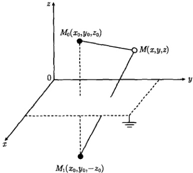

图 12.7 点电荷  $ M_{0} $ 与它的像电荷  $ M_{1} $ 在上半空间任意点 M 形成的电位
 

$$  \left.\frac{\partial G}{\partial n_{0}}\right|_{\Gamma}=-\left.\frac{\partial G}{\partial z_{0}}\right|_{z_{0}=0}   \tag*{(12.6.4)}$$

利用式(12.6.3)计算式(12.6.4)右边的偏导数，得到

 $$ \begin{aligned}\frac{\partial G}{\partial z_{0}}=&\frac{1}{4\pi}\frac{\partial}{\partial z_{0}}\left[\frac{1}{\sqrt{(x-x_{0})^{2}+(y-y_{0})^{2}+(z-z_{0})^{2}}}\right]\\&-\frac{1}{4\pi}\frac{\partial}{\partial z_{0}}\left[\frac{1}{\sqrt{(x-x_{0})^{2}+(y-y_{0})^{2}+(z+z_{0})^{2}}}\right]\\=&\frac{1}{4\pi}\frac{z-z_{0}}{[(x-x_{0})^{2}+(y-y_{0})^{2}+(z-z_{0})^{2}]^{3/2}}\\&+\frac{1}{4\pi}\frac{z+z_{0}}{[(x-x_{0})^{2}+(y-y_{0})^{2}+(z+z_{0})^{2}]^{3/2}}\end{aligned} $$ 

从而

$$  \left.\frac{\partial G}{\partial n_{0}}\right\vert_{G}=-\frac{1}{2\pi}\frac{z}{[(x-x_{0})^{2}+(y-y_{0})^{2}+z^{2}]^{3/2}}   \tag*{(12.6.5)}$$

将式（12.6.3）和式（12.6.5）代入式（12.5.16a）得到

 $$ \begin{aligned}u\left(\boldsymbol{r}\right)&=\frac{1}{2\pi}\int_{-\infty}^{\infty}\int_{-\infty}^{\infty}\frac{z}{\left[(x-x_{0})^{2}+(y-y_{0})^{2}+z^{2}\right]^{3/2}}\mathrm{d}x_{0}\mathrm{d}y_{0}\\&\quad+\frac{1}{4\pi}\int_{x_{0}=-\infty}^{\infty}\int_{y_{0}=-\infty}^{\infty}\int_{z_{0}=0}^{\infty}f(x_{0},y_{0},z_{0})\end{aligned} $$

<!-- page: 390 -->

$$  \left[\begin{array}{c}\frac{1}{\sqrt{(x-x_{0})^{2}+(y-y_{0})^{2}+(z-z_{0})^{2}}}-\\ \frac{1}{\sqrt{(x-x_{0})^{2}+(y-y_{0})^{2}+(z+z_{0})^{2}}}\end{array}\right]\mathrm{d}x_{0}\mathrm{d}y_{0}\mathrm{d}z_{0}   \tag*{(12.6.6)}$$

这就是边值问题（12.6.1）的解。如果自由电荷密度  $ f(x,y,z)=0 $，则式（12.6.1）约化成拉普拉斯方程的边值问题，相应的解由式（12.6.6）约化为

$$  u\left(r\right)=\frac{1}{2\pi}\int_{-\infty}^{\infty}\int_{-\infty}^{\infty}\frac{z}{\left[(x-x_{0})^{2}+(y-y_{0})^{2}+z^{2}\right]^{3/2}}\mathrm{d}x_{0}\mathrm{d}y_{0}   \tag*{(12.6.7)}$$

例 2 在上半平面 y > 0 求解拉普拉斯方程的第一类边值问题

$$  \left\{\begin{array}{l l}{\nabla^{2}u=\displaystyle\frac{\partial^{2}u}{\partial x^{2}}+\frac{\partial^{2}u}{\partial y^{2}}=0}&{(-\infty<x<\infty,y>0)}\\ {u(x,0)=g(x)}&{(-\infty<x<\infty)}\end{array}\right.   \tag*{(12.6.8a)}$$

解 相应格林函数  $ G(r,r_{0}) $ 满足边值问题

$$  \int\nabla^{2}G=-\delta(x-x_{0})\delta(y-y_{0})   \tag*{(12.6.9a)}$$

$$  \left\{\begin{array}{c}G\big|_{y=0}=0\end{array}\right.   \tag*{(12.6.9b)}$$

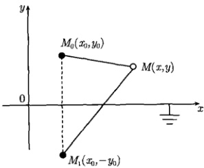

边值问题 (12.6.9) 的物理意义是，在一个位于 y=0 的接地导线上方的  $ M_{0}(x_{0},y_{0}) $ 点放置一个二维点源 (线密度  $ \rho=1 $ 的垂直于 x-y 平面的无限长线电荷)。 $ G(\boldsymbol{r}, \boldsymbol{r}_{0}) $ 则表示在导线上方任意点  $ M(x, y) $ 形成的电位。现在 M 点的电位不仅是由该线电荷形成的，还有它在导线上的感应电荷所产生的电位。但是感应电荷的分布是未知的，只知道导线的电位为零。

图 12.8  $ M_{0} $ 处的点源与它在
 

 $ M_{1} $ 处的像电荷在上半平面任意点 M 形成的电位
 

使得导线电位为零的一个等效方式是，除上半平面  $ M_{0} $ 处的点源之外，在下半平面的镜像对称点  $ M_{1}(x_{0}, -y_{0}) $ 还有一个像电荷 ( $ \rho = -1 $ 的垂直于 x - y 平面的无限长线电荷)，如图12.8所示。这样一来，由式(12.1.15)得到满足式(12.6.9)的解

$$  \begin{aligned}G(M,M_{0})&=\frac{1}{2\pi}\ln\frac{1}{r_{M_{0}M}}-\frac{1}{2\pi}\ln\frac{1}{r_{M_{1}M}}=\frac{1}{2\pi}\ln\frac{r_{M_{1}M}}{r_{M_{0}M}}\\&=\frac{1}{4\pi}\ln\frac{(x-x_{0})^{2}+(y+y_{0})^{2}}{(x-x_{0})^{2}+(y-y_{0})^{2}}\end{aligned}   \tag*{(12.6.10)}$$

<!-- page: 391 -->

对于现在的二维情况，解的积分公式由式 $  (12.5.24d)  $表示，即

$$  u\left(\boldsymbol{r}\right)=-\int_{C}g\left(\boldsymbol{r}_{0}\right)\frac{\partial G\left(\boldsymbol{r},\boldsymbol{r}_{0}\right)}{\partial n_{0}}\mathrm{d}l_{0}   \tag*{(12.6.11)}$$

现在计算边界线 C 上的外法向导数  $ \left.\frac{\partial G}{\partial n_{0}}\right|_{C} $，对于上半平面而言，其边界线 C 是  $ y_{0}=0 $ 直线，外法线  $ n_{0} $ 的方向为  $ y_{0} $ 轴负向，故

$$  \begin{aligned}\left.\frac{\partial G}{\partial n_{0}}\right|_{C}&=-\left.\frac{\partial G}{\partial y_{0}}\right|_{y_{0}=0}\\&=-\frac{1}{4\pi}\left[\frac{\partial}{\partial y_{0}}\ln\frac{(x-x_{0})^{2}+(y+y_{0})^{2}}{(x-x_{0})^{2}+(y-y_{0})^{2}}\right]_{y_{0}=0}\\&=-\frac{1}{2\pi}\left[\frac{y+y_{0}}{(x-x_{0})^{2}+(y+y_{0})^{2}}+\frac{y-y_{0}}{(x-x_{0})^{2}+(y-y_{0})^{2}}\right]_{y_{0}=0}.\\&=-\frac{1}{\pi}\frac{y}{(x-x_{0})^{2}+y^{2}}\tag{1}\end{aligned}   \tag*{(12.6.12)}$$

将式 (12.6.12) 代入式 (12.6.11)，注意到边界线 C 为整个 x 轴， $ \mathrm{d}l_{0}=\mathrm{d}x_{0} $，得到

$$  u(x,y)=\frac{1}{\pi}\int_{-\infty}^{\infty}g(x_{0})\frac{y}{(x-x_{0})^{2}+y^{2}}\mathrm{d}x_{0}   \tag*{(12.6.13)}$$

这就是边值问题（12.6.8）的解，它与傅里叶变换法的结果（11.1.48）是相同的。

例 3 在上半平面 y > 0 求解泊松方程的第一类边值问题

$$  \left\{\begin{array}{l l}\displaystyle\frac{\partial^{2}v}{\partial x^{2}}+\frac{\partial^{2}v}{\partial y^{2}}=-f(x,y)&(-\infty<x<\infty,y>0)\\ \\ v(x,0)=0&(-\infty<x<\infty)\end{array}\right.   \tag*{(12.6.14b)}$$

解 该边值问题的格林函数与式 (12.6.10) 相同，积分公式为式 (12.5.16b)，即

$$  v\left(\boldsymbol{r}\right)=\iint\limits_{D}G\left(\boldsymbol{r},\boldsymbol{r}_{0}\right)f\left(\boldsymbol{r}_{0}\right)\mathrm{d}\sigma_{0}-\int_{C}g\left(\boldsymbol{r}_{0}\right)\frac{\partial G\left(\boldsymbol{r},\boldsymbol{r}_{0}\right)}{\partial n_{0}}\mathrm{d}l_{0}   \tag*{(12.6.15)}$$

现在 D 为上半平面，且 g=0，故式 (12.6.15) 变为

$$  v\left(x,y\right)=\int_{y=0}^{\infty}\int_{x=-\infty}^{\infty}G\left(M,M_{0}\right)f(x_{0},y_{0})\mathrm{d}x_{0}\mathrm{d}y_{0}   \tag*{(12.6.16a)}$$

将式（12.6.10）代入式（12.6.16a）得到

$$  v(x,y)=\frac{1}{4\pi}\int_{y=0}^{\infty}\int_{x=-\infty}^{\infty}f(x_{0},y_{0})\ln\frac{(x-x_{0})^{2}+(y+y_{0})^{2}}{(x-x_{0})^{2}+(y-y_{0})^{2}}\mathrm{d}x_{0}\mathrm{d}y_{0}   \tag*{(12.6.16b)}$$

<!-- page: 392 -->

这就是边值问题（12.6.14）的解。

对于上半平面泊松方程的第一类非齐次边值问题

$$  \left\{\begin{array}{l l}{\displaystyle\frac{\partial^{2}w}{\partial x^{2}}+\frac{\partial^{2}w}{\partial y^{2}}=-f(x,y)}&{(-\infty<x<\infty,y>0)}\\ {w(x,0)=g(x)}&{(-\infty<x<\infty)}\end{array}\right.   \tag*{(12.6.17a)}$$

由叠加原理得到 w = u + v，其中 u 和 v 分别由式 (12.6.13) 和式 (12.6.16b) 表示，故

$$  \begin{align*}w\left(x,y\right)=&\frac{1}{\pi}\int_{-\infty}^{\infty}g(x_{0})\frac{y}{(x-x_{0})^{2}+y^{2}}\mathrm{d}x_{0}\\&+\frac{1}{4\pi}\int_{y=0}^{\infty}\int_{x=-\infty}^{\infty}f(x_{0},y_{0})\ln\frac{(x-x_{0})^{2}+(y+y_{0})^{2}}{(x-x_{0})^{2}+(y-y_{0})^{2}}\mathrm{d}x_{0}\mathrm{d}y_{0}\end{align*}   \tag*{(12.6.18)}$$

得到这一结果的另一个思路是，定解问题(12.6.17)的格林函数仍由式(12.6.10)表示，这样式(12.6.17)解的积分公式由式(12.5.16b)给出

$$  w\left(x,y\right)=\int_{y=0}^{\infty}\int_{x=-\infty}^{\infty}G\left(M,M_{0}\right)f\left(x_{0},y_{0}\right)\mathrm{d}x_{0}\mathrm{d}y_{0}-\int_{-\infty}^{\infty}g\left(x_{0}\right)\frac{\partial G}{\partial n_{0}}\mathrm{d}x_{0}   \tag*{(12.6.19)}$$

将格林函数 (12.6.10) 和它的外法向导数 (12.6.12) 代入式 (12.6.19) 即得式 (12.6.18)。

例 4 求解球域内拉普拉斯方程的第一类边值问题

$$  \left\{\begin{array}{l}\nabla^{2}u=\frac{\partial^{2}u}{\partial x^{2}}+\frac{\partial^{2}u}{\partial y^{2}}+\frac{\partial^{2}u}{\partial z^{2}}=0\quad(r<R)\\ u\big|_{r=R}=g(x,y,z)\end{array}\right.   \tag*{(12.6.20b)}$$

解 该边值问题的区域  $ \Omega $ 是以坐标原点 O 为中心，以 R 为半径的球域，它的边界面  $ \Gamma $ 为球面。相应格林函数  $ G(r, r_{0}) $ 满足的边值问题为

$$  \left\{\begin{array}{l}\nabla^{2}G=-\delta(x-x_{0})\delta(y-y_{0})\delta(z-z_{0})\\ G\big|_{r=R}=0\end{array}\right.   \tag*{(12.6.21a)}$$

边值问题 (12.6.21) 的物理意义是，在一个以 O 为中心、以 R 为半径的接地导体球壳内的  $ M_{0}(x_{0},y_{0},z_{0}) $ 点放置一个点源 (q=1 的点电荷)，如图 12.9 所示。 $ G(r,r_{0}) $ 则表示在球壳内任意点  $ M(x,y,z) $ 形成的电位。现在 M 点的电位不仅是由该电荷形成的，还有它在球壳内壁的感应电荷所产生的电位。但是感应电荷的分布是未知的，只知道球壳的电位为零。

<!-- page: 393 -->

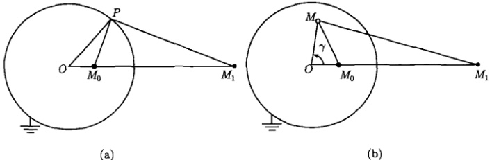

(b)
 

图 12.9 (a) 点电荷  $ M_{0} $ 与它的像电荷  $ M_{1} $ 在球壳上任意点 P 形成的电位为零；(b) 点电荷  $ M_{0} $ 与它的像电荷  $ M_{1} $ 在球壳内任意点 M 形成的电位为所求的电位。 $ POM_{1} $ 与  $ MOM_{1} $ 不是同一个平面。这里  $ r_{0}=r_{OM_{0}}, r_{1}=r_{OM_{1}}, r=r_{OM}, R=r_{OP} $
 

使球壳电位为零的一个等效方式是，除  $ M_{0} $ 处的点源之外，在空间某点  $ M_{1} $ 还有一个像电荷（电量为 -q 的点电荷）。我们现在来确定 q 及它的位置  $ M_{1} $。根据对称性分析， $ M_{1} $ 应在  $ OM_{0} $ 的延长线。事实上， $ M_{1} $ 的位置由

$$  r_{0}\cdot r_{1}=R^{2}   \tag*{(12.6.22)}$$

确定。要使得球壳上任一点 P 的电位为零，根据式(12.1.2)，必须有

$$  \frac{1}{4\pi r_{M_{0}P}}-\frac{q}{4\pi r_{M_{1}P}}=0   \tag*{(12.6.23)}$$

由此得到

$$  q=\frac{r_{M_{1}P}}{r_{M_{0}P}}   \tag*{(12.6.24)}$$

注意到  $ \triangle O M_{1}P $ 与  $ \triangle O M_{0}P $ 有公共角，且由式 (12.6.22) 知夹这角的两边成比例  $ \frac{r_{OM_{0}}}{R}=\frac{R}{r_{OM_{1}}} $，因此这两个三角形相似，从而

$$  \frac{r_{M_{1}P}}{r_{M_{0}P}}=\frac{R}{r_{OM_{0}}}   \tag*{(12.6.25)}$$

故由式（12.6.24）得到

$$  q=\frac{R}{r_{0}}   \tag*{(12.6.26)}$$

这样一来， $ M_{0} $ 处的电量为 q = 1 的点电荷与它的像电荷（位于  $ M_{1} $ 的电量为 -R/r_{0} 的点电荷）使得球壳上任一点的电位为零。这样我们得到满足式 (12.6.21) 的解

$$  G(M,M_{0})=\frac{1}{4\pi}\left(\frac{1}{r_{M_{0}M}}-\frac{R}{r_{0}}\frac{1}{r_{M_{1}M}}\right)   \tag*{(12.6.27)}$$

<!-- page: 394 -->

式（12.6.27）能被进一步化简，注意到

$$  r_{M_{0}M}=\sqrt{r_{0}^{2}+r^{2}-2r r_{0}\cos\gamma}   \tag*{(12.6.28a)}$$

$$  r_{M_{1}M}=\sqrt{r_{1}^{2}+r^{2}-2rr_{1}\cos\gamma}   \tag*{(12.6.28b)}$$

并利用式（12.6.22）、式（12.6.27）变为

$$  G(M,M_{0})=\frac{1}{4\pi}\left(\frac{1}{\sqrt{r_{0}^{2}+r^{2}-2rr_{0}\cos\gamma}}-\frac{R}{\sqrt{r^{2}r_{0}^{2}+R^{4}-2R^{2}rr_{0}\cos\gamma}}\right)   \tag*{(12.6.29)}$$

它只含有点源的坐标  $ r_{0} $ 和观察点的坐标  $ r $（不再包含像电荷的坐标  $ r_{1} $），这就是问题 (12.6.21) 的格林函数。至于式 (12.6.29) 中的  $ \cos\gamma $ 也只与  $ r_{0} $ 和  $ r $ 的取向有关 (我们最后再计算它)。

格林函数的表达式（12.6.29）还可以从另一个简捷的思路求得。事实上，起初可以将格林函数写成

$$  \begin{aligned}G(M,M_{0})&=\frac{1}{4\pi}\frac{1}{r_{M_{0}M}}+\frac{q}{4\pi}\frac{1}{r_{M_{1}M}}\\&=\frac{1}{4\pi}\left[\frac{1}{\sqrt{r_{0}^{2}+r^{2}-2rr_{0}\cos\gamma}}+\frac{q}{\sqrt{r_{1}^{2}+r^{2}-2rr_{1}\cos\gamma}}\right]\end{aligned}   \tag*{(12.6.30)}$$

然后利用边界条件(12.6.12b)确定其中的q和 $ r_{1} $。事实上，当r=R时，式(12.6.30)给出 $ G(P,M_{0})=0 $，即

$$  \frac{1}{\sqrt{r_{0}^{2}+R^{2}-2R r_{0}\cos\gamma}}+\frac{q}{\sqrt{r_{1}^{2}+R^{2}-2R r_{1}\cos\gamma}}=0   \tag*{(12.6.31)}$$

由式（12.6.31）得到

$$  r_{0}^{2}+R^{2}-2R r_{0}\cos\gamma=\frac{1}{q^{2}}\left(r_{1}^{2}+R^{2}\right)-\frac{2R r_{1}}{q^{2}}\cos\gamma   \tag*{(12.6.32)}$$

式(12.6.32)对于任意的 $ \gamma $都应该成立，故两边比较常数项及 $ \cos\gamma $的系数，得到

$$  r_{0}^{2}+R^{2}=\frac{1}{q^{2}}\left(r_{1}^{2}+R^{2}\right),\quad r_{0}=\frac{r_{1}}{q^{2}}   \tag*{(12.6.33)}$$

联立解出

$$  q=-\frac{R}{r_{0}},\quad r_{1}=\frac{R^{2}}{r_{0}}   \tag*{(12.6.34)}$$

代入式（12.6.30）即得式（12.6.29）。

<!-- page: 395 -->

现在解的积分公式为式(12.5.24a)，即

$$  u\left(\boldsymbol{r}\right)=-\iint\limits_{\Gamma}g\left(\boldsymbol{r}_{0}\right)\frac{\partial G\left(\boldsymbol{r},\boldsymbol{r}_{0}\right)}{\partial n_{0}}\mathrm{d}S_{0}   \tag*{(12.6.35)}$$

在球面  $ \Gamma $ 上， $ \mathrm{d}S_{0} $ 的外法线  $ n_{0} $ 的方向与径向相同，故

$$  \left.\frac{\partial G}{\partial n_{0}}\right|_{\Gamma}=\left.\frac{\partial G}{\partial r_{0}}\right|_{r_{0}=R}   \tag*{(12.6.36)}$$

式（12.6.36）右边的偏导数由式（12.6.29）给出为

$$  \frac{\partial G}{\partial r_{0}}=-\frac{1}{4\pi}\frac{r_{0}-r\cos\gamma}{\left(r^{2}+r_{0}^{2}-2r_{0}r\cos\gamma\right)^{3/2}}+\frac{1}{4\pi}\frac{R\left(r^{2}r_{0}-R^{2}r\cos\gamma\right)}{\left(r_{0}^{2}r^{2}+R^{4}-2R^{2}r_{0}r\cos\gamma\right)^{3/2}}   \tag*{(12.6.37)}$$

故

$$  \left.\frac{\partial G}{\partial n_{0}}\right\vert_{F}=-\frac{1}{4\pi R}\frac{R^{2}-r^{2}}{\left(R^{2}+r^{2}-2r R\cos\gamma\right)^{3/2}}   \tag*{(12.6.38)}$$

将式（12.6.38）代入式（12.6.35）得到

$$  u\left(\boldsymbol{r}\right)=\frac{1}{4\pi R}\iint\limits_{r}g\left(\boldsymbol{r}_{0}\right)\frac{R^{2}-r^{2}}{\left(R^{2}+r^{2}-2rR\cos\gamma\right)^{3/2}}\mathrm{d}S_{0}   \tag*{(12.6.39)}$$

式（12.6.39）在球坐标系中表示为（注意到  $ \mathrm{d}S_{0}=R^{2}\sin\theta_{0}\mathrm{d}\theta_{0}\mathrm{d}\phi_{0} $）

$$  u\left(r,\theta,\phi\right)=\frac{R}{4\pi}\int_{0}^{2\pi}\int_{0}^{\pi}g\left(R,\theta_{0},\phi_{0}\right)\frac{R^{2}-r^{2}}{\left(R^{2}+r^{2}-2rR\cos\gamma\right)^{3/2}}\sin\theta_{0}\mathrm{d}\theta_{0}\mathrm{d}\phi_{0}   \tag*{(12.6.40)}$$

最后我们来求出  $ \cos\gamma $ 的表达式。 $ \gamma $ 是 OM 与  $ OM_{0} $ 的夹角，设 n 和  $ n_{0} $ 分别是 OM 和  $ OM_{0} $ 方向的单位矢量，利用直角坐标系与球坐标系之间的变换关系式 (10.6.1)，我们有

$$  \boldsymbol{n}=\sin\theta\cos\phi\boldsymbol{i}+\sin\theta\sin\phi\boldsymbol{j}+\cos\theta\boldsymbol{k}   \tag*{(12.6.41a)}$$

$$  \boldsymbol{n}_{0}=\sin\theta_{0}\cos\phi_{0}\boldsymbol{i}+\sin\theta_{0}\sin\phi_{0}\boldsymbol{j}+\cos\theta_{0}\boldsymbol{k}   \tag*{(12.6.41b)}$$

于是

 $$ \begin{aligned}\cos\gamma=&\boldsymbol{n}\cdot\boldsymbol{n}_{0}\\=&(\sin\theta\cos\phi\boldsymbol{i}+\sin\theta\sin\phi\boldsymbol{j}+\cos\theta\boldsymbol{k})\\&\cdot(\sin\theta_{0}\cos\phi_{0}\boldsymbol{i}+\sin\theta_{0}\sin\phi_{0}\boldsymbol{j}+\cos\theta_{0}\boldsymbol{k})\\=&\sin\theta\cos\phi\sin\theta_{0}\cos\phi_{0}+\sin\theta\sin\phi\sin\theta_{0}\sin\phi_{0}+\cos\theta\cos\theta_{0}\\=&\sin\theta\sin\theta_{0}\cos(\phi-\phi_{0})+\cos\theta\cos\theta_{0}\end{aligned} $$

<!-- page: 396 -->

至此，式(12.6.40)中的所有因子已经确定，它就是边值问题(12.6.20)的解，表示考查点 $ M(r,\theta,\phi) $的电位。式(12.6.39)或式(12.6.40)称为球的泊松积分公式。

例 5 求解球域内泊松方程的第一类非齐次边值问题

$$  \left\{\begin{array}{l}\nabla^{2}w=\frac{\partial^{2}w}{\partial x^{2}}+\frac{\partial^{2}w}{\partial y^{2}}+\frac{\partial^{2}w}{\partial z^{2}}=-f(x,y,z)\quad(r<R)\\ w\big|_{r=R}=g(x,y,z)\end{array}\right.   \tag*{(12.6.42a)}$$

解 边值问题 (12.6.42) 的格林函数仍由式 (12.6.29) 表示，而解的积分公式由式 (12.5.16a) 给出，即

$$  w\left(\boldsymbol{r}\right)=\underset{\Omega}{\iiint}G\left(M,M_{0}\right)f\left(\boldsymbol{r}_{0}\right)\mathrm{d}V_{0}-\underset{\Gamma}{\iint}g\left(\boldsymbol{r}_{0}\right)\frac{\partial G\left(M,M_{0}\right)}{\partial n_{0}}\mathrm{d}S_{0}   \tag*{(12.6.43a)}$$

将式（12.6.29）及式（12.6.38）代入上式，在球坐标系中表示为

$$  \begin{align*}w\left(r,\theta,\phi\right)=&\int_{0}^{R}\int_{0}^{\pi}\int_{0}^{2\pi}G(M,M_{0})f(r_{0},\theta_{0},\phi_{0})r_{0}^{2}\sin\theta_{0}\mathrm{d}r_{0}\mathrm{d}\theta_{0}\mathrm{d}\phi_{0}\\&+\frac{R\left(R^{2}-r^{2}\right)}{4\pi}\int_{0}^{2\pi}\int_{0}^{\pi}\frac{g(R,\theta_{0},\phi_{0})}{\left(R^{2}+r^{2}-2rR\cos\gamma\right)^{3/2}}\sin\theta_{0}\mathrm{d}\theta_{0}\mathrm{d}\phi_{0}\end{align*}   \tag*{(12.6.43b)}$$

其中， $ G(M,M_{0}) $ 由式(12.6.29)表示，式(12.6.43b)就是定解问题(12.6.42)的解。

例 6 求解圆域内泊松方程的第一类边值问题

$$  \left\{\begin{array}{l}\nabla^{2}u=\frac{\partial^{2}u}{\partial x^{2}}+\frac{\partial^{2}u}{\partial y^{2}}=-f(x,y)\quad(r<R)\\ \\ \left.u\right|_{r=R}=g(x,y)\end{array}\right.   \tag*{(12.6.44b)}$$

解 这个边值问题的解的积分公式为式 (12.5.16b)，即

$$  u\left(\boldsymbol{r}\right)=\iint\limits_{D}G\left(\boldsymbol{r},\boldsymbol{r}_{0}\right)f\left(\boldsymbol{r}_{0}\right)\mathrm{d}\sigma_{0}-\int_{C}g\left(\boldsymbol{r}_{0}\right)\frac{\partial G\left(\boldsymbol{r},\boldsymbol{r}_{0}\right)}{\partial n_{0}}\mathrm{d}l_{0}   \tag*{(12.6.45)}$$

该边值问题的区域 D 是以坐标原点 O 为中心、以 R 为半径的圆域，它的边界 C 为包围 D 的圆周，其中的格林函数  $ G(r, r_{0}) $ 是

$$  \left\{\begin{array}{l}\nabla^{2}G=-\delta(x-x_{0})\delta(y-y_{0})\\ G\big|_{r=R}=0\end{array}\right.   \tag*{(12.6.46b)}$$

的解。边值问题式(12.6.46)的物理意义是，在一个以z轴为中心轴线、以R为半径的无限长接地导体圆筒内的 $ M_{0}(x_{0},y_{0}) $点放置一个点源(线密度 $ \rho=1 $的平行

<!-- page: 397 -->

于 z 轴的无限长线电荷)，圆筒的正截面为 x-y 平面 (图 12.10)。 $ G(r,r_{0}) $ 则表示在圆筒内任意点  $ M(x,y) $ 的电位。现在 M 点的电位不仅是由该线电荷形成的，还包含它在圆筒内壁的感应电荷所产生的电位。但是感应电荷的分布是未知的，只知道圆筒的电位为零。

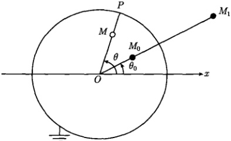

图 12.10 处于  $ M_{0} $ 的点源与它的像电荷  $ M_{1} $ 在圆筒内任意点 M 形成的电位 这里  $ r_{0}=r_{OM_{0}}, r_{1}=r_{OM_{1}}, r=r_{OM}, R=r_{OP} $
 

使圆筒电位为零的一个等效方式是，除了  $ M_{0} $ 处的点源之外，在某处  $ M_{1} $ 还有一个像电荷 (线密度为  $ \rho $ 的平行于 z 轴的无限长线电荷)。根据对称性分析， $ M_{1} $ 应在  $ OM_{0} $ 的延长线上。设 M 点的电位为

$$  G(M,M_{0})=\frac{1}{2\pi}\ln\frac{1}{r_{M_{0}M}}+\frac{\rho}{2\pi}\ln\frac{1}{r_{M_{1}M}}+\frac{1}{2\pi}\ln\frac{r_{0}}{R}   \tag*{(12.6.47)}$$

其中

$$  r_{M_{0}M}=\sqrt{r^{2}+r_{0}^{2}-2r r_{0}\cos(\theta-\theta_{0})}   \tag*{(12.6.48a)}$$

$$  r_{M_{1}M}=\sqrt{r^{2}+r_{1}^{2}-2r r_{1}\cos(\theta-\theta_{0})}   \tag*{(12.6.48b)}$$

由于电位的数值是相对的，可以相差一个常数，式 (12.6.47) 右边的第三项就是一个附加的常数 [添加这个常数是为了随后满足边界条件 (12.6.46b)]。现在我们利用边界条件 (12.6.46b)，即  $ G(P,M_0)=0 $，来确定式 (12.6.47) 中的像电荷的线密度  $ \rho $ 和它的位置  $ r_1 $。当  $ r \to R $ 时， $ M \to P $， $ G(M,M_0) \to G(P,M_0)=0 $，我们有

 $$ \begin{aligned}G(P,M_{0})=&\frac{1}{2\pi}\ln\frac{1}{r_{M_{0}P}}+\frac{\rho}{2\pi}\ln\frac{1}{r_{M_{1}P}}+\frac{1}{2\pi}\ln\frac{r_{0}}{R}\\=&-\frac{1}{4\pi}\ln\left[R^{2}+r_{0}^{2}-2R r_{0}\cos(\theta-\theta_{0})\right]\\&-\frac{\rho}{4\pi}\ln\left[R^{2}+r_{1}^{2}-2R r_{1}\cos(\theta-\theta_{0})\right]+\frac{1}{2\pi}\ln\frac{r_{0}}{R}\\=&0\end{aligned} $$

<!-- page: 398 -->

上式中  $ \theta $ 为变量，由  $ \partial G(P,M_{0})/\partial\theta=0 $ 得到

$$  \frac{r_{0}}{R^{2}+r_{0}^{2}-2R r_{0}\cos(\theta-\theta_{0})}+\frac{\rho r_{1}}{R^{2}+r_{1}^{2}-2R r_{1}\cos(\theta-\theta_{0})}=0   \tag*{(12.6.49)}$$

即

$$  r_{0}\left(R^{2}+r_{1}^{2}\right)-2r_{0}r_{1}R\cos(\theta-\theta_{0})=-\rho r_{1}\left(R^{2}+r_{0}^{2}\right)+2\rho r_{0}r_{1}R\cos(\theta-\theta_{0})   \tag*{(12.6.50)}$$

式(12.6.50)对于任意 $ \theta $均成立，两边比较常数项及 $ \cos(\theta-\theta_{0}) $的系数，得到

$$  r_{0}\left(R^{2}+r_{1}^{2}\right)=-\rho r_{1}\left(R^{2}+r_{0}^{2}\right)   \tag*{(12.6.51)}$$

 $$ \rho=-1 $$ 

将式（12.6.52）代入式（12.6.51），得到

$$  r_{1}=\frac{R^{2}}{r_{0}}   \tag*{(12.6.53)}$$

这样式(12.6.47)变为

$$  \begin{aligned}G(M,M_{0})=&\frac{1}{2\pi}\ln\frac{1}{\sqrt{r^{2}+r_{0}^{2}-2rr_{0}\cos(\theta-\theta_{0})}}\\&-\frac{1}{2\pi}\ln\frac{1}{\sqrt{r^{2}+r_{1}^{2}-2rr_{1}\cos(\theta-\theta_{0})}}+\frac{1}{2\pi}\ln\frac{r_{0}}{R}\\=&\frac{1}{4\pi}\ln\left[\frac{r^{2}+r_{1}^{2}-2rr_{1}\cos(\theta-\theta_{0})}{r^{2}+r_{0}^{2}-2rr_{0}\cos(\theta-\theta_{0})}\frac{r_{0}^{2}}{R^{2}}\right]\\=&\frac{1}{4\pi}\ln\frac{r^{2}r_{0}^{2}+R^{4}-2rr_{0}R^{2}\cos(\theta-\theta_{0})}{R^{2}\left[r^{2}+r_{0}^{2}-2rr_{0}\cos(\theta-\theta_{0})\right]}\end{aligned}   \tag*{(12.6.54)}$$

式 (12.6.54) 只含有点源的坐标  $ r_0 $、 $ \theta_0 $ 和观察点的坐标  $ r $、 $ \theta $，它就是所求的格林函数。特别是，我们看到由于附加常数  $ \frac{1}{2\pi} \ln \frac{r_0}{R} $ 的引入，式 (12.6.54) 在  $ r \to R $ 时给出  $ G(P, M_0) = 0 $，满足边界条件 (12.6.46b)。

现在计算式 (12.6.45) 中的方向导数，在圆周 C 上， $ dI_{0} $ 的外法线  $ n_{0} $ 的方向与径向相同，故由式 (12.6.54) 得到

$$  \frac{\partial G}{\partial n_{0}}\bigg|_{C}=\left.\frac{\partial G}{\partial r_{0}}\right|_{r_{0}=R}=-\frac{R^{2}-r^{2}}{2\pi R\left[R^{2}+r^{2}-2r R\cos(\theta-\theta_{0})\right]}   \tag*{(12.6.55)}$$

将式 (12.6.54) 和式 (12.6.55) 代入式 (12.6.45)，注意到  $ \mathrm{d}\sigma_{0}=r_{0}\mathrm{d}r_{0}\mathrm{d}\theta_{0} $， $ \mathrm{d}l_{0}=R\mathrm{d}\theta_{0} $

<!-- page: 399 -->

得到

$$  \begin{align*}u\left(r,\theta\right)=&\frac{1}{4\pi}\int_{0}^{R}\int_{0}^{2\pi}f(r_{0},\theta_{0})\ln\left\{\frac{r^{2}r_{0}^{2}+R^{4}-2rr_{0}R^{2}\cos(\theta-\theta_{0})}{R^{2}\left[r^{2}+r_{0}^{2}-2rr_{0}\cos(\theta-\theta_{0})\right]}\right\}r_{0}\mathrm{d}r_{0}\mathrm{d}\theta_{0}\\&+\frac{R^{2}-r^{2}}{2\pi}\int_{0}^{2\pi}\frac{g(\theta_{0})}{R^{2}+r^{2}-2rR\cos(\theta-\theta_{0})}\mathrm{d}\theta_{0}\end{align*}   \tag*{(12.6.56)}$$

式（12.6.56）就是定解问题（12.6.44）的解。

对于圆域内拉普拉斯方程的边值问题，f=0，式(12.6.56) 约为

$$  u\left(r,\theta\right)=\frac{R^{2}-r^{2}}{2\pi}\int_{0}^{2\pi}\frac{g\left(\theta_{0}\right)}{R^{2}+r^{2}-2rR\cos\left(\theta-\theta_{0}\right)}\mathrm{d}\theta_{0}   \tag*{(12.6.57)}$$

式（12.6.57）称为圆域的泊松积分公式，而

$$  P\left(r,\theta\right)=\frac{R^{2}-r^{2}}{R^{2}+r^{2}-2rR\cos\left(\theta-\theta_{0}\right)}\quad\left(0\leqslant r<R,0\leqslant\theta\leqslant2\pi\right)   \tag*{(12.6.58)}$$

称为圆域的泊松核。

### 12.7 第二、第三类边值问题的格林函数

12.6 节用电像法讨论了拉普拉斯方程与泊松方程的第一类边值问题，本节用电像法进一步求解第二、第三类边值问题的格林函数。

#### 12.7.1 第二类边值问题的格林函数

考虑上半平面内具有第二类边界条件的格林函数问题

$$  \left\{\begin{array}{l}\nabla^{2}G=-\delta(x-x_{0})\delta(y-y_{0})\quad(-\infty<x<\infty,y>0)\\ \left.\frac{\partial G}{\partial y}\right|_{y=0}=0\end{array}\right.   \tag*{(12.7.1a)}$$

这个边值问题的物理意义是，在一根处于 y=0 的导线上方的  $ M_{0}(x_{0},y_{0}) $ 点放置一个点源 (线密度  $ \rho=1 $ 的垂直于 x-y 平面的无限长线电荷)。 $ G(M,M_{0}) $ 则表示在导线上方任意点  $ M(x,y) $ 形成的电位。现在 M 点的电位不仅是由该线电荷形成，还有它在导线上的感应电荷所产生的电位。但是感应电荷的分布是未知的，只知道导线上的电位梯度 (即电场强度) 为零。

设想 M 点的电位是由  $ M_{0} $ 处的点源和位于  $ M_{1}(x_{0}, y_{1}) $ 的像电荷（线密度为  $ \rho $ 的垂直于 x-y 平面的无限长线电荷）在 M 点所形成的电位的叠加，即格林函数为

 $$ G(M,M_{0})=\frac{1}{2\pi}\ln\frac{1}{r_{M_{0}M}}+\frac{\rho}{2\pi}\ln\frac{1}{r_{M_{1}M}} $$

<!-- page: 400 -->

$$  =-\frac{1}{4\pi}\ln\left[(x-x_{0})^{2}+(y-y_{0})^{2}\right]-\frac{\rho}{4\pi}\ln\left[(x-x_{0})^{2}+(y-y_{1})^{2}\right]   \tag*{(12.7.2)}$$

进而由式 $ （12.7.2 $）计算出电位梯度

$$  \frac{\partial G}{\partial y}=-\frac{1}{2\pi}\frac{y-y_{0}}{(x-x_{0})^{2}+(y-y_{0})^{2}}-\frac{\rho}{2\pi}\frac{y-y_{1}}{(x-x_{0})^{2}+(y-y_{1})^{2}}   \tag*{(12.7.3)}$$

下面我们根据边界条件式（12.7.1b）来确定式（12.7.2）和式（12.7.3）中的像电荷的线密度  $ \rho $ 和它的位置  $ y_{1} $。由式（12.7.1b）和式（12.7.3）得到

$$  \left[\frac{\partial G}{\partial y}\right]_{y=0}=\frac{1}{2\pi}\frac{y_{0}}{(x-x_{0})^{2}+y_{0}^{2}}+\frac{\rho}{2\pi}\frac{y_{1}}{(x-x_{0})^{2}+y_{1}^{2}}=0   \tag*{(12.7.4)}$$

式(12.7.4)对变量x求导数，得到

$$  \frac{y_{0}}{\left[(x-x_{0})^{2}+y_{0}^{2}\right]^{2}}+\frac{\rho y_{1}}{\left[(x-x_{0})^{2}+y_{1}^{2}\right]^{2}}=0   \tag*{(12.7.5)}$$

即

$$  y_{0}\left[(x-x_{0})^{2}+y_{1}^{2}\right]^{2}=-\rho y_{1}\left[(x-x_{0})^{2}+y_{0}^{2}\right]^{2}   \tag*{(12.7.6)}$$

式(12.7.6)两边比较 $ (x-x_{0}) $的幂的系数，得到

$$  y_{0}=-\rho y_{1},\quad y_{1}=-\rho y_{0}   \tag*{(12.7.7)}$$

联立解得

$$  \rho=1,\quad y_{1}=-y_{0}   \tag*{(12.7.8)}$$

这表示像电荷与点源的电荷相同，而位于点源的镜像对称点  $ M_{1}(x_{0},-y_{0}) $。这样格林函数式 (12.7.2) 变为

$$  \begin{aligned}G(M,M_{0})&=-\frac{1}{4\pi}\ln\left[(x-x_{0})^{2}+(y-y_{0})^{2}\right]-\frac{1}{4\pi}\ln\left[(x-x_{0})^{2}+(y+y_{0})^{2}\right]\\&=-\frac{1}{4\pi}\ln\left\{\left[(x-x_{0})^{2}+(y-y_{0})^{2}\right]\left[(x-x_{0})^{2}+(y+y_{0})^{2}\right]\right\}\\&=\frac{1}{4\pi}\ln\frac{1}{\left[(x-x_{0})^{2}+(y-y_{0})^{2}\right]\left[(x-x_{0})^{2}+(y+y_{0})^{2}\right]}\\ \end{aligned}   \tag*{(12.7.9)}$$

我们进一步检验它是否满足边界条件式 $  (12.7.1b)  $，事实上，从式 $  (12.7.9)  $得到

 $$ \begin{aligned}\left[\frac{\partial G}{\partial y}\right]_{y=0}&=-\frac{1}{4\pi}\left[\frac{2(y-y_{0})}{(x-x_{0})^{2}+(y-y_{0})^{2}}+\frac{2(y+y_{0})}{(x-x_{0})^{2}+(y+y_{0})^{2}}\right]_{y=0}\\&=-\frac{1}{4\pi}\left[\frac{-2y_{0}}{(x-x_{0})^{2}+y_{0}^{2}}+\frac{2y_{0}}{(x-x_{0})^{2}+y_{0}^{2}}\right]=0\end{aligned} $$ 

确实满足边界条件式(12.7.1b)，可见格林函数(12.7.9)就是问题(12.7.1)的解。

<!-- page: 401 -->

由式（12.7.9）得到零电位线

$$  \left[(x-x_{0})^{2}+(y-y_{0})^{2}\right]\left[(x-x_{0})^{2}+(y+y_{0})^{2}\right]=1   \tag*{(12.7.10)}$$

对于  $ y_{0}=0^{+} $，式 (12.7.10) 变成

$$  (x-x_{0})^{2}+y^{2}=1   \tag*{(12.7.11)}$$

它是一个以 $ (x_{0},0^{+}) $为圆心，以1为半径，位于y>0的半圆。电位在该半圆内取正值。

我们利用式 (12.7.9) 作出格林函数的图像 (图 12.11)，它显示了点源在不同 y 处的电位分布。由于上半平面的电位是由  $ M_{0}(x_{0}, y_{0}) $ 和  $ M_{1}(x_{0}, -y_{0}) $ 两个带正电的线电荷形成的，因此 y 较  $ y_{0} $ 越高，电位越低。

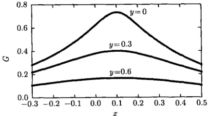

图 12.11 格林函数（12.7.9）曲线
 

点源与像电荷位置分别是  $ x_{0}=0.1, y_{0}=0.1 $ 和  $ x_{1}=0.1, y_{1}=-0.1 $

#### 12.7.2 第三类边值问题的格林函数

考虑上半平面具有第三类边界条件的格林函数问题

$$  \left\{\begin{array}{l}\nabla^{2}G=-\delta(x-x_{0})\delta(y-y_{0})\quad(-\infty<x<\infty,y>0)\\ \left[G+\frac{\partial G}{\partial y}\right]_{y=0}=0\end{array}\right.   \tag*{(12.7.12a)}$$

边值问题 (12.7.12) 的物理意义是，在一根位于 y=0 的导线上方的  $ M_{0}(x_{0},y_{0}) $ 点放置一个点源 (线密度  $ \rho=1 $ 的垂直于 x-y 平面的无限长线电荷)。 $ G(M,M_{0}) $ 则表示在导线上方任意点  $ M(x,y) $ 形成的电位。现在 M 点的电位不仅由该线电荷形成，还有它在导线上的感应电荷所产生的电位。但是感应电荷的分布是未知的，只知道导线上的电位正比于电位梯度 [式 (12.7.12b)]。

<!-- page: 402 -->

设想 M 点的电位是由  $ M_{0} $ 处的点源和位于  $ M_{1}(x_{0}, y_{1}) $ 的像电荷（线密度为  $ \rho $ 的垂直于 x-y 平面的无限长线电荷）在 M 点所形成的电位的叠加，即格林函数为

$$  \begin{aligned}G(M,M_{0})=&\frac{1}{2\pi}\ln\frac{1}{r_{M_{0}M}}+\frac{\rho}{2\pi}\ln\frac{1}{r_{M_{1}M}}+\frac{1}{2\pi}\ln\frac{1}{R}\\=&-\frac{1}{4\pi}\ln\left[(x-x_{0})^{2}+(y-y_{0})^{2}\right]\\&-\frac{\rho}{4\pi}\ln\left[(x-x_{0})^{2}+(y-y_{1})^{2}\right]-\frac{1}{4\pi}\ln R^{2}\end{aligned}   \tag*{(12.7.13)}$$

其中，R 是一个待定的常数，添加它是为了随后满足边界条件 (12.7.12b)，添加该常数后，式 (12.7.13) 仍满足方程 (12.7.10a)。进而由式 (12.7.13) 计算出电位梯度

$$  \frac{\partial G}{\partial y}=-\frac{1}{2\pi}\frac{y-y_{0}}{(x-x_{0})^{2}+(y-y_{0})^{2}}-\frac{\rho}{2\pi}\frac{y-y_{1}}{(x-x_{0})^{2}+(y-y_{1})^{2}}   \tag*{(12.7.14)}$$

下面我们根据边界条件（12.7.12b）来确定式（12.7.13）和式（12.7.14）中像电荷的线密度  $ \rho $ 和它的位置  $ y_{1} $。我们有

$$  \begin{aligned}\left[G+\frac{\partial G}{\partial y}\right]_{y=0}=&-\frac{1}{4\pi}\ln\left[(x-x_{0})^{2}+y_{0}^{2}\right]-\frac{\rho}{4\pi}\ln\left[(x-x_{0})^{2}+y_{1}^{2}\right]\\ &-\frac{1}{4\pi}\ln R^{2}+\frac{1}{2\pi}\frac{y_{0}}{(x-x_{0})^{2}+y_{0}^{2}}+\frac{\rho}{2\pi}\frac{y_{1}}{(x-x_{0})^{2}+y_{1}^{2}}=0\end{aligned}   \tag*{(12.7.15)}$$

式(12.7.15)对变量x求导数得到

$$  \frac{1}{(x-x_{0})^{2}+y_{0}^{2}}+\frac{\rho}{(x-x_{0})^{2}+y_{1}^{2}}+\frac{2y_{0}}{[(x-x_{0})^{2}+y_{0}^{2}]^{2}}+\frac{2\rho y_{1}}{[(x-x_{0})^{2}+y_{1}^{2}]^{2}}=0   \tag*{(12.7.16)}$$

即

$$  \begin{aligned}&2y_{0}\left[(x-x_{0})^{2}+y_{1}^{2}\right]^{2}+2\rho y_{1}\left[(x-x_{0})^{2}+y_{0}^{2}\right]^{2}\\=&-\left[(x-x_{0})^{2}+y_{0}^{2}\right]\left[(x-x_{0})^{2}+y_{1}^{2}\right]^{2}-\rho\left[(x-x_{0})^{2}+y_{1}^{2}\right]\left[(x-x_{0})^{2}+y_{0}^{2}\right]^{2}\\\end{aligned}   \tag*{(12.7.17)}$$

式(12.7.17)两边比较 $ (x-x_{0}) $的各次幂的系数，得到

$$  \rho=-1,\quad y_{1}=2-y_{0}\quad(y_{0}\geqslant1)   \tag*{(12.7.18)}$$

这表示像电荷是负的，其位置不是点源的镜像对称点。将式 (12.7.18) 代入式 (12.7.13) 和式 (12.7.14) 得到

$$  G(M,M_{0})=\frac{1}{4\pi}\ln\frac{(x-x_{0})^{2}+(y-2+y_{0})^{2}}{(x-x_{0})^{2}+(y-y_{0})^{2}}-\frac{1}{4\pi}\ln R^{2}   \tag*{(12.7.19)}$$

<!-- page: 403 -->

$$  \frac{\partial G}{\partial y}=\frac{1}{2\pi}\left[\frac{y-2+y_{0}}{(x-x_{0})^{2}+(y-2+y_{0})^{2}}-\frac{y-y_{0}}{(x-x_{0})^{2}+(y-y_{0})^{2}}\right]   \tag*{(12.7.20)}$$

现在利用边界条件式(12.7.12b)来确定式(12.7.19)中的常数R，让式(12.7.19)和式(12.7.20)满足边界条件(12.7.12b)，得到

$$  \frac{1}{4\pi}\ln\frac{(x-x_{0})^{2}+(2-y_{0})^{2}}{R^{2}[(x-x_{0})^{2}+y_{0}^{2}]}-\frac{1}{2\pi}\left[\frac{2-y_{0}}{(x-x_{0})^{2}+(2-y_{0})^{2}}-\frac{y_{0}}{(x-x_{0})^{2}+y_{0}^{2}}\right]=0   \tag*{(12.7.21)}$$

式(12.7.21)对于变量 $ (x-x_{0}) $的任何值应该成立，故对于 $ x-x_{0}=0 $也应该成立，由此得到

$$  R^{2}=\left(\frac{2-y_{0}}{y_{0}}\right)^{2}\exp\left[-2\left(\frac{1}{2-y_{0}}-\frac{1}{y_{0}}\right)\right]   \tag*{(12.7.22)}$$

代入式(12.7.19)得

$$  G(M,M_{0})=\frac{1}{4\pi}\ln\left[\left(\frac{y_{0}}{2-y_{0}}\right)^{2}\frac{(x-x_{0})^{2}+(y-2+y_{0})^{2}}{(x-x_{0})^{2}+(y-y_{0})^{2}}\right]+\frac{1}{2\pi}\left(\frac{1}{2-y_{0}}-\frac{1}{y_{0}}\right)   \tag*{(12.7.23)}$$

这就是满足式（12.7.12）的格林函数。

现在对得到的结果进行讨论。首先从式（12.7.18）可以看出，当点源的位置 $ y_{0}=1 $时，像电荷的位置也是 $ y_{1}=1 $，即 $ (y_{0},y_{1})=(1,1) $，这表示点源与像电荷的位置相同，而它们的电荷相反，这相当于空间没有电荷，所以应该有G=0和 $ \partial G/\partial y=0 $。实际上，式(12.7.23)和式(12.7.20)给出这一结果。利用式(12.7.23)和式(12.7.20)作出 $ D\equiv G+\frac{\partial G}{\partial y} $的曲线，如图12.12所示。可以看出，对于任何 $ x,D|_{y=0}=0 $满足边界条件式(12.7.12b)]。当y>0时，D呈现关于 $ x_{0} $的对称

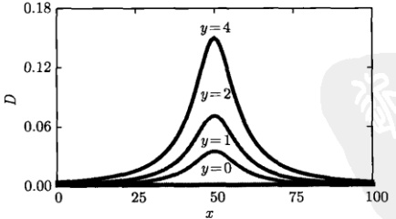

图 12.12  $ D \equiv G + \frac{\partial G}{\partial y} $ 的分布曲线
 

点源与像电荷位置分别是  $ x_{0}=50, y_{0}=10 $ 和  $ x_{1}=50, y_{1}=-8 $

<!-- page: 404 -->

分布，并随着 y 的增大而升高。格林函数 (12.7.23) 作为点源引起的电位分布如图12.13所示，可以看出 y = 1 相应于零电位。随着 y 的增加，观察点  $ M(x,y) $ 越来越靠近点源  $ y_{0} = 10 $，故电位逐渐升高；当观察点  $ M(x,y) $ 上升至高于点源后，电位随着 y 的增加而下降。

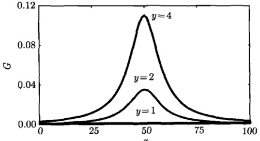

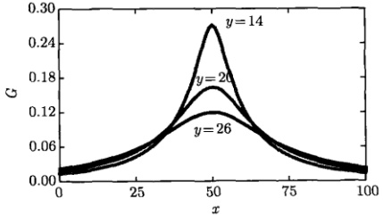

图 12.13 格林函数 (12.7.23) 曲线
 

点源与像电荷位置分别是  $ x_{0}=50, y_{0}=10 $ 和  $ x_{1}=50, y_{1}=-8 $

### 12.8 非线性问题的格林函数解法

格林函数法还可以用来处理某些非线性问题，下面介绍非线性单摆的格林函数解法。

非线性单摆的运动方程为 [式（1.1.20）]

$$  \frac{\mathrm{d}^{2}\theta}{\mathrm{d}^{2}t}+\omega^{2}\sin\theta=0   \tag*{(12.8.1)}$$

其中， $ \omega $ 是单摆的角频率。当摆角  $ \theta < 5^{\circ} $ 时， $ \sin\theta \approx \theta $，方程 (12.8.1) 化为线性形式

$$  \frac{\mathrm{d}^{2}\theta}{\mathrm{d}^{2}t}+\omega^{2}\theta=0   \tag*{(12.8.2)}$$

<!-- page: 405 -->

为解非线性方程 (12.8.1)，将  $ \sin\theta $ 展开成级数

$$  \sin\theta=\theta-\frac{1}{3!}\theta^{3}+\frac{1}{5!}\theta^{5}-\cdots   \tag*{(12.8.3)}$$

将式（12.8.3）代入式（12.8.1）得到

$$  \frac{\mathrm{d}^{2}\theta}{\mathrm{d}^{2}t}+\omega^{2}\theta=\omega^{2}\left(\frac{1}{3!}\theta^{3}-\frac{1}{5!}\theta^{5}+\cdots\right)   \tag*{(12.8.4)}$$

令

$$  f(t)\equiv\omega^{2}\left[\frac{1}{3!}\theta^{3}(t)-\frac{1}{5!}\theta^{5}(t)+\cdots\right]   \tag*{(12.8.5)}$$

方程(12.8.4)变为

$$  \frac{\mathrm{d}^{2}\theta}{\mathrm{d}^{2}t}+\omega^{2}\theta=f(t)   \tag*{(12.8.6)}$$

这样一来，非线性方程(12.8.1)从形式上化成了线性非齐次方程(12.8.6)。该方程的解的积分公式可以表示为

$$  \theta(t)=\int_{0}^{\infty}f(\xi)G(t,\xi)\mathrm{d}\xi   \tag*{(12.8.7)}$$

其中， $ G(\xi,t) $ 是格林函数，它满足方程

$$  \left(\frac{\mathrm{d}^{2}}{\mathrm{d}^{2}t}+\omega^{2}\right)G(t,\xi)=\delta(t-\xi)   \tag*{(12.8.8)}$$

方程（12.8.8）可以写为

$$  \left(\frac{\mathrm{d}}{\mathrm{d}t}+\mathrm{i}\omega\right)\left(\frac{\mathrm{d}}{\mathrm{d}t}-\mathrm{i}\omega\right)G(t,\xi)=\delta(t-\xi)   \tag*{(12.8.9)}$$

令

$$  g=\left(\frac{\mathrm{d}}{\mathrm{d}t}-\mathrm{i}\omega\right)G(t,\xi)   \tag*{(12.8.10)}$$

则方程(12.8.9)变为

$$  \left(\frac{\mathrm{d}}{\mathrm{d}t}+\mathrm{i}\omega\right)g=\delta(t-\xi)   \tag*{(12.8.11)}$$

用积分因子  $ e^{i\omega t} $ 乘以方程 (12.8.11) 两端，化简为

$$  \frac{\mathrm{d}}{\mathrm{d}t}\left(\mathrm{e}^{\mathrm{i}\omega t}g\right)=\mathrm{e}^{\mathrm{i}\omega t}\delta(t-\xi)   \tag*{(12.8.12)}$$

积分后得到

$$  g(t)=\left\{\begin{array}{l l}{\mathrm{e}^{-\mathrm{i}\omega\left(t-\xi\right)}}&{(t>\xi)}\\ {0}&{(t<\xi)}\end{array}\right.   \tag*{(12.8.13)}$$

<!-- page: 406 -->

将式（12.8.13）代入式（12.8.10）得到

$$  \left(\frac{\mathrm{d}}{\mathrm{d}t}-\mathrm{i}\omega\right)G(t,\xi)=\left\{\begin{array}{l l}\mathrm{e}^{-\mathrm{i}\omega(t-\xi)}&(t>\xi)\\ &0\quad(t<\xi)\end{array}\right.   \tag*{(12.8.14)}$$

方程（12.8.14）两边同乘以积分因子  $ e^{-i\omega t} $，变为

$$  \frac{\mathrm{d}}{\mathrm{d}t}\left(\mathrm{e}^{-\mathrm{i}\omega t}G\right)=\left\{\begin{array}{l l}\mathrm{e}^{-\mathrm{i}2\omega t}\mathrm{e}^{\mathrm{i}\omega\xi}&(t>\xi)\\ &\\ 0&(t<\xi)\end{array}\right.   \tag*{(12.8.15)}$$

积分后得到格林函数

$$  G(t,\xi)=\left\{\begin{array}{l l}\frac{\mathrm{e}^{\mathrm{i}\omega(t-\xi)}-\mathrm{e}^{-\mathrm{i}\omega(t-\xi)}}{\mathrm{i}2\omega}&(t>\xi)\\ 0&(t<\xi)\end{array}\right.   \tag*{(12.8.16)}$$

或

$$  G(t,\xi)=\left\{\begin{array}{ll}\frac{\sin\omega(t-\xi)}{\omega}&(t>\xi)\\0&(t<\xi)\end{array}\right.   \tag*{(12.8.17)}$$

将式（12.8.17）代入式（12.8.7）得到

$$  \theta(t)=\int_{0}^{t}\omega\sin\omega\left(t-\xi\right)\left[\frac{1}{3!}\theta^{3}(t)-\frac{1}{5!}\theta^{5}(t)+\cdots\right]\mathrm{d}\xi   \tag*{(12.8.18)}$$

这就是非线性单摆方程（12.8.1）解的积分公式，可以直接用于数值计算。

