# 13-第13章 贝塞尔函数

[返回全书目录](../../README.md)

> PDF 页码：407–451

<!-- page: 407 -->

### 第13章 贝塞尔函数

我们知道，利用分离变量法可以把偏微分方程化成常微分方程。经过分离变量后出现的常微分方程，有时是变系数的方程。变系数常微分方程的求解一般是困难的，但在求解数学物理方程中出现的变系数的常微分方程往往有一些特殊性，它们的解一般情况下不是初等函数，而是用收敛的无穷级数或是多项式来表示，这就是所谓的“特殊函数”。常见的特殊函数有伽马函数、贝塞尔函数、球贝塞尔函数、勒让德多项式、连带勒让德函数、厄米多项式、拉盖尔多项式、广义拉盖尔多项式等。我们在接下来的讨论中会涉及这些特殊函数，而本章首先讨论贝塞尔方程与贝塞尔函数。

贝塞尔方程源于偏微分方程的求解，特别是极坐标系和柱坐标系的拉普拉斯方程。另外，贝塞尔方程还出现在其他许多经典问题的求解中，如我们在第9章所讨论的吊摆问题就是贝塞尔方程最初的形式，这一研究是在1732年完成的。贝塞尔方程与贝塞尔函数在现代许多理论问题与工程技术领域扮演着重要的角色。

### 13.1 几个微分方程的引入

本节我们一般性地将引入几个微分方程、包括亥姆霍兹方程、欧拉方程、贝塞尔方程、球贝塞尔方程、勒让德方程、连带勒让德方程等。首先考虑三维波动方程

$$  \frac{\partial^{2}v}{\partial t^{2}}=a^{2}\left(\frac{\partial^{2}v}{\partial x^{2}}+\frac{\partial^{2}v}{\partial y^{2}}+\frac{\partial^{2}v}{\partial z^{2}}\right)\equiv a^{2}\nabla^{2}v   \tag*{(13.1.1a)}$$

和三维热传导方程

$$  \frac{\partial v}{\partial t}=a^{2}\left(\frac{\partial^{2}v}{\partial x^{2}}+\frac{\partial^{2}v}{\partial y^{2}}+\frac{\partial^{2}v}{\partial z^{2}}\right)\equiv a^{2}\nabla^{2}v   \tag*{(13.1.1b)}$$

设它们有变量分离的形式解

$$  v(\boldsymbol{r},t)=u(\boldsymbol{r})T(t)   \tag*{(13.1.2)}$$

将式 (13.1.2) 分别代入式 (13.1.1a) 和式 (13.1.1b) 得到相同形式的空间函数  $ u(r) $ 的方程

$$  \nabla^{2}u(\boldsymbol{r})+k^{2}u(\boldsymbol{r})=0   \tag*{（13.1.3）}$$

而时间函数  $ T(t) $ 的方程分别为

$$  T^{\prime\prime}(t)+k^{2}a^{2}T(t)=0,\quad T^{\prime}(t)+k^{2}a^{2}T(t)=0   \tag*{(13.1.4)}$$

<!-- page: 408 -->

其中，k 是分离常数。方程 (13.1.3) 称为亥姆霍兹方程。

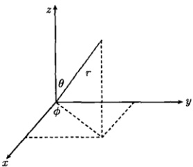

首先我们在球坐标系中讨论方程(13.1.3)。利用直角坐标系与球坐标系的关系(图13.1):

$$  x=r\sin\theta\cos\phi   \tag*{(13.1.5a)}$$

$$  y=r\sin\theta\sin\phi   \tag*{(13.1.5b)}$$

图 13.1 球坐标系  $ (r,\theta,\phi) $
 

$$  z=r\cos\theta   \tag*{(13.1.5c)}$$

方程（13.1.3）变为[式（1.2.49）]

$$  \frac{1}{r^{2}}\frac{\partial}{\partial r}\left(r^{2}\frac{\partial u}{\partial r}\right)+\frac{1}{r^{2}\operatorname{s i n}\theta}\frac{\partial}{\partial\theta}\left(\operatorname{s i n}\theta\frac{\partial u}{\partial\theta}\right)+\frac{1}{r^{2}\operatorname{s i n}^{2}\theta}\frac{\partial^{2}u}{\partial\phi^{2}}+k^{2}u=0   \tag*{(13.1.6)}$$

设方程（13.1.6）有变量分离的形式解

$$  u(r,\theta,\phi)=R(r)\Theta(\theta)\Phi(\phi)   \tag*{(13.1.7)}$$

将式(13.1.7)代入式(13.1.6)得到

$$  \frac{\mathrm{d}}{\mathrm{d}r}\left(r^{2}\frac{\mathrm{d}R}{\mathrm{d}r}\right)+\left(k^{2}r^{2}-\omega^{2}\right)R=0   \tag*{(13.1.8a)}$$

$$  \frac{1}{\sin\theta}\frac{\mathrm{d}}{\mathrm{d}\theta}\left(\sin\theta\frac{\mathrm{d}\theta}{\mathrm{d}\theta}\right)+\left(\omega^{2}-\frac{m^{2}}{\sin^{2}\theta}\right)\theta=0   \tag*{(13.1.8b)}$$

$$  \Phi^{\prime\prime}+m^{2}\Phi=0   \tag*{(13.1.8c)}$$

其中，m 与  $ \omega $ 均是分离常数。方程 (13.1.8a) 称为球贝塞尔方程，当其中的 k=0 时，约化为

$$  \frac{\mathrm{d}}{\mathrm{d}r}\left(r^{2}\frac{\mathrm{d}R}{\mathrm{d}r}\right)-\omega^{2}R=0   \tag*{(13.1.9a)}$$

这是欧拉方程。在式(13.1.8b)中，令  $ x = \cos\theta $， $ y(x) = \theta(\theta) $，该方程变为

$$  \frac{\mathrm{d}}{\mathrm{d}x}\left[(1-x^{2})\frac{\mathrm{d}y}{\mathrm{d}x}\right]+\left(\omega^{2}-\frac{m^{2}}{1-x^{2}}\right)y=0   \tag*{(13.1.9b)}$$

它称为连带勒让德方程。在式(13.1.9b)中，当 m=0 时，它变为

$$  \frac{\mathrm{d}}{\mathrm{d}x}\left[(1-x^{2})\frac{\mathrm{d}y}{\mathrm{d}x}\right]+\omega^{2}y=0   \tag*{(13.1.9c)}$$

这是勒让德方程。

<!-- page: 409 -->

现在我们在柱坐标系中讨论方程(13.1.3)，利用直角坐标系与柱坐标的关系（图13.2）

$$  x=\rho\cos\phi,\quad y=\rho\sin\phi,\quad z=z   \tag*{(13.1.10)}$$

方程（13.1.3）变为[式（1.2.34）]

$$  \frac{1}{\rho}\frac{\partial}{\partial\rho}\left(\rho\frac{\partial u}{\partial\rho}\right)+\frac{1}{\rho^{2}}\frac{\partial^{2}u}{\partial\phi^{2}}+\frac{\partial^{2}u}{\partial z^{2}}+k^{2}u=0   \tag*{(13.1.11)}$$

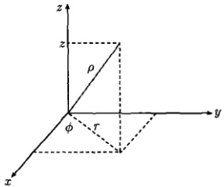

设方程（13.1.11）有变量分离的形式解

 $$ u(\rho,\phi,z)=R(\rho)\Phi(\phi)Z(z) $$ 

图 13.2 柱坐标系  $ (\rho,\phi,z) $
 

将式（13.1.12）代入式（13.1.11）得到

$$  \rho^{2}\frac{\mathrm{d}^{2}R}{\mathrm{d}\rho^{2}}+\rho\frac{\mathrm{d}R}{\mathrm{d}\rho}+\left[\left(k^{2}+\omega^{2}\right)\rho^{2}-m^{2}\right]R=0   \tag*{(13.1.13a)}$$

$$  \Phi^{\prime\prime}+m^{2}\Phi=0   \tag*{(13.1.13b)}$$

$$  Z^{\prime\prime}-\omega^{2}Z=0   \tag*{(13.1.13c)}$$

其中，m 与  $ \omega $ 均是分离常数。在式 (13.1.13b) 中，令  $ x = \sqrt{k^{2} + \omega^{2}} \rho $， $ y(x) = R(\rho) $，该方程变为

$$  x^{2}\frac{d^{2}y}{\mathrm{d}x^{2}}+x\frac{\mathrm{d}y}{\mathrm{d}x}+\left(x^{2}-m^{2}\right)y=0   \tag*{(13.1.14)}$$

方程（13.1.14）称为贝塞尔方程。

上述这些微分方程的引入，还可以从施图姆-刘维尔型方程 [见式（9.1.1）] 出发

$$  \frac{\mathrm{d}}{\mathrm{d}x}\left[k(x)\frac{\mathrm{d}y}{\mathrm{d}x}\right]-q(x)y+\lambda\rho(x)y=0   \tag*{(13.1.15)}$$

事实上，

（1）当 k=1, q=0,  $ \rho=1 $ 时，方程（13.1.15）约化为

$$  \frac{\mathrm{d}^{2}y}{\mathrm{d}x^{2}}+\lambda y=0   \tag*{(13.1.16)}$$

这是亥姆霍兹方程。

(2) 当 k = x,  $ q = m^{2}/x $,  $ \rho = x $ 时，方程 (13.1.15) 约化为

$$  \frac{\mathrm{d}}{\mathrm{d}x}\left(x\frac{\mathrm{d}y}{\mathrm{d}x}\right)-\frac{m^{2}}{x}y+\lambda xy=0   \tag*{(13.1.17)}$$

<!-- page: 410 -->

这是参数形式的贝塞尔方程，当参数  $ \lambda = 1 $ 时变为贝塞尔方程。

(3) 当  $ k = x^{2} $,  $ q = \omega^{2} $,  $ \rho = x^{2} $ 时, 方程 (13.1.15) 约化为

$$  \frac{\mathrm{d}}{\mathrm{d}x}\left[x^{2}\frac{\mathrm{d}y}{\mathrm{d}x}\right]-\omega^{2}y+\lambda x^{2}y=0   \tag*{(13.1.18)}$$

这是球贝塞尔方程。方程（13.1.18）中，当  $ \lambda=0 $ 时，化为欧拉方程（13.1.9a）。

(4) 当 k = 1 - x^{2}, q = 0,  $ \rho = 1 $ 时，方程 (13.1.15) 约化为

$$  \frac{\mathrm{d}}{\mathrm{d}x}\left[(1-x^{2})\frac{\mathrm{d}y}{\mathrm{d}x}\right]+\lambda y=0   \tag*{(13.1.19)}$$

这是勒让德方程。

(5) 当  $ k=1-x^{2}, q=\frac{m^{2}}{1-x^{2}}, \rho=1 $ 时，方程 (13.1.15) 约化为

$$  \frac{\mathrm{d}}{\mathrm{d}x}\left[(1-x^{2})\frac{\mathrm{d}y}{\mathrm{d}x}\right]-\frac{m^{2}}{1-x^{2}}y+\lambda y=0   \tag*{(13.1.20)}$$

这是连带勒让德方程。

### 13.2 伽马函数的基本知识

为了随后的需要，本节介绍伽马函数（gamma function）的基本知识。伽马函数定义为

$$  \Gamma(x)=\int_{0}^{\infty}\mathrm{e}^{-t}t^{x-1}\mathrm{d}t\quad(x>0)   \tag*{(13.2.1)}$$

它的基本性质是

$$  \Gamma(x+1)=x\Gamma(x)   \tag*{(13.2.2)}$$

这个公式可以用分部积分法证明如下

$$  \begin{aligned}\Gamma(x+1)&=\int_{0}^{\infty}\mathrm{e}^{-t}t^{x}\mathrm{d}t=-\int_{0}^{\infty}t^{x}\mathrm{d}\left(\mathrm{e}^{-t}\right)\\&=-\left[t^{x}\mathrm{e}^{-t}\right]_{t=0}^{\infty}+x\int_{0}^{\infty}\mathrm{e}^{-t}t^{x-1}\mathrm{d}t=x\Gamma(x)\end{aligned}   \tag*{(13.2.3)}$$

另外，由式（13.2.1）容易求得伽马函数在 x 取正整数时的值，例如

$$  \Gamma(1)=\int_{0}^{\infty}\mathrm{e}^{-t}\mathrm{d}t=1   \tag*{(13.2.4)}$$

进而，基本性质(13.2.2)给出

$$  \Gamma(2)=1\cdot\Gamma(1)=1,\quad\Gamma(3)=2\cdot\Gamma(2)=2!,\quad\Gamma(4)=3\cdot\Gamma(3)=3!,\cdots   \tag*{(13.2.5)}$$

<!-- page: 411 -->

继续递推可得

$$  \Gamma(n+1)=n!\quad(n=0,1,2,\cdots)   \tag*{(13.2.6)}$$

需要指出，伽马函数（13.2.1）在自变量取零和负整数时是没有定义的，这意味着

$$  \Gamma(-n)\to\infty\quad(n=0,1,2,\cdots)   \tag*{(13.2.7)}$$

例 1 证明伽马函数的另一个重要性质

$$  \Gamma\left(\frac{1}{2}\right)=\sqrt{\pi}   \tag*{(13.2.8)}$$

证明 在式(13.2.1)中令 $ x=u^{2} $，我们有

$$  \Gamma\left(\frac{1}{2}\right)=\int_{0}^{\infty}\mathrm{e}^{-x}x^{-1/2}\mathrm{d}x=2\int_{0}^{\infty}\mathrm{e}^{-u^{2}}\mathrm{d}u   \tag*{(13.2.9)}$$

两边平方得

 $$ \left[\Gamma\left(\frac{1}{2}\right)\right]^{2}=\left(2\int_{0}^{\infty}\mathrm{e}^{-u^{2}}\mathrm{d}u\right)\left(2\int_{0}^{\infty}\mathrm{e}^{-v^{2}}\mathrm{d}v\right)=4\int_{0}^{\infty}\int_{0}^{\infty}\mathrm{e}^{-\left(x^{2}+y^{2}\right)}\mathrm{d}x\mathrm{d}y $$ 

右端的积分换成极坐标  $ (r^{2}=x^{2}+y^{2}, \mathrm{d}x\mathrm{d}y=r\mathrm{d}r\mathrm{d}\theta) $，得到

 $$ \begin{align*}\left[\Gamma\left(\frac{1}{2}\right)\right]^{2}&=4\int_{0}^{\infty}\int_{0}^{\infty}\mathrm{e}^{-\left(x^{2}+y^{2}\right)}\mathrm{d}x\mathrm{d}y=4\int_{\theta=0}^{\pi/2}\int_{r=0}^{\infty}\mathrm{e}^{-r^{2}}r\mathrm{d}r\mathrm{d}\theta\\&=4\int_{0}^{\pi/2}\left[-\frac{1}{2}\mathrm{e}^{-r^{2}}\right]_{0}^{\infty}\mathrm{d}\theta=\pi\end{align*} $$ 

故式(13.2.8)得证。

例2 证明

$$  \Gamma\left(n+\frac{1}{2}\right)=\frac{(2n)!}{2^{2n}n!}\sqrt{\pi}   \tag*{(13.2.10a)}$$

$$  \Gamma\left(n+\frac{1}{2}+1\right)=\frac{(2n+1)!}{2^{2n+1}n!}\sqrt{\pi}   \tag*{(13.2.10b)}$$

证明 由式(13.2.2)和式(13.2.8)得

$$  \Gamma\left(1+\frac{1}{2}\right)=\frac{1}{2}\Gamma\left(\frac{1}{2}\right)=\frac{1}{2}\sqrt{\pi}   \tag*{(13.2.11a)}$$

$$  \Gamma\left(2+\frac{1}{2}\right)=\frac{3}{2}\Gamma\left(1+\frac{1}{2}\right)=\frac{3}{2}\frac{1}{2}\sqrt{\pi}   \tag*{(13.2.11b)}$$

$$  \Gamma\left(3+\frac{1}{2}\right)=\frac{5}{2}\Gamma\left(2+\frac{1}{2}\right)=\frac{5}{2}\frac{3}{2}\frac{1}{2}\sqrt{\pi}   \tag*{(13.2.11c)}$$

<!-- page: 412 -->

继续递推可得

 $$ \begin{aligned}\Gamma\left(n+\frac{1}{2}\right)&=\frac{2n-1}{2}\cdots\frac{5}{2}\frac{3}{2}\frac{1}{2}\sqrt{\pi}\\&=\frac{\frac{2n-1}{2}\cdots\frac{5}{2}\frac{3}{2}\frac{1}{2}\cdot\frac{2n}{2}\cdots\frac{6}{2}\frac{4}{2}\frac{2}{2}}{\frac{2n}{2}\cdots\frac{6}{2}\frac{4}{2}\frac{2}{2}}\sqrt{\pi}=\frac{(2n)!}{2^{2n}n!}\sqrt{\pi}\end{aligned} $$ 

故式 $  (13.2.10a)  $得证。将上式中的 n 换成  $ n+1 $ 即得式 $  (13.2.10b)  $。

例 3 证明对于大的 n，下面的近似式（斯特林公式）成立

$$  n!=\sqrt{2\pi n}n^{n}\mathrm{e}^{-n}   \tag*{(13.2.12)}$$

证明 由式(13.2.1)得到

$$  \Gamma(n+1)=\int_{0}^{\infty}x^{n}\mathrm{e}^{-x}\mathrm{d}x=\int_{0}^{\infty}\exp\left(n\ln x-x\right)\mathrm{d}x   \tag*{(13.2.13)}$$

由于函数  $ n \ln x - x $ 在 x = n 处有一个极大值，这启示我们作代换 x = n + y，于是式 (13.2.13) 变成

 $$ \begin{aligned}\Gamma(n+1)&=\mathrm{e}^{-n}\int_{-n}^{\infty}\exp\left[n\ln(n+y)-y\right]\mathrm{d}y\\&=\mathrm{e}^{-n}\int_{-n}^{\infty}\exp\left[n\ln n+n\ln\left(1+\frac{y}{n}\right)-y\right]\mathrm{d}y\\&=n^{n}\mathrm{e}^{-n}\int_{-n}^{\infty}\exp\left[n\ln\left(1+\frac{y}{n}\right)-y\right]\mathrm{d}y\end{aligned} $$ 

利用展开式

$$  \ln(1+u)=u-\frac{u^{2}}{2}+\frac{u^{3}}{3}-\cdots\quad\left(u=\frac{y}{n}\right)   \tag*{(13.2.14)}$$

然后设  $ y = \sqrt{n} v $，得到

 $$ \begin{align*}\Gamma(n+1)&=n^{n}\mathrm{e}^{-n}\int_{-n}^{\infty}\exp\left(-\frac{y^{2}}{2n}+\frac{y^{3}}{3n^{2}}-\cdots\right)\mathrm{d}y\\&=n^{n}\mathrm{e}^{-n}\sqrt{n}\int_{-\sqrt{n}}^{\infty}\exp\left(-\frac{v^{2}}{2}+\frac{v^{3}}{3\sqrt{n}}-\cdots\right)\mathrm{d}v\end{align*} $$ 

当 $n$ 很大时，上式中的积分主要由 $\int_{-\infty}^{\infty} \exp\left(-v^2/2\right) \, \mathrm{d}v = \sqrt{2\pi}$ 确定，再注意到式 (13.2.6)，即得斯特林公式 (13.2.12)。该公式在统计物理学中有重要的应用。

<!-- page: 413 -->

### 13.3 贝塞尔方程的求解

#### 13.3.1 贝塞尔方程的广义幂级数解

本节我们求解贝塞尔方程(13.1.14)，它可以写为

$$  x^{2}\frac{\mathrm{d}^{2}y}{\mathrm{d}x^{2}}+x\frac{\mathrm{d}y}{\mathrm{d}x}+(x^{2}-\nu^{2})y=0\quad(x>0)   \tag*{(13.3.1)}$$

这个方程称为  $ \nu $ 阶贝塞尔方程， $ \nu $ 为给定的实数。贝塞尔方程的解称为贝塞尔函数。方程 (13.3.1) 可以写为

$$  y^{\prime \prime}+\frac{1}{x}y^{\prime}+\frac{x^{2}-\nu^{2}}{x^{2}}y=0   \tag*{(13.3.2)}$$

容易看出，方程(13.3.2)的解不能在x=0附近展开成幂级数，因为x=0是它的正则奇点。

按照常微分方程理论，对于变系数方程

$$  y^{\prime\prime}+p(x)y^{\prime}+q(x)y=0   \tag*{(13.3.3)}$$

如果  $ xp(x) $,  $ x^{2}q(x) $ 都能在 x=0 附近展开成幂级数，则在这个邻域内方程 (13.3.3) 有广义幂级数解  $ \infty $

$$  y=\sum_{k=0}^{\infty}C_{k}x^{C+k}\quad(C_{0}\neq0)   \tag*{(13.3.4)}$$

其中，C 是待定常数， $ C_{k}(k=0,1,2,\cdots) $ 是展开系数。用广义幂级数 (13.3.4) 求解变系数微分方程 (13.3.3) 的方法称为弗罗贝尼乌斯法 (Frobenius method)。考查贝塞尔方程 (13.3.2)，我们有  $ xp(x)=1, x^{2}q(x)=x^{2}-\nu^{2} $。显然，它们都能在 x=0 附近展开成幂级数，因此方程 (13.3.2) 能展开成如式 (13.3.4) 所示的广义幂级数。

下面来确定 C、 $ C_{k}(k=0,1,2,\cdots) $，为此对式 (13.3.4) 求导数，得到

$$  \begin{aligned}&y^{\prime}=\sum_{k=0}^{\infty}C_{k}(C+k)x^{C+k-1}\\&y^{\prime\prime}=\sum_{k=0}^{\infty}C_{k}(C+k)(C+k-1)x^{C+k-2}\\ \end{aligned}   \tag*{(13.3.5)}$$

将式（13.3.4）和式（13.3.5）代入式（13.3.1），得到

 $$ \sum_{k=0}^{\infty}C_{k}(C+k)(C+k-1)x^{C+k}+\sum_{k=0}^{\infty}C_{k}(C+k)x^{C+k}-\nu^{2}\sum_{k=0}^{\infty}C_{k}x^{C+k}+S=0 $$ 

现在式(13.3.6)中的前三个求和有相同的幂次 $ x^{C+k} $，而

<!-- page: 414 -->

$$  S=\sum_{k=0}^{\infty}C_{k}x^{C+k+2}=\sum_{m=2}^{\infty}C_{m-2}x^{C+m}\quad(k+2=m)   \tag*{(13.3.7)}$$

这样我们必须将式(13.3.6)中前三个求和的 k=0 项和 k=1 单独写出，再将剩余的部分与 S 合并，得到

$$  \begin{aligned}&C_{0}\left(C^{2}-\nu^{2}\right)x^{C}+C_{1}\left[(C+1)^{2}-\nu^{2}\right]x^{C+1}\\&+\sum_{k=2}^{\infty}\left\{C_{k}\left[(C+k)^{2}-\nu^{2}\right]+C_{k-2}\right\}x^{C+k}=0\\ \end{aligned}   \tag*{(13.3.8)}$$

由 x 各次幂的系数为零得到

$$  C_{0}\left(C^{2}-\nu^{2}\right)=0\quad(k=0)   \tag*{(13.3.9a)}$$

$$  C_{1}\left[(C+1)^{2}-\nu^{2}\right]=0\quad(k=1)   \tag*{(13.3.9b)}$$

$$  C_{k}\left[(C+k)^{2}-\nu^{2}\right]+C_{k-2}=0\quad(k\geqslant2)   \tag*{(13.3.9c)}$$

由式 $  (13.3.9a)  $，注意到 $ C_{0}\neq0 $，我们有

$$  \left(C+\nu\right)\left(C-\nu\right)=0   \tag*{(13.3.10)}$$

它给出两个根  $ C=\pm\nu $ (设  $ \nu\geqslant0 $)。它们相应于方程 (13.3.1) 的两个线性无关的解。

#### 13.3.2 第一类贝塞尔函数

首先考虑  $ C = \nu $，将它代入式 (13.3.9c) 给出递推关系式

$$  C_{k}=\frac{-1}{k(k+2\nu)}C_{k-2}\quad(k\geqslant2)   \tag*{(13.3.11)}$$

这是一个双间隔递推关系式，偶指标项与奇指标项必须分开确定。我们首先考查奇指标项，这时因为  $ C = \nu $，式 (13.3.9b) 变成  $ C_1(2\nu + 1) = 0 $，它导致  $ C_1 = 0 $。从而由式 (13.3.11) 知  $ C_3 = C_5 = \cdots = 0 $。这样一来，我们只需要处理偶指标项，为此令 k = 2m，将式 (13.3.11) 改写为

$$  C_{2m}=\frac{-1}{2^{2}m(m+\nu)}C_{2m-2}\quad(m\geqslant1)   \tag*{(13.3.12)}$$

它给出

 $$ \begin{aligned}&m=1:\quad C_{2}=\frac{-1}{2^{2}(1+\nu)}C_{0}\\&m=2:\quad C_{4}=\frac{-1}{2^{2}2(2+\nu)}C_{2}=\frac{1}{2^{4}2!(1+\nu)(2+\nu)}C_{0}\\&m=3:\quad C_{6}=\frac{-1}{2^{2}3(3+\nu)}C_{4}=\frac{-1}{2^{6}3!(1+\nu)(2+\nu)(3+\nu)}C_{0}\\&\cdots\end{aligned} $$ 

 $$ m=m:\quad C_{2m}=\frac{(-1)^{m}}{2^{2m}m!(1+\nu)(2+\nu)(3+\nu)\cdots(m+\nu)}C_{0} $$

<!-- page: 415 -->

每个系数都有  $ C_{0} $，将这些系数代入式 (13.3.4) 给出贝塞尔方程 (13.3.1) 的一个特解

$$  y=C_{0}\sum_{m=0}^{\infty}\frac{(-1)^{m}}{2^{2m}m!(1+\nu)(2+\nu)(3+\nu)\cdots(m+\nu)}x^{2m+\nu}   \tag*{(13.3.13)}$$

这里  $ C_{0} $ 是一个任意常数，通常取为

$$  C_{0}=\frac{1}{2^{\nu}\Gamma(\nu+1)}   \tag*{(13.3.14)}$$

按式(13.3.14)选择 $ C_{0} $可使式(13.3.13)中2的次数与x的次数相同，构成 $ \left(\frac{x}{2}\right)^{2m+\nu} $的形式。另外，可以运用下列伽马函数的恒等式[式(13.2.2)]

 $$ \begin{aligned}&\Gamma(1+\nu)\left[(1+\nu)(2+\nu)(3+\nu)\cdots(m+\nu)\right]\\=&\Gamma(2+\nu)\left[(2+\nu)(3+\nu)\cdots(m+\nu)\right]\\=&\cdots\\=&\Gamma(m+\nu)\cdot(m+\nu)\\=&\Gamma(m+\nu+1)\end{aligned} $$ 

使式（13.3.13）变成简洁的形式，记为

$$  J_{\nu}(x)=\sum_{m=0}^{\infty}\frac{(-1)^{m}}{m!\Gamma(m+\nu+1)}\left(\frac{x}{2}\right)^{2m+\nu}   \tag*{(13.3.15)}$$

它称为  $ \nu $ 阶第一类贝塞尔函数， $ J_{\nu}(x) $ 是贝塞尔方程 (13.3.1) 的第一个特解。

考查  $ J_{\nu}(x) $ 在 x=0 的值，显然有  $ J_{\nu}(0)=0(\nu>0) $；当  $ \nu=0 $ 时，式 (13.3.15) 求和中 m>0 的项均为零，而 m=0 的项给出 [注意到式 (13.2.4)]

$$  J_{0}(0)=\frac{1}{\Gamma(1)}\left(\frac{x}{2}\right)^{0}=1   \tag*{(13.3.16)}$$

当  $ \nu $ 取零和正整数，即  $ \nu = n (n = 0, 1, 2, \cdots) $ 时，利用伽马函数的性质 (13.2.6)，式 (13.3.15) 变成

$$  J_{n}(x)=\sum_{m=0}^{\infty}\frac{(-1)^{m}}{m!(m+n)!}\left(\frac{x}{2}\right)^{2m+n}   \tag*{(13.3.17)}$$

它称为整数阶贝塞尔函数。

为了对贝塞尔函数有一个直观的了解，由式 (13.3.17) 作出  $ J_{0}(x) $、 $ J_{1}(x) $ 和  $ J_{2}(x) $ 的曲线，如图 13.3 所示，图中的曲线显示，确实有  $ J_{0}(0) = 1 $，而  $ J_{\nu}(0) = 0 (\nu > 0) $。

<!-- page: 416 -->

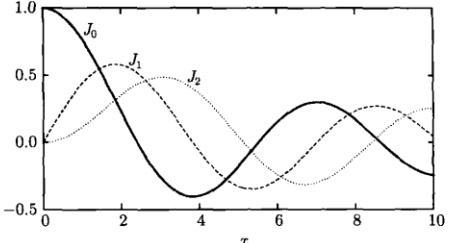

图 13.3 第一类贝塞尔函数  $ J_{0}(x) $、 $ J_{1}(x) $ 和  $ J_{2}(x) $ 的曲线
 

#### 13.3.3 贝塞尔方程的通解

贝塞尔方程 (13.3.1) 的第二个特解相应于 (13.3.10) 的另一个根  $ C = -\nu $，这样只需要将式 (13.3.15) 中的  $ \nu $ 用  $ -\nu $ 代替，即得这个特解

$$  J_{-\nu}(x)=\sum_{m=0}^{\infty}\frac{(-1)^{m}}{m!\Gamma(m-\nu+1)}\left(\frac{x}{2}\right)^{2m-\nu}   \tag*{(13.3.18)}$$

考查  $ J_{\nu}(x) $ 和  $ J_{-\nu}(x) $ 在 x=0 的取值可以看出，当  $ \nu $ 不是整数时， $ J_{-\nu}(0) \to \infty $ 而  $ J_{\nu}(0) $ 是有限值，因此，比值  $ J_{\nu}(x)/J_{-\nu}(x) $ 不可能是常数，这表示两个特解  $ J_{\nu}(x) $ 和  $ J_{-\nu}(x) $ 是线性独立的。我们举例说明这一结论。根据伽马函数的性质 (13.2.10b)，我们有

 $$ \begin{aligned}J_{1/2}(x)&=\sum_{m=0}^{\infty}\frac{(-1)^{m}}{m!\Gamma\left(m+\frac{1}{2}+1\right)}\left(\frac{x}{2}\right)^{2m+\frac{1}{2}}=\frac{1}{\sqrt{\pi}}\sum_{m=0}^{\infty}\frac{(-1)^{m}2^{2m+1}m!}{m!(2m+1)!}\left(\frac{x}{2}\right)^{2m+\frac{1}{2}}\\ &=\sqrt{\frac{2}{\pi x}}\sum_{m=0}^{\infty}\frac{(-1)^{m}}{(2m+1)!}x^{2m+1}\end{aligned} $$ 

最后的求和正好是  $ \sin x $ 的幂级数，故

$$  J_{1/2}(x)=\sqrt{\frac{2}{\pi x}}\sin x   \tag*{(13.3.19)}$$

另外由式 $  (13.2.10a)  $，我们有

 $$ \begin{aligned}J_{-1/2}(x)&=\sum_{m=0}^{\infty}\frac{(-1)^{m}}{m!\Gamma\left(m-\frac{1}{2}+1\right)}\left(\frac{x}{2}\right)^{2m-\frac{1}{2}}=\frac{1}{\sqrt{\pi}}\sum_{m=0}^{\infty}\frac{(-1)^{m}2^{2m}m!}{m!(2m)!}\left(\frac{x}{2}\right)^{2m-\frac{1}{2}}\\ &=\sqrt{\frac{2}{\pi x}}\sum_{m=0}^{\infty}\frac{(-1)^{m}}{(2m)!}x^{2m}\end{aligned} $$

<!-- page: 417 -->

最后的求和正好是  $ \cos x $ 的幂级数，故

$$  J_{-1/2}(x)=\sqrt{\frac{2}{\pi x}}\cos x   \tag*{(13.3.20)}$$

我们在图 13.4 中作出  $ J_{1/2}(x) $ 和  $ J_{-1/2}(x) $ 的曲线。显然  $ J_{-1/2}(0^{+}) \to \infty $，而式 (13.3.19) 给出  $ J_{1/2}(0) = 0 $，可见  $ J_{1/2}(x) $ 和  $ J_{-1/2}(x) $ 是线性独立的。

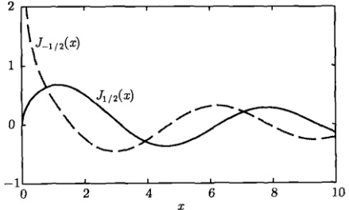

图 13.4 贝塞尔函数  $ J_{1/2}(x) $ 和  $ J_{-1/2}(x) $ 是线性独立的
 

我们进一步考查整数阶贝塞尔函数  $ J_{n}(x) $ 与  $ J_{-n}(x) $ 的关系。由式 (13.3.18) 写出

$$  J_{-n}(x)=\sum_{m=0}^{\infty}\frac{(-1)^{m}}{m!\Gamma(m-n+1)}\left(\frac{x}{2}\right)^{2m-n}   \tag*{(13.3.21)}$$

按照伽马函数的性质式(13.2.7)，式(13.3.21)中  $ m-n+1 \leqslant 0 $ 时， $ \Gamma(m-n+1) \rightarrow \infty $，即  $ \frac{1}{\Gamma}(m-n+1)=0 $。因此，当  $ m-n+1>0 $ (即 m>n-1) 时， $ J_{-n}(x) $ 取非零值，故式(13.3.21)中的求和实际上始于 m=n，即

$$  J_{-n}(x)=\sum_{m=n}^{\infty}\frac{(-1)^{m}}{m!\Gamma(m-n+1)}\left(\frac{x}{2}\right)^{2m-n}   \tag*{(13.3.22)}$$

令  $ m=k+n $，式 (13.3.22) 变为

 $$ \begin{aligned}J_{-n}(x)&=(-1)^{n}\sum_{k=0}^{\infty}\frac{(-1)^{k}}{(k+n)!\Gamma(k+1)}\left(\frac{x}{2}\right)^{2k+n}\\&=(-1)^{n}\sum_{k=0}^{\infty}\frac{(-1)^{k}}{k!(k+n)!}\left(\frac{x}{2}\right)^{2k+n}\end{aligned} $$ 

注意到式(13.3.17)，我们有

$$  J_{-n}(x)=(-1)^{n}J_{n}(x)   \tag*{(13.3.23)}$$

<!-- page: 418 -->

可见  $ J_{n}(x) $ 和  $ J_{-n}(x) $ 是线性相关的。

为了找到另一个与  $ J_{n}(x) $ 线性无关的解，通常的方法是引入诺伊曼函数

$$  Y_{\nu}(x)=\frac{J_{\nu}(x)\cos\nu\pi-J_{-\nu}(x)}{\sin\nu\pi}\quad(\nu\  不是整数 )   \tag*{(13.3.24)}$$

 $ Y_{\nu} $ 也称为第二类  $ \nu $ 阶贝塞尔函数。由于  $ J_{\nu} $ 与  $ J_{-\nu} $ 是贝塞尔方程的两个线性独立的特解，因此  $ Y_{\nu} $ 也是贝塞尔方程的特解，显然它与  $ J_{\nu} $ 是线性无关的。

在  $ \nu $ 为整数的情况下，通常由非整数值向  $ \nu $ 趋近的极限过程来构造一个函数

$$  Y_{\nu}(x)=\lim_{\alpha\to\nu}\frac{J_{\alpha}(x)\cos\alpha\pi-J_{-\alpha}(x)}{\sin\alpha\pi}\quad(\nu\  是整数 )   \tag*{(13.3.25)}$$

这个极限是存在的（图 13.5），它定义了  $ \nu $ 阶贝塞尔方程的一个特解。这个解在  $ x \to 0^{+} $ 处不是有界的 [图 13.5 显示  $ Y_{\nu}(0^{+}) \to -\infty $]，因此它与相应的第一类贝塞尔函数（图 13.3）是线性独立的。

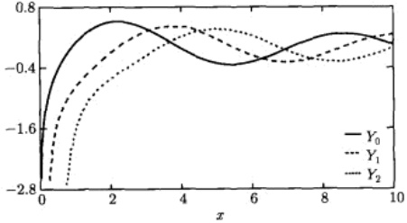

图 13.5 第二类贝塞尔函数  $ Y_{0}(x) $、 $ Y_{1}(x) $ 和  $ Y_{2}(x) $ (它们在  $ x \rightarrow 0^{+} $ 处不是有界的)
 

综合上述，我们得到如下结论： $ \nu $ 阶贝塞尔方程 (13.3.1) 的通解为

$$  y(x)=A J_\nu(x)+B Y_\nu(x)   \tag*{(13.3.26a)}$$

其中， $ J_{\nu}(x) $ 由式 (13.3.15) 确定，而  $ Y_{\nu}(x) $ 由式 (13.3.24) 或式 (13.3.25) 表示；如果  $ \nu $ 不是整数，其通解还可以表示为

$$  y(x)=A J_{\nu}(x)+B J_{-\nu}(x)   \tag*{(13.3.26b)}$$

其中， $ J_{\nu}(x) $ 和  $ J_{-\nu}(x) $ 分别由式 (13.3.15) 和式 (13.3.18) 表示。

最后需要补充说明，研究发现第二类贝塞尔函数  $ Y_{n}(x) $ (n = 0, 1, 2, …) 有下

<!-- page: 419 -->

列级数展开式

$$  \begin{align*}Y_{n}(x)=&\frac{2}{\pi}\left(\ln\frac{x}{2}+\gamma\right)J_{n}(x)-\frac{1}{\pi}\sum_{k=0}^{n-1}\frac{(n-k-1)!}{k!}\left(\frac{x}{2}\right)^{2k-n}\\&-\frac{1}{\pi}\sum_{k=0}^{n-1}\frac{(-1)^{k}}{k!(n+k)!}\left[\varPhi(k)+\varPhi(n+k)\right]\left(\frac{x}{2}\right)^{2k+n}\end{align*}   \tag*{(13.3.27)}$$

其中， $ \gamma=\lim_{n\to\infty}\left(1+\frac{1}{2}+\frac{1}{3}+\cdots+\frac{1}{n}-\ln n\right)=0.577\cdots $ 是欧拉常数，而

$$  \varPhi(p)=1+\frac{1}{2}+\frac{1}{3}+\cdots+\frac{1}{p},\quad\varPhi(0)=0   \tag*{(13.3.28)}$$

 $ Y_{n}(x) $ 还有下列积分表示

$$  Y_{n}(x)=\frac{1}{\pi}\int_{0}^{\pi}\sin(x\sin\theta-n\theta)\mathrm{d}\theta-\frac{1}{\pi}\int_{0}^{\infty}\left[\mathrm{e}^{n t}+(-1)^{n}\mathrm{e}^{-n t}\right]\mathrm{e}^{-x\sinh t}\mathrm{d}t   \tag*{(13.3.29)}$$

例1 证明  $ y = x^{\nu} J_{\nu}(x) $， $ u = x^{\nu} Y_{\nu}(x) $ 是方程

$$  x\frac{\mathrm{d}^{2}y}{\mathrm{d}x^{2}}+(1-2\nu)\frac{\mathrm{d}y}{\mathrm{d}x}+xy=0\quad(x>0)   \tag*{(13.3.30)}$$

的两个线性独立的解。

证明 对  $ y=x^{\nu}J_{\nu}(x) $ 求导数

$$  \begin{aligned}&y^{\prime}=\nu x^{\nu-1}J_{\nu}(x)+x^{\nu}J_{\nu}^{\prime}(x)\\ &\\y^{\prime\prime}=x^{\nu}J_{\nu}^{\prime\prime}(x)+2\nu x^{\nu-1}J_{\nu}^{\prime}(x)+\nu\left(\nu-1\right)x^{\nu-2}J_{\nu}(x)\\ \end{aligned}   \tag*{(13.3.31)}$$

代入式(13.3.30)得到

$$  x^{\nu-1}\left[x^{2}J^{\prime}{}_{\nu}^{\prime}(x)+x J_{\nu}^{\prime}(x)+\left(x^{2}-\nu^{2}\right)J_{\nu}(x)\right]=0   \tag*{(13.3.32)}$$

由于  $ J_{\nu}(x) $ 满足贝塞尔方程 (13.3.1)，即

$$  x^{2}J_{\nu}^{\prime\prime}(x)+x J_{\nu}^{\prime}(x)+\left(x^{2}-\nu^{2}\right)J_{\nu}(x)=0   \tag*{(13.3.33)}$$

故  $ y = x^{\nu} J_{\nu}(x) $ 是式 (13.3.30) 的解。

另一方面， $ u = x^{\nu}Y_{\nu}(x) $ 也是式 (13.3.30) 的解，而且比值

$$  \frac{y}{u}=\frac{J_{\nu}(x)}{Y_{\nu}(x)}\neq 常数   \tag*{(13.3.34)}$$

故 y 和 u 是方程 (13.3.30) 的两个线性无关的解。

<!-- page: 420 -->

### 13.4 贝塞尔函数的基本性质

本节我们讨论贝塞尔函数的生成函数，递推公式、积分表示和渐近公式等，这些基本知识将被用来进一步理解贝塞尔函数的正交完备性及其广泛应用。

#### 13.4.1 生成函数

如果一个函数的级数展开式的系数是贝塞尔函数，则称该函数为贝塞尔函数的生成函数或母函数，即如果有

$$  f(x,r)=\sum_{n}J_{n}(x)r^{n}   \tag*{(13.4.1)}$$

则称  $ f(x,r) $ 为  $ J_{n}(x) $ 的生成函数，其中 r 为参数。生成函数有非常广泛的应用。

整数阶贝塞尔函数  $ J_{n}(x) $ 的生成函数为

$$  \exp\left[\frac{x}{2}\left(r-\frac{1}{r}\right)\right]=\sum_{n=-\infty}^{\infty}J_{n}(x)r^{n}   \tag*{(13.4.2)}$$

现证明如下。

证明 考虑函数

$$  \exp\left[\frac{x}{2}\left(r-\frac{1}{r}\right)\right]=\exp\left(\frac{xr}{2}\right)\exp\left(-\frac{x}{2r}\right)   \tag*{(13.4.3)}$$

将式（13.4.3）右边的两个指数因子展开，得到

$$  \begin{aligned}\exp\left(\frac{xr}{2}\right)\exp\left(-\frac{x}{2r}\right)&=\left[\sum_{l=0}^{\infty}\frac{1}{l!}\left(\frac{xr}{2}\right)^{l}\right]\left[\sum_{k=0}^{\infty}\frac{1}{k!}\left(-\frac{x}{2r}\right)^{k}\right]\\&=\sum_{l=0}^{\infty}\sum_{k=0}^{\infty}\frac{(-1)^{k}}{l!k!}\left(\frac{x}{2}\right)^{l+k}r^{l-k}\end{aligned}   \tag*{(13.4.4)}$$

令 l-k=n，则 n 由 $-\infty$ 变到 $\infty$，于是式 (13.4.4) 中的求和变成

$$  \begin{aligned}\sum_{n=-\infty}^{\infty}\sum_{k=0}^{\infty}\frac{(-1)^{k}}{(n+k)!k!}\left(\frac{x}{2}\right)^{n+2k}r^{n}&=\sum_{n=-\infty}^{\infty}\left\lbrack\sum_{k=0}^{\infty}\frac{(-1)^{k}}{k!(n+k)!}\left(\frac{x}{2}\right)^{n+2k}\right\rbrack r^{n}\\&=\sum_{n=-\infty}^{\infty}J_{n}(x)r^{n}\end{aligned}   \tag*{(13.4.5)}$$

故式(13.4.2)得证。

<!-- page: 421 -->

#### 13.4.2 递推公式

阶数邻近的贝塞尔函数之间存在一定的关系式，称为递推公式。基本的递推公式是

$$  \frac{\mathrm{d}}{\mathrm{d}x}\left[x^{\nu}J_{\nu}(x)\right]=x^{\nu}J_{\nu-1}(x)   \tag*{(13.4.6a)}$$

$$  \frac{\mathrm{d}}{\mathrm{d}x}\left[x^{-\nu}J_{\nu}(x)\right]=-x^{-\nu}J_{\nu+1}(x)   \tag*{(13.4.6b)}$$

式(13.4.6)对于任何ν成立。

证明 利用式(13.3.15)，我们有

 $$ \begin{aligned}\frac{\mathrm{d}}{\mathrm{d}x}\left[x^{\nu}J_{\nu}(x)\right]&=\frac{\mathrm{d}}{\mathrm{d}x}\left[\sum_{k=0}^{\infty}\frac{(-1)^{k}}{k!\Gamma(k+\nu+1)}\left(\frac{1}{2}\right)^{2k+\nu}x^{2k+2\nu}\right]\\&=\sum_{k=0}^{\infty}\frac{(-1)^{k}2(k+\nu)}{k!\Gamma(k+\nu+1)}\left(\frac{1}{2}\right)^{2k+\nu}x^{2k+2\nu-1}\\&=x^{\nu}\sum_{k=1}^{\infty}\frac{(-1)^{k}}{k!\Gamma(k+\nu)}\left(\frac{x}{2}\right)^{2k+\nu-1}\\&=x^{\nu}J_{\nu-1}(x)\\ \end{aligned} $$ 

这里用到了伽马函数的性质  $ \Gamma(k+\nu+1)=(k+\nu)\Gamma(k+\nu) $。另外

 $$ \begin{aligned}\frac{\mathrm{d}}{\mathrm{d}x}\left[x^{-\nu}J_{\nu}(x)\right]&=\frac{\mathrm{d}}{\mathrm{d}x}\left[\sum_{k=0}^{\infty}\frac{(-1)^{k}}{k!\Gamma(k+\nu+1)}\left(\frac{1}{2}\right)^{2k+\nu}x^{2k}\right]\\&=\sum_{k=0}^{\infty}\frac{(-1)^{k}2k}{k!\Gamma(k+\nu+1)}\left(\frac{1}{2}\right)^{2k+\nu}x^{2k-1}\\&=\sum_{k=1}^{\infty}\frac{(-1)^{k}2k}{k!\Gamma(k+\nu+1)}\left(\frac{1}{2}\right)^{2k+\nu}x^{2k-1}\\ \end{aligned} $$ 

因为求和中 k=0 的项为零，故求和始于 k=1。令 k=m+1，上式变为

 $$ \begin{aligned}&\sum_{m=0}^{\infty}\frac{(-1)^{m+1}2(m+1)}{(m+1)!\Gamma(m+\nu+2)}\left(\frac{1}{2}\right)^{2m+\nu+2}x^{2m+1}\\ =&-x^{-\nu}\sum_{m=0}^{\infty}\frac{(-1)^{m}}{m!\Gamma(m+\nu+2)}\left(\frac{x}{2}\right)^{2m+\nu+1}\\ =&-x^{-\nu}J_{\nu+1}(x)\end{aligned} $$ 

故式(13.4.6b)得证，在该公式中取 $ \nu=0 $，得到

$$  \frac{\mathrm{d}}{\mathrm{d}x}\left[J_{0}(x)\right]=-J_{1}(x)   \tag*{(13.4.7a)}$$

<!-- page: 422 -->

在式（13.4.6a）中取  $ \nu = 1 $，得到

$$  \frac{\mathrm{d}}{\mathrm{d}x}\left[x J_{1}(x)\right]=x J_{0}(x)   \tag*{(13.4.7b)}$$

式（13.4.7）是两个非常有用的递推公式。

贝塞尔函数还有如下两个常用的递推公式

$$  J^{\prime}_\nu(x)=\frac{1}{2}\left[J_{\nu-1}(x)-J_{\nu+1}(x)\right]   \tag*{(13.4.8a)}$$

$$  J_{\nu-1}(x)+J_{\nu+1}(x)=\frac{2\nu}{x}J_{\nu}(x)   \tag*{(13.4.8b)}$$

式(13.4.8)对于任何 $ \nu $成立。

证明 由式 $  (13.4.6a)  $有

$$  x^{\nu}J_{\nu}^{\prime}(x)+\nu x^{\nu-1}J_{\nu}(x)=x^{\nu}J_{\nu-1}(x)   \tag*{(13.4.9a)}$$

或

$$  x J_{\nu}^{\prime}(x)+\nu J_{\nu}(x)=x J_{\nu-1}(x)   \tag*{(13.4.9b)}$$

 $$ x^{-\nu}J_{\nu}^{\prime}(x)-\nu x^{-\nu-1}J_{\nu}(x)=-x^{-\nu}J_{\nu+1}(x) $$ 

由式 $  (13.4.6b)  $有

或

$$  x J_{\nu}^{\prime}(x)-\nu J_{\nu}(x)=-x J_{\nu+1}(x)   \tag*{(13.4.10b)}$$

式（13.4.9b）与式（13.4.10b）相加，得到

$$  J_{\nu-1}(x)-J_{\nu+1}(x)=2J_{\nu}^{\prime}(x)   \tag*{(13.4.11a)}$$

这就是式(13.4.8a)。式(13.4.9b)与式(13.4.10b)相减，得到

$$  2\nu J_{\nu}(x)=x J_{\nu-1}(x)+x J_{\nu+1}(x)   \tag*{(13.4.11b)}$$

这就是式(13.4.8b)。

此外，式(13.4.8)的二式相加、相减还给出递推公式

$$  x J_{\nu-1}(x)=\nu J_{\nu}(x)+x J_{\nu}^{\prime}(x)   \tag*{(13.4.12a)}$$

$$  x J_{\nu+1}(x)=\nu J_{\nu}(x)-x J_{\nu}^{\prime}(x)   \tag*{(13.4.12b)}$$

我们由式（13.4.6）还能得到贝塞尔函数的积分递推公式

$$  \int x^{\nu+1}J_{\nu}(x)\mathrm{d}x=x^{\nu+1}J_{\nu+1}(x)   \tag*{(13.4.13a)}$$

<!-- page: 423 -->

$$  \int x^{-\nu+1}J_{\nu}(x)\mathrm{d}x=-x^{-\nu+1}J_{\nu-1}(x)   \tag*{(13.4.13b)}$$

它们对于任何  $ \nu $ 成立。

注意，第二类贝塞尔函数（13.3.24）也具有与第一类贝塞尔函数相同的递推公式

$$  \frac{\mathrm{d}}{\mathrm{d}x}\left[x^{\nu}Y_{\nu}(x)\right]=x^{\nu}Y_{\nu-1}(x)   \tag*{(13.4.14a)}$$

$$  \frac{\mathrm{d}}{\mathrm{d}x}\left[x^{-\nu}Y_{\nu}(x)\right]=-x^{-\nu}Y_{\nu+1}(x)   \tag*{(13.4.14b)}$$

$$  Y_{\nu}^{\prime}(x)=\frac{1}{2}\left[Y_{\nu-1}(x)-Y_{\nu+1}(x)\right]   \tag*{(13.4.14c)}$$

$$  Y_{\nu-1}(x)+Y_{\nu+1}(x)=\frac{2\nu}{x}Y_{\nu}(x)   \tag*{(13.4.14d)}$$

$$  x Y_{\nu-1}(x)=\nu Y_{\nu}(x)+x Y_{\nu}^{\prime}(x)   \tag*{(13.4.14e)}$$

$$  x Y_{\nu+1}(x)=\nu Y_{\nu}(x)-x Y_{\nu}^{\prime}(x)   \tag*{(13.4.14f)}$$

它们对于任何  $ \nu $ 成立。

例 1 利用生成函数证明：整数阶贝塞尔函数满足递推公式 (13.4.8a)。

证明 对生成函数 $  (13.4.2)  $两边关于x求导数，我们有

$$  \exp\left[\frac{x}{2}\left(r-\frac{1}{r}\right)\right]\frac{1}{2}\left(r-\frac{1}{r}\right)=\sum_{n=-\infty}^{\infty}J_{n}^{\prime}(x)r^{n}   \tag*{(13.4.15)}$$

再次利用生成函数式(13.4.2)，得到

$$  \sum_{n=-\infty}^{\infty}\left(r-\frac{1}{r}\right)J_{n}(x)r^{n}=2\sum_{n=-\infty}^{\infty}J_{n}^{\prime}(x)r^{n}   \tag*{(13.4.16a)}$$

即

$$  \sum_{n=-\infty}^{\infty}J_{n}(x)r^{n+1}-\sum_{n=-\infty}^{\infty}J_{n}(x)r^{n-1}=2\sum_{n=-\infty}^{\infty}J_{n}^{\prime}(x)r^{n}   \tag*{(13.4.16b)}$$

在左边的两个求和中分别令  $ n+1=m $ 和 n-1=k，得到

$$  \sum_{m=-\infty}^{\infty}J_{m-1}(x)r^{m}-\sum_{k=-\infty}^{\infty}J_{k+1}(x)r^{k}=2\sum_{n=-\infty}^{\infty}J_{n}^{\prime}(x)r^{n}   \tag*{(13.4.17a)}$$

即

$$  \sum_{n=-\infty}^{\infty}J_{n-1}(x)r^{n}-\sum_{n=-\infty}^{\infty}J_{n+1}(x)r^{n}=2\sum_{n=-\infty}^{\infty}J_{n}^{\prime}(x)r^{n}   \tag*{(13.4.17b)}$$

<!-- page: 424 -->

两边比较  $ r^{n} $ 的系数，得到

$$  J_{n-1}(x)-J_{n+1}=2J_{n}^{\prime}(x)   \tag*{(13.4.18)}$$

这就是递推公式(13.4.8a)的整数阶形式。

例 2 利用生成函数证明：整数阶贝塞尔函数满足递推公式 (13.4.8b)。

证明 对生成函数(13.4.2)两边关于r求导数，我们有

$$  \exp\left[\frac{x}{2}\left(r-\frac{1}{r}\right)\right]\frac{x}{2}\left(1+\frac{1}{r^{2}}\right)=\sum_{n=-\infty}^{\infty}n J_{n}(x)r^{n-1}   \tag*{(13.4.19)}$$

再次利用生成函数(13.4.2)，得到

$$  \sum_{n=-\infty}^{\infty}\frac{x}{2}\left(1+\frac{1}{r^{2}}\right)J_{n}(x)r^{n}=\sum_{n=-\infty}^{\infty}n J_{n}(x)r^{n-1}   \tag*{(13.4.20a)}$$

即

$$  \sum_{n=-\infty}^{\infty}\frac{x}{2}J_{n}(x)r^{n}+\sum_{n=-\infty}^{\infty}\frac{x}{2}J_{n}(x)r^{n-2}=\sum_{n=-\infty}^{\infty}n J_{n}(x)r^{n-1}   \tag*{(13.4.20b)}$$

在式（13.4.20b）左边的两个积分中分别令 n=m-1 和 n-1=k，得到

$$  \sum_{m=-\infty}^{\infty}\frac{x}{2}J_{m-1}(x)r^{m-1}+\sum_{k=-\infty}^{\infty}\frac{x}{2}J_{k+1}(x)r^{k-1}=\sum_{n=-\infty}^{\infty}n J_{n}(x)r^{n-1}   \tag*{(13.4.21a)}$$

即

$$  \sum_{n=-\infty}^{\infty}\frac{x}{2}J_{n-1}(x)r^{n-1}+\sum_{n=-\infty}^{\infty}\frac{x}{2}J_{n+1}(x)r^{n-1}=\sum_{n=-\infty}^{\infty}n J_{n}(x)r^{n-1}   \tag*{(13.4.21b)}$$

两边比较  $ r^{n-1} $ 的系数，得到

$$  \frac{x}{2}J_{n-1}(x)+\frac{x}{2}J_{n+1}(x)=nJ_{n}(x)   \tag*{(13.4.22a)}$$

即

$$  J_{n-1}(x)+J_{n+1}(x)=\frac{2n}{x}J_{n}(x)   \tag*{(13.4.22b)}$$

这就是递推公式（13.4.8b）的整数阶形式。

例 3 计算半奇数阶的贝塞尔函数  $ J_{\pm3/2}(x) $、 $ J_{\pm5/2}(x) $ 和  $ J_{\pm(n+\frac{1}{2})}(x) $。

解 我们利用式（13.3.19）和式（13.3.20），即

$$  J_{1/2}(x)=\sqrt{\frac{2}{\pi x}}\sin x,J_{-1/2}(x)=\sqrt{\frac{2}{\pi x}}\cos x   \tag*{(13.4.23)}$$

<!-- page: 425 -->

推导  $ J_{\pm3/2}(x) $。在递推公式 (13.4.8b) 中取  $ \nu=\pm1/2 $，得到

 $$ \begin{aligned}J_{3/2}(x)&=\frac{1}{x}J_{1/2}(x)-J_{-1/2}(x)=\sqrt{\frac{2}{\pi x}}\left(\frac{\sin x}{x}-\cos x\right)\\&=-\sqrt{\frac{2}{\pi}}x^{1+\frac{1}{2}}\left(\frac{1}{x}\frac{\mathrm{d}}{\mathrm{d}x}\right)\left(\frac{\sin x}{x}\right)\end{aligned} $$ 

 $$ \begin{aligned}J_{-3/2}(x)&=J_{1/2}(x)-\frac{1}{x}J_{-1/2}(x)=\sqrt{\frac{2}{\pi x}}\left(\sin x-\frac{\cos x}{x}\right)\\&=\sqrt{\frac{2}{\pi}}x^{1+\frac{1}{2}}\left(\frac{1}{x}\frac{\mathrm{d}}{\mathrm{d}x}\right)\left(\frac{\cos x}{x}\right)\end{aligned} $$ 

在式 (13.4.8b) 中取  $ \nu = \pm 3/2 $，得到

 $$ \begin{aligned}J_{5/2}(x)&=\frac{3}{x}J_{3/2}(x)-J_{1/2}(x)=\sqrt{\frac{2}{\pi x}}\left[\left(\frac{3}{x^{2}}-1\right)\sin x-\frac{3}{x}\cos x\right]\\&=\sqrt{\frac{2}{\pi}}x^{2+\frac{1}{2}}\left(\frac{1}{x}\frac{\mathrm{d}}{\mathrm{d}x}\right)^{2}\left(\frac{\sin x}{x}\right)\end{aligned} $$ 

 $$ \begin{aligned}J_{-5/2}(x)&=-J_{-1/2}(x)-\frac{3}{x}J_{-3/2}(x)=\sqrt{\frac{2}{\pi x}}\left[\left(\frac{3}{x^{2}}-1\right)\cos x-\frac{3}{x}\sin x\right]\\&=\sqrt{\frac{2}{\pi}}x^{2+\frac{1}{2}}\left(\frac{1}{x}\frac{\mathrm{d}}{\mathrm{d}x}\right)^{2}\left(\frac{\cos x}{x}\right)\end{aligned} $$ 

一般而言，有

$$  J_{n+\frac{1}{2}}(x)=(-1)^{n}\sqrt{\frac{2}{\pi}}x^{n+\frac{1}{2}}\left(\frac{1}{x}\frac{\mathrm{d}}{\mathrm{d}x}\right)^{n}\left(\frac{\sin x}{x}\right)   \tag*{(13.4.24)}$$

$$  J_{-{\left(n+\frac{1}{2}\right)}}(x)=\sqrt{\frac{2}{\pi}}x^{n+\frac{1}{2}}\left(\frac{1}{x}\frac{\mathrm{d}}{\mathrm{d}x}\right)^{n}\left(\frac{\cos x}{x}\right)   \tag*{(13.4.25)}$$

可见半奇数阶的贝塞尔函数都是初等函数。

例4 计算积分  $ \int x J_{2}(x) dx $。

解 下面的积分运算中省写了积分常数。由 n=1 时的递推公式 (13.4.22b)，即

$$  J_{2}(x)=-J_{0}(x)+\frac{2}{x}J_{1}(x)   \tag*{(13.4.26)}$$

得到

$$  \int x J_{2}(x)\mathrm{d}x=-\int x J_{0}(x)\mathrm{d}x+2\int J_{1}(x)\mathrm{d}x   \tag*{(13.4.27)}$$

写出式(13.4.13a)的整数阶贝塞尔函数形式

$$  \int x^{n+1}J_{n}(x)\mathrm{d}x=x^{n+1}J_{n+1}(x)\quad(n=0,1,2,\cdots)   \tag*{(13.4.28)}$$

<!-- page: 426 -->

在上式中取 n=0，得到

$$  \int x J_{0}(x)\mathrm{d}x=x J_{1}(x)   \tag*{(13.4.29a)}$$

利用  $ J_{1}(x) = -J_{0}^{\prime}(x) $ [式 (13.4.7a)] 得到

$$  \int J_{1}(x)\mathrm{d}x=-J_{0}(x)   \tag*{(13.4.29b)}$$

由式（13.4.29）给出式（13.4.27）为

$$  \int x J_{2}(x)\mathrm{d}x=-x J_{1}(x)-2J_{0}(x)   \tag*{(13.4.30)}$$

例 5 计算积分  $ \int x^{4}J_{1}(x)\mathrm{d}x $，并将结果用最低整数阶的贝塞尔函数的组合来表示。

解 在下面的积分运算中略写了积分常数。

方法 1 在式 (13.4.28) 中取 n=1 得到

$$  \int x^{2}J_{1}(x)\mathrm{d}x=x^{2}J_{2}(x)=\int\mathrm{d}\left[x^{2}J_{2}(x)\right]   \tag*{(13.4.31)}$$

用分部积分法给出

 $$ \begin{aligned}\int x^{4}J_{1}(x)\mathrm{d}x&=\int x^{2}\left[x^{2}J_{1}(x)\right]\mathrm{d}x=\int x^{2}\mathrm{d}[x^{2}J_{2}(x)]\\&=x^{4}J_{2}(x)-2\int x^{3}J_{2}(x)\mathrm{d}x\\&=x^{4}J_{2}(x)-2x^{3}J_{3}(x)\end{aligned} $$ 

方法2 利用  $ J_{1}(x) = -J_{0}^{\prime}(x) $，有

$$  \int x^{4}J_{1}(x)\mathrm{d}x=-\int x^{4}\mathrm{d}\left[J_{0}(x)\right]=-x^{4}J_{0}(x)+4\int x^{3}J_{0}(x)\mathrm{d}x   \tag*{(13.4.32)}$$

对式（13.4.32）右边的积分用分部积分法，并利用式（13.4.28），得到

$$  \begin{aligned}\int x^{3}J_{0}(x)\mathrm{d}x&=\int x^{2}\left[xJ_{0}(x)\right]\mathrm{d}x=\int x^{2}\mathrm{d}\left[xJ_{1}(x)\right]\\&=x^{3}J_{1}(x)-2\int x^{2}J_{1}(x)\mathrm{d}x\\&=x^{3}J_{1}(x)-2x^{2}J_{2}(x)\end{aligned}   \tag*{(13.4.33a)}$$

于是

$$  \int x^{4}J_{1}(x)\mathrm{d}x=-x^{4}J_{0}(x)+4x^{3}J_{1}(x)-8x^{2}J_{2}(x)   \tag*{(13.4.33b)}$$

<!-- page: 427 -->

为了用最低整数阶的贝塞尔函数的组合表示式 (13.4.33b)，再利用 n=1 时的式 (13.4.22b)，即

$$  J_{2}(x)=\frac{2}{x}J_{1}(x)-J_{0}(x)   \tag*{(13.4.34)}$$

由式(13.4.33b)得到

 $$ \begin{aligned}\int x^{4}J_{1}(x)\mathrm{d}x&=-x^{4}J_{0}(x)+4x^{3}J_{1}(x)-8x^{2}\left[\frac{2}{x}J_{1}(x)-J_{0}(x)\right]\\&=\left(-x^{4}+8x^{2}\right)J_{0}(x)+\left(4x^{3}-16x\right)J_{1}(x)\end{aligned} $$ 

这就是所要求的结果。

#### 13.4.3 积分表示

考虑解析函数

$$  \exp\left[\frac{x}{2}\left(z-\frac{1}{z}\right)\right]=\exp\left(\frac{xz}{2}\right)\exp\left(-\frac{x}{2z}\right)   \tag*{(13.4.35)}$$

其中，z 是复变量，x 为实变量。将式 (13.4.35) 右边的两个指数因子展开，得到

$$  \exp\left(\frac{xz}{2}\right)=\sum_{l=0}^{\infty}\frac{1}{l!}\left(\frac{xz}{2}\right)^{l}   \tag*{(13.4.36a)}$$

$$  \exp\left(-\frac{x}{2z}\right)=\sum_{k=0}^{\infty}\frac{1}{k!}\left(-\frac{x}{2z}\right)^{k}   \tag*{(13.4.36b)}$$

式 (13.4.36) 的两式相乘，由于绝对收敛级数 (13.4.36a) 与 (13.4.36b) 可以逐项相乘，而且与项的排列次序无关，这样按照如式 (13.4.4) 和式 (13.4.5) 所示的方法，可得

$$  \exp\left[\frac{x}{2}\left(z-\frac{1}{z}\right)\right]=\sum_{n=-\infty}^{\infty}J_{n}(x)z^{n}   \tag*{(13.4.37)}$$

按照复变函数理论，将解析函数  $ f(z) $ 在 z = 0 展开成洛朗级数

$$  f(z)=\sum_{n=-\infty}^{\infty}c_{n} z^{n}   \tag*{(13.4.38)}$$

其中，展开系数为

$$  c_{n}=\frac{1}{2\pi i}\oint_{C}\frac{f(\xi)}{\xi^{n+1}}\mathrm{d}\xi   \tag*{(13.4.39)}$$

C 为  $ \xi $ 平面上围绕  $ \xi = 0 $ 点的任一闭合回路。这样式 (13.4.37) 中的展开系数可以表示为

$$  J_{n}(x)=\frac{1}{2\pi i}\oint_{C}\frac{1}{z^{n+1}}\exp\left[\frac{x}{2}\left(z-\frac{1}{z}\right)\right]\mathrm{d}z   \tag*{(13.4.40)}$$

<!-- page: 428 -->

如果取 C 为单位圆，则在圆周上有  $ z = e^{i\theta} $，我们有

$$  z-{\frac{1}{z}}=\mathrm{e}^{\mathrm{i}\theta}-\mathrm{e}^{-\mathrm{i}\theta}=2\mathrm{i}\sin\theta,\quad z^{n+1}=\mathrm{e}^{\mathrm{i}\theta(n+1)},\quad\mathrm{d}z=\mathrm{i}\mathrm{e}^{\mathrm{i}\theta}\mathrm{d}\theta   \tag*{(13.4.41)}$$

从而式 $  (13.4.40)  $变为

$$  J_{n}(x)=\frac{1}{2\pi}\int_{0}^{2\pi}\frac{1}{\mathrm{e}^{\mathrm{i}\theta(n+1)}}\mathrm{e}^{\mathrm{i}x\sin\theta}\mathrm{e}^{\mathrm{i}\theta}\mathrm{d}\theta=\frac{1}{2\pi}\int_{0}^{2\pi}\mathrm{e}^{\mathrm{i}(x\sin\theta-n\theta)}\mathrm{d}\theta   \tag*{(13.4.42)}$$

即

$$  J_{n}(x)=\frac{1}{2\pi}\int_{0}^{2\pi}\left[\cos\left(x\sin\theta-n\theta\right)+\mathrm{i}\sin\left(x\sin\theta-n\theta\right)\right]\mathrm{d}\theta   \tag*{(13.4.43)}$$

其中， $ n = 0, \pm 1, \pm 2, \cdots $ 式 (13.4.43) 右边的被积函数是  $ \theta $ 的周期函数（周期为  $ 2\pi $），根据式 (2.1.10)，积分限可以取成  $ [- \pi, \pi] $。而在这一区间内， $ \sin (x \sin \theta - n\theta) $ 是奇函数， $ \cos (x \sin \theta - n\theta) $ 是偶函数，因此式 (13.4.43) 变为

$$  J_{n}(x)=\frac{1}{\pi}\int_{0}^{\pi}\cos\left(x\sin\theta-n\theta\right)\mathrm{d}\theta\quad(n=0,\pm1,\pm2,\cdots)   \tag*{(13.4.44)}$$

这就是 n 阶贝塞尔函数的积分表示。当 n=0 时

$$  J_{0}(x)=\frac{1}{\pi}\int_{0}^{\pi}\cos\left(x\sin\theta\right)\mathrm{d}\theta   \tag*{(13.4.45)}$$

这是零阶贝塞尔函数的积分表示。

上述推导积分表示式 (13.4.43) 的基础是复变函数理论。如果不利用这一理论，也可以按下面的方法进行推导。事实上，在式 (13.4.37) 中，令  $ z = e^{i\theta} $，可得

$$  \exp\left(\mathrm{i}x\sin\theta\right)=\sum_{n=-\infty}^{\infty}J_{n}(x)\mathrm{e}^{\mathrm{i}n\theta}   \tag*{(13.4.46)}$$

两边比较实部与虚部，有

$$  \cos\left(x\sin\theta\right)=\sum_{n=-\infty}^{\infty}J_{n}(x)\cos n\theta   \tag*{(13.4.47a)}$$

$$  \sin\left(x\sin\theta\right)=\sum_{n=-\infty}^{\infty}J_{n}(x)\sin n\theta   \tag*{(13.4.47b)}$$

式 (13.4.47a) 两边同乘以  $ \cos m\theta $，式 (13.4.47b) 两边同乘以  $ \sin m\theta $，然后对  $ \theta $ 从 0 到  $ \pi $ 积分，并利用三角函数的正交性

$$  \int_{0}^{\pi}\cos m\theta\cos n\theta\mathrm{d}\theta=\frac{\pi}{2}\delta_{mn},\quad\int_{0}^{\pi}\sin m\theta\sin n\theta\mathrm{d}\theta=\frac{\pi}{2}\delta_{mn}   \tag*{(13.4.48)}$$

<!-- page: 429 -->

得到

 $$ \begin{aligned}\int_{0}^{\pi}\cos\left(x\sin\theta\right)\cos m\theta\mathrm{d}\theta&=\sum_{n=-\infty}^{\infty}J_{n}(x)\int_{0}^{\pi}\cos m\theta\cos n\theta\mathrm{d}\theta\\&=\frac{\pi}{2}\sum_{n=-\infty}^{\infty}J_{n}(x)\delta_{mn}=\frac{\pi}{2}J_{m}(x).\end{aligned} $$ 

 $$ \begin{aligned}\int_{0}^{\pi}\sin\left(x\sin\theta\right)\sin m\theta\mathrm{d}\theta&=\sum_{n=-\infty}^{\infty}J_{n}(x)\int_{0}^{\pi}\sin m\theta\sin n\theta\mathrm{d}\theta\\&=\frac{\pi}{2}\sum_{n=-\infty}^{\infty}J_{n}(x)\delta_{mn}=\frac{\pi}{2}J_{m}(x)\end{aligned} $$ 

以上二式相加，并利用

$$  \cos\alpha\cos\beta+\sin\alpha\sin\beta=\cos\left(\alpha-\beta\right)   \tag*{(13.4.49)}$$

得到

$$  J_{n}(x)=\frac{1}{\pi}\int_{0}^{\pi}\cos\left(x\sin\theta-n\theta\right)\mathrm{d}\theta(n=0,\pm1,\pm2,\cdots)   \tag*{(13.4.50)}$$

可以看出，贝塞尔函数的积分表示其实是用正弦和余弦函数的积分形式表示贝塞尔函数，下面两个例题进一步显示正弦和余弦函数与贝塞尔函数的关系。

例1 证明

$$  \cos\left(x\sin\theta\right)=J_{0}(x)+2J_{2}(x)\cos2\theta+2J_{4}(x)\cos4\theta+\cdots   \tag*{(13.4.51a)}$$

$$  \sin\left(x\sin\theta\right)=2J_{1}(x)\sin\theta+2J_{3}(x)\sin3\theta+2J_{5}(x)\sin5\theta+\cdots   \tag*{(13.4.51b)}$$

证明 我们从式(13.4.47)出发，利用  $ J_{-n}(x)=(-1)^{n}J_{n}(x) $ [式(13.3.23)]，得到

 $$ \begin{aligned}\cos\left(x\sin\theta\right)=&\sum_{n=-\infty}^{\infty}J_{n}(x)\cos n\theta\\=&J_{0}(x)+[J_{1}(x)\cos\theta+J_{-1}(x)\cos\left(-\theta\right)]\\&+[J_{2}(x)\cos2\theta+J_{-2}(x)\cos\left(-2\theta\right)]+\cdots\\=&J_{0}(x)+[J_{1}(x)\cos\theta-J_{1}(x)\cos\theta]\\&+[J_{2}(x)\cos2\theta+J_{2}(x)\cos2\theta]+\cdots\\=&J_{0}(x)+2J_{2}(x)\cos2\theta+2J_{4}(x)\cos4\theta+\cdots\end{aligned} $$ 

同理

 $$ \sin\left(x\sin\theta\right)=\sum_{n=-\infty}^{\infty}J_{n}(x)\sin n\theta $$

<!-- page: 430 -->

$$ \begin{aligned}=&\left[J_{1}(x)\sin\theta+J_{-1}(x)\sin\left(-\theta\right)\right]+\left[J_{2}(x)\sin2\theta+J_{-2}(x)\sin\left(-2\theta\right)\right]\\&+\left[J_{3}(x)\sin3\theta+J_{-3}(x)\sin\left(-3\theta\right)\right]+\cdots\\=&\left[J_{1}(x)\sin\theta+J_{1}(x)\cos\theta\right]+\left[J_{2}(x)\sin2\theta-J_{2}(x)\sin2\theta\right]\\&+\left[J_{3}(x)\sin3\theta+J_{3}(x)\sin3\theta\right]\cdots\\=&2J_{1}(x)\sin\theta+2J_{3}(x)\sin3\theta+2J_{5}(x)\sin5\theta+\cdots\end{aligned} $$ 

例 2 推导下列展开式

$$  \cos x=J_{0}(x)+2\sum_{n=1}^{\infty}(-1)^{n}J_{2n}(x)   \tag*{(13.4.52a)}$$

$$  \sin x=2\sum_{n=0}^{\infty}(-1)^{n}J_{2n+1}(x)   \tag*{(13.4.52b)}$$

解 在式 (13.4.47) 中令  $ \theta = \pi/2 $，得到

$$  \cos x=\sum_{n=-\infty}^{\infty}J_{n}(x)\cos\left(\frac{n\pi}{2}\right)   \tag*{(13.4.53a)}$$

$$  \sin x=\sum_{n=-\infty}^{\infty}J_{n}(x)\sin\left(\frac{n\pi}{2}\right)   \tag*{(13.4.53b)}$$

进而得到

 $$ \begin{aligned}\cos x&=J_{0}(x)+\sum_{n=1}^{\infty}(-1)^{n}J_{2n}(x)+\sum_{n=-1}^{-\infty}(-1)^{n}J_{2n}(x)\\&=J_{0}(x)+\sum_{n=1}^{\infty}(-1)^{n}\left[J_{2n}(x)+J_{-2n}(x)\right]\\&=J_{0}(x)+2\sum_{n=1}^{\infty}(-1)^{n}J_{2n}(x)\end{aligned} $$ 

同理可得式(13.4.53b)。

上述推导过程还可以简化为直接在式（13.4.51）中取  $ \theta = \pi/2 $，得到

$$  \cos x=J_{0}(x)-2J_{2}(x)+2J_{4}(x)-\cdots   \tag*{(13.4.54a)}$$

$$  \sin x=2J_{1}(x)-2J_{3}(x)+2J_{5}(x)-\cdots   \tag*{(13.4.54b)}$$

它们分别是式 $  (13.4.52a)  $和式 $  (13.4.52b)  $。

<!-- page: 431 -->

#### 13.4.4 渐近公式

观察如图 13.3 所示的贝塞尔函数的行为，如  $ J_{0}(x) $ 的曲线。我们可以看出两个特征：当 x 变得较大时，它们显示振荡的行为，形似余弦或正弦波；而波的振幅发生衰减，好像一个 x 的负数幂。我们在图 13.6 中将  $ J_{0}(x) $ 与余弦函数  $ \sqrt{\frac{2}{\pi x}}\cos\left(x-\frac{\pi}{4}\right) $ 相比较。可以看出，在 x<1 范围，二者有明显的差别，但在 x>1 之后几乎是相等的。这样我们称该余弦函数是  $ J_{0}(x) $ 的渐近公式

$$  J_{0}(x)\approx\sqrt{\frac{2}{\pi x}}\cos\left(x-\frac{\pi}{4}\right)   \tag*{(13.4.55)}$$

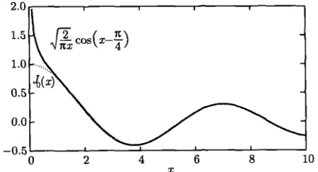

图 13.6  $ J_{0}(x) $ 和它的渐近公式  $ \sqrt{\frac{2}{\pi x}}\cos\left(x-\frac{\pi}{4}\right) $ 的曲线
 

一般情况下，n 阶贝塞尔函数  $ J_{n}(x) $ 有渐近公式

$$  J_{n}(x)\approx\sqrt{\frac{2}{\pi x}}\cos\left(x-\frac{\pi}{4}-\frac{n\pi}{2}\right)\quad(n=0,1,2,\cdots)   \tag*{(13.4.56)}$$

式(13.4.56)给出

$$  J_{1}(x)\approx\sqrt{\frac{2}{\pi x}}\sin\left(x-\frac{\pi}{4}\right)   \tag*{(13.4.57)}$$

图 13.7 显示了  $ J_{1}(x) $ 和它的渐近公式的曲线，在 x > 2 之后二者符合很好。这样我们由式 (13.4.55) 和式 (13.4.57) 看到，在 x 较大时， $ J_{0}(x) $ 和  $ J_{1}(x) $ 几乎是以  $ 2\pi $ 为周期的周期函数，它们分别类似于余弦和正弦函数，即

$$  J_{0}(x)\to\cos x,\quad J_{1}(x)\to\sin x   \tag*{(13.4.58)}$$

这样的类似性还表现在

$$  J_{0}^{\prime}(x)=-J_{1}(x)\to(\cos x)^{\prime}=-\sin x   \tag*{(13.4.59)}$$

<!-- page: 432 -->

关于贝塞尔函数与余弦和正弦函数的区别，由式(13.4.56)可以看出，当 $ x\to\infty $时 $ J_{n}(\infty)\to0 $，而余弦和正弦函数维持振荡。

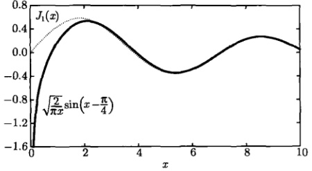

图 13.7  $ J_{1}(x) $ 和它的渐近公式  $ \sqrt{\frac{2}{\pi x}}\sin\left(x-\frac{\pi}{4}\right) $ 的曲线
 

最后需要说明，贝塞尔函数渐近公式的推导涉及“稳定相方法”(method of stationary phase)，对此可参考相关的专著。

### 13.5 贝塞尔函数的正交完备性

本节我们进一步推导贝塞尔函数的正交性及完备性关系式，它们对于求解有关贝塞尔方程的定解问题是很有用的。

#### 13.5.1 正交函数集的构造

为了理解贝塞尔函数的正交性，我们从熟知的正弦函数集

$$  S_{m}(x)=\sin\left(m\pi x\right)\quad(0\leqslant x\leqslant1,m=1,2,3,\cdots)   \tag*{(13.5.1)}$$

出发。我们知道它们在区间 [0, 1] 上是正交的

$$  \int_{0}^{1}\sin\left(m\pi x\right)\sin\left(k\pi x\right)\mathrm{d}x=\frac{1}{2}\delta_{mk}   \tag*{(13.5.2)}$$

同样，余弦函数集

$$  C_{m}(x)=\cos\left[\frac{(2m-1)\pi}{2}x\right]\quad(0\leqslant x\leqslant1,m=1,2,3,\cdots)   \tag*{(13.5.3)}$$

在区间 [0, 1] 上也是正交的

$$  \int_{0}^{1}\cos\left[\frac{(2m-1)\pi}{2}x\right]\cos\left[\frac{(2k-1)\pi}{2}x\right]\mathrm{d}x=\frac{1}{2}\delta_{mk}   \tag*{(13.5.4)}$$

<!-- page: 433 -->

前几个  $ C_{m}(x) $ 和  $ S_{m}(x) $ 如图 13.8 所示。

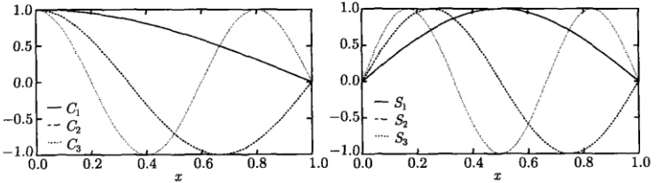

图 13.8 区间 [0, 1] 上的正交函数集：余弦函数  $ C_{m}(x) $ 与正弦函数  $ S_{m}(x) $
 

注意到，正交函数集  $ C_m(x) $ 中的  $ [(2m-1)\pi]/2 $ 是余弦函数  $ \cos x $ 的第  $ m $ 个零点，而正交函数集  $ S_m(x) $ 中的  $ m\pi $ 是正弦函数  $ \sin x $ 的第  $ m $ 个零点。按照这个情况，构造贝塞尔函数的正交函数集的第一步是考查它的零点。为此我们考虑一个典型的贝塞尔函数  $ J_\nu(x) $，为了能写出它的渐近公式，取  $ J_\nu(x) $ 为整数阶贝塞尔函数  $ J_n(x) $，图 13.9 显示了  $ J_n(x) $ 和它的渐近公式的曲线。由此可以看出：对于确定的阶数  $ n $， $ J_n(x) $ 有无穷多个正零点，我们用  $ \mu_{nm}(m=1,2,3,\cdots) $ 表示它的第  $ m $ 个正零点，则

$$  0<\mu_{n1}<\mu_{n2}<\cdots<\mu_{nm}<\cdots   \tag*{(13.5.5)}$$

在 m 较大时，这些正零点的位置与它的渐近公式的正零点几乎是重合的，此时  $ J_{n}(x) $ 几乎是以  $ 2\pi $ 为周期的余弦函数 [式 (13.4.56)]，因此相邻两个正零点的间隔为

$$  \lim_{m\to\infty}\left(\mu_{n,m+1}-\mu_{n,m}\right)=\pi   \tag*{(13.5.6)}$$

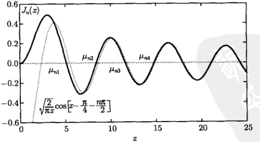

图 13.9 一个典型的贝塞尔函数与它的渐近公式的零点
 

<!-- page: 434 -->

我们考虑一般情况，在贝塞尔函数  $ J_{\nu}(x) $ 的正零点  $ \mu_{\nu m} $ 的意义上，其正交函数集可以写为  $ J_{\nu}(\mu_{\nu m}x) $。它的含义是，对于确定的阶数  $ \nu $，相应于不同零点  $ \mu_{\nu m}(m=1,2,3,\cdots) $ 的函数  $ J_{\nu}(\mu_{\nu m}x) $ 是相互正交的。我们在表 13.1 中列出了  $ \mu_{nm}(n=0,1,2) $ 的前五个值。由这些值分别作出  $ J_{0}(\mu_{0m}x) $ 和  $ J_{1}(\mu_{1m}x) $ 的前三个正交函数，如图 13.10 所示。其行为分别与余弦函数  $ C_{m}(x) $、正弦函数  $ S_{m}(x) $ 类似。

表 13.1  $ J_{0}(x) $、 $ J_{1}(x) $ 和  $ J_{3}(x) $ 的前五个正零点
 

<table border=1 style='margin: auto; word-wrap: break-word;'><tr><td style='text-align: center; word-wrap: break-word;'>m</td><td style='text-align: center; word-wrap: break-word;'>1</td><td style='text-align: center; word-wrap: break-word;'>2</td><td style='text-align: center; word-wrap: break-word;'>3</td><td style='text-align: center; word-wrap: break-word;'>4</td><td style='text-align: center; word-wrap: break-word;'>5</td></tr><tr><td style='text-align: center; word-wrap: break-word;'>$ \mu_{0}m $</td><td style='text-align: center; word-wrap: break-word;'>2.404 83</td><td style='text-align: center; word-wrap: break-word;'>5.520 08</td><td style='text-align: center; word-wrap: break-word;'>8.653 73</td><td style='text-align: center; word-wrap: break-word;'>11.791 5</td><td style='text-align: center; word-wrap: break-word;'>14.930 9</td></tr><tr><td style='text-align: center; word-wrap: break-word;'>$ \mu_{1}m $</td><td style='text-align: center; word-wrap: break-word;'>3.831 71</td><td style='text-align: center; word-wrap: break-word;'>7.015 59</td><td style='text-align: center; word-wrap: break-word;'>10.173 5</td><td style='text-align: center; word-wrap: break-word;'>13.323 7</td><td style='text-align: center; word-wrap: break-word;'>16.470 6</td></tr><tr><td style='text-align: center; word-wrap: break-word;'>$ \mu_{2}m $</td><td style='text-align: center; word-wrap: break-word;'>5.135 62</td><td style='text-align: center; word-wrap: break-word;'>8.417 24</td><td style='text-align: center; word-wrap: break-word;'>11.619 8</td><td style='text-align: center; word-wrap: break-word;'>14.796 0</td><td style='text-align: center; word-wrap: break-word;'>18.980 1</td></tr></table>

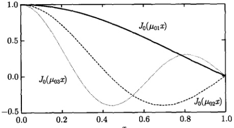

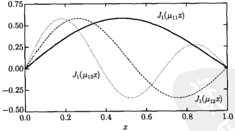

图 13.10 区间 [0, 1] 上的正交函数集：贝塞尔函数  $ J_{0}(\mu_{0m}x) $ 与  $ J_{1}(\mu_{1m}x) $
 

#### 13.5.2 参数形式的贝塞尔函数

一般来说，形如  $ J_{\nu}(\lambda x)(\lambda > 0) $ 的贝塞尔函数称为参数形式的贝塞尔函数。在贝塞尔方程 (13.3.1) 中，用  $ \lambda x $ 代换 x，即得

<!-- page: 435 -->

$$  (\lambda x)^{2}\frac{\mathrm{d}^{2}y}{\mathrm{d}(\lambda x)^{2}}+(\lambda x)\frac{\mathrm{d}y}{\mathrm{d}(\lambda x)}+\left[(\lambda x)^{2}-\nu^{2}\right]y=0   \tag*{(13.5.7)}$$

或

$$  x^{2}\frac{\mathrm{d}^{2}y}{\mathrm{d}x^{2}}+x\frac{\mathrm{d}y}{\mathrm{d}x}+\left(\lambda^{2}x^{2}-\nu^{2}\right)y=0   \tag*{(13.5.8a)}$$

方程 (13.5.8a) 称为参数形式的贝塞尔方程，它的解为  $ J_{\nu}(\lambda x) $。而方程 (13.5.8a) 的通解由式 (13.3.26a) 表示为  $ y = AJ_{\nu}(\lambda x) + BY_{\nu}(\lambda x) $。方程 (13.5.8a) 的施图姆-刘维尔形式为

$$  \frac{\mathrm{d}}{\mathrm{d}x}\left(x\frac{\mathrm{d}y}{\mathrm{d}x}\right)-\frac{\nu^{2}}{x}y+\lambda^{2}xy=0   \tag*{(13.5.8b)}$$

在  $ J_{\nu}(\lambda x) $ 的意义上，贝塞尔函数的递推公式呈现相应的参数形式。特别是，在基本递推公式 (13.4.6b) 中，用  $ \lambda x $ 代换 x，得到

$$  \frac{\mathrm{d}}{\mathrm{d}\left(\lambda x\right)}\left[\left(\lambda x\right)^{-\nu}J_{\nu}\left(\lambda x\right)\right]=-\left(\lambda x\right)^{-\nu}J_{\nu+1}\left(\lambda x\right)   \tag*{(13.5.9)}$$

取 $ \nu=0 $，即

$$  \frac{\mathrm{d}}{\mathrm{d}x}J_{0}(\lambda x)=-\lambda J_{1}(\lambda x)   \tag*{(13.5.10a)}$$

这就是递推公式(13.4.7a)的参数形式。在式(13.5.9)中取 $ \nu=1 $得到

$$  \frac{\mathrm{d}}{\mathrm{d}x}\left[\frac{1}{x}J_{1}(\lambda x)\right]=-\frac{\lambda}{x}J_{2}(\lambda x)   \tag*{(13.5.10b)}$$

同样，在基本递推公式 (13.4.6a) 中，用  $ \lambda x $ 代换 x，得到

$$  \frac{\mathrm{d}}{\mathrm{d}\left(\lambda x\right)}\left[\left(\lambda x\right)^{\nu}J_{\nu}\left(\lambda x\right)\right]=\left(\lambda x\right)^{\nu}J_{\nu-1}\left(\lambda x\right)   \tag*{(13.5.11)}$$

取  $ \nu=1 $，得到

$$  \frac{\mathrm{d}}{\mathrm{d}x}\left[x J_{1}(\lambda x)\right]=\lambda x J_{0}(\lambda x)   \tag*{(13.5.12a)}$$

这就是递推公式（13.4.7b）的参数形式。在式（13.5.11）中取  $ \nu = 2 $，得到

$$  \frac{\mathrm{d}}{\mathrm{d}x}\left[x^{2}J_{2}(\lambda x)\right]=\lambda x^{2}J_{1}(\lambda x)   \tag*{(13.5.12b)}$$

我们将会看到，这些参数形式的递推公式能用来计算有关贝塞尔函数的正交完备性中的许多具体问题。

<!-- page: 436 -->

#### 13.5.3 贝塞尔函数的正交性

现在我们可以着手从理论上建立函数集  $ J_{\nu}(\mu_{\nu m}x) $ 的正交性关系式。为此首先取一个正数 a，考虑零点  $ \mu_{\nu m} $ 与 a 的比值

$$  \lambda_{\nu m}=\frac{\mu_{\nu m}}{a}\quad(m=1,2,3,\cdots)   \tag*{(13.5.13)}$$

显然  $ \lambda_{\nu m} $ 表示  $ \nu $ 阶贝塞尔函数的相对于 a 的正零点。在  $ \lambda_{\nu m} $ 的意义上，参数形式的贝塞尔函数表示为  $ J_{\nu}(\lambda_{\nu m}x) $。这样一来， $ J_{\nu}(\mu_{\nu m}x) $ 中的 x 从 0 到 1 变化，相应于  $ J_{\nu}(\lambda_{\nu m}x) $ 中的 x 从 0 到 a 变化。下面我们将在区间  $ [0,a] $ 上一般性地讨论  $ J_{\nu}(\lambda_{\nu m}x) $ 的正交性。

首先将参数形式的贝塞尔方程 (13.5.8b) 与施图姆-刘维尔型方程 (9.1.1) 相比较，我们有  $ \rho(x) = x $，因此从式 (9.1.6) 知道，贝塞尔函数的正交性关系式中带有权重函数 x。实际上，我们将要证明

$$  \int_{0}^{a}x J_{\nu}(\lambda_{\nu m}x)J_{\nu}(\lambda_{\nu k}x)\mathrm{d}x=0\quad(m\neq k)   \tag*{(13.5.14)}$$

证明 将方程 (13.5.8b) 与施图姆-刘维尔型方程 (9.1.1) 相比较，有  $ k(x)=x $，故端点值为  $ k(0)=0 $， $ k(a)=a $。我们进一步计算式 (9.1.7) 的 Q 因子，有

$$  Q=-a\left[J_{\nu}(\mu_{\nu m})J_{\nu}^{\prime}(\mu_{\nu k})-J_{\nu}(\mu_{\nu k})J_{\nu}^{\prime}(\mu_{\nu m})\right]   \tag*{(13.5.15)}$$

在零点  $ \mu_{\nu m} $ 和  $ \mu_{\nu k} $，有  $ J_{\nu}(\mu_{\nu m}) = J_{\nu}(\mu_{\nu k}) = 0 $，故 Q = 0，因此式 (13.5.14) 成立。

下面我们给出式 (13.5.14) 的详细证明过程。因为  $ y = J_{\nu}(\lambda x) \equiv J_{\nu}(\lambda_{\nu m}x) $ 满足方程 (13.5.8a)

$$  x^{2}\frac{\mathrm{d}^{2}y}{\mathrm{d}x^{2}}+x\frac{\mathrm{d}y}{\mathrm{d}x}+\left(\lambda^{2}x^{2}-\nu^{2}\right)y=0   \tag*{(13.5.16a)}$$

所以  $ u = J_{\nu}(\beta x) \equiv J_{\nu}(\lambda_{\nu k}x) $ 满足方程

$$  x^{2}\frac{\mathrm{d}^{2}u}{\mathrm{d}x^{2}}+x\frac{\mathrm{d}u}{\mathrm{d}x}+\left(\beta^{2}x^{2}-\nu^{2}\right)u=0   \tag*{(13.5.16b)}$$

用 u 乘以方程 (13.5.16a)，用 y 乘以方程 (13.5.16b)，并相减，得到

$$  x^{2}\left(u\frac{\mathrm{d}^{2}y}{\mathrm{d}x^{2}}-y\frac{\mathrm{d}^{2}u}{\mathrm{d}x^{2}}\right)+x\left(u\frac{\mathrm{d}y}{\mathrm{d}x}-y\frac{\mathrm{d}u}{\mathrm{d}x}\right)=x^{2}\left(\beta^{2}-\lambda^{2}\right)y u   \tag*{(13.5.17)}$$

式(13.5.17)两边同除以x，得到

$$  x\frac{\mathrm{d}}{\mathrm{d}x}\left(u\frac{\mathrm{d}y}{\mathrm{d}x}-y\frac{\mathrm{d}u}{\mathrm{d}x}\right)+\left(u\frac{\mathrm{d}y}{\mathrm{d}x}-y\frac{\mathrm{d}u}{\mathrm{d}x}\right)=x\left(\beta^{2}-\lambda^{2}\right)yu   \tag*{(13.5.18)}$$

<!-- page: 437 -->

或

$$  \frac{\mathrm{d}}{\mathrm{d}x}\left[x\left(u\frac{\mathrm{d}y}{\mathrm{d}x}-y\frac{\mathrm{d}u}{\mathrm{d}x}\right)\right]=x\left(\beta^{2}-\lambda^{2}\right)y u   \tag*{(13.5.19)}$$

上式对 x 从 0 到 a 积分，得到

$$  \begin{aligned}\int_{0}^{a}x J_{\nu}(\lambda x)J_{\nu}(\beta x)\mathrm{d}x&=\int_{0}^{a}x J_{\nu}(\lambda_{\nu m}x)J_{\nu}(\lambda_{\nu k}x)\mathrm{d}x\\&=\frac{1}{\beta^{2}-\lambda^{2}}\left[x\left(u\frac{\mathrm{d}y}{\mathrm{d}x}-y\frac{\mathrm{d}u}{\mathrm{d}x}\right)\right]_{0}^{a}\end{aligned}   \tag*{(13.5.20)}$$

式(13.5.20)右边有  $ y(a)=J_{\nu}(\mu_{\nu m})=0,\quad u(a)=J_{\nu}(\mu_{\nu k})=0 $ ，而  $ \beta\neq\lambda $ ，故式(13.5.14)得证。

现在我们进一步证明模值为

$$  \int_{0}^{a}x J_{\nu}^{2}(\lambda_{\nu m}x)\mathrm{d}x=\frac{a^{2}}{2}J_{\nu+1}^{2}(\mu_{\nu m})\quad(m=1,2,3,\cdots)   \tag*{(13.5.21)}$$

注意式（13.5.21）涉及零点  $ \mu_{vm} $ 和相对零点  $ \lambda_{vm} $

证明

方法1 在式(13.5.20)中取 $ \beta=\mu_{vk}/a $，视 $ \lambda $为变数，我们有

$$  \left.\frac{\mathrm{d}u}{\mathrm{d}x}\right|_{x=a}=\left[\frac{\mathrm{d}}{\mathrm{d}x}J_{\nu}(\lambda_{\nu k}x)\right]_{x=a}=\frac{\mu_{\nu k}}{a}J_{\nu}^{\prime}(\mu_{\nu k})   \tag*{(13.5.22)}$$

另外  $ u\big|_{x=a}=J_{\nu}(\mu_{\nu k})=0 $，故式(13.5.20)变为

$$  \int_{0}^{a}x J_{\nu}(\lambda x)J_{\nu}\left(\frac{\mu_{\nu k}}{a}x\right)\mathrm{d}x=\frac{-\mu_{\nu k}J_{\nu}(\lambda a)J_{\nu}^{\prime}(\mu_{\nu k})}{\left(\frac{\mu_{\nu k}}{a}\right)^{2}-\lambda^{2}}   \tag*{(13.5.23)}$$

上式中，令  $ \lambda \rightarrow \frac{\mu_{\nu k}}{a} $，此时式 (13.5.23) 的右边为不定式  $ \frac{0}{0} $，运用洛必达法则，可得

$$  \begin{aligned}\int_{0}^{a}x J_{\nu}^{2}\left(\frac{\mu_{\nu k}}{a}x\right)\mathrm{d}x&=\lim_{\lambda\rightarrow\frac{\mu_{\nu k}}{a}}\frac{-\mu_{\nu k}J_{\nu}(\lambda a)J_{\nu}^{\prime}(\mu_{\nu k})}{\left(\frac{\mu_{\nu k}}{a}\right)^{2}-\lambda^{2}}\\&=\lim_{\lambda\rightarrow\frac{\mu_{\nu k}}{a}}\frac{-a\mu_{\nu k}J_{\nu}^{\prime}(\lambda a)J_{\nu}^{\prime}(\mu_{\nu k})}{-2\lambda}\\&=\frac{a^{2}}{2}\left[J_{\nu}^{\prime}(\mu_{\nu k})\right]^{2}\end{aligned}   \tag*{(13.5.24)}$$

下面我们对式（13.5.24）右边化简。在递推公式（13.4.12），即

$$  x J_{\nu}^{\prime}(x)=-\nu J_{\nu}(x)+x J_{\nu-1}(x)   \tag*{(13.5.25a)}$$

$$  x J_{\nu}^{\prime}(x)=\nu J_{\nu}(x)-x J_{\nu+1}(x)   \tag*{(13.5.25b)}$$

<!-- page: 438 -->

中，取  $ x = \mu_{\nu k} $，注意到  $ J_{\nu}(\mu_{\nu k}) = 0 $，我们有

$$  J_{\nu}^{\prime}(\mu_{\nu k})=J_{\nu-1}(\mu_{\nu k})=-J_{\nu+1}(\mu_{\nu k})   \tag*{(13.5.26)}$$

将式（13.5.26）代入式（13.5.24）即得式（13.5.21），或

$$  \int_{0}^{a}x J_{\nu}^{2}(\lambda_{\nu m}x)\mathrm{d}x=\frac{a^{2}}{2}J_{\nu-1}^{2}(\mu_{\nu m})\quad(m=1,2,3,\cdots)   \tag*{(13.5.27)}$$

方法 2 将贝塞尔方程（13.3.1）写成施图姆-刘维尔形式

$$  \frac{\mathrm{d}}{\mathrm{d}x}(x y^{\prime})+\left(x-\frac{\nu^{2}}{x}\right)y=0   \tag*{(13.5.28)}$$

用 xy′ 乘以方程 (13.5.28) 两边，得到

$$  \frac{\mathrm{d}}{\mathrm{d}x}[(x y^{\prime})^{2}]+(x^{2}-\nu^{2})\frac{\mathrm{d}}{\mathrm{d}x}(y^{2})=0   \tag*{(13.5.29)}$$

现在将式（13.5.29）变成参数形式的贝塞尔方程，为此用  $ \lambda x $ 代换 x，得到

$$  \frac{\mathrm{d}}{\mathrm{d}x}\left[\left(\lambda x y^{\prime}\right)^{2}\right]+\left(\lambda^{2}x^{2}-\nu^{2}\right)\frac{\mathrm{d}}{\mathrm{d}x}\left(y^{2}\right)=0   \tag*{(13.5.30)}$$

式(13.5.30)是关于  $ y = J_{\nu}(\lambda_{\nu m}x) $ 的方程。对该方程关于 x 从 0 到 a 积分，并利用微分关系式  $ \mathrm{d}\left(x^{2}y^{2}\right)=2xy^{2}\mathrm{d}x+x^{2}\mathrm{d}\left(y^{2}\right) $，得到

$$  \left[\left(\lambda x y^{\prime}\right)^{2}\right]_{0}^{a}+\lambda^{2}\left[x^{2}y^{2}\right]_{0}^{a}-\nu^{2}\left[y^{2}\right]_{0}^{a}=2\lambda^{2}\int_{0}^{a}x y^{2}\mathrm{d}x   \tag*{(13.5.31)}$$

注意到  $ \left.\nu y\right|_{x=0}=\nu J_{\nu}(0)=0 $ 和  $ y|_{x=a}=\left[J_{\nu}(\lambda_{\nu m}x)\right]_{x=a}=J_{\nu}(\mu_{\nu m})=0 $，式(13.5.31)左边后两项为零，而第一项给出

$$  \left[\left(x y^{\prime}\right)^{2}\right]_{0}^{a}=\left[\left(x J_{\nu}^{\prime}(\lambda_{\nu m}x)\right)^{2}\right]_{0}^{a}=\left[a J_{\nu}^{\prime}(\mu_{\nu m})\right]^{2}   \tag*{(13.5.32)}$$

从而式 $  (13.5.31)  $变为

$$  \int_{0}^{a}xy^{2}\mathrm{d}x=\int_{0}^{a}xJ_{\nu}^{2}(\lambda_{\nu m}x)\mathrm{d}x=\frac{[aJ_{\nu}^{\prime}(\mu_{\nu m})]^{2}}{2}   \tag*{(13.5.33)}$$

这就是式 (13.5.24)，接下来的过程与方法 1 相同。现在我们将式 (13.5.14) 与 (13.5.21) 合写为

$$  \int_{0}^{a}x J_{\nu}(\lambda_{\nu m}x)J_{\nu}(\lambda_{\nu k}x)\mathrm{d}x=\frac{a^{2}}{2}J_{\nu+1}^{2}(\mu_{\nu m})\delta_{mk}   \tag*{(13.5.34)}$$

<!-- page: 439 -->

注意式(13.5.34)右边的 $ J_{\nu+1}(\mu_{\nu m}) $表示 $ \nu+1 $阶贝塞尔函数在 $ \nu $阶贝塞尔函数的零点 $ \mu_{\nu m} $的取值。由于 $ J_{\nu+1}(x) $的零点与 $ J_{\nu}(x) $的零点不相重合，故 $ J_{\nu+1}(\mu_{\nu m})\neq0 $。一个例子如图13.11所示。

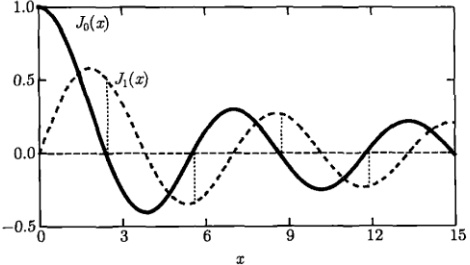

图 13.11  $ J_{1}(\mu_{0m})(m=1,2,3,\cdots) $
 

式(13.5.34)在a=1时约化为

$$  \int_{0}^{1}x J_{\nu}(\mu_{\nu m}x)J_{\nu}(\mu_{\nu k}x)\mathrm{d}x=\frac{1}{2}J_{\nu+1}^{2}(\mu_{\nu m})\delta_{m k}   \tag*{(13.5.35)}$$

#### 13.5.4 贝塞尔函数的完备性

正像 (13.5.1) 的正弦函数  $ \sin(m\pi x) $ 和式 (13.5.3) 的余弦函数  $ \cos\left[(2m-1)\frac{\pi x}{2}\right] $ 能够用来展开一个任意函数一样，贝塞尔正交函数集  $ J_{\nu}(\lambda_{\nu m}x) $ 也可以将一个定义在区间  $ [0,a] $ 的函数  $ f(x) $ 展开为

$$  f(x)=\sum_{m=1}^{\infty}A_{m} J_{\nu}\left(\lambda_{\nu m}x\right)   \tag*{(13.5.36)}$$

它称为贝塞尔级数。我们利用正交性表达式（13.5.34）求式（13.5.36）的系数  $ A_m $，式（13.5.36）两边同乘以  $ x J_\nu(\lambda_{\nu k}x) $，并在区间  $ [0,a] $ 积分，我们有

 $$ \begin{aligned}\int_{0}^{a}x J_{\nu}\left(\lambda_{\nu k}x\right)f(x)\mathrm{d}x&=\int_{0}^{a}x J_{\nu}\left(\lambda_{\nu k}x\right)\left[\sum_{m=1}^{\infty}A_{m}J_{\nu}\left(\lambda_{\nu m}x\right)\right]\mathrm{d}x\\&=\sum_{m=1}^{\infty}A_{m}\int_{0}^{a}x J_{\nu}\left(\lambda_{\nu k}x\right)J_{\nu}\left(\lambda_{\nu m}x\right)\mathrm{d}x\\&=\frac{a^{2}}{2}\sum_{m=1}^{\infty}A_{m}J_{\nu+1}^{2}\left(\mu_{\nu m}\right)\delta_{k m}\\&=\frac{a^{2}}{2}A_{k}J_{\nu+1}^{2}\left(\mu_{\nu k}\right)\end{aligned} $$

<!-- page: 440 -->

即

$$  A_{m}=\frac{2}{a^{2}J_{\nu+1}^{2}\left(\mu_{\nu m}\right)}\int_{0}^{a}x J_{\nu}\left(\lambda_{\nu m}x\right)f(x)\mathrm{d}x   \tag*{(13.5.37)}$$

如果函数 $f$ 在区间 $[0,a]$ 是分段光滑的，则 $f$ 有如式 (13.5.36) 所示的贝塞尔级数展开式，对于 $x\in(0,a)$，贝塞尔级数的收敛性由狄利克雷定理确定，即

$$  \sum_{m=1}^{\infty}A_{m}J_{\nu}\left(\lambda_{\nu m}x\right)=f(x)\quad( 在 x 的连续点 )   \tag*{(13.5.38a)}$$

$$  \sum_{m=1}^{\infty}A_{m}J_{\nu}\left(\lambda_{\nu m}x\right)=\frac{f(x-0)+f(x+0)}{2}\quad( 在 x 的间断点 )   \tag*{(13.5.38b)}$$

必须注意，贝塞尔级数展开式(13.5.36)不能给出区间[0,a]端点的行为，这从下面的例题中可以看出。

例 1 将函数  $ f(x)=1 $ 在区间  $ [0,1] $ 上按零阶贝塞尔正交函数集  $ J_{0}(\mu_{0m}x) $ 展开。

解 现在我们有

$$  1=\sum_{m=1}^{\infty}A_{m}J_{0}\left(\mu_{0m}x\right)   \tag*{(13.5.39)}$$

其中的展开系数为

$$  A_{m}=\frac{2}{J_{1}^{2}\left(\mu_{0m}\right)}\int_{0}^{1}x J_{0}\left(\mu_{0m}x\right)\mathrm{d}x   \tag*{(13.5.40a)}$$

式中的积分为

$$  \begin{aligned}\int_{0}^{1}xJ_{0}\left(\mu_{0m}x\right)\mathrm{d}x&=\frac{1}{\mu_{0m}}\int_{0}^{1}\mu_{0m}xJ_{0}\left(\mu_{0m}x\right)\mathrm{d}x\\&=\frac{1}{\mu_{0m}}\int_{0}^{1}\mathrm{d}\left[xJ_{1}\left(\mu_{0m}x\right)\right]\\&=\frac{1}{\mu_{0m}}\left[xJ_{1}\left(\mu_{0m}x\right)\right]_{0}^{1}=\frac{J_{1}\left(\mu_{0m}\right)}{\mu_{0m}}\end{aligned}   \tag*{(13.5.40b)}$$

其中的运算用到了参数形式的递推公式(13.5.12a)。这样式(13.5.39)变为

$$  1=\sum_{m=1}^{\infty}\frac{2}{\mu_{0m}J_{1}\left(\mu_{0m}\right)}J_{0}\left(\mu_{0m}x\right)\quad(0<x<1)   \tag*{(13.5.41)}$$

利用表 13.1 的  $ \mu_{0m} $ 值作出式 (13.5.41) 的部分和  $ S_{5}(x) $，如图 13.12 所示。现在我们可以看出，贝塞尔级数 (13.5.36) 确实不能给出区间端点  $ [0,1] $ 的行为。事实上，本例中在 x = 1 端点，式 (13.5.41) 右边求和中每一项都有  $ J_{0}(\mu_{0m}) = 0 $，因为我们在  $ J_{0} $ 的零点计算它的取值，因此式 (13.5.41) 右边的求和为零。图 13.12 的部分

<!-- page: 441 -->

和也清楚地显示这个情况。因此，本例的贝塞尔级数在端点 x=1 不收敛于原函数  $ f(x)=1 $。

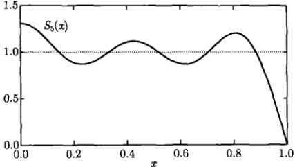

图 13.12 函数  $ f(x)=1 $ 的贝塞尔级数的部分和
 

例 2 将函数  $ f(x)=x $ 在区间  $ [0,1] $ 上按一阶贝塞尔正交函数集  $ J_{1}(\mu_{1m}x) $ 展开。

解 现在我们有

$$  x=\sum_{m=1}^{\infty}A_{m}J_{1}\left(\mu_{1m}x\right)   \tag*{(13.5.42)}$$

展开系数

$$  A_{m}=\frac{2}{J_{2}^{2}\left(\mu_{1m}\right)}\int_{0}^{1}x^{2}J_{1}\left(\mu_{1m}x\right)\mathrm{d}x   \tag*{(13.5.43)}$$

其中的积分为

$$  \int_{0}^{1}x^{2}J_{1}\left(\mu_{1m}x\right)\mathrm{d}x=\frac{1}{\mu_{1m}}\int_{0}^{1}\mu_{1m}x^{2}J_{1}\left(\mu_{1m}x\right)\mathrm{d}x=\frac{1}{\mu_{1m}}J_{2}\left(\mu_{1m}\right)   \tag*{(13.5.44)}$$

其中的计算用到了参数形式的递推公式(13.5.12b)。这样

$$  A_{m}=\frac{2}{\mu_{1m}J_{2}(\mu_{1m})}   \tag*{(13.5.45)}$$

$$  x=\sum_{m=1}^{\infty}\frac{2}{\mu_{1m}J_{2}\left(\mu_{1m}\right)}J_{1}\left(\mu_{1m}x\right)   \tag*{(13.5.46)}$$

式(13.5.46)的展开系数还可以用更低阶的贝塞尔函数表示。利用递推公式(13.4.8b)，即

$$  J_{2}(x)=\frac{2}{x}J_{1}(x)-J_{0}(x)   \tag*{(13.5.47)}$$

注意到  $ J_{1}\left(\mu_{1m}\right)=0 $，式(13.5.46)变为

$$  x=-\sum_{m=1}^{\infty}\frac{2}{\mu_{1m}J_{0}(\mu_{1m})}J_{1}(\mu_{1m}x)\quad(0<x<1)   \tag*{(13.5.48)}$$

<!-- page: 442 -->

与上例的情况相同，在端点 x=1，式 (13.5.48) 右边求和中每一项都有  $ J_{1}(\mu_{1m})=0 $，因此式 (13.5.48) 右边的求和为零。本例的贝塞尔级数在该端点不收敛于原函数  $ f(x)=x $。

例 3 将函数  $ f(x) = x^{\nu} $ ( $ \nu \geqslant 0 $) 在区间  $ [0,1] $ 上按  $ \nu $ 阶贝塞尔正交函数集  $ J_{\nu}\left(\mu_{\nu m}x\right) $ 展开，并由此计算  $ f(x) = \sqrt{x} $ 的展开式。

解 现在我们有

$$  x^{\nu}=\sum_{m=1}^{\infty}A_{m}J_{\nu}\left(\mu_{\nu m}x\right)   \tag*{(13.5.49)}$$

其中

$$  A_{m}=\frac{2}{J_{\nu+1}^{2}\left(\mu_{\nu m}\right)}\int_{0}^{1}x^{\nu+1}J_{\nu}\left(\mu_{\nu m}x\right)\mathrm{d}x   \tag*{（13.5.50）}$$

在式（13.4.13a）中用  $ \mu_{\nu m}x $ 代换 x，得到

$$  \mu_{\nu m}\int x^{\nu+1}J_{\nu}(\mu_{\nu m}x)\mathrm{d}x=x^{\nu+1}J_{\nu+1}(\mu_{\nu m}x)   \tag*{(13.5.51)}$$

利用它计算式（13.5.50）中的积分，得到

$$  A_{m}=\frac{2}{\mu_{\nu m}J_{\nu+1}^{2}\left(\mu_{\nu m}\right)}\left[x^{\nu+1}J_{\nu+1}\left(\mu_{\nu m}x\right)\right]_{0}^{1}=\frac{2}{\mu_{\nu m}J_{\nu+1}\left(\mu_{\nu m}\right)}   \tag*{(13.5.52)}$$

代入式(13.5.49)得到

$$  x^{\nu}=2\sum_{m=1}^{\infty}\frac{1}{\mu_{\nu m}J_{\nu+1}\left(\mu_{\nu m}\right)}J_{\nu}\left(\mu_{\nu m}x\right)\quad(0<x<1)   \tag*{(13.5.53)}$$

这就是  $ \nu \geqslant 0 $ 时的一般结果。当  $ \nu = 1/2 $ 时，式 (13.5.53) 给出

$$  \sqrt{x}=2\sum_{m=1}^{\infty}\frac{1}{\mu_{\frac{1}{2},m}J_{\frac{3}{2}}\left(\mu_{\frac{1}{2},m}\right)}J_{\frac{1}{2}}\left(\mu_{\frac{1}{2},m}x\right)   \tag*{(13.5.54)}$$

由式(13.3.19)知

$$  \mu_{\frac{1}{2},m}=m\pi\quad(m=1,2,3,\cdots)   \tag*{(13.5.55)}$$

由式(13.4.24)知

$$  J_{\frac{3}{2}}(\mu_{\frac{1}{2},m})=J_{\frac{3}{2}}(m\pi)=\frac{1}{\pi}\sqrt{\frac{2}{m}}(-1)^{m-1}   \tag*{(13.5.56)}$$

由式(13.3.19)知

$$  J_{\frac{1}{2}}\left(\mu_{\frac{1}{2},m}x\right)=J_{\frac{1}{2}}\left(m\pi x\right)=\frac{1}{\pi}\sqrt{\frac{2}{m}}\sin\left(m\pi x\right)   \tag*{(13.5.57)}$$

<!-- page: 443 -->

将式（13.5.55）～式（13.5.57）代入式（13.5.54），得到

$$  \sqrt{x}=\frac{2}{\pi}\sum_{m=1}^{\infty}\frac{(-1)^{m-1}}{m}\sin\left(m\pi x\right)\quad(0<x<1)   \tag*{(13.5.58)}$$

它正好是  $ \sqrt{x} $ 的正弦函数展开式。

### 13.6 贝塞尔函数应用举例

贝塞尔函数在求解数学物理方法的定解问题中扮演着重要的角色，特别是通过分离变量法，很多问题都化为极坐标系或柱坐标系中的贝塞尔方程，它们在理论问题与工程领域都具有非常广泛的应用，其中一个有趣的例子是第9章所讨论的吊摆问题。本节通过一些典型的例题进一步讨论贝塞尔方程和贝塞尔函数在求解定解问题中的应用。

例 1 对于给定的实数  $ \nu \geqslant 0 $，求解关于待定常数  $ \lambda $ 的本征值问题

$$  x^{2}\frac{\mathrm{d}^{2}y}{\mathrm{d}x^{2}}+x\frac{\mathrm{d}y}{\mathrm{d}x}+\left(\lambda x^{2}-\nu^{2}\right)y=0\quad(0<x<1)   \tag*{(13.6.1a)}$$

$$  y(1)=0   \tag*{(13.6.1b)}$$

$$  \left|y(0)\right|= 有限值   \tag*{(13.6.1c)}$$

解 方程 (13.6.1a) 是参数形式的贝塞尔方程 [见式 (13.1.17)]，它的通解为

$$  y=A J_{\nu}(\sqrt{\lambda}x)+B Y_{\nu}(\sqrt{\lambda}x)   \tag*{(13.6.2)}$$

由于第二类贝塞尔函数  $ Y_{\nu} $ 在 x = 0 不是有界的（图 13.5），条件 (13.6.1c) 要求 B = 0，因此式 (13.6.2) 变为

$$  y=A J_{\nu}(\sqrt{\lambda}x)   \tag*{(13.6.3)}$$

由边界条件（13.6.1b）得到

$$  J_{\nu}(\sqrt{\lambda})=0   \tag*{(13.6.4)}$$

可见  $ \sqrt{\lambda} $ 是  $ \nu $ 阶贝塞尔函数的零点，即  $ \sqrt{\lambda} = \mu_{\nu m} (m = 1, 2, 3, \cdots) $。这样本征值问题 (13.6.1) 的解为

$$  \lambda=\mu_{\nu m}^{2},y=A J_{\nu}(\mu_{\nu m}x)\quad(m=1,2,3,\cdots)   \tag*{(13.6.5)}$$

其中， $ \mu_{\nu m} $ 是  $ \nu $ 阶贝塞尔函数  $ J_{\nu}(x) $ 的第 m 个零点。

<!-- page: 444 -->

例2 设有半径为1的薄均匀圆盘，边缘温度保持为零度，初始时刻圆盘内温度分布为 $ 1-r^{2} $。其中，r是圆盘内任一点到盘中心的距离，求圆内任意时刻的温度分布。

解 圆盘内任意时刻的温度分布服从二维热传导方程

$$  \frac{\partial u}{\partial t}=a^{2}\left(\frac{\partial^{2}u}{\partial x^{2}}+\frac{\partial^{2}u}{\partial y^{2}}\right)   \tag*{(13.6.6)}$$

由于是圆域的定解问题，故采用极坐标系，取圆盘中心为坐标原点。考虑到初始温度分布 $ 1-r^{2} $是中心对称的（只与r有关），因此任意时刻的温度分布可以写为 $ u(r,t) $（与变量 $ \theta $无关），利用二维极坐标系的拉普拉斯方程(1.2.30)，系统的温度分布归结为下列定解问题

$$  \left\{\begin{array}{l}\frac{\partial u}{\partial t}=a^{2}\left(\frac{\partial^{2}u}{\partial r^{2}}+\frac{1}{r}\frac{\partial u}{\partial r}\right)\quad(0<r<1,t>0)\end{array}\right.   \tag*{(13.6.7a)}$$

$$  u(1,t)=0\quad(t>0)   \tag*{(13.6.7b)}$$

$$  u(r,0)=1-r^{2}\quad(0\leqslant r\leqslant1)   \tag*{(13.6.7c)}$$

设式（13.6.7a）有变量分离的形式解

$$  u(r,t)=R(r)T(t)   \tag*{(13.6.8)}$$

将式(13.6.8)代入式(13.6.7a)，得到

$$  R T^{\prime}=a^{2}\left(R^{\prime\prime}T+\frac{1}{r}R^{\prime}T\right)   \tag*{(13.6.9)}$$

或

$$  \frac{T^{\prime}}{a^{2}T}=\frac{R^{\prime\prime}+\frac{1}{r}R^{\prime}}{R}=-\beta   \tag*{（13.6.10）}$$

其中， $ \beta $ 是分离常数。由此得

$$  T^{\prime}+\beta a^{2}T=0   \tag*{(13.6.11a)}$$

$$  r^{2}R^{\prime\prime}+r R^{\prime}+\beta r^{2}R=0   \tag*{(13.6.11b)}$$

方程（13.6.11a）的解为

$$  T(t)=\mathrm{e}^{-a^{2}\beta t}   \tag*{(13.6.12)}$$

由于  $ t \to \infty $ 时，u = 有限值，所以  $ \beta $ 只能为正值，令  $ \sqrt{\beta} = \mu $，则

$$  T(t)=\mathrm{e}^{-a^{2}\mu^{2}t}   \tag*{(13.6.13)}$$

<!-- page: 445 -->

方程（13.6.11b）是零阶贝塞尔方程，它的通解为

$$  R(r)=A J_{0}(\mu r)+B Y_{0}(\mu r)   \tag*{(13.6.14)}$$

由于第二类贝塞尔函数  $ Y_{0} $ 在 r=0 不是有界的（图 13.5），故必须取 B=0，因此式 (13.6.14) 变为

$$  R(r)=A J_{0}(\mu r)   \tag*{(13.6.15)}$$

由边界条件（13.6.7b）得到

$$  J_{0}(\mu)=0   \tag*{(13.6.16)}$$

可见  $ \mu $ 是零阶贝塞尔函数的正零点，即  $ \mu = \mu_{0m}(m = 1,2,3,\cdots) $。综合以上结果可得

$$  R_{m}(r)=A_{m}J_{0}(\mu_{0m}r)   \tag*{(13.6.17a)}$$

$$  T_{m}(t)=\mathrm{e}^{-a^{2}\mu_{0m}^{2}t}   \tag*{(13.6.17b)}$$

从而本征解为

$$  u_{m}(r,t)=A_{m}J_{0}(\mu_{0m}r)\mathrm{e}^{-a^{2}\mu_{0m}^{2}t}   \tag*{(13.6.18)}$$

利用叠加原理，得到定解问题（13.6.7）的一般解

$$  u(r,t)=\sum_{m=1}^{\infty}A_{m}J_{0}(\mu_{0m}r)\mathrm{e}^{-a^{2}\mu_{0m}^{2}t}   \tag*{(13.6.19)}$$

现在利用初始条件（13.6.7c）确定系数  $ A_{m} $，我们有

$$  1-r^{2}=\sum_{m=1}^{\infty}A_{m}J_{0}(\mu_{0m}r)   \tag*{(13.6.20)}$$

由式（13.5.37）得到

$$  \begin{aligned}A_{m}&=\frac{2}{J_{1}^{2}\left(\mu_{0m}\right)}\int_{0}^{1}xJ_{0}\left(\mu_{0m}x\right)\left(1-x^{2}\right)\mathrm{d}x\\&=\frac{2}{J_{1}^{2}\left(\mu_{0m}\right)}\int_{0}^{1}xJ_{0}\left(\mu_{0m}x\right)\mathrm{d}x-\frac{2}{J_{1}^{2}\left(\mu_{0m}\right)}\int_{0}^{1}x^{3}J_{0}\left(\mu_{0m}x\right)\mathrm{d}x\end{aligned}   \tag*{(13.6.21)}$$

由式 $  (13.5.40b)  $得到

$$  \int_{0}^{1}x J_{0}\left(\mu_{0m}x\right)\mathrm{d}x=\frac{J_{1}\left(\mu_{0m}\right)}{\mu_{0m}}   \tag*{(13.6.22)}$$

在式 $  (13.4.33a)  $中用 $ \mu_{0m}x $代换x，积分后得到

$$  \int_{0}^{1}x^{3}J_{0}(\mu_{0m}x)\mathrm{d}x=\frac{J_{1}(\mu_{0m})}{\mu_{0m}}-2\frac{J_{2}(\mu_{0m})}{\mu_{0m}^{2}}   \tag*{(13.6.23)}$$

<!-- page: 446 -->

将式（13.6.22）和式（13.6.23）代入式（13.6.21），得到

$$  A_{m}=\frac{4J_{2}(\mu_{0m})}{\mu_{0m}^{2}J_{1}^{2}(\mu_{0m})}   \tag*{(13.6.24)}$$

将式（13.6.24）代入式（13.6.19），得到

$$  u(r,t)=\sum_{m=1}^{\infty}\frac{4J_{2}(\mu_{0m})}{\mu_{0m}^{2}J_{1}^{2}(\mu_{0m})}J_{0}(\mu_{0m}r)\mathrm{e}^{-a^{2}\mu_{0m}^{2}t}   \tag*{(13.6.25)}$$

这就是所求定解问题的解。其中， $ \mu_{0m}(m=1,2,3,\cdots) $ 是  $ J_{0}(x) $ 的第 m 个正零点。

利用表 13.1 的数据可以写出式 (13.6.25) 的部分和  $ S_{5}(r,t) $，并作出不同时刻 t 的温度分布，如图 13.13 所示。可以看出，t = 0 时，部分和  $ S_{5}(r,0) $ 与初始分布  $ u(r,0) = 1 - r^{2} $ 拟合极好。随着时间的增加， $ S_{5}(r,t) $ 不断下降。由式 (13.6.25) 可以看出，当  $ t \to \infty $ 时，系统温度为零。

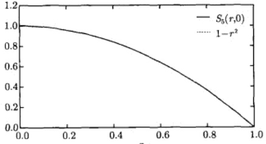

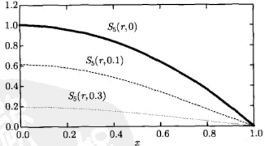

图 13.13 温度分布式 (13.6.25) 的部分和  $ S_{5}(r,t)(a=1) $
 

例 3 设有高度为 h、半径为 a 的均匀圆柱体，圆柱体侧面的温度保持为零度，上、下底的温度分别为 0 和 H，求圆柱体内的稳态温度分布。

解 圆柱体内的稳态温度分布服从拉普拉斯方程

$$  \frac{\partial^{2}u}{\partial x^{2}}+\frac{\partial^{2}u}{\partial y^{2}}+\frac{\partial^{2}u}{\partial z^{2}}=0   \tag*{(13.6.26)}$$

<!-- page: 447 -->

由于是圆柱区域的问题，故采用柱坐标系（图 13.14），取下底中心为坐标原点，圆柱轴为 z 轴。考虑到边界温度分布与变量  $ \phi $ 无关，因此稳态温度分布可以写为  $ u(\rho,z) $，利用三维柱坐标系的拉普拉斯方程 (1.2.34)，系统的温度分布归结为下列边值问题

$$  \left\{\begin{array}{l}\frac{\partial^{2}u}{\partial\rho^{2}}+\frac{1}{\rho}\frac{\partial u}{\partial\rho}+\frac{\partial^{2}u}{\partial z^{2}}=0\quad(\rho<a,0<z<h)\end{array}\right.   \tag*{(13.6.27a)}$$

$$  u\big|_{\rho=a}=0\quad(0\leqslant z\leqslant h)   \tag*{(13.6.27b)}$$

$$  u\big|_{z=0}=0\quad(\rho\leqslant a)   \tag*{(13.6.27c)}$$

$$  u\big|_{z=h}=H\quad\qquad(\rho\leqslant a)   \tag*{(13.6.27d)}$$

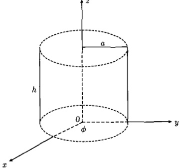

图 13.14 柱坐标系中的圆柱体
 

设式 $  (13.6.27a)  $有变量分离的形式解

$$  u(\rho,z)=R(\rho)Z(z)   \tag*{(13.6.28)}$$

将式（13.6.28）代入式（13.6.27a），得到

$$  -\frac{1}{Z}Z^{\prime \prime}=\frac{R^{\prime \prime}+\frac{1}{\rho}R^{\prime}}{R}=-\lambda^{2}   \tag*{(13.6.29)}$$

其中， $ \lambda $ 是分离常数。由式 (13.6.29) 得到

$$  \begin{aligned}Z^{\prime\prime}-\lambda^{2}Z&=0\\R^{\prime\prime}+\frac{1}{\rho}R^{\prime}+\lambda^{2}R&=0\end{aligned}   \tag*{(13.6.30a)}$$

<!-- page: 448 -->

方程（13.6.30a）的解为

$$  Z(z)=\sinh(\lambda z)   \tag*{(13.6.31)}$$

它满足 u 在下底的条件式 (13.6.27c)。方程 (13.6.30b) 是零阶贝塞尔方程，它的通解为

$$  R(\rho)=A J_{0}(\lambda\rho)+B Y_{0}(\lambda\rho)   \tag*{(13.6.32)}$$

由于第二类贝塞尔函数  $ Y_{0} $ 在  $ \rho = 0 $ 不是有界的（图 13.5），故必须取 B = 0，因此式 (13.6.32) 变为

$$  R(\rho)=A J_{0}(\lambda\rho)   \tag*{(13.6.33)}$$

由边界条件（13.6.27b）得到

$$  J_{0}(\lambda a)=0   \tag*{(13.6.34)}$$

可见  $ \lambda a = \mu_{0m}(m = 1, 2, 3, \cdots) $ 是零阶贝塞尔函数的正零点。综合以上结果可得本征解为

$$  u_{m}(\rho,z)=A_{m}\sinh\left(\mu_{0m}\frac{z}{a}\right)J_{0}\left(\mu_{0m}\frac{\rho}{a}\right)   \tag*{(13.6.35)}$$

利用叠加原理，得到定解问题（13.6.27）的一般解

$$  u(r,t)=\sum_{m=1}^{\infty}A_{m}\sinh\left(\mu_{0m}\frac{z}{a}\right)J_{0}\left(\mu_{0m}\frac{\rho}{a}\right)   \tag*{(13.6.36)}$$

现在利用 u 在上底的条件 (13.6.27d) 确定系数  $ A_{m} $，我们有

$$  H=\sum_{m=1}^{\infty}A_{m}\sinh\left(\mu_{0m}\frac{h}{a}\right)J_{0}\left(\mu_{0m}\frac{\rho}{a}\right)   \tag*{(13.6.37)}$$

式 (13.6.37) 表明， $ A_m \sinh \left( \mu_0 m \frac{n}{a} \right) $ 是函数  $ f(\rho) = H $ 按  $ J_0 \left( \mu_0 m \frac{\rho}{a} \right) $ 在区间  $ [0, a] $ 上展开的系数，由式 (13.5.37) 得到

$$  A_{m}\sinh\left(\mu_{0m}\frac{h}{a}\right)=\frac{2H}{a^{2}J_{1}^{2}\left(\mu_{0m}\right)}\int_{0}^{a}x J_{0}\left(\frac{\mu_{0m}}{a}x\right)dx   \tag*{(13.6.38)}$$

由式 $  (13.5.40b)  $得到

$$  \int_{0}^{a}xJ_{0}\left(\frac{\mu_{0m}}{a}x\right)\mathrm{d}x=\frac{a}{\mu_{0m}}\left[xJ_{1}\left(\frac{\mu_{0m}}{a}x\right)\right]_{0}^{a}=\frac{a^{2}}{\mu_{0m}}J_{1}\left(\mu_{0m}\right)   \tag*{(13.6.39)}$$

<!-- page: 449 -->

于是式(13.6.38)给出

$$  A_{m}=\frac{2H}{\mu_{0}m J_{1}\left(\mu_{0}m\right)}\operatorname{csch}\left(\mu_{0m}\frac{h}{a}\right)   \tag*{(13.6.40)}$$

从而式 $  (13.6.35)  $变为

$$  u(\rho,z)=2H\sum_{m=1}^{\infty}\frac{1}{\mu_{0m}J_{1}\left(\mu_{0m}\right)}\operatorname{csch}\left(\mu_{0m}\frac{h}{a}\right)\sinh\left(\mu_{0m}\frac{z}{a}\right)J_{0}\left(\mu_{0m}\frac{\rho}{a}\right)   \tag*{(13.6.41)}$$

这就是所求定解问题的解。其中， $ \mu_{0m}(m=1,2,3,\cdots) $ 是  $ J_{0}(x) $ 的第 m 个正零点。

### 13.7 球贝塞尔函数

球贝塞尔方程（13.1.8a）可以写为

$$  x^{2}y^{\prime\prime}+2xy^{\prime}+\left[kx^{2}-n(n+1)\right]y=0\quad(0<x<a)   \tag*{(13.7.1)}$$

其中，k 是一个非负的实数，n=0,1,2,\cdots 为了得到方程 (13.7.1) 在区间 [0,a] 上的有界解，引入代换

$$  y(x)=x^{-1/2}w(x)   \tag*{(13.7.2)}$$

方程(13.7.1)变成

$$  x^{2}w^{\prime\prime}+x w^{\prime}+\left[kx^{2}-\left(n+\frac{1}{2}\right)^{2}\right]w=0   \tag*{(13.7.3)}$$

这是  $ \left(n+\frac{1}{2}\right) $ 阶参数形式的贝塞尔方程 [式 (13.5.8a)]。方程 (13.7.3) 存在有界解的条件是

$$  k=\lambda^{2}   \tag*{(13.7.4)}$$

而

$$  \lambda=\lambda_{nm}=\frac{\mu_{n+\frac{1}{2},m}}{a}   \tag*{(13.7.5)}$$

这里  $ \mu_{n+\frac{1}{2},m} $ 表示  $ \left(n+\frac{1}{2}\right) $ 阶贝塞尔函数的第 m 个正零点。这样式 (13.7.3) 的解为

$$  w_{n m}(x)=J_{n+\frac{1}{2}}(\lambda_{n m}x)\quad(n=0,1,2,\cdots,\quad m=1,2,3,\cdots)   \tag*{(13.7.6)}$$

<!-- page: 450 -->

于是式(13.7.2)变为

$$  \begin{array}{r l}{x^{-1/2}J_{n+\mathrm{\scriptsize~\frac{1}{2}~}}(\lambda_{n m}x)}&{{}(n=01,2,\cdots,\quad m=1,2,3,\cdots)}\end{array}   \tag*{(13.7.7)}$$

球贝塞尔函数定义为

$$  j_{n}(x)=\sqrt{\frac{\pi}{2x}}J_{n+\frac{1}{2}}(x)\quad(n=0,1,2,\cdots)   \tag*{(13.7.8)}$$

在  $ j_{n}(x) $ 的意义上，方程 (13.7.1) 的解表示为

$$  y_{nm}(x)=j_{n}(\lambda_{nm}x)\quad(n=0,1,2,\cdots,\quad m=1,2,3,\cdots)   \tag*{(13.7.9)}$$

这就是球贝塞尔方程 (13.7.1) 的解。n 阶球贝塞尔函数  $ j_{n}(x) $ 由式 (13.7.8) 定义，它与  $ \left(n+\frac{1}{2}\right) $ 阶贝塞尔函数相差一个因子  $ \sqrt{\frac{\pi}{2x}} $。因此，由式 (13.4.24) 可知，球贝塞尔函数都是初等函数。利用式 (13.4.24) 计算出前几个球贝塞尔函数

$$  j_{0}(x)=\frac{\sin x}{x}   \tag*{(13.7.10a)}$$

$$  j_{1}(x)=\frac{\sin x}{x^{2}}-\frac{\cos x}{x}   \tag*{(13.7.10b)}$$

$$  j_{2}(x)=\left(\frac{3}{x^{3}}-\frac{1}{x}\right)\sin x-\frac{3}{x^{2}}\cos x   \tag*{(13.7.10c)}$$

它们的曲线如图 13.15 所示。

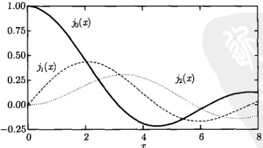

图 13.15 前几个球贝塞尔函数  $ j_{n}(x) $ 曲线
 

<!-- page: 451 -->

球贝塞尔函数  $ j_{n}(x) $ 的性质与半整数阶的贝塞尔函数  $ J_{n+\frac{1}{2}}(x) $ 类似，球贝塞尔函数的基本递推公式为

$$  \frac{\mathrm{d}}{\mathrm{d}x}\left[x^{n+1}j_{n}(x)\right]=x^{n+1}j_{n-1}(x)   \tag*{(13.7.11a)}$$

$$  \frac{\mathrm{d}}{\mathrm{d}x}\left[x^{-n}J_{n}(x)\right]=-x^{-n}j_{n+1}(x)   \tag*{(13.7.11b)}$$

它们相应于贝塞尔函数的递推公式 (13.4.6)。而正交性关系为

$$  \int_{0}^{a}x^{2}j_{n}(\lambda_{nm}x)j_{n}(\lambda_{nk}x)\mathrm{d}x=\frac{a^{3}}{2}j_{n+1}^{2}(\mu_{n+\frac{1}{2},m})\delta_{mk}   \tag*{(13.7.12)}$$

可见球贝塞尔函数  $ j_{n}(x) $ 正交性的权重函数是  $ x^{2} $。

