# 14-第14章 勒让德多项式

[返回全书目录](../../README.md)

> PDF 页码：452–496

<!-- page: 452 -->

### 第14章 勒让德多项式

本章介绍另一种变系数的常微分方程——勒让德方程。我们在讨论它的级数解法的基础上，由其在区间  $ [-1,1] $ 的有界解构成另一类正交完备函数集——勒让德多项式。我们还将对勒让德多项式的性质进行全面的讨论。最后介绍勒让德多项式在求解数学物理方法定解问题中的应用。

### 14.1 勒让德方程的引入

第 13 章我们通过三维波动方程、三维热传导方程，以及施图姆-刘维尔方程引入了勒让德方程。这里我们从拉普拉斯方程直接引入勒让德方程。拉普拉斯方程在球坐标系中表示为 [式 (1.2.49)]

$$  \frac{1}{r^{2}}\frac{\partial}{\partial r}\left(r^{2}\frac{\partial u}{\partial r}\right)+\frac{1}{r^{2}\sin\theta}\frac{\partial}{\partial\theta}\left(\sin\theta\frac{\partial u}{\partial\theta}\right)+\frac{1}{r^{2}\sin^{2}\theta}\frac{\partial^{2}u}{\partial\phi^{2}}=0   \tag*{(14.1.1)}$$

设方程（14.1.1）有变量分离的形式解

$$  u(r,\theta,\phi)=R(r)\Theta(\theta)\Phi(\phi)   \tag*{(14.1.2)}$$

将式（14.1.2）代入式（14.1.1）得到

$$  \frac{\theta\Phi}{r^{2}}\frac{\partial}{\mathrm{d}r}\left(r^{2}\frac{\mathrm{d}R}{\mathrm{d}r}\right)+\frac{\Phi R}{r^{2}\sin\theta}\frac{\mathrm{d}}{\mathrm{d}\theta}\left(\sin\theta\frac{\mathrm{d}\theta}{\mathrm{d}\theta}\right)+\frac{\theta R}{r^{2}\sin^{2}\theta}\frac{\mathrm{d}^{2}\phi}{d\phi^{2}}=0   \tag*{(14.1.3)}$$

两边同乘以  $ \frac{r^{2}}{\theta\Phi R} $，并移项，得到

$$  \frac{1}{R}\frac{\partial}{\mathrm{d}r}\left(r^{2}\frac{\mathrm{d}R}{\mathrm{d}r}\right)=-\frac{1}{\theta\sin\theta}\frac{\mathrm{d}}{\mathrm{d}\theta}\left(\sin\theta\frac{\mathrm{d}\theta}{\mathrm{d}\theta}\right)-\frac{1}{\Phi\sin^{2}\theta}\frac{\mathrm{d}^{2}\Phi}{\mathrm{d}\phi^{2}}   \tag*{(14.1.4)}$$

于是

$$  \frac{1}{R}\frac{\partial}{\mathrm{d}r}\left(r^{2}\frac{\mathrm{d}R}{\mathrm{d}r}\right)=l(l+1)   \tag*{(14.1.5a)}$$

$$  \frac{1}{\theta\sin\theta}\frac{\mathrm{d}}{\mathrm{d}\theta}\left(\sin\theta\frac{\mathrm{d}\theta}{\mathrm{d}\theta}\right)+\frac{1}{\Phi\sin^{2}\theta}\frac{\mathrm{d}^{2}\Phi}{\mathrm{d}\phi^{2}}=-\mathrm{l}(l+1)   \tag*{(14.1.5b)}$$

其中，l 是分离常数，一般为实数。方程 (14.1.5a) 为欧拉方程，它的通解为

$$  R(r)=A_{l}r^{l}+B_{l}\frac{1}{r^{l+1}}   \tag*{(14.1.6)}$$

<!-- page: 453 -->

其中， $ A_{l} $ 和  $ B_{l} $ 是任意常数。给方程 (14.1.5b) 两边同乘以  $ \sin^{2}\theta $，并移项，得到

$$  \frac{1}{\theta}\sin\theta\frac{\mathrm{d}}{\mathrm{d}\theta}\left(\sin\theta\frac{\mathrm{d}\theta}{\mathrm{d}\theta}\right)-l(l+1)\sin^{2}\theta=-\frac{1}{\Phi}\frac{\mathrm{d}^{2}\Phi}{\mathrm{d}\phi^{2}}   \tag*{(14.1.7)}$$

于是

$$  -\frac{1}{\Phi}\frac{\mathrm{d}^{2}\Phi}{\mathrm{d}\phi^{2}}=m^{2}   \tag*{(14.1.8a)}$$

$$  \frac{1}{\theta}\sin\theta\frac{\mathrm{d}}{\mathrm{d}\theta}\left(\sin\theta\frac{\mathrm{d}\dot{\theta}}{\mathrm{d}\theta}\right)-l(l+1)\sin^{2}\theta=m^{2}   \tag*{(14.1.8b)}$$

其中，m 是另一个分离常数。方程 (14.1.8a) 的通解为

$$  \Phi(\phi)=B_{1}\cos m\phi+B_{2}\sin m\phi   \tag*{(14.1.9)}$$

方程（14.1.8b）是连带勒让德方程。令  $ x = \cos\theta $， $ y(x) = \theta(\theta) $，则

$$  \frac{\mathrm{d}\theta}{\mathrm{d}\theta}=-\sin\theta\frac{\mathrm{d}\theta}{\mathrm{d}x},\quad\frac{\mathrm{d}^{2}\theta}{\mathrm{d}\theta^{2}}=-\cos\theta\frac{\mathrm{d}\theta}{\mathrm{d}x}+\sin^{2}\theta\frac{\mathrm{d}^{2}\theta}{\mathrm{d}x^{2}}   \tag*{(14.1.10)}$$

于是方程(14.1.8b)变为

$$  (1-x^{2})y^{\prime\prime}-2xy^{\prime}+\left[l(l+1)-\frac{m^{2}}{\sin^{2}\theta}\right]y=0   \tag*{(14.1.11a)}$$

即

$$  (1-x^{2})y^{\prime\prime}-2xy^{\prime}+\left[l(l+1)-\frac{m^{2}}{1-x^{2}}\right]y=0   \tag*{(14.1.11b)}$$

当 m=0 时，式 (14.1.8b) 和式 (14.1.11b) 分别约化为

$$  \frac{1}{\sin\theta}\frac{\mathrm{d}}{\mathrm{d}\theta}\left(\sin\theta\frac{\mathrm{d}\theta}{\mathrm{d}\theta}\right)=l(l+1)\theta   \tag*{(14.1.12)}$$

和

$$  (1-x^{2})y^{\prime\prime}-2x y^{\prime}+l(l+1)y=0   \tag*{(14.1.13)}$$

方程式（14.1.12）或式（14.1.13）就是勒让德方程。

### 14.2 勒让德多项式

现在我们求解勒让德方程 (14.1.13)，由式 (13.1.9c) 写出它的施图姆-刘维尔形式

$$  \frac{\mathrm{d}}{\mathrm{d}x}\left[(1-x^{2})\frac{\mathrm{d}y}{\mathrm{d}x}\right]+l(l+1)y=0   \tag*{(14.2.1)}$$

可以看出，方程(14.2.1)是算符 $ -\frac{\mathrm{d}}{\mathrm{d}x}\left[(1-x^{2})\frac{\mathrm{d}y}{\mathrm{d}x}\right] $的本征方程，本征值为 $ l(l+1) $。

<!-- page: 454 -->

设方程（14.1.13）在 x=0 处有幂级数解

$$  y=\sum_{k=0}^{\infty}C_{k}x^{k}=C_{0}+C_{1}x+C_{2}x^{2}+\cdots   \tag*{(14.2.2)}$$

其中， $ C_{k}(k=0,1,2,\cdots) $ 是系数。对式(14.2.2)求导数，得到

$$  y^{\prime}=\sum_{k=1}^{\infty}k C_{k}x^{k-1}   \tag*{(14.2.3a)}$$

$$  y^{\prime \prime}=\sum_{k=2}^{\infty}k(k-1)C_{k}x^{k-2}   \tag*{(14.2.3b)}$$

在式 $  (14.2.3a)  $中，因为求和的第一项 $ (k=0) $为零，故求和实际从k=1开始。同理，在式 $  (14.2.3b)  $中，因为求和的前两项 $ (k=0,1) $均为零，故求和实际从k=2开始。将式(14.2.2)和式(14.2.3)代入式(14.1.13)，得到

 $$ \begin{align*}&\sum_{k=2}^{\infty}k(k-1)C_{k}x^{k-2}-\sum_{k=2}^{\infty}k(k-1)C_{k}x^{k}-\sum_{k=1}^{\infty}2kC_{k}x^{k}+l(l+1)\sum_{k=0}^{\infty}C_{k}x^{k}\\=&\sum_{k=2}^{\infty}k(k-1)C_{k}x^{k-2}-\sum_{k=0}^{\infty}[k(k+1)-l(l+1)]C_{k}x^{k}\\&\quad(k-2=m)\\=&\sum_{m=0}^{\infty}(m+2)(m+1)C_{m+2}x^{m}-\sum_{k=0}^{\infty}(k-l)(k+l+1)C_{k}x^{k}\\=&\sum_{k=0}^{\infty}[(k+2)(k+1)C_{k+2}-(k-l)(k+l+1)C_{k}]x^{k}=0\end{align*} $$ 

上式中参与求和的各项是相互独立的，因此求和为零的必要充分条件是任意项  $ x^{k} $ 的系数为零，即

$$  (k+2)(k+1)C_{k+2}-(k-l)(k+l+1)C_{k}=0   \tag*{(14.2.4)}$$

这是系数所满足的关系式，可以写成

$$  C_{k+2}=\frac{(k-l)(k+l+1)}{(k+2)(k+1)}C_{k}\quad(k=0,1,2,\cdots)   \tag*{(14.2.5)}$$

这是一个双间隔系数递推公式，我们由  $ C_{0} $ 开始递推，得到

 $$ \begin{aligned}&k=0:\quad C_{2}=\frac{(0-l)(0+l+1)}{2\cdot1}C_{0}=-\frac{l(l+1)}{2!}C_{0}\\&k=2:\quad C_{4}=\frac{(2-l)(l+3)}{4\cdot3}C_{2}=\frac{(l-2)l(l+1)(l+3)}{4!}C_{0}\\ \end{aligned} $$

<!-- page: 455 -->

$$ \begin{array}{c} k=4:\quad C_{6}=-\frac{(l-4)(l-2)l(l+1)(l+3)(l+5)}{6!}C_{0}\\ \cdots\cdots\end{array} $$ 

可以看出，每个系数都含有  $ C_{0} $，将  $ C_{0} $， $ C_{2} $， $ C_{4} $， $ C_{6} $，… 代入式 (14.2.2)，得到偶数幂的集合  $ C_{0}y_{0}(x) $，其中

$$  \begin{aligned}y_{0}(x)=&1-\frac{l(l+1)}{2!}x^{2}+\frac{(l-2)l(l+1)(l+3)}{4!}x^{4}\\&-\frac{(l-4)(l-2)l(l+1)(l+3)(l+5)}{6!}x^{6}\\&+\frac{(l-6)(l-4)(l-2)l(l+1)(l+3)(l+5)(l+7)}{8!}x^{8}-\cdots\end{aligned}   \tag*{(14.2.6a)}$$

进而我们利用式(14.2.5)由 $ C_{1} $开始递推，得到

 $$ \begin{aligned}&k=1:\quad C_{3}=\frac{(1-l)(l+2)}{3\cdot2}C_{1}=-\frac{(l-1)(l+2)}{3!}C_{1}\\&k=3:\quad C_{5}=\frac{(3-l)(l+4)}{5\cdot4}C_{3}=\frac{(l-3)(l-1)(l+2)(l+4)}{5!}C_{1}\\&k=5:\quad C_{7}=-\frac{(l-5)(l-3)(l-1)(l+2)(l+4)(l+6)}{7!}C_{1}\\ \end{aligned} $$ 

可以看出，每个系数都含有  $ C_{1} $，将  $ C_{1}, C_{3}, C_{5}, \cdots $ 代入式 (14.2.2)，得到奇数幂的集合  $ C_{1}y_{1}(x) $，其中

$$  \begin{aligned}y_{1}(x)=&x-\frac{(l-1)(l+2)}{3!}x^{3}+\frac{(l-3)(l-1)(l+2)(l+4)}{5!}x^{5}\\ &-\frac{(l-5)(l-3)(l-1)(l+2)(l+4)(l+6)}{7!}x^{7}+\cdots\end{aligned}   \tag*{(14.2.6b)}$$

显然， $ y_{0}(x) $ 和  $ y_{1}(x) $ 线性独立的。这样我们得到式 (14.1.13) 的通解

$$  y(x)=C_{0}y_{0}(x)+C_{1}y_{1}(x)   \tag*{(14.2.7)}$$

我们的结论是，勒让德方程（14.1.13）作为二阶常微分方程有两个线性独立的解 $ y_{0}(x) $和 $ y_{1}(x) $，称为勒让德函数，而 $ C_{0} $和 $ C_{1} $是两个线性无关的常数。

我们进一步讨论勒让德函数  $ y_{0}(x) $ 和  $ y_{1}(x) $ 的收敛性。按照达朗贝尔判别法， $ y_{0}(x) $ 和  $ y_{1}(x) $ 的收敛半径均为

$$  R=\lim_{k\to\infty}\left|\frac{C_{k}}{C_{k+2}}\right|=\lim_{k\to\infty}\left|\frac{(k+2)(k+1)}{(k-l)(k+l+1)}\right|=\lim_{k\to\infty}\left|\frac{\left(1+\frac{2}{k}\right)\left(1+\frac{1}{k}\right)}{\left(1-\frac{l}{k}\right)\left(1+\frac{l+1}{k}\right)}\right|=1   \tag*{(14.2.8)}$$

<!-- page: 456 -->

这表示勒让德函数在  $ |x|<1 $ 内收敛。

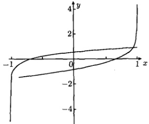

可以一般地证明：勒让德函数在边界  $ x=\pm1 $ 上是无界的。图14.1作为一个例子显示了勒让德函数  $ y_{0}(x) $ 和  $ y_{1}(x) $ 在  $ l(l+1)=3/4 $ 时的行为，可以看出它们分别在  $ x=\pm1 $ 是无界的。在实际应用中，需要勒让德函数在  $ x=\pm1 $ 是有界的，为此我们考虑将无穷级数 (14.2.6a) 和 (14.2.6b) 截断，使它们变成多项式，而多项式一定是有界的。

图 14.1 · 勒让德函数在  $ l(l+1)=3/4 $ 时的行为
 

观察式 (14.2.6a) 中的系数可以发现，一旦一个因子在系数中出现，则这个因子会出现在后面的每一个系数中。例如，因子 l-2 在  $ x^{4} $ 的系数中出现后，在  $ x^{6} $， $ x^{8} $，… 系数中均会出现。这样如果取 l=2，则式 (14.2.6a) 被截断变成二项式  $ y_{0}(x)=1-3x^{2} $。显然，如果取 l=0,2,4,\cdots,l(l 是偶数)，则  $ y_{0}(x) $ 变成 l 次多项式

$$  y_{0}(x)=C_{0}+C_{2}x^{2}+C_{4}x^{4}+\cdots+C_{l}x^{l}\quad(l 为偶数 )   \tag*{(14.2.9a)}$$

同理，在式(14.2.6b)中，如果取  $ l=1,3,5,\cdots,l $ (l 是奇数)，则  $ y_{1}(x) $ 变成 l 次多项式

$$  y_{1}(x)=C_{1}x+C_{3}x^{3}+C_{5}x^{5}+\cdots+C_{l}x^{l}\quad(l 为奇数 )   \tag*{(14.2.9b)}$$

当 $l$ 取负整数也可以截断无穷级数 (14.2.6a) 和 (14.2.6b)。例如，在式 (14.2.6a) 中取 $l = -3$，同样得到 $y_0(x) = 1 - 3x^2$，这意味着 $l$ 取负整数截断无穷级数后没有给出新的结果。这样我们得到结论：当勒让德方程 (14.1.13) 中的实数 $l$ 限于

$$  l=0,1,2,\cdots   \tag*{(14.2.10)}$$

时，它的解是多项式(14.2.9)。

现在我们进一步确定式(14.2.9)中的系数。如果最高次幂的系数  $ C_{l} $ 被确定，按照递推公式(14.2.5)可以推出系数  $ C_{l-2} $， $ C_{l-4} $，… 这意味着所有系数都能依次确定。原则上  $ C_{l} $ 是一个任意常数，不过如果取

$$  C_{l}=\frac{(2l)!}{2^{l}(l!)^{2}}   \tag*{(14.2.11)}$$

勒让德多项式（14.2.9）将呈现最简洁的形式。现在我们由式（14.2.11）推出较低次幂的系数，为此将式（14.2.5）写为

$$  C_{k}=-\frac{(k+2)(k+1)}{(l-k)(k+l+1)}C_{k+2}\quad(k=0,1,2,\cdots,l-2)   \tag*{(14.2.12)}$$

<!-- page: 457 -->

则有

$$  C_{l-2}=-\frac{l(l-1)}{2(2l-1)}C_{l}=-\frac{l(l-1)}{2(2l-1)}\frac{(2l)!}{2^{l}(l!)^{2}}=-\frac{(2l-2)!}{2^{l}(l-1)!(l-2)!}   \tag*{(14.2.13)}$$

类似地

$$  C_{l-4}=-\frac{(l-2)(l-3)}{4(2l-3)}C_{l-2}=\frac{(2l-4)!}{2^{l}2!(l-2)!(l-4)!}   \tag*{(14.2.14)}$$

一般项为

$$  C_{l-2m}=(-1)^{m}\frac{(2l-2m)!}{2^{l}m!(l-m)!(l-2m)!}\quad\left(m=0,\;1,\;2\cdots\frac{l}{2}\right)   \tag*{(14.2.15)}$$

特别是常数项为

$$  C_{0}=(-1)^{\frac{l}{2}}\frac{l!}{2^{l}\left[\left(\frac{l}{2}\right)!\right]^{2}}\quad\left(m=\frac{l}{2}\right)   \tag*{(14.2.16)}$$

利用通项公式(14.2.15)，多项式解(14.2.9)被写为

$$  P_{l}(x)=\frac{1}{2^{l}}\sum_{m=0}^{M}(-1)^{m}\frac{(2l-2m)!}{m!(l-m)!(l-2m)!}x^{l-2m}   \tag*{(14.2.17)}$$

它称为 l 阶勒让德多项式，其中，M 是求和指标 m 的最大值 (M = l/2)。由于 M 必须是自然数，所以将它写成

$$  M=\left\{\begin{array}{ll}\displaystyle\frac{l}{2}&(l=0,2,4,\cdots)\\ \displaystyle\frac{l-1}{2}&(l=1,3,5,\cdots)\end{array}\right.   \tag*{(14.2.18)}$$

这样在任何情况下，M 的取值为  $ M = 0, 1, 2, 3, \cdots $ 注意在勒让德多项式 (14.2.17) 中，求和指标 m 的最小值 m = 0 相应于最高次幂  $ x^{l} $ [它的系数由式 (14.2.11) 确定]，而它的最大值 m = M 相应于常数项 [由式 (14.2.16) 确定]。

前几阶勒让德多项式（图 14.2）是

 $$ \begin{aligned}&P_{0}(x)=1&&P_{1}(x)=x\\&P_{2}(x)=\frac{1}{2}\left(3x^{2}-1\right)&&P_{3}(x)=\frac{1}{2}\left(5x^{3}-3x\right)\\&P_{4}(x)=\frac{1}{8}\left(35x^{4}-30x^{2}+3\right)&&P_{5}(x)=\frac{1}{8}\left(63x^{5}-70x^{3}+15x\right)\end{aligned} $$ 

可以看出，当 l 为偶数时， $ P_{l}(x) $ 为偶函数；当 l 为奇数时， $ P_{l}(x) $ 为奇函数。对于任意阶勒让德多项式，恒有  $ P_{l}(1)=1 $，这样的简洁性来自式 (14.2.11) 的规定。

<!-- page: 458 -->

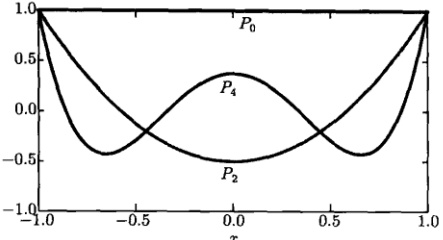

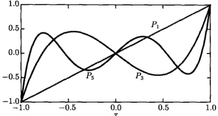

图 14.2 前几阶勒让德多项式
 

至此我们得到了勒让德方程 (14.1.13) 在  $ x = \pm 1 $ 收敛的解，即  $ l $ 阶勒让德多项式 (14.2.17)。但通解 (14.2.7) 包含两个线性无关的解，另一个解呢？事实上，在截断无穷级数 (14.2.6) 的过程中，当  $ l $ 为偶数时，式 (14.2.6a) 的无穷级数  $ y_0(x) $ 被截断成为多项式 (14.2.9a)，但  $ y_1(x) $ 仍是无穷级数 [记为  $ Y_1(x) $]；同样，当  $ l $ 为奇数时，式 (14.2.6b) 的无穷级数  $ y_1(x) $ 被截断成为多项式 (14.2.9b)，但  $ y_0(x) $ 仍是无穷级数 [记为  $ Y_0(x) $]。多项式 (14.2.9a) 和 (14.2.9b) 组合起来构成  $ l $ 阶勒让德多项式  $ P_l(x) $，而  $ Y_0(x) $ 与  $ Y_1(x) $ 的组合表示为  $ Q_l(x) $， $ Q_l(x) $ 在  $ |x| < 1 $ 是收敛的，在  $ x = \pm 1 $ 是发散的，它称为第二类勒让德函数。因此勒让德方程 (14.1.13) 的通解为

$$  \begin{aligned}y(x)&=A\left[y_{0}(x)+y_{1}(x)\right]+B\left[Y_{0}(x)+Y_{1}(x)\right]\\&=AP_{l}(x)+BQ_{l}(x)\end{aligned}   \tag*{(14.2.19)}$$

例 1 求下列微分方程的通解

$$  (1-x^{2})y^{\prime\prime}-2x y^{\prime}+12y=0   \tag*{(14.2.20)}$$

解　与勒让德方程（14.1.13）相比较，可以看出，方程（14.1.20）是 l = 3 的勒让德方程。它的通解由式（14.2.19）表示为

$$  y(x)=AP_{3}(x)+BQ_{3}(x)   \tag*{(14.2.21)}$$

由于 l 是奇数，无穷级数解  $ Q_{3}(x) $ 由式 (14.2.6a) 给出为

<!-- page: 459 -->

$$  Q_{3}(x)=1-6x^{2}+3x^{4}+\frac{4}{5}x^{6}-\cdots   \tag*{(14.2.22)}$$

于是通解（14.2.21）变为

$$  y(x)=A\left[\frac{1}{2}\left(5x^{3}-3x\right)\right]+B\left(1-6x^{2}+3x^{4}+\frac{4}{5}x^{6}-\cdots\right)   \tag*{(14.2.23)}$$

例 2 证明：l 阶勒让德多项式  $ P_{l}(x) $ 可以写成下列形式

$$  \begin{aligned}{P_{l}(x)=}&{{}\frac{(2l-1)(2l-3)\cdots3\cdot1}{l!}}\\ {}&{{}\cdot\left[x^{l}-\frac{1}{2}\frac{l(l-1)}{(2l-1)}x^{l-2}+\frac{1}{2\cdot4}\frac{l(l-1)(l-2)(l-3)}{(2l-1)(2l-3)}x^{l-4}-\cdots\right]}\\ \end{aligned}   \tag*{(14.2.24)}$$

证明 从递推公式 (14.2.5) 出发，即

$$  C_{k+2}=\frac{(k-l)(k+l+1)}{(k+2)(k+1)}C_{k}\quad(k=0,1,2,\cdots)   \tag*{(14.2.25)}$$

在式 (14.2.25) 中取 l = k = 0, 1, 2,  $ \cdots $ 则由  $ C_{l} \neq 0 $ 得到  $ C_{l+2} = 0 $，由此得到  $ C_{l+4} = C_{l+6} = \cdots = 0 $。这样幂级数解 (14.2.2) 变为多项式

$$  y(x)=C_{l}x^{l}+C_{l-2}x^{l-2}+\cdots   \tag*{(14.2.26)}$$

将递推公式（14.2.5）写成

$$  C_{k-2}=-\frac{k(k-1)}{(l-k+2)(k+l-1)}C_{k}   \tag*{(14.2.27)}$$

由式(14.2.27)推出

 $$ \begin{aligned}&C_{l-2}=-\frac{1}{2}\frac{l(l-1)}{(2l-1)}C_{l}\\&C_{l-4}=-\frac{1}{4}\frac{(l-2)(l-3)}{(2l-3)}C_{l-2}=\frac{1}{2\cdot4}\frac{l(l-1)(l-2)(l-3)}{(2l-1)(2l-3)}C_{l}\\ \end{aligned} $$ 

这些系数有公因子  $ C_{l} $，为了使  $ P(1)=1 $ 取

$$  C_{l}=\frac{(2l-1)(2l-3)\cdots3\cdot1}{l!}   \tag*{(14.2.28)}$$

将  $ C_{l} $,  $ C_{l-2} $,  $ C_{l-4} $, … 代入式 (14.2.26)，得到

$$  \begin{aligned}y(x)=&\frac{(2l-1)(2l-3)\cdots3\cdot1}{l!}\\&\cdot\left[x^{l}-\frac{1}{2}\frac{l(l-1)}{(2l-1)}x^{l-2}+\frac{1}{2\cdot4}\frac{l(l-1)(l-2)(l-3)}{(2l-1)(2l-3)}x^{l-4}-\cdots\right]\end{aligned}   \tag*{(14.2.29)}$$

<!-- page: 460 -->

这就是勒让德方程(14.1.13)的多项式解，它与l阶勒让德多项式 $ P_{l}(x) $是相同的[式(14.2.29)的前几阶给出如图14.2所示的曲线]，因此式(14.2.17)可以写成式(14.2.24)的形式。

例 3 求解轴对称系统 (如位于 z 轴上的点电荷) 在空间的电位分布。

解 自由空间的电位分布由拉普拉斯方程 (14.1.1) 描述。对于轴对称问题，电位分布与  $ \phi $ 无关，可表示为  $ u(r,\theta) $，它满足方程

$$  \frac{1}{r^{2}}\frac{\partial}{\partial r}\left(r^{2}\frac{\partial u}{\partial r}\right)+\frac{1}{r^{2}\sin\theta}\frac{\partial}{\partial\theta}\left(\sin\theta\frac{\partial u}{\partial\theta}\right)=0   \tag*{(14.2.30)}$$

设方程（14.2.30）有变量分离的形式解

$$  u(r,\ \theta)=R(r)\theta(\theta)   \tag*{(14.2.31)}$$

将式（14.2.31）代入式（14.2.30），得到

$$  \frac{1}{R}\frac{\partial}{\mathrm{d}r}\left(r^{2}\frac{\mathrm{d}R}{\mathrm{d}r}\right)=-\frac{1}{\theta\sin\theta}\frac{\mathrm{d}}{\mathrm{d}\theta}\left(\sin\theta\frac{\mathrm{d}\theta}{\mathrm{d}\theta}\right)=l(l+1)   \tag*{(14.2.32)}$$

其中，l 是分离常数。由式 (14.2.32) 得到

$$  \frac{1}{R}\frac{\partial}{\mathrm{d}r}\left(r^{2}\frac{\mathrm{d}R}{\mathrm{d}r}\right)=l(l+1)   \tag*{(14.2.33a)}$$

$$  \frac{1}{\theta\sin\theta}\frac{\mathrm{d}}{\mathrm{d}\theta}\left(\sin\theta\frac{\mathrm{d}\theta}{\mathrm{d}\theta}\right)=-l(l+1)   \tag*{(14.2.33b)}$$

其中，(14.2.33a) 是欧拉方程，它的通解为

$$  R(r)=A_{l}r^{l}+B_{l}\frac{1}{r^{l+1}}   \tag*{(14.2.34)}$$

而式 (14.2.33b) 为勒让德方程 [式 (14.1.12)]，它的多项式解为  $ \Theta(\theta) = P_l(\cos\theta) $。故本征解 (14.2.31) 为

$$  u_{l}(r,\theta)=\left(A_{l}r^{l}+B_{l}\frac{1}{r^{l+1}}\right)P_{l}(\cos\theta)   \tag*{(14.2.35)}$$

而一般解为

$$  u(r,\theta)=\sum_{l=0}^{\infty}\left(A_{l}r^{l}+B_{l}\frac{1}{r^{l+1}}\right)P_{l}(\cos\theta)   \tag*{(14.2.36)}$$

这就是轴对称系统在空间的电位分布。

<!-- page: 461 -->

### 14.3 勒让德多项式的基本性质

#### 14.3.1 微分表示

本节我们首先推导出 l 阶勒让德多项式  $ P_{l}(x) $ 的微分表示，即罗德里格斯 (Rodrigues) 公式

$$  P_{l}(x)=\frac{1}{2^{l}l!}\frac{\mathrm{d}^{l}}{\mathrm{d}x^{l}}(x^{2}-1)^{l}   \tag*{(14.3.1)}$$

方法 1 用二项式定理

$$  (a+b)^{l}=\sum_{m=0}^{l}\left(\begin{array}{c}l\\ m\end{array}\right)a^{l-m}b^{m}=\sum_{m=0}^{l}\frac{l!}{(l-m)!m!}a^{l-m}b^{m}   \tag*{(14.3.2)}$$

将 $ (x^{2}-1)^{l} $展开

 $$ \begin{aligned}\frac{1}{2^{l}l!}(x^{2}-1)^{l}&=\frac{1}{2^{l}l!}\sum_{m=0}^{l}\frac{(-1)^{m}l!}{(l-m)!m!}(x^{2})^{l-m}\\&=\sum_{m=0}^{l}\frac{(-1)^{m}}{2^{l}m!(l-m)!}x^{2l-2m}\\&\Rightarrow x^{2l}+x^{2l-2}+\cdots+x^{l}+x^{l-1}+\cdots+x+1\end{aligned} $$ 

接下来将对上式求 $l$ 次导数，$x^{l-1}$ 及其后面的项将为零，只需考虑 $2l - 2m \geq l$ 的项，即 $m \leq l/2$。这样上式的求和只需考虑到 $m = l/2$ 项，再利用式 (14.2.18) 的表示，我们有

 $$ \begin{aligned}&\frac{1}{2^{l}l!}\frac{\mathrm{d}^{l}}{\mathrm{d}x^{l}}(x^{2}-1)^{l}=\frac{\mathrm{d}^{l}}{\mathrm{d}x^{l}}\left[\sum_{m=0}^{M}\frac{(-1)^{m}}{2^{l}m!(l-m)!}x^{2l-2m}\right]\\ &=\sum_{m=0}^{M}(-1)^{m}\frac{(2l-2m)(2l-2m-1)\cdots(l-2m+1)}{2^{l}m!(l-m)!}x^{l-2m}\\ &=\sum_{m=0}^{M}(-1)^{m}\frac{(2l-2m)(2l-2m-1)\cdots(l-2m+1)(l-2m)!}{2^{l}m!(l-m)!(l-2m)!}x^{l-2m}\\ &=\sum_{m=0}^{M}(-1)^{m}\frac{(2l-2m)!}{2^{l}m!(l-m)!(l-2m)!}x^{l-2m}=P_{l}(x)\\ \end{aligned} $$ 

方法 2 对勒让德多项式（14.2.24）从 0 到 x 积分 l 次，得到

 $$ \underbrace{\int_{0}^{x}\cdots\cdots\int_{0}^{x}}_{l\  次 }P_{l}(x)\mathrm{d}x=\frac{(2l-1)(2l-3)\cdots3\cdot1}{(2l)!}\left[x^{2l}-lx^{2l-2}+\frac{l(l-1)}{2!}x^{2l-4}-\cdots\right] $$

<!-- page: 462 -->

$$ \begin{aligned}&=\frac{(2l-1)(2l-3)\cdots3\cdot1}{(2l)(2l-1)(2l-2)\cdots2\cdot1}(x^{2}-1)^{l}\\&=\frac{1}{2^{l}l!}(x^{2}-1)^{l}\end{aligned} $$ 

对它微分 l 次，便得到式 (14.3.1)。

#### 14.3.2 积分表示

根据复变函数论中的柯西积分公式

$$  f^{(l)}(z)=\frac{l!}{2\pi\mathrm{i}}\oint_{C}\frac{f(\xi)}{(\xi-z)^{l+1}}\mathrm{d}\xi   \tag*{(14.3.3)}$$

 $ P_{l}(x) $ 的微分表示又可以变为积分表示

$$  P_{l}(x)=\frac{1}{2^{l}l!}\frac{\mathrm{d}^{l}}{\mathrm{d}x^{l}}(x^{2}-1)^{l}=\frac{1}{2^{l}2\pi\mathrm{i}}\oint_{C}\frac{(\xi^{2}-1)^{l}}{(\xi-x)^{l+1}}\mathrm{d}\xi   \tag*{(14.3.4)}$$

其中，C 是  $ \xi $ 平面上围绕  $ \xi = x $ 点的任一闭合回路，积分 (14.3.4) 称为施列夫利 (Schläfi) 积分。

施列夫利积分也可以表示为定积分的形式。为此，在式(14.3.4)中将积分回路C选成以 $ \xi=x $为圆心，以 $ \sqrt{x^{2}-1} $为半径的圆周，其中 $ |x|>1 $。如图14.3所示。这样，在C上有

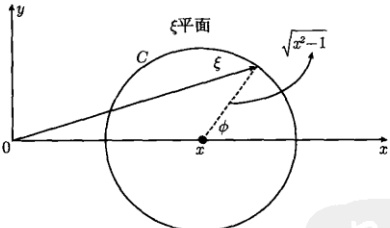

图 14.3 积分回路 C
 

$$  \xi-x=\sqrt{x^{2}-1}\mathrm{e}^{\mathrm{i}\phi}\quad(0\leqslant\phi\leqslant2\pi)   \tag*{(14.3.5a)}$$

于是

$$  \mathrm{d}\xi=\mathrm{i}\sqrt{x^{2}-1}\mathrm{e}^{\mathrm{i}\phi}\mathrm{d}\phi=\mathrm{i}(\xi-x)\mathrm{d}\phi   \tag*{(14.3.5b)}$$

另外

 $$ \xi^{2}-1=(x+\sqrt{x^{2}-1}\mathrm{e}^{\mathrm{i}\phi})^{2}-1 $$

<!-- page: 463 -->

$$  \begin{aligned}&=(x^{2}-1)(1+\mathrm{e}^{\mathrm{i}2\phi})+2x\sqrt{x^{2}-1}\mathrm{e}^{\mathrm{i}\phi}\\&=2\sqrt{x^{2}-1}\mathrm{e}^{\mathrm{i}\phi}(x+\sqrt{x^{2}-1}\cos\phi)\\&=2(\xi-x)(x+\sqrt{x^{2}-1}\cos\phi)\end{aligned}   \tag*{(14.3.5c)}$$

将式（14.3.5）代入式（14.3.4）得到

$$  \begin{aligned}P_{l}(x)&=\frac{1}{2\pi}\int_{0}^{2\pi}(x+\sqrt{x^{2}-1}\cos\phi)^{l}\mathrm{d}\phi\\&=\frac{1}{2\pi}\int_{-\pi}^{\pi}(x+\sqrt{x^{2}-1}\cos\phi)^{l}\mathrm{d}\phi\\&=\frac{1}{\pi}\int_{0}^{\pi}(x+\sqrt{x^{2}-1}\cos\phi)^{l}\mathrm{d}\phi\end{aligned}   \tag*{(14.3.6)}$$

这就是勒让德多项式  $ P_{l}(x) $ 的积分表示。

#### 14.3.3 生成函数

下面我们计算勒让德多项式的生成函数。

方法 1 由二项式定理

$$  \begin{aligned}(1+v)^{p}&=\sum_{k=0}^{\infty}\frac{p!}{(p-k)!k!}v^{k}\\&=1+pv+\frac{p(p-1)}{2!}v^{2}+\frac{p(p-1)(p-2)}{3!}v^{3}+\cdots\quad(|v|<1)\end{aligned}   \tag*{(14.3.7)}$$

它的收敛半径为

$$  R=\lim_{k\to\infty}\left|\frac{C_{k}}{C_{k+1}}\right|=\lim_{k\to\infty}\left|\frac{k+1}{p-k}\right|=\lim_{k\to\infty}\left|\frac{1+\frac{1}{k}}{\frac{p}{k}-1}\right|=1   \tag*{(14.3.8)}$$

取  $ p = -\frac{1}{2} $，我们得到

$$  \frac{1}{\sqrt{1+v}}=\sum_{k=0}^{\infty}(-1)^{k}\frac{(2k)!}{2^{2k}(k!)^{2}}v^{k}\quad(|v|<1)   \tag*{(14.3.9)}$$

令  $ v = -2rx + r^{2} $，我们有

 $$ \begin{aligned}\frac{1}{\sqrt{1-2rx+r^{2}}}=&\left[1-r(2x-r)\right]^{-1/2}\\=&1+\frac{1}{2}r(2x-r)+\frac{1\cdot3}{2\cdot4}r^{2}(2x-r)^{2}+\frac{1\cdot3\cdot5}{2\cdot4\cdot6}r^{3}(2x-r)^{3}+\cdots\end{aligned} $$ 

在展开式中， $ r^{l} $ 的系数是

<!-- page: 464 -->

$$  \begin{aligned}\frac{1\cdot3\cdot5\cdots(2l-1)}{2\cdot4\cdot6\cdots2l}(2x)^{l}&-\frac{1\cdot3\cdot5\cdots(2l-3)}{2\cdot4\cdot6\cdots(2l-2)}\cdot\frac{(l-1)}{1!}(2x)^{l-2}\\&+\frac{1\cdot3\cdot5\cdots(2l-5)}{2\cdot4\cdot6\cdots(2l-4)}\cdot\frac{(l-2)(l-3)}{2!}(2x)^{l-4}\end{aligned}   \tag*{(14.3.10)}$$

它也可以写成

$$  \frac{1\cdot3\cdot5\cdots(2l-1)}{l!}\left[x^{l}-\frac{l(l-1)}{2(2l-1)}x^{l-2}+\frac{l(l-1)(l-2)(l-3)}{2\cdot4(2l-1)(2l-3)}x^{l-4}-\cdots\right]   \tag*{(  |x|  \leq 1)}$$

这就是如式（14.2.24）所示的 l 阶勒让德多项式，因此勒让德多项式的生成函数为

$$  \frac{1}{\sqrt{1-2rx+r^{2}}}=\sum_{l=0}^{\infty}P_{l}(x)r^{l}\quad(|x|\leqslant1,|r|<1)   \tag*{(14.3.12)}$$

注意，对于  $ |x| \leqslant 1 $，有  $ \left|P_{1}(x)\right| \leqslant 1 $，所以这个级数对于 x 和 r 的所有给定的值是收敛的。

方法2 考虑复变函数

$$  w(x,z)=\frac{1}{\sqrt{1-2zx+z^{2}}}   \tag*{(14.3.13)}$$

其中，z 是复变量， $ x(x=\cos\theta) $ 为绝对值不大于 1 的参数，这样  $ w(x,z) $ 在单位圆  $ \left|z\right|<1 $ 内是解析函数。于是由复变函数论可知，当  $ \left|z\right|<1 $ 时， $ w(x,z) $ 可以展开为

$$  w(x,z)=\left(1-2zx+z^{2}\right)^{-1/2}=\sum_{l=0}^{\infty}C_{l}(x)z^{l}   \tag*{(14.3.14)}$$

其中，展开系数为

$$  C_{l}(x)=\frac{1}{2\pi i}\oint_{C}\frac{\left(1-2zx+z^{2}\right)^{-1/2}}{z^{l+1}}\mathrm{d}z   \tag*{(14.3.15)}$$

这里 C 是单位圆内包围原点 z=0 的任一封闭曲线。现在我们证明式 (14.3.14) 中的展开系数  $ C_{l}(x) $ 就是 l 阶勒让德多项式  $ P_{l}(x) $。为此，引入变换

$$  \left(1-2z x+z^{2}\right)^{1/2}=1-z\xi   \tag*{(14.3.16)}$$

其中， $ \xi $ 是复变量。这样

$$  z=\frac{2(\xi-x)}{\xi^{2}-1}   \tag*{(14.3.17a)}$$

$$  \mathrm{d}z=2\frac{2\xi x-1-\xi^{2}}{(\xi^{2}-1)^{2}}\mathrm{d}\xi   \tag*{(14.3.17b)}$$

<!-- page: 465 -->

$$  \frac{1}{1-z\xi}=\frac{\xi^{2}-1}{2\xi x-1-\xi^{2}}   \tag*{(14.3.17c)}$$

显然，z 平面的坐标原点 z=0 对应  $ \xi $ 平面的  $ \xi=x $。这样 z 沿着包围原点 z=0 的封闭曲线 C 走一圈，就相应于  $ \xi $ 在包围  $ \xi=x $ 的封闭曲线  $ C' $ 走一圈。将式 (14.3.17) 代入式 (14.3.15) 得到

$$  C_{l}(x)=\frac{1}{2^{l}2\pi\mathrm{i}}\oint_{C^{\prime}}\frac{(\xi^{2}-1)^{l}}{(\xi-x)^{l+1}}\mathrm{d}\xi   \tag*{(14.3.18)}$$

这正是如式(14.3.4)所示的l阶勒让德多项式 $ P_{l}(x) $的积分表示，于是式(14.3.14)变成

$$  \frac{1}{\sqrt{1-2zx+z^{2}}}=\sum_{l=0}^{\infty}P_{l}(x)z^{l}   \tag*{(14.3.19)}$$

它与方法1的结果式(14.3.12)是相同的。

方法 3 利用牛顿力学模型讨论三质点间的引力作用。考查水平面上的三个质点： $ m_{1} $、m 和  $ m_{2} $，它们分别处于固定点  $ O(0,0) $ 和  $ P(1,0) $ 以及任意点  $ Q(r,\theta) $，如图 14.4 所示。按照牛顿万有引力，两个质点间的引力与它们质量的乘积成正比，与它们距离的平方成反比。我们考查质点 m，它与  $ m_{1} $、 $ m_{2} $ 之间的引力分别为

$$  F_{1}=\frac{G m_{1}m}{R^{2}},\quad F_{2}=\frac{G m_{2}m}{d^{2}}   \tag*{(14.3.20)}$$

其中，G 是万有引力常数。质点 m 处在  $ m_{1} $ 的引力场中具有的势能为

$$  V_{1}=F_{1}R=\frac{G m_{1}m}{R}   \tag*{(14.3.21a)}$$

同理，质点 m 处在  $ m_{2} $ 的引力场中具有的势能为

$$  V_{2}=F_{2}d=\frac{G m_{2}m}{d}=\frac{G m_{2}m}{\sqrt{1-2r\cos\theta+r^{2}}}   \tag*{(14.3.21b)}$$

故质点 m 的势函数为

$$  V(r,\theta)=V_{1}+V_{2}=\frac{G m_{1}m}{R}+\frac{G m_{2}m}{\sqrt{1-2r\cos\theta+r^{2}}}   \tag*{(14.3.22)}$$

选势能零点  $ \frac{G m_{1} m}{R}=0 $，设  $ G m_{2} m=1 $，则势函数变为

$$  V(r,\theta)=\frac{1}{\sqrt{1-2r\cos\theta+r^{2}}}   \tag*{(14.3.23)}$$

取  $ \cos\theta=x $，则势函数（14.3.23）就是勒让德多项式的生成函数（14.3.12）。

<!-- page: 466 -->

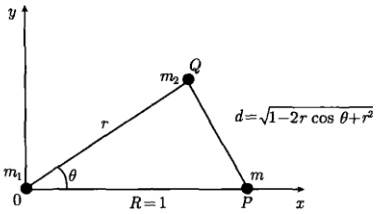

图 14.4 三质点间的万有引力作用
 

上述的牛顿力学模型不能给出生成函数按勒让德多项式的级数展开，即式(14.3.12)，但能够反映生成函数的极限行为。事实上，当 $ \theta=0 $时，三个质点在一条直线上，质点m的势函数与 $ m_{2} $的位置有关，我们有

$$  V(r,0)=\frac{1}{\sqrt{\left(1-r\right)^{2}}}=\left\{\begin{array}{ll}\frac{1}{1-r}&(r<1)\\ \frac{1}{r-1}&(r>1)\end{array}\right.   \tag*{(14.3.24)}$$

这是生成函数的一个重要特征。

方法4 利用静电学方法考查点电荷的电位分布 [式 (12.1.2)]。设电量  $ q = 4\pi\varepsilon $ 的点电荷位于 z 轴的 z = 1 处，如图14.5 所示。由于点电荷的电位分布是关于 z 轴对称的（与  $ \phi $ 没有关系），因此空间任意点的电位分布为

$$  u(r,\theta)=\frac{1}{\sqrt{1-2r\cos\theta+r^{2}}}   \tag*{(14.3.25)}$$

在 z 轴上 ( $ \theta = 0 $)，式 (14.3.25) 给出

$$  u(r,0)=\frac{1}{\sqrt{(1-r)^{2}}}=\left\{\begin{array}{ll}\frac{1}{1-r}&(r<1)\\ \frac{1}{r-1}&(r>1)\end{array}\right.   \tag*{(14.3.26)}$$

这与生成函数的牛顿力学模型的结果式（14.3.24）是相同的。考虑到轴对称系统的电位分布式（14.2.36），式（14.3.13）可以写成

$$  u(r,\theta)=\left\{\begin{array}{l l}{\displaystyle\sum_{l=0}^{\infty}A_{l}r^{l}\;P_{l}(\operatorname{c o s}\theta)}&{(r<1)}\\ {\displaystyle\sum_{l=0}^{\infty}B_{l}\frac{1}{r^{l+1}}P_{l}(\operatorname{c o s}\theta)}&{(r>1)}\end{array}\right.   \tag*{(14.3.27)}$$

在  $ \theta=0[P_{l}(1)=1] $ 时，式 (14.3.27) 应约化为式 (14.3.26)，即

<!-- page: 467 -->

$$  u(r,0)=\left\{\begin{array}{ll}\displaystyle\sum_{l=0}^{\infty}A_{l}r^{l}&(r<1)\\ \displaystyle\sum_{l=0}^{\infty}B_{l}\frac{1}{r^{l+1}}&(r>1)\end{array}\right.=\left\{\begin{array}{ll}\displaystyle\frac{1}{1-r}&(r<1)\\ \displaystyle\frac{1}{r-1}&(r>1)\end{array}\right.   \tag*{(14.3.28)}$$

我们知道

$$  \sum_{l=0}^{\infty}r^{l}=\frac{1}{1-r}\quad(r<1),\quad\sum_{l=0}^{\infty}\frac{1}{r^{l+1}}=\frac{1}{r-1}\quad(r>1)   \tag*{(14.3.29)}$$

故式(14.3.28)要求 $ A_{l}=1 $， $ B_{l}=1 $，这样，由式(14.3.25)和式(14.3.27)得到

$$  \frac{1}{\sqrt{1-2r\cos\theta+r^{2}}}=\left\{\begin{matrix}{\displaystyle\sum_{l=0}^{\infty}r^{l}\;P_{l}(\cos\theta)}&{(r<1)}\\ {\displaystyle\sum_{l=0}^{\infty}\frac{1}{r^{l+1}}P_{l}(\cos\theta)}&{(r>1)}\\ \end{matrix}\right.   \tag*{(14.3.30a)}$$

或

$$  \frac{1}{\sqrt{1-2rx+r^{2}}}=\left\{\begin{array}{ll}\displaystyle\sum_{l=0}^{\infty}r^{l}\ P_{l}(x)&(r<1)\\ \displaystyle\sum_{l=0}^{\infty}\frac{1}{r^{l+1}}P_{l}(x)&(r>1)\end{array}\right.   \tag*{(14.3.30b)}$$

式（14.3.30）就是一般情况下勒让德多项式的生成函数。

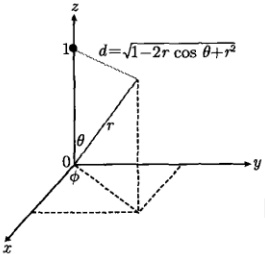

图 14.5 位于 z=1 的点电荷在空间形成的电位  $ u(r,\theta) $
 

#### 14.3.4 递推公式

常见的勒让德多项式递推公式如下

<!-- page: 468 -->

n = 1, 2, 3,  $ \cdots $

 $$ (1)(n+1)P_{n+1}(x)=(2n+1)xP_{n}(x)-nP_{n-1}(x) $$ 

 $$ P_{n}(x)=P_{n+1}^{\prime}(x)-2x P_{n}^{\prime}(x)+P_{n-1}^{\prime}(x) $$ 

(3)

 $$ xP_{n}^{\prime}(x)-P_{n-1}^{\prime}(x)=nP_{n}(x) $$ 

(4)

 $$ P_{n+1}^{\prime}(x)-P_{n-1}^{\prime}(x)=(2n+1)P_{n}(x) $$ 

 $$ \begin{aligned}&(5)nP_{n+1}^{\prime}(x)+(n+1)P_{n-1}^{\prime}(x)=(2n+1)xP_{n}^{\prime}(x)\\ &\cdots\cdots\\ &n=0,1,2,\cdots\\ &(6)P_{n+1}^{\prime}(x)=(n+1)P_{n}(x)+xP_{n}^{\prime}(x)\\ &\cdots\cdots\\ \end{aligned} $$ 

#### 证明 公式 (1): 对生成函数 (14.3.12) 两边关于 r 求导数，得到

$$  -\frac{1}{2}\left(1-2rx+r^{2}\right)^{-3/2}(-2x+2r)=\frac{x-r}{\left(1-2rx+r^{2}\right)^{3/2}}=\sum_{l=1}^{\infty}lr^{l-1}P_{l}(x)   \tag*{(14.3.31)}$$

两边同乘以  $ (1-2rx+r^{2}) $，得到

$$  \frac{x-r}{\sqrt{1-2rx+r^{2}}}=\left(1-2rx+r^{2}\right)\sum_{l=1}^{\infty}lr^{l-1}P_{l}(x)   \tag*{(14.3.32)}$$

利用式(14.3.12)，式(14.3.32)写为

$$  (x-r)\sum_{l=0}^{\infty}r^{l}P_{l}(x)=\left(1-2rx+r^{2}\right)\sum_{l=1}^{\infty}lr^{l-1}P_{l}(x)   \tag*{(14.3.33)}$$

整理后得

$$  \sum_{l=0}^{\infty}(2l+1)x r^{l}\ P_{l}(x)=\sum_{l=1}^{\infty}l r^{l-1}\ P_{l}(x)+\sum_{l=0}^{\infty}(l+1)r^{l+1}\ P_{l}(x)   \tag*{(14.3.34)}$$

在式(14.3.34)右边的两个求和中，分别令 n=l-1 和  $ n=l+1 $，得到

$$  \sum_{n=0}^{\infty}(2n+1)x r^{n}P_{n}(x)=\sum_{n=0}^{\infty}(n+1)r^{n}P_{n+1}(x)+\sum_{n=0}^{\infty}n r^{n}P_{n-1}(x)   \tag*{(14.3.35)}$$

两边比较  $ r^{n} $ 的系数得到

$$  (2n+1)xP_{n}(x)=(n+1)P_{n+1}(x)+nP_{n-1}(x)   \tag*{(14.3.36)}$$

这就是递推公式(1)。

证明 公式 (2)：对生成函数 (14.3.12) 两边关于 x 求导数，得到

$$  -\frac{1}{2}\left(1-2rx+r^{2}\right)^{-3/2}(-2r)=\frac{r}{\left(1-2rx+r^{2}\right)^{3/2}}=\sum_{l=0}^{\infty}r^{l}P_{l}^{\prime}(x)   \tag*{(14.3.37)}$$

<!-- page: 469 -->

两边同乘以  $ (1-2rx+r^{2}) $，得到

$$  \frac{r}{\sqrt{1-2rx+r^{2}}}=\left(1-2rx+r^{2}\right)\sum_{l=0}^{\infty}r^{l}P_{l}^{\prime}(x)   \tag*{(14.3.38)}$$

利用式(14.3.12)，式(14.3.38)写为

$$  r\sum_{l=0}^{\infty}P_{l}(x)r^{l}=\left(1-2r x+r^{2}\right)\sum_{l=0}^{\infty}r^{l}P_{l}^{\prime}(x)   \tag*{(14.3.39)}$$

整理后得

$$  \sum_{n=1}^{\infty}P_{n}(x)r^{n+1}+2x\sum_{n=1}^{\infty}r^{n+1}P_{n}^{\prime}(x)=\sum_{n=1}^{\infty}r^{n+1}P_{n+1}^{\prime}(x)+\sum_{n=1}^{\infty}r^{n+1}P_{n-1}^{\prime}(x)   \tag*{(14.3.40)}$$

两边比较  $ r^{n+1} $ 的系数得

$$  P_{n}(x)+2xP_{n}^{\prime}(x)=P_{n+1}^{\prime}(x)+P_{n-1}^{\prime}(x)   \tag*{(14.3.41)}$$

这就是递推公式(2)。

证明 公式 (3): 式 (14.3.31) 两边同乘以 r，得到

$$  \frac{r(x-r)}{(1-2rx+r^2)^{3/2}}=\sum_{l=1}^{\infty}lr^l P_l(x)   \tag*{(14.3.42a)}$$

式(14.3.37)两边同乘以 $ (x-r) $，得到

$$  \frac{r(x-r)}{(1-2rx+r^2)^{3/2}}=(x-r)\sum_{l=0}^{\infty}r^l P_l'(x)   \tag*{(14.3.42b)}$$

式(14.3.42)的两式比较得到

$$  \sum_{l=1}^{\infty}l r^{l}P_{l}(x)=(x-r)\sum_{l=0}^{\infty}r^{l}P_{l}^{\prime}(x)   \tag*{(14.3.43)}$$

整理后得

$$  \sum_{n=1}^{\infty}nr^{n}P_{n}(x)=x\sum_{n=1}^{\infty}r^{n}\ P_{n}^{\prime}(x)\ -\sum_{n=1}^{\infty}r^{n}\ P_{n-1}^{\prime}(x)   \tag*{(14.3.44)}$$

两边比较  $ r^{n} $ 的系数得到

$$  nP_{n}(x)=xP_{n}^{\prime}(x)-P_{n-1}^{\prime}(x)   \tag*{(14.3.45)}$$

这就是递推公式(3)。

证明 公式 (4)：对式 (14.3.36) 两边关于 x 求导数，得到

$$  (2n+1)P_{n}(x)+(2n+1)xP_{n}^{\prime}(x)=(n+1)P_{n+1}^{\prime}(x)+nP_{n-1}^{\prime}(x)   \tag*{(14.3.46)}$$

由式(14.3.45)与式(14.3.46)消去 $ xP_{n}^{\prime}(x) $，得到

<!-- page: 470 -->

$$  (2n+1)P_{n}(x)=P_{n+1}^{\prime}(x)-P_{n-1}^{\prime}(x)   \tag*{(14.3.47)}$$

这就是这就是递推公式(4)。

证明 公式 (5): 由式 (14.3.41) 与式 (14.3.46) 消去  $ P_{n}(x) $，得到

$$  nP_{n+1}^{\prime}(x)+(n+1)P_{n-1}^{\prime}(x)=(2n+1)xP_{n}^{\prime}(x)   \tag*{(14.3.48)}$$

这就是递推公式(5)。

证明 公式 (6): 由式 (14.3.45) 与式 (14.3.46) 消去  $ P'_{n-1}(x) $，得到

$$  (n+1)P_{n}(x)=P_{n+1}^{\prime}(x)-x P_{n}^{\prime}(x)   \tag*{(14.3.49)}$$

这就是递推公式(6)。

以上的证明方法都是利用生成函数，下面我们介绍另一种方法，用之证明递推公式 $ ^{(1)} $， $ (4) $， $ (6) $。

证明 令  $ u = x^{2} - 1 $，并采用符号  $ D^{n} \equiv \frac{\mathrm{d}^{n}}{\mathrm{d}x^{n}} $，我们有

 $$ Du^{n+1}=2(n+1)xu^{n} $$ 

 $$ \begin{aligned}D^{2}u^{n+1}&=D\left[2(n+1)xu^{n}\right]=2(n+1)\left[u^{n}+2x^{2}nu^{n-1}\right]\\&=2(n+1)\left[u^{n}+2(u+1)nu^{n-1}\right]\\&=2(n+1)\left[2nu^{n-1}+(2n+1)u^{n}\right]\\ \end{aligned} $$ 

这样

$$  \begin{align*}D^{n+1}\left(u^{n+1}\right)&=D^{n-1}D^{2}\left(u^{n+1}\right)\\&=4n(n+1)D^{n-1}\left(u^{n-1}\right)+2(n+1)(2n+1)D^{n-1}u^{n}\end{align*}   \tag*{(14.3.50)}$$

将罗德里格斯公式（14.3.1）写为

$$  P_{n}(x)=\frac{1}{2^{n}n!}D^{n}u^{n}   \tag*{(14.3.51)}$$

由式（14.3.50）得到

$$  \begin{aligned}P_{n+1}(x)&=\frac{1}{2^{n+1}(n+1)!}D^{n+1}\left(u^{n+1}\right)\\&=\frac{1}{2^{n+1}(n+1)!}\left[4n(n+1)D^{n-1}\left(u^{n-1}\right)+2(n+1)(2n+1)D^{n-1}u^{n}\right]\\&=\frac{D^{n-1}\left(u^{n-1}\right)}{2^{n-1}(n-1)!}+\frac{(2n+1)D^{n-1}u^{n}}{2^{n}n!}\\&=P_{n-1}(x)+\frac{(2n+1)D^{n-1}u^{n}}{2^{n}n!}\tag{14.3}\end{aligned}   \tag*{(14.3.52)}$$

现在利用莱布尼茨的乘积微分法则

$$  \frac{\mathrm{d}^{n}}{\mathrm{d}x^{n}}(f\cdot g)=\sum_{k=0}^{n}\frac{n!}{(n-k)!k!}\frac{\mathrm{d}^{k}f}{\mathrm{d}x^{k}}\frac{\mathrm{d}^{n-k}g}{\mathrm{d}x^{n-k}}   \tag*{(14.3.53)}$$

<!-- page: 471 -->

计算  $ D^{n}(xu^{n}) $，求和中只有前两项是非零的，即

$$  D^{n}\left(x u^{n}\right)=x D^{n}u^{n}+n D^{n-1}u^{n}   \tag*{(14.3.54)}$$

写 $ D^{n+1}=D^{n}D $，利用式(14.3.51)，得到

$$  \begin{aligned}P_{n+1}(x)&=\frac{1}{2^{n+1}(n+1)!}D^{n}D\left(u^{n+1}\right)\\&=\frac{1}{2^{n+1}(n+1)!}D^{n}\left[2(n+1)xu^{n}\right]\\&=\frac{1}{2^{n}n!}D^{n}\left[xu^{n}\right]=\frac{1}{2^{n}n!}\left[xD^{n}u^{n}+nD^{n-1}u^{n}\right]\\&=xP_{n}(x)+\frac{n}{2^{n}n!}D^{n-1}u^{n}\\ \end{aligned}   \tag*{(14.3.55)}$$

从式(14.3.52)和式(14.3.55)中消去 $ \frac{1}{2^{n}n!}D^{n-1}u^{n} $，即得递推公式(1)。

进一步对式(14.3.52)两边求导数，得到

$$  P_{n+1}^{\prime}(x)=P_{n-1}^{\prime}(x)+\frac{(2n+1)D^{n}u^{n}}{2^{n}n!}   \tag*{(14.3.56)}$$

将式(14.3.51)代入式(14.3.56)，得到

$$  P_{n+1}^{\prime}(x)=P_{n-1}^{\prime}(x)+(2n+1)P_{n}(x)   \tag*{(14.3.57)}$$

这就是递推公式(4)。

另外对式（14.3.55）两边求导数，得到

$$  P_{n+1}^{\prime}(x)=P_{n}(x)+xP_{n}^{\prime}(x)+\frac{n}{2^{n}n!}D^{n}u^{n}   \tag*{(14.3.58)}$$

将式(14.3.51)代入式(14.3.58)，得到

$$  P_{n+1}^{\prime}(x)=(n+1)P_{n}(x)+xP_{n}^{\prime}(x)   \tag*{(14.3.59)}$$

这就是递推公式(6)。

#### 14.3.5 例题

例1 计算： $ P_{l}(1) $， $ P_{l}^{\prime}(1) $， $ P_{l}(-1) $ 和  $ P_{l}^{\prime}(-1) $。

解

方法 1 利用勒让德多项式的微分表示式 (14.3.1)。用二项式定理写出

 $$ \begin{aligned}(x^{2}-1)^{l}&=(x-1)^{l}\left[(x-1)+2\right]^{l}\\&=(x-1)^{l}\sum_{n=0}^{l}\frac{l!}{n!(l-n)!}2^{l-n}(x-1)^{n}\\&=\sum_{n=0}^{l}\frac{l!}{n!(l-n)!}2^{l-n}(x-1)^{l+n}\end{aligned} $$ 

代入式(14.3.1)得到

<!-- page: 472 -->

$$ \begin{aligned}P_{l}(x)&=\frac{1}{2^{l}l!}\frac{\mathrm{d}^{l}}{\mathrm{d}x^{l}}\left[\sum_{n=0}^{l}\frac{l!}{n!(l-n)!}2^{l-n}(x-1)^{l+n}\right]\\&=\frac{\mathrm{d}^{l}}{\mathrm{d}x^{l}}\left[\sum_{n=0}^{l}\frac{1}{2^{n}n!(l-n)!}(x-1)^{l+n}\right]\\&=\sum_{n=0}^{l}\frac{1}{2^{n}n!(l-n)!}(l+n)(l+n-1)\cdots(n+1)\cdot(x-1)^{n}\\&=\sum_{n=0}^{l}\frac{1}{n!(l-n)!}(l+n)(l+n-1)\cdots(n+1)\cdot\left(\frac{x-1}{2}\right)^{n}\\&=\sum_{n=0}^{l}\frac{1}{n!(l-n)!}\frac{(l+n)!}{n!}\cdot\left(\frac{x-1}{2}\right)^{n}\\ \end{aligned} $$ 

上式除 n=0 项外，其余各项都含有因子  $ (x-1) $，而 n=0 项给出

$$  P_{l}(1)=1   \tag*{(14.3.60a)}$$

进而

 $$ \begin{aligned}P_{l}^{\prime}(x)&=\sum_{n=0}^{l}\frac{1}{n!(l-n)!}\frac{(l+n)!}{n!}\cdot\frac{n}{2}\left(\frac{x-1}{2}\right)^{n-1}\\&=\sum_{n=1}^{l}\frac{1}{n!(l-n)!}\frac{(l+n)!}{n!}\cdot\frac{n}{2}\left(\frac{x-1}{2}\right)^{n-1}\end{aligned} $$ 

上式除 n=1 项外，其余各项都含有因子  $ (x-1) $，而 n=1 项给出

$$  P_{l}^{\prime}(1)=\frac{l(l+1)}{2}   \tag*{(14.3.60b)}$$

另一方面，用二项式定理写出

 $$ \begin{aligned}(x^{2}-1)^{l}&=(x+1)^{l}\left[(x+1)-2\right]^{l}\\&=(x+1)^{l}\sum_{n=0}^{l}\frac{l!}{n!(l-n)!}(-2)^{l-n}(x+1)^{n}\\&=\sum_{n=0}^{l}\frac{l!}{n!(l-n)!}(-2)^{l-n}(x+1)^{l+n}\end{aligned} $$ 

代入式(14.3.47)得到

 $$ \begin{aligned}P_{l}(x)&=\frac{1}{2^{l}l!}\frac{\mathrm{d}^{l}}{\mathrm{d}x^{l}}\left[\sum_{n=0}^{l}\frac{l!}{n!(l-n)!}(-2)^{l-n}(x+1)^{l+n}\right]\\&=\frac{\mathrm{d}^{l}}{\mathrm{d}x^{l}}\left[\sum_{n=0}^{l}\frac{(-1)^{l-n}}{2^{n}n!(l-n)!}(x+1)^{l+n}\right]\end{aligned} $$

<!-- page: 473 -->

$$ \sum_{n=0}^{l}\frac{(-1)^{l-n}}{n!(l-n)!}\frac{(l+n)!}{n!}\cdot\left(\frac{x+1}{2}\right)^{n} $$ 

上式除 n=0 项外，其余各项都含有因子  $ (x+1) $，而 n=0 项给出

$$  P_{l}(-1)=(-1)^{l}   \tag*{(14.3.61a)}$$

进而

 $$ \begin{aligned}P_{l}^{\prime}(x)&=\sum_{n=0}^{l}\frac{(-1)^{l-n}}{n!(l-n)!}\frac{(l+n)!}{n!}\cdot\frac{n}{2}\left(\frac{x+1}{2}\right)^{n-1}\\&=\sum_{n=1}^{l}\frac{(-1)^{l-n}}{n!(l-n)!}\frac{(l+n)!}{n!}\cdot\frac{n}{2}\left(\frac{x+1}{2}\right)^{n-1}\end{aligned} $$ 

上式除 n=1 项外，其余各项都含有因子  $ (x+1) $，而 n=1 项给出

$$  P_{l}^{\prime}(-1)=(-1)^{l-1}\frac{l(l+1)}{2}   \tag*{(14.3.61b)}$$

方法 2 利用莱布尼茨的乘积微分法则 [与式（14.3.53）等价的另一种形式]

$$  \frac{\mathrm{d}^{l}}{\mathrm{d}x^{l}}(f\cdot g)=\sum_{n=0}^{l}\frac{l!}{(l-n)!n!}\frac{\mathrm{d}^{l-n}f}{\mathrm{d}x^{l-n}}\frac{\mathrm{d}^{n}g}{\mathrm{d}x^{n}}   \tag*{(14.3.62)}$$

我们有

 $$ \begin{aligned}\frac{\mathrm{d}^{l}}{\mathrm{d}x^{l}}\left[(x^{2}-1)^{l}\right]&=\frac{\mathrm{d}^{l}}{\mathrm{d}x^{l}}\left[(x+1)^{l}(x-1)^{l}\right]\\&=\frac{\mathrm{d}^{l}}{\mathrm{d}x^{l}}(x+1)^{l}\cdot(x-1)^{l}+\left(\begin{array}{l}l\\1\end{array}\right)\frac{\mathrm{d}^{l-1}}{\mathrm{d}x^{l-1}}(x+1)^{l}\cdot\frac{\mathrm{d}}{\mathrm{d}x}(x-1)^{l}+\cdots\\&\quad+\left(\begin{array}{l}l\\n\end{array}\right)\frac{\mathrm{d}^{l-n}}{\mathrm{d}x^{l-n}}(x+1)^{l}\cdot\frac{\mathrm{d}^{n}}{\mathrm{d}x^{n}}(x-1)^{l}+\cdots+(x+1)^{l}\cdot\frac{\mathrm{d}^{l}}{\mathrm{d}x^{l}}(x-1)^{l}\end{aligned} $$ 

在上式中除最后一项外，其余各项都含有 $ (x-1) $因子，而最后一项给出

$$  P_{l}(1)=\frac{1}{2^{l}l!}(1+1)^{l}l!=1   \tag*{(14.3.63a)}$$

另一方面，除第一项外，其余各项都含有 $ (x+1) $因子，而第一项给出

$$  P_{l}(-1)=\frac{1}{2^{l}l!}(-2)^{l}l!=(-1)^{l}   \tag*{(14.3.63b)}$$

方法 3 在勒让德多项式的生成函数（14.3.12）中取 x=1，得到

$$  \frac{1}{1-r}=\sum_{l=0}^{\infty}P_{l}(1)r^{l}=\sum_{l=0}^{\infty}r^{l}   \tag*{(14.3.64)}$$

这里利用了式(14.3.29)的第一式。两边比较  $ r^{l} $ 的系数得到  $ P_{l}(1)=1 $。另外将生成函数写成

<!-- page: 474 -->

$$  \frac{1}{\sqrt{1-2rx+r^{2}}}=\frac{1}{\sqrt{1-2(-r)(-x)+(-r)^{2}}}   \tag*{(14.3.65)}$$

与式(14.3.12)比较，有

$$  \sum_{l=0}^{\infty}r^{l}P_{l}(x)=\sum_{l=0}^{\infty}(-r)^{l}P_{l}(-x)=\sum_{l=0}^{\infty}r^{l}(-1)^{l}P_{l}(-x)   \tag*{(14.3.66)}$$

两边比较  $ r^{l} $ 的系数，有  $ P_{l}(-x)=(-1)^{l}P_{l}(x) $，取 x=1 得到  $ P_{l}(-1)=(-1)^{l} $。

方法 4 利用勒让德多项式的积分表示式 (14.3.6)，即

$$  P_{l}(x)=\frac{1}{\pi}\int_{0}^{\pi}(x+\sqrt{x^{2}-1}\cos\phi)^{l}\mathrm{d}\phi   \tag*{(14.3.67)}$$

在式(14.3.67)中分别取 $ x=\pm1 $，得到

$$  P_{l}(1)=\frac{1}{\pi}\int_{0}^{\pi}\mathrm{d}\theta=1   \tag*{(14.3.68a)}$$

$$  P_{l}(-1)=\frac{1}{\pi}\int_{0}^{\pi}(-1)^{l}\mathrm{d}\theta=(-1)^{l}   \tag*{(14.3.68b)}$$

例2 计算  $ P_{2n}(0) $， $ P_{2n+1}(0) $ 和  $ P_{2n}(0)-P_{2n+2}(0) $。

解 利用勒让德多项式的定义 (14.2.17)，即

$$  P_{l}(x)=\frac{1}{2^{l}}\sum_{m=0}^{M}(-1)^{m}\frac{(2l-2m)!}{m!(l-m)!(l-2m)!}x^{l-2m}   \tag*{(14.3.69)}$$

当 l 为奇数时， $ P_{l}(x) \Rightarrow x^{l} + x^{l-2} + \cdots + x $ (无常数项)，故

$$  P_{2n+1}(0)=0   \tag*{(14.3.70)}$$

当 $l$ 为偶数时，$P_l(x) \Rightarrow x^l + x^{l-2} + \cdots + x +$ 常数项 $P_l(0)$。由式 (14.3.69) 看出，常数项相应于 $l=2m$，故

$$  P_{l}(0)=\frac{(-1)^{k}(2l-2m)!}{2^{l}m!(l-m)!(l-2m)!}=(-1)^{\frac{l}{2}}\frac{l!}{2^{l}\left(\frac{l}{2}\right)!\left(\frac{l}{2}\right)!}   \tag*{(14.3.71a)}$$

该常数项还可以直接由式（14.2.16）给出

$$  C_{0}=(-1)^{\frac{l}{2}}\frac{l!}{2^{l}\left[\left(\frac{l}{2}\right)!\right]^{2}}   \tag*{(14.3.71b)}$$

<!-- page: 475 -->

对于偶数 l=2n，式 (14.3.71) 写为

$$  P_{2n}(0)=(-1)^{n}\frac{(2n)!}{2^{2n}\left(n!\right)^{2}}   \tag*{(14.3.72)}$$

得到该结果的另一个方法是在生成函数(14.3.12)的两边取x=0，并利用式(14.3.9)，得到

$$  \frac{1}{\sqrt{1+r^{2}}}=\sum_{l=0}^{\infty}P_{l}(0)r^{l}=\sum_{n=0}^{\infty}(-1)^{n}\frac{(2n)!}{2^{2n}(n!)^{2}}r^{2n}   \tag*{(14.3.73)}$$

两边比较  $ r^{l} $ 的系数 (l=2n)，立即得到式 (14.3.72)。

得到式（14.3.72）最直接的方法是从式（14.2.24）写出

$$  \begin{aligned}P_{2n}(x)&=\frac{(4n-1)(4n-3)\cdots3\cdot1}{(2n)!}\\&\cdot\left[\begin{array}{l}x^{2n}-\frac{1}{2}\frac{2n(2n-1)}{(4n-1)}x^{2n-2}+\\\frac{1}{2\cdot4}\frac{2n(2n-1)(2n-2)(2n-3)}{(4n-1)(4n-3)}x^{2n-4}-\cdots\end{array}\right]\end{aligned}   \tag*{(14.3.74)}$$

它的常数项  $ P_{2n}(0) $ 即为式 (14.3.72)。

进而由式（14.3.72）得到

$$  P_{2n+2}(0)=(-1)^{\frac{2n+2}{2}}\frac{(2n+2)!}{2^{2n+2}\left[\left(\frac{2n+2}{2}\right)!\right]^{2}}=-(-1)^{n}\frac{(2n+2)!}{2^{2n+2}\left[(n+1)!\right]^{2}}   \tag*{(14.3.75)}$$

于是

$$  P_{2n}(0)-P_{2n+2}(0)=(-1)^{n}\left(\frac{4n+3}{n+1}\right)\frac{(2n)!}{2^{2n+1}\left(n!\right)^{2}}\quad(n=0,1,2,\cdots)   \tag*{(14.3.76)}$$

这是一个很有用的公式。

例3 计算  $ P_{2n}^{\prime}(0) $ 和  $ P_{2n+1}^{\prime}(0) $。

解 当 l 为偶数时， $ P_{l}^{\prime}(x) \Rightarrow x^{l} + x^{l-2} + \cdots + x $ (无常数项)，故

$$  P_{2n}^{\prime}(0)=0   \tag*{(14.3.77)}$$

当 l 为奇数时， $ P_{l}^{\prime}(x) \Rightarrow x^{l} + x^{l-2} + \cdots + x^{2} + \text{常数项 } P_{l}^{\prime}(0) $。而  $ P_{l}^{\prime}(x) $ 的常数项等于  $ P_{l}(x) $ 的一次项 x 的系数（相应于 } l - 2m = 1 $），故

 $$ P_{l}^{\prime}(0)=(-1)^{m}\frac{(2l-2m)!}{2^{l}m!(l-m)!(l-2m)!} $$

<!-- page: 476 -->

$$ =(-1)^{\frac{l-1}{2}}\frac{(l+1)!}{2^l\left(\frac{l-1}{2}\right)!\left(\frac{l+1}{2}\right)!} $$ 

或

$$  P_{2n+1}^{\prime}(0)=(-1)^{n}\frac{(2n+2)!}{2^{2n+1}n!(n+1)!}=(2n+1)P_{2n}(0)   \tag*{(14.3.78)}$$

例4 计算积分

$$  I_{l}=\int_{0}^{1}P_{l}(x)\mathrm{d}x   \tag*{(14.3.79)}$$

解 当 l=0 时

$$  I_{0}=\int_{0}^{1}P_{0}(x)\mathrm{d}x=\int_{0}^{1}\mathrm{d}x=1   \tag*{(14.3.80)}$$

利用式(14.2.1)，即

$$  \frac{\mathrm{d}}{\mathrm{d}x}\left[(1-x^{2})\frac{\mathrm{d}P_{l}(x)}{\mathrm{d}x}\right]=-l(l+1)P_{l}(x)   \tag*{(14.3.81)}$$

将式（14.3.79）写为

 $$ \begin{aligned}I_{l}&=\int_{0}^{1}P_{l}(x)\mathrm{d}x=-\frac{1}{l(l+1)}\int_{0}^{1}\mathrm{d}\left[(1-x^{2})\frac{\mathrm{d}P_{l}(x)}{\mathrm{d}x}\right]\\&=-\frac{1}{l(l+1)}\left[(1-x^{2})\frac{\mathrm{d}P_{l}(x)}{\mathrm{d}x}\right]_{0}^{1}\\&=\frac{1}{l(l+1)}P_{l}^{\prime}(0)\\ \end{aligned} $$ 

利用式(14.3.77)和式(14.3.78)，得到

$$  I_{2n}=0\quad(n=1,2,3\cdots)   \tag*{(14.3.82a)}$$

$$  I_{2n+1}=(-1)^{n}\frac{(2n)!}{2^{2n+1}n!(n+1)!}\quad(n=0,1,2\cdots)   \tag*{(14.3.82b)}$$

式(14.3.80)和式(14.3.82)就是积分式(14.3.79)的结果。式(14.3.82a)表明，偶数阶勒让德多项式 $ P_{2n}(x) $在区间 $ [-1,1] $上的正、负面积相等 $ [P_{0}(x)=1 $除外]。

得出式（14.3.82b）的另一个方法是利用递推公式（4），即

$$  P^{\prime}_{2n+2}(x)-P^{\prime}_{2n}(x)=(4n+3)P_{2n+1}(x)   \tag*{(14.3.83)}$$

从而积分式 $  (14.3.79)  $为

 $$ I_{2n+1}=\int_{0}^{1}P_{2n+1}(x)\mathrm{d}x $$

<!-- page: 477 -->

$$ \begin{aligned}&=\frac{1}{(4n+3)}\int_{0}^{1}\left[P_{2n+2}^{\prime}(x)-P_{2n}^{\prime}(x)\right]\mathrm{d}x\\&=\frac{1}{(4n+3)}\left[P_{2n+2}(1)-P_{2n+2}(0)-P_{2n}(1)+P_{2n}(0)\right]\\&=\frac{1}{(4n+3)}\left[P_{2n}(0)-P_{2n+2}(0)\right]\\&=(-1)^{n}\frac{(2n)!}{2^{2n+1}\left(n+1\right)\left(n!\right)^{2}}\end{aligned} $$ 

这里用到了式(14.3.76)。

例 5 设  $ f(x) $ 是一个 k 次多项式，试证明当 0 < k < l 时， $ f(x) $ 与 l 阶勒让德多项式  $ P_l(x) $ 在  $ [-1,1] $ 上正交，即

$$  \int_{-1}^{1}f(x)P_{l}(x)\mathrm{d}x=0   \tag*{(14.3.84)}$$

证明 利用勒让德多项式的微分表示式 (14.3.1)，即

$$  P_{l}(x)=\frac{1}{2^{l}l!}\frac{\mathrm{d}^{l}}{\mathrm{d}x^{l}}(x^{2}-1)^{l}   \tag*{(14.3.85)}$$

我们有

 $$ \begin{align*}\int_{-1}^{1}f(x)P_{l}(x)\mathrm{d}x&=\frac{1}{2^{l}l!}\int_{-1}^{1}f(x)\frac{\mathrm{d}^{l}}{\mathrm{d}x^{l}}(x^{2}-1)^{l}\mathrm{d}x\\&=\frac{1}{2^{l}l!}\int_{-1}^{1}f(x)\mathrm{d}\left[\frac{\mathrm{d}^{l-1}}{\mathrm{d}x^{l-1}}(x^{2}-1)^{l}\right]\\&=\frac{1}{2^{l}l!}\left[f(x)\frac{\mathrm{d}^{l-1}}{\mathrm{d}x^{l-1}}(x^{2}-1)^{l}\right]_{-1}^{1}-\frac{1}{2^{l}l!}\int_{-1}^{1}f^{\prime}(x)\frac{\mathrm{d}^{l-1}}{\mathrm{d}x^{l-1}}(x^{2}-1)^{l}\mathrm{d}x\end{align*} $$ 

上式右端第一项为零 [因为含有因子  $ (x^{2}-1) $]。对第二项用分部积分法积分  $ (k-1) $ 次，注意到  $ f(x) $ 是一个 k 次多项式，微分 k 次后变成常数  $ f^{(k)} $。而由于 k<l，微分 k 次后  $ P_{l}(x) $ 仍然是 x 的函数。于是上式变为

 $$ \begin{aligned}\int_{-1}^{1}f(x)P_{l}(x)\mathrm{d}x&=(-1)^{k}\frac{1}{2^{l}l!}\int_{-1}^{1}f^{(k)}\frac{\mathrm{d}^{l-k}}{\mathrm{d}x^{l-k}}(x^{2}-1)^{l}\mathrm{d}x\\&=(-1)^{k}\frac{f^{(k)}}{2^{l}l!}\int_{-1}^{1}\frac{\mathrm{d}^{l-k}}{\mathrm{d}x^{l-k}}(x^{2}-1)^{l}\mathrm{d}x\\&=(-1)^{k}\frac{f^{(k)}}{2^{l}l!}\int_{-1}^{1}\mathrm{d}\left[\frac{\mathrm{d}^{l-k-1}}{\mathrm{d}x^{l-k-1}}(x^{2}-1)^{l}\right]\\&=(-1)^{k}\frac{f^{(k)}}{2^{l}l!}\left[f(x)\frac{\mathrm{d}^{l-k-1}}{\mathrm{d}x^{l-k-1}}(x^{2}-1)^{l}\right]_{-1}^{1}=0\end{aligned} $$ 

这表示  $ f(x) $ 与 l 阶勒让德多项式  $ P_{l}(x) $ 在  $ [-1,1] $ 上是正交的。

<!-- page: 478 -->

### 14.4 勒让德多项式的正交完备性

#### 14.4.1 正交性

由式（14.2.1）写出勒让德方程的施图姆-刘维尔形式

$$  \frac{\mathrm{d}}{\mathrm{d}x}\left[(1-x^{2})\frac{\mathrm{d}P_{l}(x)}{\mathrm{d}x}\right]=-l(l+1)P_{l}(x)   \tag*{(14.4.1)}$$

方程（14.4.1）具有边界条件[式（14.3.48）]

$$  P_{l}(1)=1,P_{l}^{\prime}(1)=\frac{l(l+1)}{2}   \tag*{(14.4.2a)}$$

$$  P_{l}(-1)=(-1)^{l},P_{l}^{\prime}(-1)=(-1)^{l-1}\frac{l(l+1)}{2}   \tag*{(14.4.2b)}$$

为了讨论  $ P_{l}(x) $ 的正交性，将式 (14.4.2) 代入式 (9.1.7) 的 Q 因子，得到

 $$ \begin{aligned}Q&=k(1)\left[P_{l}(1)P_{m}^{\prime}(1)-P_{m}(1)P_{l}^{\prime}(1)\right]-k(-1)\left[P_{l}(-1)P_{m}^{\prime}(-1)-P_{m}(-1)P_{l}^{\prime}(-1)\right]\\&=k(1)\left[\frac{m(m+1)}{2}-\frac{l(l+1)}{2}\right]-k(-1)(-1)^{l+m-1}\left[\frac{m(m+1)}{2}-\frac{l(l+1)}{2}\right]\end{aligned} $$ 

其中， $ k(x)=1-x^{2} $，故  $ k(1)=0 $， $ k(-1)=0 $，这导致 Q=0。因此勒让德多项式满足正交性

$$  \int_{-1}^{1}P_{l}(x)P_{m}(x)\mathrm{d}x=0\quad(l\neq m)   \tag*{(14.4.3)}$$

关系式(14.4.3)从14.3.5节例5的结果是容易证明的。事实上， $ \int_{-1}^{1}P_{l}(x)P_{m}(x)\mathrm{d}x $ 中的  $ P_{l}(x) $ 和  $ P_{m}(x) $ 分别是 l 阶和 m 阶多项式。如果 l < m， $ P_{l}(x) $ 相应于式(14.3.84)中的  $ f(x) $，积分结果为零；反之如果 m < l， $ P_{m}(x) $ 相应于式(14.3.84)中的  $ f(x) $，积分结果也为零。因此，只要  $ l \neq m $，就有  $ \int_{-1}^{1}P_{l}(x)P_{m}(x)\mathrm{d}x = 0 $。

其实，勒让德多项式的正交性从方程（14.4.1）可以直接看出来，式（14.4.1）表示  $ P_{l}(x) $ 是算符

$$  F=-\frac{\mathrm{d}}{\mathrm{d}x}\left[(1-x^{2})\frac{\mathrm{d}}{\mathrm{d}x}\right]=(x^{2}-1)\frac{\mathrm{d}^{2}}{\mathrm{d}x^{2}}+2x\frac{\mathrm{d}}{\mathrm{d}x}   \tag*{(14.4.4)}$$

的本征函数，而该算符显然满足  $ F^{+} = F $，是厄米算符，本征值  $ l(l+1) $ 是实数。因此按照 9.3 节的论述，本征函数  $ P_{l}(x) $ 是正交的。

下面我们推导勒让德多项式的一个重要积分公式。设  $ P_{l}(x) $ 和  $ P_{m}(x) $ 是两个不同阶的勒让德多项式，则它们满足方程 (14.1.13)

<!-- page: 479 -->

$$  (1-x^{2})P_{l}^{\prime\prime}-2x P_{l}^{\prime}=-l(l+1)P_{l}   \tag*{(14.4.5a)}$$

$$  (1-x^{2})P_{m}^{\prime\prime}-2xP_{m}^{\prime}=-m(m+1)P_{m}   \tag*{(14.4.5b)}$$

以  $ P_{m}(x) $ 乘以式 (14.4.5a)，以  $ P_{l}(x) $ 乘以式 (14.4.5b)，再将结果相减，得到

 $$ \begin{align*}\left[m(m+1)-l(l+1)\right]P_{l}P_{m}&=\left(1-x^{2}\right)\left(P_{m}P_{l}^{\prime\prime}-P_{l}P_{m}^{\prime\prime}\right)-2x\left(P_{m}P_{l}^{\prime}-P_{l}P_{m}^{\prime}\right)\\&=\left(1-x^{2}\right)\frac{\mathrm{d}}{\mathrm{d}x}\left(P_{m}P_{l}^{\prime}-P_{l}P_{m}^{\prime}\right)-2x\left(P_{m}P_{l}^{\prime}-P_{l}P_{m}^{\prime}\right)\\&=\frac{\mathrm{d}}{\mathrm{d}x}\left[\left(1-x^{2}\right)\left(P_{m}P_{l}^{\prime}-P_{l}P_{m}^{\prime}\right)\right]\end{align*} $$ 

两边对 x 在区间  $ [x,1] $ 积分，得到

 $$ \begin{align*}\left[m(m+1)-l(l+1)\right]\int_{x}^{1}P_{l}(x)P_{m}(x)\mathrm{d}x&=\left[\left(1-x^{2}\right)\left(P_{m}P_{l}^{\prime}-P_{l}P_{m}^{\prime}\right)\right]_{x}^{1}\\&=\left(x^{2}-1\right)\left[P_{m}(x)P_{l}^{\prime}\left(x\right)-P_{l}(x)P_{m}^{\prime}(x)\right]\end{align*} $$ 

所以

$$  \int_{x}^{1}P_{l}(x)P_{m}(x)\mathrm{d}x=\frac{(1-x^{2})\left[P_{l}(x)P_{m}^{\prime}(x)-P_{m}(x)P_{l}^{\prime}(x)\right]}{m(m+1)-l(l+1)}\quad(l\neq m)   \tag*{(14.4.6a)}$$

这是勒让德多项式的一般性结果。当积分下限为 x = -1 时，给出勒让德多项式的正交性关系式  $ \int_{-1}^{1} P(x) P_{m}(x) \, dx = 0 $。显然还有

$$  \int_{-1}^{x}P_{l}(x)P_{m}(x)\mathrm{d}x=-\frac{(1-x^{2})\left[P_{l}(x)P_{m}^{\prime}(x)-P_{m}(x)P_{l}^{\prime}(x)\right]}{m(m+1)-l(l+1)}\quad(l\neq m)   \tag*{(14.4.6b)}$$

式(14.4.6)是重要的积分公式。

#### 14.4.2 模值

现在我们证明

$$  I_{l}\equiv\int_{-1}^{1}P_{l}^{2}(x)\mathrm{d}x=\frac{2}{2l+1}   \tag*{(14.4.7)}$$

证明

方法 1 对生成函数(14.3.12)的两边平方

$$  \frac{1}{1-2rx+r^{2}}=\left[\sum_{l=0}^{\infty}r^{l}\ P_{l}(x)\right]\cdot\left[\sum_{m=0}^{\infty}r^{m}\ P_{m}(x)\right]=\sum_{l=0}^{\infty}\sum_{m=0}^{\infty}r^{l+m}P_{l}(x)P_{m}(x)   \tag*{(14.4.8)}$$

<!-- page: 480 -->

两边对 x 在区间  $ [-1,1] $ 积分，并利用式 (14.4.3)，得到

$$  \begin{aligned}\int_{-1}^{1}\frac{1}{1-2rx+r^{2}}\mathrm{d}x&=\sum_{l=0}^{\infty}\sum_{m=0}^{\infty}r^{l+m}\int_{-1}^{1}P_{l}(x)P_{m}(x)\mathrm{d}x\\&=\sum_{l=0}^{\infty}\sum_{m=0}^{\infty}I_{l}r^{l+m}\delta_{lm}\\&=\sum_{l=0}^{\infty}I_{l}r^{2l}\end{aligned}   \tag*{(14.4.9)}$$

式(14.4.9)左边的积分为

$$  \begin{aligned}\int_{-1}^{1}\frac{1}{1-2rx+r^{2}}\mathrm{d}x&=-\frac{1}{2r}\int_{-1}^{1}\frac{\mathrm{d}(1-2rx+r^{2})}{1-2rx+r^{2}}\\&=\left[-\frac{1}{2r}\ln(1-2rx+r^{2})\right]_{-1}^{1}=\frac{1}{r}\ln\frac{1+r}{1-r}\quad(|r|<1)\\&=\sum_{l=0}^{\infty}\frac{2}{2l+1}r^{2l}\tag{14}\end{aligned}   \tag*{(14.4.10)}$$

式(14.4.9)与式(14.4.10)比较 $ r^{2l} $的系数，即得式(14.4.7)。

方法2 利用递推公式(1)

$$  (n+1)P_{n+1}+nP_{n-1}=(2n+1)xP_{n}   \tag*{(14.4.11a)}$$

及它的 n-1 形式

$$  nP_{n}+(n-1)P_{n-2}=(2n-1)xP_{n-1}   \tag*{(14.4.11b)}$$

以  $ P_{n-1} $ 乘以式 (14.4.11a)，以  $ P_n $ 乘以式 (14.4.11b)，将结果对 x 在区间  $ [-1,1] $ 积分，并利用式 (14.4.3)，得到

$$  n\int_{-1}^{1}P_{n-1}^{2}(x)\mathrm{d}x=(2n+1)\int_{-1}^{1}x P_{n-1}(x)P_{n}(x)\mathrm{d}x   \tag*{(14.4.12a)}$$

和

$$  n\int_{-1}^{1}P_{n}^{2}(x)\mathrm{d}x=(2n-1)\int_{-1}^{1}x P_{n-1}(x)P_{n}(x)\mathrm{d}x   \tag*{(14.4.12b)}$$

比较式（14.4.12a）与式（14.4.12b）的右边，得到

$$  \frac{1}{2n-1}\int_{-1}^{1}P_{n}^{2}(x)\mathrm{d}x=\frac{1}{2n+1}\int_{-1}^{1}P_{n-1}^{2}(x)\mathrm{d}x   \tag*{(14.4.13)}$$

即

$$  \int_{-1}^{1}P_{n}^{2}(x)\mathrm{d}x=\frac{2n-1}{2n+1}\int_{-1}^{1}P_{n-1}^{2}(x)\mathrm{d}x   \tag*{(14.4.14)}$$

<!-- page: 481 -->

这是一个积分形式的递推公式。当 n = 1 时，我们有  $ P_{0}(x) = 1 $ 及  $ \int_{-1}^{1} P_{0}^{2}(x) \, dx = 2 $，于是式 (14.4.14) 给出

$$  \int_{-1}^{1}P_{1}^{2}(x)\mathrm{d}x=\frac{2\cdot1-1}{2\cdot1+1}\int_{-1}^{1}P_{0}^{2}(x)\mathrm{d}x=\frac{2}{3}=\frac{2}{2\cdot1+1}   \tag*{(14.4.15a)}$$

进而，当 n=2 时，我们有

$$  \int_{-1}^{1}P_{2}^{2}(x)\mathrm{d}x=\frac{2\cdot2-1}{2\cdot2+1}\int_{-1}^{1}P_{1}^{2}(x)\mathrm{d}x=\frac{2}{5}=\frac{2}{2\cdot2+1}   \tag*{(14.4.15b)}$$

显然可以归纳出

$$  \int_{-1}^{1}P_{l}^{2}(x)\mathrm{d}x=\frac{2}{2l+1}   \tag*{(14.4.16)}$$

这个积分的平方根

$$  \sqrt{\int_{-1}^{1}P_{l}^{2}(x)\mathrm{d}x}=\sqrt{\frac{2}{2l+1}}   \tag*{(14.4.17)}$$

通常称为勒让德多项式的模值。

#### 14.4.3 完备性

利用式（14.4.3）和式（14.4.16）可以写出勒让德多项式的正交性关系式

$$  \int_{-1}^{1}P_{l}(x)P_{m}(x)\mathrm{d}x=\frac{2}{2l+1}\delta_{l,m}   \tag*{(14.4.18)}$$

设  $ f(x) $ 在闭区间  $ [-1,1] $ 是分段光滑的，则  $ f(x) $ 可以按勒让德多项式级数展开，即

$$  f(x)=\sum_{l=0}^{\infty}C_{l}P_{l}(x)\quad.   \tag*{(14.4.19)}$$

这称为勒让德多项式的完备性。现在我们利用式(14.4.18)计算展开系数  $ C_{l} $，为此给式(14.4.19)两边同乘以  $ P_{m}(x) $，并对 x 在区间  $ [-1,1] $ 积分，得到

 $$ \begin{aligned}\int_{-1}^{1}P_{m}(x)f(x)\mathrm{d}x&=\int_{-1}^{1}P_{m}(x)\sum_{l=0}^{\infty}C_{l}P_{l}(x)\mathrm{d}x\\&=\sum_{l=0}^{\infty}C_{l}\int_{-1}^{1}P_{m}(x)P_{l}(x)\mathrm{d}x\\&=\sum_{l=0}^{\infty}\frac{2}{2l+1}C_{l}\delta_{m l}=\frac{2}{2m+1}C_{m}\end{aligned} $$

<!-- page: 482 -->

由此得到展开系数

$$  C_{l}=\frac{2l+1}{2}\int_{-1}^{1}P_{l}(x)f(x)\mathrm{d}x   \tag*{(14.4.20)}$$

如果函数 $f$ 在区间 $[-1,1]$ 是分段光滑的，则 $f$ 有如式 (14.4.19) 所示的勒让德级数展开式，对于 $x \in (-1,1)$，勒让德级数的收敛性由狄利克雷定理确定，即

$$  \sum_{l=0}^{\infty}C_{l}P_{l}(x)=f(x)\quad( 在 x 的连续点 )   \tag*{(14.4.21a)}$$

$$  \sum_{l=0}^{\infty}C_{l}P_{l}(x)=\frac{f(x-0)+f(x+0)}{2}\quad( 在 x 的间断点 )   \tag*{(14.4.21b)}$$

#### 14.4.4 例题

例1 证明

$$  \int_{x}^{1}P_{m}(x)\mathrm{d}x=\frac{1}{2m+1}\left[P_{m-1}(x)-P_{m+1}(x)\right]   \tag*{(14.4.22a)}$$

$$  \int_{-1}^{x}P_{m}(x)\mathrm{d}x=\frac{1}{2m+1}\left[P_{m+1}(x)-P_{m-1}(x)\right]   \tag*{(14.4.22b)}$$

证明

方法 1 根据式 (14.4.6a)，并利用 14.3.4 节的递推公式 (3)，公式 (6) 和公式 (1)，即

 $$ \begin{aligned}&xP^{\prime}_{m}(x)=mP_{m}(x)+P^{\prime}_{m-1}(x)\\&xP^{\prime}_{m-1}(x)=P^{\prime}_{m}(x)-mP_{m-1}(x)\\ \end{aligned} $$ 

 $$ xP_{m}(x)=\frac{m+1}{(2m+1)}P_{m+1}(x)+\frac{m}{(2m+1)}P_{m-1}(x) $$ 

我们有

 $$ \begin{aligned}\int_{x}^{1}P_{m}(x)\mathrm{d}x&=\int_{x}^{1}P_{0}(x)P_{m}(x)\mathrm{d}x\\&=\frac{(1-x^{2})\left[P_{0}(x)P_{m}^{\prime}(x)-P_{m}(x)P_{0}^{\prime}(x)\right]}{m(m+1)}=\frac{(1-x^{2})P_{m}^{\prime}(x)}{m(m+1)}\\&=\frac{(1-x)P_{m}^{\prime}(x)}{m(m+1)}(1+x)=\frac{1+x}{m(m+1)}\left[P_{m}^{\prime}(x)-m P_{m}(x)-P_{m-1}^{\prime}(x)\right]\\&=\frac{1}{m(m+1)}\left[P_{m}^{\prime}(x)-mx P_{m}(x)-x P_{m-1}^{\prime}(x)\right]\\&=\frac{1}{m+1}\left[-x P_{m}(x)+P_{m-1}(x)\right]\end{aligned} $$

<!-- page: 483 -->

$$ \begin{aligned}&=\frac{1}{(m+1)}\left[-\frac{m+1}{(2m+1)}P_{m+1}(x)+\frac{m+1}{(2m+1)}P_{m-1}(x)\right]\\&=\frac{1}{2m+1}\left[P_{m-1}(x)-P_{m+1}(x)\right]\end{aligned} $$ 

进而利用式 $  (14.4.6b)  $得到式 $  (14.4.22b)  $。

方法2 利用14.3.4节递推公式(4)，即

$$  P_{m}(x)=\frac{1}{2m+1}\left[P_{m+1}^{\prime}(x)-P_{m-1}^{\prime}(x)\right]   \tag*{(14.4.23)}$$

得到

 $$ \begin{aligned}\int_{x}^{1}P_{m}(x)\mathrm{d}x&=\frac{1}{2m+1}\int_{x}^{1}\left[P_{m+1}^{\prime}(x)-P_{m-1}^{\prime}(x)\right]\mathrm{d}x\\&=\frac{1}{2m+1}\int_{x}^{1}\mathrm{d}\left[P_{m+1}(x)-P_{m-1}(x)\right]\\&=\frac{1}{2m+1}\left[P_{m+1}(x)-P_{m-1}(x)\right]_{x}^{1}\\&=\frac{1}{2m+1}\left[P_{m-1}(x)-P_{m+1}(x)\right]\end{aligned} $$ 

同理可得式(14.4.22b)。

例2 计算积分：(1) $ \int_{0}^{1}xP_{1}(x)dx $; (2) $ \int_{0}^{1}xP_{2n}(x)dx $。

解 (1) 由式 (14.4.12a) 得到

$$  \int_{-1}^{1}xP_{n-1}(x)P_{n}(x)\mathrm{d}x=\frac{n}{2n+1}\int_{-1}^{1}P_{n-1}^{2}(x)\mathrm{d}x   \tag*{(14.4.24a)}$$

在式(14.4.24a)中取n=1，有

$$  \int_{-1}^{1}x P_{0}(x)P_{1}(x)\mathrm{d}x=\frac{1}{3}\int_{-1}^{1}P_{0}^{2}(x)\mathrm{d}x   \tag*{(14.4.24b)}$$

利用  $ P_{0}(x)=1 $ 有

$$  \int_{-1}^{1}xP_{1}(x)\mathrm{d}x=\frac{2}{3}   \tag*{(14.4.25a)}$$

因  $ xP_{1}(x) $ 是区间  $ [-1,1] $ 上的偶函数，故

$$  \int_{0}^{1}x P_{1}(x)\mathrm{d}x=\frac{1}{3}   \tag*{(14.4.25b)}$$

(2) 由 14.3.4 节递推公式 (1) 有

$$  xP_{2n}(x)=\frac{2n+1}{4n+1}P_{2n+1}(x)+\frac{2n}{4n+1}P_{2n-1}(x)   \tag*{(14.4.26)}$$

<!-- page: 484 -->

从式(14.3.82b)得到

$$  \int_{0}^{1}P_{2n+1}(x)\mathrm{d}x=(-1)^{n}\frac{(2n)!}{2^{2n+1}n!(n+1)!}\quad(n=0,1,2\cdots)   \tag*{(14.4.27a)}$$

又有

$$  \int_{0}^{1}P_{2n-1}(x)\mathrm{d}x=(-1)^{n-1}\frac{(2n-2)!}{2^{2n-1}(n-1)!n!}\quad(n=1,2,3\cdots)   \tag*{(14.4.27b)}$$

故

 $$ \begin{align*}\int_{0}^{1}xP_{2n}(x)\mathrm{d}x&=\frac{2n+1}{4n+1}\int_{0}^{1}P_{2n+1}(x)\mathrm{d}x+\frac{2n}{4n+1}\int_{0}^{1}P_{2n-1}(x)\mathrm{d}x\\&=\frac{2n+1}{4n+1}(-1)^{n}\frac{(2n)!}{2^{2n+1}n!(n+1)!}+\frac{2n}{4n+1}(-1)^{n-1}\frac{(2n-2)!}{2^{2n-1}(n-1)!n!}\\&=(-1)^{n+1}\frac{(2n-2)!}{2^{2n}(n+1)!(n-1)!}\quad(n=1,2,3,\cdots)\tag{14.4.2}\end{align*} $$ 

例 3 计算积分  $ \int_{-1}^{1}P_{n}(x)\mathrm{d}x $。

解

方法 1 利用 14.3.4 节递推公式 (4)，即

$$  P_{n}(x)=\frac{1}{2n+1}\left[P^{\prime}_{n+1}(x)-P^{\prime}_{n-1}(x)\right]   \tag*{(14.4.29)}$$

我们有

 $$ \begin{aligned}\int_{-1}^{1}P_{n}(x)\mathrm{d}x&=\frac{1}{2n+1}\int_{-1}^{1}\left[P_{n+1}^{\prime}(x)-P_{n-1}^{\prime}(x)\right]\mathrm{d}x\\&=\frac{1}{2n+1}\left\{\left[P_{n+1}(1)-P_{n+1}(-1)\right]-\left[P_{n-1}(1)-P_{n-1}(-1)\right]\right\}\\&=\frac{1}{2n+1}\left[-(-1)^{n+1}+(-1)^{n-1}\right]\\&=0\quad(n=1,2,3,\cdots)\end{aligned} $$ 

这个结果不包含 n=0 情况，对此另行计算，有  $ \int_{-1}^{1}P_{0}(x)\mathrm{d}x=2 $。故问题的结果为

$$  \int_{-1}^{1}P_{n}(x)\mathrm{d}x=\left\{\begin{array}{ll}0&(n=1,2,3,\cdots)\\ 2&(n=0)\end{array}\right.   \tag*{(14.4.30a)}$$

方法2 将  $ P_{0}(x)=1 $ 插入被积函数，并利用式(14.4.18)，有

$$  \int_{-1}^{1}P_{n}(x)\mathrm{d}x=\int_{-1}^{1}P_{0}(x)P_{n}(x)\mathrm{d}x=\frac{2}{2n+1}\delta_{0n}=\left\{\begin{array}{l l}0&(n\neq0)\\ 2&(n=0)\end{array}\right.   \tag*{(14.4.30b)}$$

<!-- page: 485 -->

例4 计算积分  $ \int_{0}^{\pi}P_{n}(\cos\theta)\sin(2\theta)\mathrm{d}\theta $。

解 利用  $ \sin(2\theta)=2\sin\theta\cos\theta $，得到

 $$ \begin{aligned}\int_{0}^{\pi}P_{n}(\cos\theta)\sin(2\theta)\mathrm{d}\theta&=2\int_{0}^{\pi}P_{n}(\cos\theta)\sin\theta\cos\theta\mathrm{d}\theta\\&=-2\int_{0}^{\pi}P_{n}(\cos\theta)\cos\theta\mathrm{d}(\cos\theta)\end{aligned} $$ 

令  $ x = \cos\theta $，利用  $ P_{1}(x) = x $ 以及式 (14.4.18)，上式变为

 $$ \begin{aligned}\int_{0}^{\pi}P_{n}(\cos\theta)\sin(2\theta)\mathrm{d}\theta&=-2\int_{1}^{-1}P_{n}(x)x\mathrm{d}x\\&=2\int_{-1}^{1}P_{n}(x)P_{1}(x)\mathrm{d}x\\&=\left\{\begin{array}{ll}\dfrac{4}{3}&(n=1)\\0&(n\neq1)\end{array}\right.\end{aligned} $$ 

例 5 将下列函数在区间  $ [-1,1] $ 内展开成勒让德多项式级数

$$  f(x)=2x^{3}+3x+4,\quad f(x)=x^{3}   \tag*{(14.4.31)}$$

解 因为  $ f(x) $ 是三次式，将它展开成勒让德多项式级数时，只需要前三阶勒让德多项式，利用它们的表示式有

$$  \begin{aligned}2x^{3}+3x+4&=a_{0}P_{0}(x)+a_{1}P_{1}(x)+a_{2}P_{2}(x)+a_{3}P_{3}(x)\\&=a_{0}\cdot1+a_{1}x+a_{2}\frac{1}{2}(3x^{2}-1)+a_{3}\frac{1}{2}(5x^{3}-3x)\\&=\left(a_{0}-\frac{1}{2}a_{2}\right)+\left(a_{1}-\frac{3}{2}a_{3}\right)x+\frac{3}{2}a_{2}x^{2}+\frac{5}{2}a_{3}x^{3}\\ \end{aligned}   \tag*{(14.4.32)}$$

两边比较 x 各次幂的系数，得到

$$  a_{0}-\frac{1}{2}a_{2}=4,\quad a_{1}-\frac{3}{2}a_{3}=3,\quad\frac{3}{2}a_{2}=0,\quad\frac{5}{2}a_{3}=2   \tag*{(14.4.33)}$$

解之得

$$  a_{0}=4,\quad a_{1}=\frac{21}{5},\quad a_{2}=0,\quad a_{3}=\frac{4}{5}   \tag*{(14.4.34)}$$

代入式(14.4.32)得到

$$  2x^{3}+3x+4=4P_{0}(x)+\frac{21}{5}P_{1}(x)+\frac{4}{5}P_{3}(x)   \tag*{(14.4.35)}$$

这就是函数  $ f(x) $ 的勒让德多项式级数。

<!-- page: 486 -->

同理

 $$ \begin{aligned}x^{3}&=b_{0}P_{0}(x)+b_{1}P_{1}(x)+b_{2}P_{2}(x)+b_{3}P_{3}(x)\\&=\left(b_{0}-\frac{1}{2}b_{2}\right)+\left(b_{1}-\frac{3}{2}b_{3}\right)x+\frac{3}{2}b_{2}x^{2}+\frac{5}{2}b_{3}x^{3}\end{aligned} $$ 

比较系数

$$  b_{0}-\frac{1}{2}b_{2}=0,\quad b_{1}-\frac{3}{2}b_{3}=0,\quad\frac{3}{2}b_{2}=0,\quad\frac{5}{2}b_{3}=1   \tag*{(14.4.36)}$$

故

$$  b_{0}=0,\quad b_{1}=\frac{3}{5},\quad b_{2}=0,\quad b_{3}=\frac{2}{5}   \tag*{(14.4.37)}$$

展开式为

$$  x^{3}=\frac{3}{5}P_{1}(x)+\frac{2}{5}P_{3}(x)   \tag*{(14.4.38)}$$

例 6 计算积分  $ \int_{-1}^{1}x^{2}P_{n}(x)\mathrm{d}x $。

解 首先将函数  $ x^{2} $ 在区间  $ [-1,1] $ 内展开成勒让德多项式级数，我们有

 $$ \begin{aligned}x^{2}&=aP_{0}(x)+bP_{1}(x)+cP_{2}(x)\\&=a+bx+c\frac{1}{2}\left(3x^{2}-1\right)\\&=\left(a-\frac{c}{2}\right)+bx+\frac{3}{2}cx^{2}\\ \end{aligned} $$ 

两边比较 x 各次幂的系数，得到

$$  c=\frac{2}{3},\quad a=\frac{1}{3},\quad b=0   \tag*{(14.4.39)}$$

故

$$  x^{2}=\frac{1}{3}P_{0}(x)+\frac{2}{3}P_{2}(x)   \tag*{(14.4.40)}$$

将式 (14.4.40) 代入被积函数，并利用式 (14.4.18)，得到

 $$ \begin{aligned}\int_{-1}^{1}x^{2}P_{n}(x)\mathrm{d}x&=\int_{-1}^{1}\left[\frac{1}{3}P_{0}(x)+\frac{2}{3}P_{2}(x)\right]P_{n}(x)\mathrm{d}x\\&=\frac{1}{3}\int_{-1}^{1}P_{0}(x)P_{n}(x)\mathrm{d}x+\frac{2}{3}\int_{-1}^{1}P_{2}(x)P_{n}(x)\mathrm{d}x\\&=\left\{\begin{array}{ll}\frac{2}{3}&(n=0)\\0&(n\neq0,2)\\\frac{4}{15}&(n=2)\end{array}\right.\end{aligned} $$

<!-- page: 487 -->

例 7 计算积分：(1)  $ \int_{-1}^{1}x^{2}P_{3}(x)\mathrm{d}x;\quad(2)\int_{-1}^{1}\left(2x^{3}+3x+4\right)P_{3}(x)\mathrm{d}x $

(1) 根据式 (14.3.84)，有

$$  \int_{-1}^{1}x^{2}P_{3}(x)\mathrm{d}x=0   \tag*{(14.4.41)}$$

(2) 利用式 (14.4.35)，得到

 $$ \begin{aligned}\int_{-1}^{1}\left(2x^{3}+3x+4\right)P_{3}(x)\mathrm{d}x&=\int_{-1}^{1}\left[4P_{0}(x)+\frac{21}{5}P_{1}(x)+\frac{4}{5}P_{3}(x)\right]P_{3}(x)\mathrm{d}x\\&=\frac{4}{5}\int_{-1}^{1}P_{3}^{2}(x)\mathrm{d}x=\frac{4}{5}\frac{2}{2\cdot3+1}=\frac{8}{35}\end{aligned} $$ 

得到该结果的另一个方法是利用式(14.3.84)，并注意式(14.4.38)，有

 $$ \begin{aligned}\int_{-1}^{1}\left(2x^{3}+3x+4\right)P_{3}(x)\mathrm{d}x&=2\int_{-1}^{1}x^{3}P_{3}(x)\mathrm{d}x\\&=2\int_{-1}^{1}\left\lbrack\frac{3}{5}P_{1}(x)+\frac{2}{5}P_{3}(x)\right\rbrack P_{3}(x)\mathrm{d}x\\&=\frac{4}{5}\int_{-1}^{1}P_{3}^{2}\mathrm{d}x=\frac{8}{35}\end{aligned} $$ 

例 8 计算积分  $ \int_{-1}^{1} x P_{m}(x) P_{n}(x) dx \quad (m, n = 0, 1, 2, \cdots) $

解 利用 14.3.4 节的递推公式 (1)，即

$$  xP_{m}(x)=\frac{m+1}{2m+1}P_{m+1}(x)+\frac{m}{2m+1}P_{m-1}(x)   \tag*{(14.4.42)}$$

得到

 $$ \begin{aligned}&\int_{-1}^{1}xP_{m}(x)P_{n}(x)\mathrm{d}x\\=&\frac{m+1}{2m+1}\int_{-1}^{1}P_{m+1}(x)P_{n}(x)\mathrm{d}x+\frac{m}{2m+1}\int_{-1}^{1}P_{m-1}(x)P_{n}(x)\mathrm{d}x\\=&\frac{m+1}{2m+1}\delta_{m+1,n}+\frac{m}{2m+1}\delta_{m-1,n}\\=&\left\{\begin{array}{ll}\frac{2n}{4n^{2}-1}&(m-n=-1)\\\frac{2(n+1)}{(2n+3)(2n+1)}&(m-n=1)\\0&(m-n\neq\pm1)\end{array}\right.\end{aligned} $$

<!-- page: 488 -->

例 9 将  $ f(x) = |x| $ (图 14.6) 在区间  $ (-1,1) $ 内展开成勒让德多项式级数

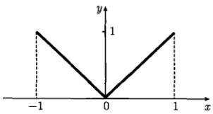

解 设展开式为

$$  f(x)=\sum_{l=0}^{\infty}C_{l}P_{l}(x)   \tag*{(14.4.43)}$$

图 14.6 函数  $ f(x)=|x|(-1<x<1) $ 其中，展开系数为
 

$$  C_{l}=\frac{2l+1}{2}\int_{-1}^{1}P_{l}(x)f(x)dx=\frac{2l+1}{2}\int_{-1}^{1}P_{l}(x)\left|x\right|dx   \tag*{(14.4.44a)}$$

因  $ f(x)=|x| $ 在  $ (-1,1) $ 内是偶函数，而  $ P_{2n+1}(x) $ 是奇函数，故  $ C_{2n+1}=0(n=0,1,2,\cdots) $。下面来计算  $ C_{2n}(n=0,1,2,\cdots) $。首先

$$  C_{0}=\frac{1}{2}\int_{-1}^{1}P_{0}(x)f(x)\mathrm{d}x=\frac{1}{2}\int_{-1}^{1}f(x)\mathrm{d}x=\int_{0}^{1}x\mathrm{d}x=\frac{1}{2}   \tag*{(14.4.44b)}$$

另外利用 14.3.4 节递推公式 (1)，即

$$  x P_{2n}(x)=\frac{2n+1}{4n+1}P_{2n+1}(x)+\frac{2n}{4n+1}P_{2n-1}(x)   \tag*{(14.4.45)}$$

以及式(14.4.27)，我们有

 $$ \begin{aligned}C_{2n}&=\frac{4n+1}{2}\int_{-1}^{1}P_{2n}(x)f(x)\mathrm{d}x=(4n+1)\int_{0}^{1}x P_{2n}(x)\mathrm{d}x\\&=(4n+1)\int_{0}^{1}\left[\frac{2n+1}{4n+1}P_{2n+1}(x)+\frac{2n}{4n+1}P_{2n-1}(x)\right]\mathrm{d}x\\&=(2n+1)\int_{0}^{1}P_{2n+1}(x)\mathrm{d}x+2n\int_{0}^{1}P_{2n-1}(x)\mathrm{d}x\\&=(-1)^{n}\frac{(2n)!(2n+1)}{2^{2n+1}n!(n+1)!}+(-1)^{n-1}\frac{2n(2n-2)!}{2^{2n-1}n!(n-1)!}\\&=(-1)^{n+1}\left(\frac{4n+1}{n+1}\right)\frac{n(2n-2)!}{2^{2n}\left(n!\right)^{2}}\quad(n=1,2,3\cdots)\\ \end{aligned} $$ 

从而式 $  (14.4.43)  $变为

$$  |x|=\frac{1}{2}+\sum_{n=1}^{\infty}(-1)^{n+1}\left(\frac{4n+1}{n+1}\right)\frac{n(2n-2)!}{2^{2n}\left(n!\right)^{2}}P_{2n}(x)\quad(-1<x<1)   \tag*{(14.4.46)}$$

这就是函数  $ |x| $ 的勒让德多项式级数。

<!-- page: 489 -->

#### 例 10 将符号函数 (图 14.7)

$$  f(x)=\left\{\begin{array}{ll}-1&(-1<x<0)\\ 1&(0<x<1)\end{array}\right.   \tag*{(14.4.47)}$$

在区间 $ (-1,1) $内展开成勒让德多项式的级数。

#### 解 设展开式为

 $$ f(x)=\sum_{l=0}^{\infty}C_{l}P_{l}(x) $$ 

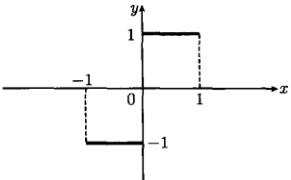

图 14.7 如式 (14.4.47) 所示的符号函数
 

其中

$$  C_{l}=\frac{2l+1}{2}\int_{-1}^{1}P_{l}(x)f(x)\mathrm{d}x=-\frac{2l+1}{2}\int_{-1}^{0}P_{l}(x)\mathrm{d}x+\frac{2l+1}{2}\int_{0}^{1}P_{l}(x)\mathrm{d}x   \tag*{(14.4.49)}$$

当 l 为偶数时， $ P_{l}(x) $ 是偶函数，式 (14.4.49) 给出  $ C_{l}=0 $；当 l 为奇数时， $ P_{l}(x) $ 是奇函数，式 (14.4.49) 给出

$$  C_{l}=(2l+1)\int_{0}^{1}P_{l}(x)\mathrm{d}x   \tag*{(14.4.50)}$$

即

$$  C_{2n-1}=\left(4n-1\right)\int_{0}^{1}P_{2n-1}(x)\mathrm{d}x\quad(n=1,2,3,\cdots)   \tag*{(14.4.51)}$$

于是

$$  C_{1}=3\int_{0}^{1}P_{1}(x)\mathrm{d}x=3\int_{0}^{1}x\mathrm{d}x=\frac{3}{2}   \tag*{(14.4.52a)}$$

$$  C_{3}=7\int_{0}^{1}P_{3}(x)\mathrm{d}x=\frac{7}{2}\int_{0}^{1}(5x^{3}-3x)\mathrm{d}x=-\frac{7}{8}   \tag*{(14.4.52b)}$$

$$  C_{5}=11\int_{0}^{1}P_{5}(x)\mathrm{d}x=\frac{11}{8}\int_{0}^{1}(63x^{5}-70x^{3}+15x)\mathrm{d}x=\frac{11}{16}   \tag*{(14.4.52c)}$$

所以

$$  f(x)=\frac{3}{2}P_{1}(x)-\frac{7}{8}P_{3}(x)+\frac{11}{16}P_{5}(x)\mathrm{d}x+\cdots\quad(-1<x<0,0<x<1)   \tag*{(14.4.53)}$$

这就是符号函数（14.4.47）的勒让德多项式级数，它在原函数的间断点 x=0 收敛于零  $ (P_{2n-1}(0)=0) $，符合狄利克雷定理： $ [f(x-0)+f(x+0)]/2=0 $。

例 11 将单位阶跃函数 (图 14.8)

$$  f(x)=\left\{\begin{array}{cc}-1&(-1<x<0)\\1&(0<x<1)\end{array}\right.   \tag*{(14.4.54)}$$

<!-- page: 490 -->

在区间 $ (-1,1) $内展开成勒让德多项式级数。

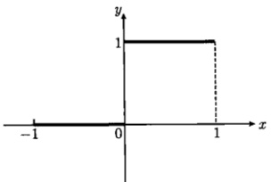

解 设展开式为

$$  f(x)=\sum_{l=0}^{\infty}C_{l}P_{l}(x)   \tag*{(14.4.55)}$$

图 14.8 如式 (14.4.54) 所示的单位阶跃函数
 

其中

$$  \begin{aligned}C_{l}&=\frac{2l+1}{2}\int_{-1}^{1}P_{l}(x)f(x)\mathrm{d}x\\&=\frac{2l+1}{2}\int_{0}^{1}P_{l}(x)\mathrm{d}x\end{aligned}   \tag*{(14.4.56)}$$

利用勒让德方程

$$  \frac{\mathrm{d}}{\mathrm{d}x}\left[(1-x^{2})\frac{\mathrm{d}P_{l}(x)}{\mathrm{d}x}\right]=-l(l+1)P_{l}(x)   \tag*{(14.4.57)}$$

作出式（14.4.56）中的积分

 $$ \begin{aligned}\int_{0}^{1}P_{l}(x)\mathrm{d}x&=-\frac{1}{l(l+1)}\int_{0}^{1}\mathrm{d}\left[(1-x^{2})\frac{\mathrm{d}P_{l}(x)}{\mathrm{d}x}\right]\\&=-\frac{1}{l(l+1)}\left[(1-x^{2})\frac{\mathrm{d}P_{l}(x)}{\mathrm{d}x}\right]_{0}^{1}\\&=\frac{1}{l(l+1)}P_{l}^{\prime}(0)\end{aligned} $$ 

系数式（14.4.56）变为

$$  C_{l}=\frac{1}{2}\frac{(2l+1)}{l(l+1)}P_{l}^{\prime}(0)\quad(l=1,2,3,\cdots)   \tag*{(14.4.58)}$$

利用 14.3.5 节例 3 的结果

$$  P_{2n}^{\prime}(0)=0   \tag*{(14.4.59a)}$$

$$  P_{2n+1}^{\prime}(0)=(-1)^{n}\frac{(2n+2)!}{2^{2n+1}n!(n+1)!}=(2n+1)P_{2n}(0)   \tag*{(14.4.59b)}$$

得到

$$  C_{2n}=0   \tag*{(14.4.60a)}$$

$$  C_{2n+1}=\frac{1}{2}\frac{(4n+3)}{(2n+1)(2n+2)}P_{2n+1}^{\prime}(0)=(-1)^{n}\left(\frac{4n+3}{n+1}\right)\frac{(2n)!}{2^{2n+2}\left(n!\right)^{2}}   \tag*{(14.4.60b)}$$

对于 l=0 情况，需要另行计算，给出

$$  C_{0}=\frac{1}{2}\int_{0}^{1}P_{0}(x)\mathrm{d}x=\frac{1}{2}   \tag*{(14.4.61)}$$

<!-- page: 491 -->

将式（14.4.60）和式（14.4.61）代入式（14.4.55），得到

$$  f(x)=\frac{1}{2}+\sum_{n=0}^{\infty}(-1)^{n}\left(\frac{4n+3}{n+1}\right)\frac{(2n)!}{2^{2n+2}\left(n!\right)^{2}}P_{2n+1}(x)   \tag*{(14.4.62)}$$

这就是单位阶跃函数(14.4.54)的勒让德多项式级数，它在原函数的间断点x=0收敛于1/2[因为 $ P_{2n+1}(0)=0 $]。这符合狄利克雷定理： $ [f(x-0)+f(x+0)]/2=1/2 $。

为了检验级数（14.4.62）的收敛性，我们进一步讨论式（14.4.55）的部分和

$$  S_{m}(x)=\sum_{l=0}^{m}C_{l}P_{l}(x)   \tag*{(14.4.63)}$$

为此首先利用式（14.4.56）计算出前几个系数

$$  C_{0}=\frac{1}{2}\int_{0}^{1}P_{0}(x)\mathrm{d}x=\frac{1}{2}\int_{0}^{1}\mathrm{d}x=\frac{1}{2}   \tag*{(14.4.64a)}$$

$$  C_{1}=\frac{3}{2}\int_{0}^{1}P_{1}(x)\mathrm{d}x=\frac{3}{2}\int_{0}^{1}x\mathrm{d}x=\frac{3}{4}   \tag*{(14.4.64b)}$$

$$  C_{2}=\frac{5}{2}\int_{0}^{1}P_{2}(x)\mathrm{d}x=\frac{5}{2}\int_{0}^{1}\frac{3x^{2}-1}{2}\mathrm{d}x=0   \tag*{(14.4.64c)}$$

$$  C_{3}=\frac{7}{2}\int_{0}^{1}P_{3}(x)\mathrm{d}x=\frac{7}{2}\int_{0}^{1}\frac{5x^{3}-3x}{2}\mathrm{d}x=-\frac{7}{16}   \tag*{(14.4.64d)}$$

类似地

$$  C_{4}=0,\quad C_{5}=\frac{11}{32},\quad C_{6}=0,\quad C_{7}=-\frac{75}{256}   \tag*{(14.4.64e)}$$

利用这些系数和前几阶勒让德多项式的表达式，写出式（14.4.63）的部分和

$$  S_{0}(x)=\frac{1}{2},\quad S_{1}(x)=\frac{1}{2}+\frac{3}{4}x,\quad S_{2}(x)=S_{1}(x)   \tag*{(14.4.65a)}$$

$$  S_{3}(x)=\frac{-35x^{3}+45x+16}{32},\quad S_{4}(x)=S_{3}(x)   \tag*{(14.4.65b)}$$

$$  S_{5}(x)=\frac{693x^{5}-1050x^{3}+525x+128}{256},\quad S_{6}(x)=S_{5}(x)   \tag*{(14.4.65c)}$$

$$  S_{7}(x)=\frac{-32175x^{7}+63063x^{5}-40425x^{3}+11025x+2048}{4095}   \tag*{(14.4.65d)}$$

图 14.9 显示了如式 (14.4.65) 所示的部分和及单位阶跃函数  $ f $。可以看出，当求和项数增加时，曲线更加接近函数  $ f $。注意所有部分和的曲线在原函数的间断点  $ x = 0 $ 的值均为 1/2，这符合狄利克雷定理： $ [f(x - 0) + f(x + 0)] / 2 = 1/2 $。

<!-- page: 492 -->

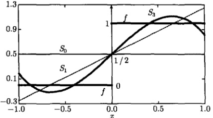

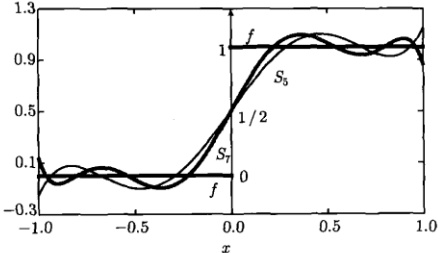

图 14.9 单位阶跃函数 f 和它的勒让德多项式级数的部分和  $ S_{m}(x) $
 

### 14.5 勒让德多项式应用举例

本节通过几个例题讨论勒让德多项式在求解定解问题中的应用。

例 1 有一个球心在原点，半径为 1 的球，球内无电荷，球面上的电位分布为已知函数  $ \cos^{2}\theta $，求球内的电位分布。

解 由于球内无电荷，电位满足拉普拉斯方程，它在球坐标系中表示为

$$  \frac{1}{r^{2}}\frac{\partial}{\partial r}\left(r^{2}\frac{\partial u}{\partial r}\right)+\frac{1}{r^{2}\sin\theta}\frac{\partial}{\partial\theta}\left(\sin\theta\frac{\partial u}{\partial\theta}\right)+\frac{1}{r^{2}\sin^{2}\theta}\frac{\partial^{2}u}{\partial\phi^{2}}=0   \tag*{(14.5.1)}$$

由于球面上的电位分布为  $ \cos^{2}\theta $，问题具有轴对称性（与变量  $ \phi $ 无关），故电位分布可以写为  $ u(r,\theta) $，它构成定解问题

$$  \left\{\begin{aligned}&\frac{1}{r^{2}}\frac{\partial}{\partial r}\left(r^{2}\frac{\partial u}{\partial r}\right)+\frac{1}{r^{2}\sin\theta}\frac{\partial}{\partial\theta}\left(\sin\theta\frac{\partial u}{\partial\theta}\right)=0&(0<r<1,0\leqslant\theta\leqslant\pi)\\ &u(1,\theta)=\cos^{2}\theta&(0\leqslant\theta\leqslant\pi)\end{aligned}\right.   \tag*{(14.5.2a)}$$

设方程（14.5.2a）的变量分离的形式解为

$$  u(r,\theta)=R(r)\theta(\theta)   \tag*{(14.5.3)}$$

<!-- page: 493 -->

代入式(14.5.2a)，得到[式(14.2.33)]

$$  \frac{1}{R}\frac{\partial}{\mathrm{d}r}\left(r^{2}\frac{\mathrm{d}R}{\mathrm{d}r}\right)=l(l+1)   \tag*{(14.5.4a)}$$

$$  \frac{1}{\theta\sin\theta}\frac{\mathrm{d}}{\mathrm{d}\theta}\left(\sin\theta\frac{\mathrm{d}\theta}{\mathrm{d}\theta}\right)=-l(l+1)   \tag*{(14.5.4b)}$$

其中，l 是分离常数。式 (14.5.4a) 为欧拉方程，它的通解为

$$  R(r)=A_{l}r^{l}+B_{l}\frac{1}{r^{l+1}}   \tag*{(14.5.5)}$$

其中， $ A_{l} $ 和  $ B_{l} $ 是任意常数。电位在原点 r=0 要满足自然边界条件  $ \left.u\right|_{r=0}= $ 有限值，这要求  $ B_{l}=0 $，故式(14.5.5)变为

$$  R(r)=A_{l}r^{l}   \tag*{(14.5.6)}$$

方程 (14.5.4b) 为勒让德方程，它的多项式解为  $ \Theta(\theta)=P_l(\cos\theta)(l=0,1,2,3,\cdots) $。故式 (14.5.2a) 的一般解为

$$  u(r,\theta)=\sum_{l=0}^{\infty}A_{l}r^{l}P_{l}(\cos\theta)   \tag*{(14.5.7)}$$

利用边界条件(14.5.2b)，由式(14.5.7)得到

$$  \sum_{l=0}^{\infty}A_{l}P_{l}(\cos\theta)=\cos^{2}\theta   \tag*{(14.5.8)}$$

令  $ x = \cos\theta $，则

$$  \sum_{l=0}^{\infty}A_{l}P_{l}(x)=x^{2}   \tag*{(14.5.9)}$$

函数  $ x^{2} $ 在区间  $ [-1,1] $ 内可以展开成勒让德多项式的级数 [式 (14.4.40)]

$$  x^{2}=\frac{1}{3}P_{0}(x)+\frac{2}{3}P_{2}(x)   \tag*{（14.5.10）}$$

故式(14.5.7)给出

 $$ \begin{aligned}u(r,\theta)&=\frac{1}{3}P_{0}(\cos\theta)+\frac{2}{3}r^{2}P_{2}(\cos\theta)\\&=\frac{1}{3}+\frac{1}{3}r^{2}(3\cos^{2}\theta-1)\end{aligned} $$ 

这就是所求定解问题的解。

例2 一个半径为R的导体球壳，在 $ \theta=\theta_{0} $处被绝缘材料分隔成两部分，两部分球面上的电位分别为U和0，如图14.10所示。已知球壳内无电荷，求球内的电位分布，并讨论 $ \theta_{0}=\pi/2 $的情况。

<!-- page: 494 -->

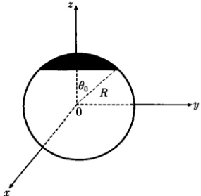

图 14.10 一个半径为 R 的导体球壳在  $ \theta = \theta_{0} $ 处被绝缘材料分隔成两部分
 

解

方法 1 由于球壳内无电荷，电位满足拉普拉斯方程，而系统具有轴对称性，故电位  $ u(r, \theta) $ 在球坐标系中构成定解问题

$$  \left\{\begin{aligned}&\frac{1}{r^{2}}\frac{\partial}{\partial r}\bigg(r^{2}\frac{\partial u}{\partial r}\bigg)+\frac{1}{r^{2}\sin\theta}\frac{\partial}{\partial\theta}\left(\sin\theta\frac{\partial u}{\partial\theta}\right)=0&(0<r<R,0\leqslant\theta\leqslant\pi)\\ &u(R,\theta)=f(\theta)=\left\{\begin{array}{ll}U&(0\leqslant\theta\leqslant\theta_{0})\\ 0&(\theta_{0}<\theta\leqslant\pi)\end{array}\right.\end{aligned}\right.   \tag*{(14.5.11a)}$$

与上例的情况相同，考虑到电位在原点 r = 0 要满足自然边界条件： $ u|_{r=0} = $ 有限值，故定解问题 (14.5.11) 的一般解为

$$  u(r,\theta)=\sum_{l=0}^{\infty}A_{l}r^{l}P_{l}(\cos\theta)   \tag*{(14.5.12)}$$

利用边界条件(14.5.11b)，由式(14.5.12)得到

$$  f(\theta)=\sum_{l=0}^{\infty}A_{l}R^{l}P_{l}(\cos\theta)   \tag*{(14.5.13)}$$

令  $ x = \cos\theta $，则式 (14.5.13) 变为

$$  f(x)=\sum_{l=0}^{\infty}A_{l}R^{l}P_{l}(x)   \tag*{(14.5.14)}$$

则

 $$ \begin{aligned}A_{l}R^{l}&=\frac{2l+1}{2}\int_{-1}^{1}f(x)P_{l}(x)\mathrm{d}x\\&=\frac{2l+1}{2}\int_{\theta=\pi}^{0}f(\theta)P_{l}(\cos\theta)\mathrm{d}(\cos\theta)\end{aligned} $$

<!-- page: 495 -->

$$  \begin{aligned}&=-\frac{2l+1}{2}\int_{\theta=0}^{\pi}f(\theta)P_{l}(\cos\theta)\mathrm{d}(\cos\theta)\\&=-\frac{(2l+1)U}{2}\int_{\theta=0}^{\theta_{0}}P_{l}(\cos\theta)\mathrm{d}(\cos\theta)\end{aligned}   \tag*{(14.5.15)}$$

利用 14.3.4 节递推公式 (4)，即

$$  P_{l}(x)=\frac{1}{2l+1}\left[P_{l+1}^{\prime}(x)-P_{l-1}^{\prime}(x)\right]   \tag*{(14.5.16)}$$

得到展开系数

 $$ \begin{aligned}A_{l}&=-\frac{U}{2R^{l}}\left[P_{l+1}(\cos\theta)-P_{l-1}(\cos\theta)\right]_{0}^{\theta_{0}}\\&=\frac{U}{2R^{l}}\left[P_{l-1}(\cos\theta_{0})-P_{l+1}(\cos\theta_{0})\right]\quad(l=1,2,3,\cdots)\end{aligned} $$ 

对于 l=0 情况

$$  \begin{aligned}A_{0}&=-\frac{U}{2}\int P_{0}(x)\mathrm{d}x=-\frac{U}{2}\int\mathrm{d}x=-\frac{U}{2}x\\&=-\frac{U}{2}\cos\theta|_{0}^{\theta_{0}}=\frac{U}{2}(1-\cos\theta_{0})\end{aligned}   \tag*{(14.5.17)}$$

将  $ A_{l}(l=0,1,2,\cdots) $ 代入式 (14.5.12)，得到

$$  u(r,\theta)=\frac{U}{2}(1-\cos\theta_{0})+\frac{U}{2}\sum_{l=1}^{\infty}\left(\frac{r}{R}\right)^{l}[P_{l-1}(\cos\theta_{0})-P_{l+1}(\cos\theta_{0})]P_{l}(\cos\theta)   \tag*{(14.5.18)}$$

这就是所求定解问题的解。

对于  $ \theta_{0}=\pi/2 $ 的情况 (球壳一半电位为 U，而另一半为零)，式 (14.5.18) 约为

$$  u(r,\theta)=\frac{U}{2}+\frac{U}{2}\sum_{l=1}^{\infty}\left(\frac{r}{R}\right)^{l}[P_{l-1}(0)-P_{l+1}(0)]P_{l}(\cos\theta)   \tag*{(14.5.19)}$$

当 l = 2n 时，根据  $ P_{2n+1}(0) = 0 $ [式 (14.3.70)]，式 (14.5.19) 求和中各项为零；当 l = 2n + 1 时，利用式 (14.3.76) 得到

$$  P_{l-1}(0)-P_{l+1}(0)=P_{2n}(0)-P_{2n+2}(0)=(-1)^{n}\left(\frac{4n+3}{n+1}\right)\frac{(2n)!}{2^{2n+1}\left(n!\right)^{2}}   \tag*{(14.5.20)}$$

故式(14.5.19)变为

$$  u(r,\theta)=\frac{U}{2}+U\sum_{n=0}^{\infty}(-1)^{n}\left(\frac{r}{R}\right)^{2n+1}\left(\frac{4n+3}{n+1}\right)\frac{(2n)!}{2^{2n+2}\left(n!\right)^{2}}P_{2n+1}(\cos\theta)   \tag*{(14.5.21)}$$

这与单位阶跃函数的勒让德多项式级数（14.4.62）是类似的。

<!-- page: 496 -->

方法2 利用勒让德方程

$$  \frac{\mathrm{d}}{\mathrm{d}x}\left[(1-x^{2})\frac{\mathrm{d}P_{l}(x)}{\mathrm{d}x}\right]=-l(l+1)P_{l}(x)   \tag*{(14.5.22)}$$

将式（14.5.15）写成

 $$ \begin{aligned}A_{l}&=-\frac{(2l+1)U}{2R^{l}}\int_{\theta=0}^{\theta_{0}}P_{l}(\cos\theta)\mathrm{d}(\cos\theta)=-\frac{(2l+1)U}{2R^{l}}\int P_{l}(x)\mathrm{d}x\\&=\frac{(2l+1)U}{2R^{l}l(l+1)}\int\mathrm{d}\left[(1-x^{2})\frac{\mathrm{d}P_{l}(x)}{\mathrm{d}x}\right]=\frac{(2l+1)U}{2R^{l}l(l+1)}\left[(1-\cos^{2}\theta)P_{l}^{\prime}(\cos\theta)\right]_{\theta=0}^{\theta_{0}}\\&=\frac{(2l+1)U}{2R^{l}l(l+1)}(1-\cos^{2}\theta_{0})P_{l}^{\prime}(\cos\theta_{0})=\frac{(2l+1)U}{2R^{l}l(l+1)}\sin^{2}\theta_{0}P_{l}^{\prime}(\cos\theta_{0})\\ \end{aligned} $$ 

再注意到式(14.5.17)，结果为

$$  u(r,\theta)=\frac{U}{2}(1-\dot{\cos\theta}_{0})+\frac{U}{2}\sin^{2}\theta_{0}\sum_{l=1}^{\infty}\left(\frac{r}{R}\right)^{l}\frac{(2l+1)}{l(l+1)}P_{l}^{\prime}(\cos\theta_{0})P_{l}(\cos\theta)   \tag*{(14.5.23)}$$

当  $ \theta_{0}=\pi/2 $ 时，式 (14.5.23) 约化为

$$  u(r,\theta)=\frac{U}{2}+\frac{U}{2}\sum_{l=1}^{\infty}\left(\frac{r}{R}\right)^{l}\frac{(2l+1)}{l(l+1)}P_{l}^{\prime}(0)P_{l}(\cos\theta)   \tag*{(14.5.24)}$$

将式(14.4.59)，即

$$  P_{2n}^{\prime}(0)=0   \tag*{(14.5.25a)}$$

$$  P_{2n+1}^{\prime}(0)=(-1)^{n}\frac{(2n+2)!}{2^{2n+1}n!(n+1)!}   \tag*{(14.5.25b)}$$

代入式(14.5.24)化简后即得

$$  u(r,\theta)=\frac{U}{2}+\frac{U}{2}\sum_{n=0}^{\infty}(-1)^{n}\left(\frac{r}{R}\right)^{2n+1}\left(\frac{4n+3}{n+1}\right)\frac{(2n)!}{2^{2n+1}\left(n!\right)^{2}}P_{2n+1}(\cos\theta)   \tag*{(14.5.26)}$$

这就是式(14.5.21)。

