# 15-第15章 量子力学薛定谔方程

[返回全书目录](../../README.md)

> PDF 页码：497–545

<!-- page: 497 -->

### 第15章 量子力学薛定谔方程

勒让德多项式不但在稳定场问题中有广泛的应用，在量子力学中更是扮演着重要的角色。本章通过求解量子力学薛定谔方程，进一步讨论勒让德多项式在量子力学中的应用。另外我们的求解还将涉及连带勒让德函数（球谐函数）、广义拉盖尔多项式，以及厄米多项式等。这些内容不但涉及多种特殊函数的应用，而且为理解微观系统的量子力学性质提供了数学基础。

### 15.1 薛定谔方程的一般解

在量子力学中，微观粒子在势场  $ V(r) $ 中的运动由薛定谔方程

$$  \mathrm{i}\hbar\frac{\partial\varPsi}{\partial t}=-\frac{\hbar^{2}}{2\mu}\nabla^{2}\varPsi+V(\boldsymbol{r})\varPsi   \tag*{(15.1.1)}$$

描述。其中， $ \mu $ 是粒子的质量； $ \hbar = \frac{n}{2\pi} $ (h 是普朗克常数)； $ \Psi(r,t) $ 是粒子的波函数；而  $ |\Psi(r,t)|^{2} $ 是任意 t 时刻在空间 r 处的单位体积内发现粒子的几率。设粒子初始时刻的波函数为

$$  \varPsi(\pmb{r},0)=f(\pmb{r})   \tag*{(15.1.2)}$$

现在我们来求任意 t 时刻的波函数  $ \Psi(r,t) $。

设  $ \Psi(r,t) $ 具有变量分离的形式解

$$  \varPsi(\boldsymbol{r},t)=\psi(\boldsymbol{r})T(t)   \tag*{(15.1.3)}$$

其中， $ \psi(r) $ 和  $ T(t) $ 为波函数的空间与时间部分。将式 (15.1.3) 代入式 (15.1.1)，并利用粒子的哈密顿算符

$$  \hat{H}=-\frac{\hbar^{2}}{2\mu}\nabla^{2}+V(\pmb{r})   \tag*{(15.1.4)}$$

得到

$$  \mathrm{i}\hbar\psi(\pmb{r})T^{\prime}(t)=\hat{H}[\psi(\pmb{r})T(t)]   \tag*{(15.1.5)}$$

由于算符  $ \hat{H} $ 不含时间 t，两边同除以  $ \psi(\boldsymbol{r})T(t) $ 得到

$$  \mathrm{i}\hbar\frac{1}{T(t)}\frac{\mathrm{d}T}{\mathrm{d}t}=\frac{\hat{H}\psi(\boldsymbol{r})}{\psi(\boldsymbol{r})}   \tag*{(15.1.6)}$$

<!-- page: 498 -->

式(15.1.6)两边对时间 t 求导数，注意到右边不含 t， $ \frac{\mathrm{d}}{\mathrm{d}t}\left[\frac{\hat{H}\psi(\boldsymbol{r})}{\psi(\boldsymbol{r})}\right]=0 $，故

$$  \mathrm{i}\hbar\frac{1}{T(t)}\frac{\mathrm{d}T}{\mathrm{d}t}=\frac{\hat{H}\psi(\mathbf{r})}{\psi(\mathbf{r})}=E   \tag*{(15.1.7)}$$

其中，E 是分离常数。由此得到空间函数  $ \psi(r) $ 和时间函数  $ T(t) $ 的方程

$$  \hat{H}\psi(\boldsymbol{r})=E\psi(\boldsymbol{r})   \tag*{(15.1.8a)}$$

$$  \frac{\mathrm{d}T}{T}=-\frac{\mathrm{i}}{\hbar}E\mathrm{d}t   \tag*{(15.1.8b)}$$

式(15.1.8a)表示， $ \psi(r) $是哈密顿算符 $ \hat{H} $的本征函数。而方程(15.1.8b)的解为

$$  T(t)=c\exp\left(-\frac{\mathrm{i}}{\hbar}E t\right)   \tag*{（15.1.9）}$$

其中，c 是任意常数。这样我们得到  $ \Psi(r,t) $ 的形式解

$$  c\psi(\pmb{r})\exp\left(-\frac{\mathrm{i}}{\hbar}E t\right)   \tag*{(15.1.10)}$$

在量子力学系统中，哈密顿算符的本征方程常伴有相应的量子化条件，故本征值是一系列分立的值，而相应的本征函数是一系列分立的函数，即

$$  \begin{array}{r l}{\hat{H}\psi_{n}(\boldsymbol{r})=E_{n}\psi_{n}(\boldsymbol{r})}&{{}(n=1,~2,~3,\cdots)}\end{array}   \tag*{(15.1.11)}$$

这样本征解(15.1.10)可以写为

$$  \varPsi_{n}(\boldsymbol{r},t)=c_{n}\psi_{n}(\boldsymbol{r})\exp\left(-\frac{\mathrm{i}}{\hbar}E_{n}t\right)   \tag*{（15.1.12）}$$

薛定谔方程（15.1.1）是线性的，服从叠加原理。为了满足初始条件式（15.1.2），将本征解（15.1.2）叠加起来构成一般解

$$  \Psi(\boldsymbol{r},t)=\sum_{n}c_{n}\psi_{n}(\boldsymbol{r})\exp\left(-\frac{i}{\hbar}E_{n}t\right)   \tag*{(15.1.13)}$$

在 t=0 时，由式(15.1.2)和式(15.1.13)得到

$$  f(\boldsymbol{r})=\sum_{n}c_{n}\psi_{n}(\boldsymbol{r})   \tag*{(15.1.14)}$$

下面我们求展开系数  $ C_{n} $。由于哈密顿算符（15.1.4）是厄米算符，它的本征函数满足正交性（9.3.7），即

$$  \int\psi_{m}^{*}(\boldsymbol{r})\psi_{n}(\boldsymbol{r})\mathrm{d}\boldsymbol{r}=\delta_{m n}   \tag*{(15.1.15)}$$

以  $ \psi_{m}^{*}(r) $ 乘以式 (15.1.14) 两端，并对 r 变化的整个区域积分，利用式 (15.1.15) 得到

<!-- page: 499 -->

$$ \begin{aligned}\int\psi_{m}^{*}(\boldsymbol{r})f(\boldsymbol{r})\mathrm{d}\boldsymbol{r}&=\int\psi_{m}^{*}(\boldsymbol{r})\left[\sum_{n}c_{n}\psi_{n}(\boldsymbol{r})\right]\mathrm{d}\boldsymbol{r}\\&=\sum_{n}c_{n}\int\psi_{m}^{*}(\boldsymbol{r})\psi_{n}(\boldsymbol{r})\mathrm{d}\boldsymbol{r}\\&=\sum_{n}c_{n}\delta_{mn}=c_{m}\end{aligned} $$ 

即

$$  c_{n}=\int\psi_{n}^{*}(\boldsymbol{r})f(\boldsymbol{r})\mathrm{d}\boldsymbol{r}   \tag*{(15.1.16)}$$

这就是式(15.1.14)中的展开系数，它由哈密顿算符的本征函数  $ \psi_{n}(r) $ 与初始波函数  $ f(r) $ 确定。一旦知道  $ c_{n} $，就可以写出薛定谔方程的一般解(15.1.13)。可见，薛定谔方程(15.1.1)的求解归结为哈密顿算符的本征值问题(15.1.11)。

例 1 设一个粒子的哈密顿算符的本征万程为  $ H\psi_{n}(x)=E_{n}\psi_{n}(x) $，该粒子的初始波函数为  $ f(x)=c_{1}\psi_{1}(x)+c_{2}\psi_{2}(x) $，求任意 t 时刻的波函数以及粒子的概率密度。

解 任意 t 时刻粒子的波函数为

$$  \bar{\psi}(x,t)=\sum_{n}c_{n}\psi_{n}(x)\exp\left(-\frac{\mathrm{i}}{\hbar}E_{n}t\right)   \tag*{(15.1.17)}$$

其中的展开系数为

$$  c_{n}=\int\psi_{n}^{*}(x)f(x)\mathrm{d}x   \tag*{(15.1.18)}$$

将初始波函数  $ f(x)=c_{1}\psi_{1}(x)+c_{2}\psi_{2}(x) $ 代入式(15.1.18)，利用式(15.1.15)得到

$$  c_{n}=\int\psi_{n}^{*}(x)\left[c_{1}\psi_{1}(x)+c_{2}\psi_{2}(x)\right]\mathrm{d}x=\left\{\begin{array}{ll}c_{1}&(n=1)\\ c_{2}&(n=2)\\ 0&(n\neq1,2)\end{array}\right.   \tag*{(15.1.19)}$$

这样式（15.1.17）变为

$$  \Psi(x,t)=c_{1}\psi_{1}(x)\exp\left(-\frac{\mathrm{i}}{\hbar}E_{1}t\right)+c_{2}\psi_{2}(x)\exp\left(-\frac{\mathrm{i}}{\hbar}E_{2}t\right)   \tag*{(15.1.20)}$$

粒子的概率密度为

 $$ \begin{aligned}\left|\varPsi(x,t)\right|^{2}=&\left[c_{1}^{*}\psi_{1}^{*}(x)\exp\left(\frac{\mathrm{i}}{\hbar}E_{1}t\right)+c_{2}^{*}\psi_{2}^{*}(x)\exp\left(\frac{\mathrm{i}}{\hbar}E_{2}t\right)\right]\\&\cdot\left[c_{1}\psi_{1}(x)\exp\left(-\frac{\mathrm{i}}{\hbar}E_{1}t\right)+c_{2}\psi_{2}(x)\exp\left(-\frac{\mathrm{i}}{\hbar}E_{2}t\right)\right]\end{aligned} $$

<!-- page: 500 -->

$$  \begin{aligned}=&\left|c_{1}\right|^{2}\left|\psi_{1}(x)\right|^{2}+\left|c_{2}\right|^{2}\left|\psi_{2}(x)\right|^{2}\\&+c_{1}^{*}c_{2}\psi_{1}^{*}(x)\psi_{2}(x)\exp\left[-\frac{\mathrm{i}}{\hbar}(E_{2}-E_{1})t\right]\\&+c_{2}^{*}c_{1}\psi_{2}^{*}(x)\psi_{1}(x)\exp\left[\frac{\mathrm{i}}{\hbar}(E_{2}-E_{1})t\right]\end{aligned}   \tag*{(15.1.21)}$$

设

$$  c_{1}^{*}c_{2}\psi_{1}^{*}(x)\psi_{2}(x)=|c_{1}c_{2}||\psi_{1}(x)\psi_{2}(x)|\mathrm{e}^{-\mathrm{i}\delta}   \tag*{(15.1.22)}$$

令

$$  \omega=\frac{E_{2}-E_{1}}{\hbar}   \tag*{(15.1.23)}$$

式(15.1.21)变为

$$  |\varPsi(x,t)|^{2}=|c_{1}|^{2}|\psi_{1}(x)|^{2}+|c_{2}|^{2}|\psi_{2}(x)|^{2}+2|c_{1}c_{2}||\psi_{1}(x)\psi_{2}(x)|\cos{(\omega t+\delta)}}   \tag*{(15.1.24)}$$

这表示粒子的概率密度以ω为频率作周期振荡。

### 15.2 角向解：球谐函数

#### 15.2.1 中心力场

在量子系统中，微观粒子所处的势场往往是中心力场，即势函数是球对称的（只是 r 的函数），可以写为  $ V(r) $。这时粒子的哈密顿算符为

$$  \hat{H}=-\frac{\hbar^{2}}{2\mu}\nabla^{2}+V(r)   \tag*{(15.2.1)}$$

现在我们求解  $ \hat{H} $ 的本征方程

$$  \hat{H}\psi(\boldsymbol{r})=E\psi(\boldsymbol{r})   \tag*{(15.2.2)}$$

其中，E 是能量本征值； $ \psi(r) $ 是相应的本征函数。由于势函数  $ V(r) $ 的球对称性，我们选择球坐标系，利用式 (1.2.49)，将方程 (15.2.2) 写为

$$  -\frac{\hbar^{2}}{2\mu}\left[\frac{1}{r^{2}}\frac{\partial}{\partial r}\left(r^{2}\frac{\partial\psi}{\partial r}\right)+\frac{1}{r^{2}\sin\theta}\frac{\partial}{\partial\theta}\left(\sin\theta\frac{\partial\psi}{\partial\theta}\right)+\frac{1}{r^{2}\sin^{2}\theta}\frac{\partial^{2}\psi}{\partial\phi^{2}}\right]+V(r)\psi=E\psi   \tag*{(15.2.3)}$$

设方程（15.2.3）具有变量分离的形式解

$$  \psi(\boldsymbol{r})=R(r)Y(\theta,\phi)   \tag*{(15.2.4)}$$

其中， $ R(r) $ 和  $ Y(\theta,\phi) $ 分别是径向函数和角向函数。将式 (15.2.4) 代入式 (15.2.3)，分离变量后得到

$$  -\frac{1}{Y}\left[\frac{1}{\sin\theta}\frac{\partial}{\partial\theta}\left(\sin\theta\frac{\partial Y}{\partial\theta}\right)+\frac{1}{\sin^{2}\theta}\frac{\partial^{2}Y}{\partial\phi^{2}}\right]=l(l+1)   \tag*{(15.2.5)}$$

<!-- page: 501 -->

$$  \frac{1}{R}\frac{\mathrm{d}}{\mathrm{d}r}\left(r^{2}\frac{\mathrm{d}R}{\mathrm{d}r}\right)+\left\{\frac{2\mu r^{2}}{\hbar^{2}}\left[E-V(r)\right]\right\}=l(l+1)   \tag*{(15.2.6)}$$

其中，$l$ 是分离常数（一般为实数）。方程式（15.2.5）和式（15.2.6）分别称为角向方程和径向方程。我们看到，能量本征值 $E$ 与势函数 $V(r)$ 都含在径向方程中。角向方程的解 $Y(\theta,\phi)$ 称为球谐函数。显然，球坐标系中的薛定谔方程，不管中心势 $V(r)$ 的形式如何，其角向解都是球谐函数 $Y(\theta,\phi)$。

现在我们求解角向方程(15.2.5)。首先我们看出，球谐函数  $ Y(\theta,\phi) $ 是算符

$$  {\cal L}^{2}=-\left[\frac{1}{\sin\theta}\frac{\partial}{\partial\theta}\left(\sin\theta\frac{\partial}{\partial\theta}\right)+\frac{1}{\sin^{2}\theta}\frac{\partial^{2}}{\partial\phi^{2}}\right]   \tag*{(15.2.7)}$$

的本征函数，即

$$  L^{2}Y(\theta,\phi)=l(l+1)Y(\theta,\phi)   \tag*{(15.2.8)}$$

本征值为  $ l(l+1) $。设角向方程式（15.2.5）具有变量分离的形式解

$$  Y(\theta,\phi)=\Theta(\theta)\Phi(\phi)   \tag*{(15.2.9)}$$

代入式(15.2.5)，得到

$$  \frac{\Phi}{\sin\theta}\frac{\partial}{\partial\theta}\left(\sin\theta\frac{\partial\Theta}{\partial\theta}\right)+\frac{\Theta}{\sin^{2}\theta}\frac{\partial^{2}\Phi}{\partial\phi^{2}}+l(l+1)\Theta\Phi=0   \tag*{(15.2.10)}$$

式(15.2.10)两边同乘以 $ \frac{\sin^{2}\theta}{\omega\phi} $，分离变量后给出

$$  \frac{\mathrm{d}^{2}\varPhi}{\mathrm{d}\phi^{2}}+\lambda\varPhi=0   \tag*{(15.2.11)}$$

$$  \sin\theta\frac{\mathrm{d}}{\mathrm{d}\theta}\left(\sin\theta\frac{\mathrm{d}\theta}{\mathrm{d}\theta}\right)+\left[l(l+1)\sin^{2}\theta-\lambda\right]\theta=0   \tag*{(15.2.12)}$$

其中， $ \lambda $ 是分离常数。方程式（15.2.11）和式（15.2.12）分别称为经度角方程和纬度角方程。经度角方程显然伴有周期性边界条件

$$  \Phi(\phi+2\pi)=\Phi(\phi)   \tag*{(15.2.13)}$$

考虑由式 (15.2.11) 和式 (15.2.13) 组成的定解问题，当  $ \lambda < 0 $ 时，方程式 (15.2.11) 的解为  $ \pm \exp(\sqrt{-\lambda}\phi) $，它显然不具有周期性。当  $ \lambda \geq 0 $，方程式 (15.2.11) 的通解为

$$  \Phi(\phi)=c\mathrm{e}^{\mathrm{i}\sqrt{\lambda}\phi}+d\mathrm{e}^{-\mathrm{i}\sqrt{\lambda}\phi}   \tag*{(15.2.14)}$$

由式（15.2.13）和式（15.2.14）得到

$$  c\mathrm{e}^{\mathrm{i}2\pi\sqrt{\lambda}}+d\mathrm{e}^{-\mathrm{i}2\pi\sqrt{\lambda}}=c+d   \tag*{(15.2.15)}$$

它成立的条件为

$$  \sqrt{\lambda}=m\quad(m=0,1,2,\cdots)   \tag*{(15.2.16)}$$

这样经度角方程式（15.2.11）的满足周期性边界条件式（15.2.13）的解为

$$  \Phi(\phi)=c\mathrm{e}^{\mathrm{i}m\phi}+d\mathrm{e}^{-\mathrm{i}m\phi}\quad(m=0,1,2\cdots)   \tag*{(15.2.17)}$$

<!-- page: 502 -->

#### 15.2.2 连带勒让德函数

现在考查纬度角方程（15.2.12），当其中的 $ \lambda $由式（15.2.16）确定后，它变为

$$  \frac{1}{\sin\theta}\frac{\mathrm{d}}{\mathrm{d}\theta}\left(\sin\theta\frac{\mathrm{d}\theta}{\mathrm{d}\theta}\right)+\left(l(l+1)-\frac{m^{2}}{\sin^{2}\theta}\right)\theta=0\quad(m=0,1,2,\cdots)   \tag*{(15.2.18)}$$

这是连带勒让德方程式（13.1.28b）。至此方程式（15.2.18）中的 l 为任意实数。下面我们利用勒让德多项式的方程

$$  (1-x^{2})\frac{\mathrm{d}^{2}P_{l}(x)}{\mathrm{d}x^{2}}-2x\frac{\mathrm{d}P_{l}(x)}{\mathrm{d}x}+l(l+1)P_{l}(x)=0\quad(l=0,1,2,\cdots)   \tag*{(15.2.19)}$$

来求解方程式(15.2.18)。为此令 $ x=\cos\theta $， $ y(x)=\Theta(\theta) $，方程式(15.2.18)变为

$$  (1-x^{2})\frac{\mathrm{d}^{2}y}{\mathrm{d}x^{2}}-2x\frac{\mathrm{d}y}{\mathrm{d}x}+\left[l(l+1)-\frac{m^{2}}{1-x^{2}}\right]y=0\quad(l=0,1,2,\cdots)   \tag*{(15.2.20)}$$

对方程式（15.2.19）两边求导数，得到

$$  (1-x^{2})P_{l}^{(1+2)}(x)-2(1+1)x P_{l}^{(1+1)}(x)+[l(l+1)-1\cdot(1+1)]P_{l}^{\prime}(x)=0   \tag*{(15.2.21)}$$

对式（15.2.21）求导数，即对式（15.2.19）求二阶导数

$$  (1-x^{2})P_{l}^{(2+2)}(x)-2(2+1)x P_{l}^{(2+1)}(x)+\left[l(l+1)-2\cdot(2+1)\right]P_{l}^{\prime\prime}(x)=0   \tag*{(15.2.22)}$$

对式(15.2.19)求 m 阶导数，得到

$$  (1-x^{2})P_{l}^{(m+2)}(x)-2(m+1)x P_{l}^{(m+1)}(x)+\left[l(l+1)-m(m+1)\right]P_{l}^{(m)}(x)=0   \tag*{(15.2.23)}$$

因为方程式（15.2.19）中的  $ x^{2}\frac{\mathrm{d}^{2}P_{l}(x)}{\mathrm{d}x^{2}} $， $ x\frac{\mathrm{d}P_{l}(x)}{\mathrm{d}x} $， $ P_{l}(x) $ 都是 l 阶多项式，所以方程的求导数不能超过 l 次（否则方程变成 0=0）。因此，m 的取值为

$$  m=0,1,2,\cdots,l   \tag*{(15.2.24)}$$

方程式（15.2.23）可以写成

$$  (1-x^{2})\frac{\mathrm{d}^{2}P_{l}^{(m)}(x)}{\mathrm{d}x^{2}}-2(m+1)x\frac{\mathrm{d}P_{l}^{(m)}(x)}{\mathrm{d}x}+\left[l(l+1)-m(m+1)\right]P_{l}^{(m)}(x)=0   \tag*{(15.2.25)}$$

这是 l 阶勒让德多项式的 m 阶导数  $ P_{l}^{(m)} $ 所满足的二阶常微分方程。为解方程式 (15.2.25)，引入变换

$$  w(x)=(-1)^{m}(1-x^{2})^{m/2}P_{l}^{(m)}(x)   \tag*{(15.2.26)}$$

将式 (15.2.26) 代入式 (15.2.25)，得到  $ w(x) $ 的方程

$$  (1-x^{2})\frac{\mathrm{d}^{2}w}{\mathrm{d}x^{2}}-2x\frac{\mathrm{d}w}{\mathrm{d}x}+\left[l(l+1)-\frac{m^{2}}{1-x^{2}}\right]w=0   \tag*{(15.2.27)}$$

<!-- page: 503 -->

这正是连带勒让德方程（15.2.20）。这表示式（15.2.27）的解是式（15.2.26）所示的 $ w(x) $，因此式（15.2.20）的解 $ y(x) $由式（15.2.26）表示，记为

$$  P_{l}^{m}(x)=(-1)^{m}(1-x^{2})^{m/2}P_{l}^{(m)}(x)   \tag*{(15.2.28)}$$

 $ P_{l}^{m}(x) $ 称为 m 阶连带勒让德函数。显然，当 m > l 时， $ P_{l}^{m}(x) = 0 $。这样我们得到了纬度角方程 (15.2.18) 的解

$$  \begin{array}{r l}{\Theta(\theta)=P_{l}^{m}(\cos\theta)}&{{}(m=0,~1,~2,\cdots,l)}\end{array}   \tag*{(15.2.29)}$$

现在我们根据如式（15.2.24）所示的 m 的取值范围，进一步考查纬度角式(15.2.17)的表达式，它现在写为

$$  \Phi(\phi)=c\mathrm{e}^{\mathrm{i}m\phi}+d\mathrm{e}^{-\mathrm{i}m\phi}\quad(m=0,1,2,\cdots,l)   \tag*{(15.2.30)}$$

式(15.2.30)表示， $ \Phi(\phi) $有 $ 2l+1 $个独立解

$$  1 个常数解 :c+d, 相应于 m=0;   \tag*{(15.2.31a)}$$

$$  2l 个函数解 :\mathrm{ce^{im\phi}} 和 d\mathrm{e^{-im\phi}}, 相应于 m=1,2,\cdots,l   \tag*{(15.2.31b)}$$

这样式（15.2.30）有等价的表示式

$$  \Phi(\phi)=A\mathrm{e}^{\mathrm{i}m\phi}\quad(m=0,\pm1,\pm2,\cdots,\pm l)   \tag*{(15.2.32)}$$

它的独立解也是 2l+1 个。

现在， $ m $ 的取值范围已经扩大，我们必须将式 (15.2.28) 中  $ m $ 的取值范围也作相应的扩大。实施这一扩大的依据是连带勒让德方程 (15.2.20) 中出现的  $ m^2 $ 使得  $ m $ 换成  $ -m $ 时，方程保持不变。我们利用罗德里格斯公式 (14.3.1) 将式 (15.2.28) 写成

 $$ P_{l}^{m}(x)=\frac{(-1)^{m}}{2^{l}l!}(1-x^{2})^{m/2}\frac{\mathrm{d}^{l+m}}{\mathrm{d}x^{l+m}}(x^{2}-1)^{l} $$ 

将 m 换成 -m，给出

 $$ P_{l}^{-m}(x)=\frac{(-1)^{m}}{2^{l}l!}(1-x^{2})^{-m/2}\frac{\mathrm{d}^{l-m}}{\mathrm{d}x^{l-m}}(x^{2}-1)^{l} $$ 

 $ P_{l}^{m}(x) $ 与  $ P_{l}^{-m}(x) $ 只相差一个常数，即

 $$  常数 =\frac{P_{l}^{m}(x)}{P_{l}^{-m}(x)}=\frac{(1-x^{2})^{m}\frac{\mathrm{d}^{l+m}}{\mathrm{d}x^{l+m}}(x^{2}-1)^{l}}{\frac{\mathrm{d}^{l-m}}{\mathrm{d}x^{l-m}}(x^{2}-1)^{l}} $$ 

其中，右边的分子与分母是幂次相同的多项式，它们的同幂项之比就等于左边的常数。我们计算分子与分母最高幂项之比，利用14.3.1节的方法，得到

<!-- page: 504 -->

$$ \frac{(-1)^{m}x^{2m}\frac{(2l)!}{2^{l}l!(l-m)!}x^{l-m}}{\frac{(2l)!}{2^{l}l!(l+m)!}x^{l+m}}=(-1)^{m}\frac{(l+m)!}{(l-m)!} $$ 

故

$$  P_{l}^{m}(x)=(-1)^{m}\frac{(l+m)!}{(l-m)!}P_{l}^{-m}(x)   \tag*{(15.2.33)}$$

这样一来，对于连带勒让德函数  $ P_{l}^{m}(x) $，当 m=0 时， $ P_{l}^{m}(x)=P_{l}^{-m}(x)=P_{l}(x) $；当 m=1,2,3, $ \cdots $,l 时，(15.2.28) 给出 l 个值；当 m=-1,-2,-3, $ \cdots $,l 时，式 (15.2.33) 给出另外 l 个值，因此，当 m=0, $ \pm1 $, $ \pm2 $, $ \cdots $, $ \pm l $ 时，连带勒让德函数  $ P_{l}^{m}(x) $ 有  $ 2l+1 $ 个值。

下面列出 l=0,1,2 情况下的连带勒让德函数

 $$ \begin{aligned}l=0:\quad&m=0:\quad P_{0}^{0}(x)=1\\ l=1:\quad&m=0:\quad P_{1}^{0}(x)=x\\&m=1:\quad P_{1}^{1}(x)=-\sqrt{1-x^{2}},\quad m=-1:\quad P_{1}^{-1}(x)=\frac{1}{2}\sqrt{1-x^{2}}\end{aligned} $$ 

 $$ l=2:\quad m=0:\quad P_{2}^{0}(x)=\frac{1}{2}(3x^{2}-1) $$ 

 $$ m=1:\quad P_{2}^{1}(x)=-3x\sqrt{1-x^{2}},\quad m=-1:\quad P_{2}^{-1}(x)=\frac{1}{2}x\sqrt{1-x^{2}} $$ 

 $$ m=2:\quad P_{2}^{2}(x)=3(1-x^{2}),\quad m=-2:\quad P_{2}^{-2}(x)=\frac{1}{8}(1-x^{2}) $$ 

可以看出，如果 m 是正、负奇数，则  $ P_{l}^{m}(x) $ 不是多项式，因为因子  $ \sqrt{1-x^{2}} $ 的存在，所以我们称  $ P_{l}^{m}(x) $ 为连带勒让德函数。另外，如果  $ (l+m) $ 是偶数，则  $ P_{l}^{m}(x) $ 是偶函数；反之，如果  $ (l+m) $ 是奇数，则  $ P_{l}^{m}(x) $ 是奇函数。

m 取值扩大之后，纬度方程解 (15.2.29) 变为

$$  \Theta(\theta)=P_{l}^{m}(\cos\theta)(m=0,\pm1,\pm2,\cdots,\pm l)   \tag*{(15.2.34)}$$

#### 15.2.3 连带勒让德函数的性质

连带勒让德函数与勒让德多项式类似，也具有在区间  $ [-1,1] $ 上的正交性，其证明方法与勒让德多项式情况也完全相同。事实上，在连带勒让德函数  $ P_{l}^{m}(x) $ 的意义上，方程 (15.2.20) 能写成施图姆-刘维尔形式

$$  \frac{\mathrm{d}}{\mathrm{d}x}\left[(1-x^{2})\frac{\mathrm{d}P_{l}^{m}}{\mathrm{d}x}\right]+\left[l(l+1)-\frac{m^{2}}{1-x^{2}}\right]P_{l}^{m}(x)=0   \tag*{(15.2.35)}$$

这里  $ k(x)=1-x^{2} $，故  $ k(1)=0 $， $ k(-1)=0 $，这导致式 (9.1.7) 中的 Q=0。因此，连带勒让德函数满足正交性

$$  \int_{-1}^{1}P_{l}^{m}(x)P_{k}^{m}(x)\mathrm{d}x=0\quad(l\neq k)   \tag*{(15.2.36)}$$

<!-- page: 505 -->

现在我们证明

$$  \int_{-1}^{1}\left[P_{l}^{m}(x)\right]^{2}\mathrm{d}x=\frac{2}{2l+1}\frac{(l+m)!}{(l-m)!}\quad(m\leqslant l)   \tag*{(15.2.37)}$$

证明 对式(15.2.28)两边关于x求导数，得到

$$  \frac{\mathrm{d}P_{l}^{m}}{\mathrm{d}x}=(-1)^{m}\left[-x m(1-x^{2})^{\frac{m}{2}-1}P_{l}^{(m)}(x)+(1-x^{2})^{\frac{m}{2}}P_{l}^{(m+1)}(x)\right]   \tag*{(15.2.38)}$$

由式（15.2.28）直接得到

$$  P_{l}^{m+1}(x)=(-1)^{m+1}(1-x^{2})^{\frac{m+1}{2}}P_{l}^{(m+1)}(x)   \tag*{(15.2.39)}$$

由式（15.2.38）和式（15.2.39）消去  $ P_{l}^{(m+1)}(x) $ 得到

$$  P_{l}^{m+1}(x)=-\left(1-x^{2}\right)^{1/2}\frac{\mathrm{d}P_{l}^{m}}{\mathrm{d}x}-m x\left(1-x^{2}\right)^{-1/2}P_{l}^{m}(x)   \tag*{(15.2.40)}$$

在式 $  (15.2.40)  $两边取平方并积分，得到

$$  \begin{aligned}\int_{-1}^{1}\left[P_{l}^{m+1}(x)\right]^{2}\mathrm{d}x&=\int_{-1}^{1}\left(1-x^{2}\right)\left[\frac{\mathrm{d}P_{l}^{m}}{\mathrm{d}x}\right]^{2}\mathrm{d}x+2m\int_{-1}^{1}x P_{l}^{m}(x)\frac{\mathrm{d}P_{l}^{m}}{\mathrm{d}x}\mathrm{d}x\\&\quad+m^{2}\int_{-1}^{1}\frac{x^{2}}{1-x^{2}}\left[P_{l}^{m}(x)\right]^{2}\mathrm{d}x\end{aligned}   \tag*{(15.2.41a)}$$

为了化简式 $  (15.2.41a)  $右边的积分，首先注意到

 $$ \begin{aligned}\int_{-1}^{1}P_{l}^{m}(x)\frac{\mathrm{d}}{\mathrm{d}x}\left[\left(1-x^{2}\right)\frac{\mathrm{d}P_{l}^{m}}{\mathrm{d}x}\right]\mathrm{d}x&=\int_{-1}^{1}P_{l}^{m}(x)\mathrm{d}\left[\left(1-x^{2}\right)\frac{\mathrm{d}P_{l}^{m}}{\mathrm{d}x}\right]\\&=\left[P_{l}^{m}(x)\left(1-x^{2}\right)\frac{\mathrm{d}P_{l}^{m}}{\mathrm{d}x}\right]_{-1}^{1}\\&\quad-\int_{-1}^{1}\left(1-x^{2}\right)\frac{\mathrm{d}P_{l}^{m}}{\mathrm{d}x}\mathrm{d}\left[P_{l}^{m}(x)\right]\\&=-\int_{-1}^{1}\left(1-x^{2}\right)\left[\frac{\mathrm{d}P_{l}^{m}}{\mathrm{d}x}\right]^{2}\mathrm{d}x\end{aligned} $$ 

再利用  $ \mathrm{d}\left\{x\left[P_{l}^{m}(x)\right]^{2}\right\}=\left[P_{l}^{m}(x)\right]^{2}\mathrm{d}x+2xP_{l}^{m}(x)\frac{\mathrm{d}P_{l}^{m}}{\mathrm{d}x}\mathrm{d}x $ ，得到

 $$ \begin{aligned}2m\int_{-1}^{1}xP_{l}^{m}(x)\frac{\mathrm{d}P_{l}^{m}}{\mathrm{d}x}\mathrm{d}x&=\underbrace{\left[mx\left[P_{l}^{m}(x)\right]^{2}\right]_{-1}^{1}}_{=0}-m\int_{-1}^{1}\left[P_{l}^{m}(x)\right]^{2}\mathrm{d}x\\&=-m\int_{-1}^{1}\left[P_{l}^{m}(x)\right]^{2}\mathrm{d}x\end{aligned} $$ 

另外

<!-- page: 506 -->

$$ m^{2}\int_{-1}^{1}\frac{x^{2}}{1-x^{2}}\left[P_{l}^{m}(x)\right]^{2}\mathrm{d}x=-m^{2}\int_{-1}^{1}\left[P_{l}^{m}(x)\right]^{2}\mathrm{d}x+\int_{-1}^{1}\frac{m^{2}}{1-x^{2}}\left[P_{l}^{m}(x)\right]^{2}\mathrm{d}x $$ 

这样式(15.2.41a)变成

 $$ \begin{align*}\int_{-1}^{1}\left[P_{l}^{m+1}(x)\right]^{2}\mathrm{d}x=&-\int_{-1}^{1}P_{l}^{m}(x)\frac{\mathrm{d}}{\mathrm{d}x}\left[\left(1-x^{2}\right)\frac{\mathrm{d}P_{l}^{m}}{\mathrm{d}x}\right]\mathrm{d}x-m\int_{-1}^{1}\left[P_{l}^{m}(x)\right]^{2}\mathrm{d}x\\&-m^{2}\int_{-1}^{1}\left[P_{l}^{m}(x)\right]^{2}\mathrm{d}x+\int_{-1}^{1}\frac{m^{2}}{1-x^{2}}\left[P_{l}^{m}(x)\right]^{2}\mathrm{d}x\end{align*} $$ 

进而利用式(15.2.35)，我们有

 $$ \begin{align*}\int_{-1}^{1}\left[P_{l}^{m+1}(x)\right]^{2}\mathrm{d}x=&\int_{-1}^{1}\left[l(l+1)-\frac{m^{2}}{1-x^{2}}\right]\left[P_{l}^{m}(x)\right]^{2}\mathrm{d}x-m\int_{-1}^{1}\left[P_{l}^{m}(x)\right]^{2}\mathrm{d}x\\&-m^{2}\int_{-1}^{1}\left[P_{l}^{m}(x)\right]^{2}\mathrm{d}x+\int_{-1}^{1}\frac{m^{2}}{1-x^{2}}\left[P_{l}^{m}(x)\right]^{2}\mathrm{d}x\\=&\left[l(l+1)-m(m+1)\right]\int_{-1}^{1}\left[P_{l}^{m}(x)\right]^{2}\mathrm{d}x\end{align*} $$ 

即

$$  \int_{-1}^{1}\left[P_{l}^{m+1}(x)\right]^{2}\mathrm{d}x=(l-m)(l+m+1)\int_{-1}^{1}\left[P_{l}^{m}(x)\right]^{2}\mathrm{d}x   \tag*{(15.2.41b)}$$

这是一个积分递推公式，有

$$  \int_{-1}^{1}\left[P_{l}^{m}(x)\right]^{2}\mathrm{d}x=\left(l-m+1\right)\cdot\left(l+m\right)\int_{-1}^{1}\left[P_{l}^{m-1}(x)\right]^{2}\mathrm{d}x   \tag*{(15.2.42a)}$$

$$  \int_{-1}^{1}\left[P_{l}^{m-1}(x)\right]^{2}\mathrm{d}x=\left(l-m+2\right)\cdot\left(l+m-1\right)\int_{-1}^{1}\left[P_{l}^{m-2}(x)\right]^{2}\mathrm{d}x   \tag*{(15.2.42b)}$$

$$  \int_{-1}^{1}\left[P_{l}^{1}(x)\right]^{2}\mathrm{d}x=l(l+1)\int_{-1}^{1}\left[P_{l}(x)\right]^{2}\mathrm{d}x   \tag*{(15.2.42c)}$$

这样

$$  \begin{aligned}&\int_{-1}^{1}\left[P_{l}^{m}(x)\right]^{2}\mathrm{d}x\\=&(l-m+1)(l-m+2)\cdots l\cdot(l+m)(l+m-1)\cdots(l+1)\int_{1}^{1}\left[P_{l}(x)\right]^{2}\mathrm{d}x\end{aligned}   \tag*{(15.2.43)}$$

其中

 $$ \begin{aligned}&(l-m+1)(l-m+2)\cdots l\cdot(l+m)(l+m-1)\cdots(l+1)\\=&\frac{(l-m)!(l-m+1)(l-m+2)\cdots l}{(l-m)!}\frac{(l+m)(l+m-1)\cdots(l+1)!}{l!}\\=&\frac{l!}{(l-m)!}\frac{(l+m)!}{l!}=\frac{(l+m)!}{(l-m)!}\end{aligned} $$

<!-- page: 507 -->

再利用式(14.4.7)，则式(15.2.43)变成式(15.2.37)。

关于连带勒让德函数的完备性，可以证明：对于一个非负的整数 m，假定函数  $ f(x) $ 在区间  $ [-1,1] $ 上是分段光滑的，则  $ f(x) $ 可以展开成连带勒让德函数的级数

$$  f(x)=\sum_{l=m}^{\infty}C_{l}P_{l}^{m}(x)   \tag*{(15.2.44)}$$

其中，连带勒让德系数为

$$  C_{l}=\frac{2l+1}{2}\frac{(l+m)!}{(l-m)!}\int_{-1}^{1}f(x)P_{l}^{m}(x)\mathrm{d}x\quad(l=m,m+1,m+2,\cdots)   \tag*{(15.2.45)}$$

在开区间  $ (-1,1) $ 的连续点 x，级数  $ (15.2.44) $ 收敛于  $ f(x) $，而在其他点收敛于  $ [f(x-0)+f(x+0)]/2 $。容易验证，当 m=0 时，式  $ (15.2.44) $ 和式  $ (15.2.45) $ 约为勒让德多项式的结果，即式  $ (14.4.19) $ 和式  $ (14.4.20) $。

#### 15.2.4 球谐函数

我们回到角向解的讨论，利用式(15.2.32)和式(15.2.34)，角向解现在可以表示(注出下标l、m)为

$$  Y_{l m}(\theta,\phi)=A_{l m}P_{l}^{m}(\operatorname{c o s}\theta)\mathrm{e}^{\mathrm{i}m\phi}\left\{\begin{array}{l}l=0,1,2,\cdots\\ m=0,\pm1,\pm2,\cdots,\pm l\end{array}\right.   \tag*{(15.2.46)}$$

这就是球谐函数的表示式。式（15.2.7）显示，球谐函数是算符

$$  L^{2}=-\left[\frac{1}{\sin\theta}\frac{\partial}{\partial\theta}\left(\sin\theta\frac{\partial}{\partial\theta}\right)+\frac{1}{\sin^{2}\theta}\frac{\partial^{2}}{\partial\phi^{2}}\right]   \tag*{(15.2.47)}$$

的本征函数，即

$$  L^{2}Y_{l m}(\theta,\phi)=l(l+1)Y_{l m}(\theta,\phi)   \tag*{(15.2.48)}$$

本征值为  $ l(l+1) $。显然， $ Y_{lm}(\theta,\phi) $ 还是算符

$$  L_{z}=-i\frac{\partial}{\partial\phi}   \tag*{(15.2.49)}$$

的本征函数。事实上

$$  \begin{align*}L_{z}Y_{l m}(\theta,\phi)&=-\mathrm{i}\frac{\partial}{\partial\phi}\left[A_{l m}P^{m}_{l}(\cos\theta)\mathrm{e}^{\mathrm{i}m\phi}\right]\\&=m\left[A_{l m}P^{m}_{l}(\cos\theta)\mathrm{e}^{\mathrm{i}m\phi}\right]=m Y_{l m}(\theta,\phi)\end{align*}   \tag*{(15.2.50)}$$

本征值正是m。

我们的结论是：球谐函数  $ Y_{lm}(\theta,\phi) $ 是算符  $ L^{2} $ 和  $ L_{z} $ 共同的本征函数，相应的本征值分别为  $ l(l+1) $ 和 m。其中，l 的取值为 l=0,1,2,\cdots；而对于一个 l 值，m 的取值为 m=0, $ \pm1 $, $ \pm2 $, $ \pm3 $, $ \cdots $, $ \pm l $。

<!-- page: 508 -->

在讨论球谐函数的性质之前，我们首先考查  $ L^{2} $ 和  $ L_{z} $ 的物理意义。我们知道，量子力学的角动量算符表示为

$$  \hat{\boldsymbol{L}}=\hat{\boldsymbol{r}}\times\hat{\boldsymbol{p}}=-\mathrm{i}\hbar\hat{\boldsymbol{r}}\times\nabla   \tag*{(15.2.51)}$$

其中， $ \hat{p} = -\mathrm{i}\hbar\nabla $ 是动量算符。利用矢量叉乘的定义

$$  \begin{array}{c|c}{\dot{\boldsymbol{r}}\times\dot{\boldsymbol{p}}=}&{\begin{array}{c|c}{\boldsymbol{i}}&{\boldsymbol{j}}&{\boldsymbol{k}}\\ \hline{\boldsymbol{x}}&{\boldsymbol{y}}&{\boldsymbol{z}}\\ \hline{\hat{p}_{x}}&{\hat{p}_{y}}&{\hat{p}_{z}}\\ \end{array}}\\ \end{array}   \tag*{(15.2.52)}$$

可以写出角动量分量  $ \hat{L}_{x} $， $ \hat{L}_{y} $， $ \hat{L}_{z} $ 在直角坐标系中的表达式

$$  \hat{L}_{x}=y\hat{p}_{z}-z\hat{p}_{y}=-\mathrm{i}\hbar\left(y\frac{\partial}{\partial z}-z\frac{\partial}{\partial y}\right)   \tag*{(15.2.53a)}$$

$$  \hat{L}_{y}=z\hat{p}_{x}-x\hat{p}_{z}=-\mathrm{i}\hbar\left(z\frac{\partial}{\partial x}-x\frac{\partial}{\partial z}\right)   \tag*{(15.2.53b)}$$

$$  \hat{L}_{z}=x\hat{p}_{y}-y\hat{p}_{x}=-\mathrm{i}\hbar\left(x\frac{\partial}{\partial y}-y\frac{\partial}{\partial x}\right)   \tag*{(15.2.53c)}$$

角动量平方算符是

$$  \hat{L}^{2}=-\hbar^{2}\left[\left(y\frac{\partial}{\partial z}-z\frac{\partial}{\partial y}\right)^{2}+\left(z\frac{\partial}{\partial x}-x\frac{\partial}{\partial z}\right)^{2}+\left(x\frac{\partial}{\partial y}-y\frac{\partial}{\partial x}\right)^{2}\right]   \tag*{(15.2.54)}$$

利用直角坐标与球坐标的关系

$$  x=r\cos\phi\sin\theta,\quad y=r\sin\phi\sin\theta,\quad z=r\cos\theta   \tag*{(15.2.55a)}$$

$$  r^{2}=x^{2}+y^{2}+z^{2}   \tag*{(15.2.55b)}$$

我们用球坐标变量表示  $ \hat{L}_{x} $,  $ \hat{L}_{y} $,  $ \hat{L}_{z} $ 和  $ \hat{L}^{2} $

 $$ \hat{L}_{x}=\mathrm{i}\hbar\left(\sin\phi\frac{\partial}{\partial\theta}+\cot\theta\cos\phi\frac{\partial}{\partial\phi}\right) $$ 

$$  \hat{L}_{y}=\mathrm{i}\hbar\left(-\cos\phi\frac{\partial}{\partial\theta}+\cot\theta\sin\phi\frac{\partial}{\partial\phi}\right)   \tag*{(15.2.56b)}$$

$$  \hat{L}_{z}=-\mathrm{i}\hbar\frac{\partial}{\partial\phi}   \tag*{(15.2.56c)}$$

$$  \hat{L}^{2}=-\hbar^{2}\left[\frac{1}{\sin\theta}\frac{\partial}{\partial\theta}\left(\sin\theta\frac{\partial}{\partial\theta}\right)+\frac{1}{\sin^{2}\theta}\frac{\partial^{2}}{\partial\phi^{2}}\right]   \tag*{(15.2.57)}$$

式(15.2.56c)、式(15.2.57)与式(15.2.49)、式(15.2.47)相比，有

$$  \hat{L}_{z}=\hbar L_{z},\quad\hat{L}^{2}=\hbar^{2}L^{2}   \tag*{(15.2.58)}$$

可见  $ L^{2} $ 就是无量纲的角动量平方算符，而  $ L_{z} $ 则是无量纲的角动量 z 分量算符。在角动量平方算符  $ \hat{L}^{2} $ 和角动量 z 分量算符  $ \hat{L}_{z} $ 的意义上，我们有本征方程

<!-- page: 509 -->

$$  \hat{L}^{2}Y_{l m}(\theta,\phi)=l(l+1)\hbar^{2}Y_{l m}(\theta,\phi)   \tag*{(15.2.59a)}$$

$$  \hat{L}_{z}Y_{l m}(\theta,\phi)=m\hbar Y_{l m}(\theta,\phi)   \tag*{(15.2.59b)}$$

所以球谐函数  $ Y_{lm}(\theta,\phi) $ 是算符  $ \hat{L}^{2} $ 和  $ \hat{L}_{z} $ 共同的本征函数，本征值分别为  $ l(l+1)\hbar^{2} $ 和  $ m\hbar $。因为 l 表征角动量的大小，所以称为角量子数，m 称为磁量子数。l 的取值为  $ l=0,1,2,\cdots $ 而对于一个 l 的值，m 的取值为  $ m=0,\pm1,\pm2,\cdots,\pm l $，可以取  $ (2l+1) $ 个值。因而对应于  $ \hat{L}^{2} $ 的一个本征值  $ l(l+1)\hbar^{2} $，因 m 的不同有  $ (2l+1) $ 个不同的本征函数  $ Y_{lm}(\theta,\phi) $。我们把这种一个本征值对应一个以上本征函数的情况称为“简并”，把所对应的本征函数的数目称为简并度， $ \hat{L}^{2} $ 的本征值是  $ (2l+1) $ 度简并的。按照光谱学的记法，l=0 的态称为 s 态，l=1,2,3,\cdots 的态依次称为 p,d,f,\cdots 态。处于这些态的粒子，依次简称为 p,d,f,\cdots 粒子。

作为一个独立的问题，我们可以讨论角动量 z 分量算符  $ \hat{L}_{z} $ 的本征值问题。设  $ \hat{L}_{z} $ 的本征方程为

$$  -\mathrm{i}\hbar\frac{\partial}{\partial\phi}\Phi=l_{z}\Phi   \tag*{(15.2.60)}$$

其中， $ l_{z} $ 是本征值； $ \Phi $ 是相应的本征波函数。方程 (15.2.60) 的通解为

$$  \varPhi=c\exp\left(\frac{\mathrm{i}}{\hbar}l_{z}\phi\right)   \tag*{(15.2.61)}$$

其中，c 是任意常数。由波函数的归一化条件

$$  \int_{0}^{2\pi}\left|\varPhi\right|^{2}\mathrm{d}\phi=2\pi\left|c\right|^{2}=1   \tag*{(15.2.62)}$$

以及周期性边界条件： $ \Phi(0)=\Phi(2\pi) $，得到本征值

$$  l_{z}=m\hbar(m=0,\pm1,\pm2,\cdots)   \tag*{(15.2.63)}$$

及归一化的本征函数

$$  \varPhi_{m}(\phi)=\frac{1}{\sqrt{2\pi}}\exp(\mathrm{i}m\phi)   \tag*{(15.2.64)}$$

它正是式(15.2.32)。在这个独立的问题中，不存在 l 对 m 的限制，因此 m 的取值为无限多个。

另外作为一个独立的问题，本征函数  $ \Phi_{m}(\phi) $ 具有正交归一性

$$  \int_{0}^{2\pi}\varPhi_{m}^{*}(\phi)\varPhi_{n}(\phi)\mathrm{d}\phi=\frac{1}{2\pi}\int_{0}^{2\pi}\mathrm{e}^{-\mathrm{i}m\phi}\mathrm{e}^{\mathrm{i}n\phi}\mathrm{d}\phi=\delta_{m n}   \tag*{(15.2.65)}$$

#### 15.2.5 球谐函数的性质

在解释了球谐函数的物理意义之后，我们现在讨论它的性质。首先考查球谐函数 (15.2.46) 的正交性。为此需要在整个角向  $ \Omega \in [0,4\pi] $ 范围内作积分

 $$ \int_{0}^{4\pi}Y_{l m}^{*}(\theta,\phi)Y_{l^{\prime}m^{\prime}}(\theta,\phi)\mathrm{d}\Omega=\int_{\theta=0}^{\pi}\int_{\phi=0}^{2\pi}Y_{l m}^{*}(\theta,\phi)Y_{l^{\prime}m^{\prime}}(\theta,\phi)\sin\theta\mathrm{d}\theta\mathrm{d}\phi $$

<!-- page: 510 -->

$$ \propto\int_{0}^{\pi}\int_{0}^{2\pi}P_{l}^{m}(\cos\theta)\mathrm{e}^{-\mathrm{i}m\phi}P_{l^{\prime}}^{m^{\prime}}(\cos\theta)\mathrm{e}^{\mathrm{i}m^{\prime}\phi}\sin\theta\mathrm{d}\theta\mathrm{d}\phi\equiv I $$ 

利用变换关系  $ x = \cos\theta $,  $ dx = -\sin\theta d\theta $, 以及函数  $ \mathrm{e}^{\mathrm{i}m\phi} $ 的正交性表达式 (15.2.65), 容易得到

 $$ \begin{aligned}I&=\int_{0}^{\pi}P_{l}^{m}(\cos\theta)P_{l^{\prime}}^{m^{\prime}}(\cos\theta)\sin\theta\mathrm{d}\theta\int_{0}^{2\pi}\mathrm{e}^{-\mathrm{i}m\phi}\mathrm{e}^{\mathrm{i}m^{\prime}\phi}\mathrm{d}\phi\\&=2\pi\left[\int_{-1}^{1}P_{l}^{m}(x)P_{l^{\prime}}^{m^{\prime}}(x)\mathrm{d}x\right]\left[\frac{1}{2\pi}\int_{0}^{2\pi}\mathrm{e}^{-\mathrm{i}m\phi}\mathrm{e}^{\mathrm{i}m^{\prime}\phi}\mathrm{d}\phi\right]\\&=2\pi\left[\int_{-1}^{1}P_{l}^{m}(x)P_{l^{\prime}}^{m^{\prime}}(x)\mathrm{d}x\right]\delta_{mm^{\prime}}\\ \end{aligned} $$ 

这表示，如果  $ m \neq m' $ 则 I = 0；如果  $ m = m' $，则由连带勒让德函数的正交性表达式 (15.2.36)，得到

$$  I=2\pi\int_{-1}^{1}P_{l}^{m}(x)P_{l^{\prime}}^{m}(x)\mathrm{d}x\propto\delta_{l l^{\prime}}   \tag*{(15.2.66)}$$

如果  $ l \neq l' $，仍有 I = 0。结论是，只有当  $ m = m' $ 且同时  $ l = l' $，才有  $ I \neq 0 $。

现在我们根据归一化条件

$$  \int_{\theta=0}^{\pi}\int_{\phi=0}^{2\pi}\left|Y_{l m}(\theta,\phi)\right|^{2}\sin\theta\mathrm{d}\theta\mathrm{d}\phi=1   \tag*{(15.2.67)}$$

来确定式（15.2.46）中的归一化常数  $ A_{lm} $。利用式（15.2.37）和式（15.2.65），式（15.2.67）左边变为

 $$ \begin{aligned}&A_{l m}^{2}\int_{\theta=0}^{\pi}\int_{\phi=0}^{2\pi}\left[P_{l}^{m}(\cos\theta)\right]^{2}\sin\theta\mathrm{d}\theta\mathrm{d}\phi\\=&A_{l m}^{2}\int_{-1}^{1}\left[P_{l}^{m}(x)\right]^{2}\mathrm{d}x\int_{0}^{2\pi}\mathrm{d}\phi=\frac{4\pi}{2l+1}\frac{(l+m)!}{(l-m)!}\end{aligned} $$ 

故

$$  A_{lm}=\sqrt{\frac{2l+1}{4\pi}\frac{(l-m)!}{(l+m)!}}   \tag*{(15.2.68)}$$

这样一来，归一化的球谐函数为

$$  Y_{l.m}(\theta,\phi)=\sqrt{\frac{2l+1}{4\pi}\frac{(l-m)!}{(l+m)!}}P_{l}^{m}(\cos\theta)\mathrm{e}^{\mathrm{i}m\phi}\\\left\{\begin{array}{l}l=0,1,2,\cdots\\ .m=0,\pm1,\pm2,\cdots,\pm l\end{array}\right.   \tag*{(15.2.69)}$$

相对于第15.2.2节所列出的连带勒让德函数，这里列出相应的球谐函数如下

 $$ \begin{aligned}&l=0:\quad m=0:\quad Y_{0,0}(\theta,\phi)=\frac{1}{\sqrt{4\pi}}\\&l=1:\quad m=0:\quad Y_{1,0}(\theta,\phi)=\sqrt{\frac{3}{4\pi}}\cos\theta\\ \end{aligned} $$

<!-- page: 511 -->

$$ m=\pm1:\quad Y_{1,\pm1}(\theta,\phi)=\mp\sqrt{\frac{3}{8\pi}}\sin\theta\mathrm{e}^{\pm\mathrm{i}\phi} $$ 

 $$ l=2:\quad m=0:\quad Y_{2,0}(\theta,\phi)=\sqrt{\frac{5}{16\pi}}\left(3\cos^{2}\theta-1\right) $$ 

 $$ m=\pm1:\quad Y_{2,\pm1}(\theta,\phi)=\mp\sqrt{\frac{15}{8\pi}}\cos\theta\sin\theta\mathrm{e}^{\pm\mathrm{i}\phi} $$ 

 $$ m=\pm2:\quad Y_{2,\pm2}(\theta,\phi)=\sqrt{\frac{15}{32\pi}}\sin^{2}\theta\mathrm{e}^{\pm2\mathrm{i}\phi} $$ 

关于球谐函数的完备性，可以证明：如果函数  $ f(\theta, \phi) $ 定义在  $ 0 < \phi < 2\pi $， $ 0 < \theta < \pi $，假定它是  $ \phi $ 的周期函数（周期为  $ 2\pi $），这样  $ f(x) $ 能展开成球谐函数的级数

$$  f(\theta,\phi)=\sum_{l=0}^{\infty}\sum_{m=-l}^{l}C_{l m}Y_{l m}(\theta,\phi)   \tag*{(15.2.70)}$$

其中，球谐系数为

$$  C_{l m}=\int_{0}^{2\pi}\int_{0}^{\pi}Y_{l m}^{*}(\theta,\phi)f(\theta,\phi)\sin\theta\mathrm{d}\theta\mathrm{d}\phi   \tag*{(15.2.71)}$$

### 15.3 径向解：广义拉盖尔多项式

#### 15.3.1 库仑场中的束缚态

至此我们已经对于中心力场问题得到了如式 (15.2.1) 所示的哈密顿算符  $ \hat{H} $ 的本征函数  $ \psi(r) = R(r)Y(\theta,\phi) $ 的角向部分  $ Y(\theta,\phi) $，下面我们继续求解径向函数  $ R(r) $ 的方程，即方程 (15.2.6)。由于角向问题的求解中已经确定了 l 的取值范围，因此径向方程现在写为

$$  \frac{1}{R}\frac{\mathrm{d}}{\mathrm{d}r}\left(r^{2}\frac{\mathrm{d}R}{\mathrm{d}r}\right)+\left\{\frac{2\mu r^{2}}{\hbar^{2}}\left[E-V(r)\right]\right\}=l(l+1)\quad(l=0,1,2\cdots)   \tag*{（15.3.1）}$$

注意到，当 E > 0 时，对于 E 的任何值，径向方程 (15.3.1) 都有解  $ R(r) $，即体系的能量具有连续谱 (图 15.1)。这在物理上意味着电子不受核的约束而自由运动 (电离)。但是我们知道电子受原子核约束时，在核外做轨道运动。电子被束缚时的运动状态称为“束缚态”。在方程 (15.3.1) 中，束缚态相应于 E < 0，体系的能量呈现分立谱。在下面的讨论中，我们只考虑 E < 0 的情况。

引入函数代换

$$  R(r)=\frac{u(r)}{r}   \tag*{（15.3.2）}$$

方程（15.3.1）变为

$$  \frac{\mathrm{d}^{2}u}{\mathrm{d}r^{2}}+\left\{\frac{2\mu}{\hbar^{2}}\left[E-V(r)\right]-\frac{l\left(l+1\right)}{r^{2}}\right\}u=0   \tag*{(15.3.3)}$$

<!-- page: 512 -->

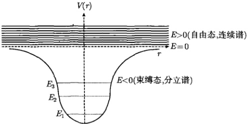

图 15.1 自由态与束缚态
 

为了求解方程 (15.3.3)，我们讨论最简单的中心力场，即库仑场。考虑一个电子在原子核所产生的电场中的运动，电子质量为  $ \mu $，其电荷为 -e，核的电荷为 Z； $ Z = 1 $ 时，这个体系就是氢原子； $ Z > 1 $ 则为类氢离子，如  $ \mathrm{He}^{+}(Z = 2) $， $ \mathrm{Li}^{++}(Z = 3) $。取核为坐标原点，则电子受核吸引的势能为

$$  V(r)=-\frac{Z e^{2}}{r}   \tag*{(15.3.4)}$$

将它代入式(15.3.3)得

$$  \frac{\mathrm{d}^{2}u}{\mathrm{d}r^{2}}+\left[\frac{2\mu}{\hbar^{2}}\left(E+\frac{Z e^{2}}{r}\right)-\frac{l\left(l+1\right)}{r^{2}}\right]u=0   \tag*{(15.3.5)}$$

引入参数

$$  \alpha=\sqrt{\frac{8\mu|E|}{\hbar^{2}}},\quad\beta=\frac{2\mu Z e^{2}}{\alpha\hbar^{2}}=\frac{Z e^{2}}{\hbar}\sqrt{\frac{\mu}{2|E|}}   \tag*{(15.3.6)}$$

及变量

$$  \rho=\alpha t   \tag*{(15.3.7)}$$

方程(15.3.5)变为

$$  \frac{\mathrm{d}^{2}u}{\mathrm{d}\rho^{2}}+\left[\frac{\beta}{\rho}-\frac{1}{4}-\frac{l(l+1)}{\rho^{2}}\right]u=0   \tag*{(15.3.8)}$$

为解方程 (15.3.8)，我们首先考查它在  $ \rho \to \infty $ 的渐近行为，这时式 (15.3.8) 变为

$$  \frac{\mathrm{d}^{2}u}{\mathrm{d}\rho^{2}}-\frac{1}{4}u=0   \tag*{(15.3.9)}$$

方程（15.3.9）的通解为

$$  u(\rho)=A\mathrm{e}^{-\rho/2}+B\mathrm{e}^{\rho/2}   \tag*{(15.3.10)}$$

这里 A 和 B 为任意常数。因为波函数的标准条件要求当  $ \rho \to \infty $ 时  $ u(\rho) $ 应为有限值，故 B = 0，渐近解为  $ Ae^{-\rho/2} $。

<!-- page: 513 -->

根据上面的讨论，我们写出 u 的形式解

$$  u(\rho)=f(\rho)\mathrm{e}^{-\rho/2}   \tag*{(15.3.11)}$$

其中， $ f(\rho) $ 是待求的函数。将式 (15.3.11) 代入式 (15.3.8)，得到  $ f(\rho) $ 的方程

$$  f^{\prime\prime}(\rho)-f^{\prime}(\rho)+\left[\frac{\beta}{\rho}-\frac{l(l+1)}{\rho^{2}}\right]f(\rho)=0   \tag*{(15.3.12)}$$

它的解不能在  $ \rho=0 $ 附近展开成幂级数，因为它是该方程的奇点。但式(15.3.12)可以展开成广义幂级数

$$  f(\rho)=\sum_{\nu=0}^{\infty}b_{\nu}\rho^{s+\nu}\quad(b_{0}\neq0)   \tag*{(15.3.13)}$$

为了保证波函数的有限性，即  $ r \to 0 $ 时， $ R(r) = u(r)/r $ 有限，我们考查

$$  \frac{u(r)}{r}=\frac{\alpha f(\rho)\mathrm{e}^{-\rho/2}}{\rho}=\alpha\mathrm{e}^{-\rho/2}\sum_{\nu=0}^{\infty}b_{\nu}\rho^{s+\nu-1}   \tag*{(15.3.14)}$$

这里  $ \nu $ 的最小值为 0，为了确保  $ \rho $ 不出现在分母上，必须有  $ s \geqslant 1 $。将式 (15.3.13) 代入方程 (15.3.12) 得到

$$  \sum_{\nu=0}^{\infty}[(\nu+s)(\nu+s-1)-l(l+1)]b_{\nu}\rho^{\nu+s-2}+\sum_{\nu=0}^{\infty}[\beta-(\nu+s)]b_{\nu}\rho^{\nu+s-1}=0   \tag*{(15.3.15)}$$

将式（15.3.15）第一个求和中的第一项（即  $ \nu = 0 $ 项）单独写出，则该式变为

$$  \begin{aligned}&[s(s-1)-l(l+1)]b_{0}\rho^{s-2}+\sum_{\nu=1}^{\infty}[(\nu+s)(\nu+s-1)-l(l+1)]b_{\nu}\rho^{\nu+s-2}\\&+\sum_{\nu=0}^{\infty}[\beta-(\nu+s)]b_{\nu}\rho^{\nu+s-1}=0\\ \end{aligned}   \tag*{(15.3.16)}$$

在式(15.3.16)左边的第一个求和项中，令 $ m=\nu-1 $，则有

 $$ \begin{aligned}&\sum_{\nu=1}^{\infty}[(\nu+s)(\nu+s-1)-l(l+1)]b_{\nu}\rho^{\nu+s-2}\\=&\sum_{m=0}^{\infty}[(m+1+s)(m+s)-l(l+1)]b_{m+1}\rho^{m+s-1}\\=&\sum_{\nu=0}^{\infty}[(\nu+1+s)(\nu+s)-l(l+1)]b_{\nu+1}\rho^{\nu+s-1}\end{aligned} $$ 

代回式（15.3.16），整理后得到

<!-- page: 514 -->

$$  [s(s-1)-l(l+1)]b_{0}\rho^{s-2}+\sum_{\nu=0}^{\infty}\left\{\begin{array}{l}{[(\nu+s+1)(\nu+s)-l(l+1)]b_{\nu+1}}\\ {+(\beta-\nu-s)b_{\nu}]}\end{array}\right\}\rho^{\nu+s-1}=0   \tag*{(15.3.17)}$$

式(15.3.17)各项是相互独立的，它导致 $ \rho $的各次幂的系数为零，即

$$  s(s-1)-l(l+1)=0   \tag*{(15.3.18)}$$

$$  [(\nu+s+1)(\nu+s)-l(l+1)]b_{\nu+1}+(\beta-\nu-s)b_{\nu}=0   \tag*{(15.3.19)}$$

由式（15.3.18）得到

$$  s=-l,s=l+1   \tag*{(15.3.20)}$$

式(15.3.20) 相应于二阶常微分方程(15.3.12)的两个线性独立的解。但是 s = -l 不满足  $ s \geqslant 1 $ 的条件，它导致式(15.3.14)在  $ r \rightarrow 0 $ 时发散。将 s = l + 1 代入式(15.3.19)得到

$$  b_{\nu+1}=\frac{\nu+l+1-\beta}{(\nu+1)(\nu+2l+2)}b_{\nu}   \tag*{(15.3.21)}$$

另外将 s = l + 1 代入式 (15.3.13) 得到

$$  f(\rho)=\sum_{\nu=0}^{\infty}b_{\nu}\rho^{\nu+l+1}\quad(b_{0}\neq0)   \tag*{(15.3.22)}$$

现在我们讨论式（15.3.22）的收敛性，利用式（15.3.21）给出收敛半径

 $$ \begin{aligned}R&=\lim_{\nu\to\infty}\left|\frac{b_{\nu}}{b_{\nu+1}}\right|=\lim_{\nu\to\infty}\left|\frac{(\nu+1)(\nu+2l+2)}{\nu+l+1-\beta}\right|\\&=\lim_{\nu\to\infty}\left|\frac{\left(1+\frac{1}{\nu}\right)\left(1+\frac{2l+2}{\nu}\right)}{\frac{1}{\nu}+\frac{l+1-\beta}{\nu^{2}}}\right|=\lim_{\nu\to\infty}\nu\to\infty\end{aligned} $$ 

可见广义幂级数解（15.3.22）的收敛半径为无穷大。

我们进一步考查该级数在  $ \rho \to \infty $ 的收敛性。相邻两项系数的比值为

$$  \frac{b_{\nu+1}}{b_{\nu}}=\frac{\nu+l+1-\beta}{(\nu+1)(\nu+2l+2)}\stackrel{\nu\to\infty}{\longrightarrow}\frac{1}{\nu}   \tag*{(15.3.23)}$$

考查指数函数  $ e^{\rho} $ 的幂级数

$$  \mathrm{e}^{\rho}=1+\frac{\rho}{1!}+\frac{\rho^{2}}{2!}+\cdots+\frac{\rho^{\nu}}{\nu!}+\frac{\rho^{\nu+1}}{(\nu+1)!}+\cdots   \tag*{(15.3.24)}$$

它的相邻两项系数的比值也是  $ \frac{1}{\nu} $，即

$$  \frac{\frac{1}{(\nu+1)!}}{\frac{1}{\nu!}}=\frac{\nu!}{(\nu+1)!}=\frac{1}{\nu+1}\stackrel{\nu\to\infty}{\longrightarrow}\frac{1}{\nu}   \tag*{(15.3.25)}$$

<!-- page: 515 -->

当  $ \rho \to \infty $ 时，级数的渐近性质主要取决于  $ \nu $ 较大的项。现在可以看出，当  $ \nu $ 很大时， $ f(\rho) $ 与  $ e^{\rho} $ 有相同的渐近行为，因而

$$  R(r)=\frac{u(r)}{r}=\frac{\alpha f(\rho)\mathrm{e}^{-\rho/2}}{\rho}\stackrel{\rho\to\infty}{\longrightarrow}\frac{\alpha\mathrm{e}^{\rho}\mathrm{e}^{-\rho/2}}{\rho}=\frac{\alpha\mathrm{e}^{\rho/2}}{\rho}\stackrel{\rho\to\infty}{\longrightarrow}\infty   \tag*{(15.3.26)}$$

这表示波函数在  $ \rho \to \infty $ 不是有限的，这不满足波函数的标准条件。为了保证波函数  $ R(r) $ 在  $ \rho \to \infty $ 的有限性，需要将无穷级数 (15.3.22) 截断，使之变成多项式。

设级数（15.3.22）被截断后其最高求和指标  $ \nu_{max}=n_{r} $，即

$$  f(\rho)=\sum_{\nu=0}^{n_{\tau}}b_{\nu}\rho^{\nu+l+1}   \tag*{(15.3.27)}$$

则截断后所得多项式的最高幂次为  $ n_{r}+l+1 $，而式 (15.3.21) 变为

$$  b_{n_{r}+1}=\frac{n_{r}+l+1-\beta}{(n_{r}+1)(n_{r}+2l+2)}b_{n_{r}}   \tag*{(15.3.28)}$$

这时  $ b_{n_{r}} \neq 0 $， $ b_{n_{r}+1} = 0 $，因此由式 (15.3.28) 得到

$$  n_{r}+l+1-\beta=0   \tag*{(15.3.29)}$$

式(15.3.29)表示 $ \beta $是一个正整数，设为n，则

$$  \beta=n_{r}+l+1\equiv n   \tag*{(15.3.30)}$$

式(15.3.30)扮演了一个量子化条件。由它可以确定相关量子数的取值范围。 $ n_{r} $称为径量子数： $ n_{r}=0,1,2,\cdots,n-1 $，角量子数为

$$  l=0,1,2,\cdots,n-1   \tag*{(15.3.31)}$$

而 n 是主量子数，取值为

$$  n=1,2,3,\cdots   \tag*{(15.3.32)}$$

将式（15.3.30）代入式（15.3.6），得到能量本征值为

$$  E_{n}=-\frac{\mu Z^{2}e^{4}}{2\hbar^{2}n^{2}}\quad(n=1,2,3,\cdots)   \tag*{(15.3.33)}$$

由此可见，在粒子能量小于零（束缚态）的情况下，波函数在  $ r \to \infty $ 的有限性，导致能量取分立值（即能量的量子化）。而基态能量（n = 1）为，

$$  E_{1}=-\frac{\mu Z^{2}e^{4}}{2\hbar^{2}}   \tag*{(15.3.34)}$$

对于氢原子  $  (Z = 1)  $， $  E_1 = -13.6 \, \text{eV}  $。这个值恰好氢原子的电离能，可见上述量子理论的结果与实验相符合。特别是，束缚态之间的跃迁给出

<!-- page: 516 -->

$$  \nu_{m,n}=\frac{E_{m}-E_{n}}{h}=R c\left(\frac{1}{n^{2}}-\frac{1}{m^{2}}\right)\quad(m>n)   \tag*{(15.3.35)}$$

其中， $ \nu_{m,n} $ 是能级  $ E_{m} $ 与  $ E_{n} $ 之间的频率间隔；c 是真空中的高速； $ R=\frac{2\pi\mu e^{4}}{h^{3}c} $ 是里德堡常数。式(15.3.35)正是熟知的氢原子光谱的巴尔末公式，如图15.2(a)所示。当  $ n\to\infty $ 时， $ E_{n}\to0 $，电子趋于自由态，光谱线变成连续谱  $ (\nu_{m,n}\to0) $，如图15.2(b)所示。

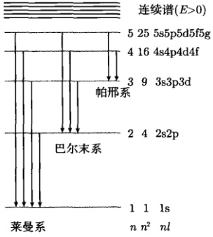

(a)
 

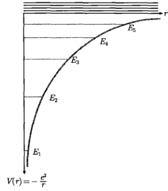

(b)
 

图 15.2 (a) 氢原子的能级与光谱线; (b) 氢原子的势能曲线与束缚态
 

#### 15.3.2 广义拉盖尔多项式

我们进一步求径向本征函数。由式（15.3.27）和式（15.3.30）得到

$$  f(\rho)=\sum_{\nu=0}^{n-l-1}b_{\nu}\rho^{\nu+l+1}=b_{0}\rho^{l+1}\sum_{\nu=0}^{n-l-1}\frac{b_{\nu}}{b_{0}}\rho^{\nu}   \tag*{(15.3.36)}$$

为了计算其中的比值  $ b_{\nu}/b_{0} $，由式(15.3.21)和式(15.3.30)写出

$$  b_{\nu+1}=\frac{\nu+l+1-n}{(\nu+1)(\nu+2l+2)}b_{\nu}   \tag*{(15.3.37)}$$

它给出  $ \frac{b_{0}}{b_{0}}=1 $， $ \frac{b_{1}}{b_{0}}=\frac{l+1-n}{(2l+2)} $，… 这样式 (15.3.36) 写为

 $$ f(\rho)=b_0\rho^{l+1}\left[1-\frac{n-l-1}{1!(2l+2)}\rho+\frac{(n-l-1)(2l-2)}{2!(2l+2)(2l+3)}\rho^2+\cdots\right] $$

<!-- page: 517 -->

$$ \begin{aligned}&+(-1)^{\nu}\frac{(n-l-1)(n-l-2)\cdots(n-l-\nu)}{\nu!(2l+2)(2l+3)\cdots(2l+1+\nu)}\rho^{\nu}+\cdots\\ &+(-1)^{n-l-1}\frac{(n-l-1)(n-l-2)\cdots1}{(n-l-1)!(2l+2)(2l+3)\cdots(n+l)}\rho^{n-l-1}\bigg]\\ =&b_{0}\rho^{l+1}\sum_{\nu=0}^{n-l-1}(-1)^{\nu}\frac{(2l+1)!(n-l-1)!}{\nu!(n-l-\nu-1)!(2l+1+\nu)!}\rho^{\nu}\\ =&b_{0}\rho^{l+1}\frac{(2l+1)!(n-l-1)!}{(n+l)!}\sum_{\nu=0}^{n-l-1}(-1)^{\nu}\frac{(n+l)!}{\nu!(n-l-1-\nu)!(2l+1+\nu)!}\rho^{\nu}\\ =&b_{0}\rho^{l+1}\frac{(2l+1)!(n-l-1)!}{(n+l)!}L_{n-l-1}^{2l+1}(\rho)\end{aligned} $$ 

其中， $ L_{n-l-1}^{2l+1}(\rho) $ 是广义拉盖尔多项式，而

$$  L_{n}^{m}(x)=\sum_{k=0}^{n}(-1)^{k}\frac{(m+n)!}{k!(n-k)!(m+k)!}x^{k}   \tag*{(15.3.38)}$$

称为 m 阶 n 度广义拉盖尔多项式。

利用式 (15.3.2)、式 (15.3.7) 和式 (15.3.11) 写出径向本征函数 (注出量子数 n、l) 为

$$  R_{n l}(\rho)=N_{n l}\mathrm{e}^{-\rho/2}\rho^{l}L_{n-l-1}^{2l+1}(\rho)   \tag*{(15.3.39)}$$

这里  $ N_{nl} $ 包含所有与  $ \rho $ 无关的常数因子。用玻尔半径

$$  a=\frac{\hbar^{2}}{\mu\mathrm{e}^{2}}=0.529\times10^{-10}\mathrm{m}   \tag*{(15.3.40)}$$

表示空间尺度，注意到式 $  (15.3.30)  $，式 $  (15.3.7)  $变为

$$  \rho=\alpha r=\frac{2Z}{an}r   \tag*{(15.3.41)}$$

这样，式(15.3.39)写为

$$  R_{n l}(r)=N_{n l}\exp\left(-\frac{Z}{a n}r\right)\left(\frac{2Z}{a n}r\right)^{l}L_{n-l-1}^{2l+1}\left(\frac{2Z}{a n}r\right)   \tag*{(15.3.42)}$$

至此，只剩下归一化常数  $ N_{nl} $ 需要确定。波函数的归一化条件为

$$  \int_{-\infty}^{\infty}\int_{-\infty}^{\infty}\int_{-\infty}^{\infty}\left|\psi_{n l m}\right|^{2}\mathrm{d}x\mathrm{d}y\mathrm{d}z=1   \tag*{(15.3.43a)}$$

在球坐标系中，我们有  $ \mathrm{d}x\mathrm{d}y\mathrm{d}z = r^2\sin\theta\mathrm{d}r\mathrm{d}\theta\mathrm{d}\phi $，这样式 (15.3.43a) 写为

$$  \int_{r=0}^{\infty}\int_{\theta=0}^{\pi}\int_{\phi=0}^{2\pi}\left|\psi_{nlm}(r,\theta,\phi)\right|^{2}r^{2}\sin\theta\mathrm{d}r\mathrm{d}\theta\mathrm{d}\phi=1   \tag*{(15.3.43b)}$$

<!-- page: 518 -->

由于球谐函数已经归一化 [式（15.2.67）]，故式（15.3.43b）变为

$$  \int_{0}^{\infty}\left|R_{n l}(r)\right|^{2}r^{2}\mathrm{d}r\cdot\int_{\theta=0}^{\pi}\int_{\phi=0}^{2\pi}\left|Y_{l m}(\theta,\phi)\right|^{2}\sin\theta\mathrm{d}\theta\mathrm{d}\phi=\int_{0}^{\infty}\left|R_{n l}(r)\right|^{2}r^{2}\mathrm{d}r=1   \tag*{(15.3.44)}$$

这表示径向函数本身是归一化的，而波函数的径向概率密度为  $ \left|R_{nl}(r)\right|^{2}r^{2} $

将式（15.3.42）代入式（15.3.44），并利用式（15.3.41），得到

$$  |N_{n l}|^{-2}=\left(\frac{a n}{2Z}\right)^{3}\int_{0}^{\infty}\mathrm{e}^{-\rho}\rho^{2l+2}\left[L_{n-l-1}^{2l+1}(\rho)\right]^{2}\mathrm{d}\rho   \tag*{(15.3.45)}$$

利用积分公式

$$  \int_{0}^{\infty}\mathrm{e}^{-x}x^{M+1}\left[L_{N}^{M}(x)\right]^{2}\mathrm{d}x=\frac{\Gamma(N+M+1)}{N!}(2N+M+1)   \tag*{(15.3.46)}$$

由式（15.3.45）得到

$$  N_{n l}=\sqrt{\left(\frac{2Z}{a n}\right)^{3}\frac{(n-l-1)!}{2n(n+l)!}}   \tag*{(15.3.47)}$$

这样归一化的径向函数为

$$  R_{n l}(r)=\sqrt{\left(\frac{2Z}{a n}\right)^{3}\frac{(n-l-1)!}{2n(n+l)!}}\exp\left(-\frac{Z}{a n}r\right)\left(\frac{2Z}{a n}r\right)^{l}L_{n-l-1}^{2l+1}\left(\frac{2Z}{a n}r\right)   \tag*{(15.3.48)}$$

下面列出前几个归一化的径向函数  $ R_{nl}(r) $

 $$ \begin{align*}R_{10}(r)&=\left(\frac{Z}{a}\right)^{3/2}2\exp\left(-\frac{Z}{a}r\right)\\R_{20}(r)&=\left(\frac{Z}{2a}\right)^{3/2}\left(2-\frac{Z}{a}r\right)\exp\left(-\frac{Z}{2a}r\right)\\R_{21}(r)&=\left(\frac{Z}{2a}\right)^{3/2}\frac{Z}{a\sqrt{3}}r\exp\left(-\frac{Z}{2a}r\right)\\R_{30}(r)&=\left(\frac{Z}{3a}\right)^{3/2}\left[2-\frac{4Z}{3a}r+\frac{4}{27}\left(\frac{Z}{a}r\right)^{2}\right]\exp\left(-\frac{Z}{3a}r\right)\\R_{31}(r)&=\left(\frac{2Z}{a}\right)^{3/2}\left(\frac{2}{27\sqrt{3}}-\frac{Z}{81\sqrt{3}a}r\right)\frac{Z}{a}r\exp\left(-\frac{Z}{3a}r\right)\\R_{32}(r)&=\left(\frac{2Z}{2}\right)^{3/2}\frac{Z}{\_-\_}\left(\frac{Z}{2}r\right)^{2}\exp\left(-\frac{Z}{\_}r\right)\end{align*} $$ 

 $$ R_{32}(r)=\left(\frac{2Z}{a}\right)^{3/2}\frac{Z}{81\sqrt{15}}\left(\frac{Z}{a}r\right)^{2}\exp\left(-\frac{Z}{3a}r\right) $$ 

现在我们把角向解（15.2.69）和径向解（15.3.48）代入式（15.2.4）得到本征函数为

<!-- page: 519 -->

$$  \begin{aligned}&\psi_{nlm}(r,\theta,\phi)=R_{nl}(r)Y_{l m}(\theta,\phi)\\=&N_{nl}\exp\biggl(-\frac{Z}{an}r\biggr)\biggl(\frac{2Z}{an}r\biggr)^{l}L_{n-l-1}^{2l+1}\biggl(\frac{2Z}{an}r\biggr)Y_{l m}(\theta,\phi)\\&\begin{cases}n=1,2,3,\cdots\\l=0,1,2,\cdots,n-1\\m=0,\pm1,\pm2,\cdots,\pm l\end{cases}\end{aligned}   \tag*{(15.3.49)}$$

我们在式 (15.2.59) 中显示，球谐函数  $ Y_{lm}(\theta,\phi) $ 是算符  $ \hat{L}^{2} $ 和  $ \hat{L}_{z} $ 共同的本征函数，而现在  $ \psi_{nlm} $ 是算符  $ \hat{H} $、 $ \hat{L}^{2} $ 和  $ \hat{L}_{z} $ 共同的本征函数，事实上

$$  \hat{H}\psi_{n l m}=-\frac{\mu Z^{2}e^{4}}{2\hbar^{2}n^{2}}\psi_{n l m}   \tag*{(15.3.50a)}$$

$$  \hat{L}^{2}\psi_{n l m}=l(l+1)\hbar^{2}\psi_{n l m}   \tag*{(15.3.50b)}$$

$$  \hat{L}_{z}\psi_{n l m}=m\hbar\psi_{n l m}   \tag*{(15.3.50c)}$$

电子处于态 (15.3.49) 时，其能级由 (15.3.33) 式给出。由于  $ \psi_{nlm} $ 与 n、l、m 三个量子数有关，而能级  $ E_n $ 只与 n 有关，所以能级对于 l 和 m 是简并的。对于一个 n 值，l 可以取  $ l = 0, 1, 2, \cdots, n - 1 $ (共 n 个值)，而对于一个 l 值，m 还可以取  $ m = 0, \pm 1, \pm 2, \cdots, \pm l $ (共  $ (2l + 1) $ 个值)。不同的 l、m 对应不同的波函数  $ \psi_{nlm} $。因此对于第 n 个能级  $ E_n $，有

$$  \sum_{l=0}^{n-1}(2l+1)=2\frac{n(n-1)}{2}+n=n^{2}   \tag*{(15.3.51)}$$

个波函数，因此电子第 n 个能级是  $ n^{2} $ 度简并的。

本节的最后，我们把空间函数（15.3.49）与时间函数（15.1.9）相乘，给出（15.1.12）的表示式

$$  \varPsi_{n l m}(r,\theta,\phi,t)=\psi_{n l m}(r,\theta,\phi)\exp\left(-\frac{\mathrm{i}}{\hbar}E_{n}t\right)   \tag*{(15.3.52)}$$

其中，能量本征值  $ E_n $ 由式 (15.3.34) 确定；本征函数  $ \psi_{nlm} $ 由式 (15.3.49) 确定。式 (15.3.52) 就是薛定谔方程 (15.1.1) 的解。由于  $ \left|\exp\left(-\frac{\mathrm{i}}{\hbar}E_n t\right)\right|^2 = 1 $，含时波函数  $ \Psi_{nlm}(r, \theta, \phi, t) $ 是归一化的。

#### 15.3.3 径向概率密度

本节我们进一步讨论径向解的性质。简单起见，考虑氢原子情况（Z = 1），并讨论三种典型的束缚态：① 基态  $ \psi_{100} $；②  $ \psi_{n00} $ 态；③  $ \psi_{n,n-1,m} $ 态。在讨论中，我们用  $ W_{nl}(r) $ 表示式 (15.3.44) 中的径向概率密度，即  $ W_{nl}(r) \equiv |R_{nl}(r)|^{2} r^{2} $。

(1) 首先考虑基态  $ (n=1, l=0, m=0) $，其波函数是  $ \psi_{100}(r,\theta,\phi) $，相应的径向概率密度由式 (15.3.44) 给出为

<!-- page: 520 -->

$$  W_{10}(r)=|R_{10}(r)|^{2}r^{2}=\left|\frac{2}{a^{3/2}}\exp\left(-\frac{r}{a}\right)\right|^{2}r^{2}=\frac{4}{a^{3}}r^{2}\exp\left(-\frac{2r}{a}\right)   \tag*{(15.3.53)}$$

这个表示式还可以从另一个更基本的思路而得到。事实上，基态波函数为

 $$ \begin{aligned}\psi_{100}&=R_{10}(r)Y_{00}(\theta,\phi)\\&=\frac{2}{a^{3/2}}\exp\left(-\frac{r}{a}\right)\frac{1}{\sqrt{4\pi}}=\frac{1}{\sqrt{\pi}a^{3/2}}\exp\left(-\frac{r}{a}\right)\end{aligned} $$ 

电子在空间任意处的单位体积内的几率（概率密度）为

$$  \left|\psi_{100}\right|^{2}=\frac{1}{\pi a^{3}}\exp\left(-\frac{2r}{a}\right)   \tag*{(15.3.54)}$$

则电子在  $ r \rightarrow r + dr $ 球壳（体积为  $ 4\pi r^{2}dr $）内的出现的几率（图 15.3）为

 $$ \begin{aligned}\left|\psi_{100}\right|^{2}\cdot4\pi r^{2}\mathrm{d}r&=\frac{4}{a^{3}}r^{2}\exp\left(-\frac{2r}{a}\right)\mathrm{d}r\\&=4\left(\frac{r}{a}\right)^{2}\exp\left(-2\frac{r}{a}\right)\mathrm{d}\left(\frac{r}{a}\right)\\&=4\rho^{2}\exp(-2\rho)\mathrm{d}\rho\ \left(\rho=r/a\right)\end{aligned} $$ 

其中，a 是玻尔半径。由此得到电子的径向概率密度（以  $ \rho $ 为变量）

$$  W_{10}(\rho)=4\rho^{2}\exp(-2\rho)   \tag*{(15.3.55)}$$

这个结果与式 $  (15.3.53)  $是相同的。容易验证几率的归一性，即

$$  \int_{0}^{\infty}W_{10}(\rho)\mathrm{d}\rho=4\int_{0}^{\infty}\rho^{2}\exp(-2\rho)\mathrm{d}\rho=1   \tag*{(15.3.56)}$$

由式(15.3.55)作出径向概率密度分布 $ W(\rho) $，如图15.4所示。它的最大值相应于

$$  \frac{\mathrm{d}W_{10}}{\mathrm{d}\rho}=8\rho(1-\rho)\exp(-2\rho)\Rightarrow\rho_{m}=1   \tag*{(15.3.57)}$$

这个结果显示，基态氢原子中的电子在整个空间  $ (0 < r < \infty) $ 出现的几率都不为零，但在玻尔半径 r = a 处有最大几率值  $ [W_{10}(1) = 0.54] $。我们看到氢原子的量子理论与玻尔的轨道理论如此奇妙地联系了起来。

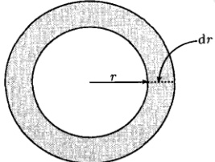

图 15.3 球壳  $ (r \to r + dr) $ 的体积  $ 4\pi r^{2}dr $
 

<!-- page: 521 -->

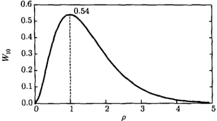

图 15.4 基态氢原子的径向概率密度分布
 

利用概率密度可以计算某些力学量的平均值，如电子运动半径的平均值为

 $$ \begin{aligned}\langle\rho\rangle&=\int_{0}^{\infty}\rho W_{10}(\rho)\mathrm{d}\rho\\&=4\int_{0}^{\infty}\rho^{3}\exp(-2\rho)\mathrm{d}\rho=4\cdot3!\left(\frac{1}{2}\right)^{4}=1.5\end{aligned} $$ 

它是玻尔半径的 1.5 倍。而势能  $ V(r) = -e^{2}/r $ 的平均值为

 $$ \begin{aligned}\langle V\rangle&=\int_{0}^{\infty}\left(-\frac{\mathrm{e}^{2}}{r}\right)\frac{4}{a^{3}}r^{2}\exp\left(-\frac{2r}{a}\right)\mathrm{d}r\\&=-4\frac{\mathrm{e}^{2}}{a^{3}}\int_{0}^{\infty}r\exp\left(-\frac{2r}{a}\right)\mathrm{d}r=-4\frac{\mathrm{e}^{2}}{a^{3}}\left(\frac{a}{2}\right)^{2}=-\frac{\mathrm{e}^{2}}{a}\end{aligned} $$ 

势能的平均点在玻尔半径处。

我们进一步考查电子在有限空间的几率，引入

$$  \begin{aligned}P_{nl}(s)&=\int_{r=0}^{sa}\int_{\theta=0}^{\pi}\int_{\phi=0}^{2\pi}\left|\psi_{nlm}\right|^{2}r^{2}\sin\theta\mathrm{d}r\mathrm{d}\theta\mathrm{d}\phi\\&=\int_{r=0}^{sa}\left|R_{nl}\right|^{2}r^{2}\mathrm{d}r\cdot\int_{\theta=0}^{\pi}\int_{\phi=0}^{2\pi}\left|Y_{lm}\right|^{2}\sin\theta\mathrm{d}\theta\mathrm{d}\phi\\&=\int_{0}^{sa}\left|R_{nl}\right|^{2}r^{2}\mathrm{d}r\\ \end{aligned}   \tag*{(15.3.58)}$$

它表示在任意态  $ \psi_{nlm} $ 中电子在 s 倍的玻尔半径内出现的几率。对于基态情况，注意到  $ \rho = r/a $，式 (15.3.58) 给出

$$  P_{10}(s)=4\int_{0}^{s}\rho^{2}\exp(-2\rho)\mathrm{d}\rho=\mathrm{e}^{-2s}\left(\mathrm{e}^{2s}-1-2s-2s^{2}\right)   \tag*{(15.3.59)}$$

图 15.5 显示了  $ P_{10}(s) $ 随 s 的变换曲线。可以得到，当  $ s \approx 2.7 $，几率值达到 0.9。当  $ s \to \infty $ 时，式 (15.3.59) 给出  $ P_{10}(\infty) = 1 $，这正是波函数的归一化条件，即式 (15.3.56)。

<!-- page: 522 -->

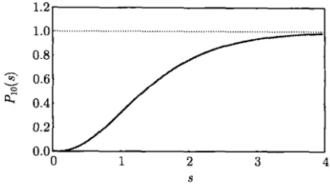

图 15.5 基态氢原子的电子在 s 倍玻尔半径内出现的几率： $ P_{10}(1)=0.32,\ P_{10}(2)=0.76 $
 

下面我们计算电子在经典禁区出现的几率。经典禁区定义为  $ r > r_{n} $ 区域，而  $ r_{n} $ 由

$$  V(r_{n})=-\frac{\mathrm{e}^{2}}{r_{n}}=E_{n}=-\frac{\mu\mathrm{e}^{4}}{2\hbar^{2}n^{2}}=-\frac{\mathrm{e}^{2}}{2n^{2}a}   \tag*{(15.3.60)}$$

确定，即在以半径为  $ r_{n} $ 的球面上，电子的势能等于总能量。该球面以外的区域称为经典禁区。由式(15.3.60)解得

$$  r_{n}=2n^{2}a   \tag*{(15.3.61)}$$

 $ r_{n} $ 称为电子运动的最大经典半径，它是玻尔半径的  $ 2n^{2} $ 倍。对于基态，最大经典半径是玻尔半径的 2 倍。引入

$$  \begin{aligned}Q_{nl}(n)&=\int_{r=2n^{2}a}^{\infty}\int_{\theta=0}^{\pi}\int_{\phi=0}^{2\pi}\left|\psi_{nlm}\right|^{2}r^{2}\sin\theta\mathrm{d}r\mathrm{d}\theta\mathrm{d}\phi\\&=\int_{r=2n^{2}a}^{\infty}\left|R_{nl}\right|^{2}r^{2}\mathrm{d}r\cdot\int_{\theta=0}^{\pi}\int_{\phi=0}^{2\pi}\left|Y_{lm}\right|^{2}\sin\theta\mathrm{d}\theta\mathrm{d}\phi\\&=\int_{2n^{2}a}^{\infty}\left|R_{nl}\right|^{2}r^{2}\mathrm{d}r\\ \end{aligned}   \tag*{(15.3.62)}$$

它表示在任意态  $ \psi_{nlm} $ 中电子在经典禁区出现的几率。在基态情况下

 $$ \begin{aligned}Q_{10}(1)&=4\int_{2}^{\infty}\rho^{2}\exp(-2\rho)\mathrm{d}\rho=1-4\int_{0}^{2}\rho^{2}\exp(-2\rho)\mathrm{d}\rho\\&=1-\left[\mathrm{e}^{-2s}\left(\mathrm{e}^{2s}-1-2s-2s^{2}\right)\right]_{s=2}\\&=1-0.76=0.24\end{aligned} $$ 

可见，基态情况下电子在经典禁区出现的几率是相当高的。这是一种很强的量子效应。

综合上述，在基态氢原子中，电子径向概率密度的最可几半径是玻尔半径 a，电子运动的平均半径为 1.5a，电子运动的最大经典半径为 2a，电子在经典禁区出现的几率高达 24%。

<!-- page: 523 -->

(2) 现在我们讨论  $ \psi_{n00} $ 态 (n = 1, 2, 3,  $ \cdots $, l = 0; m = 0)。这些态之间的区别只是主量子数不同，而角向状态都是  $ Y_{00} $。我们将考查这些态中电子的径向概率密度  $ W_{n0} $ 以及电子在 s 倍玻尔半径内出现的几率  $ P_{n0} $。对于  $ \psi_{100} $ 态，我们已经讨论过。对于  $ \psi_{200} $ 态，由式 (15.3.58) 得到

 $$ \begin{aligned}P_{20}(s)&=\int_{r=0}^{s a}\left|R_{20}\right|^{2}r^{2}\mathrm{d}r=\int_{r=0}^{s a}\left|\left(\frac{1}{2a}\right)^{3/2}\left(2-\frac{1}{a}r\right)\mathrm{e}^{-\frac{1}{2a}r}\right|^{2}r^{2}\mathrm{d}r\\&=\int_{0}^{s a}\frac{1}{(2a)^{3}}\left(2-\frac{1}{a}r\right)^{2}\mathrm{e}^{-\frac{1}{a}r}r^{2}\mathrm{d}r\\&=\int_{0}^{s}\frac{1}{8}\rho^{2}\left(2-\rho\right)^{2}\mathrm{e}^{-\rho}\mathrm{d}\rho\\ \end{aligned} $$ 

从而径向概率密度为

$$  W_{20}(\rho)=\frac{1}{8}\rho^{2}\left(2-\rho\right)^{2}\mathrm{e}^{-\rho}   \tag*{(15.3.63a)}$$

同理，对于  $ \psi_{300} $ 态，我们有

 $$ \begin{aligned}P_{30}(s)&=\int_{r=0}^{s a}\left|R_{30}\right|^{2}r^{2}\mathrm{d}r=\int_{r=0}^{s a}\left|\left(\frac{1}{3a}\right)^{3/2}\left[2-\frac{4}{3a}r+\frac{4}{27}\left(\frac{1}{a}r\right)^{2}\right]\mathrm{e}^{-\frac{1}{3a}}r\right|^{2}r^{2}\mathrm{d}r\\&=\int_{0}^{s a}\frac{1}{(3a)^{3}}\left[2-\frac{4}{3a}r+\frac{4}{27}\left(\frac{1}{a}r\right)^{2}\right]^{2}\mathrm{e}^{-\frac{2}{3a}}r r^{2}\mathrm{d}r\\&=\int_{0}^{s}\frac{1}{27}\rho^{2}\left[2-\frac{4}{3}\rho+\frac{4}{27}\rho^{2}\right]^{2}\mathrm{e}^{-\frac{2}{3}}\rho\mathrm{d}\rho\\ \end{aligned} $$ 

$$  W_{30}(\rho)=\frac{1}{27}\rho^{2}\left[2-\frac{4}{3}\rho+\frac{4}{27}\rho^{2}\right]^{2}\mathrm{e}^{-\frac{2}{3}\rho}   \tag*{(15.3.63b)}$$

利用上述结果作出三个态的径向概率密度，如图15.6所示，图中还给出了当 $ P_{n0}=0.9 $时相应的 $ \rho $值。可以看出，随着主量子数n的增大，核对电子的束缚减弱，电子概率密度的峰向r增加的方向移动。

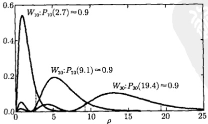

图 15.6 在  $ \psi_{n00} $ 态中，电子径向概率密度  $ W_{n0} $ 及  $ P_{n0}=0.9 $ 时相应的  $ \rho $ 值
 

<!-- page: 524 -->

(3) 现在我们讨论  $ \psi_{n,n-1,m} $ 态。这些态的角量子数为 l=n-1。首先我们根据  $ W_{n,n-1}(r) \equiv |R_{n,n-1}(r)|^{2}r^{2} $ 求出前几个态的径向概率密度

$$  W_{10}(r)=\left|\frac{2}{a^{3/2}}\exp\left(-\frac{r}{a}\right)\right|^{2}r^{2}=\frac{4}{a^{3}}r^{2}\exp\left(-\frac{2r}{a}\right)   \tag*{(15.3.64a)}$$

$$  W_{21}(r)=\left|\left(\frac{1}{2a}\right)^{3/2}\frac{1}{a\sqrt{3}}r\mathrm{e}^{-\frac{1}{2a}r}\right|^{2}r^{2}=\frac{1}{24a}\left(\frac{r}{a}\right)^{4}\mathrm{e}^{-r/a}   \tag*{(15.3.64b)}$$

$$  W_{32}(r)=\left|\left(\frac{2}{a}\right)^{3/2}\frac{1}{81\sqrt{15}}\left(\frac{r}{a}\right)^{2}\mathrm{e}^{-\frac{1}{3a}r}\right|^{2}r^{2}=\frac{8}{98415a}\left(\frac{r}{a}\right)^{6}\mathrm{e}^{-\frac{2}{3}\frac{r}{a}}   \tag*{(15.3.64c)}$$

将式 (15.3.64) 中三式的 r/a 换成  $ \rho $，再计算  $ \mathrm{d}W_{n,n-1}(\rho)/\mathrm{d}\rho=0 $，得到三个态的径向几率分布和相应的最可几  $ \rho $ 值为

$$  W_{10}(\rho)=4\rho^{2}\exp\left(-2\rho\right),\quad\rho_{m}=1   \tag*{(15.3.65a)}$$

$$  W_{21}(\rho)=\frac{1}{24}\rho^{4}\exp(-\rho),\quad\rho_{m}=4   \tag*{(15.3.65b)}$$

$$  W_{32}(\rho)=\frac{8}{98415}\rho^{6}\exp\left(-\frac{2}{3}\rho\right),\quad\rho_{m}=9   \tag*{(15.3.65c)}$$

图15.7显示了式(15.3.65)的径向几率分布及相应的最可几 $ \rho $值。由此推测 $ W_{n,n-1}(\rho) $的最可几值为 $ \rho_{m}=n^{2} $，下面对此作一般性的证明。为此由式(15.3.48)写出

 $$ \begin{aligned}W_{n,n-1}(r)&=\left|\sqrt{\left(\frac{2}{na}\right)^{3}\frac{1}{2n(2n-1)!}}\exp\left(-\frac{1}{an}r\right)\left(\frac{2}{an}r\right)^{n-1}\right.L_{0}^{2l+1}\left(\frac{2}{an}r\right)\Bigg|^{2}r^{2}\\&=\left(\frac{2}{na}\right)^{3}\frac{1}{2n(2n-1)!}\exp\left(-\frac{2r}{na}\right)\left(\frac{2r}{an}\right)^{2(n-1)}r^{2}\\&=\frac{1}{an^{2}(2n-1)!}\exp\left(-\frac{2r}{na}\right)\left(\frac{2r}{na}\right)^{2n}\\ \end{aligned} $$ 

这里利用了广义拉盖尔多项式的性质  $ L_{0}^{m}(x)=1 $。事实上，从式 (15.3.38) 可以看出，当 n=0 时，广义拉盖尔多项式  $ L_{n}^{m}(x) $ 只有第一项（其值为 1）。上式换成变量  $ \rho $ 后变为

$$  W_{n,n-1}(\rho)=\frac{1}{n^{2}(2n-1)!}\exp\left(-\frac{2}{n}\rho\right)\left(\frac{2}{n}\rho\right)^{2n}   \tag*{(15.3.66)}$$

这就是  $ \psi_{n,n-1,m} $ 态中电子的径向概率密度。由式 (15.3.66) 得到

$$  \frac{\mathrm{d}W_{n,n-1}}{\mathrm{d}\rho}=\frac{4}{n^{3}(2n-1)!}\exp\left(-\frac{2}{n}\rho\right)\left(\frac{2}{n}\rho\right)^{2n-1}\left(n-\frac{\rho}{n}\right)   \tag*{(15.3.67)}$$

<!-- page: 525 -->

由  $ \mathrm{d}W_{n,n-1}/\mathrm{d}\rho=0 $ 得到最可几值为  $ \rho_{m}=n^{2} $

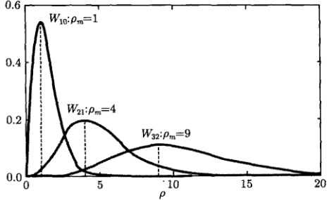

图 15.7 式 (15.3.65) 的径向几率分布及相应的最可几  $ \rho $ 值
 

现在计算电子在经典禁区出现的几率，由式(15.3.61)可以看出，经典禁区相应于  $ \rho > 2n^{2} $，由式(15.3.66)得到

$$  Q_{n,n-1}(n)=\frac{1}{n^{2}(2n-1)!}\int_{2n^{2}}^{\infty}\exp\left(-\frac{2}{n}\rho\right)\left(\frac{2}{n}\rho\right)^{2n}\mathrm{d}\rho   \tag*{(15.3.68)}$$

其中的积分是一种不完全伽马函数 (incomplete gamma function)，该函数定义为

$$  \Gamma(a,x)=\int_{x}^{\infty}\exp\left(-t\right)t^{a-1}\mathrm{d}t   \tag*{(15.3.69)}$$

如果 a 是一个正整数，则式 (15.3.69) 约化为

$$  \Gamma(a,x)=(a-1)!\mathrm{e}^{x}\sum_{k=0}^{a-1}\frac{x^{k}}{k!}   \tag*{(15.3.70)}$$

这样式（15.3.68）写为

 $$ \begin{aligned}Q_{n,n-1}(n)&=\frac{1}{(2n)!}\int_{4n}^{\infty}\exp\left(-t\right)t^{(2n+1)-1}\mathrm{d}t\\&=\frac{1}{(2n)!}\Gamma(2n+1,4n)=\mathrm{e}^{-4n}\sum_{k=0}^{2n}\frac{(4n)^{k}}{k!}\end{aligned} $$ 

上式给出

 $$ Q_{1,0}(1)=0.238,\quad Q_{2,1}(2)=0.100,\quad Q_{3,2}(3)=0.046,\quad Q_{4,3}(4)=0.022 $$ 

 $$ Q_{10,9}(10)=0.000368 $$ 

可见，随着主量子数 n 的增大，电子在经典禁区出现的几率减小，量子特征趋于经典的行为，这正是量子-经典对应原理的具体体现。

<!-- page: 526 -->

### 15.4 量子谐振子与厄米多项式

本节我们讨论另一个典型的量子力学系统，即线性谐振子，并求解谐振子的薛定谔方程，它涉及另一类重要的特殊函数——厄米多项式。

#### 15.4.1 量子谐振子

在经典力学中，质量为  $ \mu $ 的弹簧振子 (图 15.8)，在弹性力 (恢复力) F = -kx 作用下运动，其中，k 是弹簧的劲度系数，x 是振子在任意 t 时刻离开平衡位置的位移。根据牛顿第二定律，有

$$  \mu\frac{\mathrm{d}^{2}x}{\mathrm{d}t^{2}}=-kx   \tag*{(15.4.1)}$$

方程（15.4.1）是线性的，其通解为

$$  x=A\sin(\omega t+\delta)   \tag*{(15.4.2)}$$

其中， $ \omega=\sqrt{k/\mu} $ 是振子的角频率；A 和  $ \delta $ 分别是振幅和位相，由振子的初始条件决定。式(15.4.2)所描述的运动称为简谐振动，做简谐振动的振子称为谐振子。

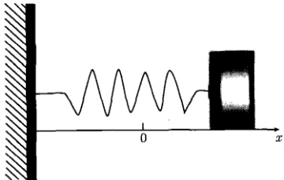

图 15.8 弹簧振子
 

在物理学中，任何一个力  $ F(x) $，如引力、电磁力等，均对应一个势能函数  $ U(x) $，二者之间有一般关系式

$$  F(x)=-\frac{\partial U(x)}{\partial x}   \tag*{(15.4.3)}$$

这样，谐振子的势能函数  $ U(x) $ 为

$$  U(x)=\int kx\mathrm{d}x=\frac{1}{2}kx^{2}+U_{0}=\frac{1}{2}\mu\omega^{2}x^{2}   \tag*{(15.4.4)}$$

这里已经将参考势能选为  $ U_{0}=0 $ 。可见谐振子的势能函数  $ U(x) $ 是抛物线，如图

<!-- page: 527 -->

15.9 所示，当谐振子处于振幅位置时  $ (x = \pm A) $，有最大势能  $ \frac{1}{2} k A^{2} $，而此处的动能为零。谐振子在任意 x 处的总能量为

$$  E=\frac{p^{2}}{2\mu}+\frac{1}{2}\mu\omega^{2}x^{2}   \tag*{(15.4.5)}$$

其中，p 是振子的动量。

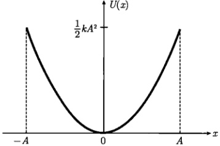

图 15.9 谐振子的势能曲线
 

根据力学量的算符表示

$$  E\to\mathrm{i}\hbar\frac{\partial}{\partial t},p\to-\mathrm{i}\hbar\frac{\partial}{\partial x}\left(p^{2}\to-\hbar^{2}\frac{\partial^{2}}{\partial x^{2}}\right)   \tag*{(15.4.6)}$$

我们由式（15.4.5）得到体系的薛定谔方程

$$  \mathrm{i}\hbar\frac{\partial\varPsi}{\partial t}=-\frac{\hbar^{2}}{2\mu}\frac{\partial^{2}\varPsi}{\partial x^{2}}+\frac{1}{2}\mu\omega^{2}x^{2}\varPsi(x,t)   \tag*{(15.4.7)}$$

这里， $ \psi(x,t) $ 是任意 t 时刻的波函数。设粒子初始时刻的波函数为

$$  \Psi(x,0)=f(x)   \tag*{(15.4.8)}$$

现在我们来求任意 t 时刻的波函数  $ \Psi(x,t) $。设  $ \Psi(x,t) $ 具有形式解

$$  \varPsi(x,t)=\psi(x)T(t)   \tag*{(15.4.9)}$$

其中， $ \psi(x) $ 和  $ T(t) $ 分别是空间与时间部分。将式 (15.4.9) 代入式 (15.4.7)，分离变量后，得到

$$  -\frac{\hbar^{2}}{2\mu}\frac{\partial^{2}\psi}{\partial x^{2}}+\frac{1}{2}\mu\omega^{2}x^{2}\psi(x)=E\psi(x)   \tag*{(15.4.10a)}$$

$$  \frac{\mathrm{d}T}{T}=-\frac{\mathrm{i}}{\hbar}E\mathrm{d}t\Rightarrow T(t)=\exp\left(-\frac{\mathrm{i}}{\hbar}E t\right)   \tag*{(15.4.10b)}$$

其中，$E$ 是能量本征值。方程 (15.4.10a) 就是系统的定态薛定谔方程。它描述质量为 $\mu$ 的微观粒子在势场 $\frac{1}{2}\mu\omega^{2}x^{2}$ 中沿 $x$ 轴的线性振动。一般来说，任何量子体系

<!-- page: 528 -->

在稳定平衡点附件的小幅度振动都可以近似地用线性谐振子来表示，如固体中原子的振动、晶格的振动、原子核表面振动等。特别是，双原子分子中两原子之间的相互作用势能就是原子间距离 x 的函数，其形状如图 15.10 所示，图中的势能函数为

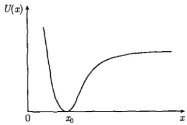

 $$ U(x)=\frac{1}{2}k(x-x_{0})^{2} $$ 

图 15.10 两原子间的势能曲线
 

在  $ x = x_{0} $ 处势能有极小值  $ U(x_{0}) = 0 $，这是一个稳定平衡点，当原子间距大于  $ x_{0} $ 时，原子间相互吸引；反之当原子间距小于  $ x_{0} $ 时，原子间相互排斥，两原子间的相对运动可以看成一种简谐振动。这样一种相互作用势能存在于许多体系之中，而体系在平衡点附件的振动行为可以用势能曲线（图 15.9）近似地表示。

现在我们求解方程(15.4.10a)，为方便起见，引入无量纲位移 $ \xi $代替x，它们的关系是

$$  \xi=\alpha x,\quad k\alpha=\sqrt{\frac{\mu\omega}{\hbar}}   \tag*{(15.4.11)}$$

并定义无量纲参数

$$  \lambda=\frac{2E}{\hbar\omega}   \tag*{(15.4.12)}$$

用  $ \frac{2}{\hbar\omega} $ 乘以方程 (15.4.10a) 两边，并利用式 (15.4.11) 及式 (15.4.12)，得到

$$  \frac{\mathrm{d}^{2}\psi}{\mathrm{d}\xi^{2}}+(\lambda-\xi^{2})\psi=0   \tag*{(15.4.13)}$$

这是一个变系数二阶常微分方程，称为谐振子的标准方程。为求解该方程，我们先考查它的渐近解，即当  $ \xi \to \pm \infty $ 时波函数的行为。在此情况下， $ \lambda \ll \xi^2 $，于是方程变为

$$  \frac{\mathrm{d}^{2}\psi}{\mathrm{d}\xi^{2}}-\xi^{2}\psi=0   \tag*{(15.4.14)}$$

它的解是

$$  \psi\sim\mathrm{e}^{\xi^{2}/2}+\mathrm{e}^{-\xi^{2}/2}   \tag*{(15.4.15)}$$

这就是方程 (15.4.13) 的渐近解 (即  $ \xi \to \pm \infty $ 时的解)。因为波函数的标准条件要求当  $ \xi \to \pm \infty $ 时  $ \psi $ 应是有限的，故只取  $ \psi \sim e^{-\xi^2/2} $。

根据上面的讨论，现在将方程（15.4.13）的形式解写为

$$  \psi(\xi)=y(\xi)\mathrm{e}^{-\xi^{2}/2}   \tag*{(15.4.16)}$$

<!-- page: 529 -->

其中， $ y(\xi) $ 是待求的函数，它必须保证波函数  $ \psi $ 在  $ \xi $ 取有限值以及  $ \xi \to \pm \infty $ 时都满足标准条件。

将形式解式（15.4.16）代入式（15.4.13），并利用

$$  \frac{\mathrm{d}\psi}{\mathrm{d}\xi}=\left(-\xi y+\frac{\mathrm{d}y}{\mathrm{d}\xi}\right)\mathrm{e}^{-\xi^{2}/2}   \tag*{(15.4.17a)}$$

$$  \frac{\mathrm{d}^{2}\psi}{\mathrm{d}\xi^{2}}=\left(-y-2\xi\frac{\mathrm{d}y}{\mathrm{d}\xi}+\xi^{2}y+\frac{\mathrm{d}^{2}y}{\mathrm{d}\xi^{2}}\right)\mathrm{e}^{-\xi^{2}/2}   \tag*{(15.4.17b)}$$

得到关于  $ y(\xi) $ 的方程

$$  \frac{\mathrm{d}^{2}y}{\mathrm{d}\xi^{2}}-2\xi\frac{\mathrm{d}y}{\mathrm{d}\xi}+(\lambda-1)y=0   \tag*{(15.4.18)}$$

这个方程称为厄米方程。设方程（15.4.18）在  $ \xi = 0 $ 处有幂级数解

$$  y(\xi)=\sum_{k=0}^{\infty}C_{k}\xi^{k}=C_{0}+C_{1}\xi+C_{2}\xi^{2}+\cdots   \tag*{(15.4.19)}$$

其中， $ C_{k}(k=0,1,2,\cdots) $ 是展开系数。对式（15.4.19）求导数，得到

$$  y^{\prime}=\sum_{k=1}^{\infty}k C_{k}\xi^{k-1},\quad y^{\prime\prime}=\sum_{k=2}^{\infty}k(k-1)C_{k}\xi^{k-2}   \tag*{(15.4.20)}$$

将式（15.4.19）和式（15.4.20）代入式（15.4.18），得到

 $$ \begin{aligned}&\sum_{k=2}^{\infty}k(k-1)C_{k}\xi^{k-2}-2\xi\sum_{k=1}^{\infty}kC_{k}\xi^{k-1}+(\lambda-1)\sum_{k=0}^{\infty}C_{k}\xi^{k}\\=&\sum_{k=2}^{\infty}k(k-1)C_{k}\xi^{k-2}-\sum_{k=0}^{\infty}[2k-(\lambda-1)]C_{k}\xi^{k}\\&(m=k-2)\\=&\sum_{m=0}^{\infty}(m+2)(m+1)C_{m+2}\xi^{m}-\sum_{k=0}^{\infty}[2k-(\lambda-1)]C_{k}\xi^{k}\\=&\sum_{k=0}^{\infty}[(k+2)(k+1)C_{k+2}-[2k-(\lambda-1)]C_{k}]\xi^{k}=0\end{aligned} $$ 

上式中参与求和的各项是相互独立的，因此求和为零的必要充分条件是任意项  $ \xi^{k} $ 的系数为零，即

$$  (k+2)(k+1)C_{k+2}-[2k-(\lambda-1)]C_{k}=0   \tag*{(15.4.21)}$$

这是系数所满足的关系式，可以写成

$$  C_{k+2}=\frac{2k-(\lambda-1)}{(k+2)(k+1)}C_{k}\quad(k=0,\;1,\;2,\cdots)   \tag*{(15.4.22)}$$

<!-- page: 530 -->

这是一个双间隔系数递推公式，我们由  $ C_{0} $ 开始递推，得到

 $$ \begin{aligned}&k=0:\quad C_{2}=\frac{-(\lambda-1)}{2\cdot1}C_{0}=\frac{-(\lambda-1)}{2!}C_{0}\\&k=2:\quad C_{4}=\frac{4-(\lambda-1)}{4\cdot3}C_{2}=\frac{-(\lambda-1)[4-(\lambda-1)]}{4!}C_{0}\\&k=4:\quad C_{6}=\frac{8-(\lambda-1)}{6\cdot5}C_{4}=\frac{-(\lambda-1)[4-(\lambda-1)][8-(\lambda-1)]}{6!}C_{0}\\ \end{aligned} $$ 

可以看出，每个系数都含有  $ C_{0} $，将  $ C_{0} $， $ C_{2} $， $ C_{4} $， $ C_{6} $，… 代入式 (15.4.19)，得到偶数幂的集合  $ C_{0}y_{0}(x) $，其中

$$  \begin{aligned}y_{0}(\xi)=&1+\frac{-(\lambda-1)}{2!}\xi^{2}+\frac{-(\lambda-1)[4-(\lambda-1)]}{4!}\xi^{4}\\&+\frac{-(\lambda-1)[4-(\lambda-1)][8-(\lambda-1)]}{6!}\xi^{6}+\cdots\end{aligned}   \tag*{(15.4.23a)}$$

进而我们利用式 $  (15.4.22)  $由 $ C_{1} $开始递推，得到

 $$ \begin{aligned}&k=1:\quad C_{3}=\frac{2-(\lambda-1)}{3\cdot2}C_{1}=\frac{2-(\lambda-1)}{3!}C_{1}\\&k=3:\quad C_{5}=\frac{6-(\lambda-1)}{5\cdot4}C_{3}=\frac{[2-(\lambda-1)][6-(\lambda-1)]}{5!}C_{1}\\&k=5:\quad C_{7}=\frac{10-(\lambda-1)}{7\cdot6}C_{5}=\frac{[2-(\lambda-1)][6-(\lambda-1)][10-(\lambda-1)]}{7!}C_{1}\\ \end{aligned} $$ 

可以看出，每个系数都含有  $ C_{1} $，将  $ C_{1}, C_{3}, C_{5}, \cdots $ 代入式 (15.4.19)，得到奇数幂的集合  $ C_{1}y_{1}(x) $，其中

$$  \begin{aligned}y_{1}(\xi)=&\xi+\frac{2-(\lambda-1)}{3!}\xi^{3}+\frac{[2-(\lambda-1)][6-(\lambda-1)]}{5!}\xi^{5}\\&+\frac{[2-(\lambda-1)][6-(\lambda-1)][10-(\lambda-1)]}{7!}\xi^{7}+\cdots\end{aligned}   \tag*{(15.4.23b)}$$

显然  $ y_{0}(\xi) $ 和  $ y_{1}(\xi) $ 是线性独立的。这样我们得到式 (15.4.18) 的通解

$$  y(\xi)=C_{0}y_{0}(\xi)+C_{1}y_{1}(\xi)   \tag*{(15.4.24)}$$

我们的结论是，厄米方程（15.4.18）作为二阶常微分方程有两个线性独立的解  $ y_{0}(x) $ 和  $ y_{1}(x) $，它们称为厄米函数，而  $ C_{0} $ 和  $ C_{1} $ 是两个线性无关的常数。

我们进一步讨论厄米函数 $ y_{0}(\xi) $和 $ y_{1}(\xi) $的收敛性。按照达朗贝尔判别法， $ y_{0}(\xi) $和 $ y_{1}(\xi) $的收敛半径均为

<!-- page: 531 -->

$$  R=\lim_{k\to\infty}\left|\frac{C_{k}}{C_{k+2}}\right|=\lim_{k\to\infty}\left|\frac{(k+2)(k+1)}{2k-(\lambda-1)}\right|=\lim_{k\to\infty}\left|\frac{\left(1+\frac{2}{k}\right)\left(1+\frac{1}{k}\right)}{\frac{2}{k}-\frac{(\lambda-1)}{k^{2}}}\right|=\lim_{k\to\infty}\left(\frac{k}{2}\right)\to\infty   \tag*{(15.4.25)}$$

这表示厄米方程的幂级数通解（15.4.24）的收敛半径为无穷大。

我们进一步讨论幂级数通解(15.4.24)在 $ \xi\to\pm\infty $的行为。级数中相邻两项系数的比值为

$$  \frac{C_{k+2}}{C_{k}}=\frac{2k-(\lambda-1)}{(k+1)(k+2)}=\frac{\frac{2k-(\lambda-1)}{k^{2}}}{\left(1+\frac{1}{k}\right)\left(1+\frac{2}{k}\right)}\stackrel{k\to\infty}{\longrightarrow}\frac{2}{k}   \tag*{(15.4.26)}$$

考查指数函数  $ \exp\left(\xi^{2}\right) $ 的幂级数

$$  \exp\left(\xi^{2}\right)=1+\frac{\xi^{2}}{1!}+\frac{\xi^{4}}{2!}+\cdots+\frac{\xi^{k}}{\left(\frac{k}{2}\right)!}+\frac{\xi^{k+2}}{\left(\frac{k}{2}+1\right)!}+\cdots   \tag*{(15.4.27)}$$

它的相邻两项系数的比值也是  $ \frac{2}{k} $，即

$$  \frac{C_{k+2}}{C_{k}}=\frac{\left(\frac{k}{2}\right)!}{\left(\frac{k}{2}+1\right)!}=\frac{1}{\left(\frac{k}{2}+1\right)}\stackrel{k\to\infty}{\longrightarrow}\frac{2}{k}   \tag*{(15.4.28)}$$

当  $ \xi \to \pm \infty $ 时， $ y(\xi) $ 与  $ \exp\left(\xi^{2}\right) $ 的级数的性质主要取决于 k 较大的高次项。现在可以看出，当 k 很大时，两级数有相同的性质，所以函数  $ y(\xi) $ 与  $ \exp\left(\xi^{2}\right) $ 在  $ \xi \to \pm \infty $ 时有相同的渐近行为，因而

 $$ \begin{aligned}\psi(\xi)&=y(\xi)\exp\left(-\frac{1}{2}\xi^{2}\right)\overset{\xi\to\pm\infty}{\longrightarrow}=\exp\left(\xi^{2}\right)\exp\left(-\frac{1}{2}\xi^{2}\right)\\&=\exp\left(\frac{1}{2}\xi^{2}\right)\overset{\xi\to\pm\infty}{\longrightarrow}\infty\end{aligned} $$ 

这表示厄米函数  $  y(\xi)  $ 使波函数  $  \psi(\xi)  $ 在  $ \xi \to \pm\infty $ 发散，不满足波函数的标准条件。为了保证波函数  $  \psi(\xi)  $ 在  $ \xi \to \pm\infty $ 的有限性，需要将无穷级数  $  y(\xi)  $ 截断，使之变成多项式，而多项式一定是有界的。

观察式 (15.4.23a) 中的系数可以发现，一旦一个因子在系数中出现，则这个因子会出现在后面的每一个系数中。例如，因子  $ [4 - (\lambda - 1)] $ 在  $ \xi^{4} $ 的系数中出现后，在  $ \xi^{6} $， $ \xi^{8} $，… 系数中均会出现。这样如果取  $ \lambda - 1 = 4 $，则式 (15.4.23a) 被截断变成

<!-- page: 532 -->

二项式  $ y_{0}(\xi)=1-2\xi^{2} $。显然，如果取  $ \lambda-1=2n(n \text{ 是偶数}) $，则  $ y_{0}(\xi) $ 变成 n 次多项式

$$  y_{0}(\xi)=C_{0}+C_{2}\xi^{2}+C_{4}\xi^{4}+\cdots+C_{n}\xi^{n}\quad(n 为偶数 )   \tag*{(15.4.29a)}$$

同理，在式(15.4.23b)中，如果取  $ \lambda-1=2n $ (n 是奇数)，则  $ y_{1}(\xi) $ 变成 n 次多项式

$$  y_{1}(\xi)=C_{1}\xi+C_{3}\xi^{3}+C_{5}\xi^{5}+\cdots+C_{n}\xi^{n}\quad(n 为奇数 )   \tag*{(15.4.29b)}$$

因此得到结论：当厄米方程（15.4.18）中的任意实数  $ \lambda $ 的取值限于

$$  \lambda-1=2n\quad(n=0,\;1,\;2,\cdots)   \tag*{(15.4.30)}$$

时，它的解是多项式(15.4.29)。

现在我们进一步确定式(15.4.29)中的系数。如果  $ C_{n} $ 被确定，按照递推公式(15.4.22)可以推出系数  $ C_{n-2}, C_{n-4}, \cdots $ 这意味着所有系数都能依次确定。原则上  $ C_{n} $ 是一个任意常数，不过如果取

$$  C_{n}\simeq2^{n}   \tag*{(15.4.31)}$$

厄米多项式（15.4.29）将呈现最简洁的形式。现在我们由式（15.4.31）推出较低次幂的系数，为此将式（15.4.22）写为

$$  C_{k}=\frac{(k+2)(k+1)}{2k-2n}C_{k+2}\quad(k=0,1,\cdots,n-2)   \tag*{(15.4.32)}$$

我们有

 $$ C_{n}=2^{n}=\frac{(-1)^{0}n!}{0!(n-2\cdot0)!}2^{n-2\cdot0} $$ 

 $$ \begin{aligned}C_{n-2}&=-\frac{n(n-1)}{4}2^{n}=-\frac{n(n-1)(n-2)!}{2^{2}(n-2)!}2^{n}\\&=-\frac{n!}{(n-2)!}2^{n-2}=\frac{(-1)^{1}n!}{1!(n-2\cdot1)!}2^{n-2\cdot1}\end{aligned} $$ 

 $$ \begin{aligned}C_{n-4}&=\frac{n(n-1)}{4}\frac{(n-2)(n-3)}{8}2^{n}=\frac{n(n-1)(n-2)(n-3)(n-4)!}{2!\cdot2^{4}(n-4)!}2^{n}\\&=\frac{(-1)^{2}n!}{2!(n-2\cdot2)!}2^{n-2\cdot2}\end{aligned} $$ 

一般项为

$$  C_{n-2m}=\frac{(-1)^{m}n!}{m!(n-2m)!}2^{n-2m}\quad\left(m=0,1,2,\cdots,\frac{n}{2}\right)   \tag*{(15.4.33)}$$

特别是常数项为

<!-- page: 533 -->

$$  C_{0}=\frac{(-1)^{n/2}n!}{\left(\frac{n}{2}\right)!}\quad\left(m=\frac{n}{2}\right)   \tag*{(15.4.34)}$$

利用通项公式（15.4.33），多项式解（15.4.29）被写为

$$  H_{n}(\xi)=\sum_{m=0}^{M}(-1)^{m}\frac{n!}{m!(n-2m)!}\left(2\xi\right)^{n-2m}   \tag*{(15.4.35)}$$

式(15.4.35)称为n阶厄米多项式。其中，M是求和指标m的最大值(M=n/2)。由于M必须是自然数，所以将它写成

$$  M=\left\{\begin{array}{ll}\displaystyle\frac{n}{2}&(n=0,2,4,\cdots)\\ \displaystyle\frac{n-1}{2}&(n=1,3,5,\cdots)\end{array}\right.   \tag*{(15.4.36)}$$

这样在任何情况下，M 的取值为 M = 0, 1, 2, 3, … 注意在厄米多项式 (15.4.35) 中，求和指标 m 的最小值 m = 0 相应于最高次幂  $ \xi^{n} $ [它的系数由式 (15.4.31) 确定]，而它的最大值 m = M 相应于常数项 [由式 (15.4.34) 确定]。

前几阶厄米多项式（图 15.11）是

 $$ \begin{aligned}&H_{0}(x)=1,\quad&H_{1}(x)=2x\\&H_{2}(x)=4x^{2}-2,\quad&H_{3}(x)=8x^{3}-12x\\&H_{4}(x)=16x^{4}-48x^{2}+12,\quad&H_{5}(x)=32x^{5}-160x^{3}+120x\\ \end{aligned} $$ 

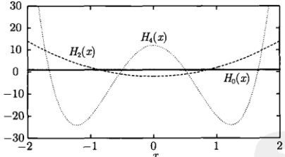

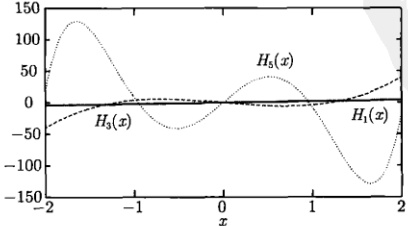

图 15.11 前几阶厄米多项式
 

<!-- page: 534 -->

例 1 证明：n 阶厄米多项式  $ H_{n}(x) $ 可以写成下列形式

$$  H_{n}(x)=(2x)^{n}-n(n-1)(2x)^{n-2}+\frac{n(n-1)(n-2)(n-3)}{2}(2x)^{n-4}-\cdots   \tag*{(15.4.37)}$$

证明 从递推公式 (15.4.22) 出发，即

$$  C_{k+2}=\frac{2k-(\lambda-1)}{(k+2)(k+1)}C_{k}\quad(k=0,1,2,\cdots)   \tag*{(15.4.38)}$$

在式 (15.4.38) 中取  $ \lambda-1=2n(n=k=0,1,2,\cdots) $，则由  $ C_{n}\neq0 $ 得到  $ C_{n+2}=0 $，由此得到  $ C_{n+4}=C_{n+6}=\cdots=0 $。这样，幂级数解 (15.4.19) 变为多项式

$$  y(\xi)=C_{n}\xi^{n}+C_{n-2}\xi^{n-2}+\cdots   \tag*{(15.4.39)}$$

将递推公式（15.4.38）写成

$$  C_{k-2}=\frac{k(k-1)}{2(k-2)-2n}C_{k}   \tag*{(15.4.40)}$$

由式（15.4.40）推出

 $$ \begin{aligned}&C_{n-2}=-\frac{n(n-1)}{4}C_{n}\\&C_{n-4}=-\frac{(n-2)(n-3)}{8}C_{n-2}=\frac{n(n-1)(n-2)(n-3)}{32}C_{n}\\ \end{aligned} $$ 

这些系数有共同的因子  $ C_{n} $，取  $ C_{n}=2^{n} $，将  $ C_{n} $， $ C_{n-2} $， $ C_{n-4}\cdots $ 代入式 (15.4.39)，得到

 $$ \begin{aligned}y(\xi)&=2^{n}\left[\xi^{n}-\frac{n(n-1)}{4}\xi^{n-2}+\frac{n(n-1)(n-2)(n-3)}{32}\xi^{n-4}-\cdots\right]\\&=(2\xi)^{n}-n(n-1)(2\xi)^{n-2}+\frac{n(n-1)(n-2)(n-3)}{2}(2\xi)^{n-4}-\cdots\end{aligned} $$ 

这就是厄米方程 (15.4.18) 的多项式解，它与 n 阶厄米多项式  $ H_{n}(\xi) $ 是相同的，式 (15.4.37) 的曲线如图 15.11 所示。

例 2 证明厄米多项式的公式

$$  \frac{\mathrm{d}H_{n}}{\mathrm{d}x}=2nH_{n-1}(x),\quad\frac{\mathrm{d}^{n}H_{n}}{\mathrm{d}x^{n}}=2^{n}n!   \tag*{(15.4.41)}$$

证明 由式(15.4.37)写出

 $$ \begin{aligned}H_{n-1}(x)=&(2x)^{n-1}-(n-1)(n-2)(2x)^{n-3}\\&+\frac{(n-1)(n-2)(n-3)(n-4)}{2}(2x)^{n-5}-\cdots\end{aligned} $$

<!-- page: 535 -->

另一方面，对式 $  (15.4.37)  $求导数，得到

 $$ \begin{aligned}&\frac{\mathrm{d}H_{n}}{\mathrm{d}x}\\=&2n(2x)^{n-1}-2(n-2)n(n-1)(2x)^{n-2-1}\\&+2(n-4)\frac{n(n-1)(n-2)(n-3)}{2}(2x)^{n-4-1}-\cdots\\=&2n\Big[(2x)^{n-1}-(n-1)(n-2)(2x)^{n-3}+\frac{(n-1)(n-2)(n-3)(n-4)}{2}(2x)^{n-5}-\cdots\Big]\\=&2nH_{n-1}(x)\end{aligned} $$ 

这样

$$  \frac{\mathrm{d}^{2}H_{n}}{\mathrm{d}x^{2}}=2^{2}n(n-1)H_{n-2}(x),\quad\frac{\mathrm{d}^{n}H_{n}}{\mathrm{d}x^{n}}=2^{n}n!   \tag*{(15.4.42)}$$

#### 15.4.2 厄米多项式

从上述讨论可以看出，为了确保波函数  $ \psi(\xi) = y(\xi)\mathrm{e}^{-\xi^{-}/2} $ [式 (15.4.16)] 的有限性，我们将无穷级数  $ y(\xi) $ 截断，使之转变成厄米多项式  $ H_n(\xi) $，而这一转变发生的条件是厄米方程 (15.4.18) 中  $ \lambda $ 的取值限于  $ \lambda - 1 = 2n(n = 0, 1, 2, \cdots) $。由此我们立即得到本征值 [利用式 (15.4.12)]

$$  E_{n}=\hbar\omega\left(n+\frac{1}{2}\right)\quad(n=0,\;1,\;2,\cdots)   \tag*{(15.4.43)}$$

本征函数（15.4.16）则为

$$  \psi_{n}(\xi)=A_{n}\exp\left(-\frac{1}{2}\xi^{2}\right)H_{n}(\xi)\quad(n=0,\;1,\;2,\cdots)   \tag*{(15.4.44)}$$

其中， $ A_{n} $ 是归一化常数。为了求出  $ A_{n} $，我们需要推导出关于厄米多项式  $ H_{n}(\xi) $ 性质的一些结果。

# 1. 正交性

在厄米多项式的意义上，厄米方程（15.4.18）现在写为

$$  \frac{\mathrm{d}^{2}H_{n}}{\mathrm{d}\xi^{2}}-2\xi\frac{\mathrm{d}H_{n}}{\mathrm{d}\xi}+2nH_{n}(\xi)=0\quad(n=0,\ 1,\ 2,\cdots)   \tag*{(15.4.45)}$$

下面我们按照施图姆-刘维尔理论考查  $ H_{n}(\xi) $ 的正交性。但是方程 (15.4.45) 显然不能化成施图姆-刘维尔型方程。不过给方程 (15.4.45) 两边同乘以  $ e^{-\xi^{2}} $

$$  \mathrm{e}^{-\xi^{2}}\frac{\mathrm{d}^{2}H_{n}}{\mathrm{d}\xi^{2}}-2\xi\mathrm{e}^{-\xi^{2}}\frac{\mathrm{d}H_{n}}{\mathrm{d}\xi}+2n\mathrm{e}^{-\xi^{2}}H_{n}(\xi)=0   \tag*{(15.4.46)}$$

它变成施图姆-刘维尔型方程

<!-- page: 536 -->

$$  \frac{\mathrm{d}}{\mathrm{d}\xi}\left(\mathrm{e}^{-\xi^{2}}\frac{\mathrm{d}H_{n}}{\mathrm{d}\xi}\right)+2n\mathrm{e}^{-\xi^{2}}H_{n}=0   \tag*{(15.4.47)}$$

与式(9.1.1)相比较： $ k(\xi)=\mathrm{e}^{-\xi^{2}},\rho(\xi)=\mathrm{e}^{-\xi^{2}} $。由于在边界  $ \xi\to\pm\infty $ 处， $ k(\pm\infty)=0 $，这使得式(9.1.7)中的 Q=0。而式(9.1.6)给出加权正交性关系式

$$  \int_{-\infty}^{\infty}H_{m}(\xi)H_{n}(\xi)\mathrm{e}^{-\xi^{2}}\mathrm{d}\xi=0\quad(m\neq n)   \tag*{(15.4.48)}$$

# 2. 微分表示

现在我们推导厄米多项式  $ H_{n}(\xi) $ 的微分表示，令  $ U = \exp(-\xi^{2}) $，则

$$  \frac{\mathrm{d}U}{\mathrm{d}\xi}=-2\xi U   \tag*{(15.4.49)}$$

现在利用莱布尼茨的乘积微分法则 [式（14.3.53）]，即

$$  \frac{\mathrm{d}^{n}}{\mathrm{d}x^{n}}(f\cdot g)=\sum_{k=0}^{n}\frac{n!}{(n-k)!k!}\frac{\mathrm{d}^{k}f}{\mathrm{d}x^{k}}\frac{\mathrm{d}^{n-k}g}{\mathrm{d}x^{n-k}}   \tag*{(15.4.50)}$$

计算  $ \frac{\mathrm{d}^{n}}{\mathrm{d}\xi^{n}}(-2\xi U) $，求和中只有前两项  $ (k=0,1) $ 是非零的

$$  \frac{\mathrm{d}^{n}}{\mathrm{d}\xi^{n}}\left(-2\xi U\right)=-2\left(\xi\frac{\mathrm{d}^{n}U}{\mathrm{d}\xi^{n}}+n\frac{\mathrm{d}^{n-1}U}{\mathrm{d}\xi^{n-1}}\right)   \tag*{(15.4.51)}$$

利用式 $ （15.1.49 $），式 $ （15.4.51） $变为

$$  \frac{\mathrm{d}^{n+1}U}{\mathrm{d}\xi^{n+1}}=-2\left(\xi\frac{\mathrm{d}^{n}U}{\mathrm{d}\xi^{n}}+n\frac{\mathrm{d}^{n-1}U}{\mathrm{d}\xi^{n-1}}\right)   \tag*{(15.4.52)}$$

再对式（15.4.52）求导数，得到

$$  \frac{\mathrm{d}^{n+2}U}{\mathrm{d}\xi^{n+2}}=-2\xi\frac{\mathrm{d}^{n+1}U}{\mathrm{d}\xi^{n+1}}-2(n+1)\frac{\mathrm{d}^{n}U}{\mathrm{d}\xi^{n}}   \tag*{(15.4.53)}$$

方程（15.4.53）可以写成

$$  \frac{\mathrm{d}^{2}U^{(n)}}{\mathrm{d}\xi^{2}}=-2\xi\frac{\mathrm{d}U^{(n)}}{\mathrm{d}\xi}-2(n+1)U^{(n)}(\xi)   \tag*{(15.4.54)}$$

为解方程(15.4.54)，引入变换

$$  w(\xi)=(-1)^{n}\mathrm{e}^{\xi^{2}}U^{(n)}(\xi)   \tag*{(15.4.55)}$$

将式(5.4.55)代入式(15.4.54)，得到  $ w(\xi) $ 的方程

$$  \frac{\mathrm{d}^{2}w}{\mathrm{d}\xi^{2}}-2\xi\frac{\mathrm{d}w}{\mathrm{d}\xi}+2n w(\xi)=0   \tag*{(15.4.56)}$$

<!-- page: 537 -->

正是厄米方程 (15.4.45)。这表示式 (15.4.45) 的解就是  $ w(\xi) $，即  $ H_{n}(\xi) = w(\xi) $。注意到  $ U = \exp\left(-\xi^{2}\right) $，由式 (15.4.55) 得到

$$  H_{n}(\xi)=(-1)^{n}\mathrm{e}^{\xi^{2}}\frac{\mathrm{d}^{n}}{\mathrm{d}\xi^{n}}\left(\mathrm{e}^{-\xi^{2}}\right)   \tag*{(15.4.57)}$$

这就是厄米多项式  $ H_{n}(\xi) $ 的微分表示。

# 3. 生成函数

厄米多项式的生成函数表示为

$$  S(x,r)\equiv\exp\left(2xr-r^{2}\right)=\sum_{n=0}^{\infty}H_{n}(x)\frac{r^{n}}{n!}   \tag*{(15.4.58)}$$

其中，r 是实参数。这个生成函数是非常有用的，我们现在论证其中的  $ H_{n}(x) $ 是 n 阶厄米多项式。式 (15.4.58) 两边分别对 x 和 r 求导数，得到

$$  \frac{\partial S}{\partial x}=2r\exp\left(2xr-r^{2}\right)=\sum_{n=0}^{\infty}H_{n}(x)\frac{2r^{n+1}}{n!}=\sum_{n=0}^{\infty}\frac{r^{n}}{n!}\frac{\mathrm{d}H_{n}}{\mathrm{d}x}   \tag*{(15.4.59a)}$$

$$  \begin{aligned}\frac{\partial S}{\partial r}&=(2x-2r)\exp\left(2xr-r^{2}\right)=2\sum_{n=0}^{\infty}H_{n}(x)\frac{(x-r)r^{n}}{n!}\\&=\sum_{n=0}^{\infty}\frac{nr^{n-1}}{n!}H_{n}(x)=\sum_{n=1}^{\infty}\frac{r^{n-1}}{(n-1)!}H_{n}(x)\end{aligned}   \tag*{(15.4.59b)}$$

其中，n=0 项为零。由式（15.4.59a）得到

$$  \sum_{n=1}^{\infty}H_{n-1}(x)\frac{2r^{n}}{(n-1)!}=\sum_{n=1}^{\infty}\frac{r^{n}}{n!}\frac{\mathrm{d}H_{n}}{\mathrm{d}x}\quad\left(\frac{\mathrm{d}H_{0}}{\mathrm{d}x}=0\right)   \tag*{(15.4.60)}$$

两边比较  $ r^{n} $ 幂的系数，得到

$$  \frac{\mathrm{d}H_{n}}{\mathrm{d}x}=2nH_{n-1}(x)\quad(n=1,2,3,\cdots)   \tag*{(15.4.61)}$$

由式（15.4.59b）得到

$$  2\sum_{n=0}^{\infty}H_{n}(x)\frac{x r^{n}}{n!}-2\sum_{n=0}^{\infty}H_{n-1}(x)\frac{n r^{n}}{n!}=\sum_{n=0}^{\infty}\frac{r^{n}}{n!}H_{n+1}(x)   \tag*{(15.4.62)}$$

两边比较  $ r^{n} $ 幂的系数，得到

$$  H_{n+1}(x)=2x H_{n}(x)-2n H_{n-1}(x)\quad(n=1,\ 2,\ 3,\cdots)   \tag*{(15.4.63)}$$

<!-- page: 538 -->

由式（15.4.61）和式（15.4.63）得到

 $$ \frac{\mathrm{d}H_{n}}{\mathrm{d}x}=2xH_{n}(x)-H_{n+1}(x) $$ 

这样

 $$ \begin{aligned}\frac{\mathrm{d}^{2}H_{n}}{\mathrm{d}x^{2}}&=2H_{n}(x)+2x\frac{\mathrm{d}H_{n}}{\mathrm{d}x}-\frac{\mathrm{d}H_{n+1}}{\mathrm{d}x}\\&=2x\frac{\mathrm{d}H_{n}}{\mathrm{d}x}+2H_{n}(x)-2(n+1)H_{n}(x)\\&=2x\frac{\mathrm{d}H_{n}}{\mathrm{d}x}-2nH_{n}(x)\ (n=0,\ 1,\ 2,\cdots)\end{aligned} $$ 

这正是方程(15.4.45)，可见生成函数(15.4.58)中的 $ H_{n}(x) $确实是n阶厄米多项式。上述的论证还推出了厄米多项式的两个递推公式(15.4.61)和式(15.4.63)，而前者正是式(15.4.41)的第一式。

现在由式(15.4.58)，即

$$  S(x,r)\equiv\exp\left(x^{2}\right)\exp\left[-(x-r)^{2}\right]=\sum_{n=0}^{\infty}H_{n}(x)\frac{r^{n}}{n!}   \tag*{(15.4.64)}$$

我们随即得到

$$  \frac{\partial^{n}S}{\partial r^{n}}\bigg|_{r=0}=H_{n}(x)   \tag*{(15.4.65)}$$

注意，对于任意函数  $ f(x-r) $，我们有

$$  \frac{\partial f}{\partial x}=-\frac{\partial f}{\partial r},\quad\frac{\partial^{n}f}{\partial x^{n}}=(-1)^{n}\frac{\partial^{n}f}{\partial r^{n}}   \tag*{(15.4.66)}$$

这样

$$  \frac{\partial^{n}S}{\partial r^{n}}=\mathrm{e}^{x^{2}}\frac{\partial^{n}}{\partial r^{n}}\left[\mathrm{e}^{-(x-r)^{2}}\right]=(-1)^{n}\mathrm{e}^{x^{2}}\frac{\partial^{n}}{\partial x^{n}}\left[\mathrm{e}^{-(x-r)^{2}}\right]   \tag*{(15.4.67)}$$

由式（15.4.65）和式（15.4.67）得到

$$  H_{n}(x)=(-1)^{n}\mathrm{e}^{x^{2}}\frac{\partial^{n}}{\partial x^{n}}\left(\mathrm{e}^{-x^{2}}\right)   \tag*{(15.4.68)}$$

这就是 n 阶厄米多项式的微分表示式 (15.4.57)。利用生成函数方法，推导它相当简单。

# 4. 归一化常数

现在我们来求式(15.4.44)中的归一化常数  $ A_n $，由归一化条件  $ \int_{-\infty}^{\infty} |\psi_n(x)|^2 \, dx = 1 $ 得到

$$  |A_{n}|^{-2}=\frac{1}{\alpha}\int_{-\infty}^{\infty}\mathrm{e}^{-\xi^{2}}H_{n}^{2}(\xi)\mathrm{d}\xi=\frac{(-1)^{n}}{\alpha}\int_{-\infty}^{\infty}H_{n}(\xi)\frac{\mathrm{d}^{n}}{\mathrm{d}\xi^{n}}\mathrm{(e}^{-\xi^{2}})\mathrm{d}\xi   \tag*{(15.4.69)}$$

<!-- page: 539 -->

这里已经利用了  $ \xi $ 与 x 的关系式 (15.4.11) 及式 (15.4.57)。对式 (15.4.69) 右端的积分用分部积分法，得到

 $$ \begin{align*}\left|A_{n}\right|^{-2}&=\frac{(-1)^{n}}{\alpha}\int_{-\infty}^{\infty}H_{n}(\xi)\frac{\mathrm{d}^{n}}{\mathrm{d}\xi^{n}}(\mathrm{e}^{-\xi^{2}})\mathrm{d}\xi\\&=\frac{(-1)^{n}}{\alpha}\int_{-\infty}^{\infty}H_{n}(\xi)\mathrm{d}\left[\frac{\mathrm{d}^{n-1}}{\mathrm{d}\xi^{n-1}}(\mathrm{e}^{-\xi^{2}})\right]\\&=\frac{(-1)^{n}}{\alpha}\left[H_{n}(\xi)\frac{\mathrm{d}^{n-1}}{\mathrm{d}\xi^{n-1}}(\mathrm{e}^{-\xi^{2}})\right]_{-\infty}^{\infty}+\frac{(-1)^{n+1}}{\alpha}\int_{-\infty}^{\infty}\frac{\mathrm{d}H_{n}(\xi)}{\mathrm{d}\xi}\frac{\mathrm{d}^{n-1}}{\mathrm{d}\xi^{n-1}}(\mathrm{e}^{-\xi^{2}})\mathrm{d}\xi\end{align*} $$ 

上式中的第一项是  $ e^{-\xi^{2}} $ 与一个多项式的乘积，所以把  $ \xi = \pm\infty $ 代入后等于零。

上述的分部积分共进行 n 次，得到

$$  |A_{n}|^{-2}=\frac{(-1)^{n+n}}{\alpha}\int_{-\infty}^{\infty}\frac{\mathrm{d}^{n}H_{n}(\xi)}{\mathrm{d}^{n}\xi}\left(\mathrm{e}^{-\xi^{2}}\right)\mathrm{d}\xi   \tag*{(15.4.70)}$$

注意到式（15.4.42）的第二式，并利用高斯积分公式（3.3.8），得到

$$  A_{n}=\left(\frac{\alpha}{2^{n}n!\sqrt{\pi}}\right)^{1/2}   \tag*{(15.4.71)}$$

利用这一结果，厄米多项式的正交性关系式（15.4.48）变为

$$  \int_{-\infty}^{\infty}H_{m}(\xi)H_{n}(\xi)\mathrm{e}^{-\xi^{2}}\mathrm{d}\xi=2^{n}n!\sqrt{\pi}\delta_{mn}   \tag*{(15.4.72)}$$

这个关系式还可以由生成函数式（15.4.58）直接推出。事实上，写出生成函数

$$  \exp\left(2xt-t^{2}\right)=\sum_{m=0}^{\infty}H_{m}(x)\frac{t^{m}}{m!}   \tag*{(15.4.73)}$$

式（15.4.73）与式（15.4.58）相乘，得到

$$  \exp\left(2xt-t^{2}+2xr-r^{2}\right)=\sum_{m=0}^{\infty}\sum_{n=0}^{\infty}H_{m}(x)H_{n}(x)\frac{t^{m}r^{n}}{m!n!}   \tag*{(15.4.74)}$$

用  $ e^{-x^{2}} $ 乘上式两边，然后对 x 从 - $ \infty $ 到  $ \infty $ 积分，得到

$$  \int_{-\infty}^{\infty}\exp\left[2t r-(x+t+r)^{2}\right]\mathrm{d}x=\sum_{m=0}^{\infty}\sum_{n=0}^{\infty}\frac{t^{m}r^{n}}{m!n!}\int_{-\infty}^{\infty}H_{m}(x)H_{n}(x)\mathrm{e}^{-x^{2}}\mathrm{d}x   \tag*{(15.4.75)}$$

现在左边为

 $$ \begin{aligned}\int_{-\infty}^{\infty}\exp\left[2t r-(x+t+r)^{2}\right]\mathrm{d}x&=\mathrm{e}^{2t r}\int_{-\infty}^{\infty}\exp\left[-(x+t+r)^{2}\right]\mathrm{d}x\\&=\mathrm{e}^{2t r}\int_{-\infty}^{\infty}\mathrm{e}^{-u^{2}}\mathrm{d}u=\mathrm{e}^{2t r}\sqrt{\pi}\end{aligned} $$

<!-- page: 540 -->

将  $ e^{2tr} $ 展开成幂级数，有

$$  \mathrm{e}^{2tr}\sqrt{\pi}=\sqrt{\pi}\sum_{n=0}^{\infty}\frac{(2tr)^{n}}{n!}=2^{n}\sqrt{\pi}\sum_{n=0}^{\infty}\frac{(tr)^{n}}{n!}   \tag*{(15.4.76)}$$

由式（15.4.75）与式（15.4.76）得到

$$  2^{n}\sqrt{\pi}\sum_{n=0}^{\infty}\frac{(tr)^{n}}{n!}=\sum_{m=0}^{\infty}\sum_{n=0}^{\infty}\frac{t^{m}r^{n}}{m!n!}\int_{-\infty}^{\infty}H_{m}(x)H_{n}(x)\mathrm{e}^{-x^{2}}\mathrm{d}x   \tag*{(15.4.77)}$$

该等式的成立要求是

$$  \int_{-\infty}^{\infty}H_{m}(x)H_{n}(x)\mathrm{e}^{-x^{2}}\mathrm{d}x=2^{n}n!\sqrt{\pi}\delta_{mn}   \tag*{(15.4.78)}$$

这正是厄米多项式的正交性关系式（15.4.72）。

#### 15.4.3 系统的含时解

在式（15.4.78）的意义上，量子谐振子的本征函数的正交性表示为

$$  \int_{-\infty}^{\infty}\psi_{m}(x)\psi_{n}(x)\mathrm{d}x=\delta_{mn}   \tag*{(15.4.79)}$$

其中，归一化的本征函数为

$$  \psi_{n}(\xi)=\left(\frac{\alpha}{2^{n}n!\sqrt{\pi}}\right)^{1/2}\exp\left(-\frac{1}{2}\xi^{2}\right)H_{n}(\xi)   \tag*{(15.4.80a)}$$

或

$$  \psi_{n}(x)=\left(\frac{\alpha}{2^{n}n!\sqrt{\pi}}\right)^{1/2}\exp\left(-\frac{1}{2}\alpha^{2}x^{2}\right)H_{n}(\alpha x)   \tag*{(15.4.80b)}$$

现在我们可以讨论由式（15.4.7）和式（15.4.8）构成的定解问题。本征解式(15.4.9)给出[注意到式(15.4.10b)]

$$  \psi_{n}(x)\exp\left(-\frac{\mathrm{i}}{\hbar}E_{n}t\right)   \tag*{(15.4.81)}$$

其中， $ E_{n} $ 由式 (15.4.43) 表示。对本征解式 (15.4.81) 叠加，我们得到线性薛定谔方程 (15.4.7) 的一般解

$$  \bar{\psi}(x,t)=\sum_{n=0}^{\infty}c_{n}\psi_{n}(x)\exp\left(-\frac{1}{h}E_{n}t\right)   \tag*{(15.4.82)}$$

其中， $ c_{n} $ 是展开系数，由初始条件  $ \Psi(x,0)=f(x) $ 得到

$$  f(x)=\sum_{n=0}^{\infty}c_{n}\psi_{n}(x)   \tag*{(15.4.83)}$$

<!-- page: 541 -->

对式(15.4.83)两边同乘以 $ \psi_{m}(x) $，然后在 $ (-\infty,\infty) $上积分，并利用式(15.4.79)，得到

$$  c_{n}=\int_{-\infty}^{\infty}\psi_{n}(x)f(x)\mathrm{d}x   \tag*{(15.4.84)}$$

例 1 设谐振子的初态为基态和第一激发态的叠加态，即

$$  \Psi(x,0)=A\left[3\psi_{0}(x)+4\psi_{1}(x)\right]   \tag*{(15.4.85)}$$

其中， $ \psi_{0}(x) $ 和  $ \psi_{1}(x) $ 由式 (15.4.80b) 给出。

(1) 求出归一化常数 A;

(2) 求出谐振子任意时刻的状态。

解 由归一化条件  $ \int_{-\infty}^{\infty}|\Psi(x,0)|^{2}dx=1 $ ，即

$$  \int_{-\infty}^{\infty}A^{2}\left[3\psi_{0}(x)+4\psi_{1}(x)\right]^{2}\mathrm{d}x=1   \tag*{(15.4.86)}$$

及正交性关系式(15.4.79)，得到

$$  A^{2}=9\int_{-\infty}^{\infty}\psi_{1}^{2}(x)\mathrm{d}x+16\int_{-\infty}^{\infty}\psi_{2}^{2}(x)\mathrm{d}x=25   \tag*{(15.4.87)}$$

故 A = 5 。因此初态为

$$  \varPsi(x,0)=\frac{3}{5}\psi_{0}(x)+\frac{4}{5}\psi_{1}(x)   \tag*{(15.4.88)}$$

由式（15.4.84）得到

$$  c_{0}=\frac{3}{5},\quad c_{1}=\frac{4}{5},\quad c_{n}=0\quad(n\neq1,2)   \tag*{(15.4.89)}$$

进而由式（15.4.82）得到

 $$ \begin{aligned}\varPsi(x,t)&=\frac{3}{5}\psi_{0}\exp\left(-\frac{\mathrm{i}}{\hbar}E_{0}t\right)+\frac{4}{5}\psi_{1}\exp\left(-\frac{\mathrm{i}}{\hbar}E_{1}t\right)\\&=\frac{3}{5}\psi_{0}\exp\left(-\frac{\mathrm{i}}{2}\omega t\right)+\frac{4}{5}\psi_{1}\exp\left(-\frac{3\mathrm{i}}{2}\omega t\right)\end{aligned} $$ 

这就是谐振子任意时刻的状态，其中  $ E_{0} $ 和  $ E_{1} $ 分别是基态和第一激发态的能量，而  $ \omega $ 是能级的频率间隔，由式 (15.4.43) 确定。

#### 15.4.4 概率密度

现在进一步讨论量子谐振子本征态的概率密度，它由式（15.4.80a）给出

$$  \left|\psi_{n}(\xi)\right|^{2}=\frac{\alpha}{2^{n}n!\sqrt{\pi}}\exp\left(-\xi^{2}\right)H_{n}^{2}(\xi)   \tag*{(15.4.90)}$$

<!-- page: 542 -->

我们首先思考一个问题：一个经典谐振子运动时，在什么位置出现的几率最大（图15.12）？这个问题其实是问振子从一个端点 $ (x = -A) $运动到另一个端点 $ (x = A) $，在 $ T/2(T $为周期)时间内，在哪个位置停留的时间最长？或者更确切地说，在哪个位置上，通过单位距离用的时间最长。我们知道，振子以最大速度通过平衡位置，在该位置附件通过单位距离用的时间最短，因此出现的几率最小；而在振幅位置速度由正变负（或由负变正），总要经历速度为零的时刻，在该位置上通过单位距离用的时间最长，因此出现的几率最大。如果用 $ \rho(x) $表示振子在x处的概率密度，则几率的归一化写为

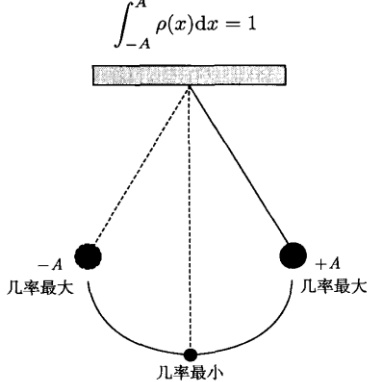

图 15.12 经典谐振子在平衡位置的几率最小，在振幅位置的几率最大
 

现在我们按照这样的知识考查量子谐振子的概率密度。首先，定义经典禁区  $ |x|>A_{n} $，其中  $ A_{n} $ 被下式定义

$$  \frac{1}{2}\mu\omega^{2}A_{n}^{2}=\hbar\omega\left(n+\frac{1}{2}\right)   \tag*{(15.4.92)}$$

式(15.4.92)表明，在 $ A_{n} $处振子的势能等于总能量， $ A_{n} $称为最大经典振幅。利用无量纲变量 $ \xi=\alpha x $[式(15.4.11)]，最大无量纲经典振幅表示为 $ a_{n}=\alpha A_{n} $。式(15.4.92)给出

$$  a_{n}=\sqrt{2n+1}   \tag*{(15.4.93)}$$

现在我们考查基态的量子谐振子 $ (n=0) $，由式(15.4.93)知道最大无量纲经典振幅为 $ a_{0}=1 $。振子的本征能量为 $ E_{1}=\frac{1}{2}\hbar\omega $，它称为零点能；相应的概率密度由式(15.4.90)给出

$$  \left|\psi_{0}(\xi)\right|^{2}=\frac{\alpha}{\sqrt{\pi}}\exp\left(-\xi^{2}\right)   \tag*{(15.4.94)}$$

<!-- page: 543 -->

这是一个高斯函数 (图 15.13)。首先可以看出，基态量子谐振子概率密度的行为与经典情况完全相反，它的最大值出现在“平衡位置” $ \xi = 0 $。另外按照经典力学的知识，基态振子只允许在  $ |x| \leq A_0 $ (即  $ |\xi| \leq 1 $) 范围内运动，而  $ |x| > A_0 $ 属于经典禁区。但量子谐振子可以出现在禁区内，事实上我们可以计算振子在经典禁区出现的几率

$$  Q_{0}=\int_{-\infty}^{-A_{0}}\left|\psi_{0}(x)\right|^{2}\mathrm{d}x+\int_{A_{0}}^{\infty}\left|\psi_{0}(x)\right|^{2}\mathrm{d}x   \tag*{(15.4.95)}$$

用  $ \xi=\alpha x $ 以及高斯函数的对称性，我们得到

$$  Q_{0}=\frac{2}{\sqrt{\pi}}\int_{1}^{\infty}\exp\left(-\xi^{2}\right)\mathrm{d}\xi   \tag*{(15.4.96)}$$

这是余误差函数  $ \mathrm{erfc}(x)=\frac{2}{\sqrt{\pi}}\int_{x}^{\infty}\exp\left(-\xi^{2}\right)\mathrm{d}\xi $ 在 x=1 的取值： $ Q_{0}=0.157 $。可见量子谐振子在经典禁区有可观的存在几率，这是一种量子效应。

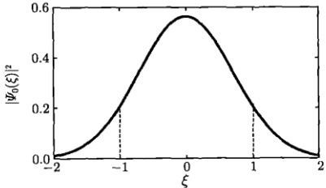

图 15.13 基态量子谐振子的概率密度，振子在经典禁区有 15.7% 的存在几率
 

为了搞清楚量子谐振子与经典谐振子的关系，下面对经典谐振子的概率密度问题进行定量的研究。由图15.8考查振子从x=-A到x=A的运动（经历的时间为半个周期），振子在任意区域内dx（停留的时间为dt）出现的几率为

$$  \rho(x)\mathrm{d}x=\frac{\mathrm{d}t}{T/2}   \tag*{(15.4.97)}$$

概率密度  $ \rho(x) $ 的归一化条件由空间变量表示为式 (15.4.91)，而用时间变量还可以表示为

$$  \int_{0}^{T/2}\frac{\mathrm{d}t}{T/2}=1   \tag*{(15.4.98)}$$

现在我们求解方程（15.4.97），为此对简谐振动的位移式（15.4.2）关于时间 t 求导数，有

 $$ \frac{\mathrm{d}x}{\mathrm{d}t}=A\omega\cos(\omega t+\delta)=A\omega\sqrt{1-\sin^{2}(\omega t+\delta)} $$

<!-- page: 544 -->

$$ =A\omega\sqrt{1-\left(\frac{x}{A}\right)^{2}}=\omega\sqrt{A^{2}-x^{2}} $$ 

由式(15.4.97)，并注意到 $ T=2\pi/\omega $，我们有

$$  \rho(x)=\frac{2/T}{\frac{\mathrm{d}x}{\mathrm{d}t}}=\frac{2}{T\omega\sqrt{A^{2}-x^{2}}}=\frac{1}{\pi\sqrt{A^{2}-x^{2}}}   \tag*{(15.4.99)}$$

这就是经典谐振子的概率密度表示式，如图 15.14 所示。

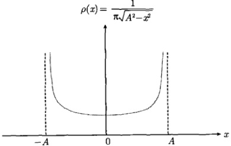

图 15.14 经典谐振子的概率密度
 

经典振幅 A 对于不同的本征态  $ \psi_{n}(x) $，应该有不同的尺度。为了与量子谐振子的概率密度相比较，式 (15.4.99) 中的经典振幅 A 应该用相应的最大经典振幅  $ A_{n} $ [式 (15.4.92)] 代替，即

$$  \rho(x)=\frac{1}{\pi\sqrt{A_{n}-x^{2}}}   \tag*{(15.4.100)}$$

利用关系式  $ \xi=\alpha x, a_{n}=\alpha A_{n} $，概率密度式（15.4.100）用无量纲变量  $ \xi $ 表示为 [注意到式 (15.4.93)]

$$  \rho(\xi)=\frac{1}{\pi\sqrt{2n+1-\xi^{2}}}   \tag*{(15.4.101)}$$

相应的归一化条件为

$$  \int_{-1}^{1}\frac{1}{\pi\sqrt{2n+1-\xi^{2}}}\mathrm{d}\xi=1   \tag*{(15.4.102)}$$

现在我们将量子谐振子的概率密度式(15.4.90)与相应的经典结果式(15.4.101)相比较，如图15.15所示。可以看出，当量子数n取前两个值时，量子谐振子的概率密度与经典情况毫无相似之处(甚至完全相反)；随着n的增加，量子谐振子概率密度两侧的峰逐渐升高，与经典情况的相似性随之增加。在较大量子数n情况下(图15.16)，量子谐振子的概率密度呈快速振荡，其平均值接近经典行为。可见，能量高的振子比能量低的振子“更经典”。量子系统在量子数较大情况下趋于经典系统的行为，这是量子-经典对应原理的普遍规律。

<!-- page: 545 -->

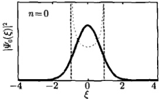

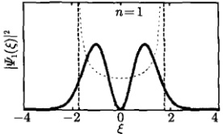

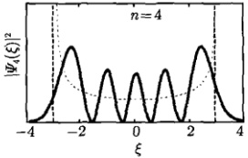

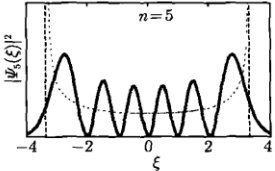

图 15.15 量子（实线）与经典（虚线）谐振子的概率密度
 

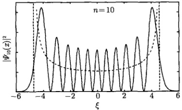

图 15.16 n = 10 时量子（实线）与经典（虚线）谐振子的概率密度
 

为了进一步说明谐振子中的这种效应，我们计算激发态情况下，振子在经典禁区的几率。对于量子数为 n 的激发态，我们有

 $$ \begin{aligned}Q_{n}&=\int_{-\infty}^{-A_{n}}\left|\psi_{n}(x)\right|^{2}\mathrm{d}x+\int_{A_{n}}^{\infty}\left|\psi_{n}(x)\right|^{2}\mathrm{d}x\\&=2\int_{A_{n}}^{\infty}\left|\psi_{n}(x)\right|^{2}\mathrm{d}x=\frac{2}{\alpha}\int_{a_{n}}^{\infty}\left|\psi_{n}(\xi)\right|^{2}\mathrm{d}\xi\\&=\frac{1}{2^{n-1}n!\sqrt{\pi}}\int_{\sqrt{2n+1}}^{\infty}\exp\left(-\xi^{2}\right)H_{n}^{2}(\xi)\mathrm{d}\xi\end{aligned} $$ 

上式给出

 $$ \begin{aligned}Q_{0}&=0.157,\quad Q_{1}=0.112,\quad Q_{2}=0.095,\quad Q_{3}=0.085\\&\quad Q_{10}=0.060\end{aligned} $$ 

可见随着量子数 n 的增加，谐振子在经典禁区的几率减小，系统趋于经典行为。我们再次看到，能量高的振子比能量低的振子“更经典”。

