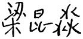

# 00-封面与前言目录

[返回全书目录](../../README.md)

> PDF 页码：1–19

<!-- page: 1 -->

# 国家精品课程配套教材 国家级精品资源共享课配套教材

# 数学物理方法

（第四版） 姚端正 周国全 贾俊基 编著

P 科学出版社

<!-- page: 2 -->

“十二五”普通高等教育本科国家级规划教材

数学物理方法

（第四版）

姚端正 周国全 贾俊基 编著

科学出版社

北京

<!-- page: 3 -->

#### 内容简介

本书是“十二五”普通高等教育本科国家级规划教材，也是国家精品课程、国家级精品资源共享课配套教材。

作者本着去粗取精、更新拓宽的思想科学地组织内容。全书密切结合物理实例，特别注重与后续课程的联系，并增加了一般传统教材中所没有的非线性方程、积分方程、分步傅里叶变换及小波变换等内容。全书分为复变函数论（第一篇）、数学物理方程（第二篇）、特殊函数（第三篇）和近似方法及现代内容（第四篇）四个部分。在每章后都有小结，每小节后都附有习题，习题中包含具有一定深度、难度和挑战度的题，以培养学生分析问题、解决问题的能力和创新能力。为了方便读者，每章后都有以二维码形式链接的授课课件及习题分析与讨论，书末附有习题参考答案。

本书可作为高等院校物理专业和相关专业本科生的教材，也可供相关专业的研究生、教师和科技人员参考使用。

图书在版编目(CIP)数据

数学物理方法/姚端正，周国全，贾俊基编著.—4版.—北京：科学出版社，2020.8

“十二五”普通高等教育本科国家级规划教材

ISBN 978-7-03-065651-3

Ⅰ. ①数… Ⅱ. ①姚…②周…③贾… Ⅲ. 数学物理方法-高等学校-教材 Ⅳ. O411.1

中国版本图书馆 CIP 数据核字（2020）第120637号

责任编辑：窦京涛 / 责任校对：杨聪敏

责任印制：张伟 / 封面设计：华路天然工作室

##### 科学出版社出版

北京东黄城根北街16号

邮政编码：100717

http://www.sciencep.com

北京建宏印刷有限公司 印刷

科学出版社发行 各地新华书店经销

关

1992年8月第一版开本：720×1000 B5

1997年7月第二版印张：241/4

2010年3月第三版字数：489000

2020年8月第四版2020年8月第十三次印刷

定价：59.00元

（如有印装质量问题，我社负责调换）

<!-- page: 4 -->

### 第四版前言

本人所编数学物理方法第三版面世业已十年。然而，“欲穷千里目，更上一层楼”，一本好的教材，必须通过在教学实践中的不断检验、千锤百炼才能造就。为此在保留了原教材特色的前提下，第四版对其内容和体系做了如下修改：

（1）为了使教材既能与时俱进，具有高阶性、创新性和挑战度，又能适应当前普遍存在的学时偏少的需要，我们改变了原教材体系，将大纲要求的最基本、必讲的内容连贯性地集中放在前三篇，增加了第四篇——近似方法及现代内容，并将原教材中的第十一章变分法、第十二章非线性方程、第十三章积分方程、经改写后的的小波变换以及新增加的现代内容一并汇入其中，以便使用该教材的学校可根据自身情况对第四篇内容或全讲或选讲，这样既能解决某些学校受学时限制的困扰，又不至降低教材质量.

（2）非线性方程是近代物理中常会遇到的方程，但大多非线性方程不能求得其解析解，为了使教材能与前沿学科接轨，在非线性方程一章增加了近些年来受广大学者青睐的“分步傅里叶变换法”这一方便的数值解法的内容，这对基础研究极为有用。

（3）对授课课件、部分章节中的措辞及注释内容进行了修改和补充.

（4）部分章节增加了有深度、难度和挑战度的习题，以进一步拓宽学生思路，增强其分析问题、解决问题的能力。

（5）增加了“附录Ⅰ.矢量微分算子与拉普拉斯算符”和“索引”两部分，以方便读者查阅.

还要指出的是，为了方便读者、节省篇幅，第四版将每章的授课课件、习题分析与讨论以及某些注释和证明过程以二维码链接的形式录入书中，这也是此版与前三版的一个较大差异和改进。

最后，感谢周国全老师、贾俊基老师加入到了第四版的改写工作中，感谢窦京涛编辑为本书出版所作的辛苦付出，感谢广大读者尤其是使用本教材的教师对本书的厚爱以及对本书所提出的宝贵意见和建议，感谢科学出版社高教数理分社社长昌盛和武汉大学熊贵光教授多年来对本人工作的支持与帮助。

姚端正

2019年6月于珞珈山

<!-- page: 5 -->

### 第三版前言

浮生却似冰底水，日夜东流人不知。不知不觉，本人的拙作《数学物理方法》一书已历经了20多年的使用历程。从讲义到出版问世，到再版；从荣获国家教委优秀教材二等奖，到荣获教育部科技进步二等奖，再到入选为普通高等教育“十一五”国家级规划教材；这一路过来，作为一个普通教师，本人心存太多的感慨和感激！我感谢李中辅教授、路见可教授和黄念宁教授在本书编写、修改过程中所作的有益讨论和指教；我感谢保宗悌教授、梁昆森教授、陆全康教授对本书的悉心评审、评阅，特别是老前辈梁昆森教授为第二版所写的序；我感谢广大读者尤其是使用本书的教师、学生对本书的厚爱；我感谢武汉大学教务部历年来对教学工作的重视、扶持；我也感谢科学出版社的昌盛编辑和窦京涛编辑为第三版的出版所付出的辛勤劳动。在第三版即将问世之际，我还要特别感谢金准智教授和熊贵光教授长期以来对本人工作的支持和帮助！我深知，没有大家的帮助和支持，本书不可能一步步地走到今天。

众所周知，数学物理方法是物理类专业的重要基础课，也是一门公认的难教、难学的理论课程。如何将难教、难学的课程变为易教、易学的课程，如何使数学物理方法教材的内容能适应21世纪科技发展的需要，这便是本人编写本书的主要宗旨。为此，第三版对第二版的内容大致作了如下更改：

1. 将全书的内容编排进行了调整，取消了原书的第四篇，而将其内容作为“非线性方程”、“积分方程”各一章并入第二篇。全书共含复变函数论、数学物理方程和特殊函数三篇，且为查找方便起见，将全书的16章不分篇地统一排序。

2. 受篇幅限制，删去了第二版中的部分章节，将其部分内容并入适当的章节或相关章节的习题中。如，删去了原书第二篇第二章行波法中的2.2节反射波，而将其内容作为习题并入习题7.1中；删去了原书第二篇第六章保角变换法，而将其中1.1节保角变换的主要内容作为新的一节（1.5节解析函数的几何性质）添加到第一篇中；删去了原书第二篇第七章复变函数法，而将其内容作为两个习题列入第二篇习题11.4中；删去了原书中的附录一（高斯方程和库默方程）、附录二（最陡下降法）、附录三（矢量公式和矢量定理），将高斯方程和库默方程的相关内容并入第三篇第十六章中，等等。

3. 对部分章节进行了改写. 如, 10.5 节含时的格林函数法, 13.2 节施密特-希尔伯特理论等.

4. 根据教育部对该课程的要求和近年来科技发展的需要，增加了部分章节或内容。如，2.3 节中含参量积分的内容，4.3 节 B 函数，5.4 节中的含对数函数的积分，9.5 节小波变换导引，等等。

<!-- page: 6 -->

需要说明的几个问题：

1. 本书可供讲授72～90学时（不含习题课）和讲授54～60学时（不含习题课）的两种需求者使用。对于讲授72学时（不含习题课）的使用者，若学时不够，建议可根据自身的情况或需求删去部分打*的节（而不是打*的章）。对于讲授54学时（不含习题课）的使用者，可直接删去打*的章。

2. 本书每小节后的大约一半的习题在其配套的《数学物理方法学习指导》（科学出版社，姚端正，2001年）中有详细解答和分析（为了培养学生分析问题、解决问题的能力，我们有意没有给出全部习题的解答）.

3. 为了方便读者，本书为读者提供了 PDF 格式的电子教案光盘（含习题课），并对以本书为教材的老师赠送可修改格式的授课用电子教案。需要指出的是，鉴于本课程应特别注重培养学生逻辑推理能力和分析问题、解决问题的能力，建议使用该教案的授课教师，一定要结合适当的板书推演过程，否则其教学效果将是不理想和不完善的。实际上本电子教案中有些章节已省去了不少推导、证明过程，而第十一章和第十三章，由于完全是通过板书推演来授课，则未录入电子教案。

“路漫漫其修远兮，吾将上下而求索！”尽管我衷心地希望本书能成为广大学习数理方法读者的良师益友，但由于受水平、时间和篇幅的限制，难免有疏漏和不妥之处，敬请专家和广大读者批评指正！

姚端正

2009年仲夏夜于珞珈山

<!-- page: 7 -->

### 第二版序言

多年来，姚端正和梁家宝两位先生先后相继为武汉大学物理类专业讲授“数学物理方法”课程。本书就是他们在长年教学实践的基础上编写出版的优秀教材。

作者十分注意数学与物理的结合，注意阐述有关物理背景和前景。这个特点对于物理类专业是很重要的。

非线性方程和积分方程对于物理学科的一些新进展很有用，但在同类教科书中却往往阙如。本书则将有关内容编为第四篇，体现出课程现代化之精神。

本书选材恰当，文字清晰，要言不繁。尽管增加了第四篇，全书篇幅并不大于同类教材，十分有利于在有限的学时内很好地完成数学物理方法的教学。

在 1995 年的优秀教材评选中，本书荣获国家教委第三届优秀教材二等奖，我以为正是实至名归。在本书再版之际，谨以此表示祝贺之忱。

1996年丙子仲秋

<!-- page: 8 -->

### 第二版前言

本书第一版虽然荣幸获得了国家教委第三届优秀教材二等奖，但一本好的教材必须通过在教学实践中的千锤百炼，不断地充实、更新，才能满足读者和迅猛发展的科学技术的需要。故借此再版之机，我们对本书第一版的内容作了如下一些修改：

1. 对部分章、节的写法和内容作了些改动。如第二篇的 §3.5，§5.1，§5.5，§8.2；第三篇的 §2.3 等，以使本书能更紧密地结合物理学及相关课程的内容。

2. 在第四篇的非线性方程部分增加了“解析近似解和正则摄动法”一节，以满足近代物理学中解大量非线性方程的需要；在附录中增加了“矢量公式和矢量定理”的内容，以便读者学习本课程时查阅；在部分章节中增加了一些例题和习题，特别是将近些年来美国部分高校的研究生试题及 CUSPEA 考题中与本课程相关的内容分别录入到了相关章节的习题中，以进一步开拓学生视野，提高学生分析问题和解决问题的能力。

3. 删去了第三篇中与高等数学重复的“常微分方程的级数解法”的内容和附录中的“贝塞尔函数表”，仅将所需用到的结论和数据简述在相应章节的附注中.

4. 对习题中可作为公式和结论运用的题加上了公式编号；而对习题中的难题、超纲题打上了 * 标记.

5. 对书中和习题答案中的印刷错误进行了更正.

本书自1992年问世以来，得到校内外广大读者和专家的关心与支持，特别是武汉大学物理学93级“人才基地班”的同学，为本书的再版提供了许多宝贵的意见，武汉大学出版社为本书的再版给予了大力支持，在此一并表示衷心的感谢。

这次再版，尽管我们倾注了不少心血，但由于水平和时间的限制，错误或不妥之处在所难免，敬请读者批评指正。

编者

1996年暑期于珞珈山

<!-- page: 9 -->

### 第一版前言

本书是在多年来武汉大学物理类专业数学物理方法课程所用的自编教材和讲义的基础上修改而成的。其内容包括复变函数论、数学物理方程、特殊函数、积分方程和非线性方程简介四个部分。适合物理类专业和相应的专业教学使用。

数学物理方法是物理系基础理论课——四大力学之间的黏合剂，是解决物理学中各种具体问题的重要工具之一。为了编写出一本较为理想的数学物理方法教材，使之不仅局限于叙述知识，更主要的是引导学生去思考问题，使他们具有分析问题和解决问题的能力，在编写时我们注意了以下几点：

一、第二篇是以数学物理方程的各种解法为主线进行编写的。这样可使读者一目了然地了解数理方程一般有哪些解法，同时还便于读者将同一问题的不同解法进行对比，从而选择最佳方法来解决具体问题。

二、在每一小节的内容后都编入了相当数量的习题（在附录中有参考答案），使读者能及时消化所学知识。在习题中，编入了一定量的能开拓学生知识面的内容。这样，既不挤占教材篇幅，又可使学生掌握更多知识。

三、每一章后都附有小结，使学生对整章内容融会贯通，加强知识的条理性、系统性。小结的形式多采用表格或框图，以便于学生对比和加深印象。

四、考虑到物理类专业的特点，对有些定理或公式不是单从数学上进行推导，而是先从物理背景、物理前景方面进行阐述，使读者易于理解和接受。书中的内容、例题和习题也都尽量结合物理问题和物理实例。

五、随着学科的新进展，根据需要，将传统数学物理方法教科书中没有而对物理学又十分有用的某些积分方程和非线性方程的解法作为第四篇编入到了本书中。

六、为了教学的方便，将本课程用到的其他课程的部分定理、公式，编写到了本书相应章节的注释中。

七、书中打“*”的章节，若受学时限制，教师可只选讲，或放入习题课中讲解，也可不讲。

本书的出版，得到了武汉大学教务处、物理系、物理系基地班及出版社有关负责同志的大力支持。保宗悌教授在百忙中对本书进行了审阅；李中辅教授对本书的编写提出了一些宝贵的意见并作了有益的指教；龙理老师为本书核对了习题答案，在此一并表示衷心的感谢！

由于编者水平有限，再加之时间仓促，难免有不妥甚至谬误之处，敬请读者批评指正。

编者

1991年10月

<!-- page: 10 -->

## 目录

## 第一篇 复变函数论

第一章 解析函数……3    
1.1 复数及其运算……3    
习题1.1……6    
1.2 复变函数……7    
习题1.2……9    
1.3 微商及解析函数……10    
习题1.3……15    
1.4 初等解析函数……16    
习题1.4……22    
1.5 解析函数的几何性质……23    
习题1.5……28    
本章小结……29    
第二章 解析函数积分……30    
2.1 复变函数的积分……30    
习题2.1……32    
2.2 柯西定理……33    
习题2.2……38    
2.3 柯西积分公式……38    
习题2.3……44    
本章小结……45    
第三章 复变函数级数……46    
3.1 复级数……46    
3.2 幂级数……49    
习题3.2……51    
3.3 泰勒级数……51    
习题3.3……54    
3.4 洛朗级数……55    
习题3.4……60    
3.5 单值函数的孤立奇点……61    
习题3.5……65

<!-- page: 11 -->

本章小结 ..... 67    
第四章 解析延拓 Γ函数 B函数 ..... 68    
4.1 解析延拓 ..... 68    
习题4.1 ..... 70    
4.2 Γ函数 ..... 71    
习题4.2 ..... 73    
4.3 B函数 ..... 74    
习题4.3 ..... 75    
本章小结 ..... 76    
第五章 留数理论 ..... 77    
5.1 留数定理 ..... 77    
习题5.1 ..... 81    
5.2 利用留数理论计算实积分 ..... 82    
习题5.2 ..... 86    
5.3 物理问题中的几个积分 ..... 87    
习题5.3 ..... 90    
5.4 多值函数的积分 ..... 91    
习题5.4 ..... 93    
本章小结 ..... 95    
    
第二篇 数学物理方程    
第六章 定解问题 ..... 99    
6.1 引言 ..... 99    
6.2 三类数理方程的导出 ..... 101    
习题6.2 ..... 105    
6.3 定解条件 ..... 106    
习题6.3 ..... 110    
本章小结 ..... 111    
第七章 行波法 ..... 112    
7.1 无界弦的自由振动 达朗贝尔公式 ..... 112    
习题7.1 ..... 116    
7.2 无界弦的强迫振动 ..... 117    
习题7.2 ..... 121    
7.3 三维无界空间的自由振动 泊松公式 ..... 121    
习题7.3 ..... 127    
7.4 三维无界空间的受迫振动 推迟势 ..... 127    
本章小结 ..... 130

<!-- page: 12 -->

第八章 分离变量法……131    
8.1 有界弦的自由振动……131    
习题8.1……138    
8.2 非齐次方程 纯强迫振动……140    
习题8.2……143    
8.3 非齐次边界条件的处理……144    
习题8.3……148    
8.4 正交曲线坐标系中的分离变量法……148    
习题8.4……157    
本章小结……159    
第九章 积分变换法……160    
9.1 傅里叶变换……160    
习题9.1……167    
9.2 傅里叶变换法……169    
习题9.2……172    
9.3 拉普拉斯变换……173    
习题9.3……179    
9.4 拉普拉斯变换法……180    
习题9.4……182    
本章小结……184    
第十章 格林函数法……185    
10.1 δ函数……185    
习题10.1……188    
10.2 边值问题的格林函数法……189    
习题10.2……195    
10.3 稳恒问题的格林函数……195    
习题10.3……198    
10.4 电像法与狄氏格林函数……199    
习题10.4……204    
10.5 含时问题的格林函数法……205    
习题10.5……210    
本章小结……211    
第三篇 特殊函数    
第十一章 勒让德多项式……215    
11.1 勒让德多项式……215

<!-- page: 13 -->

11.2 勒让德多项式的性质……220      
习题11.2 ……226      
11.3 连带勒让德函数与球函数……227      
习题11.3 ……232      
本章小结……233      
第十二章 贝塞尔函数……234      
12.1 贝塞尔函数……234      
习题12.1 ……239      
12.2 贝塞尔函数的性质……239      
习题12.2 ……245      
12.3 其他柱函数……246      
习题12.3 ……253      
本章小结……256      
第十三章 施图姆-刘维尔理论……258      
13.1 施图姆-刘维尔本征值问题……258      
习题13.1 ……261      
13.2 高斯方程和库默尔方程……262      
本篇主要特殊函数性质小结……265      
* 第四篇 近似方法及现代内容      
第十四章 变分法……269      
14.1 泛函和泛函的极值……269      
习题14.1 ……277      
14.2 用变分法解数理方程……278      
习题14.2 ……285      
本章小结……286      
第十五章 非线性方程……287      
15.1 非线性方程的某些初等解法……287      
习题15.1 ……292      
15.2 孤波和孤子……292      
习题15.2 ……297      
15.3 解析近似法之正则摄动法……298      
习题15.3 ……301      
15.4 数值解法之分步傅里叶变换法……301      
本章小结……305      
第十六章 积分方程……306      
16.1 积分方程的几种解法……306

<!-- page: 14 -->

习题16.1 ……312    
16.2 施密特-希尔伯特理论 ……313    
习题16.2 ……316    
16.3 维纳-霍普夫方法 ……316    
习题16.3 ……318    
本章小结……319    
第十七章 小波变换……320    
17.1 小波变换的由来……320    
17.2 小波变换……323    
习题参考答案……327    
参考文献……349    
附录……350    
Ⅰ. 矢量微分算子与拉普拉斯算符 ……350    
Ⅱ. 傅里叶变换简表……352    
Ⅲ. 拉普拉斯变换简表……353    
索引……355

<!-- page: 15 -->

## Contents

Part One Theory of Complex Variable Function    
    
Chapter 1 Analytic Function ..... 3    
1.1 Complex numbers and their operations ..... 3    
Problem 1.1 ..... 6    
1.2 Function of a complex variable ..... 7    
Problem 1.2 ..... 9    
1.3 Derivative and analytic function ..... 10    
Problem 1.3 ..... 15    
1.4 Elementary analytic functions ..... 16    
Problem 1.4 ..... 22    
1.5 Geometric properties of analytic functions ..... 23    
Problem 1.5 ..... 28    
Summary for chapter 1 ..... 29    
Chapter 2 The Integral of the Analytic Function ..... 30    
2.1 The integral of the variable function ..... 30    
Problem 2.1 ..... 32    
2.2 The Cauchy theorem ..... 33    
Problem 2.2 ..... 38    
2.3 Cauchy integral formula ..... 38    
Problem 2.3 ..... 44    
Summary for chapter 2 ..... 45    
Chapter 3 Series of Complex Variable Function ..... 46    
3.1 Complex series ..... 46    
3.2 Power series ..... 49    
Problem 3.2 ..... 51    
3.3 Taylor series ..... 51    
Problem 3.3 ..... 54    
3.4 Laurent series ..... 55    
Problem 3.4 ..... 60    
3.5 The isolated singularity of the single-valued function ..... 61

<!-- page: 16 -->

Problem 3.5 ..... 65    
Summary for chapter 3 ..... 67    
Chapter 4 Analytic Continuation $\Gamma$ Function B Function ..... 68    
4.1 Analytic continuation ..... 68    
Problem 4.1 ..... 70    
4.2 $\Gamma$ function ..... 71    
Problem 4.2 ..... 73    
4.3 B-function ..... 74    
Problem 4.3 ..... 75    
Summary for chapter 4 ..... 76    
Chapter 5 The Residue Theory ..... 77    
5.1 The Residue theorem ..... 77    
Problem 5.1 ..... 81    
5.2 Real integral calculated by the Residue theorem ..... 82    
Problem 5.2 ..... 86    
5.3 Several integrals in physical problems ..... 87    
Problem 5.3 ..... 90    
*5.4 Integrals of the multi-valued function ..... 91    
Problem 5.4 ..... 93    
Summary for chapter 5 ..... 95    
Part Two Equations of Mathematical Physics    
Chapter 6 Complete Mathematical Models ..... 99    
6.1 Introduction ..... 99    
6.2 Derivation for three type of equations of mathematical physics ..... 101    
Problem 6.2 ..... 105    
6.3 Boundary conditions and initial conditions ..... 106    
Problem 6.3 ..... 110    
Summary for chapter 6 ..... 111    
Chapter 7 Method of Traveling Waves ..... 112    
7.1 Solution for the free vibration of the unbounded string $D'$ Alembert formula ..... 112    
Problem 7.1 ..... 116    
7.2 Solution for the pure forced vibration of the unbounded string ..... 117    
Problem 7.2 ..... 121    
*7.3 The free vibration in three-dimensional unbounded space Poisson

<!-- page: 17 -->

formula ..... 121    
Problem 7.3 ..... 127    
*7.4 The forced vibration in three-dimensional unbounded space Retarded potentials ..... 127    
Summary for chapter 7 ..... 130    
Chapter 8 The Method of Separation of Variables ..... 131    
8.1 The free-vibration of the bounded string ..... 131    
Problem 8.1 ..... 138    
8.2 The non-homogeneous equation-the pure forced vibration ..... 140    
Problem 8.2 ..... 143    
8.3 The treatment of the non-homogeneous boundary conditions ..... 144    
Problem 8.3 ..... 148    
8.4 The separation of variables in the orthogonal curvilinear coordinates ..... 148    
Problem 8.4 ..... 157    
Summary for chapter 8 ..... 159    
Chapter 9 Integral Variable Method ..... 160    
9.1 Fourier transforms ..... 160    
Problem 9.1 ..... 167    
9.2 Fourier transform method ..... 169    
Problem 9.2 ..... 172    
9.3 Laplace transforms ..... 173    
Problem 9.3 ..... 179    
9.4 Laplace transform method ..... 180    
Problem 9.4 ..... 182    
Summary for chapter 9 ..... 184    
Chapter 10 Green's Function Method ..... 185    
10.1 $\delta$-function ..... 185    
Problem 10.1 ..... 188    
10.2 Boundary value problems solved by Green's function method ..... 189    
Problem 10.2 ..... 195    
10.3 Green's function for stable problem ..... 195    
Problem 10.3 ..... 198    
10.4 Electro-image method and Dirichlet Green's function ..... 199    
Problem 10.4 ..... 204

<!-- page: 18 -->

* 10.5 Time-related mathematical problems solved by Green's function    
method ..... 205    
Problem 10.5 ..... 210    
Summary for chapter 10 ..... 211    
Part Three Special Functions    
Chapter 11 Legendre Polynomials ..... 215    
11.1 Legendre polynomials ..... 215    
Problem 11.1 ..... 220    
11.2 The property of Legendre polynomials ..... 220    
Problem 11.2 ..... 226    
11.3 Associated Legendre function and spherical function ..... 227    
Problem 11.3 ..... 232    
Summary for chapter 11 ..... 233    
Chapter 12 Bessel functions ..... 234    
12.1 Bessel functions ..... 234    
Problem 12.1 ..... 239    
12.2 The property of Bessel functions ..... 239    
Problem 12.2 ..... 245    
* 12.3 Other Column Functions ..... 246    
Problem 12.3 ..... 253    
Summary for chapter 12 ..... 256    
Chapter 13 Sturm-Liouville Theory ..... 258    
13.1 Sturm-Liouville Eigenvalue problem ..... 258    
Problem 13.1 ..... 261    
* 13.2 Gauss equation and the Kummer equation ..... 262    
Summary for the properties of the principal special functions in part three ..... 265    
* Part Four Approximation Method and Modern Content    
Chapter 14 The Variational Method ..... 269    
14.1 Functionals and functional extreme ..... 269    
Problem 14.1 ..... 277    
14.2 Solving equations of mathematical physics by the variational method ..... 278    
Problem 14.2 ..... 285

<!-- page: 19 -->

Summary for chapter 14 ..... 286    
Chapter 15 Nonlinear Equations ..... 287    
15.1 Some Primary solution method for nonlinear equations ..... 287    
Problem 15.1 ..... 292    
15.2 Isolated wave and soliton ..... 292    
Problem 15.2 ..... 297    
15.3 The regular perturbation method in analytical approximation methods ..... 298    
Problem 15.3 ..... 301    
15.4 A step-by-step Fourier transform method for numerical approximate methods ..... 301    
Summary for chapter 15 ..... 305    
Chapter 16 Integral Equations ..... 306    
16.1 Several methods for solving integral equations ..... 306    
Problem 16.1 ..... 312    
16.2 Schmidt-Hilbert theory ..... 313    
Problem 16.2 ..... 316    
16.3 Wiener-Hopf method ..... 316    
Problem 16.3 ..... 318    
Summary for chapter 16 ..... 319    
Chapter 17 Wavelet transform ..... 320    
17.1 The origin of wavelet transform ..... 320    
17.2 Wavelet transform ..... 323    
Reference keys to the problems ..... 327    
Bibliography and references ..... 349    
Appendix ..... 350    
I. Vector Differential Operator and Laplace Operator ..... 350    
II. Summary table of Fourier transform ..... 352    
III. Summary table of Laplace transform ..... 353    
Index ..... 355

