# 01-第一章 解析函数

[返回全书目录](../../README.md)

> PDF 页码：21–47

<!-- page: 21 -->

复变函数的理论特别是其中的解析函数在物理学中有着广泛的应用。本章将建立复变函数的基本概念，并在此基础上引入解析函数；在以后各章将介绍解析函数的性质和应用。

### 1.1 复数及其运算

## 1. 复数的概念

一对有序的实数 $ (x,y) $定义为复数，通常表示为

$$  z=x+iy   \tag*{(1,1,1)}$$

式中 i 满足  $ i^{2} = -1 $，称为虚单位；而 x 和 y 都是实数，分别称为复数 z 的实部和虚部，常记为

 $$ x=Re z,\quad y=Im z $$ 

虚部为零的复数就可看作是实数，即  $ x + i0 = x $。因此，全体实数是全体复数的一部分。实部为零的复数称为纯虚数。两个复数相等，是指它们的实部和虚部分别相等，即

必须且只须

 $$ \begin{aligned}&x_{1}+i y_{1}=x_{2}+i y_{2}\\&x_{1}=x_{2},\quad y_{1}=y_{2}\\ \end{aligned} $$ 

复数  $ x + iy $ 和 x - iy 互称为共轭复数，常用  $ \bar{z} $ 表示 z 的共轭复数，于是

$$  \bar{z}=x-iy   \tag*{(1.1.2)}$$

## 2. 复数的几何表示

复数的几何表示对于了解复变函数理论中的一些概念，例如多值函数、解析延拓等，很有帮助，而在复变函数论的一个重要应用方面——保角变换，更是必须的。

复数  $ z = x + iy $ 可以用平面上的点表示（见图1.1）。在平面上作一直角坐标系，取横轴OX为实轴，单位为1，纵横OY为虚轴，单位为i，则复数 z 就可

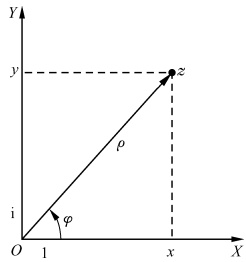

图1.1
 

以用横坐标等于x、纵坐标等于y的点表示。显然，对于每个复数，平面上有唯一的点与之相应；反过来，对于平面上的每一点，也有唯一的一个复数与之相对应。这也就是

<!-- page: 22 -->

说，复数全体与平面上的点有一一对应的关系.这样的平面称为复平面（或z平面）.

也可用从原点 O 到 z 点所引的向量  $ \overrightarrow{Oz} $ 表示复数  $ z = x + iy $ 。显然， $ \overrightarrow{Oz} $ 在实轴和虚轴上的投影分别表示  $ z = x + iy $ 的 x 和 y（图1.1）。若引入极坐标变量  $ (\rho, \varphi) $，则

 $$ x=\rho\cos\varphi,\quad y=\rho\sin\varphi $$ 

于是

$$  z=\rho\cos\varphi+i\rho\sin\varphi   \tag*{(1.1.3)}$$

或

$$  z=\rho\mathrm{e}^{\mathrm{i}\varphi}   \tag*{(1.1.4)}$$

(1,1,3)式和(1,1,4)式分别称为复数z的三角表示式和指数表示式.式中的 $ \rho $为向量 $ \overrightarrow{Oz} $的长度，称为复数z的模或绝对值，记作

$$  \rho=\mid z\mid=\sqrt{x^{2}+y^{2}}   \tag*{(1.1.5)}$$

而  $ \varphi $ 为向量  $ \overrightarrow{Oz} $ 与 x 轴的夹角，称为复数 z 的辐角，记作

$$  \varphi=\arg z,\qquad\tan\varphi=\frac{y}{x}   \tag*{(1.1.6)}$$

任一复数  $ z \neq 0 $ 有无穷多个辐角（例如  $ 30^{\circ}, 30^{\circ} + 2\pi, 30^{\circ} + 4\pi, \cdots $，均为同一向量的辐角），今以 argz 表示其中在  $ 2\pi $ 范围内变化的一个特定值，称之为辐角的主值，通常取

 $$ -\pi<\arg z\leqslant\pi $$ 

于是

$$  \mathrm{A r g}z=\arg z+2k\pi,\qquad k=0,\pm1,\pm2,\cdots   \tag*{(1.1.7)}$$

注意，当 z=0 时，其模为零，辐角无定义.

argz 与 Arctan  $ \frac{y}{x} $ 的主值  $ \arctan\frac{y}{x}\left(-\frac{\pi}{2}<\arctan\frac{y}{x}<\frac{\pi}{2}\right) $ 有如下关系：

$$   arg z=\left\{\begin{aligned}&\arctan\frac{y}{x},&z 在第Ⅰ象限 \\&\arctan\frac{y}{x}+\pi,&z 在第Ⅱ象限 \\&\arctan\frac{y}{x}-\pi,&z 在第Ⅲ象限 \\&\arctan\frac{y}{x},&z 在第Ⅳ象限 \end{aligned}\right.   \tag*{(1.1.8)}$$

例 1 已知流体在某点的速度 v = -1 - i，求其大小和方向.

解 大小： $ \left|v\right|=\sqrt{2} $

方向： $ \arg v = \arctan \frac{-1}{-1} - \pi = -\frac{3}{4}\pi $

注意，复数是没有大小的，因此以后在比较大小时只能用模来比较。

前面只是把模为有限的复数跟复数平面上的有限远点一一对应起来；在复

<!-- page: 23 -->

变函数理论中把无穷大也理解为复数平面上的一个“点”，称之为无限远点，并记为 $ \infty $，其模大于任何正数，辐角不定。显然，我们是难于用平面上的一个具体的点来描绘无限远点的，为此我们将引入复球面的概念。对于包括无限远点在内的复数的几何图像，也可用复球面来表示。如图1.2所示，把一个球放在复平面上，使其南极S与复平面相切于原点O，设复平面上的任意一点A与球的北极N的连线交球面于 $ A^{\prime} $点，于是，复

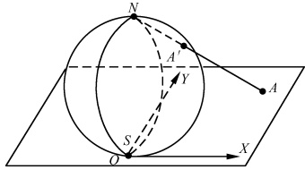

图1.2
 

数平面上的每一有限远点，都有球面上的点（除 N 以外）与之一一一对应（此对应关系称做测地投影）。若让 A 点以任何方式无限地远离原点 O，则相应的 A' 点将无限地趋近球面的北极 N，故可将 N 点看作无限远点的代表点，而整个球面就把无限远点包括在内。这样的球面称为复球面或黎曼（Riemann）球面。通常所指的复平面不包括无限远点。包括无限远点的复平面称为扩充了的复平面或全平面，它与复球面对应。复平面上只有一个无穷远点。

## 3. 复数的运算规则

由于实数是复数的特例，故在规定其运算方法时，既应使复数运算的法则施行于实数特例时，能够和实数运算的结果相符合，又应使复数的算术运算能够满足实数算术运算的一般规律（如加法遵守交换律与结合律；乘法遵守交换律、结合律与对加法的分配律等），为此我们规定：

（1）两复数  $ z_{1}=x_{1}+\mathrm{i}y_{1} $ 及  $ z_{2}=x_{2}+\mathrm{i}y_{2} $ 相加（减），可将它们的实部与实部，虚部与虚部分别相加（减），即

$$  z_{1}\pm z_{2}=(x_{1}\pm x_{2})+\mathrm{i}(y_{1}\pm y_{2})   \tag*{(1.1.9)}$$

（2）两复数  $ z_{1}=x_{1}+iy_{1} $ 及  $ z_{2}=x_{2}+iy_{2} $ 相乘，可按多项式乘法法则来进行，只需将结果中  $ i^{2} $ 换成 -1，即

$$  z_{1}\bullet z_{2}=(x_{1}x_{2}-y_{1}y_{2})+\mathrm{i}(x_{1}y_{2}+y_{1}x_{2})   \tag*{(1.1.10)}$$

（3）两复数  $ z_{1}=x_{1}+iy_{1} $ 及  $ z_{2}=x_{2}+iy_{2} $ 相除（除数 $ \neq0 $），可先把它写成分式的形式，然后分子分母同乘以分母的共轭复数，再进行化简，即

$$  \frac{z_{1}}{z_{2}}=\frac{x_{1}x_{2}+y_{1}y_{2}}{x_{2}^{2}+y_{2}^{2}}+\mathrm{i}\frac{y_{1}x_{2}-x_{1}y_{2}}{x_{2}^{2}+y_{2}^{2}},\quad z_{2}\neq0   \tag*{(1.1.11)}$$

由上述规定很容易证明

$$  \mathrm{e}^{\mathrm{i}\varphi_{1}}\bullet\mathrm{e}^{\mathrm{i}\varphi_{2}}\;=\;\mathrm{e}^{\mathrm{i}(\varphi_{1}+\varphi_{2})}   \tag*{(1.1.12)}$$

$$  \mathrm{e}^{\mathrm{i}\varphi_{1}}/\mathrm{e}^{\mathrm{i}\varphi_{2}}=\mathrm{e}^{\mathrm{i}(\varphi_{1}-\varphi_{2})}   \tag*{(1.1.13)}$$

故我们不难得到复数的乘、除、乘方和开方等运算的指数表示式

$$  z_{1}\bullet z_{2}=\rho_{1}\rho_{2}\mathrm{e}^{\mathrm{i}(\varphi_{1}+\varphi_{2})}   \tag*{（1.1.14）}$$

<!-- page: 24 -->

$$  \frac{z_{1}}{z_{2}}=\frac{\rho_{1}}{\rho_{2}}\mathrm{e}^{\mathrm{i}(\varphi_{1}-\varphi_{2})}   \tag*{(1.1.15)}$$

$$  z^{n}=\rho^{n}\mathrm{e}^{\mathrm{i}m\varphi},\qquad n=1,2,3,\cdots   \tag*{(1.1.16)}$$

$$  \sqrt[m]{z}=\sqrt[m]{\rho}\mathrm{e}^{\mathrm{i}\frac{\varphi}{m}}=\sqrt[m]{\rho}\mathrm{e}^{\mathrm{i}\frac{\arg z+2k\pi}{m}},\quad m=2,3,\cdots;k=0,\pm1,\pm2,\cdots   \tag*{(1.1.17)}$$

(1.1.17)式中的 k 本可取  $ 0, \pm1, \pm2, \cdots $，但实际上 k 只要取 0,1,…,m-1，就可得到  $ \sqrt[m]{z} $ 的 m 个不同的值，即， $ \arg(\sqrt[m]{z})=\frac{\arg z+2k\pi}{m}, k=0,1,2,\cdots,m-1 $。不难验证，k 取其他整数时所得到的  $ \sqrt[m]{z} $ 的值与这 m 个值相同.

例2 求 $ \sqrt[3]{-8} $之值.

解 因 -8 = 8e^{in}, 所以

 $$ \sqrt[3]{-8}=\sqrt[3]{8}\mathrm{e}^{\mathrm{i}\frac{\pi+2k\pi}{3}},\quad k=0,1,2 $$ 

当 k=0 时， $ \sqrt[3]{-8}=\sqrt[3]{8}\mathrm{e}^{\mathrm{i}\frac{\pi}{3}}=1+\mathrm{i}\sqrt{3} $;

当 k=1 时， $ \sqrt[3]{-8}=\sqrt[3]{8}\mathrm{e}^{\mathrm{i}\pi}=-2 $

当 k=2 时， $ \sqrt[3]{-8}=\sqrt[3]{8}\mathrm{e}^{\frac{5\pi}{3}}=1-\mathrm{i}\sqrt{3} $

注 ① 当然，矢量的起点可以不在原点；也就是说长度和方向都相同的矢量表示同一个矢量。

#### 习题1.1

1. 用复变量表示：

（1）上半平面；（2）左半平面；（3）半圆（包括边界）；（4）扇形（不要边界）.

2. 求出下列关系的几何位置：

(1) $ \left|z-a\right|=\left|z-b\right| $，a 和 b 为复常数；（2） $ \left|z\right|+\operatorname{Re}z\leq1 $；

(3)

 $$ \operatorname{Re}\frac{1}{z}=2;\quad(4)\quad\left|z-\frac{a}{2}\right|+\left|z+\frac{a}{2}\right|=c,\quad a>0,c>0. $$ 

3. 试证明下列恒等式或关系式，并解释其几何意义：

 $$ |z_{1}+z_{2}|^{2}+|z_{1}-z_{2}|^{2}=2(|z_{1}|^{2}+|z_{2}|^{2}); $$ 

(1)

(2)

 $$ \left|z_{1}+z_{2}\right|\leqslant\left|z_{1}\right|+\left|z_{2}\right|; $$ 

(3)

$$  \left|z_{1}+z_{2}\right|\geqslant\left|z_{1}\right|-\left|z_{2}\right|；   \tag*{(1.1.20)}$$

(4)

$$  \mid z_{1}\mid-\mid z_{2}\mid\mid\leqslant\mid z_{1}-z_{2}\mid.   \tag*{(1.1.21)}$$

4. 求下列复数的实部、虚部、模与辐角主值：

(1)

 $$ 1-\cos\alpha+\sin\alpha,0<\alpha\leq\pi; $$ 

(2)

 $$ \frac{1-2\mathrm{i}}{3-4\mathrm{i}}-\frac{2-\mathrm{i}}{5\mathrm{i}}； $$ 

(3)

 $$ (\sqrt{3}+i)^{-3} $$ 

(4)

 $$ \mathrm{e}^{1+i}. $$ 

5. 证明棣摩弗(De Moivre)公式

$$  (\cos\theta+i\sin\theta)^{n}=\cos n\theta+i\sin n\theta   \tag*{(1,1,22)}$$

并用  $ \cos\theta $ 及  $ \sin\theta $ 表示  $ \cos n\theta $ 及  $ \sin n\theta $.

6. 计算下列数值：

(1)  $ \sqrt{1+i} $; (2)  $ (\sqrt{3}-i)^{5} $; (3)  $ \mathrm{Arg}(2-2i) $; (4)  $ (1+\sqrt{3}i)^{-10} $.

<!-- page: 25 -->

7. 求解方程

(1) $ z^{3}-1=0 $; (2) $ z^{2}-(2+3i)z-1+3i=0 $.

8. 设流体在点  $ z=1+2i $ 的流速为  $ v=\frac{3+i}{2-i} $，求其大小和方向.

9. 验证下列关系成立：

(1)  $ z \cdot \bar{z} = |z|^2 $,  $ \frac{z + \bar{z}}{2} = \mathrm{Re}z $,  $ \frac{z - \bar{z}}{2i} = \mathrm{Im}z $;

(2) 设  $ R(a,b,c,\cdots) $ 表示对于复数 a,b,c, $ \cdots $ 的任一有理运算，则  $ \overrightarrow{R(a,b,c\cdots)}=R(\overrightarrow{a},\overrightarrow{b},\overrightarrow{c},\cdots) $.

10. 写出下列曲线方程的复变量形式：

（1）双曲方程  $ x^{2}-y^{2}=1 $

（2）椭圆方程  $ \frac{x^{2}}{a^{2}}+\frac{y^{2}}{b^{2}}=1 $;

（3）圆的方程  $ (x-x_{0})^{2}+(y-y_{0})^{2}=R^{2} $

（4）直线方程  $ Ax+By+C=0 $

### 1.2 复变函数

## 1. 复变函数的概念

设 E 为复数平面的一点集（复数的集合），若按一定的规律，使 E 内每一复数 z 都有一个或多个的  $ w = u + \mathrm{i}v $ （u 和 v 为实数）与之相应，则称 w 为 z 的复变函数，定义域为 E，记作

 $$ w=f(z),\quad z\in E $$ 

若一个z只有一个w之值与之对应（例如 $ w=z^{2} $），则称w为z的单值函数。特别是若在E内至少存在不同的两点 $ z_{1} $及 $ z_{2} $，使 $ w=f(z_{1})=f(z_{2}) $，则称w在E内是多叶的（如 $ w=z^{2} $）；否则是单叶的（如 $ w=az+b,a\neq0 $）。

若一个 z 有多个 w 之值与之对应（例如  $ w=\sqrt{z} $），则称 w 为 z 的多值函数。因 z=x+iy，于是

$$  w=f(z)=u(x,y)+\mathrm{i}v(x,y)   \tag*{(1,2,1)}$$

这表明，一个复变函数无非是两个二元实变函数的有序组合，因而研究一个复变函数，也就是要研究两个实二元函数。

## 2. 区域的概念

在解析函数论中，函数的定义域不是一般的点集，而是满足一定特殊条件的点集——区域。为此，下面我们将引入区域及与之有关的一些概念。

（1）邻域：由不等式 $ \left|z-z_{0}\right|<\varepsilon $而确定的平面点集，称为定点 $ z_{0} $的 $ \varepsilon $-邻域.

（2）内点：若 $ z_{0} $有一个邻域全含于点集E内，则称 $ z_{0} $为点集E的内点。例如，若E为 $ |z|<1 $所确定的点集，则满足 $ |z|<1 $的所有点均为E的内点。

<!-- page: 26 -->

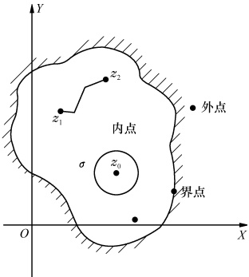

（3）区域：具备下列性质的点集 $ \sigma $称为区域.

图1.3
 

① 全由内点组成.

② $ \sigma $ 中任意两点可用全在  $ \sigma $ 中的折线连接（图1.3）. 例如， $ \left|z\right|<1 $ 表示 z 平面上以原点为中心，1 为半径的圆形区域.

（4）外点：若 $ z_{0} $不属于区域 $ \sigma $且有一个邻域不含有 $ \sigma $的点，则称 $ z_{0} $为区域 $ \sigma $的外点。例如，满足 $ |z|>1 $的所有点都是区域 $ |z|<1 $的外点。

（5）界点：若 $ z_{0} $不属于区域 $ \sigma $，但以 $ z_{0} $为中心的无论多小的邻域内总有属于区域 $ \sigma $的点，则称 $ z_{0} $为 $ \sigma $的界点。例如，满足 $ |z|=1 $的所有点均为区域 $ \left|z\right|<1 $的界点。 $ \sigma $的全部界点称为 $ \sigma $的边界。若沿边界走，区域在左方，则走向称为边界的正向。

（6）闭区域：区域 $ \sigma $连同它的边界l称为闭区域，记为 $ \bar{\sigma}=\sigma+l $。例如， $ \left|z\right|\leqslant1 $表示以原点为中心、1为半径的闭圆（即圆形闭区域）。

（7）单连通区域和复连通区域：若在区域 $ \sigma $内作任何简单的闭曲线（除起点和终点外别无重点的连续曲线），其内的点都是属于 $ \sigma $的点，则称该区域 $ \sigma $为单连通区域（图1.4斜线部分）。不是单连通的区域就是复连通（或多连通）区域（图1.5斜线部分）。

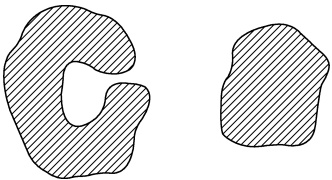

图1.4
 

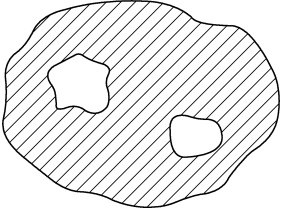

图1.5
 

## 3. 极限与连续性

设函数  $ w = f(z) $ 在  $ z_{0} $ 点的某邻域有定义（在  $ z_{0} $ 点不一定有定义），若对于任意给定的  $ \varepsilon > 0 $，总存在有  $ \delta > 0 $，使得当  $ 0 < |z - z_{0}| < \delta $ 时，就有  $ |f(z) - w_{0}| < \varepsilon (w_{0} $ 为一确定的复常数 $ ) $，则称  $ f(z) $ 当  $ z \to z_{0} $ 时以  $ w_{0} $ 为极限，并记为

$$  \lim_{z\to z_{0}}f(z)=w_{0}   \tag*{(1,2,2)}$$

<!-- page: 27 -->

应当注意的是，由于 z 是复平面上的变量，所以上式中  $ z \to z_{0} $ 必须是以任意的方式。与实函数类似，对于复变函数我们亦可证明下述结论：

（1）若极限存在必然唯一.

（2）若两个函数在某点有极限，则其和、差、积、商（分母的极限不能为0）在该点仍有极限，且其极限值等于他们各自极限值的和、差、积、商.

设  $ w = f(z) $ 在  $ z_{0} $ 点及其邻域有定义，并且当  $ z \to z_{0} $ 时，有

$$  \lim_{z\to z_{0}}f(z)=f(z_{0})   \tag*{(1,2,3)}$$

则称  $ f(z) $ 在  $ z_{0} $ 点连续. 在区域  $ \sigma $ 内各点均连续的函数称为在  $ \sigma $ 内的连续函数.

类似于实函数，对于复变函数我们亦可证明下述结论：

（1）若两函数在某点连续，则其和、差、积、商（分母不能为0）在该点仍连续.

（2）在某点连续的函数的复合函数在该点仍连续.

（3）若  $ f(x) $ 在闭区域  $ \bar{\sigma} $ 上连续，则

①  $ f(z) $ 在  $ \bar{\sigma} $ 上有界；

②  $ \left|f(z)\right| $ 在  $ \bar{\sigma} $ 上有最大值和最小值；

③  $ f(z) $ 在  $ \bar{\sigma} $ 上一致连续，即任给  $ \varepsilon>0 $，有与 z 无关的  $ \delta>0 $，使对  $ \bar{\sigma} $ 上满足  $ \left|z_{1}-z_{2}\right|<\delta $ 的任意两点  $ z_{1} $ 及  $ z_{2} $，均有  $ \left|f(z_{1})-f(z_{2})\right|<\varepsilon $.

不难证明函数  $ f(z)=u(x,y)+\mathrm{i}v(x,y) $ 在  $ z_{0} $ 点连续的充分必要条件是，二元实函数  $ u(x,y) $ 和  $ v(x,y) $ 均在  $ z_{0} $ 点连续.

例 证  $ f(z)=\mathrm{e}^{\frac{1}{z}} $ 在原点不连续.

证因

 $$ \begin{aligned}&\lim_{\substack{z\to0}}\mathrm{e}^{\frac{1}{z}}=0\quad( 沿负实轴 ),\quad\lim_{\substack{z\to0}}\mathrm{e}^{\frac{1}{z}}=\infty\quad( 沿正实轴 )\end{aligned} $$ 

故  $ f(z) $ 在原点无确定的极限，从而在原点不连续.

#### 习题1.2

1. 求下列复变函数的实部与虚部：

(1)  $ w = \frac{z - 1}{z + 1} $; (2)  $ w = z^3 $.

2. 画出下列关系所表示的 z 点的轨迹的图形并确定它是不是区域：

(1)  $ \mathrm{Im}z>1 $ 且  $ |z|<2 $;

(2) $ |z-2i|=|z+2| $;

(3)  $ 0 < \arg(z-1) < \frac{\pi}{4} $ 且  $ 2 \leqslant \mathrm{Re}z \leqslant 3 $; (4)  $ \left|z-1+2i\right|=5 $.

3. 求下列复数序列的极限：

(1)  $ \frac{1+\sqrt{3}i}{5} $,  $ \left(\frac{1+\sqrt{3}i}{5}\right)^2 $,  $ \cdots\left(\frac{1+\sqrt{3}i}{5}\right)^n $,  $ \cdots $

(2)  $ 1, \frac{1}{2}i, -\frac{1}{3}, -\frac{1}{4}i, \frac{1}{5}, \frac{1}{6}i, -\frac{1}{7}, -\frac{1}{8}i\cdots $

4. 证明  $ f(z)=\frac{1}{2\mathrm{i}}\left(\frac{z}{\bar{z}}-\frac{\bar{z}}{z}\right) $ 在原点不连续.

<!-- page: 28 -->

### 1.3 微商及解析函数

## 1. 微商及微分

设  $ w = f(z) $ 是在 z 点及其邻域定义的单值函数，若

$$  \lim_{\Delta z\to0}\frac{\Delta f}{\Delta z}=\lim_{\Delta z\to0}\frac{f(z+\Delta z)-f(z)}{\Delta z}   \tag*{(1.3.1)}$$

在 z 点存在，并且是与  $ \Delta z \rightarrow 0 $ 的方式无关的有限值，则称  $ f(z) $ 在 z 点可导或可微，而称此极限值为  $ f(z) $ 在 z 点的导数，记为

$$  f^{\prime}(z)=\lim\limits_{\Delta z\to0}\frac{\Delta f}{\Delta z}   \tag*{(1.3.2)}$$

例1 证明  $ f(z)=z^{n} $ 在复平面上每点均可导，且

$$  (z^{n})^{\prime}=n z^{n-1}   \tag*{(1.3.3)}$$

证 因对于任意固定的 z 均有

 $$ \lim_{\Delta z\to0}\frac{(z+\Delta z)^{n}-z^{n}}{\Delta z}=\lim_{\Delta z\to0}\left[nz^{n-1}+\frac{n(n-1)}{2}z^{n-2}\Delta z+\cdots+(\Delta z)^{n-1}\right]=nz^{n-1} $$ 

例2 证明  $ f(z)=\bar{z} $ 在复平面上均不可微.

证 因

 $$ \lim_{\Delta z\to0}\frac{\overline{z+\Delta z}-\bar{z}}{\Delta z}=\lim_{\Delta z\to0}\frac{\overline{\Delta z}}{\Delta z} $$ 

而

 $$ \lim\limits_{\substack{\Delta x=0\\ \Delta y\to0}}\frac{\Delta\overline{z}}{\Delta z}=\lim\limits_{\Delta y\to0}\frac{-\Delta y}{\Delta y}=-1,\quad\lim\limits_{\substack{\Delta x\to0\\ \Delta y=0}}\frac{\overline{\Delta z}}{\Delta z}=\lim\limits_{\Delta x\to0}\frac{\Delta x}{\Delta x}=1 $$ 

类似于实变函数，我们记

$$  \mathrm{d}z=f^{\prime}(z)\mathrm{d}z\quad( 或 \mathrm{d}f=f^{\prime}(z)\mathrm{d}z)   \tag*{(1.3.4)}$$

称之为函数  $ w = f(z) $ 的微分。若用 dz 除 (1.3.4) 式两边，便得

$$  f^{\prime}(z)=\frac{\mathrm{d}z}{\mathrm{d}z}\quad\left( 或 f^{\prime}(z)=\frac{\mathrm{d}f}{\mathrm{d}z}\right)   \tag*{(1.3.5)}$$

即导数  $ f'(z) $ 等于函数的微分与自变量的微分之商. 故导数又称为微商.

由于复变函数的导数与微分的定义，形式上和数学分析中单元函数的相应定义一致，因此，微分学中所有的求导和微分法则，都可以推广到复变函数中来

 $$ \begin{aligned}&\left[f_{1}(z)\pm f_{2}(z)\right]^{\prime}=f_{1}^{\prime}(z)\pm f_{2}^{\prime}(z)\\&\left[f_{1}(z)\bullet f_{2}(z)\right]^{\prime}=f_{1}^{\prime}(z)\bullet f_{2}(z)+f_{1}(z)\bullet f_{2}^{\prime}(z)\\&\left[\frac{f_{1}(z)}{f_{2}(z)}\right]^{\prime}=\frac{f_{1}^{\prime}(z)\bullet f_{2}(z)-f_{1}(z)\bullet f_{2}^{\prime}(z)}{\left[f_{2}(z)\right]^{2}},\quad f_{2}(z)\neq0\\&\frac{\mathrm{d}g\left[f(z)\right]}{\mathrm{d}z}=\frac{\mathrm{d}g(\zeta)}{\mathrm{d}\zeta}\bullet\frac{\mathrm{d}f(z)}{\mathrm{d}z},\quad\zeta=f(z)\end{aligned} $$

<!-- page: 29 -->

$$ \frac{\mathrm{d}w}{\mathrm{d}z}=1\bigg/\frac{\mathrm{d}z}{\mathrm{d}w}\quad\left(\frac{\mathrm{d}z}{\mathrm{d}w}\neq0\right) $$ 

## 2. 柯西-黎曼条件

下面我们讨论函数可微的必要条件.

设  $ f(z)=u(x,y)+\mathrm{i}v(x,y) $ 在一点  $ z=x+\mathrm{i}y $ 可微，则

$$  f^{\prime}(z)=\lim_{\Delta x\to0}\frac{\Delta f}{\Delta z}=\lim_{\Delta x\to0\atop\Delta v\to0}\frac{\Delta u+\mathrm{i}\Delta v}{\Delta x+\mathrm{i}\Delta y}   \tag*{(1.3.6)}$$

其中

 $$ \begin{aligned}\Delta u&=u(x+\Delta x,y+\Delta y)-u(x,y)\\\Delta v&=v(x+\Delta x,y+\Delta y)-v(x,y)\end{aligned} $$ 

因为  $ \Delta z $ 无论按什么方式趋于 0 时(1.3.6) 式总是成立的，现让  $ \Delta z $ 沿平行于实轴的方向趋于 0，则

$$  f^{\prime}(z)=\lim\limits_{\Delta x\to0\atop\Delta y=0}\frac{\Delta u+\mathrm{i}\Delta v}{\Delta x+\mathrm{i}\Delta y}=\frac{\partial u}{\partial x}+\mathrm{i}\frac{\partial v}{\partial x}   \tag*{(1.3.7)}$$

又让 $ \Delta z $沿平行于y轴的方向趋于0，则

$$  f^{\prime}(z)=\lim\limits_{\Delta x\to0\atop\Delta y\to0}\frac{\Delta u+\mathrm{i}\Delta v}{\Delta x+\mathrm{i}\Delta y}=-\mathrm{i}\frac{\partial u}{\partial y}+\frac{\partial v}{\partial y}   \tag*{(1.3.8)}$$

比较(1.3.8)式及(1.3.7)式得出

$$  \frac{\partial u}{\partial x}=\frac{\partial v}{\partial y},\qquad\frac{\partial v}{\partial x}=-\frac{\partial u}{\partial y}   \tag*{(1.3.9)}$$

(1.3.9)式称为柯西-黎曼(Cauchy-Riemann)条件（简记为C-R条件），它是在 $ w=f(z) $存在微商的条件下导出的，只是函数可导的必要条件，而不是充分条件，即具备这一条件的 $ f(z) $不一定可导。例如 $ f(z)=\sqrt{|xy|} $，即 $ u=\sqrt{|xy|} $，v=0，显然在z=0点是满足C-R条件的，但在z=0点却不可微。因为若让 $ \Delta z=\Delta r\mathrm{e}^{\mathrm{i}\varphi}\rightarrow0 $，则 $ \lim_{\Delta z\rightarrow0}\frac{\Delta f}{\Delta z}=\frac{\sqrt{\cos\varphi\cdot\sin\varphi}}{\mathrm{e}^{\mathrm{i}\varphi}} $之值将随 $ \varphi $不同而不同。

函数  $ f(z)=u(x,y)+\mathrm{i}v(x,y) $ 在 z 点可导的充分条件是

(1) u, v 在 z 点有连续的一阶偏微商；

(2) u, v 在 z 点满足 C-R 条件.

今证明如下.

因 u, v 有连续的一阶偏导数. 故 u, v 的全微分存在, 即

 $$ \mathrm{d}u=\frac{\partial u}{\partial x}\mathrm{d}x+\frac{\partial u}{\partial y}\mathrm{d}y,\quad\mathrm{d}v=\frac{\partial v}{\partial x}\mathrm{d}x+\frac{\partial v}{\partial y}\mathrm{d}y $$ 

而

 $$ \mathrm{d}f=\mathrm{d}u+\mathrm{i}\mathrm{d}v=\Big(\frac{\partial u}{\partial x}+\mathrm{i}\frac{\partial v}{\partial x}\Big)\mathrm{d}x+\Big(\frac{\partial u}{\partial y}+\mathrm{i}\frac{\partial v}{\partial y}\Big)\mathrm{d}y $$

<!-- page: 30 -->

又由 C-R 条件有

 $$ \frac{\partial v}{\partial x}=-\frac{\partial u}{\partial y},\quad\frac{\partial v}{\partial y}=\frac{\partial u}{\partial x} $$ 

则

 $$ \begin{aligned}\mathrm{d}f&=\left(\frac{\partial u}{\partial x}-\mathrm{i}\frac{\partial u}{\partial y}\right)\mathrm{d}x+\left(\frac{\partial u}{\partial y}+\mathrm{i}\frac{\partial u}{\partial x}\right)\mathrm{d}y\\&=\left(\frac{\partial u}{\partial x}-\mathrm{i}\frac{\partial u}{\partial y}\right)(\mathrm{d}x+\mathrm{i}\mathrm{d}y)\end{aligned} $$ 

于是

$$  \frac{\mathrm{d}f}{\mathrm{d}z}=\frac{\left(\frac{\partial u}{\partial x}-\mathrm{i}\frac{\partial u}{\partial y}\right)(\mathrm{d}x+\mathrm{i}\mathrm{d}y)}{\mathrm{d}x+\mathrm{i}\mathrm{d}y}=\frac{\partial u}{\partial x}-\mathrm{i}\frac{\partial u}{\partial y}   \tag*{(1.3.10)}$$

此式无论 $ \Delta z $以什么方式趋于零都存在，所以 $ f(z) $在z点可导.

(1.3.10)式可以作为计算复变函数微商的公式,结合C-R条件还可得到计算微商的其他三个公式

$$  \frac{\mathrm{d}f}{\mathrm{d}z}=\frac{\partial v}{\partial y}-\mathrm{i}\frac{\partial u}{\partial y}=\frac{\partial v}{\partial y}+\mathrm{i}\frac{\partial v}{\partial x}=\frac{\partial u}{\partial x}+\mathrm{i}\frac{\partial v}{\partial x}   \tag*{(1.3.11)}$$

## 3. 解析函数及其物理解释

如果函数  $ w=f(z) $ 在  $ z_{0} $ 点及其邻域均可导，则称  $ w=f(z) $ 在  $ z_{0} $ 点解析。如果函数  $ w=f(z) $ 在  $ z_{0} $ 点不解析，则  $ z_{0} $ 称为  $ w=f(z) $ 的奇点。如果函数  $ w=f(z) $ 在区域  $ \sigma $ 内处处可导，则称  $ f(z) $ 在区域  $ \sigma $ 内解析，或称  $ f(z) $ 为区域  $ \sigma $ 内的解析函数。

显然，由函数可导的必要条件与充分必要条件，我们不难推得函数解析的必要条件与充分必要条件.

例3 试证  $ f(z)=\mathrm{e}^{x}(\cos y+\mathrm{i}\sin y) $ 在复平面上解析，且  $ f'(z)=f(z) $.

证 因  $ u=e^{x}\cos y, v=e^{x}\sin y $ ，而  $ \frac{\partial u}{\partial x}=e^{x}\cos y, \frac{\partial u}{\partial y}=-e^{x}\sin y, \frac{\partial v}{\partial x}=e^{x}\sin y, \frac{\partial v}{\partial y}=e^{x}\cos y $ 均在复平面上处处连续，且满足 C-R 条件，所以  $ f(z) $ 在复平面上解析；且由 (1.3.11) 式有

 $$ f^{\prime}(z)=\mathrm{e}^{x}\mathrm{c o s}y+\mathrm{i}\mathrm{e}^{x}\mathrm{s i n}y=f(z) $$ 

由解析函数的定义和函数的求导法则可得：

（1）如果函数  $ f(z) $ 在区域  $ \sigma $ 中解析，则它在这个区域中是连续的.

（2）如果  $ f_{1}(z) $ 和  $ f_{2}(z) $ 是区域  $ \sigma $ 中的解析函数，则其和、差、积、商（商的情形要求分母在  $ \sigma $ 内不为零）也是该区域中的解析函数.

（3）如果函数  $ \zeta = f(z) $ 在区域  $ \sigma $ 内解析，而函数  $ w = g(\zeta) $ 在区域 G 内解析，若对于  $ \sigma $ 内的每一点 z，函数  $ f(z) $ 的值  $ \zeta $ 均属于 G，则函数  $ w = g[f(z)] $ 是区域  $ \sigma $ 上复变量 z 的一个解析函数.

（4）如果  $ w = f(z) $ 是区域  $ \sigma $ 上的一个解析函数，且在点  $ z_0 \in \sigma $ 的邻域中  $ |f'(z)| \neq 0 $，则在点  $ w_0 = f(z_0) \in G $ 的邻域中函数  $ f(z) $ 的值定义一个反函数  $ z = \varphi(w) $，它是复变

<!-- page: 31 -->

量 w 的解析函数. 于是我们有  $  f'(z_0) = \frac{1}{\varphi'(w_0)}  $.

我们已经知道解析函数的实部和虚部有 C-R 条件联系着，现在我们进一步阐明其实部和虚部的特性.为此，我们首先引入几个概念.

在区域  $ \sigma $ 中连续并有连续的一、二阶偏导数的实变函数  $ u(x,y) $，如果满足方程

 $$ \frac{\partial^{2}u}{\partial x^{2}}+\frac{\partial^{2}u}{\partial y^{2}}=0 $$ 

则称  $ u(x,y) $ 为区域  $ \sigma $ 上的调和函数。方程  $ \frac{\partial^{2}u}{\partial x^{2}}+\frac{\partial^{2}u}{\partial y^{2}}=0 $（或记作  $ \Delta u=0 $）称为二维拉普拉斯（Laplace）方程。而方程  $ \frac{\partial^{2}u}{\partial x^{2}}+\frac{\partial^{2}u}{\partial y^{2}}=-h(x,y) $ 和方程  $ \frac{\partial^{2}u}{\partial x^{2}}+\frac{\partial^{2}u}{\partial y^{2}}+\lambda u=0 $ 分别称为二维泊松（Poisson）方程和二维亥姆霍兹（Helmhotz）方程。在物理学中，许多平面场，如稳定温度场、静电场、无旋流的速度场等，都满足这几个方程。

定理 1.1 解析函数的实部和虚部都是调和函数，且其梯度向量相互正交.

证 设  $ f(z)=u+iv $ 在区域  $ \sigma $ 上解析，于是在  $ \sigma $ 上 C-R 条件 (1.3.9) 成立。即

 $$ \frac{\partial u}{\partial x}=\frac{\partial v}{\partial y},\quad\frac{\partial v}{\partial x}=-\frac{\partial u}{\partial y} $$ 

而第二章将证明解析函数具有任意阶微商，因而此处 u 和 v 也有各阶偏微商，故有

 $$ \frac{\partial^{2}u}{\partial x^{2}}=\frac{\partial^{2}v}{\partial x\partial y},\quad\frac{\partial^{2}v}{\partial x\partial y}=-\frac{\partial^{2}u}{\partial y^{2}} $$ 

因此在 $ \sigma $上有

 $$ \frac{\partial^{2}u}{\partial x^{2}}+\frac{\partial^{2}u}{\partial y^{2}}=0 $$ 

同样可以证明在 $ \sigma $上有

$$  \frac{\partial^{2}v}{\partial x^{2}}+\frac{\partial^{2}v}{\partial y^{2}}=0   \tag*{(1.3.13)}$$

所以， $ u(x,y) $ 和  $ v(x,y) $ 都是区域  $ \sigma $ 上的调和函数.

而将 C-R 条件(1.3.9)式的两个等式对应相乘有

 $$ \begin{aligned}\frac{\partial u}{\partial x}\bullet\frac{\partial v}{\partial x}=&-\frac{\partial v}{\partial y}\bullet\frac{\partial u}{\partial y}\\\frac{\partial u}{\partial x}\bullet\frac{\partial v}{\partial x}+\frac{\partial u}{\partial y}\bullet\frac{\partial v}{\partial y}=&0\end{aligned} $$ 

即

$$  \nabla u\bullet\nabla v=0   \tag*{(1.3.14)}$$

亦即

这表明解析函数实部和虚部的梯度向量 $ \nabla u $与 $ \nabla v $正交.而 $ \nabla u $和 $ \nabla v $分别是曲线 $ u(x,y)= $常数与 $ v(x,y)= $常数的法向向量，这说明u=常数和v=常数是彼此互相正交的两曲线族.

由于解析函数的这一性质，解析函数的理论在平面场问题中有重要应用。现在以静电场为例来分析。既然实际的空间是三维的，静电场当然总是三维的。但如果电荷沿三维空间的某方向上分布是均匀的，我们取此方向为z方向，则电场和电势 $ \varphi(x, y) $都与空间坐标z无关，我们只要在xy平面上研究它就够了。这样的静电场叫作平

<!-- page: 32 -->

面静电场，它的电势  $ \varphi(x,y) $ 在 xy 平面的无源（即无电荷）区域中是满足二维拉普拉斯方程的. 即

$$  \frac{\partial^{2}\varphi}{\partial x^{2}}+\frac{\partial^{2}\varphi}{\partial y^{2}}=0   \tag*{(1.3.15)}$$

比较方程(1.3.12)[或(1.3.13)]与方程(1.3.15)可见，解析函数的实部（或虚部）可以解释为某平面静电场的势.

注意到平面静电场的等势线族  $ \varphi(x,y)= $ 常数与电场线族也是处处相互正交的，

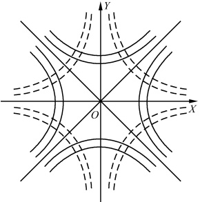

图1.6
 

所以，如果我们将解析函数的实部  $ u(x,y) $ [或虚部  $ v(x,y) $] 解释为某平面静电场的势，那么  $ v(x,y) $ [或  $ u(x,y) $] 的等值线族就是该静电场的电场线族。正因为如此，人们常用一解析函数来描绘这一无源平面静电场，并称此解析函数为该平面静电场的复势。显然，同一平面静电场的复势可以相差一常数。

例4 考虑解析函数  $ f(z)=z^{2}=x^{2}-y^{2}+i2xy $，它对应什么样的平面静电场的复势？

解 如图1.6所示，实线族 $ u=x^{2}-y^{2}= $ 常数与虚线族 $ v=2xy= $ 常数在z平面互相正交. 如将其虚部v=2xy看作平面静电场的势，则等势线族和电场线族分别为2xy=常数和 $ x^{2}-y^{2}= $ 常数，这是以实轴和虚轴为截口的两块互相垂直的甚大的带电导体平面的静电场.

以上分析同样也适用于具有类似性质的其他平面标量场。一般而言，一既无源又无旋的平面矢量场，总可以构造一个解析函数，即复势与之对应。采用复势来研究平面矢量场，不但形式紧凑，而且可使计算大为简化。

由于解析函数的实部和虚部通过 C-R 条件联系着，因此，只要知道解析函数的实部（或虚部），就能求出相应的虚部（或实部）。具体可用以下两种方法来求。

（1）如果已知 u 求 v，可从全微分出发. 因

 $$ \begin{aligned}\mathrm{d}v&=\frac{\partial v}{\partial x}\mathrm{d}x+\frac{\partial v}{\partial y}\mathrm{d}y=-\frac{\partial u}{\partial y}\mathrm{d}x+\frac{\partial u}{\partial x}\mathrm{d}y\\&\quad v=\int-\frac{\partial u}{\partial y}\mathrm{d}x+\frac{\partial u}{\partial x}\mathrm{d}y+C\end{aligned} $$ 

故

（2）已知 u 求 v 还可由关系  $ \frac{\partial v}{\partial x} = \frac{\partial u}{\partial x} $，对 y 积分来求。因

$$  v=\int\frac{\partial v}{\partial y}\mathrm{d}y+\varphi(x)=\int\frac{\partial u}{\partial x}\mathrm{d}y+\varphi(x)   \tag*{(1.3.17)}$$

所以

$$  \frac{\partial v}{\partial x}=\frac{\partial}{\partial x}\int\frac{\partial u}{\partial x}\mathrm{d}y+\varphi^{\prime}(x)=-\frac{\partial u}{\partial y}   \tag*{(1.3.18)}$$

由(1.3.18)式可求得  $ \varphi(x) $，代入(1.3.17)式即可求得 v.

<!-- page: 33 -->

当然，由关系 $ \frac{\partial v}{\partial x}=-\frac{\partial u}{\partial y} $两边对x积分类似于上述过程也可求得v.

例5 已知  $ u=x^{3}-3xy^{2} $，求 v.

解

 $$ \frac{\partial u}{\partial x}=3x^{2}-3y^{2},\quad\frac{\partial u}{\partial y}=-6xy $$ 

由（1.3.16）式有

 $$ \begin{aligned}v=&\int6xy\mathrm{d}x+(3x^{2}-3y^{2})\mathrm{d}y+C=\int\mathrm{d}(3x^{2}y-y^{3})+C\\=&3x^{2}y-y^{3}+C\end{aligned} $$ 

也可由(1.3.17)式和(1.3.18)式得

 $$ v=\int(3x^{2}-3y^{2})\mathrm{d}y+\varphi(x)=3x^{2}y-y^{3}+\varphi(x) $$ 

 $$ \frac{\partial v}{\partial x}=6xy+\varphi^{\prime}(x)=-\frac{\partial u}{\partial y}=6xy $$ 

所以

 $$ \varphi^{\prime}(x)=0,\quad\varphi(x)=C $$ 

于是

故得解析函数

 $$ v=3x^{2}y-y^{3}+C $$ 

 $$ \begin{aligned}f(z)&=u+\mathrm{i}v=x^{3}-3xy^{2}+\mathrm{i}(3x^{2}y-y^{3}+C)\\&=(x+\mathrm{i}y)^{3}+\mathrm{i}C=z^{3}+\mathrm{i}C\end{aligned} $$ 

像解析函数的实部和虚部这样的两个由 C-R 条件联系着的调和函数 u 与 v，称为共轭调和函数.

#### 习题1.3

1. 试推导极坐标形式下的 C-R 条件

$$  \frac{\partial u}{\partial\rho}=\frac{1}{\rho}\frac{\partial v}{\partial\varphi},\quad\frac{1}{\rho}\frac{\partial u}{\partial\varphi}=-\frac{\partial v}{\partial\rho}   \tag*{(1.3.19)}$$

2. 讨论下列函数的可微性和解析性：

 $$ \begin{aligned}&w=z^{2}；\\&w=\sqrt[5]{z^{3}}；\\ \end{aligned} $$ 

 $$ w=z\mathrm{R e}z; $$ 

 $$ w=|z|^{2}. $$ 

3. 若函数  $ f(z) $ 在区域  $ \sigma $ 上解析并满足下列条件之一，证明  $ f(z) $ 必为常数.

(1)  $ f'(z)=0 $;

(2) $ \overline{f(z)} $ 在  $ \sigma $ 上解析；

(3) $ |f(z)|= $ 常数；

(4)  $ \mathrm{Ref}(z)= $ 常数.

4. 已知解析函数的实部或虚部，求解析函数.

(1)  $ u = x^{2} - y^{2} + xy $,  $ f(i) = -1 + i $; (2)  $ u = 2(x - 1)y $,  $ f(2) = -i $;

 $$ v{\begin{array}{l}\frac{y}{x^{2}+y^{2}},f(2)=0;\end{array}}\quad(4)u=\ln\rho,f(1)=0. $$ 

5. 已知一平面静电场的电场线族是与实轴相切于原点的圆族，求等势线族，并求此电场的复势.

6. 已知一平面静电场的电场线簇是抛物线族  $ y^{2}=C^{2}+2Cx(C>0) $，求等势线簇，并求此电场的复势.

7.  $ xy^{2} $ 能否成为 z 的一个解析函数的实部？为什么？

<!-- page: 34 -->

8. 证明：如果  $  f(z)  $ 和  $ \varphi(z) $ 在  $ z_{0} $ 点解析， $  f(z_{0}) = \varphi(z_{0}) = 0  $， $ \varphi'(z_{0}) \neq 0 $，则  $ \lim_{z \to z_{0}} \frac{f(z)}{\varphi(z)} = \frac{f'(z_{0})}{\varphi'(z_{0})} $。即，对于解析函数而言，实函数中的洛必达(L'Hospital)法则仍成立。

### 1.4 初等解析函数

在这一节里将介绍一些简单的解析函数，如幂函数  $ z^n $，指数函数  $ e^z $，三角函数  $ \sin z $， $ \cos z $ 和双曲函数  $ \text{sh}z $， $ \text{ch}z $；还将介绍多值函数  $ \sqrt[n]{z} $， $ \text{Ln}z $， $ z^s $（ $ s \neq \text{整数} $）以及有关多值函数的一些基本概念，如支点、单值分支、支割线、黎曼面等。

## 1. 幂函数  $ w = z^{n} (n = 0, \pm 1, \pm 2, \cdots) $

由上一节的例1知道，当n=1,2,3, $ \cdots $时，幂函数 $ z^{n} $在复平面上处处可微。因此，当n是正整数（包括零）时， $ w=z^{n} $是复平面上的解析函数。当n=-1,-2,-3, $ \cdots $时，除了z=0这一点以外，导数 $ nz^{n-1} $也都处处存在并有确定值，故在n是负整数的情形下，幂函数 $ w=z^{n} $是除了z=0点以外的复平面上的解析函数，z=0是这函数的奇点。

由上所述解析函数的性质不难看出，多项式函数  $ w=P(z)=a_{0}+a_{1}z+a_{2}z^{2}+\cdots+a_{n}z^{n}(a_{n}\neq0) $ 也在复平面上解析；有理函数  $ w=\frac{P(z)}{Q(z)}=\frac{a_{0}+a_{1}z+a_{2}z^{2}+\cdots+a_{n}z^{n}}{b_{0}+b_{1}z+b_{2}z^{2}+\cdots+b_{m}z^{m}}(a_{n}, b_{m}\neq0) $ 在复平面上除使  $ Q(z)=0 $ 的点外解析.

## 2. 指数函数  $ w = e^{z} $

我们定义

$$  \mathrm{e}^{z}=\mathrm{e}^{x+\mathrm{i}y}=\mathrm{e}^{x}(\cos y+\mathrm{i}sin y)   \tag*{(1.4.1)}$$

并称它为指数函数（有时也用 expz 表示）。当 z 取实数 x 时，它就是实指数函数  $ e^{x} $

在上一节的例3中，曾证明了 $ f(z)=\mathrm{e}^{x}(\cos y+\mathrm{i}\sin y) $在复平面上解析，并且 $ f'(z)=f(z) $，所以指数函数 $ w=\mathrm{e}^{z} $在复平面上解析，并且

$$  \left(\mathrm{e}^{z}\right)^{\prime}=\mathrm{e}^{z}   \tag*{(1.4.2)}$$

易于证明，指数函数还有如下一些主要性质：

(1)  $ \mathrm{e}^{z_{1}} \cdot \mathrm{e}^{z_{2}} = \mathrm{e}^{z_{1} + z_{2}} $

(2)  $ \mathrm{e}^{z+i2k\pi}=\mathrm{e}^{z},\quad k=0,\pm1,\pm2,\cdots $

即  $ e^{z} $ 以  $ 2\pi i $ 为周期. 这是与实指数函数  $ e^{x} $ 的主要不同之点.

在(1.4.1)式中，如果令 $ z=\pm i\theta(\theta $为实数)则得我们所熟知的欧拉(Euler)公式

 $$ \mathrm{e}^{i\theta}=\cos\theta+\mathrm{i}\sin\theta,\quad\mathrm{e}^{-i\theta}=\cos\theta-\mathrm{i}\sin\theta $$ 

一般写成

$$  \sin\theta=\frac{\mathrm{e}^{\mathrm{i}\theta}-\mathrm{e}^{-\mathrm{i}\theta}}{2\mathrm{i}},\quad\cos\theta=\frac{\mathrm{e}^{\mathrm{i}\theta}+\mathrm{e}^{-\mathrm{i}\theta}}{2}   \tag*{(1,4,5)}$$

<!-- page: 35 -->

## 3. 三角函数

由(1.4.5)式我们类似地可定义正弦函数  $ \sin z $ 和余弦函数  $ \cos z $ 为

$$  \sin z=\frac{\mathrm{e}^{\mathrm{i}z}-\mathrm{e}^{-\mathrm{i}z}}{2\mathrm{i}},\quad\cos z=\frac{\mathrm{e}^{\mathrm{i}z}+\mathrm{e}^{-\mathrm{i}z}}{2}   \tag*{(1.4.6)}$$

它们是实数范围内正弦函数和余弦函数在复数范围内的推广.

由指数函数的解析性和求导公式可知道它们亦均在复平面解析，且

$$  (sinz)^{\prime}=cosz,\quad(cosz)^{\prime}=-sinz   \tag*{(1.4.7)}$$

sinz 和 cosz 还具有如下一些主要性质：

$$  (1)\sin(-z)=-\sin z,\cos(-z)=\cos z   \tag*{(1.4.8)}$$

(2)

$$  \sin^{2}z+\cos^{2}z=1   \tag*{(1.4.9)}$$

(3)

$$  \sin(z_{1}\pm z_{2})=\sin z_{1}\cos z_{2}\pm\cos z_{1}\sin z_{2}   \tag*{(1.4.10)}$$

$$  4)\cos(z_{1}\pm z_{2})=\cos z_{1}\cos z_{2}\mp\sin z_{1}\sin z_{2}   \tag*{(1.4.11)}$$

$$  \sin(z+2\pi)=\sin z,\cos(z+2\pi)=\cos z   \tag*{(1.4.12)}$$

 $$ (6)\sin z=0\  必须且只须 \ z=n\pi,n=0,\pm1,\pm2,\cdots $$ 

 $$ \cos z=0\  必须且只须 \ z=\left(n+\frac{1}{2}\right)\pi,\quad n=0,\pm1,\pm2,\cdots $$ 

(7) $ \left|\sin z\right| $和 $ \left|\cos z\right| $可大于任何正数（与实函数情形不同）.例如，当z=i时

 $$  cosi=\frac{e^{-1}+e}{2}=\frac{0.368+2.718}{2}=1.543>1 $$ 

事实上只要z的虚部y趋近无穷大， $ \left|\sin z\right| $和 $ \left|\cos z\right| $就趋于无穷大.

其他三角函数如  $ tanz $, cotz, secz, cscz 等，都可以仿照实函数关系来定义

$$  \tan z=\frac{\sin z}{\cos z},\quad\cot z=\frac{\cos z}{\sin z},\quad\sec z=\frac{1}{\cos z},\quad\csc z=\frac{1}{\sin z}   \tag*{(1.4.13)}$$

分别被称做正切、余切、正割、余割函数。它们的解析性和其他性质，也均可由 $ \sin z $和 $ \cos z $的解析性和其他性质推出。

## 4. 双曲函数

双曲正弦和双曲余弦的定义为

$$   shz=\frac{e^{z}-e^{-z}}{2},\quad chz=\frac{e^{z}+e^{-z}}{2}   \tag*{(1.4.14)}$$

类似于实函数定义

$$  \mathrm{t h}z=\frac{\mathrm{s h}z}{\mathrm{c h}z},\quad\mathrm{c o t h}z=\frac{\mathrm{c h}z}{\mathrm{s h}z},\quad\mathrm{s e c h}z=\frac{1}{\mathrm{c h}z},\quad\mathrm{c s c h}z=\frac{1}{\mathrm{s h}z}   \tag*{(1.4.15)}$$

分别称做双曲正切、双曲余切、双曲正割、双曲余割函数.

幂函数、指数函数、三角函数和双曲函数都是初等单值函数。下面介绍几种常见的初等多值函数。

<!-- page: 36 -->

## 5. 根式函数  $ w = \sqrt[n]{z} $

如果  $ z=w^{n}, n=2,3,\cdots $，则称 w 为 z 的根式函数，记为  $ w=\sqrt[n]{z} $。今以  $ w=\sqrt{z} $ 为例，来阐明有关多值函数的一些基本概念。

由  $ w=\sqrt{z} $，有  $ w^{2}=z $。令  $ w=\rho e^{\mathrm{i}\varphi} $， $ z=r e^{\mathrm{i}\theta} $，代入上式得： $ \rho^{2}e^{\mathrm{i}2\varphi}=r e^{\mathrm{i}\theta} $，于是  $ \rho^{2}=r $， $ 2\varphi=\theta+2k\pi $，所以

$$  \rho=\sqrt{r},\quad\varphi=\frac{\theta}{2}+k\pi,\quad k=0,\pm1,\pm2,\cdots   \tag*{(1.4.16)}$$

从这里可以看到，w 的模  $ \rho $ 与 z 的模 r 是一一对应的，而辐角则不然。对应于每个  $ \theta $ 值，有二个不同的  $ \varphi $ 值

$$  \varphi_{1}=\frac{\theta}{2},\quad\varphi_{2}=\frac{\theta}{2}+\pi   \tag*{(1.4.17)}$$

[相应于(1.4.16)式中 k=0,1]，从而给出两个不同的 w 值

$$  \begin{array}{r}{\begin{array}{l l}{\displaystyle w_{1}=\sqrt{r}\mathrm{e}^{\mathrm{i}\frac{\theta}{2}},}&{\displaystyle w_{2}=\sqrt{r}\mathrm{e}^{\mathrm{i}\left(\frac{\theta}{2}+\pi\right)}}\\ \end{array}=-\sqrt{r}\mathrm{e}^{\mathrm{i}\frac{\theta}{2}}}\end{array}   \tag*{(1.4.18)}$$

其他 k 值给出的 w 值只是这两个  $ \varphi $ 值的重复.

所以，函数  $ w=\sqrt{z} $ 是多值函数。其多值性表现在 w 的辐角与 z 的辐角的对应关系上。

若开始时在 z 平面选定一点  $  z(r, \theta)  $ 与  $  w_1 = \sqrt{r} e^{\frac{\theta}{2}}  $ 相对应，则当  $  z(r, \theta)  $ 沿着图 1.7 中其内含有 z=0 点的闭合曲线 C 连续变化，绕 z=0 点一圈回到原处时，Argz 的值由原来的  $ \theta $ 变为  $ \theta + 2\pi $，相应的 w 值由原来的  $ w_1 = \sqrt{r} e^{\frac{\theta}{2}} $ 变为  $ \sqrt{r} e^{\frac{\theta + 2\pi}{2}} = w_2 $。但如果  $  z(r, \theta)  $ 是沿图 1.7 中其内不包含原点的闭合曲线  $ C' $ 连续变化回到原处时，Argz 之值仍为  $ \theta $，因而相应的 w 值也不会改变，即仍为  $ w_1 = \sqrt{r} e^{\frac{\theta}{2}} $。

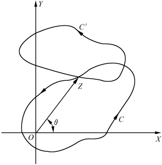

图1.7
 

从上面分析看到，对于多值函数而言，存在某些特殊的点，当变量绕它转一圈回到原处时，对应的函数值不能还原（发生了变

化），这种点称为多值函数的支点 $ ^{①} $.

所以，z=0 是函数  $ w=\sqrt{z} $ 的支点。另外， $ z=\infty $ 也是  $ w=\sqrt{z} $ 的支点，因为如果令  $ z=\frac{1}{t} $，则有  $ w=\frac{1}{\sqrt{t}} $，当 t 绕 t=0 转一圈回到原处时，w 之值不还原，这个函数再没有其他支点了。因为在 z 平面上沿着任一条不包含原点在内部的闭曲线转一圈而回到原处时，其函数值都不会改变。

<!-- page: 37 -->

如果我们规定  $ -\pi<\theta\leqslant\pi $ ，则对应于  $ z=r\mathrm{e}^{\theta} $ 相应的有函数值  $ w_{1}=\sqrt{r}\mathrm{e}^{\frac{\theta}{2}} $ ；而对应于  $ z=r\mathrm{e}^{\mathrm{i}(\theta+2\pi)} $ 相应的有函数值  $ w_{2}=\sqrt{r}\mathrm{e}^{\mathrm{i}\left(\frac{\theta}{2}+\pi\right)} $ ，函数  $ w=\sqrt{z} $ 之值与自变量的取值实现了一一对应的关系。即对于多值函数而言，如果我们限制自变量 z 的变化范围，便可使得对于每一个自变量 z 值，都分别有唯一的一个确定的函数值与之相对应，亦即多值函数被划分成了若干个单值函数，我们称其中每一个单值函数为多值函数的一个单值分支。例如， $ w_{1}=\sqrt{r}\mathrm{e}^{\frac{\theta}{2}} $ 和  $ w_{2}=\sqrt{r}\mathrm{e}^{\mathrm{i}\left(\frac{\theta}{2}+\pi\right)} $，当  $ -\pi<\theta\leqslant\pi $ 时是  $ w=\sqrt{z} $ 的两个单值分支。

单值分支的划分，也可形象地用几何图形来描绘。如图1.8(a)所示，从0到∞沿负实轴将z(一)平面切割开，并规定切割的下缘 $ \arg z=-\pi $，上缘 $ \arg z=\pi $，则与这平面上的z值对应的函数值 $ w_1(z) $位于图1.8(c)所示的w平面的右半： $ -\frac{\pi}{2}<\arg w_1\leq\frac{\pi}{2} $，与切割下缘对应的是负虚轴，与上缘对应的是正虚轴。类似的如图1.8(b)所示，将z(二)平面也沿负实轴割开，但规定切割下缘是 $ \pi $，上缘是3 $ \pi $，因此与这平面上的z值对应的函数值 $ w_2(z) $位于图1.8(c)的左半平面： $ \frac{\pi}{2}<\arg w_2\leq\frac{3\pi}{2} $，与切割下缘对应的是正虚轴，与上缘对应的是负虚轴。对于 $ w=\sqrt{z} $的反函数 $ z=w^2 $来说，在w平面按图1.8(c)这样划出的区域，能使不同的w值对应于z平面的不同的z值，这也就是说 $ z=w^2 $分别在这两个区域 $ \left(-\frac{\pi}{2}<\arg w_1\leq\frac{\pi}{2},\frac{\pi}{2}<\arg w_2\leq\frac{3\pi}{2}\right) $上都是单叶函数，我们把这两个区域分别称做 $ z=w^2 $的单叶性区域。这样一来，当我们用 $ z=w^2 $的两个互不相交的单叶区域把w平面布满之后，便把多值函数 $ w=\sqrt{z} $的两个单值分支 $ w_1(z) $和 $ w_2(z) $分开表示出来，而每个单叶性区域是其一个单值分支的值域。

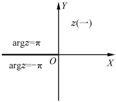

(a)
 

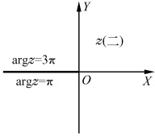

(b)
 

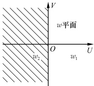

图1.8
 

(c)
 

我们称以上这种连接多值函数两支点间的割开 z 平面的线为支割线。它起着这样的作用：当 z 连续变化时，不得跨越支割线。这使得在割开的 z 平面上闭合曲线都不含支点于内，因此相应的函数值也只能在 w 平面上的一个单值分支内变化，而不会从一个单值分支跨越到另一个单值分支中去。这样，两个单值分支就完全分开了。当然，支割线并不必须是直线，只要能够起到把单值分支分开的作用即可。

<!-- page: 38 -->

应当注意，把一个多值函数划分为单值分支是有一定任意性的。例如，上述的 $ w=\sqrt{z} $，若规定 $ 0<\theta\leq2\pi $，则它的两个单值分支 $ \omega_{1}(z)=\sqrt{r}\mathrm{e}^{\mathrm{i}\frac{\theta}{2}} $和 $ \omega_{2}(z)=\sqrt{r}\mathrm{e}^{\mathrm{i}\left(\frac{\theta}{2}+\pi\right)} $就将分别位于w平面的上半平面和下半平面，如图1.9(c)所示。即

 $$ \begin{aligned}w_{1}(z):0<arg z\leqslant2\pi,\quad&0<arg w_{1}(z)\leqslant\pi\\w_{2}(z):2\pi<arg z\leqslant4\pi,\quad&\pi<arg w_{2}(z)\leqslant2\pi\end{aligned} $$ 

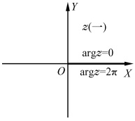

(a)
 

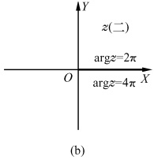

图1.9
 

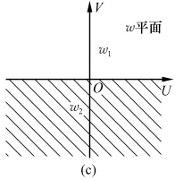

在图1.8和图1.9中，我们把根式 $ w=\sqrt{z} $的两个单值分支 $ w_{1}(z) $和 $ w_{2}(z) $的函数值与自变量z的对应关系分开表示出来了。这种对应关系也可以合并在一起表示。例如，将图1.9中 $ z(\text{一}) $平面支割线的上缘与 $ z(\text{二}) $平面中支割线的下缘连起来，并

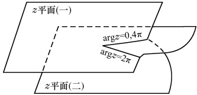

图1.10
 

设想 z(二) 平面中支割线的上缘与 z(一) 平面中支割线的下缘也能连起来，构成如图 1.10 所示的这样一个交叉连接的两叶面。当 z 在 z(一) 平面上绕 z=0 转一圈后，它的轨迹将跨过连起来的支割线  $ \arg z = 2\pi $ 而进入 z(二) 平面；如果 z 点在 z(二) 平面继续再绕 z=0 点转一圈，它的轨迹将跨越

连起来的支割线  $ \arg z = 4\pi $ 和  $ \arg z = 0 $ 而回到 z(一) 平面。因此，这两叶互相粘合的复平面使函数  $ w = \sqrt{z} $ 的值与变量 z 的值一一对应。我们称这种使多值函数 w 的值与变量 z 的值一一对应的由若干叶复平面粘合而成的模型为黎曼面。

一般说来，一个多值函数的导数是不存在的，因为极限 $ \lim_{z\to z_0}\frac{f(z)-f(z_0)}{z-z_0} $之值与z趋近于 $ z_0 $的方式（例如绕过支点或者不绕过支点）有关，所以不能笼统地讨论其解析性。但如果在某一区域内能够把多值函数的各个单值分支划分开，则对于每一单值分支可以如前讨论其解析性。例如，若将z平面按图1.8所示方式割开，则函数 $ w=\sqrt{z} $与之相应的每一单值分支 $ w_1=\sqrt{r}e^{i\frac{\theta}{2}} $和 $ w_2=\sqrt{r}e^{i\left(\frac{\theta}{2}+\pi\right)} $都是解析的。因为在此二区域内，z无论怎么变动都不会绕过支点（多值函数的支点一定是函数的奇点，因为在支点的邻域内不能把各个单值划分开，导数也就不存在）。

<!-- page: 39 -->

## 6. 对数函数  $ w = \ln z $

若  $ z=e^{w} $，则称 w 为 z 的对数函数，并记为 w=Lnz。注意 z=0 时，Lnz 没有定义。令  $ w=u+i\upsilon $， $ z=r e^{i\theta} $，则由  $ z=e^{w} $ 得  $ r e^{i\theta}=e^{u}\cdot e^{i\upsilon} $，由此得

 $$ \mathrm{e}^{u}=r $$ 

即

$$  \begin{aligned}u&=\ln r=\ln|\;z|\quad&v=\theta+2k\pi,\quad k=0,\pm1,\pm2,\cdots\end{aligned}   \tag*{(1.4.19)}$$

于是

$$  \mathrm{L n}z=u+\mathrm{i}v=\ln\mid z\mid+\mathrm{i}(\theta+2k\pi),\quad k=0,\pm1,\pm2,\cdots   \tag*{(1.4.20)}$$

这说明对数函数  $ w = \ln z $ 是多值函数，其多值性表现在函数值 w 的虚部与自变数的辐角的对应关系上：对应于每一 z 值，有无穷多个 w 值，它们彼此的虚部相差  $ 2\pi $ 的整数倍.

对数函数仅有两个支点 0 与  $ \infty $。因为当 z 沿绕 z=0 点一周的曲线变化回到原出发点时，Argz 增加  $ 2\pi $，相应的函数值 w 的虚部也增加  $ 2\pi $，即发生了变化。令  $ z=\frac{1}{t} $，类似的可证明  $ \infty $ 也是 Lnz 的支点。

类似于对  $ w=\sqrt{z} $ 的讨论，从 0 到  $ \infty $ 作支割线即可得到 Lnz 在这些割破了的 z 平面上的无穷多个单值分支，记作

$$  \left(\ln z\right)_{k}=\ln\mid z\mid+\mathrm{i}(\theta+2k\pi),\quad k=0,\pm1,\pm2,\cdots   \tag*{(1.4.21)}$$

而通常将其中  $ \theta=\arg z,0<\arg z\leqslant2\pi $ 的那一支称做 Lnz 的主值支，记作

$$  \ln z=\ln\mid z\mid+\mathrm{iarg}z,\quad0<\arg z\leqslant2\pi   \tag*{(1.4.22)}$$

显然，对数函数 w=Lnz 的黎曼面由无穷多叶 z 平面叠合而成。与每一个 z 平面对应的 w 值，在 w 平面上构成一个与实轴平行的无穷长的宽度为  $ 2\pi $ 的带形区域（即  $ z=e^{w} $ 的单叶性区域）。

易于证明对数函数的每一单值分支都是解析函数，且

$$  \frac{\mathrm{d}}{\mathrm{d}z}(\ln z)_{k}=\frac{1}{z},\quad k=0,\pm1,\pm2,\cdots   \tag*{(1.4.23)}$$

也容易证明，对数函数  $ w = \ln z $，满足与实对数函数类似的运算规律

$$  \mathrm{Ln}(z_{1}\cdot z_{2})=\mathrm{Ln}z_{1}+\mathrm{Ln}z_{2}   \tag*{(1.4.24)}$$

$$  \mathrm{Ln}\Big(\frac{\mathcal{z}_{1}}{\mathcal{z}_{2}}\Big)=\mathrm{Ln}\mathcal{z}_{1}-\mathrm{Ln}\mathcal{z}_{2}   \tag*{(1.4.25)}$$

## 7. 一般幂函数

定义  $ z^{s}=\mathrm{e}^{s\mathrm{Ln}z} $ (s 为复常数) 为一般幂函数. 不难验证，当 s 取整数 n 或  $ \frac{1}{n} $ 时，它就是前面已讨论过的  $ z^{n} $ 及  $ \sqrt[n]{z} $. 一般幂函数对于不为零的复数 z 都有意义，由于 Lnz 的

<!-- page: 40 -->

多值性， $ z^{s} $ 除 s 为整数外是多值函数。其分支的方法与 Lnz 相同。在规定单分支后，是 z 的一个解析函数，导数为

$$  \frac{\mathrm{d}}{\mathrm{d}z}z^{s}=\frac{\mathrm{d}}{\mathrm{d}z}\mathrm{e}^{s\mathrm{Ln}z}=\mathrm{e}^{s\mathrm{Ln}z}\bullet s\bullet\frac{1}{z}=sz^{s-1}   \tag*{(1.4.26)}$$

## 8. 一般指数函数

定义  $ s^{z}=e^{z\ln s} $ (s 为复常数) 为一般指数函数. 显然， $ s^{z} $ 亦为多值函数.

注 ① 如果变量 z 绕支点转 n 周 (n 为自然数) 而回到原处，多值函数回复原值，我们就说这支点是 n-1 阶支点。阶数为有限的支点都称为代数支点，阶数为无限的支点称为超越支点。

#### 习题1.4

1. 证明(1.4.3)、(1.4.4)、(1.4.8)、(1.4.12)、(1.4.23)、(1.4.25)式.

2. 试证

 $$ (1)\ \sin(iz)=ishz,\cos(iz)=chz;\tag{1.4.27} $$ 

 $$ (2)\mathrm{~ch}^{2}z-\mathrm{sh}^{2}z=1;\tag{1.4.28} $$ 

 $$ (3)\mathrm{~c h}(z_{1}+z_{2})=\mathrm{c h}z_{1}\mathrm{~c h}z_{2}+\mathrm{s h}z_{1}\mathrm{~s h}z_{2}.\tag{1.4.29} $$ 

$$  3.\  若 \ z=x+iy, 试证   \tag*{（1.4.30）}$$

 $$ (1)\sin z=\sin x\mathrm{ch}y+\mathrm{i}\cos x\mathrm{sh}y; $$ 

(2)  $ \cos z = \cos x \cdot \sin x \cdot \sin y $ (1.4.31)

$$  (3)\mid\sin z\mid^{2}=\sin^{2}x+\operatorname{sh}^{2}y;   \tag*{（1.4.32）}$$

 $$ (4)\mid\cos z\mid^{2}=\cos^{2}x+\operatorname{sh}^{2}y.\tag{1.4.33} $$ 

4. 求证： $ \lim_{z\to0}\frac{\sin z}{z}=1 $

5. 若  $ z=\sin w $，则称 w 为 z 的反正弦函数，并记作  $ w=\operatorname{Arcsin} z $。类似地也可建立反余弦、反正切、反余切函数的概念。试讨论以上反三角函数的多值性。

## 6. 解方程

 $$ (1)\mathrm{~s h}z=0;\quad(2)\mathrm{e}^{z}=1+\mathrm{i}\sqrt{3};\quad(3)\mathrm{s i n}z=2;\quad(4)\mathrm{t a n}z=\frac{\mathrm{i}}{3}. $$ 

7. 判断下列函数是单值的还是多值的. 若是多值的，是几值？其支点是什么？

 $$ (1)z+\sqrt{z-1};\quad(2)\frac{1}{1+\ln z};\quad(3)\sqrt[3]{z^{2}-4}+\sqrt{z^{2}-1};\quad(4)\sqrt{\cos z}; $$ 

 $$ \mathrm{(5)}\frac{\sin\sqrt{z}}{\sqrt{z}};\quad\mathrm{(6)}\frac{\cos\sqrt{z}}{\sqrt{z}};\quad\mathrm{(7)L n s i n z};\quad\mathrm{(8)}\sqrt{\frac{z-1}{z-2}}. $$ 

8. 设  $ w=\sqrt[3]{z} $ 确定在沿负实轴割破了的 z 平面上，并且  $ w(i)=-i $，求  $ w(-i) $.

9. 当 z=0 时，规定多值函数  $ w=\sqrt{z^{2}-1}=i $ ，求  $ w(i) $ 之值.

## 10. 计算

(1) $ (1+i)^{i} $; (2) $ 5^{2+3i} $; (3) $ \cos5\varphi $; (4) $ \mathrm{Ln}(1+i) $.

11. 讨论下列关系是否成立：

 $$ \mathrm{L n}z+\mathrm{L n}z=2\mathrm{L n}z;\quad\mathrm{(2)}\mathrm{L n}z-\mathrm{L n}z=0. $$

<!-- page: 41 -->

### 1.5 解析函数的几何性质

用几何图形表示函数  $ w = f(z) $，将使我们对函数有直观的理解，特别是对于我们处理平面场问题，会有很大帮助。我们把复变函数理解为两个复平面上的点集间的对应（映射或变换）。具体地说，取两张复平面分别代表 z 平面和 w 平面，则复变函数  $ w = f(z) $ 给出了从 z 平面上的点集 E 到 w 平面上的点集 F 间的一个对应关系，与点  $ z \in E $ 对应的点  $ w = f(z) $ 称为 z 点的像点，而 z 点就称为  $ w = f(z) $ 的原像（图 1.11）。

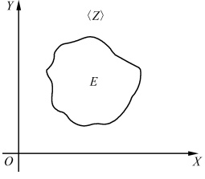

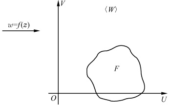

图1.11
 

例 1 问函数  $ w=z^{2} $ 将 z 平面的直线 y=x 变成了 w 平面的何种图形？

解

 $$ w=z^{2}=(x+\mathrm{i}y)(x+\mathrm{i}y)=x^{2}-y^{2}+\mathrm{i}2xy $$ 

所以

 $$ u=x^{2}-y^{2},\quad v=2xy $$ 

当 y=x 时

 $$ u=0,v=2x^{2}\geqslant0,\quad-\infty<x<\infty $$ 

故  $ w=z^{2} $ 将 z 平面的直线 y=x 变成了 w 平面上半虚轴（图 1.12）.

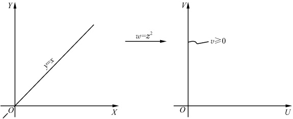

图1.12
 

## 1. 单叶变换定理

但是，我们感兴趣的是 z 与 w 构成的一一对应的变换。即双向单值的关系。换而言之，我们需要从变换  $ w = f(z) = u(x, y) + \mathrm{i}v(x, y) $ 中，解出 x 和 y 作为 u 与 v 的单

<!-- page: 42 -->

值函数. 由高等数学的知识可知，允许这样做的条件是，该  $ w=u(x,y)+\mathrm{i}v(x,y) $ 的雅克比(Jacobi)行列式不等于零. 即

$$  \boldsymbol{J}=\begin{vmatrix}\frac{\partial u}{\partial x}&\frac{\partial u}{\partial y}\\ \frac{\partial v}{\partial x}&\frac{\partial v}{\partial x}\end{vmatrix}\neq0   \tag*{(1.5.1)}$$

设  $ w=f(z) $ 在区域  $ \sigma $ 中解析，则由 C-R 条件 (1.3.9) 式和解析函数的微商公式 (1.3.11) 式有，条件 (1.5.1) 式可改写为

$$  \begin{aligned}J&=\begin{vmatrix}\frac{\partial u}{\partial x}&\frac{\partial u}{\partial y}\\\frac{\partial v}{\partial x}&\frac{\partial v}{\partial y}\end{vmatrix}=\frac{\partial u}{\partial x}\frac{\partial v}{\partial y}-\frac{\partial v}{\partial x}\frac{\partial u}{\partial y}=\left(\frac{\partial u}{\partial x}\right)^{2}+\left(\frac{\partial u}{\partial y}\right)^{2}\\&=\left|\frac{\partial u}{\partial x}-\mathrm{i}\frac{\partial u}{\partial y}\right|^{2}=\mid f^{\prime}(z)\mid^{2}\neq0\end{aligned}   \tag*{(1.5.2)}$$

由此可见，若  $ w=f(z) $ 是区域  $ \sigma $ 中的解析函数，且  $ f^{\prime}(z)\neq0(z\in\sigma) $，则变换  $ w=f(z) $ 在区域  $ \sigma $ 上构成一一对应的变换，并称这变换为域  $ \sigma $ 上的单叶变换。

## 2. 导数的几何意义

设  $ w = f(z) $ 在  $ z_{0} $ 点解析，且  $ f'(z_{0}) \neq 0 $，则当  $ z_{0} $ 在 z 平面沿一曲线  $ l_{1} $ 运动到  $ z_{0} + \Delta z $ 点 [图 1.13(a)]，相应的  $ w_{0} $ 也将在 w 平面沿着一条相应的曲线  $ l_{1}^{\prime} $，运动到  $ w_{0} + \Delta w $ 点 [图 1.13(b)]，且

即

 $$ f^{\prime}(z_{0})=\lim_{\Delta z\to0}\frac{\Delta w}{\Delta z} $$ 

 $$ \begin{aligned}\mid f^{\prime}(z_{0})\mid\mathrm{e}^{\mathrm{iarg}f^{\prime}(z_{0})}&=\lim_{\Delta z\to0}\frac{\mid\Delta w\mid\mathrm{e}^{\mathrm{iarg}\Delta w}}{\mid\Delta z\mid\mathrm{e}^{\mathrm{iarg}\Delta z}}\\&=\lim_{\Delta z\to0}\left|\frac{\Delta w}{\Delta z}\right|\bullet\lim_{\Delta z\to0}\mathrm{e}^{\mathrm{i}(\arg\Delta z v-\arg\Delta z)}\end{aligned} $$ 

所以

$$  \mid f^{\prime}(z_{0})\mid=\lim_{\Delta z\to0}\left|\frac{\Delta\varpi}{\Delta z}\right|   \tag*{(1.5.3)}$$

$$  \arg f^{\prime}(z_{0})=\lim_{\Delta z\to0}(\arg\Delta w-\arg\Delta z)=\theta^{\prime}_{1}-\theta_{1}   \tag*{(1.5.4)}$$

注意到  $ \Delta z $ 和  $ \Delta w $ 分别是  $ z_0 $ 点到  $ z_0 + \Delta z $ 点和  $ w_0 $ 点到  $ w_0 + \Delta w $ 点的向量； $ |\Delta z| $ 和  $ |\Delta w| $ 分别是向量  $ \Delta z $ 和  $ \Delta w $ 的长度；而  $ \arg\Delta z $ 和  $ \arg\Delta w $ 分别是向量  $ \Delta z $ 和  $ \Delta w $ 的辐角。所以，当  $ \Delta z $ 沿  $ l_1 $ 趋于零时， $ \theta_1 = \lim_{\Delta x \to 0} \arg\Delta z $ 表示曲线  $ l_1 $ 在  $ z_0 $ 点的切线方向；相应的  $ \theta'_1 = \lim_{\Delta x \to 0} \arg\Delta w $ 表示曲线  $ l'_1 $ 在  $ w_0 $ 点的切线方向。故由 (1.5.4) 式可看出，导数的辐角  $ \arg f'(z_0) $ 为过  $ z_0 $ 点的曲线的切线经变换后的一个转动角，称做变换  $ w = f(z) $ 在  $ z_0 $ 点的旋转角。其值与  $ \theta_1 $ 即  $ z_0 $ 点的切线方向无关。因为尽管当  $ \theta_1 $ 改变

<!-- page: 43 -->

时  $ \theta_{1}^{\prime} $ 也随之而变，但它们的差值  $ \theta_{1}^{\prime}-\theta_{1}[=argf^{\prime}(z_{0})] $ 却保持不变。类似的由(1.5.3)式可看出，导数的模，为过  $ z_{0} $ 点的微线元  $ \mathrm{d}z=\lim_{\Delta x\to0}\Delta z $ 与经变换后的微线元  $ \mathrm{d}w=\lim_{\Delta x\to0}\Delta w^{\mathrm{①}} $ 的长度之比，称做变换 w=f(z) 在  $ z_{0} $ 点的长度伸缩比或放大系数。

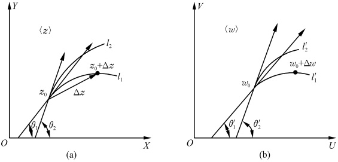

图1.13
 

## 3. 保角变换

如图1.13所示，设过 $ z_{0} $点另有一条曲线 $ l_{2} $，它在 $ z_{0} $点的切线方向为 $ \theta_{2} $，则经过变换 $ w=f(z) $后在w平面相应的也有过 $ w_{0} $的另一条曲线 $ l_{2}^{\prime} $。设它在 $ w_{0} $点的切线方向为 $ \theta_{2}^{\prime} $，则由导数的几何意义知

又由前面(1.5.4)式有

所以

 $$ \begin{aligned}\theta_{2}^{\prime}-\theta_{2}&=\arg f^{\prime}(z_{0})\\\theta_{1}^{\prime}-\theta_{1}&=\arg f^{\prime}(z_{0})\\\theta_{2}^{\prime}-\theta_{2}&=\theta_{1}^{\prime}-\theta_{1}\\\theta_{2}^{\prime}-\theta_{1}^{\prime}&=\theta_{2}-\theta_{1}\end{aligned} $$ 

即

这说明曲线  $ l_{1} $ 和  $ l_{2} $ 在  $ z_{0} $ 点的夹角 $ \theta_{2}-\theta_{1} $，经变换后其大小和转向均未发生改变.

我们称这种使通过已知点的任意两条曲线间的夹角的大小及方向保持不变的变换  $ w=f(z) $，为该点的保角变换（或在该点是保角的）。若变换  $ w=f(z) $ 在一区域  $ \sigma $ 内各点均保角，则称它为该区域  $ \sigma $ 内的保角变换。

显然，解析函数在导数不为零的各点实现保角变换。

值得指出的是，有时需要讨论两条曲线在  $ z=\infty $ 处的交角的保角性. 在这种情形下，应当先作变换  $ z=\frac{1}{t} $，然后讨论经过这变换后的相应两条曲线在 t=0 点  $ (z=\infty $ 的相应点) 的交角的保角性 $ ^{③} $.

## 4. 保角变换的性质

我们指出，在保角变换下，二维拉氏方程、泊松方程和亥姆霍兹方程均具有不变性。

<!-- page: 44 -->

事实上，若  $ w = f(z) = \xi(x, y) + \mathrm{i}\eta(x, y) $ 在某区域  $ \sigma $ 内解析，且  $ w = f'(z) \neq 0 $，则由上可知， $ w = f(z) $ 在  $ \sigma $ 内实现保角变换。于是，实二元函数  $ u(x, y) $ 在此变换下变为  $ u(\xi, \eta) $ 且经此变换后有 $ ^{①} $

 $$ \begin{aligned}u_{x}&=u_{\xi}\xi_{x}+u_{\eta}\eta_{x},\quad u_{y}=u_{\xi}\xi_{y}+u_{\eta}\eta_{y}\\u_{xx}&=u_{\xi\xi}\xi_{x}^{2}+2u_{\xi\eta}\xi_{x}\eta_{x}+u_{\eta\eta}\eta_{x}^{2}+u_{\xi\xi x x}+u_{\eta}\eta_{xx}\\u_{yy}&=u_{\xi\xi}\xi_{y}^{2}+2u_{\xi\eta}\xi_{y}\eta_{y}+u_{\eta\eta}\eta_{y}^{2}+u_{\xi\xi y y}+u_{\eta}\eta_{yy}\\x_{xx}+u_{yy}&=u_{\xi\xi}(\xi_{x}^{2}+\xi_{y}^{2})+2u_{\xi\eta}(\xi_{x}\eta_{x}+\xi_{y}\eta_{y})+u_{\eta\eta}(\eta_{x}^{2}+\eta_{y}^{2})\\&\quad+u_{\xi}(\xi_{xx}+\xi_{yy})+u_{\eta}(\eta_{xx}+\eta_{yy})\end{aligned} $$ 

所以

而由 C-R 条件(1.3.9)式有

从而有

 $$ \begin{aligned}\xi_{x}&=\eta_{y},\quad\eta_{x}=-\xi_{y}\\\xi_{x}\eta_{x}+\xi_{y}\eta_{y}&=\xi_{x}\eta_{x}-\eta_{x}\xi_{x}=0\\\xi_{xx}+\xi_{yy}&=\eta_{xx}+\eta_{yy}=0\end{aligned} $$ 

更由(1.3.10)式和(1.3.11)式有

 $$ \xi_{x}^{2}+\xi_{y}^{2}=\eta_{x}^{2}+\eta_{y}^{2}=|\ f^{\prime}(z)|\ ^{2} $$ 

将这些结果一并代入(1.5.5)式便有

$$  u_{x x}+u_{y y}=(u_{\xi\xi}+u_{\eta\eta})|f^{\prime}(z)|^{2}   \tag*{(1.5.6)}$$

将（1.5.6）式代入拉普拉斯方程

$$  u_{xx}+u_{yy}=0   \tag*{(1.5.7)}$$

便有

 $$ (u_{\mathfrak{s}\mathfrak{s}}+u_{\mathfrak{m}})\mid f^{\prime}(z)\mid^{2}=0 $$ 

因为  $ f'(z) \neq 0 $，于是有

$$  u_{ 緹 }+u_{\eta\eta}=0   \tag*{(1.5.8)}$$

即拉普拉斯方程在保角变换下仍变为新坐标平面 w 中的拉普拉斯方程. 同样, 将 (1.5.6) 式代入泊松方程

$$  u_{x x}+u_{y y}=-h(x,y)   \tag*{(1.5.9)}$$

便有

$$  u_{\xi\xi}+u_{\eta\eta}=-h^{*}\left(\xi,\eta\right)   \tag*{（1.5.10）}$$

即泊松方程在保角变换下仍变为新坐标平面 w 中的泊松方程. 其中

$$  h^{*}\left(\xi,\eta\right)=\frac{h(x,y)}{\left|f^{\prime}(z)\right|^{2}}   \tag*{（1.5.11）}$$

类似的，我们也很易看出亥姆霍兹方程

$$  u_{xx}+u_{yy}+\lambda u=0   \tag*{（1.5.12）}$$

在保角变换  $ \omega = f(z) $ 下，将也仍变为亥姆霍兹方程

$$  u_{\mathfrak{s}\mathfrak{s}}+u_{\eta\eta}+\lambda^{*}u=0   \tag*{（1.5.13）}$$

其中

$$  \lambda^{*}=\frac{\lambda}{\mid f^{^{\prime}}(z)\mid^{2}}   \tag*{（1.5.14）}$$

<!-- page: 45 -->

保角变换的上述性质，使得保角变换在物理学的平面场问题中有着广泛的应用。因为以上三方程在保角变换下的不变性，实际上意味着满足以上三方程的平面场问题，在保角变换下的物理实质不变。这就使得我们有可能将一些边界形状复杂不易求解的平面场问题，通过选择某种适当的保角变换，化为边界形状简单的易求解的问题。

例 2 求两个具有相等电势  $ v_{0} $ 的互相垂直的很大的导电平板周围的等势面和电场线的分布.

解 由于问题的对称性，只需考虑如图 1.14(a) 所示 z 平面的第一象限情况. 为使边界形状简化，选变换

 $$ w=z^{2} $$ 

则图1.14(a)中的直角区域变成了图1.14(b)中w平面的上半平面，而在实轴 $ \eta=0 $上其电势为 $ v_{0} $.故由初等电磁学的知识知，在w平面其等势线为平行于实轴的直线，即 $ \eta= $常数；而电场线则是平行于虚轴的直线，即 $ \xi= $常数.回到z平面，由 $ w=z^{2} $有

 $$ \xi+\mathrm{i}\eta=(x+\mathrm{i}y)^{2}=x^{2}-y^{2}+\mathrm{i}2xy $$ 

所以等势线和电场线的方程分别为

 $$ \eta=2xy= 常数 $$ 

 $$ \xi=x^{2}-y^{2}= 常数 $$ 

这是 z 平面中的两族互相正交的双曲线，分别用实线和虚线在图 1.14(a) 中画出.

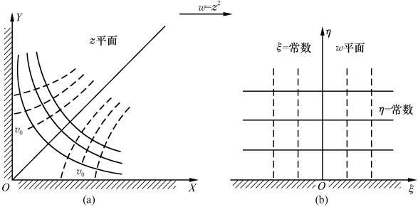

图1.14
 

注 ① 由于解析函数的连续性，所以当  $ \Delta z \to 0 $ 时有  $ \Delta w \to 0 $.

② 曲线在某点的夹角，即指它们在该点的切线的夹角.

③因为在数学上定义曲线在无穷远点的交角为 $ \alpha $，就是指它们在倒数变换下的像曲线在原点的交角为 $ \alpha $。

④这里，引入了偏微商的另一种表示方法，即， $ u_{x}=\frac{\partial u}{\partial x} $， $ u_{xx}=\frac{\partial^{2}u}{\partial x^{2}} $，其他以此类推.

<!-- page: 46 -->

#### 习题1.5

1. w=z^{2} 将正方形 OACB(图 1.15) 变成什么图形?

2. 求  $ w=\frac{z-i}{z+i} $ 在 z=-1, z=i 的放大系数和转动角.

3. 函数  $ w=\frac{1}{z} $ 将 z 平面的下列曲线变成 w 平面上的什么曲线？

(1) $ x^{2}+y^{2}=4 $; (2)y=x;

(3) $ (x-1)^{2}+y^{2}=1 $; (4)x=1.

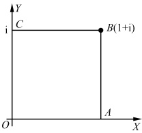

图1.15
 

4. 试讨论下列两对函数所构成的变换的特性（讨论其保角性和图形的变化情况）：

（1）幂函数  $ w=z^{n} $ 和根式函数  $ z=\sqrt[n]{w}\left(0<\arg z<\frac{2\pi}{n},n $ 为大于 1 的整数 $ \right) $;

(2) 指数函数  $ w = e^{z} $ 和对数函数  $ z = \ln w $ (0 < Imz < 2 $ \pi $).

 $ ^{*} $5. 求半无穷导体平面附近的电场分布（设导体上电势为  $ v_{0} $）.

6. 两块无穷大的金属板连成一块无穷大的板，连接处绝缘。设两部的电势分别为  $ v_{1} $ 和  $ v_{2} $，求板外的电势。

<!-- page: 47 -->

本章授课课件 本章习题分析与讨论

<table border=1 style='margin: auto; word-wrap: break-word;'><tr><td style='text-align: center; word-wrap: break-word;'>当\n\n\n\n\n\n\n\n\n\n\n\n\n\n\n\n\n\n\n\n\n\n\n\n\n\n\n\n\n\n\n\n\n\n\n\n\n\n\n\n\n\n\n\n\n\n\n\n\n\n\n\n\n\n\n\n\n\n\n\n\n\n\n\n\n\n\n\n\n\n\n\n\n\n\n\n\n\n\n\n\n\n\n\n\n\n\n\n\n\n\n\n\n\n\n\n\n\n\n\n\n\n\n\n\n\n\n\n\n\n\n\n\n\n\n\n\n\n\n\n\n\n\n\n\n\n\n\n\n\n\n\n\n\n\n\n\n\n\n\n\n\n\n\n\n\n\n\n\n\n\n\n\n\n\n\n\n\n\n\n\n\n\n\n\n\n\n\n\n\n\n\n\n\n\n\n\n\n\n\n\n\n\n\n\n\n\n\n\n\n\n\n\n\n\n\n\n\n\n\n\n\n\n\n\n\n\n\n\n\n\n\n\n\n\n\n\n\n\n\n\n\n\n\n\n\n\n\n\n\n\n\n\n\n\n\n\n\n\n\n\n\n\n\n\n\n\n\n\n\n\n\n\n\n\n\n\n\n\n\n\n\n\n\n\n\n\n\n\n\n\n\n\n\n\n\n\n\n\n\n\n\n\n\n\n\n\n\n\n\n\n\n\n\n\n\n\n\n\n\n\n\n\n\n\n\n\n\n\n\n\n\n\n\n\n\n\n\n\n\n\n\n\n\n\n\n\n\n\n\n\n\n\n\n\n\n\n\n\n\n\n\n\n\n\n\n\n\n\n\n\n\n\n\n\n\n\n\n\n\n\n\n\n\n\n\n\n\n\n\n\n\n\n\n\n\n\n\n\n\n\n\n\n\n\n\n\n\n\n\n\n\n\n\n\n\n\n\n\n\n\n\n\n\n\n\n\n\n\n\n\n\n\n\n\n\n\n\n\n\n\n\n\n\n\n\n\n\n\n\n\n\n\n\n\n\n\n\n\n\n\n\n\n\n\n\n\n\n\n\n\n\n\n\n\n\n\n\n\n\n\n\n\n\n\n\n\n\n\n\n\n\n\n\n\n\n\n\n\n\n\n\n\n\n\n\n\n\n\n\n\n\n\n\n\n\n\n\n\n\n\n\n\n\n\n\n\n\n\n\n\n\n\n\n\n\n\n\n\n\n\n\n\n\n\n\n\n\n\n\n\n\n\n\n\n\n\n\n\n\n\n\n\n\n\n\n\n\n\n\n\n\n\n\n\n\n\n\n\n\n\n\n\n\n\n\n\n\n\n\n\n\n\n\n\n\n\n\n\n\n\n\n\n\n\n\n\n\n\n\n\n\n\n\n\n\n\n\n\n\n\n\n\n\n\n\n\n\n\n\n\n\n\n\n\n\n\n\n\n\n\n\n\n\n\n\n\n\n\n\n\n\n\n\n\n\n\n\n\n\n\n\n\n\n\n\n\n\n\n\n\n\n\n\n\n\n\n\n\n\n\n\n\n\n\n\n\n\n\n\n\n\n\n\n\n\n\n\n\n\n\n\n\n\n\n\n\n\n\n\n\n\n\n\n\n\n\n\n\n\n\n\n\n\n\n\n\n\n\n\n\n\n\n\n\n\n\n\n\n\n\n\n\n\n\n\n\n\n\n\n\n\n\n\n\n\n\n\n\n\n\n\n\n\n\n\n\n\n\n\n\n\n\n\n\n\n\n\n\n\n\n\n\n\n\n\n\n\n\n\n\n\n\n\n\n\n\n\n\n\n\n\n\n\n\n\n\n\n\n\n\n\n\n\n\n\n\n\n\n\n\n\n\n\n\n\n\n\n\n\n\n\n\n\n\n\n\n\n\n\n\n\n\n\n\n\n\n\n\n\n\n\n\n\n\n\n\n\n\n\n\n\n\n\n\n\n\n\n\n\n\n\n\n\n\n\n\n\n\n\n\n\n\n\n\n\n\n\n\n\n\n\n\n\n\n\n\n\n\n\n\n\n\n\n\n\n\n\n\n\n\n\n\n\n\n\n\n\n\n\n\n\n\n\n\n\n\n\n\n\n\n\n\n\n\n\n\n\n\n\n\n\n\n\n\n\n\n\n\n\n\n\n\n\n\n\n\n\n\n\n\n\n\n\n\n\n\n\n\n\n\n\n\n\n\n\n\n\n\n\n\n\n\n\n\n\n\n\n\n\n\n\n\n\n\n\n\n\n\n\n\n\n\n\n\n\n\n\n\n\n\n\n\n\n\n\n\n\n\n\n\n\n\n\n\n\n\n\n\n\n\n\n\n\n\n\n\n\n\n\n\n\n\n\n\n\n\n\n\n\n\n\n\n\n\n\n\n\n\n\n\n\n\n\n\n\n\n\n\n\n\n\n\n\n\n\n\n\n\n\n\n\n\n\n\n\n\n\n\n\n\n\n\n\n\n\n\n\n\n\n\n\n\n\n\n\n\n\n\n\n\n\n\n\n\n\n\n\n\n\n\n\n\n\n\n\n\n\n\n\n\n\n\n\n\n\n\n\n\n\n\n\n\n\n\n\n\n\n\n\n\n\n\n\n\n\n\n\n\n\n\n\n\n\n\n\n\n\n\n\n\n\n\n\n\n\n\n\n\n\n\n\n\n\n\n\n\n\n\n\n\n\n\n\n\n\n\n\n\n\n\n\n\n\n\n\n\n\n\n\n\n\n\n\n\n\n\n\n\n\n\n\n\n\n\n\n\n\n\n\n\n\n\n\n\n\n\n\n\n\n\n\n\n\n\n\n\n\n\n\n\n\n\n\n\n\n\n\n\n\n\n\n\n\n\n\n\n\n\n\n\n\n\n\n\n\n\n\n\n\n\n\n\n\n\n\n\n\n\n\n\n\n\n\n\n\n\n\n\n\n\n\n\n\n\n\n\n\n\n\n\n\n\n\n\n\n\n\n\n\n\n\n\n\n\n\n\n\n\n\n\n\n\n\n\n\n\n\n\n\n\n\n\n\n\n\n\n\n\n\n\n\n\n\n\n\n\n\n\n\n\n\n\n\n\n\n\n\n\n\n\n\n\n\n\n\n\n\n\n\n\n\n\n\n\n\n\n\n\n\n\n\n\n\n\n\n\n\n\n\n\n\n\n\n\n\n\n\n\n\n\n\n\n\n\n\n\n\n\n\n\n\n\n\n\n\n\n\n\n\n\n\n\n\n\n\n\n\n\n\n\n\n\n\n\n\n\n\n\n\n\n\n\n\n\n\n\n\n\n\n\n\n\n\n\n\n\n\n\n\n\n\n\n\n\n\n\n\n\n\n\n\n\n\n\n\n\n\n\n\n\n\n\n\n\n\n\n\n\n\n\n\n\n\n\n\n\n\n\n\n\n\n\n\n\n\n\n\n\n\n\n\n\n\n\n\n\n\n\n\n\n\n\n\n\n\n\n\n\n\n\n\n\n\n\n\n\n\n\n\n\n\n\n\n\n\n\n\n\n\n\n\n\n\n\n\n\n\n\n\n\n\n\n\n\n\n\n\n\n\n\n\n\n\n\n\n\n\n\n\n\n\n\n\n\n\n\n\n\n\n\n\n\n\n\n\n\n\n\n\n\n\n\n\n\n\n\n\n\n\n\n\n\n\n\n\n\n\n\n\n\n\n\n\n\n\n\n\n\n\n\n\n\n\n\n\n\n\n\n\n\n\n\n\n\n\n\n\n\n\n\n\n\n\n\n\n\n\n\n\n\n\n\n\n\n\n\n\n\n\n\n\n\n\n\n\n\n\n\n\n\n\n\n\n\n\n\n\n\n\n\n\n\n\n\n\n\n\n\n\n\n\n\n\n\n\n\n\n\n\n\n\n\n\n\n\n\n\n\n\n\n\n\n\n\n\n\n\n\n\n\n\n\n\n\n\n\n\n\n\n\n\n\n\n\n\n\n\n\n\n\n\n\n\n\n\n\n\n\n\n\n\n\n\n\n\n\n\n\n\n\n\n\n\n\n\n\n\n\n\n\n\n\n\n\n\n\n\n\n\n\n\n\n\n\n\n\n\n\n\n\n\n\n\n\n\n\n\n\n\n\n\n\n\n\n\n\n\n\n\n\n\n\n\n\n\n\n\n\n\n\n\n\n\n\n\n\n\n\n\n\n\n\n\n\n\n\n\n\n\n\n\n\n\n\n\n\n\n\n\n\n\n\n\n\n\n\n\n\n\n\n\n\n\n\n\n\n\n\n\n\n\n\n\n\n\n\n\n\n\n\n\n\n\n\n\n\n\n\n\n\n\n\n\n\n\n\n\n\n\n\n\n\n\n\n\n\n\n\n\n\n\n\n\n\n\n\n\n\n\n\n\n\n\n\n\n\n\n\n\n\n\n\n\n\n\n\n\n\n\n\n\n\n\n\n\n\n\n\n\n\n\n\n\n\n\n\n\n\n\n\n\n\n\n\n\n\n\n\n\n\n\n\n\n\n\n\n\n\n\n\n\n\n\n\n\n\n\n\n\n\n\n\n\n\n\n\n\n\n\n\n\n\n\n\n\n\n\n\n\n\n\n\n\n\n\n\n\n\n\n\n\n\n\n\n\n\n\n\n\n\n\n\n\n\n\n\n\n\n\n\n\n\n\n\n\n\n</td></tr></table>

