# 02-第二章 解析函数积分

[返回全书目录](../../README.md)

> PDF 页码：48–63

<!-- page: 48 -->

## 第二章 解析函数积分

复积分是研究解析函数的工具。本章将在复积分的基础上建立表示解析函数积分的柯西（Cauchy）定理和柯西积分公式，它们是复变函数的基本理论和基本公式。

### 2.1 复变函数的积分

## 1. 复变函数积分的定义

复变函数的积分是复平面上的线积分，与实变函数积分类似，它也可以定义为和的极限.

设 l 是复数平面上的一条曲线，由 A 点到 B 点，在曲线上复变函数  $ f(z) $ 有定义。把曲线 l 任意分为 n 段，分点为  $ z_{0}=A, z_{1}, z_{2}, \cdots, z_{n}=B; \zeta_{k} $ 是  $ [z_{k-1}, z_{k}] $ 段上的任意

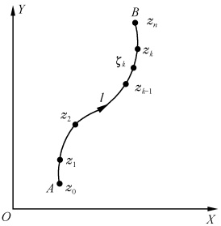

一点(图2.1).作和数

图2.1
 

 $$ \begin{aligned}\sum_{k=1}^{n}f(\zeta_{k})(z_{k}-z_{k-1})&=\sum_{k=1}^{n}f(\zeta_{k})\Delta z_{k},\\ 其中 \Delta z_{k}&=z_{k}-z_{k-1}\end{aligned} $$ 

当 $n$ 无限地增大，使每一 $|\Delta z_k|$ 都趋于零时，如果这和数的极限存在，而且其值与各个 $\zeta_k$ 点的选取无关，则这极限值称为函数 $f(z)$ 沿曲线 $l$ 由 $A$ 到 $B$ 的积分，并记

$$  \int_{l}f(z)\mathrm{d}z=\lim_{\substack{n\to\infty\\ \max|\Delta z_{b}|\to0}}\sum_{k=1}^{n}f(\zeta_{k})\Delta z_{k}   \tag*{(2.1.1)}$$

## 2. 复积分的存在条件及计算方法

若记  $ \zeta_{k}=\xi_{k}+\mathrm{i}\eta_{k},\Delta z_{k}=\Delta x_{k}+\mathrm{i}\Delta y_{k}\left(\xi_{k},\eta_{k},x_{k},y_{k}\right) $ 均为实数），则  $ f\left(\zeta_{k}\right)=u\left(\xi_{k},\eta_{k}\right)+\mathrm{i}v\left(\xi_{k},\eta_{k}\right)=u_{k}+\mathrm{i}v_{k} $ 。其中  $ u_{k}=u\left(\xi_{k},\eta_{k}\right),v_{k}=v\left(\xi_{k},\eta_{k}\right) $ 是实数。因而有

 $$ \begin{align*}\sum_{k=1}^{n}f(\zeta_{k})\Delta z_{k}&=\sum_{k=1}^{n}(u_{k}+\mathrm{i}v_{k})(\Delta x_{k}+\mathrm{i}\Delta y_{k})\\&=\sum_{k=1}^{n}(u_{k}\Delta x_{k}-v_{k}\Delta y_{k})+\mathrm{i}\sum_{k=1}^{n}(v_{k}\Delta x_{k}+u_{k}\Delta y_{k})\end{align*} $$ 

如果上式右端两个和数的极限分别存在（当  $ n \to \infty, \max | \Delta z_k | \to 0 $ 时），由数学分析中

<!-- page: 49 -->

关于实线积分的知识知道，它们就是两个实线积分

$$  \int_{l}u\mathrm{d}x-v\mathrm{d}y,\qquad\int_{l}v\mathrm{d}x+u\mathrm{d}y   \tag*{(2.1.2)}$$

于是当和数  $ \sum_{k=1}^{n}f(\zeta_{k})\Delta z_{k} $ 的极限存在时，有

$$  \int_{l}f(z)\mathrm{d}z=\int_{l}u\mathrm{d}x-v\mathrm{d}y+\mathrm{i}\int_{l}v\mathrm{d}x+u\mathrm{d}y   \tag*{(2.1.3)}$$

由此可见复积分 $ \int_{l}f(z)\mathrm{d}z $存在的条件，也就是(2.1.2)式中两个实线积分存在的条件.所以，只要 $ f(z) $在l上连续.曲线l分段光滑，复积分 $ \int_{l}f(z)\mathrm{d}z $就存在且由(2.1.3)式给出.

既然复积分是两实积分的组合，我们当然可以将复积分化为实积分来计算。

例1 计算 $ \int_{l}Rezdz $，其中l如图2.2所示分别为：(1)连接O点到2+i点的直线段；(2)连接O点到2再到2+i的折线.

解  $ \int_{l}Rez\mathrm{d}z=\int_{l}x(\mathrm{d}x+\mathrm{i}\mathrm{d}y) $

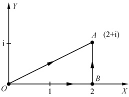

图2.2
 

（1）此时x=2y,y:0\rightarrow1，故

 $$ \begin{aligned}\int_{l}Re z\mathrm{d}z=&\int_{OA}x\left(\mathrm{d}x+\mathrm{i}\mathrm{d}y\right)\\ =&\int_{0}^{1}2y(2+\mathrm{i})\mathrm{d}y=2+\mathrm{i}\end{aligned} $$ 

（2）在 OB 上，y=0, x:0  $ \rightarrow $ 2；在 BA 上，x=2, y:0  $ \rightarrow $ 1。故

 $$ \begin{aligned}\int_{I}\mathrm{Re}z\mathrm{d}z=&\int_{OB}x\left(\mathrm{d}x+\mathrm{i}\mathrm{d}y\right)+\int_{BA}x\left(\mathrm{d}x+\mathrm{i}\mathrm{d}y\right)\\ =&\int_{0}^{2}x\mathrm{d}x+\mathrm{i}\int_{0}^{1}2\mathrm{d}y=2+2\mathrm{i}\end{aligned} $$ 

由此例看出，积分路径不同，积分的结果也不同.

例2 计算 $ \int_{l}z^{2}dz $，其中l是与上例相同的两条路径.

解  $ z^{2}=x^{2}-y^{2}+i2xy,u=x^{2}-y^{2},v=2xy $ ，故由(2.1.3)式有

 $$ \int_{l}z^{2}\mathrm{d}z=\int_{l}(x^{2}-y^{2})\mathrm{d}x-2xy\mathrm{d}y+\mathrm{i}\int_{l}2xy\mathrm{d}x+(x^{2}-y^{2})\mathrm{d}y $$ 

(1)

 $$ \int_{l}z^{2}\mathrm{d}z=\int_{0}^{1}\left[2(4y^{2}-y^{2})-4y^{2}\right]\mathrm{d}y+\mathrm{i}\int_{0}^{1}\left[8y^{2}+(4y^{2}-y^{2})\right]\mathrm{d}y=\frac{2}{3}+\frac{11}{3}\mathrm{i} $$ 

(2)

 $$ \begin{align*}\int_{I}z^{2}\mathrm{d}z=&\int_{OB}z^{2}\mathrm{d}z+\int_{BA}z^{2}\mathrm{d}z\\=&\int_{0}^{2}x^{2}\mathrm{d}x+\int_{0}^{1}(-4y)\mathrm{d}y+\mathrm{i}\int_{0}^{1}(4-y^{2})\mathrm{d}y=\frac{2}{3}+\frac{11}{3}\mathrm{i}\end{align*} $$

<!-- page: 50 -->

由此例看出，对于有些被积函数而言，尽管积分路径不同，但积分结果却是相同的。

下面再看一个结果可以作为公式记住的例子.

例3 试证

$$  \oint_{l}\frac{\mathrm{d}z}{(z-a)^{n}}=\left\{\begin{aligned}&2\pi i&(n=1)\\ &0&(n 是 \neq1 的整数 )\end{aligned}\right.   \tag*{(2.1.4)}$$

此处 l 是以 a 为中心 r 为半径的圆周.

证 在 l 上， $ z-a=re^{i\theta}(0<\theta\leqslant2\pi) $， $ \mathrm{d}z=\mathrm{i}re^{i\theta}\mathrm{d}\theta $

当n=1时有

 $$ \oint_{l}\frac{\mathrm{d}z}{z-a}=\int_{0}^{2\pi}\frac{\mathrm{i}r\mathrm{e}^{i\theta}}{r\mathrm{e}^{i\theta}}\mathrm{d}\theta=2\pi\mathrm{i} $$ 

当n为不等于1的整数时有

 $$ \oint_{l}\frac{\mathrm{d}z}{(z-a)^{n}}=\int_{0}^{2\pi}\frac{\mathrm{i}r\mathrm{e}^{\mathrm{i}\theta}}{r^{n}\mathrm{e}^{\mathrm{i}n\theta}}\mathrm{d}\theta=\frac{\mathrm{i}}{r^{n-1}}\int_{0}^{2\pi}\mathrm{e}^{-\mathrm{i}(n-1)\theta}\mathrm{d}\theta=0 $$ 

## 3. 复积分的性质

由复积分的定义，很容易证明复积分有与数学分析中的曲线积分类似的性质

(1)

 $$ \int_{l}\left[c_{1}f_{1}(z)+c_{2}f_{2}(z)\right]\mathrm{d}z=c_{1}\int_{l}f_{1}(z)\mathrm{d}z+c_{2}\int_{l}f_{2}(z)\mathrm{d}z(c_{1},c_{2} 为复 $$ 

(2)

 $$ \int_{l_{1}+l_{2}}f(z)\mathrm{d}z=\int_{l_{1}}f(z)\mathrm{d}z+\int_{l_{2}}f(z)\mathrm{d}z; $$ 

(3)

 $$ \int_{l_{A B}}f(z)\mathrm{d}z=-\int_{l_{B A}}f(z)\mathrm{d}z. $$ 

此外还有两个积分不等式，在对积分值作估计时是经常用到的

(1)

$$  \left|\int_{l}f(z)\mathrm{d}z\right|\leqslant\int_{l}\mid f(z)\mid\mathrm{d}s=\int_{l}\mid f(z)\mid\mid\mathrm{d}z\mid   \tag*{(2.1.5)}$$

其中  $ \mathrm{d}s=|\mathrm{d}z|=\sqrt{\mathrm{d}x^{2}+\mathrm{d}y^{2}} $，是曲线 l 的弧元.

证 由于  $ \left|\sum_{k=1}^{n}f(\zeta_{k})\Delta z_{k}\right|\leqslant\sum_{k=1}^{n}\left|f(\zeta_{k})\right|\mid\Delta z_{k}\mid $，两边取极限即得(2.1.5)式.

(2) $ \left|\int_{l}f(z)dz\right|\leqslant MS $ (2.1.6)

其中M为 $ \left|f(z)\right| $在l上的一个上界，S为l的长度.

证 由于  $ \left|\sum_{k=1}^{n}f(\zeta_{k})\Delta z_{k}\right|\leqslant\sum_{k=1}^{n}\left|f(\zeta_{k})\right|\left|\Delta z_{k}\right|\leqslant M\sum_{k=1}^{n}\left|\Delta z_{k}\right| $，两边取极限即得(2.1.6)式.

#### 习题2.1

1. 计算积分 $ \int_{0}^{1+i}(x-y+ix^{2})dz $，积分路径是直线段.

2. 计算积分  $ \int_{-1}^{1} |z| \, dz $，积分路径是(1)直线段；(2)单位圆周的上半；(3)单位圆周的下半.

<!-- page: 51 -->

3. 利用积分不等式，证明

(1)  $ \left|\int_{-i}^{i}(x^{2}+iy^{2})dz\right|\leqslant2 $，积分路径是直线段；

(2) $ \left|\int_{-i}^{i}(x^{2}+iy^{2})dz\right|\leqslant\pi $，积分路径是连接-i到i的右半圆周.

4. 证明  $ \left|\int_{i}^{2+i}\frac{\mathrm{d}z}{z^{2}}\right|\leqslant2. $

5. 计算  $ I=\int_{l}\frac{\mathrm{d}z}{(z-a)^{n}} $，其中 n 为整数，l 为以 a 为中心，r 为半径的上半圆周.

### 2.2 柯西定理

由上一节的例子我们看到，有些复变函数的积分值不仅依赖于起点和终点，而且还与积分路径有关（如上节例1）；而有些复变函数的积分值却是只与积分路径的起点和终点有关（如上节例2）。函数  $ f(z) $ 究竟应该具备什么条件，才能保证  $ \int_{t} f(z) dz $ 所得值与路径无关呢？本节的柯西定理将讨论这一问题。

## 1. 单连通区域的柯西定理

设  $ f(z) $ 在单连通区域  $ \sigma $ 内解析，l 为  $ \sigma $ 内的任意一条分段光滑的曲线（图 2.3），则

$$  \oint_{l}f(z)\mathrm{d}z=0   \tag*{(2.2.1)}$$

证明这样的定理是比较困难的，1851年黎曼在附加条件“ $ f'(z) $在 $ \sigma $内连续”下得到一个如下的简单证明.

证 由(2.1.3)式

 $$ \oint_{l}f(z)\mathrm{d}z=\oint_{l}(u\mathrm{d}x-v\mathrm{d}y)+\mathrm{i}\oint_{l}(v\mathrm{d}x+u\mathrm{d}y) $$ 

设  $ f'(z) $ 在  $ \sigma $ 内连续，即  $ \frac{\partial u}{\partial x}, \frac{\partial u}{\partial y}, \frac{\partial v}{\partial x}, \frac{\partial v}{\partial y} $ 在  $ \sigma $ 内连续，则由数学分析中格林(Green)公式

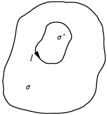

图2.3
 

$$  \oint_{l}P(x,y)\mathrm{d}x+Q(x,y)\mathrm{d}y=\iint_{\sigma^{*}}\left(\frac{\partial Q}{\partial x}-\frac{\partial P}{\partial y}\right)\mathrm{d}\sigma   \tag*{(2.2.2)}$$

有

 $$ \oint_{l}f(z)\mathrm{d}z=\iint_{\sigma^{*}}\left(-\frac{\partial v}{\partial x}-\frac{\partial u}{\partial y}\right)\mathrm{d}\sigma+\mathrm{i}\iint_{\sigma^{*}}\left(\frac{\partial u}{\partial x}-\frac{\partial v}{\partial y}\right)\mathrm{d}\sigma $$ 

其中 $ \sigma^{*} $是以l为边界的单连通区域.又因为在 $ \sigma $内有

 $$ \frac{\partial u}{\partial x}=\frac{\partial v}{\partial y},\quad\frac{\partial v}{\partial x}=-\frac{\partial u}{\partial y} $$ 

故得

 $$ \oint_{l}f(z)\mathrm{d}z=0 $$

<!-- page: 52 -->

在以上证明的过程中我们附加了条件“ $ f'(z) $在 $ \sigma $内连续”，是为了引用格林公式(2.2.2).但1900年古沙(Coursat)发明了新的证明方法，他勿需引用格林公式来证明柯西定理，因此“ $ f'(z) $在 $ \sigma $内连续”的条件在柯西定理中是可以去掉的.柯西定理的古沙证明法较长，这里从略.读者可参阅：参考书目[3]第四章§2.2，或Coursat-Hedrick-Dunkel，Function of a complex variable,1916.

## 2. 推论2.1

在单连通区域中解析的函数  $ f(z) $ 的积分值只依赖于起点与终点而与积分路线无关.

证 设  $ f(z) $ 在区域  $ \sigma $ 内解析， $ l_{1} $ 和  $ l_{2} $ 为  $ \sigma $ 内由 A 到 B 的任意两条分段光滑的

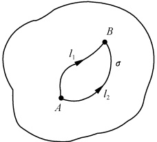

图2.4
 

 $$ \oint f(z)\mathrm{d}z=\int_{l_{1}}f(z)\mathrm{d}z-\int_{l_{2}}f(z)\mathrm{d}z=0 $$ 

所以

 $$ \int_{l_{1}}f(z)\mathrm{d}z=\int_{l_{2}}f(z)\mathrm{d}z $$ 

这就证明了推论.

根据这一结果，我们可以在一定范围内选择积分路径，使积分便于计算。

## 3. 不定积分 原函数

柯西定理已经回答了积分与路径无关的条件，这就是说，如果在单连通区域  $ \sigma $ 内  $ f(z) $ 解析，则沿  $ \sigma $ 内任一曲线 l（为叙述简单，今后我们所提到的曲线，一律指分段光滑的曲线）的积分  $ \int_{l} f(\zeta) \, \mathrm{d}\zeta $ 之值，只与其起点和终点有关。因此，当  $ z_{0} $ 固定，而令终点 z 为变点时，则不定积分  $ \int_{z_{0}}^{z} f(\zeta) \, \mathrm{d}\zeta $ 在  $ \sigma $ 内定义了一个单值函数

$$  F(z)=\int_{z_{0}}^{z}f(\zeta)\mathrm{d}\zeta   \tag*{(2.2.3)}$$

称之为  $ f(z) $ 的不定积分.

定理2.1 设  $ f(z) $ 在单连通区域  $ \sigma $ 内解析，则由(2.2.3)式定义的函数  $ F(z) $ 在  $ \sigma $ 内解析，且  $ F'(z) = f(z) $.

证 在区域  $ \sigma $ 内的任一点 z 的邻域中取一点  $ z + \Delta z $，则由(2.2.3)式有

 $$ \frac{F(z+\Delta z)-F(z)}{\Delta z}=\frac{1}{\Delta z}\Big[\int_{z_{0}}^{z+\Delta z}f(\zeta)\mathrm{d}\zeta-\int_{z_{0}}^{z}f(\zeta)\mathrm{d}\zeta\Big] $$ 

由于右端积分与路径无关，故积分 $ \int_{z_{0}}^{z+\Delta z}f(\zeta)\mathrm{d}\zeta $的积分路径可以选成先由 $ z_{0} $到z与第二个积分相同的路径，再从z沿直线段到 $ z+\Delta z $（图2.5），于是有

<!-- page: 53 -->

$$ \frac{F(z+\Delta z)-F(z)}{\Delta z}=\frac{1}{\Delta z}\int_{z}^{z+\Delta z}f(\zeta)\mathrm{d}\zeta $$ 

又

 $$ f(z)=\frac{1}{\Delta z}\int_{z}^{z+\Delta z}f(z)\mathrm{d}\zeta $$ 

故有

 $$ \frac{F(z+\Delta z)-F(z)}{\Delta z}-f(z)=\frac{1}{\Delta z}\int_{z}^{z+\Delta z}[f(\zeta)-f(z)]\mathrm{d}\zeta $$ 

因  $ f(z) $ 是  $ \sigma $ 内的连续函数，故对于任意给定的  $ \varepsilon>0 $，可以找到  $ \delta>0 $，使当  $ \left|\zeta-z\right|<\delta $ 时  $ \left|f(\zeta)-f(z)\right|<\varepsilon $，

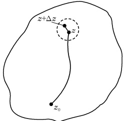

图2.5
 

而有

 $$ \left|\frac{F(z+\Delta z)-F(z)}{\Delta z}-f(z)\right|=\left|\frac{1}{\Delta z}\int_{z}^{z+\Delta z}[f(\zeta)-f(z)]\mathrm{d}\zeta\right|<\frac{1}{|\Delta z|}\int_{z}^{z+\Delta z}\varepsilon|\mathrm{d}\zeta|=\varepsilon $$ 

即

 $$ \lim_{\Delta z\to0}\frac{F(z+\Delta z)-F(z)}{\Delta z}=f(z) $$ 

亦即

 $$ F^{\prime}(z)=f(z)^{\textcircled{1}} $$ 

与数学分析一样，如果  $ \Phi'(z)=f(z) $，则称  $ \Phi(z) $ 为  $ f(z) $ 的一个原函数。因此，由不定积分（2.2.3）式所定义的函数  $ F(z) $ 就是被积函数  $ f(z) $ 的一个原函数。 $ f(z) $ 的原函数不是唯一的，但它们只差一个常数，即

$$  \Phi(z)=F(z)+C=\int_{z_{0}}^{z}f(\zeta)\mathrm{d}\zeta+C   \tag*{(2.2.4)}$$

其中 C 为一个常数. 因为

 $$ \begin{aligned}&\Phi^{\prime}(z)=F^{\prime}(z)=f(z)\\ &\left[\Phi(z)-F(z)\right]^{\prime}=0\\ \end{aligned} $$ 

故

而有

 $$ \Phi(z)-F(z)=C,\quad 即 \quad\Phi(z)=F(z)+C $$ 

在(2.2.4)式中令 $ z=z_{0} $，得到 $ C=\Phi(z_{0}) $，所以

$$  \int_{z_{0}}^{z}f(\zeta)\mathrm{d}\zeta=\varPhi(z)-\varPhi(z_{0})   \tag*{(2.2.5)}$$

(2.2.5)式将计算解析函数的积分归结为寻找其原函数的问题.

例1 计算 $ \int_{0}^{2+i} z^{2} dz $.

解 函数  $ z^{2} $ 在复平面解析， $ \frac{z^{3}}{3} $ 是它的一个原函数，所以

 $$ \int_{0}^{2+i}z^{2}\mathrm{d}z=\frac{z^{3}}{3}\bigg|_{0}^{2+i}=\frac{2}{3}+\frac{11}{3}i $$ 

这样计算，当然比上一节中将它化为实积分沿任何一条路径计算都方便、简单得多。

例2 在区域 $ \sigma:0<\arg z<2\pi $上，计算 $ \int_{1}^{2}\frac{dz}{z} $

解 因为函数 $ \frac{1}{z} $在 $ \sigma $上解析，且其原函数为 $ \ln z $，故 $ \int_{1}^{2}\frac{1}{z}\mathrm{d}z=\ln2-\ln1=\ln2 $

<!-- page: 54 -->

## 4. 柯西定理的推广

单连通区域的柯西定理实际上指出了这样的事实：如果围线 l 及其内部均含于  $ f(z) $ 的解析区域中，则  $ \oint_{l} f(z) dz = 0 $。于是，我们可以推广柯西定理成下述的形式，以后我们将经常引用这种推广了的柯西定理：

设 l 为区域  $ \sigma $ 的边界围线，如果  $ f(z) $ 在区域  $ \sigma $ 内解析，且在  $ \bar{\sigma} = \sigma + l $ 上连续，则  $ \oint_{l} f(z) dz = 0 $.

因为  $  f(z)  $ 在 l 上连续，故积分  $ \int_{l} f(z) dz $ 存在。在 l 的内部作一围线  $ l^{*} $，由前述的柯西定理有  $ \oint_{l^{*}} f(z) dz = 0 $。而  $  f(z)  $ 在 l 上及其内部都是连续的，所以当  $ l^{*} $ 逼近于 l 时  $ \oint_{l^{*}} f(z) dz $ 的极限情况应就是  $ \oint_{l} f(z) dz $。这种想法为证明本定理提供了一个线索，但严格的证明比较麻烦，这里从略，读者可参看参考书目[3]第四章 §2.8。

## 5. 复通区域的柯西定理

由于我们所碰到的问题中的函数不一定在所讨论的区域中处处解析，可能有奇点，因此，我们常常需要作一些适当的围道把奇点挖掉而考虑所得到的有洞的复通区域的柯西定理：

设  $ L=l+\sum_{k=1}^{n}l_{k} $ 为复通区域  $ \sigma $ 的全部边界围线（图 2.6），若  $ f(z) $ 在  $ \sigma $ 内解析，在  $ \bar{\sigma}=\sigma+L $ 上连续，则有

$$  \oint_{l}f(z)\mathrm{d}z=\sum_{k=1}^{n}\oint_{l}f(z)\mathrm{d}z   \tag*{(2.2.6)}$$

其中，所有积分路线的走向都是逆时针方向的（以后均将逆时针走向记为 $ \oint $，而顺时针走向记为 $ \oint $）.

证 为简单起见，先考虑如图2.7所示仅由l和 $ l_{1} $两边界所组成的复通区域（即

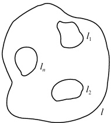

图2.6
 

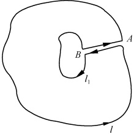

图2.7
 

<!-- page: 55 -->

$ L=l+l_{1}) $的情况.

作割线 AB，则复通区域化为了单连通区域。由单连通区域的柯西定理有

 $$ \oint_{L}f(z)\mathrm{d}z=\oint_{l}f(z)\mathrm{d}z+\int_{A}^{B}f(z)\mathrm{d}z+\oint_{l_{1}}f(z)\mathrm{d}z+\int_{B}^{A}f(z)\mathrm{d}z=0 $$ 

于是

 $$ \oint_{l}f(z)\mathrm{d}z+\oint_{l_{1}}f(z)\mathrm{d}z=0 $$ 

即

 $$ \oint_{l}f(z)\mathrm{d}z=\oint_{l_{1}}f(z)\mathrm{d}z $$ 

同法可证得，对于  $ L=l+\sum_{k=1}^{n}l_{k} $，有

 $$ \oint_{l}f(z)\mathrm{d}z=\sum_{k=1}^{n}\oint_{l_{k}}f(z)\mathrm{d}z $$ 

例3 计算 $ \oint_{l}\frac{dz}{(z-a)^{n}} $，其中n为整数，l为包围z=a的任一闭路径（图2.8）.

解 当  $ n \leqslant 0 $ 时， $ \frac{1}{(z-a)^{n}} $ 在 l 内及 l 上均解析，所以由柯西定理有

 $$ \oint_{l}\frac{\mathrm{d}z}{(z-a)^{n}}=0,\quad n\leqslant0 $$ 

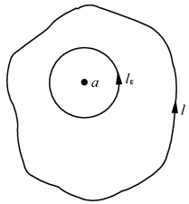

图2.8
 

当n>0时，z=a 为 $ \frac{1}{\left(z-a\right)^{n}} $的奇点，在l内以a为圆心作一小圆 $ l_{e} $（含于l内），则由复通区域的柯西定理有

 $$ \oint_{l}\frac{\mathrm{d}z}{(z-a)^{n}}=\oint_{l_{z}}\frac{\mathrm{d}z}{(z-a)^{n}} $$ 

而由(2.1.4)式有

 $$ \oint_{l_{e}}\frac{\mathrm{d}z}{(z-a)^{n}}=\left\{\begin{matrix}2\pi\mathrm{i},&n=1\\ 0,&n\neq1\end{matrix}\right. $$ 

所以

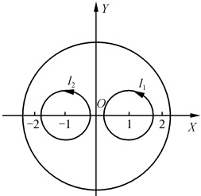

图2.9
 

$$  \oint_{l}\frac{\mathrm{d}z}{(z-a)^{n}}=\left\{\begin{aligned}&2\pi\mathrm{i},&&n=1\\ &0,&&n\neq1\text{ 且为整数 }\end{aligned}\right.   \tag*{(2.2.7)}$$

例4 计算 $ \oint_{l}\frac{dz}{z^{2}-1} $，l是圆周 $ \left|z\right|=a,a>2 $

(图2.9).

解  $ \frac{1}{z^{2}-1} $ 在 l 内有两个奇点  $ z=\pm1 $，故在 l 内可作小圆  $ l_{1} $ 和  $ l_{2} $，则由(2.2.6)式有

 $$ \oint_{l}\frac{\mathrm{d}z}{z^{2}-1}=\oint_{l_{1}}\frac{\mathrm{d}z}{z^{2}-1}+\oint_{l_{2}}\frac{\mathrm{d}z}{z^{2}-1} $$

<!-- page: 56 -->

又

 $$ \frac{1}{z^{2}-1}=\frac{1}{2}\Big(\frac{1}{z-1}-\frac{1}{z+1}\Big) $$ 

所以

 $$ \oint_{l_{1}}\frac{\mathrm{d}z}{z^{2}-1}=\frac{1}{2}\Big(\oint_{l_{1}}\frac{\mathrm{d}z}{z-1}-\oint_{l_{1}}\frac{\mathrm{d}z}{z+1}\Big)=\frac{1}{2}(2\pi\mathrm{i}-0)=\pi\mathrm{i} $$ 

同样可得

 $$ \oint_{t_{2}}\frac{\mathrm{d}z}{z^{2}-1}=-\pi\mathrm{i} $$ 

所以

 $$ \oint_{l}\frac{\mathrm{d}z}{z^{2}-1}=\pi\mathrm{i}-\pi\mathrm{i}=0 $$ 

注 ① 需要指出的是，在此处的证明中我们实际上只用到了(1) $ f(z) $有单连通区域 $ \sigma $上连续；(2) $ \int f(\zeta)d\zeta $沿区域 $ \sigma $上任意围线的积分为0这两个条件.因此只要满足这两个条件，上述定理的结论也正确.关于这一点，在2.3节中将会用到.

#### 习题2.2

1. 计算积分

(1)  $ \oint_{l}\frac{dz}{(z-a)(z-b)} $, l 是包围 a、b 两点的围线；

(2)  $ \oint_{l}\frac{2z^{2}-15z+30}{z^{3}-10z^{2}+32z-32}dz $, l 为圆  $ \left|z\right|=3 $.

2. 计算积分

(1)  $ \int_{-2}^{-2+i}(z+2)^2 dz $; (2)  $ \int_0^{\pi+2i}\cos\frac{z}{2} dz $; (3)  $ \int_1^{1+\frac{\pi}{2}i} z e^z dz $.

3. 由积分 $ \oint_{|z|=1}\frac{dz}{z+2} $之值证明

 $$ \int_{0}^{2\pi}\frac{1+2\cos\theta}{5+4\cos\theta}\mathrm{d}\theta=0 $$ 

### 2.3 柯西积分公式

## 1. 柯西公式

解析函数是一类具有特殊性质的复变函数。这种特殊性质的突出表现之一是，在函数的解析区域中，各处的函数值不是互相独立的，而是彼此联系着的。本节要介绍的柯西公式就给出了解析函数在解析区域内部的值和边界值之间的关系。

设 l 为区域  $ \sigma $ 的边界围线，若  $ f(z) $ 在区域  $ \sigma $ 内解析，在  $ \bar{\sigma} = \sigma + l $ 上连续，a 为  $ \sigma $ 内任意一点，则

$$  f(a)=\frac{1}{2\pi\mathrm{i}}\oint_{l}\frac{f(z)}{z-a}\mathrm{d}z   \tag*{(2.3.1)}$$

这就是柯西积分公式，简称为柯西公式。

<!-- page: 57 -->

证 函数  $ g(z)=\frac{f(z)}{z-a} $ 在  $ \sigma $ 内除 z=a 外均解析. 在  $ \sigma $ 内以 a 为圆心，充分小的  $ \rho $ 为半径作圆周  $ l_{\rho} $ (图 2.10)，则在以复围线  $ l+l_{\rho} $ 为边界的复通区域内，对函数  $ g(z) $ 可用复通区域的柯西定理

 $$ \oint_{l}\frac{f(z)}{z-a}\mathrm{d}z=\oint_{l_{\rho}}\frac{f(z)}{z-a}\mathrm{d}z $$ 

上式的成立，与右端 $ l_{\rho} $的半径 $ \rho $的取值无关。所以，我们只要适当选取 $ \rho $后就能证明上式的右端之值等于 $ 2\pi if(a) $，则(2.3.1)式便得证。

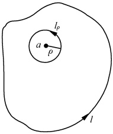

图2.10
 

 $$ \oint_{l_{_\rho}}\frac{f(z)}{z-a}\mathrm{d}z=\oint_{l_{_\rho}}\frac{f(z)-f(a)}{z-a}\mathrm{d}z+\oint_{l_{_\rho}}\frac{f(a)}{z-a}\mathrm{d}z $$ 

而

 $$ \oint_{l_{p}}\frac{f(a)}{z-a}\mathrm{d}z=f(a)\oint_{l_{p}}\frac{1}{z-a}\mathrm{d}z=2\pi\mathrm{i}f(a) $$ 

又由  $ f(z) $ 的连续性知，对于任意的  $ \varepsilon>0 $，存在  $ -\delta>0 $，使得当  $ |z-a|<\delta $ 即  $ \rho<\delta $ 时有

 $$ \mid f(z)-f(a)\mid<\varepsilon $$ 

所以，只要取  $ \rho\to0 $，便有

即

 $$ \begin{aligned}\left|\oint_{l_{p}}\frac{f(z)-f(a)}{z-a}\mathrm{d}z\right|&\leqslant\max_{( 在 l_{p} 上 )}\mid f(z)-f(a)\mid\bullet\frac{1}{\rho}\bullet2\pi\rho<2\pi\varepsilon\\\oint_{l_{p}}\frac{f(z)-f(a)}{z-a}\mathrm{d}z&=0\\\oint_{l}\frac{f(z)}{z-a}\mathrm{d}z&=2\pi\mathrm{i}f(a)\end{aligned} $$ 

故

即

 $$ \begin{aligned}&f(a)=\frac{1}{2\pi\mathrm{i}}\oint_{l}\frac{f(z)}{z-a}\mathrm{d}z\\ &\\&f(z)=\frac{1}{2\pi\mathrm{i}}\oint_{l}\frac{f(\zeta)}{\zeta-z}\mathrm{d}\zeta\\ \end{aligned} $$ 

更一般地

柯西公式(2.3.2)的意义在于：一个解析函数 $ f(z) $在区域 $ \sigma $内的值由它在该区域边界上的值 $ f(\zeta) $所确定。利用这个性质，考虑到解析函数和调和函数的关系，我们可以应用柯西公式(2.3.2)求解二维拉普拉斯方程的边值问题（见本书习题10.4中第4题）。

显然，柯西公式(2.3.2)对于复连通区域仍然成立.这时只要把l理解为区域全部边界的正向就行了.例如，对于图2.6中的情形有

$$  f(z)=\frac{1}{2\pi\mathrm{i}}\oint_{l}\frac{f(\zeta)}{\zeta-z}\mathrm{d}\zeta+\frac{1}{2\pi\mathrm{i}}\sum_{k=1}^{n}\oint_{l_{k}}\frac{f(\zeta)}{\zeta-z}\mathrm{d}\zeta   \tag*{(2.3.3)}$$

利用柯西公式(2.3.2)，可以计算某些围道积分. 注意 z 是被积函数在围道内的

<!-- page: 58 -->

奇点.

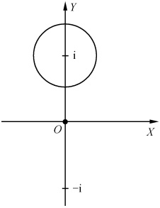

例1 计算 $ \oint_{l}\frac{e^{z}dz}{z(z^{2}+1)} $，l为圆 $ \left|z-i\right|=\frac{1}{2} $

解  $ \frac{\mathrm{e}^{z}}{z(z^{2}+1)}=\frac{\mathrm{e}^{z}}{z(z+\mathrm{i})(z-\mathrm{i})} $ 被积函数的奇点为 z=0 和  $ z=\pm\mathrm{i} $，但在 l 内只有一个奇点 z=i（图 2.11），故有

图2.11
 

 $$ \begin{aligned}\oint_{l}\frac{\mathrm{e}^{z}}{z\left(z^{2}+1\right)}\mathrm{d}z=&\oint_{l}\frac{\frac{\mathrm{e}^{z}}{z\left(z+\mathrm{i}\right)}}{z-\mathrm{i}}\mathrm{d}z\\=&\left.2\pi\mathrm{i}\bullet\frac{\mathrm{e}^{z}}{z\left(z+\mathrm{i}\right)}\right|_{z=\mathrm{i}}\\=&\left.\pi(\sin1-\mathrm{i}\cos1)\right.\end{aligned} $$ 

## 2. 无界区域的柯西公式

设  $ f(z) $ 在闭合围道 l 外单值解析，在 l 上直到 l 外连续，并且当  $ z \to \infty $ 时， $ f(z) $ 一致趋于零（即任给一  $ \varepsilon > 0 $，就可找到一大数  $ R_{1} $，当  $ |z| > R_{1} $ 时，使得  $ \left|f(z)\right| < \varepsilon $，则有

$$  f(z)=\frac{1}{2\pi\mathrm{i}}\oint_{l}\frac{f(\zeta)}{\zeta-z}\mathrm{d}\zeta   \tag*{(2.3.4)}$$

其中z为l外的任意一点.

证 以 z=0 为圆心，R 为半径作一足够大的圆  $ C_{R} $，将 l 和 z 点皆包含在其中。则当  $ R \to \infty $ 时，在  $ C_{R} $ 上有  $ \left|f(z)\right| < \varepsilon $。由(2.3.3)式有

 $$ f(z)=\frac{1}{2\pi\mathrm{i}}\oint_{c_{R}}\frac{f(\zeta)}{\zeta-z}\mathrm{d}\zeta+\frac{1}{2\pi\mathrm{i}}\oint_{l}\frac{f(\zeta)}{\zeta-z}\mathrm{d}\zeta $$ 

而

 $$ \left|\oint_{C_{R}}\frac{f(\zeta)}{\zeta-z}\mathrm{d}\zeta\right|\leqslant\oint_{C_{R}}\frac{\mid f(\zeta)\mid}{\mid\zeta-z\mid}\mid\mathrm{d}\zeta\mid<\frac{\varepsilon}{R-|z|}\cdot2\pi R\doteq2\pi\varepsilon $$ 

由于 $ \varepsilon $的任意性，所以此项趋于零，故有(2.3.4)式.

## 3. 柯西公式的几个推论

（1）解析函数的任意除导数 设 l 为区域  $ \sigma $ 的边界围线， $ f(z) $ 在  $ \sigma $ 内解析，在  $ \bar{\sigma} = \sigma + l $ 上连续，则在  $ \sigma $ 内  $ f(z) $ 的任何除导数  $ f^{(n)}(z) $ 均存在，并且

$$  f^{\left(n\right)}\left(z\right)=\frac{n!}{2\pi\mathrm{i}}\oint_{l}\frac{f\left(\zeta\right)}{\left(\zeta-z\right)^{n+1}}\mathrm{d}\zeta,\quad n=1,2,\cdots   \tag*{(2.3.5)}$$

证 容易看出，(2.3.5)式是柯西公式(2.3.2)形式地在积分号下对z求n次导数的结果. 因此，只需证明在积分号下对z求导是合法的即可. 由(2.3.2)式有

 $$ \frac{f(z+\Delta z)-f(z)}{\Delta z}=\frac{1}{2\pi\mathrm{i}}\bullet\frac{1}{\Delta z}\oint_{l}\left[\frac{f(\zeta)}{\zeta-z-\Delta z}-\frac{f(\zeta)}{\zeta-z}\right]\mathrm{d}\zeta $$

<!-- page: 59 -->

$$ =\frac{1}{2\pi\mathrm{i}}\oint_{l}\frac{f(\zeta)}{(\zeta-z-\Delta z)(\zeta-z)}\mathrm{d}\zeta $$ 

故

 $$ \begin{aligned}&\left|\frac{f(z+\Delta z)-f(z)}{\Delta z}-\frac{1}{2\pi\mathrm{i}}\oint_{l}\frac{f(\zeta)}{(\zeta-z)^{2}}\mathrm{d}\zeta\right|\\=&\left|\frac{1}{2\pi\mathrm{i}}\oint_{l}\frac{f(\zeta)}{(\zeta-z-\Delta z)(\zeta-z)}\mathrm{d}\zeta-\frac{1}{2\pi\mathrm{i}}\oint_{l}\frac{f(\zeta)}{(\zeta-z)^{2}}\mathrm{d}\zeta\right|\\=&\left|\frac{1}{2\pi\mathrm{i}}\oint_{l}\frac{\Delta z f(\zeta)}{(\zeta-z-\Delta z)(\zeta-z)^{2}}\mathrm{d}\zeta\right|\end{aligned} $$ 

因为  $ f(\zeta) $ 在  $ \bar{\sigma} $ 上连续，故在 l 上有  $ \left|f(\zeta)\right| \leqslant M $ (M 为常数). 设  $ d = \min|\zeta - z| $, S 为 l 的长度，则  $ |\zeta - z| \geqslant d $,  $ |\zeta - z - \Delta z| \geqslant |\zeta - z| - |\Delta z| > d - \frac{d}{2} = \frac{d}{2} $ (当  $ \Delta z $ 足够的小，例如  $ |\Delta z| < \frac{d}{2} $ 时)，因此

 $$ \left|\frac{1}{2\pi i}\oint_{l}\frac{\Delta z f(\zeta)}{(\zeta-z-\Delta z)(\zeta-z)^{2}}\mathrm{d}\zeta\right|\leqslant\frac{1}{2\pi}\oint_{l}\left|\frac{\Delta z\cdot f(\zeta)}{(\zeta-z-\Delta z)(\zeta-z)^{2}}\right|\mathrm{d}\zeta<\frac{|\Delta z|}{2\pi}\cdot\frac{MS}{d\frac{\zeta}{2}\cdot d\zeta} $$ 

取 $ \left|\Delta z\right|<\delta=\min\left(\frac{d}{2},\frac{\varepsilon}{MS/\pi d^{3}}\right) $，则

 $$ \lim_{\Delta z\to0}\frac{f(z+\Delta z)-f(z)}{\Delta z}=\frac{1}{2\pi\mathrm{i}}\oint_{l}\frac{f(\zeta)}{(\zeta-z)^{2}}\mathrm{d}\zeta $$ 

即

 $$ f^{\prime}(z)=\frac{1}{2\pi\mathrm{i}}\oint_{l}\frac{f(\zeta)}{(\zeta-z)^{2}}\mathrm{d}\zeta $$ 

由数学归纳法并应用上述证 n=1 的情形类似的方法即可证得(2.3.5)式.

例2 计算 $ \oint_{l}\frac{e^{z}}{z^{n}}dz,n=0,\pm1,\pm2,\cdots $; l是圆 $ \left|z\right|=1 $.

解 若  $ n \leqslant 0 $，则由柯西定理有  $ \oint_{l} \frac{e^{z}}{z^{n}} dz = 0 $；若 n = 1，则由柯西公式有  $ \oint_{l} \frac{e^{z}}{z} dz = 2\pi i $；若 n > 1，则由（2.3.5）式有

 $$ \oint_{l}\frac{\mathrm{e}^{z}}{z^{n}}\mathrm{d}z=\frac{2\pi\mathrm{i}}{(n-1)!}\left.\frac{\mathrm{d}^{n-1}}{\mathrm{d}z^{n-1}}\mathrm{e}^{z}\right|_{z=0}=\frac{2\pi\mathrm{i}}{(n-1)!} $$ 

（2）柯西型积分和含参量的积分 由上面对于解析函数各阶导数均存在的证明过程我们看到，只要  $ f(z) $ 在 l 上连续，即使 l 不是闭合曲线，上面的证明也成立。因此可以推断，在（闭合或不闭合的）曲线 l 上连续的函数  $ \varphi(\zeta) $ 所构成的积分

$$  f(z)=\frac{1}{2\pi\mathrm{i}}\int_{l}\frac{\varphi(\zeta)}{\zeta-z}\mathrm{d}\zeta   \tag*{(2.3.6)}$$

是不在曲线上的点的一个解析函数. 这样的积分称为柯西型积分.  $ f(z) $ 的导数可以通过在积分号下对 z 求导数得到

<!-- page: 60 -->

$$  f^{\left(p\right)}\left(z\right)=\frac{p!}{2\pi\mathrm{i}}\int_{l}\frac{\varphi\left(\zeta\right)\mathrm{d}\zeta}{\left(\zeta-z\right)^{p+1}}   \tag*{(2.3.7)}$$

对于积分曲线上的 z 点，积分(2.3.6)式在通常意义下不存在。因为积分变数  $ \zeta $ 要通过 z 点。关于这一问题的详细讨论，读者可参考文献[3]第四章 §3.7。

利用柯西型积分，就可以推导出含参量积分的解析性.

定理 2.2 设  $ f(t,z) $ 是 t 和 z 的连续函数， $ a \leqslant t \leqslant b, z \in \bar{\sigma} = \sigma + l $；对于  $ [a, b] $ 中的任何 t 值， $ f(t,z) $ 是  $ \bar{\sigma} $ 中的单值解析函数，则含参量的定积分所表示的函数

 $$ F(z)=\int_{a}^{b}f(t,z)\mathrm{d}t $$ 

是 $ \sigma $内的解析函数，而且

$$  F^{\prime}(z)=\int_{a}^{b}\frac{\partial f(t,z)}{\partial z}\mathrm{d}t   \tag*{(2.3.8)}$$

证 因为  $ f(z) $ 在  $ \bar{\sigma} $ 上解析，故对于  $ z \in \sigma $ 由柯西公式有

 $$ f(t,z)=\frac{1}{2\pi\mathrm{i}}\oint_{l}\frac{f(t,\zeta)}{\zeta-z}\mathrm{d}\zeta $$ 

代入  $ F(z) $，并交换积分次序[因为  $ f(t,z) $ 连续]，得

 $$ F(z)=\frac{1}{2\pi\mathrm{i}}\int_{a}^{b}\mathrm{d}t\oint_{l}\frac{f(t,\zeta)}{\zeta-z}\mathrm{d}\zeta=\frac{1}{2\pi\mathrm{i}}\oint_{l}\frac{1}{z-\zeta}\Big[\int_{a}^{b}f(t,\zeta)\mathrm{d}t\Big]\mathrm{d}\zeta $$ 

这是一个柯西型积分，由于  $ \int_{a}^{b}f(t,\zeta)dt $ 连续，故  $ F(z) $ 为  $ \sigma $ 内的解析函数，且

 $$ \begin{align*}F^{\prime}(z)&=\frac{1}{2\pi\mathrm{i}}\oint_{l}\frac{1}{(\zeta-z)^{2}}\bigg[\int_{a}^{b}f(t,\zeta)\mathrm{d}t\bigg]\mathrm{d}\zeta\\&=\int_{a}^{b}\bigg[\frac{1}{2\pi\mathrm{i}}\oint_{l}\frac{f(t,\zeta)}{(\zeta-z)^{2}}\mathrm{d}\zeta\bigg]\mathrm{d}t=\int_{a}^{b}\frac{\partial f(t,z)}{\partial z}\mathrm{d}t\end{align*} $$ 

[以上结论也适用复变数 t 的积分  $ F(z)=\int_{t}f(t,z)dt $ 和无穷积分  $ F(z)=\int_{0}^{\infty}f(t,z)dt $ （要求  $ \int_{0}^{\infty}f(t,z)dt $ 在  $ \bar{\sigma} $ 中一致收敛）].

（3）柯西不等式 设 l 为以 z 为中心的圆  $ \left|\zeta-z\right|=R $， $ f(z) $ 在  $ \left|\zeta-z\right|<R $ 内解析，在  $ \left|\zeta-z\right|\leq R $ 上连续，且对于  $ \zeta\in l $ 有  $ \left|f(\zeta)\right|\leq M $，则

$$  \mid f^{\left(n\right)}\left(z\right)\mid\leqslant\frac{n!M}{R^{n}}   \tag*{(2.3.9)}$$

证 由(2.3.5)式有

 $$ \begin{align*}|\ f^{(n)}(z)\ |=&\frac{n!}{2\pi}\Big|\oint_{l}\frac{f(\zeta)}{(\zeta-z)^{n+1}}\mathrm{d}\zeta\Big|\leqslant\frac{n!}{2\pi}\oint_{l}\frac{|\ f(\zeta)\ |}{|\ \zeta-z\ |^{n+1}}|\ \mathrm{d}\zeta|\\\leqslant&\frac{n!M2\pi R}{2\pi R^{n+1}}=\frac{n!M}{R^{n}}\end{align*} $$ 

（4）刘维尔(Liouville)定理 设  $ f(z) $ 在复平面上解析，且当  $ z \to \infty $ 时有界： $ \left|f(z)\right| \leqslant $

<!-- page: 61 -->

$ M(M $ 为常数 $ ) $,则  $ f(z) $ 必为常数.

证 以复平面中任意一点 z 为圆心作圆周  $ \left|\zeta-z\right|=R $，则在闭圆  $ \left|\zeta-z\right|\leqslant R $ 中，因为  $ f(z) $ 连续，所以  $ f(z) $ 必有上界  $ M(R) $，且  $ M(R)\leqslant M $。故由柯西不等式 (2.3.9) 有

 $$ \mid f^{\prime}(z)\mid\leqslant\frac{M(R)}{R}\leqslant\frac{M}{R} $$ 

上式的成立应与 R 的取值无关，当  $ R \to \infty $ 有

 $$ \mid f^{\prime}(z)\mid=0 $$ 

即

 $$ f^{\prime}(z)=0 $$ 

所以  $ f(z) $ 必为常数.

（5）模数原理 若  $ f(z) $ 在区域  $ \sigma $ 中解析，在  $ \bar{\sigma} = \sigma + l $ 上连续，则  $ \left|f(z)\right| $ 只能在边界 l 上取得最大值.

证 对于函数 $ [f(z)]^n $ (n为正整数)应用柯西公式有

 $$ [f(z)]^{n}=\frac{1}{2\pi\mathrm{i}}\oint_{l}\frac{\left[f(\zeta)\right]^{n}}{\zeta-z}\mathrm{d}\zeta $$ 

设  $ M = \max |f(\zeta)| $,  $ d = \min |\zeta - z| $, s 为 l 的全长，则

 $$ \mid\left[f(z)\right]^{n}\mid=\frac{1}{2\pi}\left|\oint\frac{\left[f(\zeta)\right]^{n}}{\zeta-z}\mathrm{d}\zeta\right|\leqslant\frac{M^{n}\bullet s}{2\pi d} $$ 

即

 $$ \mid f(z)\mid\leqslant M\bullet\left(\frac{s}{2\pi d}\right)^{1/n} $$ 

上式对于任意的 n 均应成立. 令  $ n \to \infty $，则因为  $ \lim_{n \to \infty} \left( \frac{s}{2\pi d} \right)^{1/n} = 1 $，所以有

 $$ \mid f(z)\mid\leqslant M $$ 

用更严格的方法可以证明（见参考文献[3]第五章§2.5），只有当 $ f(z) $为常数时，上式中的等号才成立.

（6）中值（平均值）定理 若  $ f(z) $ 在  $ \left|z-a\right|<R $ 内解析，在  $ \left|z-a\right|\leq R $ 上连续，则  $ f(z) $ 在圆心 a 的值等于它在圆周上的算术平均值. 即

$$  f(a)=\frac{1}{2\pi}\int_{0}^{2\pi}f(a+R\mathrm{e}^{\mathrm{i}\varphi})\mathrm{d}\varphi   \tag*{(2.3.10)}$$

证 由柯西公式有

 $$ f(a)=\frac{1}{2\pi\mathrm{i}}\oint_{l}\frac{f(z)}{z-a}\mathrm{d}z,\quad l\colon\mid z-a\mid=R $$ 

令  $ z-a=Re^{\mathrm{i}\varphi} $，则  $ \mathrm{d}z=\mathrm{i}Re^{\mathrm{i}\varphi}\mathrm{d}\varphi $，代入上式即得（2.3.10）式.

（7）摩勒纳(Morera)定理 设  $ f(z) $ 在区域  $ \sigma $ 内连续，且对  $ \sigma $ 内任意围线 l，都有  $ \oint_{l} f(z) dz = 0 $，则  $ f(z) $ 在  $ \sigma $ 内解析.

<!-- page: 62 -->

证 因为在  $ \sigma $ 内  $ f(z) $ 连续，且  $ \oint_{l} f(z) dz = 0 $，故根据上一节中的注释知， $ F(z) = \int_{z_0}^{z} f(\zeta) \, \mathrm{d}\zeta $ 在  $ \sigma $ 内解析，且  $ F'(z) = f(z) (z \in \sigma) $。又由本节关于解析函数任意阶导数的推论知  $ F''(z) = f'(z) (z \in \sigma) $ 存在，所以  $ f(z) $ 在  $ \sigma $ 内解析。

#### 习题2.3

1. 计算下列积分，其中 l 均为 |z| = 2.

(1)  $ \oint_{l} \frac{2z^{2}-z+1}{z-1} dz $; (2)  $ \oint_{l} \frac{\sin \frac{\pi}{4}z}{z^{2}-1} dz $; (3)  $ \oint_{l} \frac{z+2}{(z+1)z} dz $; (4)  $ \oint_{l} \frac{1}{z^{4}-1} dz $.

2. 计算积分  $ \int_{l}\frac{dz}{z^{2}+9} $，其中围道 l.

（1）包围3i，不包围-3i；（2）包围-3i，不包围3i；（3）包围 $ \pm3i $

3. 计算下列积分：

(1)  $ \oint_{l} \frac{\cos\pi z}{(z-1)^5} dz $; (2)  $ \oint_{l} \frac{e^z}{(z^2+1)^2} dz $; (3)  $ \oint_{l} \frac{z-\sin z}{z^6} dz $; (4)  $ \oint_{l} \frac{2z^2-z+1}{(z-1)^3} dz $.

其中  $ l: |z| = a, a > 1 $.

4. 已知  $ f(z)=\oint_{l}\frac{3\xi^{2}+7\xi+1}{\xi-z}d\xi $, l 为圆  $ \left|\xi\right|=3 $, 求  $ f'(1+i) $.

5. 求积分  $ \oint_{l} \frac{\mathrm{e}^{z}}{z} \mathrm{d}z (l: |z| = 1) $，从而证明

 $$ \int_{0}^{\pi}\mathrm{e}^{\cos\theta}\cos(\sin\theta)\mathrm{d}\theta=\pi $$ 

6. 计算积分 $ \frac{1}{2\pi i}\oint_{l}\frac{e^{z}}{z(1-z)^{3}}dz $，若

(1) z=0 在 l 内，z=1 在 l 外； (2) z=1 在 l 内，z=0 在 l 外； (3) z=0、z=1 均在 l 内.

7. 证明

 $$ \int_{0}^{2\pi}e^{\rho\cos\varphi}\cos(\rho\sin\varphi-n\varphi)d\varphi=\frac{2\pi\rho^{n}}{n!}(n 为自然数 ) $$ 

8. 证明：若  $ f(z)=u(x,y)+\mathrm{i}v(x,y) $ 是上半平面的解析函数，且当  $ z\to\infty $ 时  $ f(z) $ 一致趋于零，则在上半平面中有

 $$ u(x,y)=\frac{y}{\pi}\int_{-\infty}^{\infty}\frac{u(\xi,0)}{(\xi-x)^{2}+y^{2}}\mathrm{d}\xi $$ 

 $$ v(x,y)=\frac{y}{\pi}\int_{-\infty}^{\infty}\frac{v(\xi,0)}{(\xi-x)^{2}+y^{2}}\mathrm{d}\xi $$ 

9. 设  $ u(t,x)=\frac{1}{\sqrt{1-2xt+t^{2}}} $，t 是复数，试证  $ \frac{\partial^{n}u(t,x)}{\partial t^{n}}\mid_{t=0}=\frac{1}{2^{n}}\frac{\mathrm{d}^{n}}{\mathrm{d}x^{n}}(x^{2}-1)^{n} $.

10. 设  $ u(x,t)=\mathrm{e}^{2tx-t^{2}} $, t 是复数，试证  $ \left.\frac{\partial^{n}u(x,t)}{\partial t^{n}}\right|_{t=0}=(-1)^{n}\mathrm{e}^{x^{2}}\frac{\mathrm{d}^{n}}{\mathrm{d}x^{n}}\mathrm{e}^{-x^{2}} $

<!-- page: 63 -->

本章授课课件 本章习题分析与讨论

<table border=1 style='margin: auto; word-wrap: break-word;'><tr><td style='text-align: center; word-wrap: break-word;'>一、若  $ f(z) $ 在区域  $ \sigma $ 内解析,  $ \bar{\sigma}=\sigma+L $ 上连续,则\n $ \oint_{L}f(z)\mathrm{d}z=0 $,  $ L=l $\n $ \oint_{L}f(z)\mathrm{d}z=\sum_{k=1}^{n}\oint_{L_{k}}f(z)\mathrm{d}z $,  $ L=l+\sum_{k=1}^{n}l_{k} $\n $ \left\{\begin{array}{l}f(z)=\frac{1}{2\pi i}\oint_{L}\frac{f(\zeta)}{\zeta-z}\mathrm{d}\zeta,\\f(z)=\frac{1}{2\pi i}\left[\oint_{L}\frac{f(\zeta)}{\zeta-z}\mathrm{d}\zeta-\sum_{k=1}^{n}\oint_{L_{k}}\frac{f(\zeta)}{\zeta-z}\mathrm{d}\zeta\right],L=l+\sum_{k=1}^{n}l_{k}\end{array}\right. $\n $ \left\{\begin{array}{l}f^{(n)}(z)=\frac{n!}{2\pi i}\oint_{L}\frac{f(\zeta)}{(\zeta-z)^{n+1}}\mathrm{d}\zeta\\模数原理: |f(z)| \leqslant M(M=\max|f(\zeta)|)\end{array}\right. $\n平均值定理:  $ f(a)=\frac{1}{2\pi}\int_{0}^{2\pi}f(a+R e^{i\varphi})\mathrm{d}\varphi $\n $ \left\{\begin{array}{l}(\bar{\sigma}: |z-a| \leqslant R)\\\mathrm{二} \cdot \left|\int_{L}f(z)\mathrm{d}z\right| \leqslant\int_{L}\left|f(z)\right| \cdot \mathrm{d}z $\n $ \left\{\begin{array}{l}M \cdot S\end{array}\right.\end{array}\right. $\n可用来估计积分之值.</td></tr></table>

