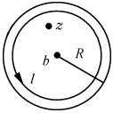
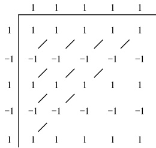
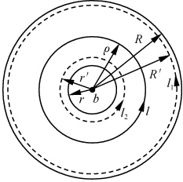

# 03-第三章 复变函数级数

[返回全书目录](../../README.md)

> PDF 页码：64–85

<!-- page: 64 -->

级数也是研究解析函数的一个重要工具。我们将看到，一个函数的解析性与一个函数可否展开成幂级数的问题是等价的。这从另一个侧面提示了解析函数的本质，因此我们可以进一步地认识解析函数。

本章将讨论解析函数表示为幂级数的问题，对于某些和数学分析中平行的结论，往往叙述而不证明。

### 3.1 复级数

## 1. 复数项级数

每项均为复数的无穷级数

$$  f_{1}+f_{2}+\cdots+f_{k}+\cdots=\sum_{k=1}^{\infty}f_{k}   \tag*{(3.1.1)}$$

称为复数项级数，若它的部分和

$$  F_{n}=f_{1}+\cdots+f_{n},\quad n=1,2,\cdots   \tag*{(3.1.2)}$$

所构成的序列 $ \{F_{n}\} $收敛，即

 $$ \lim_{n\to\infty}F_{n}=F $$ 

有限，则称级数 $ \sum_{k=1}^{\infty}f_{k} $收敛于F，而称F为级数(3.1.1)的和；否则级数称为是发散的.

令  $ f_{k}=u_{k}+\mathrm{i}v_{k}, F=u+\mathrm{i}v $，则由  $ \lim_{n\to\infty}F_{n}=F $，有

 $$ \lim_{n\to\infty}[(u_{1}+\mathrm{i}v_{1})+(u_{2}+\mathrm{i}v_{2})+\cdots+(u_{n}+\mathrm{i}v_{n})]=u+\mathrm{i}v $$ 

即

 $$ \begin{aligned}&\lim_{n\to\infty}(u_{1}+u_{2}+\cdots+u_{n})=u\\&\lim_{n\to\infty}(v_{1}+v_{2}+\cdots+v_{n})=v\end{aligned} $$ 

由此可见，如果复级数  $ \sum_{k=1}^{\infty}f_{k} $ 收敛，则实级数  $ \sum_{k=1}^{\infty}u_{k} $ 和  $ \sum_{k=1}^{\infty}v_{k} $ 必分别收敛。反过来，如果  $ \sum_{k=1}^{\infty}u_{k} $ 和  $ \sum_{k=1}^{\infty}v_{k} $ 都收敛，则  $ \sum_{k=1}^{\infty}f_{k} $ 也收敛。这样，复级数的研究就归结为对实级数的研究。有关实数级数收敛问题的定理和性质在复数级数中仍然成立；有关实级数中绝对

<!-- page: 65 -->

收敛和一致收敛的概念、性质也可以推广到复数级数中来.

类似于实数级数，级数(3.1.1)式有收敛的充要条件——柯西收敛判据：任意给定 $ \varepsilon>0 $，存在正整数N，使当 $ n\geq N $时，有

$$  |F_{n+p}-F_{n}|=|f_{n+1}+f_{n+2}+\cdots+f_{n+p}|<\varepsilon,\quad p=1,2,\cdots   \tag*{(3.1.3)}$$

由(3.1.3)式，令 p=1，可得级数(3.1.1)式收敛的必要条件是

$$  \lim_{k\to\infty}f_{k}=0   \tag*{(3.1.4)}$$

如果  $ \sum_{k=1}^{\infty}|f_{k}| $ 收敛，则称  $ \sum_{k=1}^{\infty}f_{k} $ 绝对收敛。绝对收敛的级数必定是收敛的，因为  $ \left|f_{k+1}+f_{k+2}+\cdots+f_{k+p}\right|\leqslant\left|f_{k+1}\right|+\left|f_{k+2}\right|+\cdots+\left|f_{k+p}\right| $

绝对收敛的级数具有如下的主要性质和判别法：

（1）绝对收敛的级数，可任意交换其各项的次序，所得级数仍绝对收敛且其和不变.

（2）两个绝对收敛的级数可逐项相乘，所得级数仍绝对收敛.

（3）比值[或达朗贝尔(d'Alembert)]判别法 对于  $ \sum_{k=1}^{\infty} f_{k} $，若  $ \left|\frac{f_{k+1}}{f_{k}}\right| < \rho (\rho < 1 $ 且与 k 无关)，则级数  $ \sum_{k=1}^{\infty} f_{k} $ 绝对收敛。特别是，如果

$$  \lim_{k\to\infty}\left|\frac{f_{k+1}}{f_{k}}\right|=l   \tag*{(3.1.5)}$$

则当 l<1 时，级数  $ \sum_{k=1}^{\infty}f_{k} $ 绝对收敛；当 l>1 时，级数  $ \sum_{k=1}^{\infty}f_{k} $ 发散；当 l=1 时，级数  $ \sum_{k=1}^{\infty}f_{k} $ 的敛散性需进一步检验.

（4）根式（或柯西）判别法 对于  $ \sum_{k=1}^{\infty} f_{k} $，若

$$  \lim_{k\to\infty}\sqrt[k]{\lceil f_{k}\rceil}=r   \tag*{(3.1.6)}$$

则当 r<1 时，级数  $ \sum_{k=1}^{\infty}f_{k} $ 绝对收敛；当 r>1 时，级数  $ \sum_{k=1}^{\infty}f_{k} $ 发散；当 r=1 时，级数  $ \sum_{k=1}^{\infty}f_{k} $ 的敛散性需进一步检验.

（5）高斯(Gauss)判别法 $ ^{①} $ 对于  $ \sum_{k=1}^{\infty}f_{k} $，设

$$  \frac{f_{k}}{f_{k+1}}=1+\frac{\mu}{k}+O\big(\frac{1}{k^{\lambda}}\big),\quad\lambda>1   \tag*{(3.1.7)}$$

则当  $ \mathrm{Re}\mu>1 $ 时，级数  $ \sum_{k=1}^{\infty}f_{k} $ 绝对收敛；当  $ \mathrm{Re}\mu\leqslant1 $ 时， $ \sum_{k=1}^{\infty}\left|f_{k}\right| $ 发散。式中  $ O\left(\frac{1}{k^{\lambda}}\right) $ 是量级的符号，表示数量级比  $ \frac{1}{k^{\lambda}} $ 更高的无穷小量， $ \mu $ 为复数。

<!-- page: 66 -->

## 2. 复变函数项级数

对于每项均为复变函数的复变函数项级数

$$  f_{1}(z)+\cdots+f_{k}(z)+\cdots=\sum_{k=1}^{\infty}f_{k}(z)   \tag*{(3.1.8)}$$

如果在区域  $ \sigma $ 上有一个函数  $ F(z) $，对任意给定的  $ \varepsilon > 0 $，存在与 z 无关的正整数 N，使当 n > N 时，对一切的  $ z \in \sigma $，均满足

$$  |F(z)-F_{n}(z)|<\varepsilon   \tag*{(3.1.9)}$$

则称级数(3.1.8)式在 $ \sigma $上一致收敛于 $ F(z) $.其中

$$  F_{n}(z)=\sum_{k=1}^{n}f_{k}(z)   \tag*{(3.1.10)}$$

级数(3.1.8)式在 $ \sigma $上一致收敛的充分必要条件是柯西一致收敛判据:任意给定 $ \varepsilon>0 $,存在与z无关的正整数N,使当 $ n>N $时,对一切 $ z\in\sigma $,均有

$$  f_{n+1}(z)+f_{n+2}(z)+\cdots+f_{n+p}(z)|<\varepsilon,\quad p=1,2,\cdots   \tag*{(3.1.11)}$$

一致收敛的级数具有如下的主要性质和判别法：

（1）连续性 若  $ f_{k}(z)(k=1,2,3,\cdots) $ 在区域  $ \sigma $ 内连续， $ \sum_{k=1}f_{k}(z) $ 在  $ \sigma $ 内一致收敛于  $ F(z) $，则和函数  $ F(z) $ 亦在  $ \sigma $ 内连续.

（2）逐项可积性 若  $ f_{k}(z)(k=1,2,3,\cdots) $ 在曲线 l 上连续，且  $ \sum_{k=1}^{\infty}f_{k}(z) $ 在曲线 l 上一致收敛于  $ F(z) $，则  $ \sum_{k=1}^{\infty}f_{k}(z) $ 沿 l 可以逐项积分，且

$$  \int_{l}F(z)\mathrm{d}z=\sum_{k=1}^{\infty}\int_{l}f_{k}(z)\mathrm{d}z   \tag*{(3.1.12)}$$

（3）逐项可导性——魏尔斯特拉斯(Weierstrass)定理 $ ^{②} $ 若级数 $ \sum_{k=1}^{n}f_{k}(z) $的各项均在区域 $ \sigma $内解析，且 $ \sum_{k=1}^{\infty}f_{k}(z) $在 $ \sigma $内的任一闭子域 $ \bar{\sigma}^{\prime} $上一致收敛于 $ F(z) $，则

 $ 1^{\circ}F(z)=\sum_{k=1}^{\infty}f_{k}(z) $ 在  $ \sigma $ 内解析；

 $ 2^{\circ} $ 在  $ \sigma $ 内级数可逐项求导至任意阶，且

$$  F^{\left(n\right)}\left(z\right)=\sum_{k=1}^{\infty}f_{k}^{\left(n\right)}\left(z\right)   \tag*{(3.1.13)}$$

（4）M判别法 若在区域  $ \sigma $ 内  $ \left|f_{k}(z)\right|\leqslant M_{k}(k=1,2,3,\cdots) $， $ M_{k} $ 是与 z 无关的正数，且  $ \sum_{k=1}^{\infty}M_{k} $ 收敛，则  $ \sum_{k=1}^{\infty}f_{k}(z) $ 在  $ \sigma $ 内绝对而且一致收敛.

注 ① 高斯判别法的证明见二维码.

②魏尔斯特拉斯定理的证明见二维码.

高斯判别法的证明

魏尔斯特拉斯定理的证明

<!-- page: 67 -->

### 3.2 幂级数

各项由幂函数组成的无穷级数，如

$$  \sum_{k=0}^{\infty}a_{k}(z-b)^{k}=a_{0}+a_{1}(z-b)+\cdots+a_{k}(z-b)^{k}+\cdots   \tag*{(3.2.1)}$$

称为以 b 为中心的幂级数. 其中  $ a_{0}, a_{1}, \cdots, a_{k}, \cdots $ 及 b 都是复常数.

## 1. 幂级数的收敛性

为了研究幂级数的收敛性，我们先引入如下的定理和推论：

阿贝尔(Abel)定理 若级数(3.2.1)在某点  $ z=z_{0} $ 收敛，则它在以 b 为圆心，以  $ \left|z_{0}-b\right| $ 为半径的圆内绝对收敛，而且在任何一个较小的闭圆  $ \left|z-b\right|\leqslant\rho\left(\rho<|z_{0}-b|\right) $ 上一致收敛.

证 由于级数(3.2.1)在 $ z_{0} $点收敛，故由(3.1.4)式有

 $$ \lim_{k\to\infty}a_{k}(z_{0}-b)^{k}=0 $$ 

所以存在一正数 h 使

 $$ |a_{k}(z_{0}-b)^{k}|<h,\quad k=0,1,2,\cdots $$ 

又

 $$ \begin{aligned}\mid a_{k}(z-b)^{k}\mid&=\left|a_{k}(z_{0}-b)^{k}\bullet\left(\frac{z-b}{z_{0}-b}\right)^{k}\right|\\&=\mid a_{k}(z_{0}-b)^{k}\mid\bullet\left|\frac{z-b}{z_{0}-b}\right|^{k}<h\frac{\rho^{k}}{\mid z_{0}-b\mid^{k}}\end{aligned} $$ 

而 $ \sum_{k=0}^{\infty}\frac{\rho^{k}}{|z_{0}-b|^{k}} $ 是一个收敛的常数项几何级数（因为 $ \frac{\rho}{|z_{0}-b|<1} $），由M判别法知，级数（3.2.1）式在 $ \left|z-b\right|\leqslant\rho(\rho<|z_{0}-b|) $中绝对而且一致收敛.

推论 3.1 若级数(3.2.1)式在某点  $ z=z_{1} $ 发散，则它在圆  $ \left|z-b\right|=\left|z_{1}-b\right| $ 的外面处处发散.

证 利用反证法，如果级数(3.2.1)式在圆 $ \left|z-b\right|=\left|z_{1}-b\right| $外的一点 $ z=z_{2} $收敛，则由阿贝尔定理级数将在圆 $ \left|z-b\right|=\left|z_{2}-b\right| $内收敛，这与题设级数在 $ z_{1} $点发散相矛盾.

## 2. 收敛圆及收敛圆半径

由阿贝尔定理及推论3.1不难看出，幂级数的收敛区域和发散区域是不可能相间的。因此，对于幂级数(3.2.1)式，必存在一以b为心， $ R(0 \leq R < \infty) $为半径的圆，在圆内级数绝对收敛（而且在较小的闭圆内一致收敛），而在圆外级数发散。这个圆称为该幂级数的收敛圆，而R称为它的收敛半径。

<!-- page: 68 -->

对于幂级数(3.2.1)式，由比值判别法易得到求它的收敛半径的公式. 因为

 $$ \lim_{k\to\infty}\left|\frac{f_{k+1}}{f_{k}}\right|=\lim_{k\to\infty}\left|\frac{a_{k+1}}{a_{k}}\right|\bullet\frac{\mid z-b\mid^{k+1}}{\mid z-b\mid^{k}}=\lim_{k\to\infty}\left|\frac{a_{k+1}}{a_{k}}\right|\bullet\mid z-b\mid $$ 

故

当 $ \lim_{k\to\infty}\left|\frac{a_{k+1}}{a_k}\right|\cdot|z-b|<1 $，即当 $ |z-b|<\lim_{k\to\infty}\left|\frac{a_k}{a_{k+1}}\right| $时，级数绝对收敛；

当 $ \lim_{k\to\infty}\left|\frac{a_{k+1}}{a_k}\right|\cdot|z-b|>1 $，即当 $ |z-b|>\lim_{k\to\infty}\left|\frac{a_k}{a_{k+1}}\right| $时，级数发散.

$$  R=\lim_{k\to\infty}\left|\frac{a_{k}}{a_{k+1}}\right|   \tag*{(3.2.2)}$$

例1 求级数  $ \sum_{k=0}^{\infty}z^{k} $， $ \sum_{k=1}^{\infty}\frac{z^{k}}{k} $， $ \sum_{k=1}^{\infty}\frac{z^{k}}{k^{2}} $ 的收敛半径，并讨论它们在收敛圆周上的敛散性.

解 由于对于这三个级数，均有 $ \lim_{k\to\infty}\left|\frac{a_k}{a_{k+1}}\right|=1 $，所以它们的收敛半径均为1。但在收敛圆周上它们的敛散性却各不一样：

 $ \sum_{k=0}^{\infty}z^{k} $，在 $ \mid z\mid=1 $上，由于一般项不趋于0，故处处发散.

 $ \sum_{k=1}^{\infty}\frac{z^{k}}{k} $，在z=1点，是调和级数，所以发散；在z=-1点，是交错级数，所以收敛.

 $ \sum_{k=1}^{\infty}\left|\frac{z^{k}}{k^{2}}\right| $，在 $ \left|z\right|=1 $上，是一p级数，所以 $ \sum_{k=1}^{\infty}\frac{z^{k}}{k^{2}} $处处绝对收敛，因而也处处收敛.

由复级数的根值判别法(3.1.6)式我们还可以得到求幂级数(3.2.1)式的收敛半径的另一公式

$$  R=\lim_{k\to\infty}\frac{1}{\sqrt[k]{\left|a_{k}\right|}}   \tag*{(3.2.3)}$$

例2 求级数  $ \sum_{n=0}^{\infty}\frac{1}{2^{2n}}z^{2n} $ 的收敛半径.

解  $ R=\frac{1}{\lim\limits_{n\to\infty}\left|\frac{1}{2^{2n}}\right|^{\frac{1}{2n}}}=2. $

## 3. 性质

由于幂级数(3.2.1)式的每一项 $ a_{k}(z-b)^{k} $都是z的解析函数，而且在其收敛圆内的任何一个闭区域内(3.2.1)式一致收敛，故由魏尔斯特拉斯定理知其和函数 $ f(z)=\sum_{k=0}^{\infty}a_{k}(z-b)^{k} $是收敛圆内的一个解析函数且可逐项求导至任意阶；由于幂级

<!-- page: 69 -->

数在收敛圆内绝对收敛，故具有绝对收敛级数所具有的一些性质（如可逐项相乘等）；由于幂级数在比收敛圆稍小的闭圆上一致收敛，故具有一致收敛的级数所具有的性质（如逐项积分等）。易于证明，通过逐项微分或积分后所得到的幂级数的收敛半径与原来级数的收敛半径相同。

#### 习题3.2

1. 确定下列级数的收敛半径：

(1)  $ \sum_{k=0}^{\infty}\frac{z^k}{k!} $; (2)  $ \sum_{k=1}^{\infty}\frac{k}{2^k}z^k $; (3)  $ \sum_{k=1}^{\infty}\frac{k!}{k^k}z^k $;

(4)  $ \sum_{k=0}^{\infty}(k+a^k)z^k $; (5)  $ \sum_{k=1}^{\infty}[2+(-1)^k]z^k $.

2.  $ \sum_{k=1}^{\infty}a_{k}z^{k} $ 的收敛半径为  $ R(0\leqslant R<\infty) $，确定下列级数的收敛半径：

(1)  $ \sum_{k=0}^{\infty}k^{n}a_{k}z^{k} $; (2)  $ \sum_{k=1}^{\infty}k^{k}a_{k}z^{k} $; (3)  $ \sum_{k=0}^{\infty}a_{k}^{n}z^{k} $.

3. 讨论幂级数在收敛圆周上的敛、散性：

(1)  $ \sum_{k=1}^{\infty}\frac{(-1)^k}{k}z^k $; (2)  $ \sum_{k=1}^{\infty}\frac{z^k!}{k^2} $.

4. 判断下列级数的收敛性及绝对收敛性：

(1)  $ \sum_{k=1}^{\infty} \frac{i^k}{\ln k} $; (2)  $ \sum_{k=1}^{\infty} \frac{i^k}{k} $.

### 3.3 泰勒级数

在上节曾提到，幂级数在其收敛圆内，代表一解析函数。反之，我们自然要问，解析函数是否能展开成一个幂级数？为此，我们学习泰勒（Taylor）展开定理。

## 1. 泰勒定理

设  $ f(z) $ 在圆域  $ \left|z-b\right|<R $ 内解析，则  $ f(z) $ 在该圆域内可展开为幂级数

$$  f(z)=\sum_{k=0}^{\infty}a_{k}(z-b)^{k}   \tag*{(3.3.1)}$$

称为泰勒级数（或泰勒展式）。其中系数

$$  a_{k}=\frac{1}{k!}f^{\left(k\right)}\left(b\right),\quad k=0,1,2,\cdots   \tag*{(3.3.2)}$$

称为泰勒系数. 且此展开是唯一的.

证 设 z 为圆  $ \left|z-b\right|=R $ 内的任一取定的点，则总有一个圆 l： $ \left|\zeta-b\right|=\rho(0<\rho<R) $，使 z 含在 l 内（见图 3.1）。由柯西公式有

图3.1
 

<!-- page: 70 -->

$$ f(z)=\frac{1}{2\pi\mathrm{i}}\oint_{l}\frac{f(\zeta)}{\zeta-z}\mathrm{d}\zeta $$ 

其中  $ \zeta $ 是 l 上的变点. 利用几何级数恒等式

 $$ \frac{1}{1-q}=\sum_{k=0}^{\infty}q^{k},\quad\mid q\mid<1 $$ 

可将 $ \frac{1}{\zeta-z} $写成

 $$ \begin{aligned}\frac{1}{\zeta-z}=&\frac{1}{(\zeta-b)-(z-b)}=\frac{1}{\zeta-b}\frac{1}{1-\frac{z-b}{\zeta-b}}\\=&\frac{1}{\zeta-b}\sum_{k=0}^{\infty}\left(\frac{z-b}{\zeta-b}\right)^{k}\left(\because\left|\frac{z-b}{\zeta-b}\right|<1\right)\end{aligned} $$ 

级数  $ \sum_{k=0}^{\infty}\left(\frac{z-b}{\zeta-b}\right)^{k} $ 在 l 上是一致收敛的。所以乘上 l 上的有界函数  $ \frac{f(\zeta)}{\zeta-b} $ 后，仍在 l 上一致收敛，即

 $$ \frac{f(\zeta)}{\zeta-z}=\frac{f(\zeta)}{\zeta-b}\sum_{k=0}^{\infty}\left(\frac{z-b}{\zeta-b}\right)^{k}=\sum_{k=0}^{\infty}\frac{f(\zeta)}{(\zeta-b)^{k+1}}\bullet(z-b)^{k} $$ 

在 l 上一致收敛. 故可在 l 上对它采用逐项积分, 而得

 $$ f(z)=\frac{1}{2\pi\mathrm{i}}\oint_{l}\frac{f(\zeta)}{\zeta-z}\mathrm{d}\zeta=\sum_{k=0}^{\infty}\frac{1}{2\pi\mathrm{i}}\oint_{l}\frac{f(\zeta)\mathrm{d}\zeta}{(\zeta-b)^{k+1}}\bullet(z-b)^{k}=\sum_{k=0}^{\infty}a_{k}(z-b)^{k} $$ 

其中

$$  a_{k}=\frac{1}{2\pi\mathrm{i}}\oint_{l}\frac{f(\zeta)\mathrm{d}\zeta}{(\zeta-b)^{k+1}}   \tag*{(3.3.3)}$$

又由(2.3.5)式有

 $$ \frac{1}{2\pi i}\oint_{l}\frac{f(\zeta)\mathrm{d}\zeta}{(\zeta-b)^{k+1}}=\frac{f^{(k)}(b)}{k!} $$ 

故有

 $$ a_{k}=\frac{f^{\left(k\right)}\left(b\right)}{k!} $$ 

定理中的(3.3.1)和(3.3.2)式已得证. 现在证明此展开是唯一的，即在 b 的邻域  $ \left|z-b\right|<R $ 内， $ f(z) $ 的泰勒展开系数  $ a_{k} $ 是完全确定的. 为了证明这一点，设有两个泰勒级数代表同一个解析函数

 $$ \begin{aligned}f(z)=&a_{0}+a_{1}(z-b)+\cdots+a_{k}(z-b)^{k}+\cdots\\=&a_{0}^{\prime}+a_{1}^{\prime}(z-b)+\cdots+a_{k}^{\prime}(z-b)^{k}+\cdots\end{aligned} $$ 

令z=b，则有

 $$ a_{0}=a_{0}^{\prime}=f(b) $$ 

对(3.3.4)式求导，有

 $$ \begin{aligned}f^{\prime}(z)=&a_{1}+2a_{2}(z-b)+\cdots+ka_{k}(z-b)^{k-1}+\cdots\\=&a_{1}^{\prime}+2a_{2}^{\prime}(z-b)+\cdots+ka_{k}^{\prime}(z-b)^{k-1}+\cdots\end{aligned} $$ 

又令 z=b，得

<!-- page: 71 -->

$$ a_{1}=a_{1}^{\prime}=f^{\prime}(b) $$ 

仿此做下去，即可证明对于所有的  $ k(k=0,1,2,\cdots) $ 均有  $ a_{k}=a_{k}^{\prime} $，因此展开是唯一的.

## 2. 收敛范围

泰勒级数的收敛半径，当然可由幂级数的收敛半径公式(3.2.2)和(3.2.3)来求。用下面的方法，来确定泰勒级数的收敛范围，常常更为方便：

设 a 是  $ f(z) $ 的离开中心 b 最近的奇点，则  $ f(z) $ 的泰勒展开的收敛半径为

$$  \boldsymbol{R}=|\begin{array}{l}a-b\end{array}|   \tag*{(3.3.5)}$$

因为在圆  $ \left|z-b\right|=\left|a-b\right| $ 内， $ f(z) $ 处处解析，因此  $ f(z) $ 的泰勒展开 (3.3.1) 式的收敛半径不小于  $ \left|b-a\right| $；而 a 又是  $ f(z) $ 的奇点，故它的泰勒展开的收敛半径也不会大于  $ \left|a-b\right| $，因此收敛半径  $ R=\left|a-b\right| $。

## 3. 展开的方法

我们当然可以直接用泰勒展开定理将函数展开为泰勒级数.

例1 函数  $ f(z)=\mathrm{e}^{z} $，在复平面解析，故在复平面内任一点均可展开成泰勒级数，且由于  $ \infty $ 是它的奇点，故这些级数的收敛半径都是  $ \infty $。在 z=0 处， $ e^{z} $ 的泰勒系数为

 $$ \frac{1}{k!}\frac{\mathrm{d}^{k}}{\mathrm{d}z^{k}}\mathrm{e}^{z}\bigg|_{z=0}=\frac{1}{k!},\quad k=0,1,2,\cdots $$ 

于是  $ e^{z} $ 在 z=0 的泰勒展开为

$$  \mathrm{e}^{z}=1+z+\frac{z^{2}}{2!}+\cdots+\frac{z^{k}}{k!}+\cdots,\quad\mid z\mid<\infty   \tag*{(3.3.6)}$$

例2 函数 $ \frac{1}{1-z} $在z=0的邻域内是解析的，其唯一的奇点z=1，与z=0点的距离是1，在z=0点的k阶导数易算出为k！ $ (k=0,1,2,\cdots) $，故有

$$  \frac{1}{1-z}=1+z+z^{2}+\cdots+z^{k}+\cdots,\quad\mid z\mid<1   \tag*{(3.3.7)}$$

既然泰勒展开是唯一的，故我们当然可以用任何方便的办法来求一个函数的泰勒展开，而不一定要用（3.3.2）式去确定泰勒展开的系数了（从而可避免求导的麻烦）。我们常常借助于一些已知的级数展开式，通过种种手段来实现函数的泰勒展开。

例3 求  $ f(z)=\sin z $ 和  $ f(z)=\cos z $ 在 z=0 点的泰勒展开.

解 由正弦函数的定义和(3.3.6)式我们有

 $$ \sin z=\frac{\mathrm{e}^{\mathrm{i}z}-\mathrm{e}^{-\mathrm{i}z}}{2\mathrm{i}}=\frac{\sum\limits_{k=0}^{\infty}\frac{(\mathrm{i}z)^{k}}{k!}-\sum\limits_{k=0}^{\infty}\frac{(-\mathrm{i}z)^{k}}{k!}}{2\mathrm{i}} $$ 

所以

$$  \sin z=\sum_{k=0}^{\infty}\frac{(-1)^{k}z^{2k+1}}{(2k+1)!},\quad\mid z\mid<\infty   \tag*{(3.3.8)}$$

<!-- page: 72 -->

同样可得

$$  \cos z=\sum_{k=0}^{\infty}\frac{(-1)^{k}z^{2k}}{(2k)!},\quad\mid z\mid<\infty   \tag*{(3.3.9)}$$

(3.3.6)~(3.3.9)式应作为公式记住，以后经常会用到.

例4 求 $ \frac{1}{1-z^{2}} $在z=0的邻域内的泰勒展开.

解 可通过变量代换，再利用(3.3.7)式来展开. 令 $ t=z^{2} $，则

 $$ \frac{1}{1-z^{2}}=\frac{1}{1-t}=1+t+t^{2}+\cdots+t^{k}+\cdots,\quad\mid t\mid<1 $$ 

即

 $$ \frac{1}{1-z^{2}}=1+z^{2}+z^{4}+\cdots+z^{2k}+\cdots,\quad\mid z\mid<1 $$ 

也可以通过分项分式，再利用(3.3.7)式来展开

 $$ \begin{aligned}\frac{1}{1-z^{2}}=&\frac{1}{2}\Big(\frac{1}{1-z}+\frac{1}{1+z}\Big)\\=&\frac{1}{2}(1+z+z^{2}+z^{3}+\cdots)+\frac{1}{2}(1-z+z^{2}-z^{3}+\cdots)\\=&1+z^{2}+z^{4}+\cdots+z^{2k}+\cdots,\quad\mid z\mid<1\end{aligned} $$ 

还可以用级数的乘法和(3.3.7)式来展开

 $$ \frac{1}{1-z^{2}}=\frac{1}{1-z}\bullet\frac{1}{1+z}=\sum_{k=0}^{\infty}z^{k}\bullet\sum_{n=0}^{\infty}(-1)^{n}z^{n} $$ 

图3.2
 

这两个级数在 $ |z|<1 $内绝对收敛，故可逐项相乘，如图3.2所示，我们可将乘后各次幂的系数排成对角线形式，则

 $$ \begin{aligned}\frac{1}{1-z^{2}}=&1+(1-1)z+(1-1+1)z^{2}\\&+(1-1+1-1)z^{3}+\cdots\\=&1+z^{2}+z^{4}+\cdots\end{aligned} $$ 

#### 习题3.3

1. 将下列函数在 z=0 点展开成幂级数，并指出其收敛范围：

(1) $ \frac{1}{(1-z)^{2}}; $ (2) $ \frac{1}{az+b} $ (a,b为复数, $ b\neq0 $); (3) $ e^{\frac{1}{1-z}}; $

(4)  $ \arctan z $; (5)  $ \frac{1}{1+z+z^{2}} $; (6)  $ \frac{\sin z}{1-z} $.

2. 将下列函数按(z-1)的幂展开，并指明其收敛范围：

(1)

(2)

 $$ \cos z； $$ 

 $$ \frac{z^{2}}{(z+1)^{2}}； $$ 

 $$ \frac{z}{z+2}; $$ 

(4)

 $$ \sin(2z-z^{2}) $$

<!-- page: 73 -->

3. 应用泰勒级数求下列积分：

（1）菲涅尔积分  $ s(z)=\int_{0}^{z}\sin z^{2}dz;c(z)=\int_{0}^{z}\cos z^{2}dz; $

（2）误差函数  $ \mathrm{erf}z=\frac{2}{\sqrt{\pi}}\int_{0}^{z}\mathrm{e}^{-\zeta^{2}}\mathrm{d}\zeta; $

（3）积分正弦  $ Siz=\int_{0}^{z}\frac{\sin z}{z}dz. $

4. 对于多值函数而言，在划分出单值分支后，可对各个单值分支像一个单值函数那样作泰勒展开。函数 $ (1+z)^{a} $ 在 a 不等于整数时是多值函数。试证明普遍的二项式定理

$$  (1+z)^{a}=1^{a}\bigg[1+\frac{\alpha}{1!}z+\frac{a(\alpha-1)}{2!}z^{2}+\frac{a(\alpha-1)(\alpha-2)}{3!}z^{3}+\cdots\bigg],\quad\mid z\mid<1   \tag*{(3.3.10)}$$

式中， $ \alpha $ 为任意复数； $ 1^{a}=(\mathrm{e}^{\mathrm{i}2k\pi})^{\alpha}=\mathrm{e}^{\mathrm{i}\alpha2k\pi}(k $ 为整数）.

5. 将  $ \ln(1+z) $ 在 z=0 的邻域内展开为泰勒级数.

6. 如果  $ f(z) $ 在解析区域  $ \sigma $ 内一点 a 的值为零。则称 a 为  $ f(z) $ 的零点。若  $ f(a)=f'(a)=\cdots=f^{(m-1)}(a)=0 $ 但  $ f^{(m)}(a)\neq0(m\geqslant1) $，则称 a 为  $ f(z) $ 的 m 级（阶）零点。试指出下列级数的零点 z=0 是几级（阶）零点。

(1)  $ z^{2}(e^{z^{2}}-1) $; (2)  $ 6\sin z^{3}+z^{3}(z^{6}-6) $.

7. 求和： $ s(z) = \sum_{n=1}^{\infty} z^n n^2 $， $ |z| < 1 $.

(1981年 CUSPEA 试题)

8. 求下列极数的和：

 $$ S=\sum_{n=2}^{\infty}\frac{\mathrm{e}^{\neg n}}{n^{2}-1},\quad t>0 $$ 

（加州理工学院研究生试题）

### 3.4 洛朗级数

由上节我们看出，用泰勒级数来表示圆形区域的解析函数是很方便的。但是，有些函数在我们所需讨论的区域中有奇点，特别是有时我们需讨论奇点邻域函数的性质，此时当然不能将函数表示成泰勒级数，而是另一种展开级数。本节将建立环域 $ r<|z-b|<R(0\leqslant r<R<\infty) $内解析的函数的级数表示——洛朗(Laurent)级数。

我们称具有正、负幂的幂级数

$$  \begin{aligned}\sum_{k=-\infty}^{\infty}C_{k}(z-b)^{k}=&\cdots+C_{-2}(z-b)^{-2}+C_{-1}(z-b)^{-1}\\&+C_{0}+C_{1}(z-b)+C_{2}(z-b)^{2}+\cdots\end{aligned}   \tag*{(3.4.1)}$$

为洛朗级数. 它是泰勒级数的推广.

## 1. 洛朗级数收敛性定理

洛朗级数(3.4.1)式在收敛环域 $ r<|z-b|<R $内的和函数是一解析函数，并在

<!-- page: 74 -->

任意较小的同心闭环域  $ r' \leqslant |z - b| \leqslant R'(r < r' < R' < R) $ 上一致收敛.

证 因为  $ \sum_{k=-\infty}^{\infty}C_{k}(z-b)^{k}=\sum_{k=0}^{\infty}C_{k}(z-b)^{k}+\sum_{k=1}^{\infty}C_{-k}(z-b)^{-k} $. 对于  $ \sum_{k=0}^{\infty}C_{k}(z-b)^{k} $ （称之为洛朗级数的正则部分），这正是 3.2 节中讨论过的幂级数. 设其收敛半径为 R，则在收敛圆的内部，即当  $ |z-b|<R $ 时，它的和函数是一解析函数，且在较小的闭圆  $ |z-b|\leq R'(R'<R) $ 上一致收敛.

对于 $ \sum_{k=1}^{\infty}C_{-k}(z-b)^{-k} $（称为洛朗级数的主要部分），令 $ \zeta=\frac{1}{z-b} $，则 $ \sum_{k=1}^{\infty}C_{-k}(z-b)^{-k}=\sum_{k=1}^{\infty}C_{-k}\zeta^{k} $。这亦是3.2节中讨论过的幂级数。设其收敛半径为 $ \frac{1}{r} $，则在收敛圆内即当 $ |\zeta|<\frac{1}{r} $时， $ \sum_{k=1}^{\infty}C_{-k}\zeta^{k} $的和函数是一解析函数，且在较小的闭圆 $ \left|\zeta\right|\leqslant\frac{1}{r^{\prime}}\left(\frac{1}{r^{\prime}}<\frac{1}{r}\right) $上一致收敛。也就是说， $ \sum_{k=1}^{\infty}C_{-k}(z-b)^{-k} $，当 $ |z-b|>r $时，其和函数是一解析函数，且在较大的闭圆 $ |z-b|\geqslant r^{\prime}>r $上一致收敛。

综上所述，仅当 r<R 时，级数  $ \sum_{k=0}^{\infty}C_{k}(z-b)^{k} $ 和  $ \sum_{k=1}^{\infty}C_{-k}(z-b)^{-k} $ 有共同的收敛区域  $ r<|z-b|<R $ 及共同的一致收敛的闭环域  $ r^{\prime}\leqslant|z-b|\leqslant R^{\prime} $. 故定理得证.

## 2. 洛朗定理

在环域  $ r<|z-b|<R $ 内解析的函数  $ f(z) $ 必可展开成洛朗级数

$$  f(z)=\sum_{k=-\infty}^{\infty}C_{k}(z-b)^{k}   \tag*{(3,4,2)}$$

其中

$$  C_{k}=\frac{1}{2\pi\mathrm{i}}\oint_{l}\frac{f(\zeta)}{(\zeta-b)^{k+1}}\mathrm{d}\zeta   \tag*{(3.4.3)}$$

称为洛朗展开系数，l为圆周 $ \left|z-b\right|=\rho(r<r^{\prime}<\rho<R^{\prime}<R) $，且此展开是唯一的.

证 设 z 为  $ r<|z-b|<R $ 内的任意一取定的点，则总可作含于  $ r<|z-b|<R $ 内的两个圆

图3.3
 

 $$ \begin{aligned}&l_{1}:\mid\zeta-b\mid=R^{\prime},\quad R^{\prime}<R\\&l_{2}:\mid\zeta-b\mid=r^{\prime},\quad r^{\prime}>r\\ \end{aligned} $$ 

使得 z 含在环域  $ r' < |z - b| < R' $ 内（见图 3.3）。因为  $ f(z) $ 在闭环域  $ r' \leq |z - b| \leq R' $ 上解析，则由复通区域的柯西公式 (2.3.3) 式有

$$  f(z)=\frac{1}{2\pi\mathrm{i}}\oint_{l_{1}}\frac{f(\zeta)}{\zeta-z}\mathrm{d}\zeta-\frac{1}{2\pi\mathrm{i}}\oint_{l_{2}}\frac{f(\zeta)}{\zeta-z}\mathrm{d}\zeta   \tag*{(3.4.4)}$$

<!-- page: 75 -->

其中  $ \zeta $ 为  $ l_{1} $ 和  $ l_{2} $ 上的变点.

对于上式的第一个积分，类似于泰勒定理的证明过程，我们立即可得

$$  \frac{1}{2\pi\mathrm{i}}\oint_{l_{1}}\frac{f(\zeta)}{\zeta-z}\mathrm{d}\zeta=\sum_{k=0}^{\infty}\frac{1}{2\pi\mathrm{i}}\oint_{l_{1}}\frac{f(\zeta)}{(\zeta-b)^{k+1}}\mathrm{d}\zeta\bullet(z-b)^{k}   \tag*{(3.4.5)}$$

对于(3.4.4)式右边的第二个积分，由于

 $$ \begin{aligned}\frac{1}{\zeta-z}=&\frac{1}{\zeta-b-(z-b)}=-\frac{1}{z-b}\bullet\frac{1}{1-\frac{\zeta-b}{z-b}}\\=&-\frac{1}{z-b}\sum_{k=0}^{\infty}\left(\frac{\zeta-b}{z-b}\right)^{k}\quad\left( 因 \left|\frac{\zeta-b}{z-b}\right|<1\right)\end{aligned} $$ 

故类似于上一节的理由有

 $$ \frac{f(\zeta)}{\zeta-z}=-\frac{f(\zeta)}{z-b}\sum_{k=0}^{\infty}\left(\frac{\zeta-b}{z-b}\right)^{k} $$ 

在 $ l_{2} $上一致收敛.因而有

 $$ \frac{1}{2\pi\mathrm{i}}\oint_{l_{2}}\frac{f(\zeta)}{\zeta-z}\mathrm{d}\zeta=-\sum_{k=0}^{\infty}\frac{1}{2\pi\mathrm{i}}\oint_{l_{2}}\frac{f(\zeta)}{(\zeta-b)^{-k}}\mathrm{d}\zeta\bullet(z-b)^{-(k+1)} $$ 

令 $ -(k+1)=s $，则 k=-s-1，故

$$  \frac{1}{2\pi\mathrm{i}}\oint_{l_{2}}\frac{f(\zeta)}{\zeta-z}\mathrm{d}\zeta=-\sum_{s=-1}^{\infty}\frac{1}{2\pi\mathrm{i}}\oint_{l_{2}}\frac{f(\zeta)}{(\zeta-b)^{s+1}}\mathrm{d}\zeta\bullet(z-b)^{s}   \tag*{(3.4.6)}$$

将（3.4.5）、（3.4.6）式代入（3.4.4）式有

$$  \begin{align*}f(z)=&\sum_{k=0}^{\infty}\frac{1}{2\pi\mathrm{i}}\oint_{l_{1}}\frac{f(\zeta)}{(\zeta-b)^{k+1}}\mathrm{d}\zeta\bullet(z-b)^{k}\\&+\sum_{k=-\infty}^{-1}\frac{1}{2\pi\mathrm{i}}\oint_{l_{2}}\frac{f(\zeta)}{(\zeta-b)^{k+1}}\mathrm{d}\zeta\bullet(z-b)^{k}\end{align*}   \tag*{(3.4.7)}$$

又作圆  $ l: | \zeta - b | = \rho, r' < \rho < R' $，则由复通区域的柯西定理（2.2.6）式有

$$  \oint_{l_{1}}\frac{f(\zeta)}{(\zeta-b)^{k+1}}\mathrm{d}\zeta=\oint_{l}\frac{f(\zeta)}{(\zeta-b)^{k+1}}\mathrm{d}\zeta   \tag*{(3.4.8)}$$

$$  \oint_{l_{2}}\frac{f(\zeta)}{(\zeta-b)^{k+1}}\mathrm{d}\zeta=\oint_{l}\frac{f(\zeta)}{(\zeta-b)^{k+1}}\mathrm{d}\zeta   \tag*{(3,4,9)}$$

将（3.4.8）、（3.4.9）式代入（3.4.7）式便可得到定理中的（3.4.2）式和（3.4.3）式.

必须注意的是，尽管洛朗展开(3.4.2)式中含有 $ (z-b) $的负幂项，这些项当z=b时都是奇异的，但展开中心b点不一定是函数的奇点。事实上，洛朗定理也并未涉及展开中心b是否一定是函数的奇点的问题。关于这一点，在后面的例题2中我们也会看到。另外，尽管洛朗展开的系数公式(3.4.3)与泰勒展开的系数公式(3.3.3)的形式相同，但不论b是否是 $ f(z) $的奇点，都应有 $ C_{k}\neq\frac{f^{(k)}(b)}{k!} $。如果b是 $ f(z) $的奇点，则 $ f^{(k)}(b) $根本不存在；如果b不是 $ f(z) $的奇点， $ C_{k} $也不会等于 $ \frac{f^{(k)}(b)}{k!} $。因为(2.3.5)式

<!-- page: 76 -->

成立的条件是  $ f(z) $ 在 l 内解析，而 (3.4.3) 式中的  $ f(z) $ 在 l 内肯定有奇点（当然不一定是展开中心 b），否则也不需要考虑洛朗展开了.

下面我们证明上述的洛朗展开也是唯一的.

设  $ f(z) $ 在环  $ r<|z-b|<R $ 内还有另一展开式，即

 $$ f(z)=\sum_{k=-\infty}^{\infty}C_{k}(z-b)^{k}=\sum_{k=-\infty}^{\infty}C_{k}^{\prime}(z-b)^{k} $$ 

则由洛朗级数收敛定理知，此二级数在  $ l: |z-b|=\rho (r<\rho < R) $ 上一致收敛。它们分别乘上  $ (z-b)^n (n $ 为固定整数 $ 后仍然一致收敛，故可在  $ l $ 上逐项积分，即

 $$ \sum_{k=-\infty}^{\infty}C_{k}\oint_{l}(z-b)^{k+n}\mathrm{d}z=\sum_{k=-\infty}^{\infty}C_{k}^{\prime}\oint_{l}(z-b)^{k+n}\mathrm{d}z $$ 

对于上式，若  $ k+n \neq -1 $，即  $ k \neq -n - 1 $，则由(2.1.4)式有

 $$ \oint_{l}(z-b)^{k+n}\mathrm{d}z=0 $$ 

若  $ k+n=-1 $ ，即 k=-n-1 ，则

 $$ C_{-n-1}\oint\frac{1}{z-b}\mathrm{d}z=C_{-n-1}^{\prime}\oint\frac{1}{z-b}\mathrm{d}z $$ 

由(2.1.4)式有

 $$ C_{-n-1}2\pi\mathrm{i}=C^{\prime}_{-n-1}2\pi\mathrm{i} $$ 

即

 $$ C_{-n-1}=C^{\prime}_{-n-1} $$ 

而 n 是任意的整数，故有

 $$ C_{k}=C_{k}^{\prime},\quad k=0,\pm1,\pm2,\cdots $$ 

唯一性得证.（请大家思考，在这里，为什么我们不按证泰勒展开唯一性时所用的方法来证？）

## 3. 收敛范围

显然，设 a 和  $ a' $ 分别是函数  $ f(z) $ 的两个相邻的奇点，则洛朗级数  $ \sum_{k=-\infty}^{\infty} C_{k}(z-b)^{k} $ 必在环域  $ |a-b|<|z-b|<|a'-b| $ （设  $ |a'-b|>|a-b| $）内收敛.

## 4. 展开方法

从理论上说我们当然可直接利用展开公式(3.4.2)和(3.4.3)将函数进行洛朗展开。但由于洛朗展开的系数公式只有积分的形式，它的计算，往往是相当困难甚至是无法计算的。既然洛朗展开也是唯一的，除了个别情况我们直接利用展开定理将函数进行洛朗展开外（见例3），一般均可借助一些已知的级数展式，通过种种简便方法来进行洛朗展开。

例1 求函数 $ \frac{1}{z(z-1)} $在 $ 0<|z|<1 $和 $ 1<|z|<\infty $中的洛朗展开.

<!-- page: 77 -->

解（1）若  $ 0 < |z| < 1 $，则

 $$ \frac{1}{z(z-1)}=-\frac{1}{z}\bullet\frac{1}{1-z}=-\frac{1}{z}\sum_{k=0}^{\infty}z^{k}=-\sum_{k=0}^{\infty}z^{k-1}=-\frac{1}{z}-1-z-z^{2}-\cdots $$ 

(2) 若  $ 1 < |z| < \infty $，则

 $$ \begin{aligned}\frac{1}{z(z-1)}=&\frac{1}{z}\bullet\frac{1}{z\big(1-\frac{1}{z}\big)}=\frac{1}{z^{2}}\bullet\sum_{k=0}^{\infty}\Big(\frac{1}{z}\Big)^{k}\\=&\sum_{k=0}^{\infty}\frac{1}{z^{k+2}}=\frac{1}{z^{2}}+\frac{1}{z^{3}}+\frac{1}{z^{4}}+\cdots\end{aligned} $$ 

例2 将  $ f(z)=\frac{1}{(z-1)(z-2)} $ 在复平面中以 z=0 为中心进行洛朗展开.

解 在复平面中  $ f(z)=\frac{1}{(z-1)(z-2)}=\frac{1}{z-2}-\frac{1}{z-1} $ 仅有 z=1 和 z=2 两个奇点，故在复平面中以 z=0 为中心，可在以下三个区域进行洛朗展开：

(1) $ |z|<1 $,此时

 $$ f(z)=\frac{1}{1-z}-\frac{1}{2\left(1-\frac{z}{2}\right)}=\sum_{k=0}^{\infty}z^{k}-\frac{1}{2}\sum_{k=0}^{\infty}\left(\frac{z}{2}\right)^{k}=\sum_{k=0}^{\infty}\left(1-\frac{1}{2^{k+1}}\right)z^{k} $$ 

(2)  $ 1 < |z| < 2 $，此时

 $$ \frac{1}{z-1}=\frac{1}{z}\bullet\frac{1}{\left(1-\frac{1}{z}\right)}=\frac{1}{z}\sum_{k=0}^{\infty}\left(\frac{1}{z}\right)^{k}=\sum_{k=0}^{\infty}\frac{1}{z^{k+1}} $$ 

 $$ \frac{1}{z-2}=-\frac{1}{2}\frac{1}{1-\frac{z}{2}}=-\frac{1}{2}\sum_{k=0}^{\infty}\left(\frac{z}{2}\right)^{k}=-\sum_{k=0}^{\infty}\frac{z^{k}}{2^{k+1}} $$ 

所以

 $$ f(z)=\frac{1}{z-2}-\frac{1}{z-1}=-\sum_{k=0}^{\infty}\frac{z^k}{2^{k+1}}-\sum_{k=1}^{\infty}\frac{1}{z^k} $$ 

(3)  $ 2 < |z| $，此时

 $$ \frac{1}{z-1}=\frac{1}{z}\frac{1}{1-\frac{1}{z}}=\sum_{k=0}^{\infty}\frac{1}{z^{k+1}} $$ 

 $$ \frac{1}{z-2}=\frac{1}{z}\bullet\frac{1}{1-\frac{2}{z}}=\sum_{k=0}^{\infty}\frac{2^{k}}{z^{k+1}} $$ 

所以

 $$ f(z)=\frac{1}{z-2}-\frac{1}{z-1}=\sum_{k=1}^{\infty}\frac{2^{k-1}-1}{z^{k}} $$ 

由展开的结果看到本例的情况(1)是一个泰勒级数，这当然并不奇怪，因为在 $ \left|z\right|<1 $内，没有函数 $ f(z)=\frac{1}{(z-1)(z-2)} $的奇点.在情况(2)、(3)中，右边的展开式

<!-- page: 78 -->

在 z=0 点均有无穷项负幂，即 z=0 点对于展开式而言是奇点，但函数  $ f(z)=\frac{1}{(z-1)(z-2)} $ 在 z=0 点却是解析的，这正是前面我们让大家注意的展开中心不一定是函数的奇点的情况.

例3 试证

 $$ \mathrm{ch}\left(z+\frac{1}{z}\right)=C_{0}+\sum_{k=1}^{\infty}C_{k}\left(z^{k}+z^{-k}\right) $$ 

其中  $ C_{k}=\frac{1}{2\pi}\int_{0}^{2\pi}\cos k\varphi\mathrm{ch}(2\cos\varphi)\mathrm{d}\varphi $

证 因  $ w=z+\frac{1}{z} $ 在 z 平面上只有 z=0 一个奇点，而

 $$ \mathrm{ch}\ \mathrm{w}=1+\frac{\mathrm{w}^{2}}{2!}+\frac{\mathrm{w}^{4}}{4!}+\cdots $$ 

的收敛半径为 $ \infty $，故 $ \mathrm{ch}\left(z+\frac{1}{z}\right) $在z平面上也只有一个奇点z=0。故可将它在 $ 0<|z|<\infty $中展开为洛朗级数

 $$ \operatorname{ch}\left(z+\frac{1}{z}\right)=\sum_{k=-\infty}^{\infty}C_{k}z^{k} $$ 

其中

 $$ C_{k}=\frac{1}{2\pi\mathrm{i}}\oint_{l}\frac{\mathrm{ch}(z+z^{-1})}{z^{k+1}}\mathrm{d}z $$ 

这里，l 表任意圆周  $ |z| = \rho > 0 $。取  $ \rho = 1 $，则在 l 上： $ z = e^{i\varphi}, 0 \leqslant \varphi \leqslant 2\pi $。故有

 $$ \begin{align*}\mathrm{C}_{k}=&\frac{1}{2\pi}\int_{0}^{2\pi}\mathrm{ch}(\mathrm{e}^{\mathrm{i}\varphi}+\mathrm{e}^{-\mathrm{i}\varphi})\mathrm{e}^{-\mathrm{i}k\varphi}\mathrm{d}\varphi\\=&\frac{1}{2\pi}\int_{0}^{2\pi}\mathrm{ch}(2\cos\varphi)\mathrm{c o s}k\varphi\mathrm{d}\varphi-\frac{\mathrm{i}}{2\pi}\int_{0}^{2\pi}\mathrm{ch}(2\cos\varphi)\mathrm{s i n}k\varphi\mathrm{d}\varphi\end{align*} $$ 

令  $ \varphi = \pi - \theta $，则右边第二个积分之值为零。故有

 $$ C_{k}=\frac{1}{2\pi}\int_{0}^{2\pi}\mathrm{ch}(2\cos\varphi)\cos k\varphi\mathrm{d}\varphi $$ 

所以

 $$ C_{k}=C_{\rightarrow k},\quad k=1,2,\cdots $$ 

故

 $$ \mathrm{ch}\left(z+\frac{1}{z}\right)=C_{0}+\sum_{k=1}^{\infty}C_{k}(z^{k}+z^{-k}) $$ 

#### 习题3.4

1. 将下列函数在指定环域内展开为洛朗级数：

 $$ (1)\frac{z+1}{z^{2}(z-1)},0<|z|<1,1<|z|<\infty;\qquad(2)\frac{z^{2}-2z+5}{(z-2)(z^{2}+1)},1<|z|<2; $$ 

(3)

 $$ \mathrm{e}^{z+\frac{1}{z}},0<|z|<+\infty; $$ 

 $$ \sin z\sin\frac{1}{z},0<|z|<∞. $$

<!-- page: 79 -->

2. 在给定点的（去心）邻域，将函数展开为洛朗级数，并确定展开式成立的区域.

(1) $ \frac{1}{(z^{2}+1)^{2}},z=i; $ (2) $ (z-1)^{2}\mathrm{e}^{\frac{1}{1-z}},z=1; $ (3) $ \frac{1}{(z-a)^{k}}(a\neq0,k $ 为自然数 $ ),z=0; $

(4) $ z^{2}e^{\frac{1}{z}},z=0; $ (5) $ \sin\frac{z}{1-z},z=1; $ (6) $ e^{\frac{1}{2}(z-\frac{a^{2}}{z})},z=0. $

3. 将函数 $ \frac{1}{(z-a)(z-b)}(0<|a|<|b|) $，在 z=0, z=a 的邻域内以及在圆环  $ \left|a\right|<\left|z\right|<\left|b\right| $ 内展开为洛朗级数.

4. 设  $ f(z) $ 在环域  $ 1-\varepsilon<|z|<1+\varepsilon $ 内解析， $ \varepsilon $ 为正数，证明在单位圆周上，其洛朗级数即为傅里叶级数.

5. 将函数  $  f(z) = \frac{1}{z(1-z)}  $ 在下列区域中展开为级数：

(1)  $ 0 < |z| < 1 $; (2)  $ |z| > 1 $; (3)  $ 0 < |z - 1| < 1 $; (4)  $ |z - 1| > 1 $;

(5) $ |z+1|<1 $; (6) $ 1<|z+1|<2 $; (7) $ |z+1|>2 $.

### 3.5 单值函数的孤立奇点

## 1. 函数的奇点

我们知道，函数的奇点是指函数的不解析之点。我们将函数的奇点分为孤立奇点和非孤立奇点两大类。

设单值函数  $ f(z) $ 在某点 b 不解析，而在 b 的某一去心邻域  $ 0<|z-b|<\varepsilon $ （即除去圆心 z=b 的某个圆）内解析，则称 z=b 是  $ f(z) $ 的一个孤立奇点。如，z=0 是函数  $ \frac{1}{z(z-1)} $ 的孤立奇点，因为当  $ 0<|z|<1 $ 时  $ \frac{1}{z(z-1)} $ 解析。同样，z=1 也是  $ \frac{1}{z(z-1)} $ 的一孤立奇点，因为当  $ 0<|z-1|<1 $ 时它也解析。

显然，函数在其孤立奇点的去心邻域（有时，也常常就称之为孤立奇点的邻域，而不用“去心”二字）是能展开成洛朗级数的. 如，当  $ 0<|z-1|<1 $ 时，有

 $$ \begin{aligned}f(z)&=\frac{1}{z(z-1)}=\frac{1}{z-1}\bullet\frac{1}{1-\left[-(z-1)\right]}\\&=\frac{1}{z-1}\sum_{k=0}^{\infty}(-1)^{k}(z-1)^{k}\\&=\sum_{k=0}^{\infty}(-1)^{k}(z-1)^{k-1}\\ \end{aligned} $$ 

若在 z=b 的无论多小邻域内，总有除 z=b 以外的奇点，则称 z=b 为  $ f(z) $ 的非孤立奇点。例如，z=0 就是函数  $ \left(\sin\frac{1}{z}\right)^{-1} $ 的非孤立奇点。因为这函数还有奇点  $ z=\frac{1}{n\pi} $，n=0， $ \pm1 $， $ \pm2 $， $ \cdots $。而只要 n 足够大， $ \frac{1}{n\pi} $ 可以任意接近于 0，即在 z=0 的无论多小的邻域内总可找到其他奇点。

<!-- page: 80 -->

对于函数的奇点特别是函数在其孤立奇点邻域内的性质的讨论，在许多问题中，如在留数理论中，在常微分方程的解析理论中等等，均有着十分重要的意义。本节我们将主要讨论单值函数（或多值函数的单值分支）的孤立奇点。

## 2. 孤立奇点的分类

单值函数的孤立奇点分为三类. 设 b 为  $ f(z) $ 的孤立奇点，则在 b 的去心邻域  $ 0 < |z - b| < R $ 中可将  $ f(z) $ 展开为洛朗级数

$$  f(z)=\sum_{k=-\infty}^{\infty}C_{k}(z-b)^{k}   \tag*{(3.5.1)}$$

由于洛朗级数的负幂部分表示奇点性质，故我们按(3.5.1)式其负幂部分的情况将之分为如下三类：

（1）若  $ f(z) $ 在 b 点的主要部分为零，即

$$  f(z)=C_{0}+C_{1}(z-b)+C_{2}(z-b)^{2}+\cdots,\quad0<|z-b|<R   \tag*{(3.5.2)}$$

则称 b 为  $ f(z) $ 的可去奇点. 如,  $ f(z)=\frac{\sin z}{z} $, 在 z=0 点该函数无确定值, 故 z=0 为该函数的奇点. 但

$$  \frac{\sin z}{z}=\frac{1}{z}\sum_{k=0}^{\infty}\frac{(-1)^{k}}{(2k+1)!}z^{2k+1}=\sum_{k=0}^{\infty}\frac{(-1)^{k}}{(2k+1)!}z^{2k},\quad0<|z|<\infty   \tag*{(3.5.3)}$$

无负幂，故 z=0 是  $ f(z)=\frac{\sin z}{z} $ 的可去奇点.

对于(3.5.2)式有

$$  \lim_{z\to b}f(z)=C_{0}   \tag*{(3.5.4)}$$

因此，如果定义  $ f(b)=C_{0} $，则函数  $ f(z) $ 在 z=b 的奇异性就去掉了，而可以将之作为解析函数来看待（这亦是我们称 b 为可去奇点的由来）。如，对于  $ \frac{\sin z}{z} $ 若规定在 z=0 点  $ \frac{\sin z}{z} $ 之值为 1，则

 $$ f(z)=\left\{\begin{aligned}&\frac{\sin z}{z},&z\neq0\\ &1,&z=0\end{aligned}\right. $$ 

在 $ \left|z\right|<\infty $中解析，函数在z=0点的奇异性已去掉，而此时(3.5.3)式右边的级数在 $ \left|z\right|<\infty $中成立，代表去掉奇异性以后的级数.

可以证明，如果  $ f(z) $ 以 b 为可去奇点，则下列三条件的每一条都是 z=b 为  $ f(z) $ 的可去奇点的充分必要条件，它们可以互相推出：

 $ 1^{\circ}f(z) $在b点没有主要部分；

 $ 2^{\circ}\ \lim_{x\to h}f(z) $ 存在并且有限；

 $ 3^{\circ}f(z) $在b的某去心邻域内有界.

（2）若  $ f(z) $ 在 b 点的主要部分有有限项负幂，即

<!-- page: 81 -->

$$  f(z)=\frac{C_{-m}}{(z-b)^{m}}+\frac{C_{-(m-1)}}{(z-b)^{m-1}}+\cdots+\frac{C_{-1}}{z-b}+C_{0}+C_{1}(z-b)+\cdots   \tag*{(3.5.5)}$$

则称 b 为  $ f(z) $ 的 m 阶极点  $ (C_{-m} \neq 0) $. 如， $ f(z) = \frac{1}{z^{2}(z-1)} $，z = 0 为其奇点，且

 $$ \begin{aligned}\frac{1}{z^{2}(z-1)}=&\frac{-1}{z^{2}}\bullet\frac{1}{1-z}=\frac{-1}{z^{2}}\sum_{k=0}^{\infty}z^{k}\\=&-\left(\frac{1}{z^{2}}+\frac{1}{z}+1+z+\cdots\right),\quad0<|z|<1\end{aligned} $$ 

所以 z=0 是它的二阶极点. 又如， $ f(z)=\frac{1}{z-1} $，显然 z=1 是它的一阶极点. 一阶极点又称做单极点.

可以证明，如果  $ f(z) $ 以 b 为孤立奇点，则下列三条件每一条都是 z=b 为  $ f(z) $ 的 m 阶极点的充分必要条件，它们可以互相推出：

 $ 1^{\circ}f(z) $在b点的主要部分为 $ \frac{C_{-m}}{(z-b)^{m}}+\cdots+\frac{C_{-1}}{z-b}(C_{-m}\neq0) $;

 $ 2^{\circ}f(z) $ 在 b 的某去心邻域内能表示成  $ f(z)=\frac{\varphi(z)}{(z-b)^{m}} $，其中， $ \varphi(z) $ 在 b 的邻域内解析， $ \varphi(b)\neq0 $；

 $ 3^{\circ} g(z)=\frac{1}{f(z)} $ 以 b 为（可去奇点要作解析点看）m 阶零点.

以上三条，当然均可作为判断一个函数的 m 阶极点的充分必要条件. 而  $ \lim_{z\to b}f(z)=\infty $，则是 b 为函数  $ f(z) $ 的极点的充分必要条件.

（3）若  $ f(z) $ 在 b 点的主要部分有无限项负幂，即

$$  f(z)=\cdots+\frac{C_{-m}}{(z-b)^{m}}+\cdots+\frac{C_{-1}}{z-b}+C_{0}+C_{1}(z-b)+\cdots   \tag*{(3.5.6)}$$

则称 b 为  $ f(z) $ 的本性奇点. 如  $ \mathrm{e}^{\frac{1}{z}} $，当 z=0 时，其值不定，而

 $$ \mathrm{e}^{\frac{1}{z}}=1+\frac{1}{z}+\frac{1}{2!z^{2}}+\cdots,\quad0<|z|<\infty $$ 

有无限项负幂，故 z=0 为它的本性奇点.

从 b 为  $ f(z) $ 可去奇点的充分必要条件  $ \lim_{z\to b}f(z)= $ 有限值和 b 为  $ f(z) $ 的 m 阶极点的充分必要条件  $ \lim_{z\to b}f(z)=\infty $，用反证法我们立即可得到 b 为  $ f(z) $ 的本性奇点的充分必要条件是

 $$ \lim_{z\to b}f(z)\neq\left\{\begin{aligned}& 有限值 \\ &\infty\end{aligned}\right.,\quad 即 \lim_{z\to b}f(z) 不存在 $$ 

## 3. 无穷远点的性质

以上讨论的是奇点 z=b 为有限远点的情况. 现在讨论  $ z=\infty $ 的情况. 若存在一

<!-- page: 82 -->

正数 R，使  $ f(z) $ 在以 z=0 为圆心，R 为半径的圆外每一点  $ |z|>R $（包括  $ z=\infty $）都是可导的，则称  $ f(z) $ 在无穷远点的邻域内解析。如， $ f(z)=\frac{1}{z-1} $，当  $ |z|>1 $ 时， $ f(z) $ 处处解析，故它在无穷远点的邻域解析。

若以 z=0 为圆心，R 为半径作圆  $ \left|z\right|=R $，只要 R 足够大，在圆外，除无穷远点外  $ f(z) $ 别无奇点（即  $ f(z) $ 在  $ \infty $ 点的某去心邻域  $ R<|z|<\infty $ 中解析），则称无穷远点为  $ f(z) $ 的一个孤立奇点。如  $ \frac{\sin z}{z} $，当  $ |z|>0 $ 时， $ \frac{\sin z}{z} $ 除无穷远点外别无奇点，即它在  $ 0<|z|<\infty $ 中解析，故无穷远点是它的一个孤立奇点。

为了研究函数  $ f(z) $ 在无穷远点的性质，可作变换  $ z=\frac{1}{t} $，把  $ z=\infty $ 变为 t=0；函数  $ f(z)=f\left(\frac{1}{t}\right) $ 变为  $ \varphi(t) $，然后研究函数  $ \varphi(t) $ 在 t=0 的邻域的性质。若  $ \varphi(t) $ 在 t=0 的邻域  $ \left|t\right|<\delta $ 中解析，则  $ f(z) $ 在无穷远点的邻域  $ \left|z\right|>R=\frac{1}{\delta} $ 中解析；若  $ \varphi(t) $ 在  $ 0<|t|<\delta $ 中解析，即 t=0 为  $ \varphi(t) $ 的孤立奇点，则  $ f(z) $ 在  $ \frac{1}{\delta}=R,R<|z|<\infty $ 中解析，即  $ z=\infty $ 为  $ f(z) $ 的孤立奇点。

设  $ \varphi(t) $ 在 t=0 的去心邻域  $ 0<|t|<\delta $ 内的洛朗展开为

 $$ \begin{array}{r}{\varphi(t)=\cdots\frac{C_{-k}^{^{\prime}}}{t^{k}}+\cdots+\frac{C_{-1}^{^{\prime}}}{t}+C_{0}+C_{1}^{\prime}t+\cdots+C_{k}^{\prime}t^{k}+\cdots,\quad0<|t|<\delta}\end{array} $$ 

则  $ f(z) $ 在  $ z=\infty $ 的洛朗展开为

$$  \begin{aligned}f(z)=&\cdots+C_{-k}^{^{\prime}}z^{k}+\cdots+C_{-1}^{^{\prime}}z+C_{0}+\frac{C_{1}^{^{\prime}}}{z}+\cdots+\frac{C_{k}^{^{\prime}}}{z^{k}}+\cdots\\=&\cdots+C_{k}z^{k}+\cdots+C_{1}z+C_{0}+\frac{C_{-1}}{z}+\cdots+\frac{C_{-k}}{z^{k}}+\cdots\end{aligned}   \tag*{(3.5.7)}$$

其中

 $$ R<\mid z\mid<\infty,R=\frac{1}{\delta}；\ C_{±k}=C_{干k}^{\prime},k=1,2,\cdots $$ 

可见，将  $ f(z) $ 在无穷远点展开为洛朗级数，只要将  $ f(z) $ 在以 z=0 为中心以 R 为内半径 [R 为  $ f(z) $ 在有限区域中距 z=0 最远的一个奇点与 z=0 点间的距离] 的环域  $ R<|z|< \infty $ 展开即可 [若  $ f(z) $ 在有限区域中没有奇点，则这个展开就等于在  $ |z|< \infty $ 中的泰勒展开].

例 求  $ f(z)=\frac{\sin z}{z} $ 在孤立奇点无穷远点的洛朗展开.

 $$ f(z)=\frac{1}{z}\sum_{k=0}^{\infty}\frac{(-1)^{k}}{(2k+1)!}z^{2k+1}=\sum_{k=0}^{\infty}\frac{(-1)^{k}}{(2k+1)!}z^{2k},\quad0<|z|<\infty $$ 

由于  $ f(z) $ 在  $ R<|z|< \infty $ 中的展开与  $ \varphi(t) $ 在  $ 0<|t|<\delta $ 中的展开相当，故我们当然可按照在有限区域中对孤立奇点的分类方法，将无穷远点为孤立奇点分为如下

<!-- page: 83 -->

三类：

（1）若  $ f(z) $ 在无穷远点的洛朗展开不含正幂，即

$$  f(z)=C_{0}+\frac{C_{-1}}{z}+\frac{C_{-2}}{z^{2}}+\cdots,\quad R<|z|<\infty   \tag*{(3.5.8)}$$

则称  $ z=\infty $ 为  $ f(z) $ 的可去奇点（作为解析点看）. 如， $ f(z)=z\sin\frac{1}{z} $， $ z=\infty $ 是它的可去奇点. 因为

 $$ z\sin\frac{1}{z}=z\sum_{k=0}^{\infty}\frac{(-1)^{k}}{(2k+1)!}\frac{1}{z^{2k+1}}=\sum_{k=0}^{\infty}\frac{(-1)^{k}}{(2k+1)!}\frac{1}{z^{2k}},\quad0<|z|<\infty $$ 

无正幂.

（2）若  $ f(z) $ 在无穷远点的洛朗展开有有限项正幂，即

$$  \begin{align*}f(z)=C_{m}z^{m}+C_{m-1}z^{m-1}+\cdots+C_{1}z+C_{0}+\frac{C_{-1}}{z}+\frac{C_{-2}}{z^{2}}+\cdots,\\C_{m}\neq0,\quad R<|z|<\infty\end{align*}   \tag*{(3.5.9)}$$

则称  $ z=\infty $ 为  $ f(z) $ 的 m 阶极点. 如 n 次多项式  $ P_{n}(z)=a_{n}z^{n}+a_{n-1}z^{n-1}+\cdots+a_{0}, z=\infty $ 是它的 n 阶极点.

（3）若  $ f(z) $ 在无穷远点的洛朗展开有无穷项正幂，即

$$  f(z)=\cdots+C_{k}z^{k}+\cdots+C_{1}z+C_{0}+\frac{C_{-1}}{z}+\frac{C_{-2}}{z^{2}}+\cdots,\quad R<|z|<\infty   \tag*{(3.5.10)}$$

则称  $ z=\infty $ 为  $ f(z) $ 的本性奇点. 如  $ f(z)=\mathrm{e}^{z}, z=\infty $ 是它的本性奇点, 因为

 $$ \mathrm{e}^{z}=1+\frac{z}{1!}+\frac{z^{2}}{2!}+\cdots,\quad\mid z\mid<\infty $$ 

有无限项正幂.

由上述分类标准可看出，我们亦可根据极限 $ \lim_{z\to\infty}f(z) $之值分别为有限、无限和不存在的三种不同情形，来判断 $ z=\infty $为 $ f(z) $的可去奇点、极点和本性奇点.

#### 习题3.5

1. 证明：如果 b 为  $ f(z) $ 的孤立奇点，则下列三条件的每一条都是 z=b 为  $ f(z) $ 的可去奇点的分必要条件，它们可以互相推出

(1)  $ f(z) $ 在 b 点没有主要部分；

(2) $ \lim_{x\to h}f(z) $存在并且有限；

(3)  $ f(z) $ 在 b 的充分小的邻域内有界.

2. 证明下列三种定义等价：点 b 为  $ f(z) $ 的 m 阶极点.

(1) 若  $ f(z) = \sum_{k = -m}^{\infty} C_{k}(z - b)^{k}, 0 < |z - b| < R, C_{-m} \neq 0; $

(2) 若  $ f(z)=\frac{\varphi(z)}{(z-b)^{m}} $,  $ \varphi(b)\neq0 $,  $ \varphi(z) $ 在  $ 0<|z-b|<R $ 中解析；

<!-- page: 84 -->

(3) 若  $ g(z)=\frac{1}{f(z)} $ 以 b 为 m 阶零点.

3. 证明下列三条中任意一条均是 $ \infty $为  $ f(z) $ 的 m 阶极点的充分必要条件：

(1)  $ f(z) $ 在  $ z = \infty $ 点的洛朗展开有 m 项正幂；

(2)  $ f(z) $ 在  $ z=\infty $ 的某邻域内（除  $ \infty $ 外）能表成  $ f(z)=z^{m}\varphi(z) $， $ \varphi(z) $ 在  $ z=\infty $ 的邻域内解析且  $ \varphi(\infty)\neq0 $；

(3)  $ g(z)=\frac{1}{f(z)} $ 以  $ \infty $ 为 m 阶零点.

4. 求出下列函数的奇点（包括  $ z = \infty $）。确定它们是哪一类的奇点（对于极点，要指出它们的阶）。

(1)  $ \frac{z-1}{z(z^2+4)^2} $; (2)  $ \frac{z^5}{(1-z)^2} $; (3)  $ \frac{1}{\sin z + \cos z} $; (4)  $ \frac{1-e^z}{1+e^z} $;

(5)  $ \tan^2 z $; (6)  $ z^2 $; (7)  $ \frac{z}{z+1} $; (8)  $ \frac{e^z}{1+z^2} $;

(9)  $ \frac{z^2+1}{e^z} $; (10)  $ ze^{\frac{1}{z}} $; (11)  $ \sin\left(\frac{1}{\sin\frac{1}{z}}\right) $; (12)  $ \frac{z^7}{(z^2-4)^2 \cos\frac{1}{z-2}} $.

5. 讨论下列多值函数的每一单值分支在给定点的性状. (对各个分支, 给定点是否解析, 或是否为奇点? 若为奇点, 是属哪一类?)

(1) $ \frac{z}{1+\sqrt{z-3}}, z=4; $

(2) $ \frac{1}{\sqrt{z}+\sqrt[3]{z}}, z=1; $

(3)  $ \cos\frac{1}{1+\sqrt{z}}, z=1; $

(4)  $ \frac{1}{(2+\sqrt{z})\sin(2-\sqrt{z})}, z=4. $

6.  $ f(z) $,  $ g(z) $ 分别以 z=b 为 m 阶及 n 阶极点，试问 z=b 为  $ f+g $,  $ f \cdot g $ 及  $ \frac{f}{g} $ 的什么样的点？

7. 下列函数在指定点的去心邻域内能否展为洛朗级数？

(1)  $ \cos\frac{1}{z}, z=0; $

(2)  $ \cos\frac{1}{z}, z=\infty; $

(3)  $ \sec\frac{1}{z-1}, z=1; $

(4)  $ \cot z, z=\infty. $

<!-- page: 85 -->

### 本章小结

本章授课课件 本章习题分析与讨论

二、泰勒级数和洛朗级数
 

<table border=1 style='margin: auto; word-wrap: break-word;'><tr><td style='text-align: center; word-wrap: break-word;'>一、无穷级数</td><td style='text-align: center; word-wrap: break-word;'>$ \left\{\begin{aligned}&amp;\sum_{k=1}^{\infty}f_{k}(f_{k}为复数)\\&amp;\sum_{k=1}^{\infty}f_{k}(z)\\&amp;\sum_{k=0}^{\infty}a_{k}(z-b)^{k}\end{aligned}\right. $</td><td style='text-align: center; word-wrap: break-word;'>除了实级数中，一致收敛级数的逐项可微性发展为魏尔斯特拉斯定理外，同类实级数的有关概念、定理与性质在此均适用.</td></tr></table>

<table border=1 style='margin: auto; word-wrap: break-word;'><tr><td style='text-align: center; word-wrap: break-word;'></td><td style='text-align: center; word-wrap: break-word;'>泰勒级数</td><td style='text-align: center; word-wrap: break-word;'>洛朗级数</td><td style='text-align: center; word-wrap: break-word;'>非孤立奇点</td></tr><tr><td style='text-align: center; word-wrap: break-word;'>展开式</td><td style='text-align: center; word-wrap: break-word;'>$ f(z)=\sum_{k=0}^{\infty}a_k(z-b)^k $\n $ a_k=\frac{f^{(k)}(b)}{k!} $</td><td style='text-align: center; word-wrap: break-word;'>$ f(z)=\sum_{k=-\infty}^{\infty}C_k(z-b)^k $\n $ C_k=\frac{1}{2\pi i}\oint_S f(\zeta)\over(\zeta-b)^{k+1}d\zeta $</td><td style='text-align: center; word-wrap: break-word;'>三、\n三、\n三、\n三、\n三、\n三、\n三、\n三、\n三、\n三、\n三、\n三、\n三、\n三、\n三、\n三、\n三、\n三、\n三、\n三、\n三、\n三、\n三、\n三、\n三、\n三、\n三、\n三、\n三、\n三、\n三、\n三、\n三、\n三、\n三、\n三、\n三、\n三、\n三、\n三、\n三、\n三、\n三、\n三、\n三、\n三、\n三、\n三、\n三、\n三、\n三、\n三、\n三、\n三、\n三、\n三、\n三、\n三、\n三、\n三、\n三、\n三、\n三、\n三、\n三、\n三、\n三、\n三、\n三、\n三、\n三、\n三、\n三、\n三、\n三、\n三、\n三、\n三、\n三、\n三、\n三、\n三、\n三、\n三、\n三、\n三、\n三、\n三、\n三、\n三、\n三、\n三、\n三、\n三、\n三、\n三、\n三、\n三、\n三、\n三、\n三、\n三、\n三、\n三、\n三、\n三、\n三、\n三、\n三、\n三、\n三、\n三、\n三、\n三、\n三、\n三、\n三、\n三、\n三、\n三、\n三、\n三、\n三、\n三、\n三、\n三、\n三、\n三、\n三、\n三、\n三、\n三、\n三、\n三、\n三、\n三、\n三、\n三、\n三、\n三、\n三、\n三、\n三、\n三、\n三、\n三、\n三、\n三、\n三、\n三、\n三、\n三、\n三、\n三、\n三、\n三、\n三、\n三、\n三、\n三、\n三、\n三、\n三、\n三、\n三、\n三、\n三、\n三、\n三、\n三、\n三、\n三、\n三、\n三、\n三、\n三、\n三、\n三、\n三、\n三、\n三、\n三、\n三、\n三、\n三、\n三、\n三、\n三、\n三、\n三、\n三、\n三、\n三、\n三、\n三、\n三、\n三、\n三、\n三、\n三、\n三、\n三、\n三、\n三、\n三、\n三、\n三、\n三、\n三、\n三、\n三、\n三、\n三、\n三、\n三、\n三、\n三、\n三、\n三、\n三、\n三、\n三、\n三、\n三、\n三、\n三、\n三、\n三、\n三、\n三、\n三、\n三、\n三、\n三、\n三、\n三、\n三、\n三、\n三、\n三、\n三、\n三、\n三、\n三、\n三、\n三、\n三、\n三、\n三、\n三、\n三、\n三、\n三、\n三、\n三、\n三、\n三、\n三、\n三、\n三、\n三、\n三、\n三、\n三、\n三、\n三、\n三、\n三、\n三、\n三、\n三、\n三、\n三、\n三、\n三、\n三、\n三、\n三、\n三、\n三、\n三、\n三、\n三、\n三、\n三、\n三、\n三、\n三、\n三、\n三、\n三、\n三、\n三、\n三、\n三、\n三、\n三、\n三、\n三、\n三、\n三、\n三、\n三、\n三、\n三、\n三、\n三、\n三、\n三、\n三、\n三、\n三、\n三、\n三、\n三、\n三、\n三、\n三、\n三、\n三、\n三、\n三、\n三、\n三、\n三、\n三、\n三、\n三、\n三、\n三、\n三、\n三、\n三、\n三、\n三、\n三、\n三、\n三、\n三、\n三、\n三、\n三、\n三、\n三、\n三、\n三、\n三、\n三、\n三、\n三、\n三、\n三、\n三、\n三、\n三、\n三、\n三、\n三、\n三、\n三、\n三、\n三、\n三、\n三、\n三、\n三、\n三、\n三、\n三、\n三、\n三、\n三、\n三、\n三、\n三、\n三、\n三、\n三、\n三、\n三、\n三、\n三、\n三、\n三、\n三、\n三、\n三、\n三、\n三、\n三、\n三、\n三、\n三、\n三、\n三、\n三、\n三、\n三、\n三、\n三、\n三、\n三、\n三、\n三、\n三、\n三、\n三、\n三、\n三、\n三、\n三、\n三、\n三、\n三、\n三、\n三、\n三、\n三、\n三、\n三、\n三、\n三、\n三、\n三、\n三、\n三、\n三、\n三、\n三、\n三、\n三、\n三、\n三、\n三、\n三、\n三、\n三、\n三、\n三、\n三、\n三、\n三、\n三、\n三、\n三、\n三、\n三、\n三、\n三、\n三、\n三、\n三、\n三、\n三、\n三、\n三、\n三、\n三、\n三、\n三、\n三、\n三、\n三、\n三、\n三、\n三、\n三、\n三、\n三、\n三、\n三、\n三、\n三、\n三、\n三、\n三、\n三、\n三、\n三、\n三、\n三、\n三、\n三、\n三、\n三、\n三、\n三、\n三、\n三、\n三、\n三、\n三、\n三、\n三、\n三、\n三、\n三、\n三、\n三、\n三、\n三、\n三、\n三、\n三、\n三、\n三、\n三、\n三、\n三、\n三、\n三、\n三、\n三、\n三、\n三、\n三、\n三、\n三、\n三、\n三、\n三、\n三、\n三、\n三、\n三、\n三、\n三、\n三、\n三、\n三、\n三、\n三、\n三、\n三、\n三、\n三、\n三、\n三、\n三、\n三、\n三、\n三、\n三、\n三、\n三、\n三、\n三、\n三、\n三、\n三、\n三、\n三、\n三、\n三、\n三、\n三、\n三、\n三、\n三、\n三、\n三、\n三、\n三、\n三、\n三、\n三、\n三、\n三、\n三、\n三、\n三、\n三、\n三、\n三、\n三、\n三、\n三、\n三、\n三、\n三、\n三、\n三、\n三、\n三、\n三、\n三、\n三、\n三、\n三、\n三、\n三、\n三、\n三、\n三、\n三、\n三、\n三、\n三、\n三、\n三、\n三、\n三、\n三、\n三、\n三、\n三、\n三、\n三、\n三、\n三、\n三、\n三、\n三、\n三、\n三、\n三、\n三、\n三、\n三、\n三、\n三、\n三、\n三、\n三、\n三、\n三、\n三、\n三、\n三、\n三、\n三、\n三、\n三、\n三、\n三、\n三、\n三、\n三、\n三、\n三、\n三、\n三、\n三、\n三、\n三、\n三、\n三、\n三、\n三、\n三、\n三、\n三、\n三、\n三、\n三、\n三、\n三、\n三、\n三、\n三、\n三、\n三、\n三、\n三、\n三、\n三、\n三、\n三、\n三、\n三、\n三、\n三、\n三、\n三、\n三、\n三、\n三、\n三、\n三、\n三、\n三、\n三、\n三、\n三、\n三、\n三、\n三、\n三、\n三、\n三、\n三、\n三、\n三、\n三、\n三、\n三、\n三、\n三、\n三、\n三、\n三、\n三、\n三、\n三、\n三、\n三、\n三、\n三、\n三、\n三、\n三、\n三、\n三、\n三、\n三、\n三、\n三、\n三、\n三、\n三、\n三、\n三、\n三、\n三、\n三、\n三、\n三、\n三、\n三、\n三、\n三、\n三、\n三、\n三、\n三、\n三、\n三、\n三、\n三、\n三、\n三、\n三、\n三、\n三、\n三、\n三、\n三、\n三、\n三、\n三、\n三、\n三、\n三、\n三、\n三、\n三、\n三、\n三、\n三、\n三、\n三、\n三、\n三、\n三、\n三、\n三、\n三、\n三、\n三、\n三、\n三、\n三、\n三、\n三、\n三、\n三、\n三、\n三、\n三、\n三、\n三、\n三、\n三、\n三、\n三、\n三、\n三、\n三、\n三、\n三、\n三、\n三、\n三、\n三、\n三、\n三、\n三、\n三、\n三、\n三、\n三、\n三、\n三、\n三、\n三、\n三、\n三、\n三、\n三、\n三、\n三、\n三、\n三、\n三、\n三、\n三、\n三、\n三、\n三、\n三、\n三、\n三、\n三、\n三、\n三、\n三、\n三、\n三、\n三、\n三、\n三、\n三、\n三、\n三、\n三、\n三、\n三、\n三、\n三、\n三、\n三、\n三、\n三、\n三、\n三、\n三、\n三、\n三、\n三、\n三、\n三、\n三、\n三、\n三、\n三、\n三、\n三、\n三、\n三、\n三、\n三、\n三、\n三、\n三、\n三、\n三、\n三、\n三、\n三、\n三、\n三、\n三、\n三、\n三、\n三、\n三、\n三、\n三、\n三、\n三、\n三、\n三、\n三、\n三、\n三、\n三、\n三、\n三、\n三、\n三、\n三、\n三、\n三、\n三、\n三、\n三、\n三、\n三、\n三、\n三、\n三、\n三、\n三、\n三、\n三、\n三、\n三、\n三、\n三、\n三、\n三、\n三、\n三、\n三、\n三、\n三、\n三、\n三、\n三、\n三、\n三、\n三、\n三、\n三、\n三、\n三、\n三、\n三、\n三、\n三、\n三、\n三、\n三、\n三、\n三、\n三、\n三、\n三、\n三、\n三、\n三、\n三、\n三、\n三、\n三、\n三、\n三、\n三、\n三、\n三、\n三、\n三、\n三、\n三、\n三、\n三、\n三、\n三、\n三、\n三、\n三、\n三、\n三、\n三、\n三、\n三、\n三、\n三、\n三、\n三、\n三、\n三、\n三、\n三、\n三、\n三、\n三、\n三、\n三、\n三、\n三、\n三、\n三、\n三、\n三、\n三、\n三、\n三、\n三、\n三、\n三、\n三、\n</td></tr></table>

