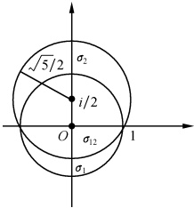
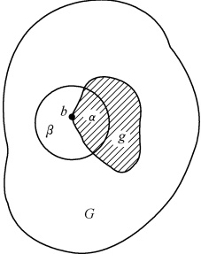

# 04-第四章 解析延拓 $ \Gamma $ 函数 B 函数

[返回全书目录](../../README.md)

> PDF 页码：86–94

<!-- page: 86 -->

解析延拓是解析函数论中的一个重要概念，在本章、下一章和以后多处均会用到； $ \Gamma $函数是数学物理中应用十分广泛的一种函数。本章将讨论解析延拓的基本原理和理论依据，并在此基础上讨论 $ \Gamma $函数、B函数。

### 4.1 解析延拓

## 1. 解析延拓

简单地说，解析延拓就是把在已知区域内解析的函数推广到更大的区域上去，或者说解析延拓就是将解析函数的定义域加以扩大。

利用泰勒级数进行解析延拓是普遍的方法. 考虑一个用幂级数定义的解析函数

$$  f_{1}(z)=\sum_{k=0}^{\infty}z^{k},\quad\mid z\mid<1   \tag*{(4.1.1)}$$

它的解析区域为 $ \sigma_{1} $:|z|<1，在|z|=1外级数是发散的。利用这级数可算出 $ f_{1}(z) $在|z|<1中任何一点的函数值及函数的各阶导数值。例如，在 $ z=\frac{1}{2} $这点，有

 $$ f_{1}\left(\frac{\mathrm{i}}{2}\right)=1+\frac{\mathrm{i}}{2}+\left(\frac{\mathrm{i}}{2}\right)^{2}+\cdots=\frac{1}{1-\frac{\mathrm{i}}{2}} $$ 

 $$ f_{1}^{\prime}\left(\frac{\mathrm{i}}{2}\right)=1+2\frac{\mathrm{i}}{2}+3\left(\frac{\mathrm{i}}{2}\right)^{2}+\cdots=\frac{1}{\left(1-\frac{\mathrm{i}}{2}\right)^{2}} $$ 

 $$ f_{1}^{(k)}\left(\frac{\mathrm{i}}{2}\right)=\frac{k!}{\left(1-\frac{\mathrm{i}}{2}\right)^{k+1}},\quad k=0,1,2,\cdots $$ 

由此得到  $ f_{1}(z) $ 在  $ z=\frac{i}{2} $ 的泰勒级数

 $$ \sum_{k=0}^{\infty}\frac{f_{1}^{(k)}\left(\frac{\mathrm{i}}{2}\right)}{k!}\left(z-\frac{\mathrm{i}}{2}\right)^{k}=\sum_{k=0}^{\infty}\frac{1}{\left(1-\frac{\mathrm{i}}{2}\right)^{k+1}}\left(z-\frac{\mathrm{i}}{2}\right)^{k} $$ 

记之为  $ f_{2}(z) $，即

<!-- page: 87 -->

$$  f_{2}(z)=\sum_{k=0}^{\infty}\frac{1}{\left(1-\frac{\mathrm{i}}{2}\right)^{k+1}}\left(z-\frac{\mathrm{i}}{2}\right)^{k}   \tag*{(4.1.2)}$$

它的收敛半径为  $ \left|1-\frac{i}{2}\right|=\frac{\sqrt{5}}{2} $，故其解析区域为  $ \sigma_{2} $ ：

 $ \left|z-\frac{i}{2}\right|<\frac{\sqrt{5}}{2} $，已越出了原来 $ f_{1}(z) $的解析区域 $ \left|z\right|<1 $

（见图4.1）。 $ f_{2}(z) $称为 $ f_{1}(z) $在区域 $ \left|z-\frac{1}{2}\right|<\frac{\sqrt{5}}{2} $内的解析延拓。

由上例看到，虽然解析函数  $ f_{1}(z) $ 和  $ f_{2}(z) $ 各有自己的有效范围  $ \left(|z|<1\right. $ 和  $ \left|z-\frac{\mathrm{i}}{2}\right|<\frac{\sqrt{5}}{2} $，但它们同时又有公共的有效范围（见图4.1中，两圆的公共部分 $ \sigma_{12} $）.

图4.1
 

一般地说，设已知一个函数  $ f_{1}(z) $ 在区域  $ \sigma_{1} $ 中解析，如果在与  $ \sigma_{1} $ 有重叠部分  $ \sigma_{12} $ （可以是一条线）的另一区域  $ \sigma_{2} $ 内，存在解析函数  $ f_{2}(z) $，且在  $ \sigma_{12} $ 中  $ f_{2}(z) \equiv f_{1}(z) $，则  $ f_{2}(z) $ 称为  $ f_{1}(z) $ 在  $ \sigma_{2} $ 中的解析延拓；同样， $ f_{1}(z) $ 也称为  $ f_{2}(z) $ 在  $ \sigma_{1} $ 中的解析延拓。

上例用函数的幂级数表达式作解析延拓，照那样做下去，将得到有不同收敛圆的许多幂级数，这些幂级数的全体代表一个解析函数  $ f(z) $，即

 $$ f(z)\equiv\left\{\begin{aligned}&f_{1}(z),z\in\sigma_{1}\\ &f_{2}(z),z\in\sigma_{2}\\ &f_{3}(z),z\in\sigma_{3}\\ &\cdots\cdots\end{aligned}\right. $$ 

或者说  $ f_{1}(z) $ 已解析延拓为解析函数  $ f(z) $，解析区域则从区域  $ \sigma_{1} $ 扩大为  $ \sigma = \sigma_{1} + \sigma_{2} + \sigma_{3} + \cdots $.

必须注意，上例中的延拓始终不能包含 z=1，因为在这点上级数（4.1.1）式总是发散的。事实上解析延拓也并非总能进行。例如函数

 $$ f(z)\equiv1+\sum_{k=1}^{\infty}z^{2^{k}} $$ 

它在圆域 $ \left|z\right|<1 $内收敛、解析，但这级数在 $ \left|z\right|=1 $上是处处发散的，在 $ \left|z\right|=1 $上处处是 $ f(z) $的奇点，因而解析延拓不能超过这圆周.

用泰勒展开进行解析延拓虽然是个普遍的方法，但具体计算较繁。通常总是采用一些特殊的方法，如用函数关系（见下节）、施瓦茨（Schwarz）反射原理（见本节习题）来进行解析延拓，可是要使这些做法有意义，必须首先证明解析延拓是唯一的。

<!-- page: 88 -->

## 2. 解析延拓的唯一性

我们所需要证明的是，如果  $ f_{2}^{\mathrm{I}}(z) $ 和  $ f_{2}^{\mathrm{II}}(z) $ 都是  $ f_{1}(z) $ 在  $ \sigma_{2} $ 中的解析延拓，则在  $ \sigma_{2} $ 中  $ f_{2}^{\mathrm{I}}(z) \equiv f_{2}^{\mathrm{II}}(z) $.

根据解析延拓的定义，既然  $ f_{2}^{\mathrm{I}}(z) $ 和  $ f_{2}^{\mathrm{II}}(z) $ 都是  $ f_{1}(z) $ 的解析延拓，那么在公共区域  $ \sigma_{12} $ 中它们都应该等于  $ f_{1}(z) $，即在  $ \sigma_{12} $ 中  $ f_{2}^{\mathrm{I}}(z) $ 和  $ f_{2}^{\mathrm{II}}(z) $ 相等，因此，所需要证明的论断可表述为解析函数的（内部）唯一性定理：

如果有两个在区域G中解析的函数 $ f^{\mathrm{I}}(z) $和 $ f^{\mathrm{II}}(z) $，已知它们在G的一个子区域g中恒等，则它们在整个G中也必恒等.

证 令

 $$ F(z)\equiv f^{\mathrm{I}}\left(z\right)-f^{\mathrm{I I}}\left(z\right) $$ 

则可将上述唯一定理表述为：设  $ F(z) $ 在 G 内解析，且在 G 的子区域 g 中  $ F(z) \equiv 0 $，则在整个区域中有  $ F(z) \equiv 0 $。

图4.2
 

我们来证明后一论述. 取 g 的边界上的一点 b，如图4.2所示，取 b 的一个邻域，它的一部分  $ \alpha $ 属于 g，另一部分  $ \beta $ 不属于 g. 按照假定， $ F(z) $ 在 g 上处处等于零，在  $ \beta $ 上并非处处等于零（否则它就并入 g 中）. 以 b 为中心，把在 G 中解析的函数  $ F(z)=f^{1}(z)-f^{\parallel}(z) $ 展开为泰勒级数，设展开系数中第一个不为零的是  $ a_{m}(m $ 有限），则

 $$ F(z)=(z-b)^{m}\big[a_{m}+a_{m+1}(z-b)+\cdots\big],\quad a_{m}\neq0 $$ 

取z为与b紧邻而不等于b的值，于是 $ \left|z-b\right| $的值虽小，但不等于零，因而方括弧中的级数之和与 $ a_{m} $接近，即

 $$ a_{m}+a_{m+1}(z-b)+a_{m+2}(z-b)^{2}+\cdots\approx a_{m} $$ 

故  $ F(z)=(z-b)^{m}\left[a_{m}+a_{m+1}(z-b)+\cdots\right]\approx(z-b)^{m}a_{m}\neq0 $。这就是说， $ F(z) $ 在 b 的邻域（除 b 外）都不等于零，这与原假设  $ F(z) $ 在 g 上处处为零相矛盾，说明展开系数  $ a_{0}, a_{1}, \cdots, a_{k}, \cdots $ 必须都等于零。如果所有的系数都为零，则  $ F(z) $ 不仅在 g 内处处为零，而且在  $ \beta $ 上也处处为零。这就证明  $ F(z) $ 在区域  $ g+\beta $ 上等于零。重复同样的论证，不断扩大  $ F(z) $ 为零的区域，就可证明在整个区域 G 中  $ F(z) $ 恒等于零。因而，在  $ G $ 中  $ f^{1}(z) \equiv f^{1}(z) $，这就证明了解析延拓的唯一性。

必须注意，解析延拓的唯一性是复变函数所特有的重要性质，实变函数不可能有这样的性质.

解析延拓的唯一性为解析延拓提供了理论依据.

#### 习题4.1

1. 证明如果  $ f(z) $ 在区域 G 中解析，在 G 的一个子区域中等于零，则  $ f(z) $ 在整个 G 中等于零.

<!-- page: 89 -->

2. 证明级数  $ f(z)=\sum_{k=0}^{\infty}\left(\frac{1+z}{1-z}\right)^{k} $ 所定义的函数在左半平面内解析，并可解析延拓到除点 z=0 外的整个复平面.

3. 证明  $ \sum_{k=0}^{\infty}(az)^{k} $ 与  $ \sum_{k=0}^{\infty}(-1)^{k}\frac{(1-a)^{k}z^{k}}{(1-z)^{k+1}} $ 互为解析延拓 (a 是复常数).

提示：证明两者的解析区域具有公共部分。

4. 试求在圆域 $ \left|z\right|<1 $中的解析函数 $ f(z)=\sum_{k=0}^{\infty}\left(1-\frac{1}{2^{k+1}}\right)z^{k} $的解析延拓.

5. 证明施瓦茨反射原理：设  $ f(z) $ 在上半平面包括实轴上的一段是解析的，而且在这段实轴上  $ f(z) $ 取实数值，则  $ \overline{f(\bar{z})} $ 是  $ f(z) $ 在下半平面的解析延拓.

提示：设  $ f(z)=u(x,y)+\mathrm{i}v(x,y) $  $ (y\geqslant0) $，则  $ \overline{f(\overline{z})}=u(x,-y)-\mathrm{i}v(x,-y)=\xi(x,y)+\mathrm{i}\eta(x,y) $，然后用 C-R 条件证明.

### 4.2  $ \Gamma $ 函数

在数学分析中  $ \Gamma $ 函数定义为

$$  \Gamma(x)=\int_{0}^{\infty}\mathrm{e}^{-t}t^{x-1}\mathrm{d}t,\quad x>0   \tag*{(4.2.1)}$$

将x换成z，得

$$  \Gamma(z)=\int_{0}^{\infty}\mathrm{e}^{-t}t^{z-1}\mathrm{d}t^{\textcircled{1}},\quad\mathrm{R e}z>0   \tag*{(4.2.2)}$$

这积分又称为第二类欧拉(Euler)积分.  $ Re z > 0 $ 是这积分收敛的条件. 可以证明 $ ^{②} $，(4.2.2)式的积分在右半平面( $ Re z > 0 $)中代表一个解析函数.

## 1.  $ \Gamma $ 函数的基本性质

由(4.2.1)式出发，我们可以得到 $ \Gamma $函数的下列几个重要性质：

(1)

 $$ \Gamma(1)=1 $$ 

$$  \Gamma(z+1)=z\Gamma(z)   \tag*{(4.2.4)}$$

$$  \Gamma(n+1)=n!,n=0,1,2,\cdots   \tag*{（4.2.5）}$$

(3)

 $$ \Gamma(z)\Gamma(1-z)=\frac{\pi}{\sin\pi z} $$ 

$$  \Gamma\left(\frac{1}{2}\right)=\sqrt{\pi}   \tag*{(4.2.7)}$$

（4）

$$  \Gamma(2z)=2^{2z-1}\pi^{-\frac{1}{2}}\Gamma(z)\Gamma\Big(z+\frac{1}{2}\Big)   \tag*{(4.2.8)}$$

现在我们来证明这些性质.

证 由（4.2.2）式立即得

 $$ \Gamma(1)=\int_{0}^{\infty}\mathrm{e}^{-t}\mathrm{d}t=1 $$ 

这就在  $ Rez \geq 0 $ 中证明了(4.2.3)式.

<!-- page: 90 -->

将(4.2.2)式中z换成 $ z+1 $，然后分部求积分得

 $$ \Gamma(z+1)=\int_{0}^{\infty}\mathrm{e}^{-t}t^{z}\mathrm{d}t=-\left.\mathrm{e}^{-t}t^{z}\right|_{0}^{\infty}+z\int_{0}^{\infty}\mathrm{e}^{-t}t^{z-1}\mathrm{d}t=z\Gamma(z) $$ 

这就在  $ Rez>0 $ 中证明了(4.2.4)式.

取(4.2.4)式中 z 等于 n (n 为零或正整数) 便得 (4.2.5) 式.

下面分两步来证明(4.2.6)式.首先证明在实轴上一段0<x<1成立等式

$$  \Gamma(x)\Gamma(1-x)=\frac{\pi}{\sin\pi x}   \tag*{(4.2.9)}$$

当 0 < x < 1 时，由(4.2.1)式有

 $$ \begin{align*}\Gamma(x)\Gamma(1-x)&=\int_{0}^{\infty}\mathrm{e}^{-t}t^{x-1}\mathrm{d}t\bullet\int_{0}^{\infty}\mathrm{e}^{-s}s^{-x}\mathrm{d}s\\&=\int_{0}^{\infty}\int_{0}^{\infty}\mathrm{e}^{-(s+t)}\left(\frac{t}{s}\right)^{x}\frac{1}{t}\mathrm{d}s\mathrm{d}t\end{align*} $$ 

作变换

 $$ \xi=s+t,\qquad\eta=\frac{t}{s} $$ 

 $ \xi $ 和  $ \eta $ 都由 0 到  $ \infty $，相应雅可比 (Jacobi) 行列式为

 $$ \left|\frac{\partial(t,s)}{\partial(\xi,\eta)}\right|=\left|\frac{\partial(\xi,\eta)}{\partial(t,s)}\right|^{-1}=\frac{\xi}{(1+\eta)^{2}} $$ 

于是得

 $$ \begin{align*}\Gamma(x)\Gamma(1-x)&=\int_{0}^{\infty}\int_{0}^{\infty}\mathrm{e}^{-\xi}\eta^{x}\frac{1+\eta}{\xi\eta}\bigg|\frac{\partial(t,s)}{\partial(\xi,\eta)}\bigg|\mathrm{d}\xi\mathrm{d}\eta\\&=\int_{0}^{\infty}\mathrm{e}^{-\xi}\mathrm{d}\xi\int_{0}^{\infty}\frac{\eta^{\iota-1}}{1+\eta}\mathrm{d}\eta=\int_{0}^{\infty}\frac{\eta^{\iota-1}}{1+\eta}\mathrm{d}\eta=\frac{\pi}{\sin\pi x}\end{align*} $$ 

在最后一步中用了下一章（5.4.2）式的结果，这就证明了（4.2.9）式. 其次证明（4.2.6）式.

当 0 < Re z < 1 时，函数  $ \Gamma(z)\Gamma(1-z) $ 和  $ \frac{\pi}{\sin\pi z} $ 都是解析函数，而由(4.2.9)式知在定轴上一段 0 < x < 1 上该两函数相等，所以由上一节解析延拓的唯一性可知 (4.2.6) 式在 0 < Re z < 1 中成立.

在(4.2.6)式中取  $ z=\frac{1}{2} $ 便可得到(4.2.7)式.

请读者自己证明(4.2.8)式在 $ Re z>0 $中成立.

## 2.  $ \Gamma $ 函数是半纯函数

在有限区域中除极点外别无其他奇点的函数称为半纯函数. 下面我们证明  $ \Gamma(z) $ 是一个半纯函数.

我们知道(4.2.4)式的两边当 $ Re z>0 $时都是z的解析函数，但 $ \Gamma(z+1) $在更大一些的区域 $ Re z>-1 $中解析，故 $ \Gamma(z+1) $是 $ z\Gamma(z) $在区域 $ Re z>-1 $中的解析延拓.

<!-- page: 91 -->

这样就把  $ \Gamma(z)=\frac{\Gamma(z+1)}{z} $ 的定义域推广到  $ \mathrm{Re}z>-1 $ 中，在这区域中除了 z=0 是  $ \Gamma(z) $ 的一阶极点之外， $ \Gamma(z) $ 处处是解析的.

现在  $ \Gamma(z) $ 已是区域  $ Re z > -1 $ 中有定义的函数，故  $ \Gamma(z+1) $ 在区域  $ Re z > -2 $ 中有定义，而且除了 z = -1 这点以外处处是解析的，因此是  $ \mathrm{z}\Gamma(z) $ 在区域  $ Re z > -2 $ 中的解析延拓。在区域  $ Re z > -2 $ 中， $ \Gamma(z) = \frac{\Gamma(z+1)}{z} = \frac{\Gamma(z+2)}{z(z+1)} $ 有两个一阶极点，z = 0 和 z = -1。

由此类推，可以利用函数关系(4.2.4)式把 $ \Gamma(z) $延拓到全平面。在全平面上，除了z=0,-1,-2,\cdots,-n,\cdots $是一阶极点之外，函数 $ \Gamma(z) $处处是解析的，即 $ \Gamma(z) $是半纯函数。

最后要指出，上面我们虽然只推出了 $ \Gamma $函数的那些基本性质 $ [(4.2.3)\sim(4.2.8)式] $在各自的局部区域中成立，但由解析延拓的唯一性知，它们在全平面中，也均成立 $ ^{③} $.

注 ① 被积函数中  $ t^{z-1}=\mathrm{e}^{(z-1)\mathrm{Lnt}} $ 一般是多值函数，但通常约定在正实轴上  $ \arg t=0 $，即 t>0 时， $ t^{z-1}=\mathrm{e}^{(z-1)\mathrm{Lnt}} $ 中的 Lnt 取实数.

② B. H. 斯米尔诺夫著，叶彦谦译，高等数学教程第三卷第二分册，247页，1958，人民教育出版社.

③如，我们已推得(4.2.4)式： $ \Gamma(z+1)=z\Gamma(z) $ 在  $ \mathrm{Re}z>0 $ 中成立，但等式两边都是除了 z=-1,-2,\cdots $ 外在全平面解析的函数，故由解析延拓的唯一性知(4.2.4)式在全平面上除 z=-1,-2,\cdots 外仍成立。又 z=-1,-2,\cdots 这些点同时是  $ \Gamma(z+1) $ 和  $ z\Gamma(z) $ 的单极点，所以(4.2.4)式又可表示为  $ \frac{\varphi(z)}{(z-1)(z-2)\cdots(z-n)\cdots}=\frac{\psi(z)}{(z-1)(z-2)\cdots(z-n)\cdots} $，其中  $ \varphi(z) $ 和  $ \psi(z) $ 均在全平面解析，故再由解析延拓的唯一性知(4.2.4)式在全平面上成立。类似地可知(4.2.6)和(4.2.8)式亦均在全平面成立。

#### 习题4.2

1. 证明

(1)

 $$ (2n)!!=2^n\Gamma(n+1); $$ 

(2)

 $$ (1+\rho)(2+\rho)\cdots(n+\rho)=\frac{\Gamma(\rho+n+1)}{\Gamma(\rho+1)}; $$ 

(3)  $ \int_{0}^{1}(\ln\frac{1}{x})^{x-1}dx = \Gamma(z) $; (4)  $ \int_{0}^{\infty}e^{-r^{2}}r^{p}dr = \frac{1}{2}\Gamma\left(\frac{p+1}{2}\right) $.

2. 令  $ \psi(z)=\frac{\mathrm{d}\left[\mathrm{Ln}\Gamma(z)\right]}{\mathrm{d}z} $，试分别由（4.2.4）式和（4.2.6）式证明

 $$ \psi(z+1)=\frac{1}{z}+\psi(z) $$ 

 $$ \psi(1-z)=\psi(z)+\pi\mathrm{c o t}\pi z $$ 

3. 计算下列积分：

(1)

 $$ \int_{0}^{\infty}x^{3}\mathrm{e}^{-x}\mathrm{d}x; $$ 

(2)

 $$ \int_{0}^{\infty}x^{6}\mathrm{e}^{-2x}\mathrm{d}x； $$

<!-- page: 92 -->

(3)

 $$ \int_{0}^{\infty}x^{-\alpha}\sin x\mathrm{d}x,0<\alpha<2; $$ 

 $$ \int_{0}^{\infty}x^{-\alpha}\cos x\mathrm{d}x,0<\alpha<1; $$ 

(5)

 $$ \int_{0}^{\infty}x^{a-1}\mathrm{e}^{-x\cos\theta}\cos(x\sin\theta)\mathrm{d}x； $$ 

(6)

 $$ \int_{0}^{\infty}x^{\alpha-1}\mathrm{e}^{-x\cos\theta}\sin(x\sin\theta)\mathrm{d}x. $$ 

在(3)～(6)问中  $ \alpha>0,\quad-\frac{\pi}{2}<\theta<\frac{\pi}{2} $

4. 计算积分  $ I=\int_{-1}^{1}\frac{x^{2n}}{\sqrt{1-x^{2}}}dx $ 之值，n 是正整数.

5. 计算四维单位球的体积 V，其中

 $$ \begin{aligned}&x_{1}=r\sin\varphi_{2}\sin\varphi_{1}\cos\varphi,\quad x_{2}=r\sin\varphi_{2}\sin\varphi_{1}\sin\varphi\\&x_{3}=r\sin\varphi_{2}\cos\varphi_{1},\quad x_{4}=r\cos\varphi_{2}\\ \end{aligned} $$ 

提示: 计算具有坐标轴  $ x_{1}\cdots x_{n} $ 的 n 维球的体积, 可利用积分

 $$ \int_{-\infty}^{\infty}\mathrm{e}^{-(x_{1}^{2}+\cdots+x_{n}^{2})}\mathrm{d}v^{(n)}\;=\int_{0}^{\infty}\mathrm{e}^{-r^{2}}A r^{n-1}\mathrm{d}r\quad(A\mathrm{ 待定 }) $$ 

（芝加哥大学研究生试题）

###  $ ^{4.3} $ B 函数

我们定义

$$  \mathrm{B}(p,q)=\int_{0}^{1}t^{p-1}(1-t)^{q-1}\mathrm{d}t,\quad\mathrm{R e}p>0;\quad\mathrm{R e}q>0   \tag*{(4.3.1)}$$

为B函数，又称为第一类欧拉积分.积分中的被积函数通常是多值函数.若令 $ t=\sin^{2}\varphi $，则易于得到B函数的另一表达式

$$  \mathrm{B}(p,q)=2\int_{0}^{\frac{\pi}{2}}\sin^{2p-1}\varphi\cos^{2q-1}\varphi\mathrm{d}\varphi   \tag*{(4.3.2)}$$

我们将会看到 B 函数与  $ \Gamma $ 函数之间有如下重要关系：

$$   B(p,q)=\frac{\Gamma(p)\Gamma(q)}{\Gamma(p+q)}   \tag*{(4.3.3)}$$

证 当  $ Rep>0 $, Req>0 时，由  $ \Gamma $ 函数的定义 (4.2.2) 式有

 $$ \Gamma(p)=\int_{0}^{\infty}\mathrm{e}^{-t}t^{p-1}\mathrm{d}t,\quad\Gamma(q)=\int_{0}^{\infty}\mathrm{e}^{-t}t^{q-1}\mathrm{d}t $$ 

分别记上二式中的 t 为  $ x^{2} $ 和  $ y^{2} $，于是有

$$  \Gamma(p)=2\int_{0}^{\infty}\mathrm{e}^{-x^{2}}x^{2p-1}\mathrm{d}x   \tag*{(4.3.4)}$$

$$  \Gamma(q)=2\int_{0}^{\infty}\mathrm{e}^{-y^{2}}y^{2q-1}\mathrm{d}y   \tag*{（4.3.5）}$$

在(4.3.4)和(4.3.5)两式中又分别令  $ x=\rho\cos\varphi $ 和  $ y=\rho\sin\varphi $ ，于是得

 $$ \begin{align*}\Gamma(p)\Gamma(q)&=4\int_{0}^{\infty}\int_{0}^{\infty}\mathrm{e}^{-(x^{2}+y^{2})}x^{2p-1}y^{2q-1}\mathrm{d}x\mathrm{d}y\\&=4\int_{0}^{\infty}\int_{0}^{\frac{\pi}{2}}\mathrm{e}^{-\rho^{2}}(\rho\mathrm{c o s}\varphi)^{2p-1}(\rho\mathrm{s i n}\varphi)^{2q-1}\rho\mathrm{d}\rho\mathrm{d}\varphi\end{align*} $$

<!-- page: 93 -->

$$ \begin{aligned}&=4\int_{0}^{\infty}\mathrm{e}^{-\rho^{2}}\rho^{2(p+q)-1}\mathrm{d}\rho\int_{0}^{\frac{\pi}{2}}\cos^{2p-1}\varphi\sin^{2q-1}\varphi\mathrm{d}\varphi\\&=\Gamma(p+q)\mathrm{B}(p,q)\end{aligned} $$ 

最后的结果是通过将上式的倒数第二步与(4.3.4)式和(4.3.2)式对比而得到的.这就证明了(4.3.3)式.

显然，利用(4.3.3)式和Γ函数的解析性，可将B函数从 $ Re p>0, Re q>0 $解析延拓到除了p=0,-1,-2, $ \cdots $;q=0,-1,-2, $ \cdots $外的整个p平面和q平面.

由 B 函数的定义式(4.3.1)或另一表达式(4.3.2)，立即可证得 B 函数的对称关系

$$   B(p,q)=B(q,p)   \tag*{(4.3.6)}$$

#### 习题4.3

1. 利用(4.3.3)式和(4.3.1)式，证明Γ函数的倍乘公式(4.2.8)式

 $$ \Gamma(2z)=2^{2z-1}\pi^{-\frac{1}{2}}\Gamma(z)\Gamma\Big(z+\frac{1}{2}\Big) $$ 

提示：在证明过程中作变量代换  $ t=\frac{1-\sqrt{\xi}}{2} $，并利用  $ \Gamma\left(\frac{1}{2}\right)=\sqrt{\pi} $ 的关系即可得.

2. 利用(4.3.3)式和(4.3.1)式，重证Γ函数的性质(4.2.6)式

 $$ \Gamma(z)\Gamma(1-z)=\frac{\pi}{\sin\pi z} $$ 

提示：在证明过程中作变量代换  $ x=\frac{t}{1-t} $

3. 计算下列积分：

(1) $ \int_{-1}^{1}(1-x^{2})^{n}dx; $

 $$ \int_{-1}^{1}(1-x)^{p}(1+x)^{q}\mathrm{d}x,\mathrm{R e}p>-1,\mathrm{R e}q>-1; $$ 

(3)  $ \int_{0}^{\frac{\pi}{2}}\tan^a\varphi\,d\varphi,\quad|\alpha|<1. $

4. 证明： $ \frac{\Gamma'(a)}{\Gamma(a)}=\lim_{b\to0}\left[\Gamma(b)-\mathrm{B}(a,b)\right] $

<!-- page: 94 -->

本章授课课件

本章小结
 

<table border=1 style='margin: auto; word-wrap: break-word;'><tr><td style='text-align: center; word-wrap: break-word;'></td><td style='text-align: center; word-wrap: break-word;'>定 义</td><td style='text-align: center; word-wrap: break-word;'>性 质</td><td style='text-align: center; word-wrap: break-word;'>方 法</td></tr><tr><td style='text-align: center; word-wrap: break-word;'>解析
延拓</td><td style='text-align: center; word-wrap: break-word;'>设  $ f_1(z)\in\sigma_1 $ 和  $ f_2(z)\in\sigma_2 $ 解析,  $ \sigma_{12}=\sigma_1\cap\sigma_2 $, 若  $ f_1(z)\equiv f_2(z) $ ,  $ f_2(z)\in\sigma_2 $ (或  $ \sigma_1 $) 中解析延拓,  $ f_1(z)\equiv f_2(z) $,  $ f_2(z)\in G $</td><td style='text-align: center; word-wrap: break-word;'>设  $ f_1(z) $ 和  $ f_2(z) $ 在区域 G 中解析, 若  $ f_1(z)\equiv f_2(z) $,  $ z\in G $,  $ g\in G $ 则</td><td style='text-align: center; word-wrap: break-word;'>1. 泰勒展开方法\n2. 函数关系式的方法\n3. 施瓦茨原理</td></tr><tr><td style='text-align: center; word-wrap: break-word;'>$ \Gamma $ 函
数</td><td style='text-align: center; word-wrap: break-word;'>$ \Gamma(z)=\int_{0}^{\infty}e^{-t^{z-1}}dt $,  $ \text{Re}z&gt;0 $</td><td style='text-align: center; word-wrap: break-word;'>1.  $ \Gamma(1)=1 $\n2.  $ \Gamma(z+1)=z\Gamma(z) $,  $ \Gamma(n+1)=n! $\n3.  $ \Gamma(z) $  $ \Gamma(1-z)=\frac{\pi}{\sin\pi z} $,  $ \Gamma\left(\frac{1}{2}\right)=\sqrt{\pi} $\n4.  $ \Gamma(2z)=2^{2z-1}\frac{1}{\sqrt{\pi}}\Gamma(z) $  $ \Gamma(z+\frac{1}{2}) $</td><td style='text-align: center; word-wrap: break-word;'></td></tr><tr><td style='text-align: center; word-wrap: break-word;'>B 函
数</td><td style='text-align: center; word-wrap: break-word;'>$ B(p,q)=\int_{0}^{1}t^{p-1}(1-t)^{q-1}dt $,  $ \text{Re}p&gt;0 $,  $ \text{Re}q&gt;0 $</td><td style='text-align: center; word-wrap: break-word;'>1.  $ B(p,q)=\frac{\Gamma(p)\Gamma(q)}{\Gamma(p+q)} $\n2.  $ B(p,q)=B(q,p) $</td><td style='text-align: center; word-wrap: break-word;'></td></tr></table>

