# 05-第五章 留数理论

[返回全书目录](../../README.md)

> PDF 页码：95–113

<!-- page: 95 -->

由第二章的学习，我们对复变函数的围道积分，已有了相当程度的了解. 我们知道，当  $ f(z) $ 在 l 内解析时，则由柯西定理(2.2.1)式有

 $$ \oint_{l}f(z)\mathrm{d}z=0 $$ 

当  $ f(z) $ 在 l 内有一阶极点时，则由柯西公式 (2.3.2) 式有

 $$ \oint_{l}f(z)\mathrm{d}z=\oint_{l}\frac{\varphi(z)}{z-a}\mathrm{d}z=2\pi\mathrm{i}\varphi(a) $$ 

当  $ f(z) $ 在 l 内有 n 阶极点时，则由解析函数的 n 阶导数公式有

 $$ \oint_{l}f(z)\mathrm{d}z=\oint_{l}\frac{\varphi(z)}{\left(z-a\right)^{n}}\mathrm{d}z=\frac{2\pi\mathrm{i}}{(n-1)!}\varphi^{(n-1)}(a) $$ 

其中，$\varphi(z)$ 在 $l$ 内解析。我们自然会想到，如果 $f(z)$ 在 $l$ 内有有限个孤立奇点（不一定是极点），围道积分 $\oint_{l} f(z) dz$ 的结果又会是怎样的呢？本章留数理论，将可回答我们的这一问题。我们已看到柯西定理和柯西公式等，只能解决围道内被积函数的奇点是极点型的围道积分问题。而从这一章的学习我们将会看到，留数理论不仅能解决奇点为极点，而且还能解决奇点为本性奇点的围道积分问题。它建立了解析函数的积分与函数的奇点的关系，并能用于计算一些实定积分。

### 5.1 留数定理

## 1. 留数定理

设  $ f(z) $ 在以曲线 l 围成的区域  $ \sigma $ 内除有有限个孤立奇点  $ b_{k}(k=1,2,\cdots,n) $ 外单值解析，在闭区域  $ \bar{\sigma} $ 上连续，则有

$$  \oint_{l}f(z)\mathrm{d}z=2\pi\mathrm{i}\sum_{k=1}^{n}\operatorname{res}f(b_{k})   \tag*{(5.1.1)}$$

其中， $ \mathrm{res}f(b_{k}) $ 表示  $ f(z) $ 在孤立奇点  $ b_{k} $ 的某（去心）邻域内的洛朗展开的负一次幂  $ \frac{1}{z-b_{k}} $ 的系数，记作

$$   res f(b_{k})=C_{-1}   \tag*{(5.1.2)}$$

<!-- page: 96 -->

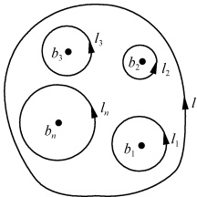

称做  $ f(z) $ 在它的孤立奇点  $ b_{k} $ 处的留数 (residue). 上述定理被称为留数定理.

证 如图5.1所示，在l内分别以 $ b_{k} $为中心 $ R_{k} $为半径作小圆 $ l_{k}(k=1,2,\cdots,n) $，使 $ l_{k} $均含于l内又彼此互相隔离，则由复连通区域的柯西定理(2.2.6)式有

图5.1
 

$$  \oint_{l}f(z)\mathrm{d}z=\sum_{k=1}^{n}\oint_{l_{k}}f(z)\mathrm{d}z   \tag*{(5.1.3)}$$

今在孤立奇点  $ b_{1} $ 的去心邻域中将  $ f(z) $ 展开为洛朗级数

 $$ f(z)=\sum_{k=-\infty}^{\infty}C_{k}(z-b_{1})^{k},\quad0<|z-b_{1}|<R_{1} $$ 

则有

而由(2.1.4)式有

 $$ \begin{align*}\oint_{l_{1}}f(z)\mathrm{d}z&=\sum_{k=-\infty}^{\infty}C_{k}\oint_{l_{1}}(z-b_{1})^{k}\mathrm{d}z\\\oint_{l_{1}}(z-b_{1})^{k}\mathrm{d}z&=\begin{cases}2\pi\mathrm{i},&k=-1\\0,&k\neq-1\end{cases}\\\oint_{l_{1}}f(z)\mathrm{d}z&=C_{-1}\bullet2\pi\mathrm{i}=2\pi\mathrm{i}\mathrm{res}f(b_{1})\end{align*} $$ 

所以

其中

 $$  res f(b_{1})=C_{-1} $$ 

（这也是称 $ C_{-1} $为留数的来由，积分后仅留下系数 $ C_{-1} $）。类似地，我们可得

$$  \oint_{l_{k}}f(z)\mathrm{d}z=2\pi\mathrm{i}\mathrm{res}f(b_{k}),\quad k=2,3,\cdots,n   \tag*{(5.1.5)}$$

将（5.1.4）和（5.1.5）式代入（5.1.3）式有

 $$ \oint_{l}f(z)\mathrm{d}z=2\pi\mathrm{i}\sum_{k=1}^{n}\operatorname{res}f(b_{k}) $$ 

由（5.1.4）和（5.1.5）式我们还可得

$$  \mathrm{res}f(b_{k})=\frac{1}{2\pi\mathrm{i}}\oint_{l_{k}}f(z)\mathrm{d}z,\quad k=1,2,\cdots,n   \tag*{（5.1.6）}$$

我们也常将此式作为留数的定义.

## 2. 无穷远点的留数

由(5.1.6)式我们看到，在 $ b_{k} $点，留数的定义是沿逆时针方向（即边界的正向）绕 $ b_{k} $一周的 $ f(z) $的一个围道积分，在围道 $ l_{k} $内，除 $ b_{k} $外别无 $ f(z) $的奇点。因此，类似地我们可定义无穷远点的留数为

$$  \mathrm{res}f(\infty)=\frac{1}{2\pi\mathrm{i}}\oint_{i}f(z)\mathrm{d}z   \tag*{(5.1.7)}$$

其中 l 是沿顺时针方向绕 z=0 一周的围道，且在围道外除  $ z=\infty $ 可能是奇点之外别无  $ f(z) $ 的奇点。这里积分的走向对于含  $ z=\infty $ 的区域说是正向。

<!-- page: 97 -->

今将  $ f(z) $ 在  $ z=\infty $ 的邻域中展开为洛朗级数

$$  f(z)=\sum_{k=-\infty}^{\infty}C_{k}z^{k},\quad R<|z|<\infty   \tag*{(5.1.8)}$$

则

 $$ \oint_{l}f(z)\mathrm{d}z=\sum_{k=-\infty}^{\infty}C_{k}\oint_{l}z^{k}\mathrm{d}z=C_{-1}\bullet2\pi\mathrm{i} $$ 

代入(5.1.7)式有

$$   res f(\infty)=-C_{-1}   \tag*{(5.1.9)}$$

应该注意的是，对于有限远点 b，如果它不是  $ f(z) $ 的奇点，则由(5.1.6)式知  $ \mathrm{res}f(b)=0 $。而对于  $ z=\infty $ 来说，即使它不是  $ f(z) $ 的奇点，只要展开式(5.1.8)式中  $ C_{-1} $ 不为 0， $ \mathrm{res}f(\infty) $ 就不等于零。

由(5.1.6)和(5.1.7)式立即可推得：全平面的留数之和为零.

## 3. 留数的计算方法

为了应用留数定理计算积分，必须掌握计算留数的方法，最基本的方法当然是由留数的定义来求留数。即在奇点的去心邻域将函数展开成洛朗级数，取其负一次幂的系数（对于 $ z=\infty $点要反号）。

例1 求  $ f(z)=\mathrm{e}^{\frac{1}{z}} $ 在本性奇点 z=0 处的留数.

解

 $$ \mathrm{e}^{\frac{1}{z}}=1+\frac{1}{z}+\frac{1}{2!}\cdot\frac{1}{z^{2}}+\cdots,\quad|z|>0 $$ 

故由留数的定义(5.1.2)式有

 $$  resf(0)=C_{-1}=1 $$ 

但上法并不常用，因为有时求洛朗级数比较麻烦，而应用上很重要的奇点是极点，对于极点可以导出如下的比较简单的计算留数的公式，而不必去求洛朗展开的负一次幂的系数.

设b为 $ f(z) $的n阶极点，则

$$  \mathrm{res}f(b)=\frac{1}{(n-1)!}\frac{\mathrm{d}^{n-1}}{\mathrm{d}z^{n-1}}\big[(z-b)^{n}f(z)\big]_{z=b}   \tag*{(5.1.10)}$$

特别是当 n=1 即 b 为  $ f(z) $ 的单极点时，有

$$  \mathrm{res}f(b)=\lim_{z\to b}[(z-b)f(z)]   \tag*{(5.1.11)}$$

证 因为 b 为  $ f(z) $ 的 n 阶极点，故由上一章 n 阶极点的充分必要条件有

 $$ f(z)=\frac{\varphi(z)}{(z-b)^{n}} $$ 

其中， $ \varphi(z) $ 在 b 点的邻域解析. 又由留数定义(5.1.6)式

 $$ \mathrm{res}f(b)=\frac{1}{2\pi\mathrm{i}}\oint_{l}f(z)\mathrm{d}z=\frac{1}{2\pi\mathrm{i}}\oint_{l}\frac{\varphi(z)}{(z-b)^{n}}\mathrm{d}z $$ 

其中 l 为绕 b 一周的围道，故由解析函数的导数公式(2.3.5)有

<!-- page: 98 -->

$$ \begin{align*}\mathrm{res}f(b)&=\frac{1}{(n-1)!}\left.\frac{\mathrm{d}^{n-1}}{\mathrm{d}z^{n-1}}\varphi(z)\right|_{z=b}\\&=\frac{1}{(n-1)!}\left.\frac{\mathrm{d}^{n-1}}{\mathrm{d}z^{n-1}}\big[(z-b)^{n} f(z)\big]_{z=b}\right.\end{align*} $$ 

此即(5.1.10)式.若取n=1，则

 $$ \mathrm{res}f(b)=\frac{1}{0!}\frac{\mathrm{d}^{0}}{\mathrm{d}z^{0}}\big[(z-b)f(z)\big]_{z=b}=\lim_{z\to b}\big[(z-b)f(z)\big] $$ 

此即(5.1.11)式.

例2  $ f(z)=\frac{ze^{z}}{(z-a)^{3}} $ , 求  $ \operatorname{res}f(a) $.  $ (a \neq 0. $

解 z=a 为  $ f(z) $ 的三阶极点，故由(5.1.10)式有

 $$ \begin{aligned}\operatorname{res}f(a)&=\frac{1}{2!}\frac{\mathrm{d}^{2}}{\mathrm{d}z^{2}}\bigg[(z-a)^{3}\frac{z\mathrm{e}^{z}}{(z-a)^{3}}\bigg]_{z=a}\\&=\frac{1}{2}\mathrm{e}^{a}(2+a)\end{aligned} $$ 

例3  $ f(z)=\frac{1}{1+z^{2}} $，求  $ \mathrm{res}f(i) $.

解 i 为  $ f(z) $ 的单极点，故由(5.1.11)式有

 $$  res f(i)=\lim_{z\to i}(z-i)\bullet\frac{1}{(z-i)(z+i)}=\frac{1}{2i} $$ 

若  $ f(z)=\frac{\varphi(z)}{\psi(z)} $，其中  $ \varphi(z) $ 和  $ \psi(z) $ 均在 b 的邻域中解析，且  $ \varphi(b)\neq0 $，而 b 为  $ \psi(b) $ 的一阶零点（即  $ \psi(b)=0,\psi'(b)\neq0 $），则有

$$   resf(b)=\frac{\varphi(b)}{\psi^{^{\prime}}(b)}   \tag*{(5.1.12)}$$

证 因为 b 为  $ \psi(b) $ 的一阶零点，所以 b 为  $ f(z) $ 的一阶极点（见 3.5 节中 2. 孤立奇点的分类）。故有

 $$ \mathrm{res}f(b)=\lim_{z\to b}(z-b)\frac{\varphi(z)}{\psi(z)}=\lim_{z\to b}\frac{\left[(z-b)\varphi(z)\right]^{\prime}}{\psi^{^{\prime}}(z)}=\frac{\varphi(b)}{\psi^{^{\prime}}(b)} $$ 

例4  $ f(z)=\frac{\mathrm{e}^{iz}}{1+z^{2}} $ , 求  $ \mathrm{res}f(i) $.

解 设  $ \varphi(z)=\mathrm{e}^{\mathrm{i}z} $， $ \phi(z)=1+z^{2} $，故

 $$  res f(i)=\frac{e^{iz}}{2z}\bigg|_{z=i}=\frac{1}{2i e} $$ 

若知道了函数在各奇点处的留数，由留数定理 $ (5.1.1) $式，我们便可计算复变函数的围道积分.

例 5 计算积分

 $$ I=\oint_{|z|=1}\frac{\mathrm{d}z}{\varepsilon z^{2}+2z+\varepsilon},\quad0<\varepsilon<1 $$

<!-- page: 99 -->

解 被积函数的奇点为

 $$ z=\frac{-1\pm\sqrt{1-\epsilon^{2}}}{\epsilon} $$ 

在单位圆  $ |z|=1 $ 内的奇点为

 $$ z_{0}=\frac{-1+\sqrt{1-\varepsilon^{2}}}{\varepsilon} $$ 

是单极点. 于是  $ z_{0} $ 点留数为

 $$ \begin{align*}\mathrm{res}f(z_{0})&=\lim_{z\to z_{0}}\biggl[\biggl(z-\frac{-1+\sqrt{1-\varepsilon^{2}}}{\varepsilon}\biggr)\frac{1}{\varepsilon z^{2}+2z+\varepsilon}\biggr]\\&=\lim_{z\to z_{0}}\frac{1}{\varepsilon\biggl(z-\frac{-1-\sqrt{1-\varepsilon^{2}}}{\varepsilon}\biggr)}=\frac{1}{2\sqrt{1-\varepsilon^{2}}}\end{align*} $$ 

故

 $$ I=\oint_{|z|=1}\frac{\mathrm{d}z}{\varepsilon z^{2}+2z+\varepsilon}=2\pi i\mathrm{res}f(z_{0})=\frac{\pi\mathrm{i}}{\sqrt{1-\varepsilon^{2}}} $$ 

#### 习题5.1

1. 求下列函数在指定点处的留数：

 $$ \frac{z}{(z-1)(z+1)^{2}} $$ 

(2) $ e^{\frac{1}{z-1}} $，在z=1, $ \infty $;

 $$ z=\pm1,\infty; $$ 

(4) $ \frac{z}{\cos z} $，在 $ z=(2k+1)\frac{\pi}{2}(k=0,\pm1,\pm2,\cdots) $;

(5) $ e^{\frac{a}{2}}\left(z-\frac{1}{z}\right) $，在z=0；

2. 求下列函数在其孤立奇点和无穷远点（不是非孤立奇点）的留数：

(1) $ \frac{z^{2m}}{(1+z)^{m}} $(m为自然数)；(2) $ \frac{e^{z}}{z^{2}(z^{2}+9)} $；(3) $ \frac{\sin2z}{(z+1)^{3}} $；

(4) $ z^{3}\cos\frac{1}{z-2}; $ (5) $ \frac{z^{2}+1}{e^{z}}; $ (6) $ \cos\sqrt{\frac{1}{z}}. $

3. 计算下列围道积分：

3. 计算下列图道积分：

(1)  $ \oint_{l}\frac{dz}{z^{4}+1}, l: x^{2} + y^{2} = 2x; $

(2)  $ \oint_{l}\frac{zdz}{(z-1)(z-2)^{2}}, l: |z-2| = \frac{1}{2}; $

(3)  $ \oint_{l}\frac{dz}{(z-3)(z^{5}-1)} $, l: |z|=2;

(4)  $ \frac{1}{2\pi i}\oint_{l}\sin\frac{1}{z}dz $, l: |z|=r.

 $ ^{*} $4. 利用围道积分技术求级数值

 $$ \sum_{n=1}^{\infty}\frac{(-1)^{n}}{n^{4}}=\frac{-7\pi^{4}}{720} $$ 

提示：利用函数  $ 1/\sin\pi z $ 沿实轴，在  $ z=0,\pm1,\pm2,\cdots $ 处有极点的事实，选择适当的围道计算。（芝加哥大学研究生试题）

5. 求解函数  $ f(z)=\int_{c(x)}\Gamma(1+z)\Gamma(1-z)dz $ 的值，其中  $ c(x) $ 是从  $ -i\infty $ 到  $ +i\infty $，沿着  $ \mathrm{Re}(z)=x $ 的围道；x 在 -1 和 +1 之间.

（加州理工学院研究生试题）

<!-- page: 100 -->

### 5.2 利用留数理论计算实积分

在研究物理学的问题时，常常需要计算一些具体的实定积分。如，在研究阻尼振动时，将遇到狄利克雷(Dirichlet)积分 $ \int_{0}^{\infty}\frac{\sin x}{x}dx $；在研究光衍射时，将遇到菲涅耳(Fresnel)积分 $ \int_{0}^{\infty}\sin x^{2}dx $；在研究热传导时，将遇到积分 $ \int_{0}^{\infty}e^{-u^{2}}\cos bx dx(a>0,b= $实数)。这些积分，若用数学分析中计算定积分的方法来计算是相当麻烦有时甚至是不可能的。但是，若将之视为复围道积分中的一部分，而利用留数定理来计算，就会使计算变得简单得多。下面从几种典型类型的积分来说明用留数定理计算实定积分的方法。

## 1. 无穷积分  $ \int_{-\infty}^{\infty} f(x) dx $

若  $ f(z) $ 在实轴上无奇点，在上半平面除了有限个孤立奇点  $ b_{k}(k=1,2,\cdots,n) $ 外是处处解析的；在包括实轴在内的上半平面中，当  $ |z|\to\infty $ 时， $ zf(z) $ 一致趋于零（即，

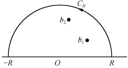

 $$ \forall\varepsilon>0,\exists R>0 $$ 

 $$ \left|z\right|>R $$ 

图5.2
 

 $$ \left|z\cdot f(z)\right|<\varepsilon) $$ 

$$  \int_{-\infty}^{\infty}f(x)\mathrm{d}x=2\pi\mathrm{i}\sum_{k=1}^{n}\operatorname{res}f(b_{k})\mid_{\operatorname{Im}z>0}   \tag*{(5.2.1)}$$

证 考虑  $ f(z) $ 沿如图 5.2 所示围道 l 的积分，则由留数定理(5.1.1)式有

 $$ \oint_{l}f(z)\mathrm{d}z=\int_{-R}^{R}f(x)\mathrm{d}x+\int_{C_{R}}f(z)\mathrm{d}z=2\pi\mathrm{i}\sum_{k}\operatorname{res}f(b_{k})\mid_{l 内 } $$ 

其中  $ \sum_{k}\operatorname{res}f(b_{k})\mid_{l内} $ 表示  $ f(z) $ 在 l 内的孤立奇点处的留数的和. 故当  $ R\to\infty $ 时有

$$  \begin{align*}\lim_{R\to\infty}\int_{-R}^{R}f(x)\mathrm{d}x+\lim_{R\to\infty}\int_{C_R}f(z)\mathrm{d}z=2\pi\mathrm{i}\sum_{k=1}^{n}\mathrm{res}f(b_k)\mid_{\mathrm{Im}z>0}\end{align*}   \tag*{(5.2.2)}$$

其中  $ \sum_{k=1}^{n} \operatorname{res} f(b_k) \mid_{\operatorname{Im} z > 0} $ 表示  $ f(z) $ 在上半平面的孤立奇点处的留数和。注意无穷积分通常定义为下列极限 $ ^{①} $：

$$  \int_{-\infty}^{\infty}f(x)\mathrm{d}x=\lim\limits_{R_{1}\to\infty\atop R_{2}\to\infty}\int_{-R_{1}}^{R_{2}}f(x)\mathrm{d}x   \tag*{(5.2.3)}$$

显然，此处

$$  \lim_{R\to\infty}\int_{-R}^{R}f(x)\mathrm{d}x=\int_{-\infty}^{\infty}f(x)\mathrm{d}x   \tag*{(5.2.4)}$$

又由题设，当 $ \left|z\right|\rightarrow\infty $时， $ zf(z) $一致趋于0，故有

 $$ \lim_{R\to\infty}\left|\int_{C_{R}}f(z)\mathrm{d}z\right|\leqslant\liminf_{R\to\infty}\int_{C_{R}}\mid z f(z)\mid\frac{\mid\mathrm{d}z\mid}{\mid z\mid} $$

<!-- page: 101 -->

$$  \leqslant\lim_{R\to\infty}\max\mid z f(z)\mid\frac{\pi R}{R}=0   \tag*{(5.2.5)}$$

将（5.2.4）式与（5.2.5）式代入（5.2.2）式便得

 $$ \int_{-\infty}^{\infty}f(x)\mathrm{d}x=2\pi\mathrm{i}\sum_{k=1}^{n}\operatorname{res}f(b_{k})\mid_{\operatorname{Im}z>0} $$ 

上面做法的精神是把所要计算的实积分看成实轴上的一段 $ (-R $到 $ R) $，补充一段 $ (C_{R}) $，使被积函数在这段上也无奇点，这样构成复平面上的一个围道，再用留数定理计算围道积分.应该注意的是，在补充一段时，应尽量使在这段路线上积分值比较易于计算，像上面(5.2.5)式那样，其值为0是再好不过的了.

例1 求积分  $ I=\int_{-\infty}^{\infty}\frac{\mathrm{d}x}{1+x^{2}} $ 之值.

解

 $$ f(z)=\frac{1}{1+z^{2}} $$ 

奇点为单极点  $ z=\pm i $，在上半平面只有孤立奇点 z=i，当  $ |z|\to\infty $ 时， $ zf(z) $ 一致趋于  $ 0(Imz\geqslant0) $，故由（5.2.1）式和（5.1.11）式有

 $$ I=2\pi i\mathrm{res}f(\mathrm{i})=2\pi\mathrm{i}\bullet\frac{1}{2\mathrm{i}}=\pi $$ 

思考：若  $ f(z) $ 在下半平面有有限个孤立奇点，则用留数定理计算无穷积分  $ \int_{-\infty}^{\infty} f(x) \, dx $ 的公式，应是怎样的？

2. 含有三角函数的无穷积分  $ \int_{0}^{\infty}f(x)\left\{\begin{aligned}&\cos px\\ &\sin px\end{aligned}\right\}\mathrm{d}x $

设  $ f(z) $ 在实轴上无奇点，在上半平面除了有限个孤立奇点  $ b_{k}(k=1,2,\cdots,n) $ 外是处处解析的；在包括实轴的上半平面  $ (0 \leqslant \arg z \leqslant \pi) $ 中，当  $ |z| \to \infty $ 时， $ f(z) $ 一致趋于 0，且 p > 0，则有

 $$ \int_{0}^{\infty}f(x)\cos p x\mathrm{d}x=\pi\mathrm{i}\sum_{k=1}^{n}\mathrm{res}[f(b_{k})\mathrm{e}^{\mathrm{i}p b_{k}}]_{\mathrm{Im}z>0}\quad[f(x) 为偶函数 ]\quad(5.2.6) $$ 

$$  \int_{0}^{\infty}f(x)\sin p x\mathrm{d}x=\pi\sum_{k=1}^{n}\mathrm{res}\left[f(b_{k})\mathrm{e}^{\mathrm{i}\beta b_{k}}\right]_{\mathrm{Im}z>0}\quad\left[f(x) 为奇函数 \right]   \tag*{(5.2.7)}$$

其中  $ \sum_{k=1}^{n}\mathrm{res}[f(b_k)\mathrm{e}^{\mathrm{ip}b_k}]_{\mathrm{lm}z>0} $ 是函数  $ f(z)\mathrm{e}^{\mathrm{ip}z} $ 在上半平面的留数和.

证 若  $ f(x) $ 为偶函数，则

$$  \begin{align*}\int_{0}^{\infty}f(x)\cos p x\mathrm{d}x=&\int_{0}^{\infty}f(x)\frac{\mathrm{e}^{\mathrm{i}p x}+\mathrm{e}^{-\mathrm{i}p x}}{2}\mathrm{d}x\\=&\frac{1}{2}\Big[\int_{0}^{\infty}f(x)\mathrm{e}^{\mathrm{i}p x}\mathrm{d}x+\int_{-\infty}^{0}f(-x)\mathrm{e}^{\mathrm{i}p x}\mathrm{d}x\Big]\\=&\frac{1}{2}\int_{-\infty}^{\infty}f(x)\mathrm{e}^{\mathrm{i}p x}\mathrm{d}x\end{align*}   \tag*{(5.2.8)}$$

<!-- page: 102 -->

于是可仿照上面所讨论的无穷积分那样，考虑函数  $ f(z)\mathrm{e}^{\mathrm{i}z} $ 沿图 5.2 中的围道的积分

 $$ \begin{aligned}\oint_{l}f(z)\mathrm{e}^{\mathrm{i}pz}\mathrm{d}z=&\int_{-R}^{R}f(x)\mathrm{e}^{\mathrm{i}p x}\mathrm{d}x+\int_{C_{R}}f(z)\mathrm{e}^{\mathrm{i}p z}\mathrm{d}z\\ =&2\pi\mathrm{i}\sum_{k}\mathrm{res}\big[f(b_{k})\mathrm{e}^{\mathrm{i}p b_{k}}\big]_{l 内 }\end{aligned} $$ 

所以

$$  \int_{-\infty}^{\infty}f(x)\mathrm{e}^{\mathrm{i}px}\mathrm{d}x+\lim_{R\to\infty}\int_{C_{R}}f(z)\mathrm{e}^{\mathrm{i}pz}\mathrm{d}z=2\pi\mathrm{i}\sum_{k=1}^{n}\mathrm{res}\left[f(b_{k})\mathrm{e}^{\mathrm{i}pb_{k}}\right]_{\mathrm{Im}z>0}   \tag*{(5.2.9)}$$

而当 $ \left|z\right|\rightarrow\infty $时， $ f(z) $在包括实轴的上半平面中一致趋于0，p>0，故由若尔当引理②有

$$  \lim_{R\to\infty}\int_{C_{R}}f(z)\mathrm{e}^{\mathrm{i}pz}\mathrm{d}z=0   \tag*{(5.2.10)}$$

先将(5.2.10)式代入(5.2.9)式，再将(5.2.9)式代入(5.2.8)式即得到(5.2.6)式.

若  $ f(x) $ 为奇函数，则

$$  \int_{0}^{\infty}f(x)\sin p x\mathrm{d}x=\frac{1}{2\mathrm{i}}\int_{-\infty}^{\infty}f(x)\mathrm{e}^{\mathrm{i}p x}\mathrm{d}x   \tag*{（5.2.11）}$$

类似于上面的讨论便可得到(5.2.7)式.

例2 求积分  $ I=\int_{0}^{\infty}\frac{\cos x}{x^{2}+b^{2}}dx $ 之值  $ (b>0) $.

解  $ f(x)=\frac{1}{x^{2}+b^{2}} $ 是偶函数，p=1>0， $ f(z) $ 在上半平面中只有一个一阶极点 z=ib，且当  $ |z|\to\infty $ 时一致趋于零  $ (Im z\geqslant0) $，故由(5.2.6)式有

 $$ I=\pi i\mathrm{res}[f(z)\mathrm{e}^{\mathrm{i}z}]_{z=bi}=\pi\mathrm{i}\left.\frac{\mathrm{e}^{\mathrm{i}z}}{2z}\right|_{z=bi}=\frac{\pi}{2b}\mathrm{e}^{-b} $$ 

思考：若  $ p<0, f(z) $ 在下半平面  $ (-\pi\leq \arg z<0) $ 中满足 (5.2.6) 式和 (5.2.7) 式中的应用条件，其结果如何？

3. 三角函数有理式的积分  $ \int_{0}^{2\pi}R(\cos\theta,\sin\theta)\mathrm{d}\theta $

设  $ R(\cos\theta,\sin\theta) $ 为  $ \cos\theta,\sin\theta $ 的有理函数，且在  $ [0,2\pi] $ 上连续，则

$$  \int_{0}^{2\pi}R(\cos\theta,\sin\theta)\mathrm{d}\theta=2\pi\mathrm{i}\sum_{k=1}^{n}\operatorname{res}f(z)\mid_{|z|<1}   \tag*{（5.2.12）}$$

其中， $ f(z)=\frac{1}{\mathrm{i}z}R\left(\frac{z+z^{-1}}{2},\frac{z-z^{-1}}{2\mathrm{i}}\right) $;  $ \sum_{k=1}^{n}\operatorname{res}f(z)|_{|z|<1} $，表示 $ f(z) $在单位圆内所有奇点处的留数和.

证 令  $ z = e^{i\theta} $，则  $ \cos\theta = \frac{e^{i\theta} + e^{-i\theta}}{2} = \frac{z + z^{-1}}{2} $;  $ \sin\theta = \frac{e^{i\theta} - e^{-i\theta}}{2i} = \frac{z - z^{-1}}{2i} $;  $ \mathrm{d}z = \mathrm{i}z\mathrm{d}\theta $;  $ 0 \leqslant \theta \leqslant 2\pi $ 变成了单位圆  $ |z| = 1 $. 所以

 $$ \int_{0}^{2\pi}R(\cos\theta,\sin\theta)\mathrm{d}\theta=\oint_{|z|=1}\frac{1}{\mathrm{i}z}R\left(\frac{z+z^{-1}}{2},\frac{z-z^{-1}}{2\mathrm{i}}\right)\mathrm{d}z=\oint_{|z|=1}f(z)\mathrm{d}z $$

<!-- page: 103 -->

这里， $ f(z) $ 是 z 的一有理函数，且因为  $ R(\cos\theta,\sin\theta) $ 在  $ [0,2\pi] $ 上连续，故  $ f(z) $ 在  $ \{z\}=1 $ 上亦连续。若  $ f(z) $ 在  $ \{z\}=1 $ 内有 n 个孤立奇点，则由留数定理立即可得上述结论 (5.2.12) 式。

#### 例3 计算积分

 $$ I=\int_{0}^{2\pi}\frac{\mathrm{d}\theta}{1+a\cos\theta},\quad\mid a\mid<1 $$ 

解 令  $ z = e^{i\theta} $，得

 $$ I=\frac{1}{\mathrm{i}}\oint_{|z|=1}\frac{1}{1+\frac{a}{2}\left(z+\frac{1}{z}\right)}\bullet\frac{\mathrm{d}z}{z}=\frac{2}{\mathrm{i}}\oint_{|z|=1}\frac{\mathrm{d}z}{a z^{2}+2z+a} $$ 

函数  $ az^{2}+2z+a $ 有两个一阶零点  $ z_{1}=-\frac{1}{a}+\sqrt{\frac{1}{a^{2}}-1} $， $ z_{2}=-\frac{1}{a}-\sqrt{\frac{1}{a^{2}}}-1 $。它们是被积函数的一阶极点。由于  $ |a|<1 $，故  $ |z_{2}|>1 $， $ |z_{1}|<1 $。即积分围道  $ |z|=1 $ 内只有一单极点  $ z_{1} $，由留数定理（5.1.1）式和单极点处的留数计算公式（5.1.11）有

 $$ I=\frac{2}{\mathrm{i}}\cdot2\pi\mathrm{i}\operatorname{res}\left[\frac{1}{az^{2}+2z+a},z_{1}\right]=\frac{4\pi}{a}\frac{1}{z_{1}-z_{2}}=\frac{2\pi}{\sqrt{1-a^{2}}} $$ 

注意，符号  $ \mathrm{res}[f(z), z_{1}] $ 是表示函数  $ f(z) $ 在  $ z_{1} $ 处的留数。我们应习惯使用各种表示方法。

我们可看出，上面做法的精神是，通过一个变量代换把实轴上的一段变为复平面中的一个闭合回路，从而好用留数定理计算积分.

注 ① 积分主值 在此，我们顺便介绍一下积分主值的概念。(5.2.3)式表示当上下限分别趋于∞时积分的极限值。但有时这样的极限不存在，而是当 $ R_{1}=R_{2}\rightarrow\infty $时极限存在。这后一极限值就称为积分主值，用

$$  P\int_{-\infty}^{\infty}f(x)\mathrm{d}x=\lim_{R\to\infty}\int_{-R}^{R}f(x)\mathrm{d}x   \tag*{(5.2.13)}$$

表示. 显然，如果(5.2.3)式的极限存在，则(5.2.13)的极限值也必定存在，而积分主值与通常意义下的无穷积分值一致；反过来则不一定.

对于有限区间 $ [a,b] $的情况，若 $ f(x) $在 $ [a,b] $内的 $ x_{0} $点无界，且极限 $ \lim_{\delta_{1}\to0}\delta_{1}\int_{a}^{x_{0}}\frac{d x}{f(x)}dx $和 $ \lim_{\delta_{2}\to0}\int_{x_{0}+\delta_{2}}^{b}f(x)dx $均存在，则

 $$ \int_{a}^{b}f(x)\mathrm{d}x\equiv\lim_{\delta_{1}\to0}\int_{a}^{x_{0}-\delta_{1}}f(x)\mathrm{d}x+\lim_{\delta_{2}\to0}\int_{x_{0}+\delta_{2}}^{b}f(x)\mathrm{d}x $$ 

若 $ \lim_{\delta_{1}\to0}\int_{a}^{x_{0}-\delta_{1}}f(x)\mathrm{d}x $ 和  $ \lim_{\delta_{2}\to0}\int_{x_{0}+\delta_{2}}^{b}f(x)\mathrm{d}x $ 均不存在，但  $ \lim_{\delta\to0}\left[\int_{a}^{x_{0}-\delta}f(x)\mathrm{d}x+\int_{x_{0}+\delta}^{b}f(x)\mathrm{d}x\right] $ 却存在，我们称这一极限为积分主值，并记作  $ P\int_{a}^{b}f(x)\mathrm{d}x $. 所以，引用积分主值，实际上是避开积分路径上奇点的方法. 如果原来的积分（如下节中的  $ \int_{0}^{\infty}\frac{\sin x}{x}\mathrm{d}x $ ) 在通常意义下存在，则其值与积分主值是一致的.

② 若尔当(Jordan)引理 设当|z|→∞时函数 f(z)在包括实轴的上半平面(0≤argz≤π)中一

<!-- page: 104 -->

致趋于零，则

$$  \lim_{R\to\infty}\int_{C_{R}}f(z)\mathrm{e}^{\mathrm{i}pz}\mathrm{d}z=0   \tag*{(5.2.14)}$$

其中，p>0； $ C_{R} $ 是以 z=0 为圆心，R 为半径的位于上半平面的半圆（图 5.2）.

思考：若 p<0，则若尔当引理应是怎样的？

③ 此积分在力学和量子力学中甚为重要，由它可以算出开普勒(Kepler)积分

若尔当引理的证明

$$  I^{*}=\frac{1}{2\pi}\int_{0}^{2\pi}\frac{\mathrm{d}\theta}{(1+\varepsilon\cos\theta)^{2}}=(1-\varepsilon^{2})^{-3/2}   \tag*{（5.2.16）}$$

因为只要在此例中以  $ \varepsilon/y $ 换  $ a(y > \varepsilon, |\varepsilon| < 1) $ 则得  $ \frac{1}{2\pi}\int_{0}^{2\pi}\frac{\mathrm{d}\theta}{(y + \varepsilon\cos\theta)} = \frac{1}{\sqrt{y^{2} - \varepsilon^{2}}} $. 两边对 y 求导再令 y = 1 即得上述结果.

#### 习题5.2

1. 计算下列积分：

 $$ \int_{-\infty}^{\infty}\frac{1+x^{2}}{1+x^{4}}\mathrm{d}x; $$ 

 $$ \int_{-\infty}^{\infty}\frac{\mathrm{e}^{i\pi k}}{k^{2}+\mu^{2}}\mathrm{d}k(r>0); $$ 

 $$ \int_{0}^{\infty}\frac{\cos ax}{1+x^{4}}\mathrm{d}x(a>0); $$ 

 $$ \int_{0}^{\infty}\frac{x}{x^{2}+a^{2}}\sin bx\mathrm{d}x(a>0,b>0). $$ 

2. 求下列积分：

(1) $ \int_{0}^{2\pi}\frac{1}{1-2b\cos\theta+b^{2}}\mathrm{d}\theta(\mid b\mid<1); $

(2) $ \int_{0}^{2\pi}\frac{1}{1+\cos^{2}\theta}\mathrm{d}\theta; $

(3) $ \int_{0}^{\frac{\pi}{2}}\frac{1}{a+\sin^{2}x}dx(a>0) $;

(4) $ \int_{0}^{\frac{\pi}{2}}\frac{1}{1+\cos^{2}x}dx. $

3. 证明： $ \int_{0}^{\infty}\frac{1}{1+x^{n}}\mathrm{d}x=\frac{\pi}{n}\frac{1}{\sin\frac{\pi}{n}}(n\geqslant2 $，整数).

提示：取如图5.3和图5.4所示围道，则在此围道内 $ f(z)=\frac{1}{1+z^{n}} $有一阶极点 $ \sqrt[n]{-1}=\mathrm{e}^{\mathrm{i}\frac{\pi}{n}} $

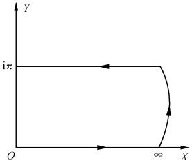

图5.3
 

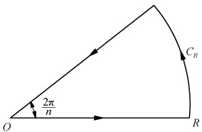

图5.4
 

 $ ^{*} $4. 证明： $ \int_{0}^{\infty}t^{x-1}\cos tdt=\Gamma(x)\cos\frac{\pi}{2}x,\int_{0}^{\infty}t^{x-1}\sin tdt=\Gamma(x)\sin\frac{\pi}{2}x. $

<!-- page: 105 -->

$ ^{*} $5. 计算积分

(1) $ \int_{0}^{\infty}\frac{x}{\mathrm{e}^{x}-1}\mathrm{d}x; $ (2) $ \int_{0}^{\infty}\frac{x^{3}}{\mathrm{e}^{x}-1}\mathrm{d}x. $

提示：在选择适当围道计算以上积分时，可利用关系

 $$ \int_{0}^{\infty}\frac{x^{n}}{\mathrm{e}^{x}+1}\mathrm{d}x=(1-2^{-n})\int_{0}^{\infty}\frac{x^{n}}{\mathrm{e}^{x}-1}\mathrm{d}x,n>0 $$ 

 $ ^{*} $6. 计算积分

(1) $ \int_{-\infty}^{\infty}\frac{1}{\cosh x}dx; $ (2) $ \int_{-\infty}^{\infty}\frac{1}{\cosh^{3}x}dx. $

提示：可作变换  $ u = \sinh x $.

7. 求极限 $ \lim_{n\to\infty}\sqrt{n}\int_{-\infty}^{\infty}\frac{\mathrm{d}x}{(1+x^2)^n} $之值，其中n为正整数.

8. 计算积分  $ I = \int_{-\infty}^{\infty} \frac{\mathrm{e}^{ax}}{\cosh\pi x} \, \mathrm{d}x $,  $ |\alpha| < \pi $.

（加州理工学院研究生试题）

 $ ^{*} $9. 已知 $ \int_{-\infty}^{\infty}e^{-\alpha x^{2}}\,dx=\sqrt{\frac{\pi}{\alpha}} $，证明

(1)

 $$ \int_{-\infty}^{\infty}x^{2}\mathrm{e}^{-\alpha x^{2}}\mathrm{d}x=\frac{1}{2}\sqrt{\pi}\alpha^{-3/2};\int_{-\infty}^{\infty}x^{4}\mathrm{e}^{-\alpha x^{2}}\mathrm{d}x=\frac{3}{4}\sqrt{\pi}\alpha^{-5/2}； $$ 

(2) 若  $ \beta/\sqrt{\alpha}\ll1 $，且  $ \alpha $ 具有和  $ 1/\sqrt{\alpha} $ 相同的量级，则

 $$ \int_{-\alpha}^{\alpha}f(x)\mathrm{e}^{-\alpha(x^{2}+\beta x^{3})}\mathrm{d}x\approx\int_{-\alpha}^{\alpha}f(x)(1-q\beta x^{3})\mathrm{e}^{-\alpha x^{2}}\mathrm{d}x $$ 

(1983年 CUSPEA 试题)

*10. 计算积分  $ \int_{0}^{2\pi}\frac{1}{a+\cos\varphi}d\varphi $

（1）当a>1时；

（2）当 $ a=a_{0}+i\varepsilon $时，其中， $ 0<a_{0}<1,\varepsilon>0 $且 $ \varepsilon\to0,a_{0} $和 $ \varepsilon $均为实数；

（3）当a=-1时.

 $ ^{*} $11. 试计算

 $$ I=\int_{0}^{2\pi}\frac{b+a\cos\varphi}{a^{2}+b^{2}+2a b\cos\varphi}\mathrm{d}\varphi,\quad\mid a\mid\neq\mid b\mid $$ 

（4～7题和10、11题均为芝加哥大学研究生试题）

### 5.3 物理问题中的几个积分

1. 狄利克雷积分  $ \int_{0}^{\infty}\frac{\sin x}{x}dx $

这是  $ f(x)=\frac{1}{x} $ 在实轴上有奇点的积分，故我们在计算它时当然不能简单的应用（5.2.7）式。由（5.2.11）式有

 $$ \int_{0}^{\infty}\frac{\sin x}{x}\mathrm{d}x=\frac{1}{2\mathrm{i}}\int_{-\infty}^{\infty}\frac{\mathrm{e}^{\mathrm{i}x}}{x}\mathrm{d}x $$

<!-- page: 106 -->

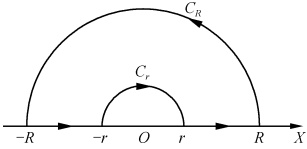

故我们应考虑  $ F(z)=\frac{e^{iz}}{z} $ 沿如图 5.5 所示的路径的积分. 由留数定理（或柯西定理）有

图5.5
 

 $$ \begin{aligned}\oint_{l}F(z)\mathrm{d}z=&\int_{-R}^{-r}\frac{\mathrm{e}^{\mathrm{i}x}}{x}\mathrm{d}x+\int_{C_{r}}\frac{\mathrm{e}^{\mathrm{i}z}}{z}\mathrm{d}z\\&+\int_{r}^{R}\frac{\mathrm{e}^{\mathrm{i}x}}{x}\mathrm{d}x+\int_{C_{R}}\frac{\mathrm{e}^{\mathrm{i}z}}{z}\mathrm{d}z=0\end{aligned} $$ 

而

 $$ \begin{aligned}\int_{-R}^{-r}\frac{\mathrm{e}^{ix}}{x}\mathrm{d}x+\int_{r}^{R}\frac{\mathrm{e}^{ix}}{x}\mathrm{d}x=&\int_{R}^{r}\frac{\mathrm{e}^{-ix}}{x}\mathrm{d}x+\int_{r}^{R}\frac{\mathrm{e}^{ix}}{x}\mathrm{d}x\\=&\int_{r}^{R}\frac{\mathrm{e}^{ix}-\mathrm{e}^{-ix}}{x}\mathrm{d}x=2\mathrm{i}\int_{r}^{R}\frac{\sin x}{x}\mathrm{d}x\end{aligned} $$ 

所以当  $ R \to \infty, r \to 0 $ 时有

$$  2\mathrm{i}\int_{0}^{\infty}\frac{\sin x}{x}\mathrm{d}x+\liminf_{r\to0}\int_{C_{r}}\frac{\mathrm{e}^{\mathrm{i}z}}{z}\mathrm{d}z+\liminf_{R\to\infty}\int_{C_{R}}\frac{\mathrm{e}^{\mathrm{i}z}}{z}\mathrm{d}z=0   \tag*{(5.3.1)}$$

由若尔当引理

 $$ \lim_{R\to\infty}\int_{C_{R}}\frac{\mathrm{e}^{\mathrm{i}z}}{z}\mathrm{d}z=0 $$ 

由小圆弧引理 $ ^{①} $

 $$ \liminf_{r\to0}\int_{C_{r}}\frac{\mathrm{e}^{\mathrm{i}\tau}}{z}\mathrm{d}z=-\pi\mathrm{i} $$ 

一并代入(5.3.1)式有

 $$ \int_{0}^{\infty}\frac{\sin x}{x}\mathrm{d}x=\frac{\pi}{2} $$ 

2. 菲涅耳积分  $ \int_{0}^{\infty}\left\{\begin{aligned}\sin x^{2}\\ \cos x^{2}\end{aligned}\right\}dx $

由5.2处理含三角函数的无穷积分的经验，自然会想到去考虑函数 $ e^{iz^{2}} $沿图5.2所示的围线l的积分，但很快发现该围道不适用，因为 $ \int_{C_{R}}e^{iz^{2}}dz $当 $ R\to\infty,\frac{\pi}{2}<\theta<\pi $时不收敛.经过摸索，选择l为图5.6中围线，则由柯西定理（或留数定理）有

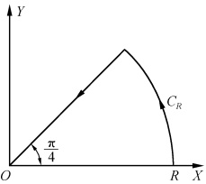

图5.6
 

$$  \oint_{l}\mathrm{e}^{\mathrm{i}z^{2}}\mathrm{d}z=\int_{0}^{R}\mathrm{e}^{\mathrm{i}x^{2}}\mathrm{d}x+\int_{C_{R}}\mathrm{e}^{\mathrm{i}z^{2}}\mathrm{d}z+\mathrm{e}^{\mathrm{i}\frac{\pi}{4}}\int_{R}^{0}\mathrm{e}^{-r^{2}}\mathrm{d}r=0   \tag*{(5.3.3)}$$

在 $ C_{R} $上，令 $ z=Re^{i\frac{\theta}{2}} $，则

 $$ \begin{aligned}\left|\int_{C_{R}}\mathrm{e}^{\mathrm{i}z^{2}}\mathrm{d}z\right|&=\left|\frac{\mathrm{i}R}{2}\int_{0}^{\pi/2}\mathrm{e}^{\mathrm{i}R^{2}\left(\cos\theta+\mathrm{i}\sin\theta\right)}\mathrm{e}^{\mathrm{i}\frac{\theta}{2}}\mathrm{d}\theta\right|\\&\leqslant\frac{R}{2}\int_{0}^{\pi/2}\mathrm{e}^{-R^{2}\sin\theta}\mid\mathrm{d}\theta\mid\end{aligned} $$ 

而在 $ \left[0,\frac{\pi}{2}\right] $上，由5.2节注②中图5.3有

 $$ \sin\theta\geqslant\frac{2}{\pi}\theta $$

<!-- page: 107 -->

故

 $$ \left|\int_{C_{R}}\mathrm{e}^{\mathrm{i}z^{2}}\mathrm{d}z\right|\leqslant\frac{R}{2}\int_{0}^{\frac{\pi}{2}}\mathrm{e}^{-\frac{2R^{2}}{\pi}\theta}\mathrm{d}\theta=\frac{\pi}{4R}[1-\mathrm{e}^{-R^{2}}]\xrightarrow{R\to\infty}0 $$ 

X

 $$ \int_{R}^{0}\mathrm{e}^{-r^{2}}\mathrm{d}r\xlongequal{R\to\infty}-\int_{0}^{\infty}\mathrm{e}^{-r^{2}}\mathrm{d}r=-\frac{\sqrt{\pi}}{2} $$ 

令  $ R \to \infty $ 将以上结果代入(5.3.3)式得

 $$ \int_{0}^{\infty}\mathrm{e}^{\mathrm{i}x^{2}}\mathrm{d}x=\mathrm{e}^{\mathrm{i}\frac{\pi}{4}}\cdot\frac{\sqrt{\pi}}{2} $$ 

即

 $$ \begin{aligned}&\int_{0}^{\infty}\cos x^{2}+\mathrm{i}\int_{0}^{\infty}\sin x^{2}\mathrm{d}x=\left(\frac{1}{\sqrt{2}}+\mathrm{i}\frac{1}{\sqrt{2}}\right)\frac{\sqrt{\pi}}{2}\\ &\\ &\quad\int_{0}^{\infty}\cos x^{2}\mathrm{d}x=\int_{0}^{\infty}\sin x^{2}\mathrm{d}x=\frac{\sqrt{2\pi}}{4}\\ \end{aligned} $$ 

故有

3. 热传导问题中的积分  $ \int_{0}^{\infty}e^{-ur^{2}}\cos bx\,dx(a>0,b \text{ 是任意实数}) $

显然，这不能应用公式(5.2.6)来求，因为当 $ \left|z\right|\rightarrow\infty $时 $ e^{-\alpha z^{2}} $在半圆 $ C_{R} $上不一致趋于零。作如下变换

$$  \begin{align*}\int_{0}^{\infty}\mathrm{e}^{-ax^{2}}\cosh x\mathrm{d}x&=\int_{0}^{\infty}\mathrm{e}^{-ax^{2}}\frac{\mathrm{e}^{iyx}+\mathrm{e}^{-iyx}}{2}\mathrm{d}x=\frac{1}{2}\int_{-\infty}^{\infty}\mathrm{e}^{-ax^{2}-iyx}\mathrm{d}x\\&=\frac{1}{2}\mathrm{e}^{-\frac{b^{2}}{4a}}\int_{-\infty}^{\infty}\mathrm{e}^{-a\left(x+\frac{iy}{2a}\right)^{2}}\mathrm{d}x=\frac{1}{2}\mathrm{e}^{-\frac{b^{2}}{4a}}\int_{l_{1}^{\prime}}\mathrm{e}^{-ax^{2}}\mathrm{d}z\end{align*}   \tag*{（5.3.5）}$$

其中积分路线 $ l_{1}^{\prime} $是与实轴平行、相距为b/2a的由

 $ \mathrm{Re}z=x=-\infty $ 到  $ x=+\infty $ 的无限长直线. 考虑  $ e^{-az^{2}} $

沿如图5.7所示的回路积分，则

 $$ \begin{aligned}\oint_{l}\mathrm{e}^{-az^{2}}\mathrm{d}z=&\int_{l_{1}}\mathrm{e}^{-az^{2}}\mathrm{d}z+\int_{b/2a}^{0}\mathrm{e}^{-a(R+\mathrm{i}y)^{2}}\mathrm{d}(\mathrm{i}y)\\&+\int_{R}^{-R}\mathrm{e}^{-ax^{2}}\mathrm{d}x+\int_{0}^{b/2a}\mathrm{e}^{-a(-R+\mathrm{i}y)^{2}}\mathrm{d}(\mathrm{i}y)=0\end{aligned} $$ 

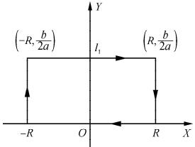

图5.7
 

其中， $ l_{1} $ 为从  $ \left(-R,\frac{b}{2a}\right) $ 到  $ \left(R,\frac{b}{2a}\right) $ 的直线段. 于是

 $$ \lim_{R\to\infty}\int_{l_{1}}\mathrm{e}^{-az^{2}}\mathrm{d}z=\int_{l_{1}^{\prime}}\mathrm{e}^{-az^{2}}\mathrm{d}z $$ 

 $$ \left|\int_{0}^{\frac{b}{2a}}\mathrm{e}^{-a(-R+\mathrm{i}y)^{2}}\mathrm{i}\mathrm{d}y\right|\leqslant\mathrm{e}^{-aR^{2}}\int_{0}^{\frac{b}{2a}}\mathrm{e}^{ay^{2}}\mathrm{d}y\xrightarrow{R\to\infty}0 $$ 

同理

 $$ \left|\int\limits_{b/2a}^{0}\mathrm{e}^{-u(R+\mathrm{i}y)^{2}}\mathrm{i}\mathrm{d}y\right|\xrightarrow{R\to\infty}0 $$ 

而

<!-- page: 108 -->

$$ \int_{R}^{-R}\mathrm{e}^{-ax^{2}}\mathrm{d}x\xlongequal{R\to\infty}-\int_{-\infty}^{\infty}\mathrm{e}^{-ax^{2}}\mathrm{d}x=-\frac{1}{\sqrt{a}}\int_{-\infty}^{\infty}\mathrm{e}^{-(\sqrt{a}x)^{2}}\mathrm{d}(\sqrt{a}x)=-\sqrt{\frac{\pi}{a}} $$ 

将这些结果一并代入(5.3.6)式得

 $$ \int_{t_{1}^{\prime}}\mathrm{e}^{-ax^{2}}\mathrm{d}z=\sqrt{\frac{\pi}{a}} $$ 

故由(5.3.5)式得

$$  \int_{0}^{\infty}\mathrm{e}^{-ax^{2}}\cos bx\mathrm{d}x=\frac{1}{2}\mathrm{e}^{-\frac{b^{2}}{4a}}\sqrt{\frac{\pi}{a}},\quad a>0   \tag*{(5.3.7)}$$

注 ① 小圆弧引理 设  $ f(z) $ 沿圆弧  $ C_{r}: z - a = r \mathrm{e}^{\mathrm{i}\theta} (\theta_{1} \leqslant \theta \leqslant \theta_{2}, r $ 充分小）上连续且  $ \lim_{r \to 0} [z - a f(z)] = \lambda (\lambda $ 为常数，包括 0) 在  $ C_{r} $ 上一致成立，则

$$  \liminf_{r\to0}\int_{C_{r}}f(z)\mathrm{d}z=\mathrm{i}(\theta_{2}-\theta_{1})\lambda   \tag*{（5.3.8）}$$

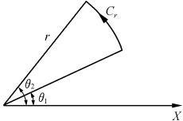

特别是若 a 为  $ f(z) $ 的一阶极点，则

 $$ \liminf_{r\to0}\int_{C_{r}}f(z)\mathrm{d}z=\mathrm{i}(\theta_{2}-\theta_{1})\operatorname{res}f(a) $$ 

图5.8
 

或

$$  \liminf_{r\to0\atop C_{r}}f(z)\mathrm{d}z=\mathrm{i}(\theta_{2}-\theta_{1})\psi(a)   \tag*{（5.3.10）}$$

其中，积分沿逆时针方向进行（图5.8）， $ \psi(z)=(z-a)f(z) $在a的

邻域中解析，且 $ \psi(a)\neq0 $

思考1：若 a 是  $ f(z) $ 高于一阶的极点，(5.3.9) 和 (5.3.10) 式是否还成立？

思考2：你能用证明小弧引理类似的方法证明如下的大弧引理吗？

② 大弧引理 设  $ f(z) $ 在圆弧  $ C_{R}: z = Re^{i\theta} (\theta_1 \leqslant \theta \leqslant \theta_2, R \to \infty) $ 上连续，且 小圆弧引理的证明  $ \lim_{R \to \infty} [zf(z)] = M $ 一致成立，则

$$  \lim_{R\to\infty}\int_{C_{R}}f(z)\mathrm{d}z=\mathrm{i}(\theta_{2}-\theta_{1})M   \tag*{（5.3.11）}$$

##### 习题5.3

1. 证明：若  $ f(z) $ 在实轴上有有限个一阶极点  $ a_{j}(j=1,2,\cdots,m) $，此外还满足 (5.2.1) 式成立的其他条件，则

$$  \int_{-\infty}^{\infty}f(x)\mathrm{d}x=2\pi\mathrm{i}\sum_{k=1}^{n}\mathrm{res}f(b_{k})\mid_{\mathrm{Im}z>0}+\pi\mathrm{i}\sum_{j=1}^{m}\mathrm{res}f(a_{j})\mid_{\mathrm{Im}z=0}   \tag*{（5.3.12）}$$

2. 证明：若  $ f(z) $ 在实轴上有有限个一阶极点  $ a_{j}(j=1,2,\cdots,m) $，此外还满足公式(5.2.6)和(5.2.7)成立的其他条件，则

$$  \int_{-\infty}^{\infty}f(x)\mathrm{e}^{\mathrm{i}\beta x}\mathrm{d}x=2\pi\mathrm{i}\sum_{k=1}^{n}\mathrm{res}\left[f(b_{k})\mathrm{e}^{\mathrm{i}\beta b_{k}}\right]_{\mathrm{Im}z>0}+\pi\mathrm{i}\sum_{j=1}^{m}\mathrm{res}\left[f(a_{j})\mathrm{e}^{\mathrm{i}\beta a_{j}}\right]_{\mathrm{Im}z=0}   \tag*{（5.3.13）}$$

于是有

$$  \begin{array}{r l r}&{}&{\int_{0}^{\infty}f(x)\mathrm{c o s}p x\mathrm{d}x=\pi\mathrm{i}\displaystyle\sum_{k=1}^{n}\mathrm{r e s}\bigl[f(b_{k})\mathrm{e}^{\mathrm{i}p b_{k}}\bigr]_{\mathrm{I m}z>0}+\frac{\pi}{2}\mathrm{i}\displaystyle\sum_{j=1}^{m}\mathrm{r e s}\bigl[f(a_{j})\mathrm{e}^{\mathrm{i}p a_{j}}\bigr]_{\mathrm{I m}z=0}}\\ &{}&{\big[f(-x)=f(x)\big]}\end{array}   \tag*{（5.3.14）}$$

$$  \begin{array}{r l r}&{}&{\int_{0}^{\infty}f(x)\sin p x\mathrm{d}x=\pi\displaystyle\sum_{k=1}^{n}\mathrm{r e s}\bigl[f(b_{k})\mathrm{e}^{\mathrm{i}\rho b_{k}}\bigr]_{\mathrm{I m}z>0}+\frac{\pi}{2}\displaystyle\sum_{j=1}^{m}\mathrm{r e s}\bigl[f(a_{j})\mathrm{e}^{\mathrm{i}\rho a_{j}}\bigr]_{\mathrm{I m}z=0}}\\ &{}&{\bigl[f(-x)=-f(x)\bigr]}\end{array}   \tag*{（5.3.15）}$$

<!-- page: 109 -->

3. 计算下列积分：

(1) $ \int_{-\infty}^{\infty}\frac{dx}{x^{4}-1}; $ (2) $ \int_{-\infty}^{\infty}\frac{dx}{x(x+1)(x^{2}+1)}. $

4. 计算下列积分：

(1) $ \int_{0}^{\infty}\frac{\sin x}{x(x^{2}+1)^{2}}\mathrm{d}x; $ (2) $ \int_{0}^{\infty}\frac{\sin x}{x(x^{2}+a^{2})}\mathrm{d}x,\quad a>0; $

(3) $ \int_{-\infty}^{\infty}\frac{\sin^{3}x}{x^{3}}dx; $ (4) $ \int_{0}^{\infty}\frac{\cos ax-\cosh x}{x^{2}}dx,\quad a\geqslant0,b\geqslant0; $

(5) $ \int_{-\infty}^{\infty}\frac{x\sin x}{x^{2}+4x+20}dx; $ (6) $ \int_{-\infty}^{\infty}\frac{x\cos x}{x^{2}+4x+20}dx. $

5. 计算下列积分：

(1)  $ \int_{-\infty}^{\infty}\frac{e^{ax}}{1+e^{x}}dx,\quad0<a<1; $

(2)  $ \int_{-\infty}^{\infty}\frac{e^{ax}-e^{bx}}{1-e^{x}}dx,\quad0<b<a<1; $

(3)  $ \int_{0}^{\infty}\frac{\sin x}{\sin x}dx; $

(4)  $ \int_{-\infty}^{\infty}\frac{\cos mx}{e^{x}+e^{-x}}dx. $

提示：对于(3)问，考虑 $ f(z)=\frac{e^{iz}}{shz} $沿如图5.9的闭路径上的积分.

 $$ \mathrm{e}^{ax}/\sinh(\pi x) $$ 

 $$ \int_{0}^{\infty}\frac{\sinh(\alpha x)}{\sinh(\pi x)}\mathrm{d}x=\frac{1}{2}\tan\frac{\alpha}{2},\quad\mid\alpha\mid<\pi $$ 

（第4题（3）问和6题为芝加哥大学研究生试题）

 $ ^{*} $7. 计算半径为 R 的四维球的体积 V，即计算积分

 $$ V=\int\mathrm{d}x_{1}\mathrm{d}x_{2}\mathrm{d}x_{3}\mathrm{d}x_{4} $$ 

 $$ 0\leqslant x_{1}^{2}+x_{2}^{2}+x_{3}^{2}+x_{4}^{2}\leqslant R^{2}. $$ 

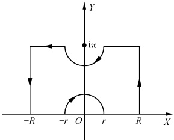

(1981年 CUSPEA 试题)

图5.9
 

###  $ ^{*} $5.4 多值函数的积分

被积函数是多值函数的情形，一定要适当割开平面，使其能分出单值解析分支，

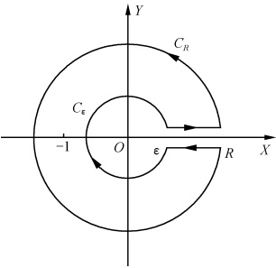

图5.10
 

才能应用柯西定理或留数定理来求出给定的积分值。下面我们将通过两个具体的例子，来了解如何计算多值函数的积分。

## 1. 欧拉积分  $ \int_{0}^{\infty}\frac{x^{\alpha-1}}{1+x}dx $ （ $ 0 < \alpha < 1 $）

其被积函数  $ f(z)=\frac{z^{a-1}}{1+z} $ 的支点为 0 和  $ \infty $.

从0点沿正实轴到 $ \infty $作支割线，则可划出单值分支.在 $ 0\leq\arg z\leq2\pi $所确定的单值分支中，考虑 $ f(z)=\frac{z^{a-1}}{1+z} $沿如图5.10所示的围道的积分，则在此围道内函数有单极点z=-1，故由

<!-- page: 110 -->

留数定理有

$$  \begin{aligned}\oint_{l}\frac{z^{a-1}}{1+z}\mathrm{d}z=&\int_{\varepsilon}^{R}\frac{x^{a-1}}{1+x}\mathrm{d}x+\int_{C_{R}}\frac{z^{a-1}}{1+z}\mathrm{d}z+\int_{R}^{\varepsilon}\frac{x^{a-1}\mathrm{e}^{\left[2\pi(a-1)\right]}}{1+x}\mathrm{d}x\\ &+\int_{C_{L}}\frac{z^{a-1}}{1+z}\mathrm{d}z=2\pi\mathrm{i}\mathrm{res}\Big[\frac{z^{a-1}}{1+z},-1\Big]\end{aligned}   \tag*{(5.4.1)}$$

因为

 $$ \begin{aligned}\int_{\varepsilon}^{R}\frac{x^{a-1}}{1+x}\mathrm{d}x&\xlongequal{R\to\infty}\int_{0}^{\infty}\frac{x^{a-1}}{1+x}\mathrm{d}x\\\left|\int_{C_{R}}\frac{z^{a-1}}{1+z}\mathrm{d}z\right|\leqslant\int_{C_{R}}\left|\frac{z^{a-1}}{1+z}\right|\bullet\mid\mathrm{d}z\mid\leqslant\frac{R^{a-1}}{R-1}\bullet2\pi R=\frac{2\pi R^{a}}{R-1}\xrightarrow{R\to\infty}0\\\int_{R}^{\varepsilon}\frac{x^{a-1}\mathrm{e}^{\mathrm{i}2\pi(a-1)}}{1+x}\mathrm{d}x=&-\mathrm{e}^{\mathrm{i}2\pi(a-1)}\int_{\varepsilon}^{R}\frac{x^{a-1}}{1+x}\mathrm{d}x\xlongequal{\varepsilon\to0}-\mathrm{e}^{\mathrm{i}2\pi(a-1)}\int_{0}^{\infty}\frac{x^{a-1}}{1+x}\mathrm{d}x\end{aligned} $$ 

在 $ C_{\varepsilon} $上， $ z=\varepsilon e^{i\theta} $（ $ \theta $由 $ 2\pi $到0），

 $$ \left|\left(z-0\right)\frac{z^{\alpha-1}}{1+z}\right|=\left|\varepsilon\mathrm{e}^{i\theta}\frac{\varepsilon^{\alpha-1}\mathrm{e}^{i\theta(a-1)}}{1+\varepsilon\mathrm{e}^{i\theta}}\right|\leqslant\varepsilon\bullet\frac{\varepsilon^{\alpha-1}}{1-\varepsilon}\xrightarrow{\varepsilon\rightarrow0}0 $$ 

故由上节小圆弧引理有

 $$ \int_{C_{\varepsilon}}\frac{z^{a-1}}{1+z}\mathrm{d}z\xrightarrow{\varepsilon\to0}0 $$ 

而

 $$ \mathrm{res}\Big[\frac{z^{a-1}}{1+z},-1\Big]=\lim_{z\to-1}(1+z)\frac{z^{a-1}}{1+z}=\mathrm{e}^{(a-1)\pi\mathrm{i}}=-\mathrm{e}^{a\pi\mathrm{i}} $$ 

把这些结果代入(5.4.1)式

 $$ [1-\mathrm{e}^{\mathrm{i}2\pi(a-1)}]\int_{0}^{\infty}\frac{x^{a-1}}{1+x}\mathrm{d}x=-2\pi\mathrm{i}\mathrm{e}^{a\pi\mathrm{i}} $$ 

所以

$$  \int_{0}^{\infty}\frac{x^{a-1}}{1+x}\mathrm{d}x=\frac{\pi}{\sin\alpha\pi}   \tag*{(5,4,2)}$$

2. 含对数函数的积分  $ \int_{0}^{\infty}\frac{\ln x}{(1+x^{2})^{2}}dx $

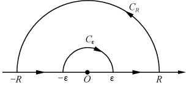

对数函数  $ \ln z $ 是一多值函数，其支点为 0 和  $ \infty $，因此，要计算如上的含对数函数的积分，需先连接 0 和  $ \infty $ 作支割线划出单值分支，然后在  $ 0 \leq \arg z \leq 2\pi $ 所确定的单值分支中计算此积分.

图5.11
 

考虑  $ f(z)=\frac{\ln z}{(1+z^{2})^{2}} $ 沿如图 5.11 所示的

围道积分，则在此围道内被积函数有唯一的二阶极点 z=i，于是由留数定理有

$$  \begin{aligned}&\int_{\epsilon}^{R}\frac{\ln x}{(1+x^{2})^{2}}\mathrm{d}x+\int_{\mathrm{C}_{R}}\frac{\ln z}{(1+z^{2})^{2}}\mathrm{d}z+\int_{-R}^{\neg\epsilon}\frac{\ln x}{(1+x^{2})^{2}}\mathrm{d}x\\ &+\int_{\mathrm{C}_{r}}\frac{\ln z}{(1+z^{2})^{2}}\mathrm{d}z=2\pi\mathrm{i}\mathrm{res}f(\mathrm{i})\\ \end{aligned}   \tag*{(5.4.3)}$$

<!-- page: 111 -->

而当  $ R \to \infty, \varepsilon \to 0 $ 时有

 $$ \int_{\varepsilon}^{R}\frac{\ln x}{(1+x^{2})^{2}}\mathrm{d}x=\int_{0}^{\infty}\frac{\ln x}{(1+x^{2})^{2}}\mathrm{d}x $$ 

 $$ \int_{-R}^{\neg\epsilon}\frac{\ln x}{(1+x^{2})^{2}}\mathrm{d}x=\int_{R}^{\epsilon}\frac{\ln(-x)}{(1+x^{2})^{2}}\mathrm{d}(-x)=\int_{0}^{\infty}\frac{\ln x+\mathrm{i}\pi}{(1+x^{2})^{2}}\mathrm{d}x $$ 

又因为 $ \lim_{z\to\infty}\frac{z\ln z}{(1+z^2)^2}=0,\lim_{z\to0}\frac{z\ln z}{(1+z^2)^2}=0 $，故由大弧引理（5.3.11）式和小弧引理（5.3.8）式，分别有

 $$ \lim_{R\to\infty}\int_{C_{R}}\frac{\ln z}{(1+z^{2})^{2}}\mathrm{d}z=0 $$ 

 $$ \lim_{\varepsilon\to0}\int_{C_{\varepsilon}}\frac{\ln z}{(1+z^{2})^{2}}\mathrm{d}z=0 $$ 

而

 $$ \mathrm{res}f(i)=\frac{\mathrm{d}}{\mathrm{d}z}\Big[(z-\mathrm{i})^{2}\left.\frac{\ln z}{(1+z^{2})^{2}}\right]\Big|_{z=i}=\frac{\pi+2\mathrm{i}}{8} $$ 

将上述结果代入(5.4.3)式得

 $$ 2\int_{0}^{\infty}\frac{\ln x}{(1+x^{2})^{2}}\mathrm{d}x+\mathrm{i}\pi\int_{0}^{\infty}\frac{1}{(1+x^{2})^{2}}\mathrm{d}x=-\frac{\pi}{2}+\frac{\pi^{2}}{4}\mathrm{i} $$ 

故有

$$  \int_{0}^{\infty}\frac{\ln x}{\left(1+x^{2}\right)^{2}}\mathrm{d}x=-\frac{\pi}{4}   \tag*{(5.4.4)}$$

$$  \int_{0}^{\infty}\frac{1}{(1+x^{2})^{2}}\mathrm{d}x=\frac{\pi}{4}   \tag*{(5.4.5)}$$

思考:可以选择如图5.10的围道来计算此积分吗?

#### 习题5.4

1. 计算下列积分：

(1)

 $$ \int_{0}^{\infty}\frac{\sqrt{x}\ln x}{\left(1+x\right)^{2}}\mathrm{d}x; $$ 

 $$ \int_{0}^{\infty}\frac{\sqrt{x}}{(1+x)^{2}}\mathrm{d}x. $$ 

提示：考虑 $ \int_{C}\frac{\sqrt{z}\ln z}{(1+z)^{2}}dz $，其中C如图5.12所示.

2. 计算下列积分：

(1) $ \int_{-1}^{1}\frac{\mathrm{d}x}{(x-2)\sqrt{1-x^{2}}} $

提示：从-1到1沿正实轴作支割线，在单值分支中考虑函数 $ \frac{1}{(z-2)\sqrt{(1-z^{2})}} $沿如图5.13所示路径的积分.

(2)

 $$ \int_{0}^{\infty}\frac{x^{a}}{(x^{2}+1)^{2}}\mathrm{d}x\quad(-1<\alpha<3)\text{；} $$ 

(3)

 $$ \int_{0}^{\infty}\frac{\ln x}{(x^{2}+1)^{2}}\mathrm{d}x； $$

<!-- page: 112 -->

(4)

 $$ \int_{0}^{\infty}\frac{\ln^{3}x}{(1+x)^{2}(1+x^{2})}\mathrm{d}x. $$ 

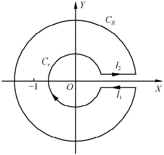

图5.12
 

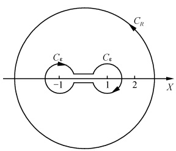

图5.13
 

3. 计算积分

(1) $ \int_{0}^{\infty}\frac{\sin x}{\sqrt{x}}\mathrm{d}x; $ (2) $ \int_{0}^{\infty}\frac{\sin x^{2}}{x}\mathrm{d}x. $

 $ ^{*} $4. 计算梅林(Melin)变换型积分

 $$ \dot{I}=\int_{0}^{\infty}\frac{x^{1/2}}{1+x^{2}}\mathrm{d}x $$ 

（芝加哥大学研究生试题）

 $ ^{*} $5. 什么正数值 n 能使下列对数型积分有界？

 $$ I_{n}=\int_{0}^{\infty}\frac{\sqrt{x}\log x}{x^{n}+1}\mathrm{d}x $$ 

由变量代换或其他方法证明  $ I_{3}=0 $，并用围道积分计算  $ I_{2} $

（加州理工学院研究生试题）

<!-- page: 113 -->

### 本章小结

本章授课课件 本章习题分析与讨论

<table border=1 style='margin: auto; word-wrap: break-word;'><tr><td rowspan="4">可用来计算实积分</td><td style='text-align: center; word-wrap: break-word;'>$ \frac{l $内的孤立奇点 $ \uparrow $ $ \operatorname*{lim}_{\varepsilon \to b_k}[(z-b_k)f(z)], b_k $ 为单极点 $ \frac{\operatorname{res}f(b_k)}{C_1}=C_1=\left\{\begin{array}{l}\frac{1}{(n-1)!}\frac{\mathrm{d}^{n-1}}{\mathrm{d}z^{n-1}}[(z-b_k)^n f(z)]=b_k, b_k $ 为  $ n $ 阶极点\\\oint_l f(z)\mathrm{d}z=2\pi\mathrm{i}\sum_{k=1}^{n}\mathrm{res}f(b_k)\rightarrow\oint_l f(z)\mathrm{d}z=2\pi\mathrm{i}\mathrm{res}f(\infty),\mathrm{res}f(\infty)=-C_1\end{array}\right. $思想:将实积分与一复变函数围道积分联系起来.</td><td rowspan="2"></td></tr><tr><td style='text-align: center; word-wrap: break-word;'>具体步骤 $ \left\{\begin{array}{l}1.\text{视}\int_{a}^{b}f(x)\mathrm{d}x\text{的}[a,b]\text{为复平面实轴上不含}f(x)\text{奇点的一段}l_1.\\2.\text{或补充一段(或几段)}l_2,\text{使}l_1+\sum_{k}l_k=\text{闭合回路}[(k=2,3,\cdots);\text{或作变数变换,使实轴上}[a,b]\text{变为复平面中闭合回路}l_2.\\3.\text{用留数定理计算}\oint_{l}f(z)\mathrm{d}z.\end{array}\right. $</td></tr><tr><td style='text-align: center; word-wrap: break-word;'>几类典型实积分</td><td rowspan="2">$ \left\{\begin{array}{l}1.\int_{-\infty}^{\infty}f(x)\mathrm{d}x=2\pi\mathrm{i}\sum_{k=1}^{n}\mathrm{res}f(b_k)\vert_{\mathrm{Im}(z)&gt;0}+\pi\sum_{j=1}^{m}\mathrm{res}f(a_j)\vert_{\mathrm{Im}=0}\\2.\int_{0}^{\infty}f(x)\cos p x\mathrm{d}x=\pi\sum_{k=1}^{n}\mathrm{res}[f(b_k)\mathrm{e}^{ip b_k}]_{\mathrm{Im}(z)&gt;0}+\frac{\pi}{2}\sum_{j=1}^{m}\mathrm{res}[f(a_j)\mathrm{e}^{ip a_j}]_{\mathrm{Im}=0}\quad[p&gt;0,f(x)=f(-x)]\\3.\int_{0}^{\infty}f(x)\sin p x\mathrm{d}x=\pi\sum_{k=1}^{n}\mathrm{res}[f(b_k)\mathrm{e}^{ip b_k}]_{\mathrm{Im}(z)&gt;0}+\frac{\pi}{2}\sum_{j=1}^{m}\mathrm{res}[f(a_j)\mathrm{e}^{ip a_j}]_{\mathrm{Im}=0}\quad[p&gt;0,f(-x)=-f(x)]\\4.\int_{0}^{2\pi}R(\cos\theta,\sin\theta)\mathrm{d}\theta=\oint_{|z|=1}\frac{1}{i\tau}R\left(\frac{z+z^{-1}}{2},\frac{z-z^{-1}}{2i}\right)\mathrm{d}z=2\pi\mathrm{i}\sum_{k=1}^{n}\mathrm{res}f(b_k)\quad(|z|&lt;1\end{array}\right. $</td></tr><tr><td style='text-align: center; word-wrap: break-word;'>6.\int_{0}^{\infty}\cos x^2\mathrm{d}x=\int_{0}^{\infty}\sin x^2\mathrm{d}x=\frac{\sqrt{2\pi}}{4}\\7.\int_{0}^{\infty}\mathrm{e}^{-ax^2}\cos ax\mathrm{d}x=\frac{1}{2}\mathrm{e}^{-\frac{x^2}{4a}}\sqrt{\frac{\pi}{a}}\quad(a&gt;0)\\8.\int_{0}^{\infty}\frac{x^{n-1}}{1+x}\mathrm{d}x=\frac{\pi}{\sin\alpha}\quad(0&lt;\alpha&lt;1)</td></tr></table>

