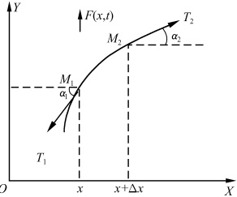
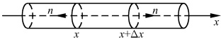
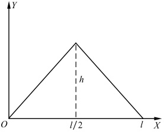
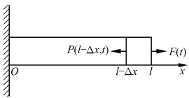
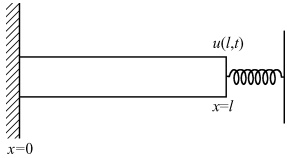

# 06-第六章 定解问题

[返回全书目录](../../README.md)

> PDF 页码：115–127

<!-- page: 115 -->

### 6.1 引 言

## 1. 数学物理方程

单从物理的角度而言，数学物理方程（简称数理方程）是指从物理问题中导出的反映客观物理量在各个地点、各个时刻之间相互制约关系的一些偏微分方程（有时也包括常微分方程和积分方程）。换而言之，它是物理过程的数学表达式。它所研究的范围十分广泛，从连续介质力学、传热学和电磁场理论，到等离子体物理、固体物理和非线性光学等；从线性问题到非线性问题。但传统的数学物理方程，却主要是指二阶线性偏微分方程。

传统的数理方程按照所代表的物理过程（或状态）一般可分为三类：

（1）描述振动和波动特征的波动方程

 $$ u_{t t}=a^{2}\Delta u+f $$ 

其中  $ u=u(x,y,z;t) $ 代表平衡时坐标为  $ (x,y,z) $ 的点在 t 时刻的位移（未知函数），a 是波传播的速度， $ f=f(x,y,z;t) $ 是与源有关的已知函数， $ \Delta $（或记作  $ \nabla^{2} $）是拉普拉斯（Laplace）算符（简称为拉氏算符） $ ^{①} $

 $$ \Delta\equiv\frac{\partial^{2}}{\partial x^{2}}+\frac{\partial^{2}}{\partial y^{2}}+\frac{\partial^{2}}{\partial z^{2}} $$ 

而

 $$ u_{tt}=\frac{\partial^{2}u}{\partial t^{2}} $$ 

（2）反映输运过程的扩散（或热传导）方程

 $$ u_{t}=D\Delta u+f $$ 

其中  $ u=u(x,y,z;t) $ 表示物质的浓度（或物体的温度），D 是扩散（或热传导）系数， $ f=f(x,y,z;t) $ 是与源有关的已知量， $ u_{t}=\frac{\partial u}{\partial t} $.

（3）描绘稳定过程（或状态）的泊松(Poisson)方程

 $$ \Delta u=-h $$ 

其中  $ u=u(x,y,z) $ 是表示稳定现象特征的物理量，如静电场中的电势等， $ h=h(x,y,z) $ 是与源有关的已知量.

这三类方程，其未知函数 u 的偏微商最高只有二阶，且 u 及其各阶偏微商都是以

<!-- page: 116 -->

线性的关系（即只有一次项）出现，故均属二阶线性偏微方程。在数学上，它们分别被称为双曲型方程，抛物型方程和椭圆型方程 $ ^{②} $。

## 2. 用数理方程研究物理问题的步骤

数理方程是以物理学与工程技术中的具体问题作为研究对象的，简单地说，它是把对物理问题的研究“翻译”为对数学问题的研究。为了使这个“翻译”及其研究工作做得既完整又准确，一般我们需经三个步骤。

（1）提出定解问题. 它包括泛定方程，即数理方程本身和定解条件，即确定具体问题的特解所需要的条件两方面. 同一类事物可用同一类方程描述，即泛定方程只是提供了解决问题的一般规律（同一类事物的共性），而定解条件提供了解决问题的具体条件（具体问题的个性），故它们总是同时提出，作为一个整体，称为定解问题. 它是根据物理学的规律和实验资料而提出的.

（2）求解. 提出了定解问题，实际上就完成了将物理问题“翻译”成数学语言的解释工作，下面紧接着面临的，当然应是对所提出的定解问题进行求解. 二阶线性偏微分方程的常用求解方法大致可归纳为如下几种：

① 行波法（或达朗贝尔解法）；

② 分离变量法；

③ 积分变换法；

④ 格林函数（或积分公式）法：

⑤ 变分法.

此外，对于有些具体问题，当我们无法得到其解析解（或不需要得到其解析解）时，还可采用近似方法求解。以上各解法，我们将在本篇以后各章中一一阐述。

（3）分析解答。作为用数理方程研究物理问题，仅仅求出了解答当然是不够的，还必须分析解的物理意义并论证解在数学上的存在性、唯一性和稳定性。至于物理意义，显然，不同的问题有不同的物理内涵。而存在性，是指验证所求得的解是否满足方程。唯一性，是指讨论在什么样的定解条件下，对于哪一函数类，方程的解是唯一的。通过对唯一性问题的研究，可以明确，对于一定的方程，需要多少个以及哪一些定解条件才能唯一地确定一个解。稳定性，是指讨论当定解条件有微小改变时，解是否也只有微小变化。若是，解就是稳定的。对于这个问题的讨论尤为重要，因为在把一个物理问题表成数学问题时，一般总会做一些简化或者理想化的假定，与真实情况有出入。研究了稳定性问题，就可以对于解的近似程度作出估计。

一个定解问题，若其解是存在、唯一而且是稳定的，就称为是适定的（即在物理上是适当而确定的）。

在本篇中，我们将主要介绍一些求解方法，而对于解的物理意义特别是解的适定性，我们只在适当的地方稍作讨论。

<!-- page: 117 -->

## 3. 数理方程的特点

从上面的介绍和分析我们看到，数理方程一方面紧密地、直接地联系着物理学中的许多问题，另一方面它又要广泛地运用数学中许多部门的成果，所以，它成为数学理论与物理学的实际问题之间的桥梁。我们在学习它时，要密切注意它的内容与物理学中各种有关现象的联系；要能熟练地掌握所讲述的解决问题的方法，并根据问题的性质来确定使用的方法；要灵活地把其他数学部门的知识运用到数理方程中来。

在这一篇的学习中，我们除了会经常用到数学分析中的许多基本内容外，还要用到复变函数论和泛函分析中的一些基本知识与方法。其他，如几何、代数、常微分方程的一些基本知识也常会用到。

注 ① 为清楚起见，有时也常将三维的拉普拉斯算符记作  $ \Delta_{3} $，而二维的记作  $ \Delta_{2} $，即

 $$ \Delta_{3}=\frac{\partial^{2}}{\partial x^{2}}+\frac{\partial^{2}}{\partial y^{2}}+\frac{\partial^{2}}{\partial z^{2}} $$ 

 $$ \Delta_{2}=\frac{\partial^{2}}{\partial x^{2}}+\frac{\partial^{2}}{\partial y^{2}} $$ 

② 见参考文献 $ ^{[2]} $第179页.

### 6.2 三类数理方程的导出

由上一节的学习，我们已看到数理方程（即泛定方程）本身，在物理学的研究中起着重要的作用，那么，究竟如何从物理学的实际问题中导出数理方程呢？在这一节里，我们就将以几个具体的物理模型为例，来导出代表物理过程（或状态）的三类数理方程，从而掌握导出（或建立）数理方程的一般步骤（或规律）。

## 1. 弦的横振动方程

设有一根细长而柔软的弦线，紧绷于 A、B 两点之间，在平衡位置 AB 附近产生振幅极为微小的横振动，求这弦上各点的运动规律.

为了解决这个问题，如图 6.1 所示，我们就

将弦的平衡位置选在 x 轴上，并以  $ u(x, t) $ 表示

弦上 x 点在时刻 t 沿垂直于 x 轴方向的位移.

由于弦是细长的，这就意味着弦可看作是均匀的，其线密度  $ \rho(x,t) $ 将不随 x 变化。即  $ \rho(x,t)=\rho(t) $ 且任一小段的重量可忽略不计；由于弦紧绷于 A、B 两点之间，这说明弦中各相邻部分之间受有拉力即张力；由于弦是柔软的，这就意味着弦没有抗弯力，在放松的情况下，把它弯成任意

图6.1
 

<!-- page: 118 -->

的形状它都保持不变，而紧绷以后，相邻小段之间的张力总是沿着弦线的切线方向；由于弦作微小横振动，故相邻两点沿振动方向的位移的差别很小，即 $ u_{x}=\frac{\partial u}{\partial x} $是小量，而 $ u_{x}^{2}\approx0 $.

现在，我们从弦中任意划出不包括端点(A、B)的一小段 $ \Delta x $，考虑这一小段与邻近部分的相互作用。在振动过程中这一小段 $ \Delta x $变成了弧 $ \widehat{M_{1}M_{2}} $，注意

 $$ \widehat{M_{1}M_{2}}=\int_{x}^{x+\Delta x}\sqrt{1+(u_{x})^{2}}\mathrm{d}x\approx\int_{x}^{x+\Delta x}\mathrm{d}x=\Delta x $$ 

即这一小段的长度在振动过程中可认为是不变的. 因此由胡克(Hooke)定律知张力和线密度也都不随 t 而变, 即  $ T(x, t) = T(x) $,  $ \rho(t) = \rho $ (常数). 我们来分析  $ \widehat{M_{1}M_{2}} $ 的受力情况, 如图 6.1 所示.

（1） $ M_{1} $ 点受有张力  $ T_{1} $，它在 y 轴方向的分力为  $ -T_{1}\sin\alpha_{1} $，在 x 轴方向的分力为  $ -T_{1}\cos\alpha_{1} $；

（2） $ M_{2} $ 点受有张力  $ T_{2} $，它在 y 轴方向的分力为  $ T_{2}\sin\alpha_{2} $，在 x 轴方向的分力为  $ T_{2}\cos\alpha_{2} $;

（3）设 $ \widehat{M}_{1}\widehat{M}_{2} $受有沿y轴方向的外力 $ F(x+\eta_{1}\Delta x,t)\Delta x $（注意， $ \widehat{M}_{1}\widehat{M}_{2}=\Delta x $）。其中 $ F(x,t) $表示单位长度所受的外力， $ 0<\eta_{1}\leq1 $

则由牛顿(Newton)第二定律有

 $$ \begin{array}{c}F(x+\eta_{1}\Delta x,t)\Delta x+T_{2}\sin\alpha_{2}-T_{1}\sin\alpha_{1}=(\rho\Delta x)u_{tt}(x+\eta_{2}\Delta x,t),\quad0<\eta_{2}\leqslant1\\ T_{2}\cos\alpha_{2}-T_{1}\cos\alpha_{1}=0\end{array} $$ 

注意到  $ \sin\alpha=\frac{\tan\alpha}{\sqrt{1+\tan^{2}\alpha}}=\frac{u_{x}}{\sqrt{1+u_{x}^{2}}}\approx u_{x} $，故有

 $$ \sin\alpha_{1}\approx u_{x}(x,t),\quad\sin\alpha_{2}\approx u_{x}(x+\Delta x,t) $$ 

 $$ \cos\alpha_{1}=\sqrt{1-\sin^{2}\alpha_{1}}\approx1,\quad\cos\alpha_{2}=\sqrt{1-\sin^{2}\alpha_{2}}\approx1 $$ 

从而有

 $$ T_{1}=T_{2}=T $$ 

于是

 $$ (\rho\Delta x)u_{tt}(x+\eta_{2}\Delta x,t)=F(x+\eta_{1}\Delta x,t)\Delta x+T[u_{x}(x+\Delta x,t)-u_{x}(x,t)] $$ 

 $$ u_{t t}(x+\eta_{2}\Delta x,t)=\frac{T}{\rho}\frac{u_{x}(x+\Delta x,t)-u_{x}(x,t)}{\Delta x}+\frac{F(x+\eta_{1}\Delta x,t)}{\rho} $$ 

对上式两边取极限（令  $ \Delta x \to 0 $）则得

$$  u_{t t}=a^{2}u_{x x}+f(x,t)   \tag*{(6.2.1)}$$

其中

$$  a^{2}=\frac{T}{\rho},\qquad f(x,t)=\frac{F(x,t)}{\rho}   \tag*{(6.2.2)}$$

此即弦的横振动方程. 若 f=0 ，即弦在振动过程中不受外力，则

$$  u_{t t}=a^{2}u_{x x}   \tag*{(6.2.3)}$$

它称为弦的自由振动方程.

<!-- page: 119 -->

对照上节所述，我们可看到弦的横振动方程是一维的波动方程。用类似的方法我们可推出杆的纵振动方程、理想传输线的电报方程也是这个方程；薄膜的横振动方程是二维的波动方程；而流体力学与声学方程是三维的波动方程。在此我们均不一一推导。

## 2. 热传导方程

设有一根横截面积为 A 的均匀细杆，沿杆长方向有温度差，其侧面绝热，考虑其热量传播的过程.

由于杆是均匀而又细的，所以在任何时刻，都可以把杆的横截面上的温度视为相同的；由于其侧面绝热，因此热量只会沿着杆长方向传导。所以，这是一个一维的热传导问题。

为方便起见，如图 6.2 所示，取杆与 x 轴重合，以  $ u(x, t) $ 表示杆上 x 点处 t 时刻的温度。现在，仿照上面导出弦振动方程一样，从杆的内部中划出一小段  $ \Delta x $，考察这一小段，在时间间隔  $ \Delta t $ 内热量流动的情况。

图6.2
 

设 c 为杆的比热容（单位物质升高单位温度所需热量，它与物质的材料有关）， $ \rho $ 为杆的密度，则

（1）在 $ \Delta t $时间内引起小段 $ \Delta x $温度升高，所需热量为

 $$ Q=c(\rho A\Delta x)\big[u(x,t+\Delta t)-u(x,t)\big] $$ 

故当  $ \Delta t \to 0 $ 时

 $$ Q\approx c\rho A u_{t}\Delta x\Delta t $$ 

而傅里叶(Fourier)实验定律告诉我们：当物体内有温度差存在时，热量由温度高处向温度低处流动，单位时间流过单位面积的热量 q (热流密度) 与温度的下降率成正比

$$  q=-k\frac{\partial u}{\partial n}   \tag*{(6.2.4)}$$

其中，k 为导热率（与物体的材料有关，且严格地说来也与温度有关，但若温度的改变范围不大，可视为与温度无关）； $ \frac{\partial u}{\partial n} $ 的方向，是所通过曲面的外法线方向；而负号表示由温度高处流向温度低处。故

（2）在  $ \Delta t $ 时间内沿 x 轴正向流入 x 处截面的热量为

 $$ Q_1(x)=-ku_x(x,t)A\Delta t $$ 

（3）在  $ \Delta t $ 时间内由  $ x + \Delta x $ 处的截面流出的热量为

 $$ Q_{2}(x+\Delta x)=-ku_{x}(x+\Delta x,t)A\Delta t $$ 

又设杆内有热源，其热源强度为  $ F(x,t) $ （单位时间内单位体积所放出的热量），则

（4）在  $ \Delta t $ 内，杆内热源在  $ \Delta x $ 段产生的热量为

<!-- page: 120 -->

$$ Q_{3}=F(x,t)(A\Delta x)\Delta t $$ 

根据能量守恒定律，流入 $ \Delta x $段的总热量与 $ \Delta x $段中热源产生的热量，应正好是 $ \Delta x $段温度升高所吸收的热量，即

 $$ Q=Q_{1}-Q_{2}+Q_{3} $$ 

故有

 $$ \begin{align*}c\rho A u_{t}\Delta x\Delta t=&-k u_{x}(x,t)A\Delta t+k u_{x}(x+\Delta x,t)A\Delta t+F A\Delta x\Delta t\\c\rho u_{t}=&\frac{k\big[u_{x}(x+\Delta x,t)-u_{x}(x,t)\big]}{\Lambda x}+F\end{align*} $$ 

令  $ \Delta x \to 0 $ 两边取极限

 $$ u_{t}=\frac{k}{c\rho}u_{x x}+\frac{F}{c\rho} $$ 

即

$$  u_{t}=D u_{x x}+f(x,t)   \tag*{（6.2.5）}$$

其中

$$  D=\frac{k}{c\rho},\quad f=\frac{F}{c\rho}   \tag*{(6.2.6)}$$

此即一维的热传导方程。用类似的方法可推出一维的扩散方程也是这个方程，当然也可推出三维的热传导（扩散）方程。

## 3. 泊松方程

设在充满了介电常数  $ \varepsilon $ 的介质区域中有体密度为  $ \rho(x,y,z) $ 的电荷，试研究这个区域中的静电场.

由于静电场中存在一势函数  $ V(x,y,z) $

$$  E=-{\nabla}V   \tag*{(6.2.7)}$$

其中 E 为电场强度。故要研究此问题，只需研究此区域中电势函数 V 所遵循的规律即可。在所要研究的区域中，任作一封闭曲面 S，围出一块空间区域  $ \tau $，则由电学中奥-高(Oersted-Gauss)定理有

 $$ \oint_{s}\boldsymbol{E}\cdot\mathrm{d}\boldsymbol{S}=\frac{1}{\varepsilon}\int_{\tau}\rho\mathrm{d}\tau $$ 

这里采用的是国际单位制. 又由数学中的高斯(Gauss)公式有

 $$ \oint_{s}\boldsymbol{E}\bullet\mathrm{d}\boldsymbol{S}=\int_{\tau}\nabla\bullet\boldsymbol{E}\mathrm{d}\tau $$ 

故有

 $$ \int_{\tau}\nabla\bullet E\mathrm{d}\tau=\frac{1}{\varepsilon}\int_{\tau}\rho\mathrm{d}\tau $$ 

由于 $ \tau $是任意的，因此

 $$ \nabla\bullet E=\frac{1}{\varepsilon}\rho $$ 

将（6.2.7）式代入上式即得

$$  \Delta V=-{\frac{1}{\varepsilon}}\rho^{ \textcircled{1} }   \tag*{(6.2.8)}$$

此即泊松方程（在真空中  $ \varepsilon = \varepsilon_{0} $）。若在我们所讨论的区域中无电荷，则（6.2.8）式变为

<!-- page: 121 -->

$$  \Delta V=0   \tag*{(6.2.9)}$$

此即拉普拉斯方程（简称为拉氏方程）。

不难看出，在三维（或二维）的热传导问题中，若达到了稳定状态，则热量将停止流动，各处温度不再变化，即 $ u_{t}=0 $。故此时热传导方程 $ u_{t}=D\Delta u+f $将变为 $ D\Delta u+f=0 $，即

 $$ \Delta u=-{\frac{f}{D}} $$ 

故稳定温度场亦满足泊松方程.

到此为止，我们已从三个实例出发推导出了物理上的三类典型方程，从以上推导过程我们看出，建立（导出）数理方程一般要经历以下三个步骤：

（1）从所研究的系统中划出一小部分，分析邻近部分与这一小部分的相互作用；

（2）根据物理学的规律（如前面所用的牛顿第二定律、能量守恒定律、奥-高定理等），以算式表达这个作用；

（3）化简、整理，即得数理方程.

当然，以上三类方程，并非能包揽物理中的一切问题，如，量子力学中的薛定谔（Schrödinger）方程

$$  \mathrm{i}\hbar\frac{\partial\psi}{\partial t}=-\frac{\hbar^{2}}{2\mu}\Delta\psi+U(r)\psi   \tag*{（6.2.10）}$$

其中，h 是普朗克(Planck)常量， $ \mu $ 是粒子质量， $ \psi(r,t) $ 是波函数， $ U(r) $ 是势函数；还有反映孤波问题的 KdV 方程

$$  u_{t}+\sigma u u_{x}+u_{x x x}=0   \tag*{(6.2.11)}$$

（其中， $ \sigma $ 为常数， $ u(x,t) $ 为位移）等，均不属这三类方程。我们将在本篇第十二章中介绍。

注 ① 高斯定理及微分算子的运算参见附录Ⅰ.

#### 习题6.2

1. 在弦的横振动问题中，若弦受到一与速度成正比的阻尼，试导出弦的阻力振动方程为

 $$ u_{t t}+c u_{t}=a^{2}u_{x x} $$ 

其中，c 是常数。又考虑回复力与弦的位移成正比时的情形，证明这时所得到的数理方程为

 $$ u_{t t}+c u_{t}+b u=a^{2}u_{x x} $$ 

其中 b 是常数. 此方程称为电报方程.

2. 试导出均匀细杆的纵振动方程

 $$ u_{t t}=a^{2}u_{x x}+f $$ 

其中  $ a^{2}=\frac{E}{\rho} $， $ f=\frac{F(x,t)}{\rho} $；E 为杨氏模量， $ \rho $ 为杆的密度，F 为单位长度的杆沿杆长方向所受的外力。

提示：应用胡克定律（应力  $ P = E \frac{\partial u}{\partial x} $）.

3. 在一维热传导方程  $ u_{t}=Du_{xx} $ 中，假设热量因杆的物质放射衰变（按指数规律）而有损失，证

<!-- page: 122 -->

明上述方程将变为

 $$ u_{t}=D u_{x x}-h\mathrm{e}^{-\omega t} $$ 

其中 h 和  $ \alpha $ 都是大于零的常数.

4. 试导出三维的热传导方程.

5. 设扩散物质的源强为  $ F(x,y,z;t) $ (单位体积内，在单位时间所产生的扩散物质)，试根据能斯特(Nernst)定律(通过介面  $ \mathrm{d}\sigma $ 流出的扩散物质为  $ -D\nabla u\cdot d\boldsymbol{\sigma} $) 和能量守恒定律导出扩散方程

 $$ u_{t}=D\Delta u+F $$ 

其中 D 为扩散系数.

6. 一长为 l 的匀质柔软轻绳，其一端固定在一竖直轴上。绳子以匀角速  $ \omega $ 转动，试导出此绳相对于水平线的横振动方程。

7. 一长为 l 的匀质柔软重绳，其上端固定在一竖直轴上，绳子和轴以匀角速  $ \omega $ 转动，试导出此绳在重力作用下相对于竖直轴的横振动方程.

8. 真空中电磁场的麦克斯韦(Maxwell)方程组的微分形式为

$$  \left\{\begin{aligned}&\nabla\bullet\boldsymbol{E}=0\\ &\nabla\times\boldsymbol{E}=-\frac{1}{c}\boldsymbol{H}_{t}\\ &\nabla\bullet\boldsymbol{H}=0\\ &\nabla\times\boldsymbol{H}=\frac{1}{c}\boldsymbol{E}_{t}\end{aligned}\right.   \tag*{(6.2.12)}$$

试由这一组方程，导出电磁波方程

$$  \begin{cases}E_{tt}=c^{2}\Delta E\\H_{tt}=c^{2}\Delta H\end{cases}   \tag*{（6.2.13）}$$

其中，E 和 H 分别为真空中的电场强度和磁场强度.

9. 试导出理想传输线的电报方程

$$  \begin{cases}V_{tt}=a^{2}V_{xx}\\I_{tt}=a^{2}I_{xx}\end{cases}   \tag*{（6.2.14）}$$

式中，V 和 I 分别是理想传输线上的电压、电流； $ a^{2}=\frac{1}{Cl} $；C 和 L 分别为单位长度上的电容和电感。

### 6.3 定解条件

## 1. 引入定解条件的必要性

从上一节对几个典型方程的推导我们看到，在推导方程时，我们总是选取物体内部不包含端点或者边界的一小部分来讨论其运动，从而导出方程。即，所得到的方程只反映物体内各部分的运动相互之间的联系。从物理的角度看，仅有方程还不足以确定物体的运动。因为物体的运动还与起始状态以及通过边界所受到的外界作用有关。另外，从数学的角度看，一个微分方程的通解中往往含有若干个任意常数或者任意函数，这就使得其解不能唯一确定。为了得到唯一确定的合理解，我们必须根据不同的

<!-- page: 123 -->

实际问题加上相应的条件来确定这些任意常数的数值和任意函数的形式。这些附加条件，就是初始条件和边界条件，统称它们为定解条件。

## 2. 初始条件

对于含有时间变量 t 的数理方程而言，其未知函数将随 t 不同而有不同的值，故必然要反映某一时刻的物理量与相邻时刻的同一物理量之间的关系，所以我们在求解这一类问题时，往往必须追溯到早先某个所谓“初始”时刻的状况，我们称物理过程初始状况的数学表达式为初始条件。

对于波动方程而言，初始条件给出的是初始位移

$$  u(x,y,z;t)\mid_{t=0}=\varphi(x,y,z)   \tag*{(6.3.1)}$$

和初始速度

$$  u_{t}(x,y,z;t)\mid_{t=0}=\psi(x,y,z)   \tag*{(6.3.2)}$$

其中  $ \varphi(x,y,z) $ 和  $ \psi(x,y,z) $ 是已知函数。如，一根长为 l 而两端固定的弦，用手把它的中点横向拨开距离 h（图 6.3），然后放手任其振动，则其初始条件为

 $$ \begin{aligned}&u(x,t)\mid_{t=0}=\left\{\begin{aligned}&(2h/l)x,&&0\leqslant x\leqslant l/2\\ &(2h/l)(l-x),&&l/2\leqslant x\leqslant l\end{aligned}\right.\\ &u_{t}(x,t)\mid_{t=0}=0\\ \end{aligned} $$ 

对于热传导（扩散）方程而言，初始条件给出的是初始温度（浓度）分布

图6.3
 

$$  u\mid_{t=0}=\varphi(x,y,z)   \tag*{(6.3.3)}$$

其中  $ \varphi(x,y,z) $ 为已知函数. 如，热传问题中若物体起始时刻处于零度，则初始条件为

 $$ u(x,y,z;t)\mid_{t=0}=0 $$ 

显然，从数学角度看，关于时间变量 t 的  $ n (n=1,2,\cdots) $ 阶方程，就需给出 n 个初始条件。因为必须对变量 t 积分 n 次，才能由  $ \frac{\partial^{n} u}{\partial t^{n}} $ 求得 u，这就会出现对于 t 而言的 n 个常数，故需给出 n 个条件才能确定这些常数。

对于泊松方程和拉普拉斯方程而言，当然根本不用提及初始条件，因为它们均不含有时间变量.

## 3. 边界条件

由于泛定方程中的未知函数均是空间位置的函数，这必然反映连续体的物理量在某一位置的取值与其相邻位置的取值之间的关系。这种关系延伸到被研究区域的边界，将与边界状况发生联系，即边界状况将通过逐点影响我们所要讨论的整个区域。所以，我们在求解方程时必须考虑边界状况。我们称物理过程边界状况的数学表

<!-- page: 124 -->

达式为边界条件. 边界条件主要有以下三类：

（1）第一类边界条件. 又称为狄利克雷条件. 它给出了未知函数在边界上的值. 即

$$  u\mid_{ 边 }=f(M,t)   \tag*{(6.3.4)}$$

其中，M代表区域边界上的变点， $ f(M,t) $是已知函数（下面也均一样）。如，杆的热传导问题，若在x=l处的一端温度为 $ T_{0}e^{-t} $，则

 $$ u\mid_{x=l}=T_{0}\mathrm{e}^{-t} $$ 

又如，长为 l 两端固定的弦的横振动问题，其边界条件为

 $$ u\mid_{x=0}=0,\quad u\mid_{x=l}=0 $$ 

（2）第二类边界条件. 又称为诺伊曼(Neumann)条件. 它给出了未知函数在边界上的法线方向的导数之值. 即

$$  u_{n}\mid_{ 边 }=f(M,t)   \tag*{（6.3.5）}$$

如，杆的导热问题，若已知在一端 x=l 处流入的热流密度为  $ \phi(t) $，则

而由(6.2.4)式有

故

 $$ \begin{aligned}-q\mid_{x=l}&=\psi(t)\\q=-ku_{x}\\ku_{x}\mid_{x=l}&=\psi(t)\\u_{x}\mid_{x=l}=\frac{1}{k}\psi(t)\end{aligned} $$ 

即

又如，长为 l 的细杆的纵振问题，若一端受有外力，单位面积所受的力为  $ F(t) $（图 6.4），则在 x=l 端的边界条件为

图6.4
 

$$  u_{x}\mid_{x=l}=\frac{1}{E}F(t)^{\textcircled{1}}   \tag*{(6.3.6)}$$

其中 E 为杨氏模量. 若该端点是自由的, 即不受外力（外力 F=0）则

$$  u_{x}\mid_{x=l}=0   \tag*{(6.3.7)}$$

（3）第三类边界条件. 又称为混合边界条件. 它给出了未知函数和它的法线方向上的导数的线性组合在边界上的值. 即

$$  (u+hu_{n})\mid_{ 边 }=f(M,t)   \tag*{(6.3.8)}$$

其中，h 为常数。如，在杆的导热问题中，若某个端点 x=l 自由冷却，即这个端点与周围介质按牛顿冷却定律[物体冷却时放出的热量 -k $ \nabla u $ 与物体外界的温度差 $ (u|_{边}-u_0) $ 成正比，其中  $ u_0 $ 为周围介质的温度。]交换热量，则在这端点的边界条件为

 $$ -ku_{x}\mid_{x=l}=H(u\mid_{x=l}-u_{0}) $$ 

其中，H为常数.所以

 $$ (u+hu_{x})_{x=l}=u_{0} $$ 

其中  $ h=\frac{k}{H} $. 又如，杆的纵振动问题，若一端 x=l 与一个一端固定的弹簧相连（如

<!-- page: 125 -->

图6.5所示)，在杆的平衡位置弹簧的伸长（或压缩）为零，则弹簧力为 $ F(t)=-ku(l,t) $，其中，k为弹簧的劲度系数，参考(6.3.6)式，故在x=l端的边界条件为

 $$ (u_{x}+h u)\mid_{x=l}=0 $$ 

其中, $ h=\frac{k}{E} $

图6.5
 

以上三类边界条件中，若 f=0，则分别称为第一、第二、第三类齐次边界条件.

当然，边界条件并不只限于以上三类，还有各式各样的边界条件，有时甚至是非线性的边界条件。比如，在热传导问题中有辐射条件

 $$ \left.-\frac{\partial u}{\partial n}\right|_{ 边 }=C(u^{4}\mid_{ 边 }-u_{0}^{4}) $$ 

其中 C 是一个常数， $ u_{0} $ 是外界的温度，u 和  $ u_{0} $ 都是绝对温标。

除了初始条件和边界条件外，有些具体的物理问题还需附加一些其他条件才能确定其解.

## 4. 其他条件

在研究具有不同介质的问题中，这时方程的数目增多，除了边界条件外，还需加上不同介质界面处的衔接条件。如，用两根不同质料的杆接成的一根杆的纵振动问题，在连接处位移相等，应力也相等，故在连接点  $ x=x_{0} $ 应满足下列衔接条件

$$  \left\{\begin{array}{l}\boldsymbol{u}_{1}\mid_{x=x_{0}}=\boldsymbol{u}_{2}\mid_{x=x_{0}}\\ \boldsymbol{E}_{1}\frac{\partial\boldsymbol{u}_{1}}{\partial x}\bigg|_{x=x_{0}}=\boldsymbol{E}_{2}\frac{\partial\boldsymbol{u}_{2}}{\partial x}\bigg|_{x=x_{0}}\end{array}\right.   \tag*{(6.3.10)}$$

其中， $ u_{1}=u_{1}(x,t) $ 和  $ u_{2}=u_{2}(x,t) $ 分别代表杆的两部分位移， $ E_{1} $ 和  $ E_{2} $ 分别为两部分的杨氏模量；在静电场问题里，在两种电介质的交界面 S 上，电势应当相等（连续），电势移矢量的法向分量也应当相等（连续），因而有衔接条件

$$  u_{1}\mid_{s}=u_{2}\mid_{s}   \tag*{(6.3.11)}$$

$$  \left.\varepsilon_{1}\frac{\partial u_{1}}{\partial n}\right|_{s}=\left.\varepsilon_{2}\frac{\partial u_{2}}{\partial n}\right|_{s}   \tag*{（6.3.12）}$$

其中  $ u_{1} $ 和  $ u_{2} $ 分别代表两种电介质的电势， $ \varepsilon_{1} $ 和  $ \varepsilon_{2} $ 则分别为两种电介质的介电常数. 设它们的电势移矢量分别为  $ D_{1} $ 和  $ D_{2} $，则由

 $$ D_{1n}\mid_{s}=D_{2n}\mid_{s} $$ 

和电动力学中关系式

 $$ \mathbf{D}=\varepsilon\mathbf{E}=-\varepsilon\nabla u $$ 

立即可得(6.3.12)式 $ (D_{1n} $ 和  $ D_{2n} $ 分别代表  $ D_{1} $ 和  $ D_{2} $ 的法向分量).

在某些情况下，出于物理上的合理性等原因，要求解为单值、有限，提出所谓自然边界条件。这些条件通常都不是要研究的问题直接明确给出的，而是根据解的特性要

<!-- page: 126 -->

求自然加上去的，故称为自然边界条件。如，欧拉方程

 $$ x^{2}y^{\prime \prime}+2xy^{\prime}-l(l+1)y=0\quad\quad(l=0,1,2,\cdots) $$ 

的通解是

 $$ y=A x^{l}+B x^{-(l+1)} $$ 

在区间 $ [0,a] $中，由于受在物理上要求解有限的条件限制，故有自然边界条件

 $$ y\mid_{x=0}\to 有限 $$ 

从而在 $ [0,a] $中其解应表示为

 $$ y=A x^{l} $$ 

## 5. 三类定解问题

我们知道，定解问题是由泛定方程和定解条件组成，而定解条件又主要是由初始条件和边界条件组成。但是，并非所有的定解问题中，都一定同时具有初始条件和边界条件。有些只有初始条件而无边界条件（如第七章要讲的“无界弦的自由振动”），我们称之为初值问题或柯西问题；有些只有边界条件而无初始条件（如，第九、十等章中均要涉及的狄氏问题），我们称之为边值问题；而有些既有初始条件又有边界条件（如，第八章要讨论的“有界弦的自由振动”），我们称之为混合问题。

注 ① 边界条件(6.3.6)的证明见二维码.

#### 习题6.3

边界条件(6.3.6)的证明

1. 长为 l 两端固定的弦，作振幅极其微小的横振动，试写出其定解条件.

2. 半无限的理想传输线，一端加上正弦电压，试写出其定解问题.

3. 长为 l 的均匀杆，两端受拉力  $ F(t) $ 而作纵振动，写出边界条件.

4. 长为 l 的均匀杆，两端有恒定热流流入，其热流密度为  $ q_{0} $，试写出这个热传导问题的边界条件.

5. 弹簧原长为 l，一端固定，另一端被拉离平衡位置 b 而静止，放手任其振动，写出定解条件.

6. 长为 l 的弹性杆，两端受压，长度缩短为  $ l(1-2\varepsilon) $，放手后自由振动，试写出其初始条件；若一端受压缩短为  $ l(1-2\varepsilon) $，其初始条件又如何？

7. 一根长为 l 导热杆由两段构成，二段的热传导系数、比热、密度分别为  $ k_{1} $、 $ c_{1} $、 $ \rho_{1} $ 和  $ k_{2} $、 $ c_{2} $、 $ \rho_{2} $，初始温度是  $ u_{0} $，然后保持两端温度为零，试写出此热传导问题的定解问题.

8. 长为 l 的均匀弦，两端 x=0 和 x=l 固定，弦中张力为  $ T_{0} $，在 x=h 点，以横向力  $ F_{0} $ 拉弦，达到稳定后放手任其自由振动，写出初始条件.

 $ ^{*} $9. 长为 l 的弹性杆，上端牢牢固定，下端挂有重物 P，试推导它作纵振动时在下述情况下的边界条件：

（1）把杆在其下端所挂静止重物 P 的作用下的伸长状态（静力伸长）取作平衡位置.

（2）把杆的未伸长状态取作平衡位置（例如，就在初始时间，把重物下的支承移去而重物开始使杆伸长）.

<!-- page: 127 -->

# 本章小结

本章授课课件 本章习题分析与讨论

<table border=1 style='margin: auto; word-wrap: break-word;'><tr><td rowspan="11">用数理方程研究物理问题</td><td rowspan="6">提出定解问题</td><td style='text-align: center; word-wrap: break-word;'>泛定方程</td><td style='text-align: center; word-wrap: break-word;'>波动方程: $ u_t = a^2 \Delta u + f $热传导(扩散)方程: $ u_t = D \Delta u + f $泊松方程: $ \Delta u = -h $振动过程: $ \left\{\begin{array}{l}u|_{t=0} = \varphi(x,y,z) \\ u_t|_{t=0} = \psi(x,y,z)\end{array}\right. $运输过程: $ u|_{t=0} = \varphi(x,y,z) $第一类边界条件: $ u|_{\text{边}} = f(M,t) $第二类边界条件: $ u_n|_{\text{边}} = f(M,t) $第三类边界条件: $ (u + hu_n)_|\text{边} = f(M,t) $</td></tr><tr><td rowspan="3">定解条件</td><td style='text-align: center; word-wrap: break-word;'>运动方程: $ \left\{\begin{array}{l}u_1|_{x=x_0} = u_2|_{x=x_0}\end{array}\right. $</td></tr><tr><td style='text-align: center; word-wrap: break-word;'>第二类边界条件: $ u_t|_{\text{边}} = f(M,t) $</td></tr><tr><td style='text-align: center; word-wrap: break-word;'>第三类边界条件: $ (u + hu_n)_|_{\text{边}} = f(M,t) $</td></tr><tr><td rowspan="2">其他条件</td><td style='text-align: center; word-wrap: break-word;'>其他条件</td></tr><tr><td style='text-align: center; word-wrap: break-word;'>周期性边界条件</td></tr><tr><td style='text-align: center; word-wrap: break-word;'>行波法</td><td rowspan="3">积分变换法</td><td style='text-align: center; word-wrap: break-word;'>有限性边界条件</td></tr><tr><td style='text-align: center; word-wrap: break-word;'>分离变量法</td><td style='text-align: center; word-wrap: break-word;'>周期性边界条件</td></tr><tr><td style='text-align: center; word-wrap: break-word;'>格林函数法</td><td style='text-align: center; word-wrap: break-word;'>周期性边界条件</td></tr><tr><td rowspan="2">分析解答</td><td style='text-align: center; word-wrap: break-word;'>物理意义</td><td rowspan="2">[将在以后逐章学习]</td></tr><tr><td style='text-align: center; word-wrap: break-word;'>存在唯一稳定</td></tr></table>

