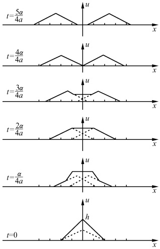
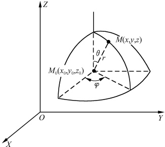
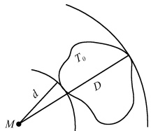
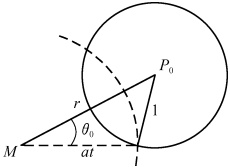

# 07-第七章 行波法

[返回全书目录](../../README.md)

> PDF 页码：128–146

<!-- page: 128 -->

## 第七章 行波法

我们已经熟悉常微分方程的求解，一般是先求方程的通解，再用初始条件去确定通解中的任意常数而得到特解。因此我们也想仿照这个方法来求解偏微分方程的定解问题。即先求偏微分方程的通解，再用定解条件确定通解中的任意常数或函数。但是偏微分方程的通解不那么容易求，用定解条件确定函数往往更加困难。通过分析，我们发现这种方法主要适用于求解（无界区域的）齐次波动方程的定解问题。齐次波动方程反映介质一经扰动后在区域里不再受到外力的运动规律。如果问题的区域是整个空间，由初始扰动所引起的振动就会一往无前地传播出去，形成行（进）波。故我们把这种主要适用于求解这类行波问题的方法称为行波法。本章将介绍这种方法。

### 7.1 无界弦的自由振动 达朗贝尔公式

让我们考虑无界弦的自由振动，这个问题既简单明了又具有代表性。其定解问题为

$$  \{u_{t t}=a^{2}u_{x x}\}   \tag*{(7.1.1)}$$

$$  u(x,0)=\varphi(x),\quad-\infty<x<\infty   \tag*{(7.1.2)}$$

$$  \begin{array}{l l}{u_{t}(x,0)=\psi(x),}&{-\infty<x<\infty}\end{array}   \tag*{(7.1.3)}$$

其中  $ \varphi(x) $、 $ \psi(x) $ 为已知函数。在上一章所提出的弦的横振动问题中，如果弦没有受到任何外力作用，而且我们只研究其中的一小段，那么在不太长的时间里，两端的影响都来不及传到，不妨认为两端都不存在，弦是“无限长”的。于是可提出（7.1.1）～（7.1.3）式这样的定解问题。“无限长”杆的自由纵振动，“无限长”理想传输线上的电流、电压的变化均提出与之相同的定解问题。

## 1. 一维齐次波动方程的通解

为了用行波法求解这一问题，我们首先要求出方程(7.1.1)式的通解。由(7.1.1)式我们有

$$  \left(\frac{\partial}{\partial t}+a\frac{\partial}{\partial x}\right)\left(\frac{\partial}{\partial t}-a\frac{\partial}{\partial x}\right)u=0   \tag*{(7.1.4)}$$

因此，只要能找到两个微分算子 $ \frac{\partial}{\partial\xi} $和 $ \frac{\partial}{\partial\eta} $，使 $ \frac{\partial}{\partial\xi}=A\left(\frac{\partial}{\partial t}+a\frac{\partial}{\partial x}\right) $， $ \frac{\partial}{\partial\eta}=B\left(\frac{\partial}{\partial t}-a\frac{\partial}{\partial x}\right) $；A、B为常数，则方程(7.1.4)式就变为 $ u_{\xi\eta}=0 $，从而立即可求出其通解。为此，我们作变换 $ x=a(\xi+\eta) $， $ t=\xi-\eta $，此时有

 $$ \frac{\partial}{\partial\xi}=\frac{\partial}{\partial t}\frac{\partial t}{\partial\xi}+\frac{\partial}{\partial x}\frac{\partial x}{\partial\xi}=\frac{\partial}{\partial t}+a\frac{\partial}{\partial x} $$

<!-- page: 129 -->

$$ \frac{\partial}{\partial\eta}=\frac{\partial}{\partial t}\frac{\partial t}{\partial\eta}+\frac{\partial}{\partial x}\frac{\partial x}{\partial\eta}=-\left(\frac{\partial}{\partial t}-a\frac{\partial}{\partial x}\right) $$ 

于是方程(7.1.4)式变为

$$  u_{\xi\eta}=0   \tag*{(7.1.5)}$$

为了以后书写形式的简便和对称，我们也不妨将上述变换修改为  $ x=\frac{1}{2}(\xi+\eta) $， $ t=\frac{1}{2a}(\xi-\eta) $，即作变换

$$  \left\{\begin{array}{l}\xi=x+at\\\eta=x-at\end{array}\right.   \tag*{(7.1.6)}$$

此时，(7.1.5)式显然仍然成立.对于方程(7.1.5)式先对 $ \eta $求积分得

 $$ u_{\xi}=c(\xi) $$ 

其中， $ c(\xi) $为 $ \xi $的任意函数。将上式再对 $ \xi $求积分，得

 $$ u=\int c(\boldsymbol{\xi})\mathrm{d}\boldsymbol{\xi}=f_{1}(\boldsymbol{\xi})+f_{2}(\boldsymbol{\eta}) $$ 

其中  $ f_{1}(\xi) $、 $ f_{2}(\eta) $ 分别是  $ \xi $、 $ \eta $ 的任意函数。把变换 (7.1.6) 式代入上式，就得方程 (7.1.1) 式的通解

$$  u(x,t)=f_{1}(x+at)+f_{2}(x-at)   \tag*{(7.1.7)}$$

## 2. 达朗贝尔( $ D^{\prime}Alembert $)公式

下面我们利用初始条件(7.1.2)和(7.1.3)式来确定通解(7.1.7)式中的任意函数 $ f_{1} $和 $ f_{2} $.将(7.1.7)式代入(7.1.2)式，有

代入7.1.3式有

 $$ u(x,0)=f_{1}(x)+f_{2}(x)=\varphi(x) $$ 

 $$ u_{t}(x,0)=a f_{1}^{\prime}(x)-a f_{2}^{\prime}(x)=\psi(x) $$ 

即

 $$ f_{1}(x)-f_{2}(x)=\frac{1}{a}\int_{x_{0}}^{x}\psi(\alpha)\mathrm{d}\alpha+c $$ 

于是可求得

 $$ f_{1}(x)=\frac{1}{2}\varphi(x)+\frac{1}{2a}\int_{x_{0}}^{x}\psi(\alpha)\mathrm{d}\alpha+\frac{c}{2} $$ 

 $$ f_{2}(x)=\frac{1}{2}\varphi(x)-\frac{1}{2a}\int_{x_{0}}^{x}\psi(\alpha)\mathrm{d}\alpha-\frac{c}{2} $$ 

将求得的  $ f_{1}(x) $ 和  $ f_{2}(x) $ 中的 x 分别换成  $ x+at $ 和 x-at 后一并代入通解 (7.1.7) 式即得

$$  u(x,t)=\frac{1}{2}\left[\varphi(x+at)+\varphi(x-at)\right]+\frac{1}{2a}\int_{x-at}^{x+at}\psi(\alpha)\mathrm{d}\alpha   \tag*{(7.1.8)}$$

这就是达朗贝尔公式或称为达朗贝尔解. 它是无界弦的自由振动, 即定解问题  $ (7.1.1)\sim(7.1.3) $ 式的特解.

#### 例 1 求解初值问题

<!-- page: 130 -->

$$ \left\{\begin{aligned}u_{tt}&=a^{2}u_{xx}\\ u\mid_{t=0}&=\cos x,u_{t}\mid_{t=0}=2\end{aligned}\right. $$ 

解 此时  $ \varphi(x)=\cos x,\psi(x)=2 $ 故由达氏公式(7.1.8)式有

 $$ \begin{align*}u(x,t)&=\frac{1}{2}\big[\cos(x+at)+\cos(x-at)\big]+\frac{1}{2a}\int_{x-at}^{x+at}2\mathrm{d}\alpha\\&=\cos x\cos at+2t\end{align*} $$ 

## 3. 达朗贝尔解的适定性

易于验证，只要  $ \varphi $ 有直到二阶的连续导数， $ \psi $ 有一阶的连续导数，达朗贝尔解是满足方程(7.1.1)和初始条件(7.1.2)、(7.1.3)式的，即达朗贝尔解是存在的。又从求解的方法已看到，通解(7.1.7)式中的任意函数已由初始条件(7.1.2)、(7.1.3)式完全确定，故达朗贝尔解是唯一的。现在来证明达朗贝尔解的稳定性。设初始条件有两组，且它们相差很小，即

 $$ u\mid_{t=0}=\left\{\begin{aligned}&\varphi_{1}(x)\\ &\varphi_{2}(x)\end{aligned}\right.,\quad u_{t}\mid_{t=0}=\left\{\begin{aligned}&\psi_{1}(x)\\ &\psi_{2}(x)\end{aligned}\right. $$ 

 $$ \mid\varphi_{1}-\varphi_{2}\mid<\delta,\quad\mid\psi_{1}-\psi_{2}\mid<\delta $$ 

则由达朗贝尔公式(7.1.8)有

 $$ \begin{aligned}\mid u_{1}-u_{2}\mid\leqslant\frac{1}{2}\mid\varphi_{1}(x+at)-\varphi_{2}(x+at)\mid+\frac{1}{2}\mid\varphi_{1}(x-at)-\varphi_{2}(x-at)\mid\\+\frac{1}{2a}\int_{x-at}^{x+at}\mid\psi_{1}(\alpha)-\psi_{2}(\alpha)\mid\mathrm{d}\alpha<\frac{1}{2}\delta+\frac{1}{2}\delta+\frac{\delta}{2a}\int_{x-at}^{x+at}\mathrm{d}\alpha\end{aligned} $$ 

即

 $$ |u_{1}-u_{2}|<\delta(1+t) $$ 

所以，在有限的时间内，当初始条件有了微小改变时，其解也只有微小改变，即达朗贝尔解是稳定的。

综上所述，达朗贝尔解是适定的。

## 4. 达朗贝尔解的物理意义

为方便起见，我们先讨论初始条件只有初始位移的情况下达朗贝尔解的物理意义。此时(7.1.8)式给出

 $$ u(x,t)=\frac{1}{2}\big[\varphi(x+at)+\varphi(x-at)\big] $$ 

先看第二项，当 t=0 时，在 x=c 处观察者看到的波形为

 $$ \varphi(x-at)=\varphi(c-a\bullet0)=\varphi(c) $$ 

若观察者以速度 a 沿 x 轴的正向运动，则 t 时刻在 x = c + at 处，他所看到的波形为

 $$ \varphi(x-at)=\varphi(c+at-at)=\varphi(c) $$ 

由于 t 为任意时刻，这说明观察者在运动过程中随时可看到相同的波形  $ \varphi(c) $，可见，

<!-- page: 131 -->

波形和观察者一样，以速度a沿x轴正向传播。所以， $ \varphi(x-at) $ 代表以速度a沿x轴正向传播的波，称为正行波。而第一项的 $ \varphi(x+at) $则当然代表以速度a沿x轴负向传播的波，称为反行波。正行波和反行波的叠加（相加）就给出弦的位移。

再讨论只有初速度的情况. 此时(7.1.8)式给出

 $$ u(x,t)=\frac{1}{2a}\int_{x-at}^{x+at}\psi(\alpha)\mathrm{d}\alpha $$ 

设  $ \Psi(x) $ 为  $ \frac{\psi(x)}{2a} $ 的一个原函数，即

 $$ \Psi(x)=\frac{1}{2a}\int_{x_{0}}^{x}\psi(\alpha)\mathrm{d}\alpha $$ 

 $$ u(x,t)=\Psi(x+at)-\Psi(x-at) $$ 

则此时有

由此可见第一项也是反行波，第二项也是正行波，正、反行波的叠加（相减）给出弦的位移.

综上所述，达朗贝尔解表示正行波和反行波的叠加。

例2 设初速度  $ \psi(x) $ 为零，初位移为

 $$ \varphi(x)=\left\{\begin{aligned}&0,&x&<&-\alpha\\ &2+\frac{2x}{\alpha},&-\alpha&\leqslant&x\leqslant&0\\ &2-\frac{2x}{\alpha},&0&\leqslant&x\leqslant&\alpha\\ &0,&x&>\alpha\end{aligned}\right. $$ 

则此时达朗贝尔解（7.1.8）式给出了弦的位移为

 $$ u=\frac{1}{2}[\varphi(x+at)+\varphi(x-at)] $$ 

即初始位移(图7.1最下一图的实线)，它分为两半(该图虚线)，分别向左右两方以速度a移动(见图7.1中由下而上的各图中的虚线)，每经过时间间隔 $ \frac{\alpha}{4a} $，弦的位移由此二行波的和给出(见图7.1中由下而上的各图的实线).

由本节的学习我们看到，行波法的求解出发点，是基于波动现象的特点为背景的变量变换。它所采用的是与求解常微分方程一样的先

图7.1
 

求通解，再用定解条件定特解的方法，故其思路上易于理解，且用之研究波动问题也很方便。但由于一般而言，偏微分方程的通解不易求，用定解条件定特解有时也十分困难，这就使得这种解法有相当大的局限性，我们一般只用它求解波动问题。

<!-- page: 132 -->

#### 习题7.1

1. 确定下列初值值问题的解：

(1)  $ u_{tt} - a^{2}u_{xx} = 0 $,  $ u(x,0) = 0 $,  $ u_{t}(x,0) = 1 $;

 $$ u_{t t}-a^{2}u_{x x}=0,\quad u(x,0)=\sin x,\quad u_{t}(x,0)=x^{2}; $$ 

(3)  $ u_{tt} - a^{2}u_{xx} = 0 $,  $ u(x,0) = x^{3} $,  $ u_{t}(x,0) = x $;

 $$ u_{t t}-a^{2}u_{x x}=0,\quad u(x,0)=\cos x,\quad u_{t}(x,0)=\mathrm{e}^{-1}. $$ 

2. 求解无界弦的自由振动，设弦的初始位移为  $ \varphi(x) $，初始速度为  $ -a\varphi'(x) $.

3. 求解弦振动方程的古沙问题

 $$ \left\{\begin{aligned}&u_{t t}=u_{x x}\\ &u(x,-x)=\varphi(x),\quad-\infty<x<\infty\\ &u(x,x)=\psi(x),\quad-\infty<x<\infty\end{aligned}\right. $$ 

4. 求解无限长理想传输线上电压和电流的传播情况. 设初始电压分布为 Acoskx，初始电流分布为  $ \sqrt{\frac{C}{L}}Acoskx $ (参考习题 6.2 第 9 题，注意  $ V_{x} = -LI_{t}, I_{x} = -CV_{t} $).

5. 细圆锥杆的纵振动的方程为

 $$ u_{t t}=a^{2}\left(u_{x x}+\frac{2}{x}u_{x}\right) $$ 

试求其通解.

提示：令  $ v(x,t)=xu(x,t) $

6. 试求出方程

 $$ \frac{\partial}{\partial x}\bigg[\left(1-\frac{x}{h}\right)^{2}\frac{\partial u}{\partial x}\bigg]=\frac{1}{a^{2}}\left(1-\frac{x}{h}\right)^{2}\frac{\partial^{2}u}{\partial t^{2}} $$ 

的通解.

 $$ u=\left[f_{1}(x-at)+f_{2}(x+at)\right]/(h-x) $$ 

其中，h 为已知常数， $ f_{1} $、 $ f_{2} $ 为充分光滑的任意函数。若

 $$ \left\{\begin{aligned}u(x,0)&=\varphi(x),&-\infty<x<\infty\\ u_{t}(x,0)&=\psi(x),&-\infty<x<\infty\end{aligned}\right. $$ 

求其特解.

提示：令  $ v(x,t)=(h-x)u(x,t) $.

7. 求下列偏微分方程的通解：

 $$ u_{x x}-2u_{x y}-3u_{y y}=0;\quad(2)u_{x x}-u_{x y}=0. $$ 

8. 解下列初值问题：

 $$ \left\{\begin{aligned}&u_{xx}+2u_{xy}-3u_{yy}=0\\ &u(x,0)=\sin x\\ &u_{y}(x,0)=x\end{aligned}\right. $$ 

9. 用行波法证明

 $$ \begin{cases}u_{tt}-a^{2}u_{xx}=0\\u(ct,t)=\varphi(t)\\u_{x}(ct,t)=\psi(t)\end{cases} $$

<!-- page: 133 -->

的解为

 $$ u=\frac{a+c}{2a}\varphi\left(\frac{a t+x}{a+c}\right)+\frac{a-c}{2a}\varphi\left(\frac{a t-x}{a-c}\right)+\frac{a^{2}-c^{2}}{2a}\int_{a t-x/a-c}^{a t+x/a+c}\psi(\xi)\mathrm{d}\xi,\quad c\neq\pm a $$ 

10. 试求一端固定的半无界弦的自由振动问题

 $$ \begin{cases}u_{tt}=a^{2}u_{xx}\\u(x,0)=\varphi(x),&0\leqslant x<\infty\\u_{t}(x,0)=\psi(x),&0\leqslant x<\infty\\u(0,t)=0,&t>0\end{cases} $$ 

并讨论其解所具有的物理意义.

11. 一根无限长的弦与 x 轴的正半轴重合，处于平衡状态中，左端位于原点，当 t > 0 时左端点作微小横振动  $ A \sin \omega t $，试求弦的振动规律.

12. 半无限长的杆，其端点受到纵向力  $ F(t)=A\sin\omega t $ 作用，求解杆的纵振动.

13. 平面偏振的平面光波沿 x 轴行进而垂直地投射于两种介质的分界面上. 入射光波的电场强度  $ E = E_{0} \sin \omega \left( t - \frac{n_{1}}{a} x \right) $，其中  $ n_{1} $ 是第一种介质的折射率，求反射光波和透射光波.

提示: 在分界面上, E 和  $ \frac{\partial E}{\partial x} $ 均连续.

### 7.2 无界弦的强迫振动

以上所讨论的只限于自由振动，其泛定方程均为齐次的。现在让我们来考虑无界弦或杆的纯强迫振动，即

$$  u_{t t}-a^{2}u_{x x}=f(x,t)   \tag*{(7.2.1)}$$

 $$ u\mid_{t=0}=0 $$ 

$$  u_{t}\mid_{t=0}=0   \tag*{(7.2.3)}$$

这时泛定方程是非齐次的。由前面的讨论我们想到，若能设法将方程的非齐次项消除掉（即将方程变为齐次方程），则便可利用7.1节中的达朗贝尔公式而得到此定解问题的解。为此，我们引入冲量原理。

## 1. 冲量原理

我们知道，(7.2.1)式中的  $ f(x,t)=\frac{\Gamma(x,t)}{\rho} $ 是单位质量的弦上所受的外力，这是一从时刻 t=0，一直延续到时刻 t 的持续作用力。由物理学中的叠加原理 $ ^{①} $，我们可将持续力  $ f(x,t) $ 所引起的振动[即定解问题(7.2.1)~(7.2.3)式的解]，视为一系列前后相继的瞬时力  $ f(x,\tau)(0\leqslant\tau\leqslant t) $ 所引起的振动  $ w(x,t;\tau) $ 的叠加。即

 $$ \begin{array}{r}{u(x,t)=\operatorname*{l i m}_{\Delta\tau\to0}\displaystyle\sum_{\tau=0}^{t}w(x,t;\tau)}\end{array} $$ 

现在，我们来分析瞬时力  $ f(x,\tau) $ 所引起的振动是怎样的。从物理的角度考虑，力对系统的作用对于时间的累积是给系统一定的冲量。我们考虑在短时间间隔  $ \Delta\tau $ 内

<!-- page: 134 -->

$ f(x,\tau) $ 对系统的作用，则  $ f(x,\tau)\Delta\tau $ 表示在  $ \Delta\tau $ 内的冲量。这个冲量使得系统的动量即系统的速度有一改变量[因为  $ f(x,t) $ 是单位质量弦所受外力，故动量在数值上等于速度]。若我们把在时间  $ \Delta\tau $ 内得到的速度改变量看成是在  $ t=\tau $ 时刻的一瞬间集中得到的，而在  $ \Delta\tau $ 的其余时间则认为没有冲量的作用，即没有外力的作用，则在  $ \Delta\tau $ 这段时间内，瞬时力  $ f(x,\tau) $ 所引起的振动的定解问题可表示为

 $$ \left\{\begin{aligned}&w_{t t}-a^{2}w_{x x}=0,\quad\tau<t<\tau+\Delta\tau\\ &w\mid_{t=\tau}=0\\ &w_{t}\mid_{t=\tau}=f(x,\tau)\Delta\tau\end{aligned}\right. $$ 

为了便于求解，设

 $$ w(x,t;\tau)=v(x,t;\tau)\triangle\tau $$ 

则有

 $$ v_{t t}-a^{2}v_{x x}=0 $$ 

$$  v\mid_{t=\tau}=0   \tag*{(7.2.5)}$$

$$  v_{t}\mid_{t=\tau}=f(x,\tau)   \tag*{(7.2.6)}$$

由上述分析可看出，欲求解纯强迫振动即定解问题(7.2.1)～(7.2.3)式，只要求解定解问题(7.2.4)～(7.2.6)式即可，而

 $$ u(x,t)=\lim_{\Delta\tau\to0}\sum_{\tau=0}^{t}w(x,t;\tau)=\lim_{\Delta\tau\to0}\sum_{\tau=0}^{t}v(x,t;\tau)\Delta\tau $$ 

即

$$  u(x,t)=\int_{0}^{t}v(x,t;\tau)\mathrm{d}\tau   \tag*{(7.2.7)}$$

以上这种用瞬时冲量的叠加代替持续作用力来解决定解问题(7.2.1)~(7.2.3)式的方法，称为冲量原理.

冲量原理的合理性，我们也可在数学上予以严格的证明。由（7.2.7）式有

 $$ \begin{aligned}&u_{t}=\int_{0}^{t}v_{t}\mathrm{d}\tau+v(x,t;\tau)\mid_{\tau=t}=\int_{0}^{t}v_{t}\mathrm{d}\tau^{\textcircled{2}}\\&u_{tt}=\int_{0}^{t}v_{tt}\mathrm{d}\tau+v_{t}\mid_{\tau=t}=\int_{0}^{t}v_{tt}\mathrm{d}\tau+f(x,t)\\&u_{xx}=\int_{0}^{t}v_{xx}\mathrm{d}\tau\\ \end{aligned} $$ 

代入方程(7.2.1)式和定解条件(7.2.2)、(7.2.3)式均满足.

## 2. 纯强迫振动的解

对于定解问题(7.2.4)～(7.2.6)式，令 $ T=t-\tau $，则有

 $$ \left\{\begin{array}{l}v_{T T}-a^{2}v_{x x}=0\\ v\mid_{T=0}=0\\ v_{T}\mid_{T=0}=f(x,\tau)\end{array}\right. $$ 

故由达朗贝尔公式(7.1.8)有

<!-- page: 135 -->

$$ v(x,t;\tau)=\frac{1}{2a}\int_{x-aT}^{x+aT}f(\alpha,\tau)\mathrm{d}\alpha=\frac{1}{2a}\int_{x-a(t-\tau)}^{x+a(t-\tau)}f(\alpha,\tau)\mathrm{d}\alpha $$ 

代入7.2.7式得

$$  u(x,t)=\frac{1}{2a}\int_{0}^{t}\int_{x-a(t-\tau)}^{x+a(t-\tau)}f(\alpha,\tau)\mathrm{d}\alpha\mathrm{d}\tau   \tag*{(7.2.8)}$$

此即纯强迫振动的解.

例 求解初值问题

 $$ \left\{\begin{array}{l}u_{t t}=u_{x x}+x\\ u(x,0)=0\\ u_{t}(x,0)=0\end{array}\right. $$ 

解 此处 a=1,  $ f(x,t)=x $, 故由(7.2.8)式有

 $$ \begin{align*}u(x,t)&=\frac{1}{2}\int_{0}^{t}\int_{x-(t-\tau)}^{x+(t-\tau)}\alpha\mathrm{d}\alpha\mathrm{d}\tau\\&=\frac{1}{4}\int_{0}^{t}\left\{\left[x+(t-\tau)\right]^{2}-\left[x-(t-\tau)\right]^{2}\right\}\mathrm{d}\tau\\&=\frac{1}{2}xt^{2}\end{align*} $$ 

## 3. 一般强迫振动

对于一般强迫振动，其定解问题为

$$  u_{t t}-a^{2}u_{x x}=f(x,t)   \tag*{(7.2.9)}$$

$$  u\mid_{t=0}=\varphi(x)   \tag*{(7.2.10)}$$

$$  u_{t}\mid_{t=0}=\psi(x)   \tag*{(7.2.11)}$$

由于泛定方程和定解条件都是线性的，故我们可以利用叠加原理来处理这一问题。

令

$$  u=u^{1}+u^{11}   \tag*{(7.2.12)}$$

并使  $ u^{1} $ 满足

$$  u_{tt}^{1}-a^{2}u_{xx}^{1}=0   \tag*{（7.2.13）}$$

$$  u^{\mathrm{I}}\mid_{t=0}=\varphi(x)   \tag*{(7.2.14)}$$

$$  u_{t}^{\mathrm{I}}\mid_{t=0}=\psi(x)   \tag*{（7.2.15）}$$

使 $ u^{||} $满足

$$  u_{t t}^{\mathbb{I}}-a^{2}u_{x x}^{\mathbb{I}}=f(x,t)   \tag*{(7.2.16)}$$

$$  u^{\mathbb{I}}\mid_{t=0}=0   \tag*{(7.2.17)}$$

$$  u_{t}^{\mathbb{I}}\mid_{t=0}=0   \tag*{（7.2.18）}$$

则(7.2.13)式加(7.2.16)式即为(7.2.9)式；(7.2.14)式加(7.2.17)式即为(7.2.10)式；(7.2.15)式加(7.2.18)式即为(7.2.11)式。故要求解定解问题(7.2.9)～(7.2.11)式只须求解定解问题(7.2.13)～(7.2.15)式和定解问题(7.2.16)～

<!-- page: 136 -->

(7.2.18)式即可. 定解问题(7.2.13)式～(7.2.15)式的解  $ u^{\mathrm{I}}(x,t) $ 可由达氏公式 (7.1.8) 给出；而定解问题 (7.2.16) 式～(7.2.18) 式的解  $ u^{\mathrm{II}}(x,t) $，由上面的 (7.2.8) 式给出. 故一般强迫振动的解为

$$  \begin{align*}u(x,t)=&u^{\mathrm{I}}+u^{\mathrm{II}}=\frac{1}{2}\big[\varphi(x+at)+\varphi(x-at)\big]\\&+\frac{1}{2a}\int_{x-at}^{x+at}\psi(\alpha)\mathrm{d}\alpha+\frac{1}{2a}\int_{0}^{t}\int_{x-a(t-\tau)}^{x+a(t-\tau)}f(\alpha,\tau)\mathrm{d}\alpha\mathrm{d}\tau\end{align*}   \tag*{(7.2.19)}$$

注 ①叠加原理 在物理学的研究中常常将几种不同原因的综合所产生的效果，用这些不同原因单独产生的效果（即假设其他原因不存在时，该原因所产生的效果）的累加来代替，这个原理称为叠加原理.

物理学中的叠加原理，在数理方法中具体反映在泛定方程和定解条件上，设L为线性微分算符，则线性微分方程和线性定解条件均可表示为

 $$ \mathbf{L}u=f $$ 

如， $ u_{tt}-a^{2}u_{xx}=0 $，即 $ \left(\frac{\partial^{2}}{\partial t^{2}}-a^{2}\frac{\partial^{2}}{\partial x^{2}}\right)u=0 $，亦即L_{u}=0。其中， $ L=\frac{\partial^{2}}{\partial t^{2}}-a^{2}\frac{\partial^{2}}{\partial x^{2}} $，f=0。又如， $ u_{t}|_{t=0}=0 $即 $ \frac{\partial}{\partial t}u(x,0)=0 $，亦即 $ Lu(x,0)=0 $，其中， $ L=\frac{\partial}{\partial t} $，f=0。易于证明：

（1）若  $ u_{i} $ 满足线性方程或线性定解条件

 $$ \mathbf{L}u_{i}=f_{i},\quad i=1,2,\cdots,n $$ 

则它们的线性组合  $ u=\sum_{i=1}^{n}c_{i}u_{i} $ 也必满足方程或定解条件，即

 $$ \mathbf{L}u=\sum_{i=1}^{n}c_{i}f_{i} $$ 

其中 $ c_{i} $为常数（下同）.

（2）若  $ u_{i} $ 满足线性方程或线性定解条件

 $$ \mathbf{L}u_{i}=f_{i},\quad i=1,2,\cdots,n,\cdots $$ 

且它们的线性组合  $ u=\sum_{i=1}^{\infty}c_{i}u_{i} $ 一致收敛，则 u 也满足方程或定解条件，即

 $$ \mathbf{L}u=\sum_{i=1}^{\infty}c_{i}f_{i} $$ 

（3）设 $ u(M,M_{0}) $满足线性方程或定解条件

 $$  Lu=f(M,M_{0}) $$ 

其中  $ M_{0} $ 为参数. 又假设  $ \boldsymbol{U}(\boldsymbol{M})=\int\boldsymbol{u}(\boldsymbol{M},\boldsymbol{M}_{0})\mathrm{d}\boldsymbol{M}_{0} $ 一致收敛，则  $ \boldsymbol{U}(\boldsymbol{M}) $ 也满足方程或定解条件，即

 $$ \mathbf{L}U=\int f(\boldsymbol{M},\boldsymbol{M}_{0})\mathrm{d}\boldsymbol{M}_{0} $$ 

由此看出，服从叠加原理的物理现象，所对应的泛定方程或定解条件应该是线性的。这是显然的，因为叠加就是累加，对于可列个是求和，不可列个是求积分；而只有线性方程（或定解条件）才满足可加性，这就是线性的定义。

由于物理上的很多问题都可以归结为线性方程或线性定解条件，这使得叠加原理在数理方法中应用很广，无论是本章还是以后各章都要用到它。特别是我们常常将数理方程的解表示为可列

<!-- page: 137 -->

个函数的叠加（即级数）或不可列个函数的叠加（即带参数的积分）的形式.

②这里，引用了含参变量积分的求导公式

 $$ \frac{\partial}{\partial t}\int_{x\neg_{at}}^{x+at}\psi(\alpha)\mathrm{d}\alpha=\int_{x\neg_{at}}^{x+at}\frac{\partial\psi}{\partial t}\mathrm{d}\alpha+\psi(x+at)\frac{\mathrm{d}(x+at)}{\mathrm{d}t}-\psi(x-at)\frac{\mathrm{d}(x-at)}{\mathrm{d}t} $$ 

##### 习题7.2

1. 求解下列定解问题：

(1)

 $$ \begin{cases}u_{tt}-a^{2}u_{xx}=x+at\\u(x,0)=0\\u_{t}(x,0)=0\end{cases}; $$ 

(2)

 $$ \left\{\begin{aligned}u_{xx}-u_{yy}&=8\\ u(x,0)&=0\\ u_{y}(x,0)&=0\end{aligned}\right., $$ 

2. 求解下列定解问题：

(1)

 $$ \left\{\begin{aligned}u_{tt}&=u_{xx}+t\sin x\\ u(x,0)&=0\\ u_{t}(x,0)&=\sin x\end{aligned}\right.; $$ 

(2)

 $$ \begin{cases}u_{xx}-u_{yy}=1\\u(x,0)=\sin x;\\u_{y}(x,0)=x\end{cases} $$ 

(3)

 $$ \begin{cases}u_{tt}-a^{2}u_{xx}=x\\u(x,0)=0\\u_{t}(x,0)=3\end{cases}; $$ 

(4)

 $$ \left\{\begin{aligned}u_{tt}&-a^{2}u_{xx}=x\mathrm{e}^{t}\\ u(x,0)&=\sin x\\ u_{t}(x,0)&=0\end{aligned}\right., $$ 

3. 设  $ v(x, y, t; \tau) $ 是初值问题

 $$ \left\{\begin{aligned}&v_{t t}=a^{2}(v_{x x}+v_{y y}),\quad t>\tau\geqslant0\\ &v\mid_{t=\tau}=0\\ &v_{t}\mid_{t=\tau}=f(x,y;\tau)\end{aligned}\right. $$ 

的解，证明

 $$ u(x,y,t)=\int_{0}^{t}v(x,y,t;\tau)\mathrm{d}\tau $$ 

是非齐次方程零值初值问题

 $$ \left\{\begin{array}{l}u_{t t}=a^{2}(u_{x x}+u_{y y})+f(x,y;t)\\ u\mid_{t=0}=0\\ u_{t}\mid_{t=0}=0\end{array}\right. $$ 

的解.

4. 试推导出二维非齐次波动方程初值问题

 $$ \left\{\begin{array}{l}u_{t t}=a^{2}(u_{x x}+u_{y y})+f(x,y;t),\quad-\infty<x,y<+\infty;t>0\\ u\mid_{t=0}=\varphi(x)\\ u_{t}\mid_{t=0}=\psi(x)\end{array}\right. $$ 

的解的表达式为

 $$ u(x,y,t)=\frac{1}{2\pi a}\left[\frac{\partial}{\partial t}\iint_{\sigma_{at}^{M}}^{}\frac{\varphi(\xi,\eta)\mathrm{d}\xi\mathrm{d}\eta}{\sqrt{(at)^{2}-(\xi-x)^{2}-(\eta-y)^{2}}}+\iint_{\sigma_{at}^{M}}^{}\frac{\varphi(\xi,\eta)\mathrm{d}\xi\mathrm{d}\eta}{\sqrt{(at)^{2}-(\xi-x)^{2}-(\eta-y)^{2}}}\right] $$ 

###  $ ^{*} $7.3 三维无界空间的自由振动 泊松公式

现在我们讨论三维空间的波动问题

<!-- page: 138 -->

$$  u_{t t}=a^{2}\triangle u   \tag*{(7.3.1)}$$

$$  u\mid_{t=0}=\varphi(M),\quad-\infty<x,y,z<\infty   \tag*{(7.3.2)}$$

$$  u_{t}\mid_{t=0}=\psi(M),\quad-\infty<x,y,z<\infty   \tag*{(7.3.3)}$$

其中 M 代表空间中任意一点。在 7.1 节中我们已比较详细的讨论过如何用行波法来求解一维的波动问题，因此我们自然想到，若能通过某种方法将三维的波动问题化为一维的波动问题，则便可借助于 7.1 节的结果或仿照 7.1 节的方法来求得三维波动问题的解。为此，我们引入平均值的方法。

## 1. 平均值法

我们引入函数

$$  \bar{u}(r,t)=\frac{1}{4\pi r^{2}}\iint_{S_{r}^{M_{0}}}u(M,t)\mathrm{d}s=\frac{1}{4\pi}\iint_{S_{r}^{M_{0}}}u(M,t)\mathrm{d}\Omega   \tag*{(7.3.4)}$$

称之为函数  $ u(M,t) $ 在以  $ M_{0} $ 为中心，r 为半径的球面  $ S_{r}^{M_{0}} $ 上的平均值。其中  $ \mathrm{d}\Omega=\frac{\mathrm{d}s}{r^{2}}=\sin\theta\mathrm{d}\theta\mathrm{d}\varphi $ 为立体角元。显然， $ \bar{u}(r,t) $ 只是独立变量 r 和 t 的函数。 $ M_{0} $ 是一个参量，而且很容易看出  $ \bar{u}(r,t) $ 和我们所要求的  $ u(M_{0},t_{0}) $ 有很紧密的联系

 $$ u(M_{0},t_{0})=\lim_{r\to0}\bar{u}(r,t_{0}) $$ 

图7.2
 

因此，欲求波动方程(7.3.1)的解  $ u(M,t) $ 在任意一点  $ M_{0} $，任意时刻  $ t_{0} $ 的值  $ u(M_{0},t_{0}) $，只要先求  $ u(M,t) $ 在  $ t_{0} $ 时刻，以  $ M_{0} $ 为中心，r 为半径的球面  $ S_{r}^{M_{0}} $ 上的平均值，再令  $ r\to0 $ 即可。这种处理问题的方法称为平均值法。注意，如图7.2所示，这里各坐标变量之间的关系为

$$  \begin{aligned}&\left\{\begin{aligned}x&=x_{0}+r\sin\theta\cos\varphi\\y&=y_{0}+r\sin\theta\sin\varphi\\z&=z_{0}+r\cos\theta\end{aligned}\right.\\ &\frac{(x-x_{0})^{2}+(y-y_{0})^{2}+(z-z_{0})^{2}}{}\\ \end{aligned}   \tag*{(7.3.6)}$$

## 2. 三维齐次波动方程的通解

为了用平均值法求解三维的波动问题，我们对(7.3.1)式两边在球面 $ S_{r}^{M_{0}} $ 上积分并乘以常数因子 $ \frac{1}{4\pi} $，则得

 $$ \frac{1}{4\pi}\iint_{S_{r}^{M_{0}}}u_{u}\mathrm{d}\Omega=\frac{a^{2}}{4\pi}\iint_{S_{r}^{M_{0}}}\Delta u\mathrm{d}\Omega $$

<!-- page: 139 -->

即

 $$ \frac{\partial^{2}}{\partial t^{2}}\Big(\frac{1}{4\pi}\iint_{S_{r}^{M_{0}}}u\mathrm{d}\Omega\Big)=a^{2}\Delta\Big(\frac{1}{4\pi}\iint_{S_{r}^{M_{0}}}u\mathrm{d}\Omega\Big) $$ 

亦即

$$  \frac{\partial^{2}}{\partial t^{2}}\bar{u}(r,t)=a^{2}\Delta\bar{u}(r,t)   \tag*{(7.3.7)}$$

又因为在直角坐标系中

 $$ \Delta\bar{u}=\frac{\partial^{2}\bar{u}}{\partial x^{2}}+\frac{\partial^{2}\bar{u}}{\partial y^{2}}+\frac{\partial^{2}\bar{u}}{\partial z^{2}} $$ 

由变量 x 和 r 的关系 (7.3.6) 我们有

 $$ \begin{aligned}\frac{\partial\bar{u}}{\partial x}&=\frac{\partial\bar{u}}{\partial r}\frac{\partial r}{\partial x}\\&=\frac{\partial\bar{u}}{\partial r}\bullet\frac{\partial}{\partial x}\sqrt{(x-x_{0})^{2}+(y-y_{0})^{2}+(z-z_{0})^{2}}\\&=\frac{\partial\bar{u}}{\partial r}\bullet\frac{x-x_{0}}{r}\end{aligned} $$ 

所以

 $$ \begin{aligned}\frac{\partial^{2}\bar{u}}{\partial x^{2}}&=\frac{\partial}{\partial r}\Big(\frac{\partial\bar{u}}{\partial r}\bullet\frac{x-x_{0}}{r}\Big)\bullet\frac{\partial r}{\partial x}\\&=\frac{\partial\bar{u}}{\partial r}\frac{r^{2}-(x-x_{0})^{2}}{r^{3}}+\frac{\partial^{2}\bar{u}}{\partial r^{2}}\frac{(x-x_{0})^{2}}{r^{2}}\end{aligned} $$ 

类似的可得

 $$ \frac{\partial^{2}\bar{u}}{\partial y^{2}}=\frac{\partial\bar{u}}{\partial r}\frac{r^{2}-(y-y_{0})^{2}}{r^{3}}+\frac{\partial^{2}\bar{u}}{\partial r^{2}}\frac{(y-y_{0})^{2}}{r^{2}} $$ 

 $$ \frac{\partial^{2}\overline{u}}{\partial z^{2}}=\frac{\partial\overline{u}}{\partial r}\frac{r^{2}-(z-z_{0})^{2}}{r^{3}}+\frac{\partial^{2}\overline{u}}{\partial r^{2}}\frac{(z-z_{0})^{2}}{r^{2}} $$ 

故有

 $$ \begin{align*}\Delta\bar{u}&=\frac{\partial^{2}\bar{u}}{\partial x^{2}}+\frac{\partial^{2}\bar{u}}{\partial y^{2}}+\frac{\partial^{2}\bar{u}}{\partial z^{2}}=\frac{\partial\bar{u}}{\partial r}\frac{3r^{2}-r^{2}}{r^{3}}+\frac{\partial^{2}\bar{u}}{\partial r^{2}}\frac{r^{2}}{r^{2}}\\&=\frac{2}{r}\frac{\partial\bar{u}}{\partial r}+\frac{\partial^{2}\bar{u}}{\partial r^{2}}=\frac{1}{r}\frac{\partial^{2}}{\partial r^{2}}(r\bar{u})\end{align*} $$ 

代入7.3.7式得

即

 $$ \begin{aligned}\frac{\partial^{2}}{\partial t^{2}}\bar{u}&=\frac{a^{2}}{r}\frac{\partial^{2}}{\partial r^{2}}(r\bar{u})\\\frac{\partial^{2}}{\partial t^{2}}(r\bar{u})&=a^{2}\frac{\partial^{2}}{\partial r^{2}}(r\bar{u})\\v(r,t)&=r\bar{u}(r,t)\end{aligned} $$ 

令在上式中，

则得

 $$ v_{t t}=a^{2}v_{r r} $$ 

这与弦振动方程完全相似，由（7.1.7），其通解为

 $$ \begin{aligned}v(r,t)&=f_{1}(r+at)+f_{2}(r-at)\\\bar{u}(r,t)&=\frac{v(r,t)}{r}=\frac{f_{1}(r+at)+f_{2}(r-at)}{r}\end{aligned} $$ 

于是

<!-- page: 140 -->

注意到(7.3.8)式，立刻知

 $$ v(0,t)=0 $$ 

即

$$  f_{1}(at)+f_{2}(-at)=0   \tag*{(7.3.10)}$$

所以

 $$ \begin{aligned}u(M_{0},t_{0})&=\lim_{r\to0}\bar{u}(r,t_{0})=\lim_{r\to0}\frac{v(r,t_{0})}{r}\\&=\lim_{r\to0}\frac{f_{1}(r+at_{0})+f_{2}(r-at_{0})}{r}\\&=f_{1}^{\prime}(at_{0})+f_{2}^{\prime}(-at_{0})\\ \end{aligned} $$ 

此处最后一步用了洛必达法则. 而由(7.3.10)式有

 $$ f_{1}^{\prime}(at_{0})=f_{2}^{\prime}(-at_{0}) $$ 

故有

$$  u(M_{0},t_{0})=2f_{1}^{\prime}(at_{0})   \tag*{(7.3.11)}$$

此即波动方程(7.3.1)在任意时刻 $ t_{0} $，任意一点 $ M_{0} $处的解，其中 $ f_{1}^{\prime}(at_{0}) $为任意函数.

## 3. 泊松(Poisson)公式

为了得到方程(7.3.1)式满足初始条件(7.3.2)和(7.3.3)式的特解，我们需要用这两个初始条件来确定(7.3.11)式中的任意函数 $ f_{1}^{\prime}(at_{0}) $.为此，我们将(7.3.9)式两边乘以r后再分别对r和t求导

 $$ \begin{aligned}&\frac{\partial}{\partial r}(r\bar{u})=f_{1}^{\prime}(r+at)+f_{2}^{\prime}(r-at)\\&\frac{1}{a}\frac{\partial}{\partial t}(r\bar{u})=f_{1}^{\prime}(r+at)-f_{2}^{\prime}(r-at)\\ \end{aligned} $$ 

将此二式相加，并取 $ r=at_{0},t=0 $，则得

 $$ \begin{align*}2f_{1}^{\prime}(at_{0})=&\left[\frac{\partial}{\partial r}(r\bar{u})+\frac{1}{a}\frac{\partial}{\partial t}(r\bar{u})\right]_{r=at_{0}}\\=&\left[\frac{\partial}{\partial r}\Big(r\bullet\frac{1}{4\pi r^{2}}\iiint_{S_{r}^{M_{0}}}u\mathrm{d}s\Big)+\frac{1}{a}\frac{\partial}{\partial t}\Big(r\bullet\frac{1}{4\pi r^{2}}\iiint_{S_{r}^{M_{0}}}u\mathrm{d}s\Big)\right]_{r=at_{0}}\\=&\frac{1}{4\pi}\Big[\frac{\partial}{\partial r}\iiint_{S_{r}^{M_{0}}}\frac{u}{r}\mathrm{d}s+\frac{1}{a}\iiint_{S_{r}^{M_{0}}}\frac{u_{t}}{r}\mathrm{d}s\Big]_{r=at_{0}}\\=&\frac{1}{4\pi a}\Big[\frac{\partial}{\partial t_{0}}\iiint_{S_{at_{0}}^{M_{0}}}\frac{\varphi(M)}{at_{0}}\mathrm{d}s+\iiint_{S_{at_{0}}^{M_{0}}}\frac{\psi(M)}{at_{0}}\mathrm{d}s\Big]\end{align*} $$ 

将此结果代入(7.3.11)式，则得

 $$ u(M_{0},t_{0})=\frac{1}{4\pi a}\Big[\frac{\partial}{\partial t_{0}}\iint_{S_{a t_{0}}^{M_{0}}}\frac{\varphi(M)}{a t_{0}}\mathrm{d}s+\iint_{S_{a t_{0}}^{M_{0}}}\frac{\psi(M)}{a t_{0}}\mathrm{d}s\Big] $$ 

注意到  $ M_{0} $ 和  $ t_{0} $ 的任意性，故一般可写为

$$  u(M,t)=\frac{1}{4\pi a}\bigg[\frac{\partial}{\partial t}\iint_{S_{at}^{M}}\frac{\varphi(M^{\prime})}{at}\mathrm{d}s+\iint_{S_{at}^{M}}\frac{\psi(M^{\prime})}{at}\mathrm{d}s\bigg]   \tag*{(7.3.12)}$$

<!-- page: 141 -->

其中  $ M^{\prime} $ 表示以 M 为中心 at 为半径的球面  $ S_{at}^{M} $ 上的动点. (7.3.12) 式称为泊松公式，它给出了三维无界空间波动方程的初值问题的解.

泊松公式的物理意义很明显，它说明定解问题（7.3.1）～（7.3.3）式的解在M点

t 时刻之值，由以 M 为中心 at 为半径的球面  $ S_{at}^{M} $ 上的初始值而确定。显然，这是由于初值的影响是以速度 a 在时间 t 内从球面  $ S_{at}^{M} $ 上传播到 M 点的缘故。具体地来看，如图 7.3 所示，设初始扰动限于空间某个区域  $ T_{0} $，d 为 M 点到  $ T_{0} $ 的最近距离，D 为 M 点与  $ T_{0} $ 的最大距离，则

（1）当 at<d，即  $ t<\frac{d}{a} $ 时， $ S_{at}^{M} $ 与  $ T_{0} $ 不相交， $ \varphi(M^{\prime}) $ 和  $ \psi(M^{\prime}) $ 之值均为零，因而（7.3.12）式中的两个积分之值亦均为零，即  $ u(M,t)=0 $。这表示扰动的“前锋”尚未到达。

图7.3
 

（2）当 d<at<D，即 $ \frac{d}{a}<t<\frac{D}{a} $时， $ S_{at}^{M} $与 $ T_{0} $相交， $ \varphi(M^{\prime}) $、 $ \psi(M^{\prime}) $之值不为零，因而两积分之值亦不为零，即 $ u(M,t)\neq0 $，这表明扰动正在经过M点.

（3）当at>D，即 $ t>\frac{D}{a} $， $ S_{at}^{M} $与 $ T_{0} $也不相交，因而同样 $ u(M,t)=0 $，这表面扰动的“阵尾”已经过去了.

例1 设大气中有一个半径为1的球形薄膜，薄膜内的压强超过大气压的数值为 $ p_{0} $，假定该薄膜突然消失，将会在大气中激起三维波，试求球外任意位置的附加压强D.

解 如图 7.4 所示，设薄膜球球心到球外任意一点 M 的距离为 r，则其定解问题为

图7.4
 

 $$ \left\{\begin{aligned}&p_{_{t t}}-a^{2}\Delta p=0\\ &p\mid_{_{t=0}}=\left\{\begin{aligned}&p_{_{0}}&(r<1)\\ &0&(r>1)\end{aligned}\right.\\ &p_{_{t}}\mid_{_{t=0}}=0\end{aligned}\right. $$ 

当 r-1<at<r+1 时有

 $$ \begin{align*}\iint_{S_{at}^{M}}\frac{\varphi(M^{\prime})}{at}\mathrm{d}s=&\int_{0}^{2\pi}\mathrm{d}\varphi\int_{0}^{\theta_{0}}\frac{p_{_{0}}(at)^{2}\sin\theta\mathrm{d}\theta}{at}=2\pi p_{_{0}}at\left(1-\cos\theta_{0}\right)\\=&~2\pi p_{_{0}}at\left(1-\frac{r^{2}+a^{2}t^{2}-1}{2art}\right)\\=&-\frac{\pi p_{_{0}}}{r}[(r-at)^{2}-1]\end{align*} $$ 

注意  $ \psi(M^{\prime})=p_{t}|_{t=0}=0 $ 。故由泊松公式(7.3.12)式有

<!-- page: 142 -->

$$ \begin{align*}p(M,t)&=\frac{1}{4\pi a}\frac{\partial}{\partial t}\iint_{S_{at}^{M}}\frac{\varphi(M^{\prime})}{at}\mathrm{d}s\\&=\frac{1}{4\pi a}\frac{\partial}{\partial t}\Bigl(-\frac{\pi p_{0}}{r}\Bigr)\bigl[(r-at)^{2}-1\bigr]\\&=\frac{p_{0}}{2r}(r-at)\end{align*} $$ 

而当 at<r-1 和 at>r+1 时，由于  $ \varphi(M^{\prime}) $ 和  $ \psi(M^{\prime}) $ 均为零，故有  $ p(M,t)=0 $.

类似的，我们当然也可求得薄膜球内任意位置处的附加压强。

例2 求解定解问题 $ ^{①} $

 $$ \left\{\begin{aligned}&u_{t t}=a^{2}\Delta u\\ &u\mid_{t=0}=x^{3}+y^{2}z,\quad-\infty<x,y,z<\infty\\ &u_{t}\mid_{t=0}=0,\quad-\infty<x,y,z<\infty\\ \end{aligned}\right. $$ 

解  $ \varphi(M)=x^{3}+y^{2}z,\psi(M)=0 $. 注意到  $ M^{\prime} $ 和 M 的关系，则由(7.3.12)式有

 $$ \begin{aligned}u(M,t)&=\frac{1}{4\pi a}\frac{\partial}{\partial t}\iint_{S_{at}^{M}}\frac{\varphi(M^{\prime})}{at}\mathrm{d}s\\&=\frac{1}{4\pi a}\frac{\partial}{\partial t}\int_{0}^{2\pi}\int_{0}^{\pi}\frac{\varphi(x^{\prime},y^{\prime},z^{\prime})}{at}(at)^{2}\sin\theta\mathrm{d}\theta\mathrm{d}\varphi\\&=\frac{1}{4\pi}\frac{\partial}{\partial t}\left\{t\int_{0}^{2\pi}\int_{0}^{\pi}[(x+at\sin\theta\cos\varphi)^{3}+(y+at\sin\theta\sin\varphi)^{2}(z+at\cos\theta)]\sin\theta\mathrm{d}\theta\mathrm{d}\varphi\right\}\\&=x^{3}+3a^{2}t^{2}x+zy^{2}+a^{2}t^{2}z\\ \end{aligned} $$ 

注 ① 由于本例初始条件的特殊性，本例也可使用叠加原理将之分解为两个一维波动问题的叠加后，再用达朗贝尔公式求解。即

另解 令

 $$ u=u^{\mathrm{I}}+u^{\mathrm{I I}} $$ 

使

 $$ \left\{\begin{aligned}&u_{t t}^{\mathrm{I}}=a^{2}u_{x x}^{\mathrm{I}}\\ &u^{\mathrm{I}}|_{t=0}=x^{3}\\ &u_{t}^{\mathrm{I}}|_{t=0}=0\end{aligned}\right.,\quad\left\{\begin{aligned}&u_{t t}^{\mathrm{I I}}=a^{2}u_{y y}^{\mathrm{I I}}\\ &u^{\mathrm{I I}}|_{t=0}=y^{2}z\\ &u_{t}^{\mathrm{I I}}|_{t=0}=0\end{aligned}\right. $$ 

则由达朗贝尔公式有

 $$ u^{1}=\frac{1}{2}\big[(x+at)^{3}+(x-at)^{3}\big]=x^{3}+3x(at)^{2} $$ 

 $$ u^{\parallel}=\frac{1}{2}[(y+at)^{2}z+(y-at)^{2}z]=z y^{2}+z(at)^{2} $$ 

于是

 $$ u(M,t)=u^{\mathrm{I}}+u^{\mathrm{I I}}=x^{3}+3a^{2}t^{2}x+z y^{2}+a^{2}t^{2}z $$ 

显然，这比直接用泊松公式求解要简单得多。

有些具有对称性的三维波动问题，也可视为一维问题而用达氏公式求解（见本节习题第2题）.

<!-- page: 143 -->

思考：初始条件  $ \varphi(M) $ 和  $ \psi(M) $ 为何种形式的函数时，能根据叠加原理将定解问题（7.3.1）式～（7.3.3）式分解为几个一维波动问题，再用达朗贝尔公式求解？为什么？[见姚端正等，大学物理，Vol.16, No.4(1997)18.]

#### 习题7.3

1. 一半径为 R 的球内含有气体，在初始时是静止的，在球内的初始压缩率为  $ s_{0} $，在球外为零。不论何时，压缩率与速度势的关系为  $ s=(1/c^{2})u_{t} $，并且速度势满足方程  $ u_{tt}=\Delta u $，试对所有的 t>0，确定压缩率 s。

2. 利用泊松积分公式求解下列定解问题

 $$ \left\{\begin{aligned}u_{t t}&=a^{2}(u_{x x}+u_{y y}+u_{z z})\\ u\mid_{t=0}&=0,\quad-\infty<x,y,z<\infty\\ u_{t}\mid_{t=0}&=x^{2}+y\mathfrak{Z},\quad-\infty<x,y,z<\infty\end{aligned}\right. $$ 

3. 证明球面问题

 $$ \begin{cases}u_{tt}=a^{2}(u_{xx}+u_{yy}+u_{zz}),&-\infty<x,y,z<\infty,t>0\\u\mid_{t=0}=\varphi(r),\quad r^{2}=x^{2}+y^{2}+z^{2}\\u_{t}\mid_{t=0}=\psi(r)\end{cases} $$ 

的解是

 $$ u(r,t)=\frac{(r-at)\varphi(r-at)+(r+at)\varphi(r+at)}{2r}+\frac{1}{2ar}\int_{r-at}^{r+at}\alpha\psi(\alpha)\mathrm{d}\alpha $$ 

4. 在泊松公式中，若将球面  $ S_{at}^{M} $ 上的积分代以 xy 平面上的圆  $ \sigma_{at}^{M} $ 上的积分，并注意球面  $ S_{at}^{M} $ 上下两半都投影于同一圆，便可导出二维空间的泊松公式。试导出二维空间的泊松公式

$$  \begin{align*}u(M,t)=u(x,y;t)=&\frac{1}{2\pi a}\Biggl[\frac{\partial}{\partial t}\iint_{\sigma_{at}^{M}}\frac{\varphi(\xi,\eta)\mathrm{d}\xi\mathrm{d}\eta}{\sqrt{(at)^{2}-(\xi-x)^{2}-(\eta-y)^{2}}}\\&+\iint_{\sigma_{at}^{M}}\frac{\psi(\xi,\eta)\mathrm{d}\xi\mathrm{d}\eta}{\sqrt{(at)^{2}-(\xi-x)^{2}-(\eta-y)^{2}}}\Biggr]\end{align*}   \tag*{(7.3.13)}$$

5. 利用二维泊松公式求解下列定解问题

 $$ \left\{\begin{aligned}&u_{tt}=a^{2}(u_{xx}+u_{yy})\\ &u(x,y,0)=x^{2}(x+y),&-\infty<x,y<\infty\\ &u_{t}(x,y,0)=0,&-\infty<x,y<\infty\end{aligned}\right. $$ 

思考：能否用注 $ ^{①} $提供的方法求解第2题和第5题？

###  $ ^{*} $7.4 三维无界空间的受迫振动 推迟势

现在，我们进一步讨论具有零值初始条件的有源空间波问题

$$  u_{t t}-a^{2}\Delta u=f(M,t)   \tag*{(7.4.1)}$$

$$  u\mid_{t=0}=0   \tag*{(7.4.2)}$$

$$  u_{t}\mid_{t=0}=0   \tag*{(7.4.3)}$$

<!-- page: 144 -->

## 1. 推迟势

欲求得这一定解问题的解，我们当然可仿照7.2节那样采用冲量原理，即先求出无源问题

$$  v_{t t}-a^{2}\Delta v=0   \tag*{(7,4,4)}$$

$$  v\mid_{t=\tau}=0   \tag*{(7.4.5)}$$

$$  v_{t}\mid_{t=\tau}=f(M,\tau)   \tag*{(7.4.6)}$$

的解  $ v(M,t;\tau) $，而定解问题（7.4.1）～（7.4.3）式的解为

$$  u(M,t)=\int_{0}^{t}v(M,t;\tau)\mathrm{d}\tau   \tag*{(7.4.7)}$$

由泊松公式(7.3.12)式，定解问题(7.4.4)～(7.4.6)式的解为

 $$ v(M,t;\tau)=\frac{1}{4\pi a}\iint_{S_{a(t-\tau)}^{M}}\frac{f(M^{\prime},\tau)}{a(t-\tau)}\mathrm{d}s $$ 

代入7.4.7式得

 $$ u(M,t)=\frac{1}{4\pi a}\int_{0}^{t}\iint_{S_{a(t-\tau)}^{M}}\frac{f(M^{\prime},\tau)}{a(t-\tau)}\mathrm{d}s\mathrm{d}\tau $$ 

引入变量代换

 $$ r=a(t-\tau) $$ 

则

 $$ \tau=t-\frac{r}{a} $$ 

 $$ \begin{align*}u(M,t)&=\frac{1}{4\pi a}\int_{at\rightarrow0}^{0}\iint_{S_{r}^{M}}\frac{f\left(M^{\prime},t-\frac{r}{a}\right)}{r}\mathrm{d}s\left(-\frac{\mathrm{d}r}{a}\right)\\&=\frac{1}{4\pi a^{2}}\int_{0}^{at}\iint_{S_{r}^{M}}\frac{f\left(M^{\prime},t-\frac{r}{a}\right)}{r}\mathrm{d}s\mathrm{d}r\\&=\frac{1}{4\pi a^{2}}\iiint_{T_{at}^{M}}\frac{f\left(M^{\prime},t-\frac{r}{a}\right)}{r}\mathrm{d}v\end{align*} $$ 

上式中  $ M^{\prime} $ 表示在以 M 为中心，at 为半径的球体  $ T_{at}^{M} $ 中的变点，积分在球体  $ T_{at}^{M} $ 中进行。若记

 $$ [\boldsymbol{f}]=f\big(M^{\prime},t-\frac{r}{a}\big) $$ 

则定解问题 $  (7.4.1) \sim (7.4.3)  $式的解为

$$  \begin{array}{r}{u(M,t)=\frac{1}{4\pi a^{2}}\iiint_{T_{a t}^{M}}\frac{\left[\boldsymbol{f}\right]}{r}\mathrm{d}\boldsymbol{v}}\end{array}   \tag*{(7.4.8)}$$

并称之为推迟势.

顺便提及，至于具有非零值初始条件的有源空间波，当然可仿照7.2节所述的那样用叠加原理来处理。

<!-- page: 145 -->

## 2. 推迟势的物理意义

由推迟势(7.4.8)式我们看到，欲求M点处t时刻的波动问题(7.4.1)～(7.4.3)式的解 $ u(M,t) $，必须把以M点为球心，at为半径的球体 $ T_{at}^{M} $内的源的影响都叠加起来。而且，源对M点在t时刻的影响，必须在比t早的时刻 $ \tau=t-\frac{r}{a} $发出，因为扰动以速度a传播必须历时 $ \frac{r}{a} $才能传到M点。换言之M点受到源的影响的时刻t，比源发出的时刻 $ t-\frac{r}{a} $迟了 $ \frac{r}{a} $，故称之为推迟势。

例 求解波动问题

 $$ \left\{\begin{aligned}&u_{t t}=a^{2}\Delta u+2(y-t)\\ &u\mid_{t=0}=0\\ &u_{t}\mid_{t=0}=x^{2}+y z\end{aligned}\right.,\quad-\infty<x,y,z<\infty $$ 

解 令  $ u = u^{I} + u^{II} $，使

 $$ \begin{cases}u_{tt}^{\mathrm{I}}=a^{2}\Delta u^{\mathrm{I}}\\u^{\mathrm{I}}\mid_{t=0}=0\\u_{t}^{\mathrm{I}}\mid_{t=0}=x^{2}+yz\end{cases},\quad\begin{cases}u_{tt}^{\mathrm{II}}=a^{2}\Delta u^{\mathrm{II}}+2(y-t)\\u^{\mathrm{II}}\mid_{t=0}=0\\u_{t}^{\mathrm{II}}\mid_{t=0}=0\end{cases} $$ 

则由泊松公式7.3.12式可求得

 $$ u^{I}\left(M,t\right)=x^{2}t+\frac{1}{3}a^{2}t^{3}+y z t $$ 

而由推迟势（7.4.8）式有

 $$ \begin{align*}u^{\parallel}\left(M,t\right)&=\frac{1}{4\pi a^{2}}\int_{0}^{at}\int_{0}^{2\pi}\int_{0}^{\pi}\frac{2\lfloor y+r\sin\theta\sin\varphi-\left(t-r/a\right)\rfloor}{r}\bullet r^{2}\sin\theta\mathrm{d}\theta\mathrm{d}\varphi\mathrm{d}r\\&=yt^{2}-\frac{t^{3}}{3}\end{align*} $$ 

所以

 $$ u(M,t)=u^{\mathrm{I}}+u^{\mathrm{I I}}=t x^{2}+\frac{1}{3}a^{2}t^{3}+y t z+t^{2}y-\frac{1}{3}t^{3} $$

<!-- page: 146 -->

本章授课课件 本章习题分析与讨论

<table border=1 style='margin: auto; word-wrap: break-word;'><tr><td colspan="3">中心内容——用行波法求解无界区域的波动问题</td></tr><tr><td style='text-align: center; word-wrap: break-word;'>定解问题</td><td style='text-align: center; word-wrap: break-word;'>定解问题</td><td style='text-align: center; word-wrap: break-word;'>求解方法 解答</td></tr><tr><td style='text-align: center; word-wrap: break-word;'>当  $ u_y = u_z = 0 $ 时</td><td style='text-align: center; word-wrap: break-word;'>$ \left\{\begin{array}{l}u_t^u = a^2 \Delta u^u + f(M,t) \\ u_t^u |_{t=0} = 0 \\ u_t^u |_{t=0} = 0 \\ u_t^u = a^2 \Delta u^u \\ u_t^u |_{t=0} = \varphi(M) \\ u_t^u |_{t=0} = \psi(M)\end{array}\right. $</td><td style='text-align: center; word-wrap: break-word;'>$ \left\{\begin{array}{l}u_t^u = a^2 \Delta u^u + f(M,t) \\ u_t^u |_{t=0} = 0 \\ u_t^u |_{t=0} = \psi(M) \\ u_t^u = a^2 \Delta u^u \\ u_t^u |_{t=0} = \varphi(M) \\ u_t^u |_{t=0} = \psi(M)\end{array}\right. $</td></tr><tr><td style='text-align: center; word-wrap: break-word;'>当  $ u_x = u_z = 0 $ 时</td><td style='text-align: center; word-wrap: break-word;'>$ \left\{\begin{array}{l}u_t^x = a^2 u_x^u \\ u_t^x |_{t=0} = 0 \\ u_t^x |_{t=0} = \varphi(x) \\ u_t^x |_{t=0} = \psi(x)\end{array}\right. $</td><td style='text-align: center; word-wrap: break-word;'>$ \left\{\begin{array}{l}u_t^x = a^2 u_x^u \\ u_t^x |_{t=0} = 0 \\ u_t^x |_{t=0} = \psi(x) \\ u_t^x |_{t=0} = \varphi(x)\end{array}\right. $</td></tr><tr><td style='text-align: center; word-wrap: break-word;'>当  $ u_x = u_x + f(x,t) $</td><td style='text-align: center; word-wrap: break-word;'>$ u_t^x = a^2 u_x^u + f(x,t) $</td><td style='text-align: center; word-wrap: break-word;'>$ \left\{\begin{array}{l}u_t^x = a^2 u_x^u \\ u_t^x |_{t=0} = 0 \\ u_t^x |_{t=0} = \varphi(x)\end{array}\right. $</td></tr><tr><td style='text-align: center; word-wrap: break-word;'>当  $ u_x = u_x + f(x,t) + u_t^u $ 时</td><td style='text-align: center; word-wrap: break-word;'>$ u_t^x = a^2 u_x^u + f(x,t) $</td><td style='text-align: center; word-wrap: break-word;'>$ \left\{\begin{array}{l}u_t^x =</td></tr></table>

