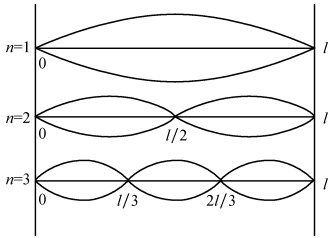
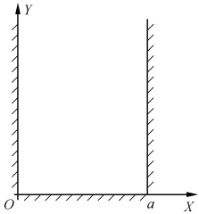
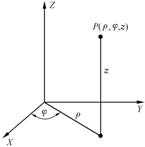
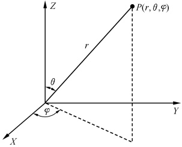
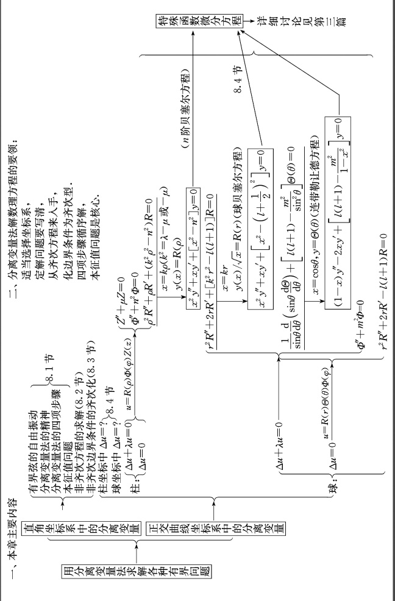

# 08-第八章 分离变量法

[返回全书目录](../../README.md)

> PDF 页码：147–175

<!-- page: 147 -->

在上一章中，我们已经说明，普遍地用行波法那样的先求通解，再用定解条件确定特解的方法来求解偏微分方程有很大的困难，因此，在解偏微分方程时，常常是直接求满足定解条件的特解。本章将学习的分离变量法就是直接求特解的一种方法，它是解数理方程的重要方法之一，适用于解大量的各种各样的定解问题，特别是在所研究问题的区域是矩形、柱面、球面等情况下，使用更为普遍。本章将主要讨论用分离变量法求解各种有界问题。

下面，我们首先以有界弦的自由振动为例来了解分离变量法的基本要领及解题步骤.

### 8.1 有界弦的自由振动

考虑长为 l 两端固定的弦的自由振动

 $$ u_{t t}=a^{2}u_{x x},\quad0<x<l,t>0 $$ 

$$  u\mid_{x=0}=0\Big\},\qquad t\geqslant0   \tag*{(8.1.2)}$$

 $$ u\mid_{x=l}=0\int^{\prime} $$ 

$$  \left.\begin{array}{l}u\mid_{t=0}=\varphi(x)\\ u_{t}\mid_{t=0}=\psi(x)\end{array}\right\}, 歩 0\leqslant x\leqslant l   \tag*{(8.1.3)}$$

由力学的知识我们知道，两端固定的弦的自由振动会形成驻波，这就启示我们尝试从驻波出发来解决这样的问题。

## 1. 分离变量

在力学中，驻波的表达式为

 $$ u(x,t)=2A\cos\frac{2\pi x}{\lambda}\cos2\pi\gamma t $$ 

这使我们自然想到，对于定解问题(8.1.1)式～(8.1.3)式可设其特解为

$$  u(x,t)=X(x)T(t)   \tag*{(8.1.4)}$$

其中  $ X(x) $ 和  $ T(t) $ 分别只是变量 x 和 t 的函数. 为了弄清楚定解问题 (8.1.1)~(8.1.3) 式究竟有什么样的驻波解, 应将 (8.1.4) 式分别代入方程和定解条件中.

将（8.1.4）式代入（8.1.1）式中得

<!-- page: 148 -->

$$ XT^{\prime \prime}=a^{2}X^{\prime \prime}T $$ 

即

 $$ \frac{T^{\prime \prime}}{a^{2}T}=\frac{X^{\prime \prime}}{X} $$ 

此式左边是 t 的函数，右边是 x 的函数，t 和 x 是两个独立变数，故只有两边都是常数时，此等式才能成立。令常数为  $ \mu $，则有

 $$ \frac{T^{\prime \prime}}{a^{2}T}=\frac{X^{\prime \prime}}{X}=\mu $$ 

即

$$  X^{\prime \prime}-\mu X=0   \tag*{(8.1.5)}$$

$$  T^{\prime \prime}-\mu a^{2}T=0   \tag*{(8.1.6)}$$

这样，求解偏微分方程（8.1.1）的问题，就化为了求解两个常微分方程（8.1.5）和（8.1.6）的问题。方程（8.1.5）和（8.1.6）总是有解的，问题是如何找到满足边界条件（8.1.2）和初始条件（8.1.3）的非零解。为此

将（8.1.4）式代入边界条件（8.1.2）式得

 $$ \left\{\begin{aligned}X(0)T(t)&=0\\ X(l)T(t)&=0\end{aligned}\right. $$ 

由于  $ T(t) $ 是 t 的任意函数，它不可能恒为零，故只可能有

$$  \left\{\begin{aligned}X(0)&=0\\ X(l)&=0\end{aligned}\right.   \tag*{(8.1.7)}$$

即，偏微分方程(8.1.1)式的边界条件(8.1.2)式，化为了常微分方程(8.1.5)式的边界条件(8.1.7)式.

将（8.1.4）式代入初始条件（8.1.3）式得

 $$ \left\{\begin{aligned}X(x)&T(0)=\varphi(x)\\ X(x)&T^{\prime}(0)=\psi(x)\end{aligned}\right. $$ 

由于  $ X(x) $ 是未知的，故显然，要想由此二式得到常微分方程（8.1.6）的初始条件  $ T(0) $ 和  $ T'(0) $，必须先求解出  $ X(x) $.

## 2. 本征值问题

让我们考虑定解问题

$$  \left\{\begin{array}{l}X^{\prime \prime}-\mu X=0\\ X(0)=0\\ X(l)=0\end{array}\right\}   \tag*{(8.1.7)}$$

在(8.1.5)式中， $ \mu $ 是常数，它不能任意取值，而只能在边界条件(8.1.7)式的限制下取某些特定的值，否则方程(8.1.5)将没有满足边界条件(8.1.7)式的非零解。这些特定的 $ \mu $值，称为方程(8.1.5)在边界条件(8.1.7)式下的本征值（或固有值）；相应于不同的 $ \mu $，方程(8.1.5)的非零解称为本征函数（或固有函数）。求本征值 $ \mu $和相应的本

<!-- page: 149 -->

征函数的问题称为本征值问题（固有值问题）.

现在我们来求解方程(8.1.5)、(8.1.7)所构成的本征值问题. $ \mu $ 的取值，无非有  $ \mu=0,\mu>0,\mu<0 $ 三种可能.

（1）若 $ \mu=0 $，则方程（8.1.5）的解为

 $$ X(x)=c_{1}x+c_{2} $$ 

其中  $ c_{1}, c_{2} $ 为任意常数（以下均同）. 代入边界条件（8.1.7）式解得  $ c_{2}=0, c_{1}=0 $ ，于是

 $$ X(x)\equiv0 $$ 

见 $ \mu $不能为零.

（2）若  $ \mu>0 $ ，则此时方程（8.1.5）的解为

 $$ X(x)=c_{1}\mathrm{e}^{\sqrt{\mu}x}+c_{2}\mathrm{e}^{-\sqrt{\mu}x} $$ 

代入边界条件(8.1.7)式得

 $$ \left\{\begin{aligned}&c_{1}+c_{2}=0\\ &c_{1}\mathrm{e}^{\sqrt{\mu}l}+c_{2}\mathrm{e}^{-\sqrt{\mu}l}=0\end{aligned}\right. $$ 

解得

 $$ c_{1}=0,\quad c_{2}=0 $$ 

于是

 $$ X(x)\equiv0 $$ 

可见 $ \mu $也不能大于零.

（3）若  $ \mu<0 $，记  $ \mu=-k^{2}(k $ 为实数），则方程（8.1.5）的解为

 $$ X(x)=c_{1}\mathrm{s i n}k x+c_{2}\mathrm{c o s}k x $$ 

由边界条件(8.1.7)式得

 $$ \left\{\begin{aligned}c_{2}&=0\\ c_{1}sinkl&=0\end{aligned}\right. $$ 

因为  $ c_{2}=0 $ ，故  $ c_{1} $ 不能为零，否则又将得到零值解。故上二式成立只可能是

 $$ \operatorname{sink}l=0 $$ 

这要求

 $$ kl=\pm n\pi,\quad n=0,1,2,\cdots $$ 

但 n 不能取零，否则 k=0，又将得到零值解；且  $ \pm n $ 给出的两个解只差一个正负号，即，是线性相关的，故

 $$ k=\frac{n\pi}{l},\quad n=1,2,3,\cdots $$ 

综上所述，由(8.1.5)式和(8.1.7)式所构成的本征值问题的本征值为

$$  \mu=-k^{2}=-\frac{n^{2}\pi^{2}}{l^{2}},\quad n=1,2,3,\cdots   \tag*{(8.1.8)}$$

其相应的本征函数即方程(8.1.5)的解为

$$  X_{n}(x)=c_{n}\sin\frac{n\pi}{l}x   \tag*{(8.1.9)}$$

其中， $ c_{n} $ 为任意常数.

<!-- page: 150 -->

## 3. 关于  $ T(t) $ 的方程的通解

将本征值  $ \mu = -\frac{n^{2}\pi^{2}}{l^{2}} $ 代入方程(8.1.6)得

 $$ T^{\prime \prime}(t)+\frac{a^{2}n^{2}\pi^{2}}{l^{2}}T(t)=0 $$ 

此方程的通解为

 $$ T_{n}(t)=A_{n}^{\prime}\cos\frac{n\pi a}{l}t+B_{n}^{\prime}\sin\frac{n\pi a}{l}t $$ 

其中  $ A_{n}^{\prime} $ 和  $ B_{n}^{\prime} $ 为任意常数. 故由(8.1.4)式得到，方程(8.1.1)满足边界条件(8.1.2)式的特解是

$$  u_{n}(x,t)=X_{n}(x)T_{n}(t)=\Big(A_{n}\cos\frac{n\pi a}{l}t+B_{n}\sin\frac{n\pi a}{l}t\Big)\sin\frac{n\pi x}{l},\quad n=1,2,3,\cdots   \tag*{(8.1.10)}$$

其中  $ A_{n}=A_{n}^{\prime}C_{n}, B_{n}=B_{n}^{\prime}C_{n} $ （8.1.10）式表示的特解有无穷多个，但一般说来，其中的任意一个并不一定能满足初始条件（8.1.3），因为当 t=0 时，

 $$ \left\{\begin{aligned}u_{n}(x,0)&=A_{n}\sin\frac{n\pi}{l}x\\ \left.\frac{\partial u_{n}}{\partial t}\right|_{t=0}&=B_{n}\frac{n\pi a}{l}\sin\frac{n\pi x}{l}\end{aligned}\right. $$ 

而初值  $ \varphi(x) $ 和  $ \psi(x) $ 是任意函数，因此这些特解  $ u_{n}(x,t) $ 中的任意一个，一般还不是问题的解.

## 4. 有界弦的自由振动的解

注意到方程（8.1.1）和边界条件（8.1.2）式均是线性的，故由叠加原理，把（8.1.10）式中所表示的特解叠加起来，得到的

$$  u(x,t)=\sum_{n=1}^{\infty}u_{n}(x,t)=\sum_{n=1}^{\infty}\left(A_{n}\cos\frac{n\pi a}{l}t+B_{n}\sin\frac{n\pi a}{l}t\right)\sin\frac{n\pi x}{l}   \tag*{(8.1.11)}$$

仍然是方程（8.1.1）满足边界条件（8.1.2）式的解。为使此解满足初始条件，将（8.1.11）式代入初始条件（8.1.3）式，则得

 $$ \left\{\begin{aligned}\varphi(x)&=\sum_{n=1}^{\infty}A_{n}\sin\frac{n\pi}{l}x\\ \psi(x)&=\sum_{n=1}^{\infty}B_{n}\frac{n\pi a}{l}\sin\frac{n\pi x}{l}\end{aligned}\right. $$ 

这恰好是  $ \varphi(x) $ 和  $ \psi(x) $ 的正弦展开 $ ^{①} $，于是

$$  \left\{\begin{array}{c}A_{n}=\frac{2}{l}\int_{0}^{l}\varphi(\alpha)\sin\frac{n\pi\alpha}{l}\mathrm{d}\alpha\\ \end{array}\right.   \tag*{(8.1.12)}$$

$$  \left\{\begin{array}{c}B_{n}=\frac{2}{n\pi a}\int_{0}^{l}\psi(\alpha)\sin\frac{n\pi\alpha}{l}\mathrm{d}\alpha\end{array}\right.   \tag*{(8.1.13)}$$

<!-- page: 151 -->

可见(8.1.11)式就是定解问题(8.1.1)~(8.1.3)式的解，其中系数  $ A_{n} $ 和  $ B_{n} $ 分别由(8.1.12)和(8.1.13)式给出。由傅里叶级数理论知，若在区间  $ [0, l] $ 中  $ \varphi(x) $ 有直到二阶的连续导数，分段连续的三阶导数； $ \psi(x) $ 有连续的一阶导数，分段连续的二阶导数，并且它们符合齐次边界条件，则系数由(8.1.12)式和(8.1.13)式给出的解(8.1.11)式存在 $ ^{②} $。

## 5. 解的物理意义

(8.1.10)式可重新改写为

 $$ u_{n}(x,t)=N_{n}\cos(\omega_{n} t-\delta_{n})\sin\frac{n\pi x}{l} $$ 

其中

 $$ N_{n}^{2}=A_{n}^{2}+B_{n}^{2},\quad\omega_{n}=\frac{n\pi a}{l},\quad\delta_{n}=\arctan\frac{B_{n}}{A_{n}} $$ 

可见  $ u_{n}(x,t) $ 代表一个驻波， $ N_{n}\sin\frac{n\pi}{l}x $ 代表弦上各点的振幅分布， $ \cos(\omega_{n}t-\delta_{n}) $ 是相位因子， $ \omega_{n} $ 是弦振动的固有频率（或本征频率）， $ \delta_{n} $ 是初相位。对于每一个 n，弦上各点都以相同的频率  $ \omega_{n} $，相同的初相位  $ \delta_{n} $ 振动。当  $ x_{m}=\frac{ml}{n}(m=0,1,\cdots,n) $ 时， $ \sin\frac{n\pi}{l}x_{m}=\sin m\pi=0 $，即这些点振幅为零，保持不动，称为节点（连同两端点在内节点共有  $ n+1 $ 个）；当  $ x_{k}=\frac{2k-1}{2n}l(k=1,2,\cdots,n) $ 时， $ \sin\frac{n\pi}{l}x_{k}=\sin\frac{2k-1}{2}\pi=\pm1 $，即这些点振幅为  $ \pm N_{n} $，达到最大值，称为腹点（有 n 个）。弦的振动  $ u(x,t)=\sum_{n=1}^{\infty}u_{n} $，表示一系列振幅不同、频率不同、相位不同的驻波的叠加。我们称 n=1 的驻波为基波；n=2 的驻波为二次谐波，以此类推。图 8.1 画出了 n=1,2,3 的驻波的形状，在节点处这些波看起来就好像没动一样，这亦正是我们称之为驻波的原因（驻是停止的意思）。

图8.1
 

## 6. 分离变量法

由前文对于有界弦的自由振动的求解我们看到

（1）虽然我们是从驻波引出解题的线索，但是在整个求解过程中跟驻波并没有联系，因此这种解题方法完全可以推广应用于各种定解问题，如扩散问题、稳定场问题等。按照它的特点我们称之为分离变量法。其主要精神是：把未知函数按自变量（包括多个自变量的情况）的单元函数分开[如，令 $ u(x,t)=X(x)T(t) $]，从而将解偏微分方程的问题化为解常微分方程的问题。

<!-- page: 152 -->

（2）用分离变量法求解偏微分方程问题.一般要经历如下四项步骤：

① 对齐次方程和齐次边界条件分离变量；

② 解关于空间因子的常微方程的本征值问题；

③ 求其他常微分方程的解，与本征函数相乘，得到特解；

④叠加，由初始条件或非齐次边界条件（后者在求解狄氏问题时将涉及到，见本节例题）确定叠加系数，而最后得所求定解问题的解.

例 考察在矩形薄板内稳定状态的温度分布，板的两对边绝热，而其余的两边一边温度保持为零，另一边的温度由  $ f(x) $ 规定.

解 其定解问题可表示为

$$  u_{x x}+u_{y y}=0,\quad0<x<a,0<y<b   \tag*{(8.1.14)}$$

$$  u_{x}\mid_{x=0}=0\rbrack   \tag*{（8.1.15）}$$

 $$ u_{x}\mid_{x=a}=0 $$ 

$$  u\mid_{y=b}=0   \tag*{(8.1.16)}$$

令

$$  u\mid_{y=0}=f(x)   \tag*{(8.1.17)}$$

$$  u(x,y)=X(x)Y(y)   \tag*{(8.1.18)}$$

代入齐次方程(8.1.14)和齐次边界条件(8.1.15)、(8.1.16)式得

 $$ X^{\prime \prime}-\mu X=0 $$ 

 $$ Y^{\prime \prime}+\mu Y=0 $$ 

 $$ \left\{\begin{aligned}X^{\prime}(0)&=0\\ X^{\prime}(a)&=0\end{aligned}\right. $$ 

 $$ Y(b)=0 $$ 

解本征值问题

 $$ \left\{\begin{aligned}X^{\prime \prime}-\mu X&=0\\ X^{\prime}(0)&=0,\quad X^{\prime}(a)&=0\end{aligned}\right. $$ 

得

 $$ \mu=-\frac{n^{2}\pi^{2}}{a^{2}},\quad n=0,1,2,\cdots $$ 

 $$ X_{n}(x)=A_{n}\cos\frac{n\pi}{a}x $$ 

将  $ \mu = -\frac{n^{2}\pi^{2}}{a^{2}} $ 代入  $ Y(y) $ 的方程得

 $$ Y^{\prime \prime}-\frac{n^{2}\pi^{2}}{a^{2}}Y=0 $$ 

其通解为

 $$ Y(y)=\left\{\begin{aligned}&C_{0}y+D_{0},\quad n=0\\ &C\operatorname{ch}\frac{n\pi}{a}y+D\operatorname{sh}\frac{n\pi}{a}y=E\operatorname{sh}\frac{n\pi}{a}(y+F),\quad n\neq0\end{aligned}\right. $$ 

其中

<!-- page: 153 -->

$$ E=\sqrt{D^{2}-C^{2}},\quad F=\frac{a}{n\pi}\mathrm{a r c t a n h}\frac{C}{D} $$ 

由边界条件 $ Y(b)=0 $有

 $$ \left\{\begin{aligned}&C_{0}b+D_{0}=0,\quad n=0\\ &E\operatorname{sh}\frac{n\pi}{a}(b+F)=0,\quad n\neq0\end{aligned}\right. $$ 

故有

 $$ C_{0}=-\frac{D_{0}}{b},\quad F=-b\quad E\neq0 $$ 

因此

 $$ Y_{n}(y)=\left\{\begin{aligned}&D_{0}\frac{b-y}{b},&n=0\\ &E_{n}\operatorname{sh}\frac{n\pi}{a}(y-b),&n\neq0\end{aligned}\right. $$ 

而由(8.1.18)式有

 $$ \begin{aligned}u_{n}(x,y)&=X_{n}(x)Y_{n}(y)\\&=\left\{\begin{aligned}&\frac{a_{0}}{2}\frac{b-y}{b},&n&=0\\&a_{n}\cos\frac{n\pi}{a}x&sh\frac{n\pi}{a}(y-b),&n&\neq0\end{aligned}\right.\end{aligned} $$ 

其中, $ \frac{a_{0}}{2}=A_{0}D_{0},a_{n}=A_{n}E_{n} $，于是我们有

 $$ \begin{aligned}u(x,y)&=\sum_{n=0}^{\infty}u_{n}(x,y)\\&=\frac{a_{0}}{2}\frac{b-y}{b}+\sum_{n=1}^{\infty}a_{n}\cos\frac{n\pi x}{a}\mathrm{sh}\frac{n\pi}{a}(y-b)\end{aligned} $$ 

将之代入非齐次边界条件(8.1.17)式得

 $$ f(x)=\frac{a_{0}}{2}+\sum_{n=1}^{\infty}a_{n}\cos\frac{n\pi x}{a}\mathrm{sh}\left(-\frac{n\pi b}{a}\right) $$ 

故

 $$ a_{0}=\frac{2}{a}\int_{0}^{a}f(x)\mathrm{d}x $$ 

 $$ a_{n}=\frac{-2}{a\mathrm{~sh}\frac{n\pi b}{a}}\int_{0}^{a}f(x)\cos\frac{n\pi x}{a}\mathrm{d}x,\quad n=1,2,\cdots $$ 

于是此问题的解为

 $$ u(x,y)=\frac{b-y}{b}\frac{a_{0}}{2}+\sum_{n=1}^{\infty}a_{n}^{*}\ \frac{\operatorname{sh}\frac{n\pi}{a}(b-y)}{\operatorname{sh}\frac{n\pi b}{a}}\cos\frac{n\pi x}{a} $$ 

其中  $ a_{n}^{*} = \frac{2}{a}\int_{0}^{a} f(x) \cos \frac{n\pi x}{a} dx. $

<!-- page: 154 -->

注 ① 设以 2l 为周期的函数  $ f(x) $ 在  $ [-l, l] $ 上可以展开为三角级数

$$  f(x)=\frac{a_{0}}{2}+\sum_{n=1}^{\infty}\left(a_{n}\cos\frac{n\pi}{l}x+b_{n}\sin\frac{n\pi}{l}x\right)   \tag*{(8.1.19)}$$

则

$$  a_{n}=\frac{1}{l}\int_{-l}^{l}f(x)\cos\frac{n\pi}{l}x\mathrm{d}x,\quad n=0,1,\cdots   \tag*{(8.1.20)}$$

$$  b_{n}=\frac{1}{l}\int_{-l}^{l}f(x)\sin\frac{n\pi x}{l}\mathrm{d}x,\quad n=1,2,\cdots   \tag*{(8.1.21)}$$

若  $ f(x) $ 为奇函数，则

$$  f(x)=\sum_{n=1}^{\infty}b_{n}\sin\frac{n\pi x}{l}   \tag*{(8.1.22)}$$

其中

$$  b_{n}=\frac{2}{l}\int_{0}^{l}f(x)\sin\frac{n\pi}{l}x\mathrm{d}x,\quad n=1,2,\cdots   \tag*{(8.1.23)}$$

若  $ f(x) $ 为偶函数，则

$$  f(x)=\frac{a_0}{2}+\sum_{n=1}^{\infty}a_n\cos\frac{n\pi}{l}x   \tag*{(8.1.24)}$$

其中

$$  a_{n}=\frac{2}{l}\int_{0}^{l}f(x)\cos\frac{n\pi}{l}x\mathrm{d}x,\quad n=0,1,2,\cdots   \tag*{（8.1.25）}$$

②参见 B.H. 斯米尔诺夫，高等数学教程，第二卷 p157.

##### 习题8.1

1. 考察长为 l 的均匀细杆的导热问题. 若

（1）杆的两端温度保持零度；

（2）杆的两端均绝热；

（3）杆的一端为恒温零度，另一端绝热；

设杆的初始温度分布均为  $ \varphi(x) $；试用分离变量法求在这三种不同情况下的杆的导热问题的解，并注意其本征函数的差异。

2. 今有一弦，其两端被钉子钉紧作自由振动，其初位移为

 $$ \varphi(x)=\left\{\begin{aligned}&hx,&&0\leqslant x\leqslant1\\ &h(2-x),&&1\leqslant x\leqslant2\end{aligned}\right. $$ 

初速度为零，试求弦的振动（其中 h 为已知常数）.

3. 求下列定解问题：

(1)

 $$ \left\{\begin{aligned}&u_{t t}=a^{2}u_{x x},\quad0<x<\pi,t>0\\ &u(x,0)=3\sin x\\ &u_{t}(x,0)=0\\ &u(0,t)=u(\pi,t)=0\end{aligned}\right.,\quad0\leqslant x\leqslant\pi； $$ 

(2)

 $$ \left\{\begin{aligned}&u_{t t}-a^{2}u_{x x}=0,\quad0<x<\pi,t>0\\ &u(x,0)=x^{3}\\ &u_{t}\left(x,0\right)=0\\ &u(0,t)=u_{x}\left(\pi,t\right)=0\end{aligned}\right.,\quad0\leqslant x\leqslant\pi\quad; $$ 

 $$ \left\{\begin{aligned}&u_{t}=4u_{x x},\quad0<x<1,t>0\\ &u(x,0)=0,\quad0\leqslant x\leqslant1\\ &u(0,t)=u(1,t)=N_{0}\end{aligned}\right.; $$ 

(3)

 $$ \left\{\begin{aligned}u_{xx}+u_{yy}&=0,\quad0<x<1,0<y<1\\ u(x,0)&=x(x-1)\\ u(x,1)&=0\\ u(0,y)&=u(1,y)=0,\quad0\leqslant x\leqslant1\end{aligned}\right., $$ 

(4)

<!-- page: 155 -->

## 4. 求阻尼波动问题的解

 $$ \left\{\begin{aligned}&u_{u}+a u_{t}=c^{2}u_{x x},&0&<x<l,t>0\\ &u(x,0)=0&0&\leqslant x\leqslant l\\ &u_{t}(x,0)=g(x)&0&\leqslant x\leqslant l\\ &u(0,t)=u(l,t)=0,&t&\geqslant0\\ \end{aligned}\right. $$ 

5. 均匀细杆长为 l，在 x=0 端固定，而另一端受着一个沿杆长的方向的重力 Q，如果在开始一瞬间，突然停止这个力的作用，求杆的纵向振动.

6. 长为 2l 的均匀细杆，被作用在二端的压力压缩成  $ 2l(1-\varepsilon) $，在 t=0 时，把这个荷载移去，试证：若 x=0 是杆的中点，则在时刻 t，坐标为 x 的杆的截面位移  $ u(x,t) $ 由下式确定：

 $$ u(x,t)=\frac{8\varepsilon l}{\pi^{2}}\sum_{n=0}^{\infty}\frac{(-1)^{n+1}}{(2n+1)^{2}}\sin\frac{(2n+1)}{2l}\pi x\cos\frac{(2n+1)\pi a}{2l}t $$ 

7. 求下列高维波动问题的解：

 $$ \begin{cases}u_{tt}=a^{2}\Delta u,\quad0<x<1,0<y<1,0<z<1,t>0\\u(x,y,z;0)=\sin\pi x\sin\pi y\sin\pi z\\u_{t}(x,y,z;0)=0\\u(0,y,z;t)=u(1,y,z;t)=0\\u(x,0,z;t)=u(x,1,z;t)=0\\u(x,y,0;t)=u(x,y,1;t)=0\end{cases} $$ 

8. 长为 l 的柱形管，一端封闭，另一端开放，管外空气中含有某种气体，其浓度为  $ u_{0} $，向管内扩散，求该气体在管内的浓度.

9. 求解杆的横振动问题

 $$ \begin{cases}u_{tt}+a^{2}u_{xxxx}=0,0<x<l\\u\mid_{x=0}=u_{xx}\mid_{x=0}=0\\u\mid_{x=l}=u_{xx}\mid_{x=l}=0\\u\mid_{t=0}=\varphi(x)\\u_{t}\mid_{t=0}=\psi(x)\end{cases} $$ 

10. 边长为 b 的方形薄膜，边缘固定，开始时膜上各点的位移是  $ Axy(b-x)(b-y) $ (A 为常数)，求它从静止开始的自由振动情况.

11. 求量子力学中处于如下一维无限深势阱中粒子的状态：

 $$ \begin{cases}\mathrm{i}\hbar\frac{\partial}{\partial t}\psi(x,t)=-\frac{\hbar^{2}}{2\mu}\frac{\partial^{2}}{\partial x^{2}}\psi(x,t)\\\psi(-a,t)=\psi(a,t)=0\\\psi(x,0)=\frac{1}{\sqrt{a}}\sin\frac{\pi}{a}(x+a)\end{cases} $$ 

提示：令分离变量常数为 E，求得的  $ E_{n} $ 即为粒子能量.

12. 设有一由 x=0, y=0, z=0 和 x=a, y=b, z=c 六个面所围成的长方形盒，盒的 z=c 的面上的电势为  $ f(x, y) $，其余各个面的电势均为零，求盒内任一点处的电势。若盒的六个面上的电势均不为零，则该盒内的电势又该如何求？

<!-- page: 156 -->

13. 求解如下电报方程的定解问题：

 $$ \left\{\begin{aligned}&u_{u}-a^{2}u_{xx}+2bu_{t}+cu=0(0<x<l,t>0)\\ &u(x,0)=\varphi(x),u_{t}(x,0)=\psi(x)(0<x<l)\quad( 其中 ,b,c>0)\\ &u(0,t)=0,u(0,l)=0(t>0)\end{aligned}\right. $$ 

### 8.2 非齐次方程 纯强迫振动

现考虑有界弦（或杆）的纯强迫振动

$$  u_{t t}=a^{2}u_{x x}+f(x,t)   \tag*{(8.2.1)}$$

$$  u\mid_{x=0}=0\Big]   \tag*{(8.2.2)}$$

 $$ u\mid_{x=l}=0 $$ 

$$  \left.\begin{array}{l l}{u\mid_{t=0}=0}\\ {u_{t}\mid_{t=0}=0}\end{array}\right\}   \tag*{(8.2.3)}$$

由于方程中非齐次项  $ f(x,t) $ 的出现，所以，若直接以  $ u(x,t)=X(x)T(t) $ 代入方程，不能实现变量分离。由此，我们自然想到解非齐次线性常微分方程的常数变易法，类似地先考虑与非齐次方程（8.2.1）所对应的齐次问题。

## 1. 对应齐次问题的本征函数

定解问题(8.2.1)～(8.2.3)式所对应的齐次问题为

 $$ \left\{\begin{aligned}u_{tt}&=a^{2}u_{x x}\\ u&\mid_{x=0}=0\\ u&\mid_{x=l}=0\end{aligned}\right. $$ 

通过分离变量 $ \left[u(x,t)=X(x)T(t)\right] $后，得到的本征值问题为

 $$ \left\{\begin{aligned}X^{\prime \prime}-\mu X&=0\\ X(0)&=0,\quad X(l)&=0\end{aligned}\right. $$ 

由此解得本征函数为

 $$ X_{n}(x)=C_{n}\sin\frac{n\pi x}{l},\quad n=1,2,3,\cdots $$ 

## 2.  $ T_{n}(t) $ 的方程的解

仿照常数变易法，令

$$  u(x,t)=\sum_{n=1}^{\infty}T_{n}(t)\sin\frac{n\pi}{l}x   \tag*{(8.2.4)}$$

并将之代入方程(8.2.1)得

 $$ \sum_{n=1}^{\infty}\left[T_{n}^{\prime\prime}(t)+\left(\frac{an\pi}{l}\right)^{2}T_{n}(t)\right]\sin\frac{n\pi x}{l}=f(x,t) $$ 

此等式的左边是右边的函数  $ f(x,t) $ 对于变量 x 的傅里叶正弦展开，故由傅里叶级数

<!-- page: 157 -->

（简称傅氏级数）的系数公式（8.1.23）式有

$$  T_{n}^{\prime\prime}(t)+\left(\frac{a n\pi}{l}\right)^{2}T_{n}(t)=f_{n}(t)   \tag*{(8.2.5)}$$

其中

$$  f_{n}(t)=\frac{2}{l}\int_{0}^{l}f(\alpha,t)\sin\frac{n\pi\alpha}{l}\mathrm{d}\alpha   \tag*{(8.2.6)}$$

又将(8.2.4)式代入初始条件(8.2.3)得

 $$ \begin{cases}\displaystyle\sum_{n=1}^{\infty}T_{n}(0)\sin\frac{n\pi}{l}x=0\\\displaystyle\sum_{n=1}^{\infty}T_{n}^{\prime}(0)\sin\frac{n\pi x}{l}=0\end{cases} $$ 

比较等式两边展开式的系数有

$$  \left\{\begin{aligned}T_{n}(0)&=0\\ T_{n}^{\prime}(0)&=0\end{aligned}\right.   \tag*{(8.2.7)}$$

由常微分方程的常数变易法 $ ^{①} $（或本篇9.3节例4）可求得关于常微分方程 $ T_{n}(t) $的定

解问题(8.2.5)和(8.2.7)式的解为

$$  T_{n}(t)=\frac{l}{n\pi a}\int_{0}^{t}f_{n}(\tau)\sin\frac{n\pi a}{l}(t-\tau)\mathrm{d}\tau   \tag*{(8.2.8)}$$

## 3. 有界弦(杆)的纯强迫振动的解

将（8.2.8）式代入（8.2.4）式得定解问题（8.2.1）～（8.2.2）式的解为

$$  u(x,t)=\sum_{n=1}^{\infty}\left[\frac{l}{n\pi a}\int_{0}^{t}f_{n}(\tau)\sin\frac{n\pi a}{l}(t-\tau)\mathrm{d}\tau\right]\sin\frac{n\pi}{l}x   \tag*{(8.2.9)}$$

其中  $ f_{n}(t) $ 由 (8.2.6) 式给出.

## 4. 本征函数法

以上求解非齐次方程的方法，显然也适用于求解带有其他齐次边界条件的各类非齐次方程，其主要步骤是

（1）用分离变量法求得对应的齐次问题（即对应的齐次方程连同齐次边界条件的本征函数.

（2）将未知函数  $ u(x,t) $ 或  $ u(x,y) $ 等按上面求得的本征函数展开，其展开系数为另一变量的函数，代入非齐次方程和初始条件（或另一变量的边界条件），得到关于时间因子的常微分方程的初值问题（或另一单元函数的常微分方程的边值问题），用常数变易法或拉氏变换法（见本篇第九章）可求得其解.

（3）将所求得的解代入未知函数的展开式中，即得到原定解问题的解. 这种分离变量的方法按其特点又叫本征函数（或固有函数）法.

#### 例 求解定解问题

<!-- page: 158 -->

$$  u_{t}-a^{2}u_{x}=A\sin\omega t   \tag*{(8.2.10)}$$

$$  u_{x}\mid_{x=0}=0,\quad u_{x}\mid_{x=l}=0   \tag*{(8.2.11)}$$

$$  u\mid_{t=0}=0   \tag*{(8.2.12)}$$

解 对应的齐次方程的本征值问题为

 $$ \left\{\begin{aligned}X^{\prime \prime}-\mu X&=0\\ X^{\prime}(0)&=0,\quad X^{\prime}(l)&=0\end{aligned}\right. $$ 

求解得本征函数

 $$ X_{n}(x)=C_{n}\cos\frac{n\pi}{l}x,\quad n=0,1,2,\cdots $$ 

令

$$  u=\sum_{n=0}^{\infty}T_{n}(t)\cos\frac{n\pi x}{l}   \tag*{(8.2.13)}$$

代入方程(8.2.10)和初始条件(8.2.12)式得

 $$ \left\{\begin{aligned}&\sum_{n=0}^{\infty}\Big[T_{n}^{\prime}(t)+\Big(\frac{n\pi a}{l}\Big)^{2}T_{n}(t)\Big]\cos\frac{n\pi x}{l}=A\sin\omega t\\ &\sum_{n=0}^{\infty}T_{n}(0)\cos\frac{n\pi x}{l}=0\end{aligned}\right. $$ 

比较等式两边傅里叶余弦展开的系数有

 $$ \left\{\begin{aligned}T_{0}^{\prime}(t)&=A\sin\omega t\\ T_{0}(0)&=0\end{aligned}\right.,\quad n=0 $$ 

 $$ \left\{\begin{aligned}T_{n}^{\prime}(t)+\left(\frac{n\pi a}{l}\right)^{2}T_{n}(t)&=0,\\ T_{n}(0)&=0\end{aligned}\right.,\quad n=1,2,3,\cdots $$ 

解之得

 $$ T_{_{0}}(t)=\frac{\mathrm{A}}{\omega}(1-\cos\omega t)\;;T_{_{n}}(t)=0,\quad n=1,2,3,\cdots $$ 

代入（8.2.13）式得到本定解问题的解为

 $$ u(x,t)=\frac{A}{\omega}(1-\cos\omega t) $$ 

不难看出用本征函数法求解非齐次方程的定解问题时，若初始条件（或另一变量的边界条件）是非零值（或非齐次）的，例如，若定解问题（8.2.1）式和（8.2.2）式带有非零值初始条件

 $$ \left\{\begin{aligned}u\mid_{t=0}&=\varphi(x)\\ u_{t}\mid_{t=0}&=\psi(x)\end{aligned}\right. $$ 

则当我们将展开式(8.2.4)代入方程(8.2.1)和上述非零值初始条件时，不仅会得到非齐次的常微分方程(8.2.5)，还会得到非零值的初始条件

<!-- page: 159 -->

$$ \left\{\begin{aligned}T_{n}(0)&=\frac{2}{l}\int_{0}^{l}\varphi(\alpha)\sin\frac{n\pi}{l}\alpha\mathrm{d}\alpha\\ T_{n}^{\prime}(0)&=\frac{2}{l}\int_{0}^{l}\psi(\alpha)\sin\frac{n\pi}{l}\alpha\mathrm{d}\alpha\end{aligned}\right. $$ 

我们固然可以直接求解这一常微分方程的初值问题，但不免增加求解的困难。对于这类问题，由于方程和定解条件都是线性的，故我们往往利用叠加原理，即令

 $$ u(x,t)=u^{\mathrm{I}}\left(x,t\right)+u^{\mathrm{II}}\left(x,t\right) $$ 

使  $ u^{I} $ 和  $ u^{II} $ 分别满足定解问题

 $$ \left\{\begin{aligned}u_{u}^{\mathrm{I}}&=a^{2}u_{x x}^{\mathrm{I}}\\ u^{\mathrm{I}}&\mid_{x=0}=0,u^{\mathrm{I}}\mid_{x=l}=0\\ u^{\mathrm{I}}&\mid_{t=0}=\varphi(x),u_{t}^{\mathrm{I}}\mid_{t=0}=\psi(x)\end{aligned}\right.\quad 和 \quad\left\{\begin{aligned}u_{t t}^{\mathrm{I I}}&=a^{2}u_{x x}^{\mathrm{I I}}+f(x,t)\\ u^{\mathrm{I I}}&\mid_{x=0}=0,u^{\mathrm{I I}}\mid_{x=l}=0\\ u^{\mathrm{I I}}&\mid_{t=0}=0,u_{t}^{\mathrm{I I}}\mid_{t=0}=0\end{aligned}\right. $$ 

于是，用8.1节和本节的方法，分别可求得 $ u^{1} $和 $ u^{2} $，从而可求得 $ u(x,t) $.

注 ① 由高等数学中的常数变易法知，对于二阶线性非齐次常微分方程

若对应的齐次方程

$$  \begin{aligned}y^{\prime \prime}(x)&+p(x)y^{\prime}(x)+q(x)y(x)=f(x)\\y^{\prime \prime}(x)&+p(x)y^{\prime}(x)+q(x)y(x)=0\end{aligned}   \tag*{(8.2.14)}$$

有通解

 $$ y(x)=c_{1}y_{1}(x)+c_{2}y_{2}(x) $$ 

其中  $ c_{1}, c_{2} $ 为常数，则非齐次方程（8.2.14）有特解

 $$ y(x)=c_{1}(x)y_{1}(x)+c_{2}(x)y_{2}(x) $$ 

其中  $ c_{1}(x) $ 和  $ c_{2}(x) $ 可由解方程组

 $$ \left\{\begin{aligned}&c_{1}^{\prime}(x)y_{1}(x)+c_{2}^{\prime}(x)y_{2}(x)=0\\ &c_{1}^{\prime}(x)y_{1}^{\prime}(x)+c_{2}^{\prime}(x)y_{2}^{\prime}(x)=f(x)\end{aligned}\right. $$ 

求得.

#### 习题8.2

1. 求解具有放射性衰变的热传导方程

 $$ u_{t}=a^{2}u_{x x}+A e^{-\beta x},\quad0<x<l,t>0 $$ 

已知边界条件为

 $$ u\mid_{x=0}=0,\quad u\mid_{x=l}=0 $$ 

初始条件为

 $$ u\mid_{t=0}=T_{0}( 常数 ) $$ 

2. 一长为 l 的均匀弦，弦上每一点受外力作用，其力密度为 bxt，若弦的二端是自由的，而初始位移为零，初始速度为  $ (l-x) $，试求弦的横振动.

3. 求解下列定解问题：

(1)

 $$ \begin{cases}u_{tt}=a^{2}u_{xx}+A x,\quad0<x<l,t>0\\u\left(x,0\right)=0,u_{t}\left(x,0\right)=0\\u\left(0,t\right)=0,u\left(l,t\right)=0\end{cases}; $$ 

(2)

 $$ \left\{\begin{aligned}&u_{t}-a^{2}u_{x x}=A\sin\omega t,\quad0<x<l,t>0\\ &u|_{x=0}=u_{x}|_{x=l}=0\\ &u|_{t=0}=0\end{aligned}\right.; $$ 

(3)

 $$ \left\{\begin{aligned}u_{x x}+u_{y y}=&A,\quad0<x<a,0<y<b\\ u\mid_{x=0}=&u\mid_{x=a}=0\\ u\mid_{y=0}=&u\mid_{y=b}=0\end{aligned}\right.; $$ 

(4)

 $$ \begin{cases}u_{tt}=a^{2}u_{xx}+A\mathrm{e}^{-t}\cos\frac{\pi}{2l}x\\u(x,0)=0,u_{t}(x,0)=0\\u_{x}(0,t)=0,u(l,t)=0\end{cases}. $$

<!-- page: 160 -->

4. 在第七章中我们曾用冲量原理在达朗贝尔公式的基础上求得了无界弦的纯强迫振动的解。试用冲量原理求出有界弦的纯强迫振动的解（8.2.9）式。

5. 均匀导线，每单位长的电阻为 r，通以恒定的电流 I，导线表面跟周围温度为零的介质进行热交换，试求导线上温度的变化。设初始温度和两端温度都为零，h 是热交换系数。

### 8.3 非齐次边界条件的处理

以上两节所讨论的问题，都基于边界条件是齐次的。但我们所遇到的实际问题，并非尽然，而往往是非齐次的边界条件更多。现以具有非齐次边界条件的有界弦的自由振动为例来研究这一问题。即

$$  u_{t t}-a^{2}u_{x x}=0   \tag*{(8.3.1)}$$

 $$ u\mid_{x=0}=g(t) $$ 

$$  u\mid_{x=l}=h(t)\Big\}   \tag*{(8.3.2)}$$

 $$ u\mid_{t=0}=\varphi(x) $$ 

$$  u_{t}\mid_{t=0}=\psi(x)\int   \tag*{(8.3.3)}$$

此时，对于边界条件(8.3.2)式将无法应用分离变量法，因为若将分离变数形式的解 $ u(x,t)=X(x)T(t) $代入(8.3.2)式，就会得到 $ X(0)=\frac{g(t)}{T(t)} $， $ X(l)=\frac{h(t)}{T(t)} $两个不能确定的值，即不能引出任何边界条件，所以首先必须把边界条件齐次化。

## 1. 边界条件的齐次化

为此，我们引入新的未知函数  $ v(x,t) $ 和辅助函数  $ w(x,t) $，令

$$  u(x,t)=v(x,t)+w(x,t)   \tag*{(8.3.4)}$$

若能找到函数  $ w(x,t) $，使它具备性质

$$  \begin{cases}w\mid_{x=0}=g(t)\\w\mid_{x=l}=h(t)\end{cases}   \tag*{(8.3.5)}$$

则新未知函数  $ v(x,t)=u(x,t)-w(x,t) $，便满足齐次边界条件

 $$ \left\{\begin{aligned}v&\mid_{x=0}=0\\ v&\mid_{x=l}=0\end{aligned}\right. $$ 

## 2. 辅助函数  $ w(x,t) $ 的选取

由此看来，问题的关键是寻找一个满足条件(8.3.5)式的函数 $ w(x,t) $. 实际上，对于任意固定的t，满足(8.3.5)式的 $ w(x,t) $所表示的是，过x-w平面上 $ [0,g(t)] $和 $ [l,h(t)] $两点的曲线. 这种曲线有很多条，最简单的是直线，令之为

 $$ w(x,t)=A(t)x+B(t) $$ 

其中， $ A(t) $ 和  $ B(t) $ 均为 t 的函数. 于是，由(8.3.5)式有

<!-- page: 161 -->

$$ \left\{\begin{aligned}&B(t)=g(t)\\ &A(t)l+B(t)=h(t)\end{aligned}\right. $$ 

从而求得

 $$ \left\{\begin{aligned}B(t)&=g(t)\\ A(t)&=\frac{h(t)-g(t)}{l}\end{aligned}\right. $$ 

故有

$$  \mathcal{w}(x,t)=\frac{h(t)-g(t)}{l}x+g(t)   \tag*{(8.3.6)}$$

这样一来，定解问题(8.3.1)～(8.3.3)式便转化为关于 $ v(x,t) $的定解问题

$$  v_{tt}-a^{2}v_{xx}=-\left(w_{tt}-a^{2}w_{xx}\right)   \tag*{(8.3.7)}$$

$$  v\mid_{x=0}=0\Big]   \tag*{(8.3.8)}$$

 $$ v\mid_{x=i}=0\big) $$ 

 $$ v\mid_{t=0}=\varphi(x)-w(x,0) $$ 

$$  v_{t}\mid_{t=0}=\psi(x)-w_{t}(x,0)   \tag*{(8.3.9)}$$

这正是上节我们介绍过的带有齐次边界条件的非齐次方程的定解问题，可用上节介绍过的本征函数法来求解.

例 1 研究一端固定，一端作周期运动  $ \sin\omega t $ 的弦振动.

解 其定解问题为

 $$ \begin{cases}u_{tt}-a^{2}u_{xx}=0,&0<x<l\\u(0,t)=0,u(l,t)=\sin\omega t&\\u(x,0)=u_{l}(x,0)=0,&0\leqslant x\leqslant l\end{cases} $$ 

令

 $$ u(x,t)=v(x,t)+w(x,t) $$ 

由（8.3.6）式选

 $$ w(x,t)=\frac{\sin\omega t}{l}x+0=\frac{x}{l}\sin\omega t $$ 

则(8.3.7)~(8.3.9)式变为

 $$ \begin{cases}v_{tt}-a^{2}v_{xx}=\frac{\omega^{2}}{l}x\sin\omega t\\v(0,t)=v(l,t)=0\\v(x,0)=0,\quad v_{t}(x,0)=-\frac{\omega}{l}x\end{cases} $$ 

又令  $ v(x,t)=v^{\mathrm{I}}(x,t)+v^{\mathrm{II}}(x,t) $，其中

 $$ \left\{\begin{aligned}&v_{t t}^{\mathrm{I}}-a^{2}v_{x x}^{\mathrm{I}}=0\\ &v^{\mathrm{I}}\left(0,t\right)=v^{\mathrm{I}}\left(l,t\right)=0\\ &v^{\mathrm{I}}\left(x,0\right)=0,\quad v_{t}^{\mathrm{I}}\left(x,0\right)=-\frac{\omega}{l}x\end{aligned}\right. $$

<!-- page: 162 -->

$$ \begin{cases}v_{tt}^{\mathbb{I}}-a^{2}v_{xx}^{\mathbb{I}}=\frac{\omega^{2}}{l}x\sin\omega t\\v^{\mathbb{I}}\left(0,t\right)=v^{\mathbb{I}}\left(l,t\right)=0\\v^{\mathbb{I}}\left(x,0\right)=v_{t}^{\mathbb{I}}\left(x,0\right)=0\end{cases} $$ 

记  $ \omega_{n}=\frac{n\pi}{l}a $ ，解之得

 $$ v^{\mathrm{I}}\left(x,t\right)=\sum_{n=1}^{\infty}\left(-1\right)^{n}\frac{2\omega l}{a\left(n\pi\right)^{2}}\sin\omega_{n}t\sin\frac{n\pi x}{l} $$ 

 $$ \begin{align*}v^{\parallel}\left(x,t\right)&=\sum_{n=1}^{\infty}(-1)^{n+1}\frac{\omega^{2}l}{a\left(n\pi\right)^{2}}\biggl[\frac{\sin\omega t+\sin\omega_{n}t}{\omega+\omega_{n}}-\frac{\sin\omega_{n}t-\sin\omega t}{\omega_{n}-\omega}\biggr]\sin\frac{n\pi}{l}x\\&=\sum_{n=1}^{\infty}(-1)^{n+1}\frac{2\omega^{2}l}{a\left(n\pi\right)^{2}}\frac{\omega\sin\omega_{n}t-\omega_{n}\sin\omega t}{\omega^{2}-\omega_{n}^{2}}\sin\frac{n\pi x}{l}\end{align*} $$ 

将  $ u(x,t) $ 按  $ \sin\frac{n\pi}{l}x $ 展开得

 $$ w(x,t)=\sum_{n=1}^{\infty}(-1)^{n+1}\frac{2}{n\pi}\sin\omega t\sin\frac{n\pi}{l}x $$ 

故立即可求得该问题的解  $ u(x,t) $ 为

 $$ u(x,t)=\sum_{n=1}^{\infty}\frac{(-1)^{n}2n\pi}{l^{2}(\omega^{2}-\omega_{n}^{2})}\sin\omega t\sin\frac{n\pi}{l}x-\sum_{n=1}^{\infty}\frac{(-1)^{n}2\omega}{al(\omega^{2}-\omega_{n}^{2})}\sin\omega_{n}t\sin\frac{n\pi}{l}x $$ 

## 3. 其他类非齐次边界条件的处理

以上处理非齐次边界条件的方法，也适用于附有其他非齐次边界条件的各类定解问题，但有时需选择  $ w(x,t) $ 为 x 的二次式，否则系数  $ A(t) $、 $ B(t) $ 无法确定。如，

 $$ \left\{\begin{aligned}&u_{t}-D u_{x x}=0\\ &u_{x}\mid_{x=0}=g(t),\quad u_{x}\mid_{x=l}=h(t)\end{aligned}\right. $$ 

为使边界条件齐次化，需选择  $  w(x,t)  $，使  $  \omega_{x}|_{x=0}=g(t), w_{x}|_{x=l}=h(l)  $. 此时若选  $  w=A(t)x+B(t)  $，则无法将边界条件代入来确定  $  A(t)  $、 $  B(t)  $. 但若选择

 $$ w=A(t)x^{2}+B(t)x+C(t) $$ 

则

 $$ \left\{\begin{aligned}w_{x}\mid_{x=0}&=2A(t)\bullet0+B(t)=g(t)\\ w_{x}\mid_{x=l}&=2A(t)\bullet l+B(t)=h(t)\end{aligned}\right. $$ 

由此得

 $$ \left\{\begin{aligned}A(t)&=\frac{h(t)-g(t)}{2l}\\ B(t)&=g(t)\end{aligned}\right. $$ 

至于  $ C(t) $，对边界条件不起作用，它是作为“机动函数”出现的，不妨取为零。

对于描绘稳定现象的定解问题，显然，不必要求（也不可能要求）所有的边界条件都是齐次的.

<!-- page: 163 -->

例2 研究如图8.2所示的半带形区域内的电势 $ u(x,y) $.已知边界x=0和y=0上的电势都是零，而边界x=a上的电势为 $ u_{0} $(常数).

解 其定解问题为

 $$ u_{xx}+u_{yy}=0,\quad0<x<a,0<y<\infty $$ 

$$  \left\{\begin{array}{l l}u\mid_{x=0}=0,u\mid_{x=a}=u_{0},&0\leqslant y<\infty\\ u\mid_{y=0}=0,&0\leqslant x\leqslant a\end{array}\right.   \tag*{(8.3.11)}$$

为使关于变量 x 的边界条件齐次化，令

 $$ u(x,y)=v(x,y)+w(x,y) $$ 

图8.2
 

由（8.3.6）式，其中

 $$ w(x,y)=\frac{u_{0}}{a}x $$ 

于是  $ v(x,y) $ 的定解问题是

$$  v_{xx}+v_{yy}=0,\qquad0<x<a,0<y<\infty   \tag*{(8.3.13)}$$

$$  v\mid_{x=0}=0,v\mid_{x=a}=0,\quad0\leqslant y<\infty   \tag*{（8.3.14）}$$

$$  \left|\begin{array}{c}v\mid_{y=0}=-\frac{u_{0}}{a}x,\quad0\leqslant x\leqslant a\end{array}\right.   \tag*{（8.3.15）}$$

用分离变量法求得满足(8.3.13)式和(8.3.14)式的解为

 $$ v(x,y)=\sum_{n=1}^{\infty}(A_{n}\mathrm{e}^{\frac{n\pi x}{a}}+B_{n}\mathrm{e}^{-\frac{n\pi x}{a}})\sin\frac{n\pi x}{a} $$ 

其中  $ A_{n} $ 和  $ B_{n} $ 为待定常数. 又因为当  $ y \to \infty $ 时  $ u(x, y) $ 应是有限的（自然边界条件），即  $ v\big|_{v \to \infty} = $ 有限值 (8.3.16)

故由边界条件(8.3.15)式和(8.3.16)式可定出

 $$ A_{n}=0,B_{n}=(-1)^{n}\frac{2u_{0}}{n\pi},\quad n=1,2,3,\cdots $$ 

于是最后可得到原定解问题(8.3.10)～(8.3.12)式的解为

 $$ u(x,y)=\frac{u_{0}}{a}x+\frac{2u_{0}}{\pi}\sum_{n=1}^{\infty}\frac{(-1)^{n}}{n}\mathrm{e}^{-\frac{n\pi x}{a}}\sin\frac{n\pi x}{a} $$ 

还要指出，由于 w 的选取有一定的任意性，故选取不同的 w 所得到的解 u 在形式上可能很不相同，但根据解的唯一性可知这些解实质上是一样的。

综上所述，在用分离变量法解偏微分方程时，为了使边界条件实现变量分离，应使非齐次的边界条件齐次化。对于未知函数  $ u(x,t) $ 的定解问题，具体做法是：

（1）作变换  $ u(x,t)=v(x,t)+w(x,t) $;

（2）适当选取  $ w(x,t) $，使关于  $ v(x,t) $ 的边界条件齐次化，通常选  $ w(x,t) $ 为 x 的一次式

 $$ w(x,t)=A(t)x+B(t) $$ 

但当两个边界条件均为第二类时，需选择  $ w(x,t) $ 为 x 的二次式

 $$ w(x,t)=A(t)x^{2}+B(t)x+C(t) $$

<!-- page: 164 -->

其中 $ A(t) $， $ B(t) $和 $ C(t) $由 $ u(x,t) $的边界条件定.

（3）解关于  $ v(x,t) $ 的带有齐次边界条件的定解问题，从而最后可求得  $ u(x,t) $.

#### 习题8.3

1. 长为 l 而固定于 x=0 一端的均匀细杆，处于静止状态中，在 t=0 时，一个沿着杆长方向的力 Q（每单位面积上）加在杆的另一端上，求在 t>0 时，杆上各点的位移.

2. 有一长为 l，侧面绝热，而初始温度为  $ 0^{\circ}C $ 的均匀细杆，它的一端 x=l 处温度永远保持  $ 0^{\circ}C $，而另一端 x=0 处温度随时间直线上升，即  $ \left.u\right|_{x=0}=ct $ (c 是常数)，求 t>0 时，杆的温度分布.

3. 设弹簧一端固定，另一端在外力作用下作周期振动，此时定解问题为

 $$ \left\{\begin{aligned}&u_{t t}=a^{2}u_{x x},0<x<l\\ &u(x,0)=u_{t}(x,0)=0\\ &u(0,t)=0,u(l,t)=A\sin\omega t\end{aligned}\right. $$ 

试求解  $ u(x,t) $. 其中  $ \frac{\omega l}{\pi a} $ 不为正整数, a, l,  $ \omega $ 均为常数.

## 4. 求解定解问题

 $$ \left\{\begin{aligned}&u_{x x}+u_{y y}=f(x,y)\\ &u\mid_{x=0}=g(y),u\mid_{x=a}=h(y),\quad&0\leqslant y\leqslant b\\ &u_{y}\mid_{y=0}=\varphi(x),u_{y}\mid_{y=b}=\psi(x),\quad&0\leqslant x\leqslant a\end{aligned}\right. $$ 

5. 求解下列有源热传导的定解问题：

 $$ \begin{cases}u_{t}-a^{2}u_{xx}=\cos\frac{x}{2}\left(0<x<\pi,t>0\right)\\u(x,0)=xt\cos\frac{x}{2}\left(0\leqslant x\leqslant\pi\right)\\u_{x}\left(0,t\right)=1,u(\pi,t)=\pi(t>0)\end{cases} $$ 

### 8.4 正交曲线坐标系中的分离变量法

由前面的学习我们了解到，在用分离变量法求解数理方程时，不仅对于方程本身，而且对于边界条件，都要进行变量的分离。一般而言，能否应用分离变量法，除了与方程和边界条件本身的形式有关之外，还与采用什么样的坐标系有关，坐标系选择不当，变量就分不开。如，圆的狄氏问题（带有第一类边值条件的定解问题，称为狄利克雷问题，简称狄氏问题），其边界条件为  $ u\big|_{\rho=a}=0 $，其中 a 为圆的半径。现对这一边界条件进行变数分离，若选择直角坐标系，即  $ u=u(x,y) $，令  $ u(x,y)=X(x)Y(y) $，则由  $ |u|_{p=a}=0 $ 有  $ XY|\sqrt{x^{2}+y^{2}}=a=0 $，边界条件不可能按单变量分出来；但若选择极坐标，即  $ u=u(\rho,\varphi) $，令  $ u(\rho,\varphi)=R(\rho)\Phi(\varphi) $，则由  $ |u|_{p=a}=0 $ 有  $ R(a)\Phi(\varphi)=0 $，从而有  $ R(a)=0 $，边界条件分出来了。有时坐标系选择不当，即使变量分得开，也会使问题变得复杂。可见适当选择坐标系，对于分离变量法而言是相当重要的。

在这一部分我们将讨论在正交曲线坐标系，主要是柱坐标系和球坐标系中两个

<!-- page: 165 -->

重要方程的分离变量. 为此, 首先需引入正交曲线坐标系的概念.

## 1. 正交曲线坐标系

由三族互相正交的曲面而定义的坐标系称为正交曲线坐标系. 若以  $ q_{1}, q_{2}, q_{3} $ 表示正交曲线坐标，则它们与直角坐标的相互关系可表示为

 $$ \left\{\begin{aligned}x&=x(q_{1},q_{2},q_{3})\\ y&=y(q_{1},q_{2},q_{3}),\\ z&=z(q_{1},q_{2},q_{3})\end{aligned}\right.\quad\left\{\begin{aligned}q_{1}&=q_{1}(x,y,z)\\ q_{2}&=q_{2}(x,y,z)\\ q_{3}&=q_{3}(x,y,z)\end{aligned}\right. $$ 

如

（1）柱坐标 $ (\rho,\varphi,z) $

$$  \begin{cases}x=\rho\cos\varphi\\y=\rho\sin\varphi,\\z=z\end{cases}\begin{cases}\rho=\sqrt{x^{2}+y^{2}}\\\varphi=\arctan\frac{y}{x}\\z=z\end{cases}   \tag*{(8.4.1)}$$

其中， $ 0 \leqslant \rho < \infty, -\infty < \varphi < \infty, -\infty < z < \infty $（见图 8.3）.

（2）球坐标 $ (r,\theta,\varphi) $

$$  \begin{cases}x=r\sin\theta\cos\varphi\\y=r\sin\theta\sin\varphi,\\z=r\cos\theta\end{cases}\begin{cases}r=\sqrt{x^{2}+y^{2}+z^{2}}\\\theta=\arctan\frac{\sqrt{x^{2}+y^{2}}}{z}\\\varphi=\arctan\frac{y}{x}\end{cases}   \tag*{(8.4.2)}$$

其中， $ 0 \leqslant r < \infty, 0 \leqslant \theta \leqslant \pi, -\infty < \varphi < \infty $（见图 8.4）.

图8.3
 

图8.4
 

其他的正交曲线坐标还有不少，如抛物柱面坐标、椭球坐标等等，但我们经常用到的还是以上两种。

<!-- page: 166 -->

## 2. 如何选择坐标系

前面我们已提到在用分离变量法解题时，为了使变量分得开和问题易于求解，必须正确选择坐标系。一般而言，应当选择坐标系，使所讨论问题的边界与一个或几个坐标曲面的部分面重合。如，当边界面为半径为 a、高为 h 的圆柱面时，就应选择柱坐标  $ (\rho,\varphi,z) $，使其边界面与坐标面  $ \rho=a,z=0,z=h $ 的部分重合；若边界面是半径为 a 的球面，就应选择球坐标  $ (r,\theta,\varphi) $，使边界面与坐标面 r=a 重合；若边界面为生成角为  $ \theta_{1} $ 的圆锥面，也应选择球坐标，使边界面与坐标面  $ \theta=\theta_{1} $ 重合等等。

由于许多数理方程中都涉及函数的拉普拉斯量

$$  \Delta u=\frac{\partial^{2}u}{\partial x^{2}}+\frac{\partial^{2}u}{\partial y^{2}}+\frac{\partial^{2}u}{\partial z^{2}}   \tag*{(8.4.3)}$$

故在此，有必要先导出常用的正交曲线坐标系中的  $ \Delta u $ 的表达式.

## 3. 正交曲线坐标系中的  $ \Delta u $

我们可以通过正交曲线坐标和直角坐标的关系，应用对复合函数求导的方法，来分别得到柱坐标、球坐标等正交曲线坐标系中的 $ \Delta u $的表达式.

由（8.4.1）式有

$$  \begin{aligned}\frac{\partial u}{\partial\rho}&=\frac{\partial u}{\partial x}\frac{\partial x}{\partial\rho}+\frac{\partial u}{\partial y}\frac{\partial y}{\partial\rho}\\&=\frac{\partial u}{\partial x}\cos\varphi+\frac{\partial u}{\partial y}\sin\varphi\end{aligned}   \tag*{(8.4.4)}$$

故

$$  \begin{aligned}\frac{\partial^{2}u}{\partial\rho^{2}}&=\Big(\frac{\partial^{2}u}{\partial x^{2}}\frac{\partial x}{\partial\rho}+\frac{\partial^{2}u}{\partial x\partial y}\frac{\partial y}{\partial\rho}\Big)\cos\varphi+\Big(\frac{\partial^{2}u}{\partial y\partial x}\frac{\partial x}{\partial\rho}+\frac{\partial^{2}u}{\partial y^{2}}\frac{\partial y}{\partial\rho}\Big)\sin\varphi\\&=\frac{\partial^{2}u}{\partial x^{2}}\cos^{2}\varphi+2\frac{\partial^{2}u}{\partial x\partial y}\sin\varphi\cos\varphi+\frac{\partial^{2}u}{\partial y^{2}}\sin^{2}\varphi\end{aligned}   \tag*{(8.4.5)}$$

类似可得

$$  \begin{aligned}\frac{\partial u}{\partial\varphi}=&-\rho\frac{\partial u}{\partial x}\mathrm{s i n}\varphi+\rho\frac{\partial u}{\partial y}\mathrm{c o s}\varphi\\\frac{\partial^{2}u}{\partial\varphi^{2}}=&\rho^{2}\frac{\partial^{2}u}{\partial x^{2}}\mathrm{s i n}^{2}\varphi-2\rho^{2}\frac{\partial^{2}u}{\partial x\partial y}\mathrm{s i n}\varphi\mathrm{c o s}\varphi+\rho^{2}\frac{\partial^{2}u}{\partial y^{2}}\mathrm{c o s}^{2}\varphi\\&-\rho\big(\frac{\partial u}{\partial x}\mathrm{c o s}\varphi+\frac{\partial u}{\partial y}\mathrm{s i n}\varphi\big)\end{aligned}   \tag*{(8.4.6)}$$

将(8.4.6)式两边乘以 $ \frac{1}{\rho^{2}} $，再与(8.4.5)式相加得

 $$ \frac{\partial^{2}u}{\partial\rho^{2}}+\frac{1}{\rho^{2}}\frac{\partial^{2}u}{\partial\varphi^{2}}=\frac{\partial^{2}u}{\partial x^{2}}+\frac{\partial^{2}u}{\partial y^{2}}-\frac{1}{\rho}\big(\frac{\partial u}{\partial x}\mathrm{c o s}\varphi+\frac{\partial u}{\partial y}\mathrm{s i n}\varphi\big) $$ 

上式两边分别加上 $ \frac{\partial^{2}u}{\partial z^{2}} $并将（8.4.4）式代入右边得

<!-- page: 167 -->

$$ \begin{array}{l}\frac{\partial^{2}u}{\partial\rho^{2}}+\frac{1}{\rho^{2}}\frac{\partial^{2}u}{\partial\varphi^{2}}+\frac{\partial^{2}u}{\partial z^{2}}=\left(\frac{\partial^{2}u}{\partial x^{2}}+\frac{\partial^{2}u}{\partial y^{2}}+\frac{\partial^{2}u}{\partial z^{2}}\right)-\frac{1}{\rho}\frac{\partial u}{\partial\rho}\end{array} $$ 

将（8.4.3）式代入上式右边移项即得

或

$$  \left.\begin{array}{l}\Delta u=\frac{\partial^{2}u}{\partial\rho^{2}}+\frac{1}{\rho}\frac{\partial u}{\partial\rho}+\frac{1}{\rho^{2}}\frac{\partial^{2}u}{\partial\varphi^{2}}+\frac{\partial^{2}u}{\partial z^{2}}\\ \Delta u=\frac{1}{\rho}\frac{\partial}{\partial\rho}\Big(\rho\frac{\partial u}{\partial\rho}\Big)+\frac{1}{\rho^{2}}\frac{\partial^{2}u}{\partial\varphi^{2}}+\frac{\partial^{2}u}{\partial z^{2}}\end{array}\right\}   \tag*{(8.4.7)}$$

此即在柱坐标中的  $ \Delta u $ 的表达式.

由于极坐标 $ (\rho,\varphi) $可看成是柱坐标 $ (\rho,\varphi,z) $当z=0的特例，故我们可立即得到极坐标中的 $ \Delta u $的表达式为

$$  \Delta u=\frac{1}{\rho}\frac{\partial}{\partial\rho}\big(\rho\frac{\partial u}{\partial\rho}\big)+\frac{1}{\rho^{2}}\frac{\partial^{2}u}{\partial\varphi^{2}}   \tag*{(8.4.8)}$$

用类似的方法我们也易于推得球坐标中的  $ \Delta u $ 的表达式为

$$  \Delta u=\frac{1}{r^{2}}\frac{\partial}{\partial r}\Big(r^{2}\frac{\partial u}{\partial r}\Big)+\frac{1}{r^{2}\sin\theta}\frac{\partial}{\partial\theta}\Big(\sin\theta\frac{\partial u}{\partial\theta}\Big)+\frac{1}{r^{2}\sin^{2}\theta}\frac{\partial^{2}u}{\partial\varphi^{2}}   \tag*{(8.4.9)}$$

在三类数理方程中，如果我们把波动方程和热传导方程中的时间变数 t 的单元函数分离出来，即

令

$$  u(x,y,z;t)=T(t)v(x,y,z)   \tag*{(8.4.10)}$$

则齐次波动方程  $ u_{tt} - a^{2} \Delta u = 0 $ 就化为

即

 $$ \begin{aligned}&T^{\prime \prime}(t)v(x,y,z)-a^{2}T(t)\Delta v=0\\ &\quad\frac{T^{\prime \prime}}{a^{2}T}=\frac{\Delta v}{v}=-\lambda\\ \end{aligned} $$ 

其中 $ -\lambda $为任意常数.从而得到关于 $ T(t) $的一个常微分方程和关于 $ v(x,y,z) $的一个偏微分方程

$$  \begin{aligned}T^{\prime \prime}+a^{2}\lambda T&=0\\\Delta v+\lambda v&=0\end{aligned}   \tag*{(8.4.11)}$$

(8.4.11)式称为亥姆霍兹(Helmhotz)方程. 同样的，若将(8.4.10)式代入齐次热传导方程 $ u_{t}-D\Delta u=0 $，有

 $$ \begin{aligned}T^{\prime}+D\lambda T&=0\\\Delta v+\lambda v&=0\end{aligned} $$ 

也得到一个  $ T(t) $ 的常微分方程和  $ v(x,y,z) $ 的亥姆霍兹方程。而泊松方程的齐次方程是拉普拉斯方程。常系数常微分方程我们均会求解，因此，若欲用分离变量法来求解三类数理方程，必须对亥姆霍兹方程和拉普拉斯方程进行变量分离。

由于在直角坐标系中，无论是亥姆霍兹方程还是拉普拉斯方程，分离变量后得到的都是我们所熟悉的常系数常微分方程。故在此我们仅在柱、球坐标系中对此二方程进行变量分离。

<!-- page: 168 -->

## 4. 柱坐标系中亥姆霍兹方程的分离变量

将（8.4.11）式写成

$$  \Delta u+\lambda u=0   \tag*{(8.4.12)}$$

并将柱坐标中的  $ \Delta u $ 的表达式代入有

 $$ \frac{1}{\rho}\frac{\partial}{\partial\rho}\big(\rho\frac{\partial u}{\partial\rho}\big)+\frac{1}{\rho^{2}}\frac{\partial^{2}u}{\partial\varphi^{2}}+\frac{\partial^{2}u}{\partial z^{2}}+\lambda u=0 $$ 

令

 $$ u(\rho,\varphi,z)=R(\rho)\Phi(\varphi)Z(z) $$ 

代入上式得

 $$ \frac{\Phi Z}{\rho}\frac{\mathrm{d}}{\mathrm{d}\rho}\big(\rho\frac{\mathrm{d}R}{\mathrm{d}\rho}\big)+\frac{R Z}{\rho^{2}}\frac{\mathrm{d}^{2}\Phi}{\mathrm{d}\varphi^{2}}+R\Phi\frac{\mathrm{d}^{2}Z}{\mathrm{d}z^{2}}+\lambda R\Phi Z=0 $$ 

两边用 $ \frac{1}{R\Phi Z} $遍乘并移项得

 $$ \frac{1}{\rho R}\frac{\mathrm{d}}{\mathrm{d}\rho}\big(\rho\frac{\mathrm{d}R}{\mathrm{d}\rho}\big)+\frac{1}{\rho^{2}\Phi}\frac{\mathrm{d}^{2}\Phi}{\mathrm{d}\varphi^{2}}+\lambda=-\frac{1}{Z}\frac{\mathrm{d}^{2}Z}{\mathrm{d}z^{2}} $$ 

上式的左边是 $ \rho $和 $ \varphi $的函数，与z无关；右边是z的函数，与 $ \rho $和 $ \varphi $无关，故要使这式成立，除非两边是同一个常数.设此常数为 $ \mu $，则

 $$ Z^{\prime\prime}+\mu Z=0 $$ 

 $$ \frac{1}{\rho R}\frac{\mathrm{d}}{\mathrm{d}\rho}\big(\rho\frac{\mathrm{d}R}{\mathrm{d}\rho}\big)+\frac{1}{\rho^{2}\Phi}\frac{\mathrm{d}^{2}\Phi}{\mathrm{d}\varphi^{2}}+\lambda-\mu=0 $$ 

对于后一方程，两边用  $ \rho^{2} $ 遍乘并移项得

 $$ \frac{\rho}{R}\frac{\mathrm{d}}{\mathrm{d}\rho}\Big(\rho\frac{\mathrm{d}R}{\mathrm{d}\rho}\Big)+\rho^{2}(\lambda-\mu)=-\frac{1}{\Phi}\frac{\mathrm{d}^{2}\Phi}{\mathrm{d}\varphi^{2}} $$ 

上式左边只是 $ \rho $的函数，右边只是 $ \varphi $的函数，故此式成立，除非两边等于同一常数，令之为 $ n^{2} $，并设 $ \lambda-\mu\geqslant0 $，记之为 $ k^{2}(k $为实数；若 $ \lambda-\mu<0 $，就记之为 $ -k^{2} $，这种情况以后讨论)，则有

 $$ \Phi^{\prime \prime}+n^{2}\Phi=0 $$ 

 $$ \frac{\rho}{R}\frac{\mathrm{d}}{\mathrm{d}\rho}\Big(\rho\frac{\mathrm{d}R}{\mathrm{d}\rho}\Big)+k^{2}\rho^{2}-n^{2}=0 $$ 

后一方程即

 $$ \rho^{2}R^{\prime \prime}+\rho R^{\prime}+(k^{2}\rho^{2}-n^{2})R=0 $$ 

综上所述，通过在柱坐标中分离变量，解偏微分方程（8.4.12）的问题，就化为了解三个常微分方程

$$  Z^{\prime \prime}+\mu Z=0   \tag*{(8.4.13)}$$

$$  \Phi^{\prime\prime}+n^{2}\Phi=0   \tag*{(8.4.14)}$$

$$  \rho^{2}R^{\prime \prime}+\rho R^{\prime}+(k^{2}\rho^{2}-n^{2})R=0   \tag*{（8.4.15）}$$

的问题. 其中  $ \mu $、 $ n^{2} $、 $ k^{2} $ 都是在分离变量过程中所引入的常数. 与弦的振动问题一样,

<!-- page: 169 -->

它们不能任意取值，而要根据边界条件取某些特定的值，分别称为方程（8.4.13）、（8.4.14）、（8.4.15）的本征值。实际上，由于受周期性的边界条件的限制，方程（8.4.14）中的本征值，只能取n=0,1,2，…（见本节例题）.

方程(8.4.13)和(8.4.14)是常系数常微分方程，其解易于得到. 方程(8.4.15)是变系数常微分方程，若作变换  $ x=k\rho, y(x)=R(\rho) $，则(8.4.15)式化为

$$  x^{2}y^{\prime \prime}+xy^{\prime}+(x^{2}-n^{2})y=0^{①}   \tag*{(8.4.16)}$$

称之为 n 阶贝塞尔(Bessel)方程. 它的求解和解的性质将在第三篇特殊函数中讨论（见第三篇 12.1 节、12.2 节）.

注意到拉普拉斯方程（简称为拉氏方程）

 $$ \Delta u=0 $$ 

只不过是亥姆霍兹方程  $ \Delta u + \lambda u = 0 $ 当  $ \lambda = 0 $ 的特例，于是由上面的讨论我们立即可知柱坐标系中拉普拉斯方程分离变量后也会得到如下三个常微分方程：

 $$ \left\{\begin{aligned}&Z^{\prime \prime}+\mu Z=0\\ &\Phi^{\prime \prime}+n^{2}\Phi=0(n=0,1,2,\cdots)\\ &\rho^{2}R^{\prime \prime}+\rho R^{\prime}+(k^{2}\rho^{2}-n^{2})R=0\end{aligned}\right. $$ 

只不过其中  $ k^{2}=0-\mu=-\mu $ (设  $ -\mu \geqslant 0 $).

例 一个半径为 a 的薄圆盘，上下两面绝热. 若已知圆盘边缘的温度，求圆盘上稳定的温度分布.

解 由于圆盘的上下两面绝热，没有热量流动，且圆盘很薄，故可以化为二维问题来处理. 又因为无热源存在，故其温度分布  $ u(x,y) $ 应满足

$$  \left\{\begin{array}{l}\Delta u=0,\rho<a\\ u\mid_{\rho=a}=f(\varphi)\end{array}\right.   \tag*{(8.4.18)}$$

其中  $ f(\varphi) $ 为给定的函数. 将极坐标系中的  $ \Delta u $ 的表达式 (8.4.8) 代入 (8.4.17) 式得

$$  \frac{1}{\rho}\frac{\partial}{\partial\rho}\big(\rho\frac{\partial u}{\partial\rho}\big)+\frac{1}{\rho^{2}}\frac{\partial^{2}u}{\partial\varphi^{2}}=0   \tag*{(8.4.19)}$$

令

$$  u(\rho,\varphi)=R(\rho)\Phi(\varphi)   \tag*{(8.4.20)}$$

代入(8.4.19)式，按上面的步骤分离变量得

 $$ \left\{\begin{aligned}&\Phi^{\prime \prime}+n^{2}\Phi=0\\ &\frac{1}{\rho}\frac{\mathrm{d}}{\mathrm{d}\rho}\Big(\rho\frac{\mathrm{d}R}{\mathrm{d}\rho}\Big)-\frac{n^{2}}{\rho^{2}}R=0\end{aligned}\right. $$ 

至于边界条件(8.4.18)，由于是非齐次的，变数不能分离，但经过讨论我们却可确定n的取值及相应的本征函数.

在一般的物理问题中，函数  $  u(\rho, \varphi)  $ 是单值的，因此应有

 $$ u(\rho,\varphi+2\pi)=u(\rho,\varphi) $$ 

由（8.4.20）式，此即

<!-- page: 170 -->

$$ R(\rho)\Phi(\varphi+2\pi)=R(\rho)\Phi(\varphi) $$ 

也就是要求  $ \varphi $ 满足条件

 $$ \Phi(\varphi+2\pi)=\Phi(\varphi) $$ 

这就给关于 $ \Phi(\varphi) $的方程提出了定解条件，常称之为周期性的边界条件。故我们现在首先面临的是解本征值问题

$$  \left\{\begin{array}{l}\Phi^{\prime \prime}+n^{2}\Phi=0\\ \Phi(\varphi+2\pi)=\Phi(\varphi)\end{array}\right.   \tag*{(8.4.21)}$$

若 n=0，则(8.4.21)式的解为

 $$ \Phi(\varphi)=B_{0}\varphi+A_{0} $$ 

其中  $ A_{0} $、 $ B_{0} $ 为常数。由边界条件(8.4.22)有

 $$ B_{0}(\varphi+2\pi)+A_{0}=B_{0}\varphi+A_{0} $$ 

所以必须 $ B_{0}=0 $即

 $$ \Phi(\varphi)=A_{0} $$ 

若 $ n^{2}<0 $. 令 $ n^{2}=-\alpha^{2}(\alpha>0) $，则(8.4.21)式的通解为

 $$ \Phi(\varphi)=A\mathrm{e}^{\alpha\varphi}+B\mathrm{e}^{-\alpha\varphi} $$ 

由于实指数函数不是周期函数，显然它不满足(8.4.22)式，因此 $ n^{2} $不能取负值.

若 $ n^{2}>0 $，则(8.4.21)式的通解为

 $$ \Phi(\varphi)=A_{n}\cos n\varphi+B_{n}\sin n\varphi $$ 

将边界条件(8.4.22)代入得

 $$ A_{n}\cos n(\varphi+2\pi)+B_{n}\sin n(\varphi+2\pi)=A_{n}\cos n\varphi+B_{n}\sin n\varphi $$ 

所以，必须取  $ n=\pm1,\pm2,\cdots $ ，上式才能成立。但 n 取正整数和 n 取负整数时方程（8.4.21）的解是线性相关的，故只需取 n=1,2,\cdots

综上所述，本征值问题（8.4.21）～（8.4.22）式的本征值为

 $$ n^{2},\quad n=0,1,2,\cdots $$ 

相应的本征函数为

$$  \Phi_{n}(\varphi)=A_{n}\cos n\varphi+B_{n}\sin n\varphi   \tag*{(8.4.23)}$$

再求解关于  $ R(\rho) $ 的方程，即

 $$ \rho^{2}R^{\prime\prime}+\rho R^{\prime}-n^{2}R=0 $$ 

这是一欧拉型方程. 可以通过自变数变换  $ t=\ln\rho $ 将之化为常系数微分方程

 $$ \frac{\mathrm{d}^{2}R}{\mathrm{d}t^{2}}-n^{2}R=0 $$ 

解之得

$$  R_{n}(\rho)=\left\{\begin{aligned}&C_{0}+D_{0}t=C_{0}+D_{0}\ln\rho,&&n=0\\ &C_{n}\mathrm{e}^{n t}+D_{n}\mathrm{e}^{-n t}=C_{n}\rho^{n}+D_{n}\rho^{-n},&&n\geqslant1\end{aligned}\right.   \tag*{(8.4.24)}$$

但由于在 $ \rho=0 $处， $ \ln\rho $和 $ \rho^{-n}(n\geqslant1) $都是无穷大，考虑到在圆盘内，当 $ \rho\to0 $时，物理量（温度）为有限值的要求，故应取 $ D_{0}=0,D_{n}=0 $而只能有

$$  R_{n}(\rho)=C_{n}\rho^{n},\quad n=0,1,2,\cdots   \tag*{(8.4.25)}$$

<!-- page: 171 -->

这种限于取有界解的条件通常称之为有界性边界条件 $ ^{②} $.

将（8.4.23）式和（8.4.25）式代入（8.4.20）式得

 $$ u_{n}(\rho,\varphi)=R_{n}(\rho)\Phi_{n}(\varphi)=\rho^{n}(A_{n}\mathrm{c o s}n\varphi+B_{n}\mathrm{s i n}n\varphi),\quad n=0,1,2,\cdots $$ 

这里已将(8.4.25)式中的系数 $ C_{n} $，并入到了 $ A_{n} $和 $ B_{n} $中.于是，方程(8.4.17)的解为

$$  u(\rho,\varphi)=\sum_{n=0}^{\infty}\rho^{n}(A_{n}\cos n\varphi+B_{n}\sin n\varphi)   \tag*{（8.4.26）}$$

将边界条件(8.4.18)代入上式，有

 $$ f(\varphi)=\sum_{n=0}^{\infty}a^{n}(A_{n}\cos n\varphi+B_{n}\sin n\varphi) $$ 

故由傅里叶级数系数公式(8.1.20)式和(8.1.21)式有

$$  \left.\begin{array}{l}a_{0}=a^{0}A_{0}=\frac{1}{2\pi}\int_{-\pi}^{\pi}f(\psi)\mathrm{d}\psi\\ \alpha_{n}=a^{n}A_{n}=\frac{1}{\pi}\int_{-\pi}^{\pi}f(\psi)\cos n\psi\mathrm{d}\psi\\ \beta_{n}=a^{n}B_{n}=\frac{1}{\pi}\int_{-\pi}^{\pi}f(\psi)\sin n\psi\mathrm{d}\psi\end{array}\right\}\Bigg\}{n\geqslant1\}   \tag*{(8.4.27)}$$

代入（8.4.26）式，得定解问题（8.4.17）～（8.4.18）式的解为

$$  u(\rho,\varphi)=\sum_{n=0}^{\infty}\left(\frac{\rho}{a}\right)^{n}(\alpha_{n}\cos n\varphi+\beta_{n}\sin n\varphi)   \tag*{（8.4.28）}$$

其中  $ \alpha_{n}, \beta_{n} $ 由 (8.4.27) 式给出.

## 5. 球坐标系中亥姆霍兹方程的分离变量

把球坐标系中  $ \Delta u $ 的表达式(8.4.9)代入亥姆霍兹方程(8.4.12)得

 $$ \begin{aligned}\frac{1}{r^{2}}\frac{\partial}{\partial r}\Big(r^{2}\frac{\partial u}{\partial r}\Big)+&\frac{1}{r^{2}\sin\theta}\frac{\partial}{\partial\theta}\Big(\sin\theta\frac{\partial u}{\partial\theta}\Big)+\frac{1}{r^{2}\sin^{2}\theta}\frac{\partial^{2}u}{\partial\varphi^{2}}+\lambda u=0\\&u(r,\theta,\varphi)=R(r)\mathrm{v}(\theta,\varphi)^{ \circ  } \quad \end{aligned} $$ 

令

代入上方程，并将方程两边同乘以  $ r^{2}/Ry $，整理后得

 $$ \frac{1}{R}\frac{\mathrm{d}}{\mathrm{d}r}\Big(r^{2}\frac{\mathrm{d}R}{\mathrm{d}r}\Big)+k^{2}r^{2}=-\frac{1}{y}\Big[\frac{1}{\sin\theta}\frac{\partial}{\partial\theta}\Big(\sin\theta\frac{\partial y}{\partial\theta}\Big)+\frac{1}{\sin^{2}\theta}\frac{\partial^{2}y}{\partial\varphi^{2}}\Big] $$ 

其中  $ k^{2}=\lambda $ 。由于 r, $ \theta,\varphi $ 均为独立自变量，故上式成立，除非等式左边和右边等于同一常数，令之为  $ l(l+1) $，则得

$$  r^{2}\frac{\mathrm{d}^{2}R}{\mathrm{d}r^{2}}+2r\frac{\mathrm{d}R}{\mathrm{d}r}+\left[k^{2}r^{2}-l(l+1)\right]R=0   \tag*{(8.4.29)}$$

$$  \frac{1}{\sin\theta}\frac{\partial}{\partial\theta}\Big(\sin\theta\frac{\partial y}{\partial\theta}\Big)+\frac{1}{\sin^{2}\theta}\frac{\partial^{2}y}{\partial\varphi^{2}}+l(l+1)y=0   \tag*{(8.4.30)}$$

方程(8.4.30)称为球谐函数方程.再令

 $$ y(\theta,\varphi)=\Theta(\theta)\Phi(\varphi) $$

<!-- page: 172 -->

代入方程(8.4.30)，并将(8.4.30)式两边同乘以 $ 1/\Theta\Phi $ 后移项得

$$  \left\{\begin{array}{l}\Phi^{\prime \prime}+m^{2}\Phi=0,\quad m=0,1,2,\cdots\\ \frac{1}{\sin\theta}\frac{\mathrm{d}}{\mathrm{d}\theta}\Big(\sin\theta\frac{\mathrm{d}\Theta}{\mathrm{d}\theta}\Big)+\Big[l(l+1)-\frac{m^{2}}{\sin^{2}\theta}\Big]\Theta=0\end{array}\right.   \tag*{(8.4.32)}$$

于是，在球坐标系中求解亥姆霍兹方程（8.4.12）的问题，就化为了解三个常微分方程（8.4.29），（8.4.31）和（8.4.32）的问题.

与前一样，这些方程中的常数  $ m^{2} $、 $ l(l+1) $ 是在分离变量过程中引入的，不能任意取值，只能根据边界条件取某些特定的值即本征值。如，和上面例子中的情形一样，关于  $ \Phi $ 的方程中的常数  $ m^{2} $，由于受周期性的边界条件的限制，m 只能取 0,1,2,\cdots，其相应的本征函数当 m=0 时为 1，当  $ m\geqslant1 $ 时为  $ \cos m\varphi $ 和  $ \sin m\varphi $（它们是线性无关的） $ ^{④} $。

方程(8.4.29)和(8.4.32)是变系数的常微分方程. 对于方程(8.4.29)，作变换  $ x=kr,\frac{1}{\sqrt{x}}y(x)=R(r) $，则(8.4.29)化为

$$  x^{2}y^{\prime \prime}+xy^{\prime}+\left[x^{2}-\left(l+\frac{1}{2}\right)^{2}\right]y=0   \tag*{(8.4.33)}$$

与贝塞尔方程(8.4.16)的形式相似，称为球贝塞尔方程. 对于方程(8.4.32)，作变换 $ x=\cos\theta,y(x)=\Theta(\theta) $，则(8.4.32)化为

$$  (1-x^{2})y^{\prime \prime}-2xy^{\prime}+\left[l(l+1)-\frac{m^{2}}{1-x^{2}}\right]y=0   \tag*{(8.4.34)}$$

称之为连带勒让德（associated Legendre）方程.

方程（8.4.33）和（8.4.34）的求解和解的性质，均在第三篇中讨论（见第三篇12.1节和11.3节）.

与柱坐标系中的讨论类似，由于 $ \Delta u=0 $是 $ \Delta u+\lambda u=0 $当 $ \lambda=0 $的特例，故只要将(8.4.29)～(8.4.32)式中的 $ k^{2}=\lambda $用零代替，便立即可得球坐标中拉普拉斯方程分离变量后的三个常微分方程

$$  \Phi^{\prime \prime}+m^{2}\Phi=0,\quad m=0,1,2,\cdots   \tag*{（8.4.36）}$$

$$  \frac{1}{\sin\theta}\frac{\mathrm{d}}{\mathrm{d}\theta}\Big(\sin\theta\frac{\mathrm{d}\Theta}{\mathrm{d}\theta}\Big)+\Big[l(l+1)-\frac{m^{2}}{\sin^{2}\theta}\Big]\Theta=0   \tag*{（8.4.37）}$$

后两个方程和从  $ \Delta u + \lambda u = 0 $ 中分离出的完全一样；前一个方程仍为变系数方程，但它是我们所熟悉的欧拉方程.

综上所述，在正交曲线坐标系中分离变数时，一般说来，会得到一些特殊的变系数的常微分方程——贝塞尔方程和连带勒让德方程等。只有讨论了这些方程的解和本征值问题，才能在正交曲线坐标系中将分离变数法进行到底。

注 ① 令  $ x=k\rho, y=R(\rho) $，则  $ \frac{d}{d\rho}=\frac{d}{dx}\cdot\frac{dx}{d\rho}=k\frac{d}{dx};\frac{d^{2}}{d\rho^{2}}=\frac{d}{dx}\left(k\frac{d}{dx}\right)\cdot\frac{dx}{d\rho}=k^{2}\frac{d^{2}}{dx^{2}} $，故此时

<!-- page: 173 -->

(8.4.15)式化为： $ k^{2}\rho^{2}\frac{d^{2}y}{dx^{2}}+k\rho\frac{dy}{d\rho}+(k^{2}\rho^{2}-n^{2})y=0 $，即

 $$ x^{2}y^{\prime \prime}+xy^{\prime}+(x^{2}-n^{2})y=0 $$ 

若  $ \lambda - \mu < 0 $，记  $ \lambda - \mu = -k^{2} $，则关于  $ R(\rho) $ 的方程为

$$  \rho^{2}R^{\prime\prime}+\rho R^{\prime}-(k^{2}\rho^{2}+n^{2})R=0   \tag*{(8.4.15)  ^{'} }$$

此时若作变换  $ x=k\rho, y=R(\rho) $，则(8.4.15) $ ^{\prime} $式化为

$$  x^{2}y^{\prime \prime}+xy^{\prime}-(x^{2}+n^{2})y=0   \tag*{(8.4.16)  ^{'} }$$

此式称为(n阶)虚宗量的贝塞尔方程. 我们将在第三篇 12.3 对它进行讨论.

②周期性边界条件和有界性边界条件又均称为自然边界条件.

③ 这里令  $ u(r,\theta,\varphi)=R(r)y(\theta,\varphi) $，而不是直接令  $ u(r,\theta,\varphi)=R(r)\Theta(\theta)\Phi(\varphi) $，是为了日后物理上的需要和讨论球函数的方便（见第三篇 11.3 节）.

④显然，这些本征函数也可用  $ \mathrm{e}^{\lim_{x\to0^{+}}(m=0,\pm1,\pm2,\cdots)} $ 来表示.

#### 习题8.4

1. 求解圆的狄氏问题

 $$ \begin{cases}\Delta_{2}u=0\\u\mid_{p=a}=A\cos\varphi\end{cases} $$ 

2. 求解扇形区域中的狄氏问题

 $$ \left\{\begin{aligned}&\Delta_{2}u=0,\quad\rho<a,\alpha<\varphi<\beta\\ &u\mid_{\varphi=a}=0,u\mid_{\varphi=\beta}=0\\ &u\mid_{\rho=a}=f(\varphi)\end{aligned}\right. $$ 

3. 求解泊松方程的狄氏问题

 $$ \begin{cases}\Delta_{2}u=-4,&\rho<a\\u\mid_{\rho=a}=0\end{cases} $$ 

提示：先找一个满足  $ u_{xx} + u_{yy} = -4 $ 的特解  $ u_{s} $

 $$ u(\rho,\varphi)=u_{s}+v(\rho,\varphi) $$ 

则

 $$ \begin{cases}\Delta_{2}v=0\\v\mid_{\rho=a}=-u_{s}\mid_{\rho=a}\end{cases} $$ 

4. 设有一个半径为 a 的“无限长”圆柱形接地导体，放置在均匀外电场  $ E_{0} $ 中，圆柱的轴线与  $ E_{0} $ 方向垂直，求电势分布.

5. 求圆环的狄氏问题

 $$ \left\{\begin{aligned}&\Delta u=0,\quad r_{2}<r<r_{1}\\ &u(r_{1},\theta)=\sin\theta\\ &u(r_{2},\theta)=0\end{aligned}\right. $$ 

6. 一无限长导体圆柱壳，半径为 a，把它充电到电势为

 $$ u=\left\{\begin{aligned}&u_{1},0<\varphi<\pi\\ &u_{2},\pi<\varphi<2\pi\end{aligned}\right. $$ 

求圆壳内的电势分布.

<!-- page: 174 -->

7. 解下列定解问题：

 $$ \left\{\begin{aligned}&\frac{1}{r}\frac{\partial}{\partial r}\Big(r\frac{\partial u}{\partial r}\Big)+\frac{1}{r^{2}}\frac{\partial^{2}u}{\partial\varphi^{2}}=0,\quad r<a\\ &\frac{\partial u}{\partial r}\bigg|_{r=a}=\varphi-\pi\end{aligned}\right. $$ 

8. 在环形区域 $ (a \leqslant \rho \leqslant b) $中，求解泊松方程的边值问题

 $$ \begin{cases}\Delta_{2}u=12(x^{2}-y^{2}),&a<\rho<b\\u\mid_{\rho=a}=0,\quad u_{\rho}\mid_{\rho=b}=0\end{cases} $$ 

提示: 先找满足  $ u_{xx} + u_{yy} = 12x^{2} - 12y^{2} $ 的特解  $ u_{s} $.

9. 半径为 a 的半圆形平板，其表面绝热，在板的周围边界上保持常温  $ u_{0} $，而在直径上保持常温  $ u_{1} $，求此半圆形平板在稳恒状态下的温度分布.

10. 半径为 a、表面熏黑了的均匀长圆柱，在温度为零度的空气中受着阳光照射。阳光垂直于柱轴，热流密度为 q，试求柱内稳定温度分布

 $$ \left\{\begin{aligned}&\Delta_{2}u=0\\ &(ku_{p}+Hu)_{p=a}=\left\{\begin{aligned}&q\sin\varphi,&0<\varphi<\pi\\ &0,&\pi<\varphi<2\pi\end{aligned}\right.\end{aligned}\right. $$ 

11. 将(8.5.18)式代入(8.5.19)式，证明当  $ \rho < a $ 时

 $$ u(\rho,\varphi)=\frac{a^{2}-\rho^{2}}{2\pi}\int_{0}^{2\pi}\frac{f(\psi)\mathrm{d}\psi}{\rho^{2}+a^{2}-2a\rho\cos(\psi-\varphi)} $$ 

此式称为泊松积分公式. 我们将在第10章格林函数法中导出.

12. 在球坐标系内，将下列氢原子的定态薛定谔方程

 $$ -\frac{\hbar^{2}}{2\mu}\Delta u(r,\theta,\varphi)-\frac{\mathrm{e}^{2}}{r}u(r,\theta,\varphi)=E u(r,\theta,\varphi) $$ 

分离变数为常微分方程. 其中  $ \mu $、h、e、E 为常数.

<!-- page: 175 -->

本章小结
 

一、本章主要内容
 

本章授课课件 本章习题分析与讨论

