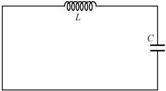
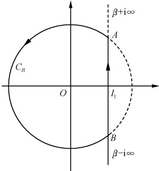
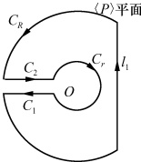

# 09-第九章 积分变换法

[返回全书目录](../../README.md)

> PDF 页码：176–200

<!-- page: 176 -->

在上一章中我们主要介绍了用分离变量法求解各种有界问题. 对于无界区域或半无界区域的问题, 采用求解数理方程的另一种常用方法——积分变换法, 比较方便, 所谓积分变换, 就是把某函数类 A 中的函数  $ f(x) $, 经过某种可逆的积分手续.

 $$ F(p)=\int k(x,p)f(x)\mathrm{d}x $$ 

变成另一函数类 B 中的函数  $ F(p) $,  $ F(p) $ 称为  $ f(x) $ 的像函数,  $ f(x) $ 称为像原函数, 而  $ k(x, p) $ 是 p 和 x 的已知函数, 称为积分变换的核. 在这种变换之下, 原来的偏微分方程可以减少自变量的个数, 直至变成常微分方程; 原来的常微分方程, 可以变成代数方程, 从而使在函数类 B 中的运算简化. 找出在 B 中的一个解, 再经过逆变换, 便得到原来要在 A 中所求的解.

积分变换的种类不少，如傅里叶变换（简称傅氏变换）、拉普拉斯变换（简称拉氏变换）、汉开尔（Hankel）变换、梅林（Mellin）变换等。本章将只介绍解数理方程时常用的傅氏变换和拉氏变换。

### 9.1 傅里叶变换

## 1. 傅里叶积分和傅里叶积分定理

由高等数学我们知道，一个以2l为周期的函数 $ f(x) $，若在区间 $ [-l,l] $上满足狄利克雷条件（即连续或有限个第一类间断点，并且只有有限个极值点），则在 $ [-l,l] $上可展开为傅氏级数（见8.1节注 $ ^{①} $）。

傅氏级数的复数形式 $ ^{①} $为

 $$ f(x)=\sum_{n=-\infty}^{\infty}c_{n}\mathrm{e}^{\mathrm{i}\omega_{n}x} $$ 

其中

 $$ \omega_{n}=\frac{n\pi}{l},\quad c_{n}=\frac{1}{2l}\int_{-l}^{l}f(\xi)\mathrm{e}^{-\mathrm{i}\omega_{n}\xi}\mathrm{d}\xi $$ 

因此， $ f(x) $也可表示为

$$  f(x)=\frac{1}{2l}\sum_{n=-\infty}^{\infty}\left[\int_{-l}^{l}f(\xi)\mathrm{e}^{-\mathrm{i}\omega_{n}\xi}\mathrm{d}\xi\right]\mathrm{e}^{\mathrm{i}\omega_{n}x}   \tag*{(9.1.1)}$$

由此看到，以2l为周期的函数，在自变数增长的过程中，函数值有规律的重复，自变数每增长一个周期2l，函数就重复变化一次。其中，参数 $ \omega_{n} $不连续地、跳跃地取下列

<!-- page: 177 -->

数值

 $$ \cdots-\frac{n\pi}{l},\cdots,-\frac{2\pi}{l},-\frac{\pi}{l},0,\frac{\pi}{l},\frac{2\pi}{l},\cdots,\frac{n\pi}{l},\cdots $$ 

其跃变间隔为

 $$ \Delta\omega_{n}=\pi/l $$ 

对于非周期函数而言，当然不具备以上这些特点，但我们自然想到，若将其看成周期趋于无穷大（即  $ 2l \to \infty $）的“周期函数”，则当然可仿照（9.1.1）式写出它的傅氏展开式，只是此时  $ \Delta\omega_{n} = \frac{\pi}{l} \to 0 $。这表明参数  $ \omega_{n} $ 变为  $ \omega $ 不再跃变，而是连续变化，即，非周期函数  $ f(x) $，可以表示为

 $$ \begin{align*}f(x)&=\lim_{l\to\infty}\sum_{n=-\infty}^{\infty}\bigg[\frac{1}{2l}\int_{-l}^{l}f(\xi)\mathrm{e}^{-\mathrm{i}\omega_{n}\xi}\mathrm{d}\xi\bigg]\mathrm{e}^{\mathrm{i}\omega_{n}x}\\&=\lim_{\Delta\omega_{n}\to0}\sum_{n=-\infty}^{\infty}\bigg[\frac{1}{2\pi}\int_{-\infty}^{\infty}f(\xi)\mathrm{e}^{-\mathrm{i}\omega_{n}\xi}\mathrm{d}\xi\bigg]\mathrm{e}^{\mathrm{i}\omega_{n}x}\Delta\omega_{n}\end{align*} $$ 

亦即

$$  f(x)=\frac{1}{2\pi}\int_{-\infty}^{\infty}\left[\int_{-\infty}^{\infty}f(\xi)\mathrm{e}^{-\mathrm{i}\omega\xi}\mathrm{d}\xi\right]\mathrm{e}^{\mathrm{i}\omega x}\mathrm{d}\omega   \tag*{(9.1.2)}$$

(9.1.2)式称为函数 $ f(x) $的傅里叶积分(简称傅氏积分)公式.应该指出，上述推导是极不严格的.因为我们交换了极限过程与求和过程的次序.实际上，傅氏积分成立，需满足下述傅里叶积分定理：设 $ f(x) $在 $ (-\infty,\infty) $上有定义且

（1）在任一有限区间上满足狄利克雷条件：

（2）在无限区间 $ (-∞, ∞) $上绝对可积

 $$ \int_{-\infty}^{\infty}\mid f(x)\mid\mathrm{d}x<+\infty $$ 

则傅里叶积分公式

 $$ f(x)=\frac{1}{2\pi}\int_{-\infty}^{\infty}\left[\int_{-\infty}^{\infty}f(\xi)\mathrm{e}^{-\mathrm{i}\omega\xi}\mathrm{d}\xi\right]\mathrm{e}^{\mathrm{i}\omega x}\mathrm{d}\omega $$ 

在  $ f(x) $ 的连续点 x 处成立，而在  $ f(x) $ 的第一类间断点  $ x_{0} $ 处，右边的积分应以  $ \frac{1}{2}[f(x_{0}+0)+f(x_{0}-0)] $ 代替.

此定理的证明，由于要用到较多的数学分析的知识，已超过本书范围，我们在此从略 $ ^{②} $.

类似地，我们可以写出三维形式的傅氏积分公式

$$  \begin{aligned}f(x,y,z)=&\left(\frac{1}{2\pi}\right)^{3}\iiint_{-\infty}^{\infty}\left[\iiint_{-\infty}^{\infty}f(\xi,\eta,\zeta)\mathrm{e}^{-\mathrm{i}(\omega_{1}\xi+\omega_{2}\eta+\omega_{3}\zeta)}\mathrm{d}\xi\mathrm{d}\eta\mathrm{d}\zeta\right]\\&\cdot\mathrm{e}^{\mathrm{i}(\omega_{1}x+\omega_{2}y+\omega_{3}z)}\mathrm{d}\omega_{1}\mathrm{d}\omega_{2}\mathrm{d}\omega_{3}\end{aligned}   \tag*{(9.1.3)}$$

## 2. 傅里叶变换

在傅氏积分公式（9.1.2）中令

<!-- page: 178 -->

$$  G(\omega)=\int_{-\infty}^{\infty}f(x)\mathrm{e}^{-\mathrm{i}\omega x}\mathrm{d}x   \tag*{(9.1.4)}$$

则

$$  f(x)=\frac{1}{2\pi}\int_{-\infty}^{\infty}G(\omega)\mathrm{e}^{\mathrm{i}\omega x}\mathrm{d}\omega   \tag*{(9.1.5)}$$

可见函数  $ f(x) $ 和  $ G(\omega) $ 可以通过积分相互表达。我们称 (9.1.4) 式为函数  $ f(x) $ 的傅里叶变换（简称傅氏变换），记作

$$  F[f(x)]=G(\omega)=\int_{-\infty}^{\infty}f(x)\mathrm{e}^{-\mathrm{i}\omega x}\mathrm{d}x   \tag*{(9.1.6)}$$

 $ G(\omega) $ 又称为  $ f(x) $ 的像函数；而称 (9.1.5) 式为函数  $ G(\omega) $ 的傅里叶逆变换（简称傅氏逆变换或傅氏反演），记作

$$  F^{-1}\left[G(\omega)\right]=f(x)=\frac{1}{2\pi}\int_{-\infty}^{\infty}G(\omega)\mathrm{e}^{\mathrm{i}\omega x}\mathrm{d}\omega   \tag*{(9.1.7)}$$

 $ f(x) $ 又称为  $ G(\omega) $ 的像原函数. 因此, 当  $ f(x) $ 满足傅氏积分定理的条件时, 傅氏积分公式就成为

$$  f(x)=F^{-1}\{F[f(x)]\}   \tag*{(9.1.8)}$$

这是傅氏变换和傅氏逆变换之间的一个重要关系.

易于看出，傅氏变换和逆变换的定义式(9.1.6)和(9.1.7)，其积分前的系数虽然各书的写法并不完全相同，但只要此二系数的乘积等于 $ \frac{1}{2\pi} $，(9.1.6)式和(9.1.7)式仍均是可以互相满足的，且两积分号内的指数因子 $ e^{-i\omega x} $和 $ e^{i\omega x} $也可以同时改为 $ e^{-i\omega x} $和 $ e^{-i\omega x} $.

在量子力学中，通常把  $ f(x) $ 记作  $ \psi(x) $，作为坐标表象的波函数，将  $ \omega $ 看作波数 k，而将 (9.1.6) 和 (9.1.7) 两式积分号前的系数分别写作  $ \frac{1}{\sqrt{2\pi}} $。由于  $ p = hk $  $ \left(h = \frac{h}{2\pi}, h $ 是普朗克常量  $ \right) $，则有  $ G(\omega) = G\left(\frac{p}{h}\right) $，记作  $ C(p) $，于是由 (9.1.5) 式和 (9.1.4) 式有

 $$ \psi(x)=\frac{1}{\sqrt{2\pi\hbar}}\int_{-\infty}^{\infty}C(p)\mathrm{e}^{\frac{\mathrm{i}}{\hbar}p x}\mathrm{d}p $$ 

 $$ C(p)=\frac{1}{\sqrt{2\pi\hbar}}\int_{-\infty}^{\infty}\psi(x)\mathrm{e}^{-\frac{i}{\hbar}p x}\mathrm{d}x $$ 

其中  $ C(p) $ 就是同一量子体系在动量表象中的波函数. 此二式表明了坐标表象与动量表象之间的波函数的变换关系（见量子力学有关知识）.

由傅氏变量和傅氏逆变换的定义(9.1.6)及(9.1.7)式可知，要求一个函数的傅氏变换（或傅氏逆变换），实际上是求一个含参数的广义积分.计算含参数的广义积分是一件比较困难的工作.但对于某些函数来说，还是比较容易计算的.

例1 指数衰减函数  $ f(t)=\left\{\begin{aligned}&0,&t<0\\ &\mathrm{e}^{-\beta t},&t\geqslant0\end{aligned}\right. $ 是无线电技术中常碰到的一个函数，求

<!-- page: 179 -->

它的傅氏变换和积分表达式. 其中  $ \beta>0 $.

解 由（9.1.6）式有

 $$ \begin{align*}F[f(t)]=G(\omega)=\int_{-\infty}^{\infty}f(t)\mathrm{e}^{-\mathrm{i}\omega t}\mathrm{d}t=\int_{0}^{\infty}\mathrm{e}^{-\beta t}\mathrm{e}^{-\mathrm{i}\omega t}\mathrm{d}t\\=\int_{0}^{\infty}\mathrm{e}^{-(\beta+\mathrm{i}\omega)t}\mathrm{d}t=\frac{1}{\beta+\mathrm{i}\omega}=\frac{\beta-\mathrm{i}\omega}{\beta^{2}+\omega^{2}}\end{align*} $$ 

而由(9.1.7)式有

 $$ \begin{align*}f(t)&=\frac{1}{2\pi}\int_{-\infty}^{\infty}G(\omega)\mathrm{e}^{\mathrm{i}\omega t}\mathrm{d}\omega\\&=\frac{1}{2\pi}\int_{-\infty}^{\infty}\frac{\beta-\mathrm{i}\omega}{\beta^{2}+\omega^{2}}\mathrm{e}^{\mathrm{i}\omega t}\mathrm{d}\omega=\frac{1}{2\pi}\int_{-\infty}^{\infty}\frac{\beta\cos\omega t+\omega\sin\omega t}{\beta^{2}+\omega^{2}}\mathrm{d}\omega\\&=\frac{1}{\pi}\int_{0}^{\infty}\frac{\beta\cos\omega t+\omega\sin\omega t}{\beta^{2}+\omega^{2}}\mathrm{d}\omega\end{align*} $$ 

此即函数  $ f(t) $ 的积分表达式. 由此我们还顺便得到一个含参变量 t 的积分公式

 $$ \int_{0}^{\infty}\frac{\beta\cos\omega t+\omega\sin\omega t}{\beta^{2}+\omega^{2}}\mathrm{d}\omega=f(t)\bullet\pi=\left\{\begin{aligned}&0,&&t<0\\ &\pi/2,&&t=0\\ &\pi\mathrm{e}^{-\beta t},&&t>0\end{aligned}\right. $$ 

常用函数的傅氏变换，已制成了表格以便查用.本书附录Ⅱ中，给出了傅氏变换简表.

类似地，在三维傅氏积分公式（9.1.3）的基础上可引入三维傅氏变换的定义.记

$$  \left\{\begin{aligned}&\boldsymbol{\omega}=\boldsymbol{e}_{1\omega_{1}}+\boldsymbol{e}_{2\omega_{2}}+\boldsymbol{e}_{3\omega_{3}}\\ &\boldsymbol{r}=\boldsymbol{e}_{1x}+\boldsymbol{e}_{2y}+\boldsymbol{e}_{3z}\\ &f(\boldsymbol{r})=f(x,y,z)\\ &\mathrm{d}\boldsymbol{r}=\mathrm{d}x\mathrm{d}y\mathrm{d}z,\quad\mathrm{d}\boldsymbol{\omega}=\mathrm{d}\omega_{1}\mathrm{d}\omega_{2}\mathrm{d}\omega_{3}\end{aligned}\right.   \tag*{(9.1.9)}$$

其中， $ e_{1}, e_{2}, e_{3} $ 为笛卡尔（Cartesian）坐标系中三个坐标轴的单位矢量。则（9.1.3）式变为

 $$ f(\boldsymbol{r})=\frac{1}{(2\pi)^{3}}\iiint_{-\infty}^{\infty}\left[\iiint_{-\infty}^{\infty}f(\boldsymbol{\xi},\boldsymbol{\eta},\boldsymbol{\zeta})\mathrm{e}^{-\mathrm{i}(\omega_{1}\boldsymbol{\xi}+\omega_{2}\boldsymbol{\eta}+\omega_{3}\boldsymbol{\zeta})}\mathrm{d}\xi\mathrm{d}\eta\mathrm{d}\zeta\right]\mathrm{e}^{\mathrm{i}\omega\cdot r}\mathrm{d}\omega $$ 

令

$$  G(\pmb{\omega})=\coprod_{-\infty}^{\infty}f(\pmb{r})\mathrm{e}^{-\mathrm{i}\pmb{\omega}\cdot\pmb{r}}\mathrm{d}\pmb{r}   \tag*{(9.1.10)}$$

则

$$  f(\boldsymbol{r})=\frac{1}{(2\pi)^{3}}\iiint_{-\infty}^{\infty}G(\pmb{\omega})\mathrm{e}^{\mathrm{i}\pmb{\omega}\cdot\boldsymbol{r}}\mathrm{d}\pmb{\omega}   \tag*{(9.1.11)}$$

我们称(9.1.10)式为三维函数  $ f(r) $ 的傅氏变换，记作

$$  F[f(\boldsymbol{r})]=G(\boldsymbol{\omega})=\iiint_{-\infty}^{\infty}f(\boldsymbol{r})\mathrm{e}^{-\mathrm{i}\omega\cdot r}\mathrm{d}\boldsymbol{r}   \tag*{(9.1.12)}$$

 $ G(\omega) $ 又称为  $ f(r) $ 的像函数，而称(9.1.11)式为三维函数  $ G(\omega) $ 的傅氏逆变换，记作

$$  F^{-1}\left[G\left(\pmb{\omega}\right)\right]=f(\pmb{r})=\frac{1}{\left(2\pi\right)^{3}}\iiint_{-\infty}^{\infty}G\left(\pmb{\omega}\right)\mathrm{e}^{\mathrm{i}\pmb{\omega}\cdot\pmb{r}}\mathrm{d}\pmb{\omega}   \tag*{(9.1.13)}$$

<!-- page: 180 -->

$ f(r) $ 又称为  $ G(\omega) $ 的像原函数.

## 3. 傅里叶变换的性质

下面我们介绍傅氏变换的几个基本性质. 设  $ F[f(x)] = G(\omega) $，且我们约定：当涉及一函数需要进行傅氏变换时，这个函数总是满足变换条件的.

（1）线性性质 若  $ \alpha,\beta $ 为任意常数，则对任意函数  $ f_{1} $ 和  $ f_{2} $ 有

$$  F[\alpha f_{_{1}}+\beta f_{_{2}}]=\alpha F[f_{_{1}}]+\beta F[f_{_{2}}]   \tag*{(9.1.14)}$$

证 由定义式(9.1.6)有

 $$ \begin{aligned}F[\alpha f_{_{1}}+\beta f_{_{2}}]=&\int_{-\infty}^{\infty}[\alpha f_{_{1}}(x)+\beta f_{_{2}}(x)]\mathrm{e}^{-\mathrm{i}\omega x}\mathrm{d}x\\ =&\alpha\int_{-\infty}^{\infty}f_{_{1}}(x)\mathrm{e}^{-\mathrm{i}\omega x}\mathrm{d}x+\beta\int_{-\infty}^{\infty}f_{_{2}}(x)\mathrm{e}^{-\mathrm{i}\omega x}\mathrm{d}x\\ =&\alpha F(f_{_{1}})+\beta F(f_{_{2}})\end{aligned} $$ 

（2）延迟性质（又称为频移性质）设 $ \omega_{0} $为任意常数，则

$$  F[\mathrm{e}^{\mathrm{i}\omega_{0}x}f(x)]=G(\omega-\omega_{0})   \tag*{(9.1.15)}$$

证 由定义式(9.1.6)有

 $$ \begin{aligned}F[\mathrm{e}^{\mathrm{i}\omega_{0}x}f(x)]&=\int_{-\infty}^{\infty}\mathrm{e}^{\mathrm{i}\omega_{0}x}f(x)\mathrm{e}^{-\mathrm{i}\omega x}\mathrm{d}x\\&=\int_{-\infty}^{\infty}f(x)\mathrm{e}^{-\mathrm{i}(\omega-\omega_{0})x}\mathrm{d}x\\&=G(\omega-\omega_{0})\\ \end{aligned} $$ 

（3）位移性质 设  $ x_{0} $ 为任意常数，则

$$  F[f(x-x_{0})]=\mathrm{e}^{-\mathrm{i}\omega x_{0}}F[f(x)]   \tag*{(9.1.16)}$$

证 由定义式(9.1.6)有

 $$ \begin{align*}F\big[\boldsymbol{f}(x-x_{0})\big]&=\int_{-\infty}^{\infty}\boldsymbol{f}(x-x_{0})\mathrm{e}^{-\mathrm{i}\omega x}\mathrm{d}x\\&=\mathrm{e}^{-\mathrm{i}\omega x_{0}}\int_{-\infty}^{\infty}\boldsymbol{f}(x-x_{0})\mathrm{e}^{-\mathrm{i}\omega(x-x_{0})}\mathrm{d}(x-x_{0})\\&=\mathrm{e}^{-\mathrm{i}\omega x_{0}}\int_{-\infty}^{\infty}\boldsymbol{f}(x^{\prime})\mathrm{e}^{-\mathrm{i}\omega x^{\prime}}\mathrm{d}x^{\prime}\\&=\mathrm{e}^{-\mathrm{i}\omega x_{0}}F\big[\boldsymbol{f}(x)\big]\end{align*} $$ 

（4）相似性质 设 a 为不为零的常数，则

$$  F[f(ax)]=\frac{1}{\mid a\mid}G\Big(\frac{\omega}{a}\Big)   \tag*{(9.1.17)}$$

证 令  $ ax = x' $，则当 a > 0 时有

 $$ F[f(ax)]=\int_{-\infty}^{\infty}f(ax)\mathrm{e}^{-\mathrm{i}\omega x}\mathrm{d}x=\int_{-\infty}^{\infty}f(x^{\prime})\mathrm{e}^{-\mathrm{i}\frac{\omega}{a}x^{\prime}}\mathrm{d}\frac{x^{\prime}}{a}=\frac{1}{a}G\left(\frac{\omega}{a}\right) $$

<!-- page: 181 -->

而当a<0时有

 $$ F[f(ax)]=\int_{-\infty}^{\infty}f(ax)\mathrm{e}^{-\mathrm{i}\omega x}\mathrm{d}x=\int_{-\infty}^{-\infty}f(x^{\prime})\mathrm{e}^{-\mathrm{i}\frac{\omega}{a}x^{\prime}}\mathrm{d}\frac{x^{\prime}}{a}=-\frac{1}{a}G\left(\frac{\omega}{a}\right) $$ 

所以

 $$ F[f(ax)]=\frac{1}{\mid a\mid}G\Big(\frac{\omega}{a}\Big) $$ 

（5）微分性质 若当 $ \left|x\right|\rightarrow\infty $时， $ f(x)\rightarrow0 $， $ f^{(n-1)}(x)\rightarrow0 $（其中n=1,2, $ \cdots $），则

$$  \left.\begin{array}{r}F\left[f^{\prime}(x)\right]=\mathrm{i}\omega F\left[f(x)\right]\\ F\left[f^{\prime \prime}(x)\right]=\left(\mathrm{i}\omega\right)^{2}F\left[f(x)\right]\\ \cdots\cdots\\ F\left[f^{(n)}(x)\right]=\left(\mathrm{i}\omega\right)^{n} F\left[f(x)\right]\end{array}\right\}   \tag*{（9.1.18）}$$

证 由定义(9.1.6)式和分部积分法有

 $$ \begin{align*}F\big[f^{\prime}(x)\big]&=\int_{-\infty}^{\infty}f^{\prime}(x)\mathrm{e}^{-\mathrm{i}_{ax}x}\mathrm{d}x\\&=\big[f(x)\mathrm{e}^{-\mathrm{i}_{ax}x}\big]_{-\infty}^{\infty}-\int_{-\infty}^{\infty}f(x)(-\mathrm{i}\omega)\mathrm{e}^{-\mathrm{i}_{ax}x}\mathrm{d}x\end{align*} $$ 

因为当 $ \left|x\right|\rightarrow\infty $时， $ f(x)\rightarrow0 $，因此

 $$ F[f^{\prime}(x)]=\mathrm{i}\omega\int_{-\infty}^{\infty}f(x)\mathrm{e}^{-\mathrm{i}\omega x}\mathrm{d}x=\mathrm{i}\omega F[f(x)] $$ 

又因为当 $ \left|x\right|\rightarrow\infty $时， $ f'(x)\rightarrow0 $，所以

 $$ F\big[f^{\prime \prime}(x)\big]=F\bigg[\frac{\mathrm{d}f^{\prime}(x)}{\mathrm{d}x}\bigg]=\mathrm{i}\omega F\big[f^{\prime}(x)\big]=(\mathrm{i}\omega)^{2}F\big[f(x)\big] $$ 

重复以上过程便可得（9.1.18）式.

（6）积分性质

$$  F\Big[\int_{x_{0}}^{x}f(\xi)\mathrm{d}\xi\Big]=\frac{1}{\mathrm{i}\omega}F\big[f(x)\big]   \tag*{(9.1.19)}$$

证 因为

 $$ \frac{\mathrm{d}}{\mathrm{d}x}\int_{x_{0}}^{x}f(\xi)\mathrm{d}\xi=f(x) $$ 

所以

 $$ F\Big[\frac{\mathrm{d}}{\mathrm{d}x}\int_{x_{0}}^{x}f(\xi)\mathrm{d}\xi\Big]=F\big[f(x)\big] $$ 

又由微分性质(9.1.18)式有

 $$ F\Big[\frac{\mathrm{d}}{\mathrm{d}x}\int_{x_{0}}^{x}f(\xi)\mathrm{d}\xi\Big]=\mathrm{i}\omega F\Big[\int_{x_{0}}^{x}f(\xi)\mathrm{d}\xi\Big] $$ 

比较上面两式即得（9.1.19）式.

（7）卷积定理 已知函数  $ f_{1}(x) $ 和  $ f_{2}(x) $，则定义积分

 $$ \int_{-\infty}^{\infty}f_{1}(\xi)f_{2}(x-\xi)\mathrm{d}\xi $$

<!-- page: 182 -->

为函数  $ f_{1}(x) $ 与  $ f_{2}(x) $ 的卷积，记作  $ f_{1}(x) \cdot f_{2}(x) $，即

$$  f_{1}(x)*f_{2}(x)=\int_{-\infty}^{\infty}f_{1}(\xi)f_{2}(x-\xi)\mathrm{d}\xi   \tag*{(9.1.20)}$$

卷积运算“*”是一种函数间的运算，易于证明它与乘法相似，具有交换律、结合律与分配律，即

 $$ \begin{aligned}&f_{1}(x)*f_{2}(x)=f_{2}(x)*f_{1}(x)\\&\left[f_{1}(x)*f_{2}(x)\right]*f_{3}(x)=f_{1}(x)*\left[f_{2}(x)*f_{3}(x)\right]\\&f_{1}(x)*\left[f_{2}(x)+f_{3}(x)\right]=f_{1}(x)*f_{2}(x)+f_{1}(x)*f_{3}(x)\\ \end{aligned} $$ 

对于函数  $ f_{1}(x) $ 和  $ f_{2}(x) $ 有

$$  F\big[f_{1}(x)*f_{2}(x)\big]=F\big[f_{1}(x)\big]\bullet F\big[f_{2}(x)\big]   \tag*{(9.1.21)}$$

此即卷积定理.

证 由定义

 $$ F[f_{1}*f_{2}]=\int_{-\infty}^{\infty}\left[\int_{-\infty}^{\infty}f_{1}(\xi)f_{2}(x-\xi)\mathrm{d}\xi\right]\mathrm{e}^{-\mathrm{i}\omega x}\mathrm{d}x $$ 

由于  $ f_{1} $ 和  $ f_{2} $ 都是在  $ (-∞, ∞) $ 上绝对可积的，故积分可交换次序，因此

 $$ \begin{align*}F\big[f_{1}*f_{2}\big]=&\int_{-\infty}^{\infty}f_{1}(\xi)\bigg[\int_{-\infty}^{\infty}f_{2}(x-\xi)\mathrm{e}^{-\mathrm{i}\omega x}\mathrm{d}x\bigg]\mathrm{d}\xi\\=&\int_{-\infty}^{\infty}f_{1}(\xi)\bullet\mathrm{e}^{-\mathrm{i}\omega\hat{\xi}}F\big[f_{2}\big]\mathrm{d}\xi=F\big[f_{1}\big]\bullet F\big[f_{2}\big]\end{align*} $$ 

#### （8）像函数的卷积定理

证

 $$ \begin{aligned}&F[f_{1}(x)\bullet f_{2}(x)]=\frac{1}{2\pi}F[f_{1}(x)]*F[f_{2}(x)]\\&\quad F[f_{1}(x)\bullet f_{2}(x)]\\&=\int_{-\infty}^{\infty}f_{1}(x)f_{2}(x)\mathrm{e}^{-\omega x}\mathrm{d}x\\&=\int_{-\infty}^{\infty}f_{1}(x)\bigg[\frac{1}{2\pi}\int_{-\infty}^{\infty}G_{2}\left(\omega^{\prime}\right)\mathrm{e}^{\mathrm{i}\omega^{\prime}x}\mathrm{d}\omega^{\prime}\bigg]\mathrm{e}^{-\omega x}\mathrm{d}x\\&=\frac{1}{2\pi}\int_{-\infty}^{\infty}G_{2}\left(\omega^{\prime}\right)\bigg[\int_{-\infty}^{\infty}f_{1}(x)\mathrm{e}^{-\left(\omega-\omega^{\prime}\right)x}\mathrm{d}x\bigg]\mathrm{d}\omega^{\prime}\\&=\frac{1}{2\pi}\int_{-\infty}^{\infty}G_{2}\left(\omega^{\prime}\right)G_{1}\left(\omega-\omega^{\prime}\right)\mathrm{d}\omega^{\prime}\\&=\frac{1}{2\pi}G_{2}\left(\omega\right)*G_{1}\left(\omega\right)\\&=\frac{1}{2\pi}F[f_{1}(x)]*F[f_{2}(x)]\\ \end{aligned} $$ 

用类似的方法可以证明三维函数  $ f(r) $ 的傅氏变换亦具有上述的那些性质.

运用傅氏变换的线性性质、微分性质和积分性质，可以把线性常系数常微分方程化为代数方程，通过解代数方程与求傅氏逆变换，就可以得到此常微分方程的解。

例2 求解质量为1具有阻尼的(经典)谐振子的受迫振动方程

<!-- page: 183 -->

$$  \ddot{x}(t)+2\dot{\gamma}\dot{x}\left(t\right)+\omega_{0}^{2}x(t)=f(t)   \tag*{（9.1.23）}$$

其中  $ f(t) $ 是已知函数,  $ \gamma>0 $ 和  $ \omega_{0}^{2} $ 是常数.

解 记  $ F[x(t)]=\tilde{x}(\omega), F[f(t)]=\tilde{f}(\omega) $; 对方程中各项施行傅氏变换，则由线性性质(9.1.14)式和微分性质(9.1.18)式有

 $$ (\mathrm{i}\omega)^{2}\widetilde{x}(\omega)+2\mathrm{i}\omega\gamma\widetilde{x}(\omega)+\omega_{0}^{2}\widetilde{x}(\omega)=\widetilde{f}(\omega) $$ 

所以

 $$ \tilde{x}(\omega)=\frac{-\tilde{f}(\omega)}{\omega^{2}-2i\gamma\omega-\omega_{0}^{2}}=\tilde{f}(\omega)\bullet\frac{1}{(\sqrt{\omega_{0}^{2}-\gamma^{2}})^{2}-(\omega-\mathrm{i}\gamma)^{2}} $$ 

由查表和位移性质知

 $$ \frac{1}{(\sqrt{\omega_{0}^{2}-\gamma^{2}})^{2}-(\omega-\mathrm{i}\gamma)^{2}}=\frac{1}{\sqrt{\omega_{0}^{2}-\gamma^{2}}}F\big[\mathrm{e}^{-\gamma t}H(t)\sin\sqrt{\omega_{0}^{2}-\gamma^{2}}t\big] $$ 

其中

$$  H(t)=\left\{\begin{aligned}&0,&t<0\\ &1,&t>0\end{aligned}\right.   \tag*{(9.1.24)}$$

称为赫维赛德（Heaviside）单位函数或阶梯函数。它的更一般表示为

$$  H(t-a)=\left\{\begin{aligned}&0,&t<a\\ &1,&t>a\end{aligned}\right.   \tag*{（9.1.25）}$$

故

 $$ F\big[x(t)\big]=\frac{1}{\sqrt{\omega_{0}^{2}-\gamma^{2}}}F\big[f(t)\big]\bullet F\big[\mathrm{e}^{-\gamma t}H(t)\sin\sqrt{\omega_{0}^{2}-\gamma^{2}}t\big] $$ 

对上式两边取傅氏逆变换并应用卷积定理，立即可得所求受迫振动方程(9.1.23)的特解[记为 $ x_{s}(t) $，以示区别]为

 $$ x_{s}(t)=\frac{1}{\sqrt{\omega_{0}^{2}-\gamma^{2}}}\int_{-\infty}^{t}f(\tau)\mathrm{e}^{-\gamma(t-\tau)}\sin\big[\sqrt{\omega_{0}^{2}-\gamma^{2}}(t-\tau)\big]\mathrm{d}\tau $$ 

从而得(9.1.23)式的解为

 $$ x(t)=c_{1}x_{1}(t)+c_{2}x_{2}(t)+x_{s}(t) $$ 

其中

 $$ x_{1}(t)=\mathrm{e}^{-n}\sin\sqrt{\omega_{0}^{2}-\gamma^{2}}t\quad 和 \quad x_{2}(t)=\mathrm{e}^{-n}\cos\sqrt{\omega_{0}^{2}-\gamma^{2}}t $$ 

是(9.1.23)式所对应的齐次方程的线性独立解， $ c_{1} $ 和  $ c_{2} $ 是任意常数.

注 ① 傅里叶级数的复数形式证明见二维码.

②证明可参阅 B. H. 斯米尔诺夫. 高等数学教程，第二卷，第二分册，p. 456～459. 北京：高等教育出版社，1959.

#### 习题9.1

傅里叶级数的

复数形式证明

1. 若  $ f(x) $ 满足傅氏积分定理的条件且为奇函数，试证

 $$ f(x)=\int_{0}^{\infty}b(\omega)\sin\omega x\mathrm{d}\omega $$

<!-- page: 184 -->

其中

 $$ b(\omega)=\frac{2}{\pi}\int_{0}^{\infty}f(x)\sin\omega x\mathrm{d}x $$ 

2. 求下列函数的傅氏变换：

(1) $ \frac{\sin ax}{x} $，a>0; (2) $ e^{-\eta x^{2}} $， $ \eta>0 $; (3) $ \sin \eta x^{2}, \cos \eta x^{2} $， $ \eta>0 $; (4) $ e^{-a|x|} $，a>0; (5) $ xe^{-ax^{2}} $，a>0.

3. 已知 $ \int_{-\infty}^{\infty}\frac{f(\xi)\mathrm{d}\xi}{(x-\xi)^{2}+a^{2}}=\frac{1}{x^{2}+b^{2}},0<a<b $，求未知函数 $ f(x) $.

4. 设  $ F[f(x)] = G(\omega), G^{(m)}(\omega) \mid_{\omega \to \pm \infty} = 0, m = 0, 1, \cdots, n-1 $，试证明像函数微分性质

$$  F\big[(-\mathrm{i}x)^{n}f(x)\big]=G^{(n)}\left(\omega\right),\quad n=1,2,\cdots   \tag*{(9.1.26)}$$

5. 试用傅氏变换的方法，求解量子力学中将会遇到的艾里（Airy）方程

 $$ u^{\prime \prime}(\xi)-\xi u(\xi)=0 $$ 

6. 设  $ F[f(x)] = G(\omega) $,  $ \int_{-\infty}^{\infty} G(\xi) \, \mathrm{d}\xi = 0 $，试证像函数的积分性质

$$  F\Big[\frac{1}{-\mathrm{i}x}f(x)\Big]=\int_{-\infty}^{\infty}G(\xi)\mathrm{d}\xi   \tag*{（9.1.27）}$$

7. 设  $ r = \sqrt{x^2 + y^2 + z^2} = |r| $,  $ \omega = \sqrt{\omega_1^2 + \omega_2^2 + \omega_3^2} = |\omega| $，证明

(1)  $  F\left[\frac{1}{r}\right] = \frac{4\pi}{\omega^2};  $

(2)  $  F\left[\frac{1}{r} e^{-\mu r}\right] = \frac{4\pi}{\omega^2 + \mu^2} (\mu > 0).  $

提示：(1) 可从右往左证，若从左往右证，则需先证(2)再取极限  $ \mu \to 0 $.

 $ ^{8} $. 试证傅里叶光学中的下列傅里叶变换关系式：

(1)  $  F[\operatorname{rect}(x)\operatorname{rect}(y)] = \operatorname{sinc}(f_x) \operatorname{sinc}(f_y)  $;

(2)  $  F[\Lambda(x)\Lambda(y)] = \mathrm{sinc}^2(f_x) \mathrm{sinc}^2(f_y).  $

其中

 $ f_{x}=\frac{\omega_{1}}{2\pi},f_{y}=\frac{\omega_{2}}{2\pi} $ 为频率；

rect(x)= $ \left\{\begin{aligned}&1,&|x|\leqslant\frac{1}{2}\\ &0,& 其他 \end{aligned}\right. $，为矩形函数；

 $$ \Lambda(x)=\begin{cases}1-\mid x\mid,&|x\mid\leqslant1\\0,& 其他 \end{cases}, 为三角函数； $$ 

 $ \sin c x=\frac{\sin \pi x}{\pi x} $，为 $ \sin c $函数.

9. 将  $ f(x)=\cos x^{2} $ 展开为傅氏积分.

（芝加哥大学研究生试题）

 $ ^{*} $10. 考虑受外力 g(t)作用的一个阻尼的简谐振子. 因此振子的运动由

 $$ \begin{array}{r}{\ddot{x}(t)+2a\dot{x}\left(t\right)+\omega_{0}^{2}x(t)=f(t),\qquad f(t)=g(t)/m}\end{array} $$ 

所给出. 考虑  $ \omega_{0} > a $ 的情形，这表示一个阻尼振子，且

 $$ f(t)=\begin{cases}f_{0},&\mid t\mid<\tau\\0,&\mid t\mid\geqslant\tau\end{cases} $$ 

求在三个区间  $ t<-\tau, t>\tau $ 和  $ |t|<\tau $ 中的  $ x(t) $，计算所有积分.

（加州理工学院研究生试题）

<!-- page: 185 -->

11. 设  $ F[f_{1}(x)] = G_{1}(\omega) $,  $ F[f_{2}(x)] = G_{2}(\omega) $,  $ F[f(x)] = G(\omega) $. 试证明乘积定理

$$  \int_{-\infty}^{\infty}f_{1}(x)f_{2}(x)\mathrm{d}x=\frac{1}{2\pi}\int_{-\infty}^{\infty}G_{1}^{*}\left(\omega\right)G_{2}\left(\omega\right)\mathrm{d}\omega=\frac{1}{2\pi}\int_{-\infty}^{\infty}G_{1}\left(\omega\right)G_{2}^{*}\left(\omega\right)\mathrm{d}\omega   \tag*{（9.1.28）}$$

和能量积分，即帕塞瓦尔(Parseval)等式

$$  \int_{-\infty}^{\infty}\left[f(x)\right]^{2}\mathrm{d}x=\int_{-\infty}^{\infty}\mid F(\omega)\mid^{2}\mathrm{d}\omega   \tag*{(9.1.29)}$$

其中， $ G_{1}^{*}(\omega) $， $ G_{2}^{*}(\omega) $ 分别为  $ G_{1}(\omega) $， $ G_{2}(\omega) $ 的共轭复数.

### 9.2 傅里叶变换法

对于无界区域的定解问题，傅里叶变换法是一种普遍适用的求解方法，其求解过程与解常微分方程大体相似。下面我们将通过几个具体的例子来了解如何用傅氏变换法来求解数学物理方程。

## 1. 波动问题

例 1 求解弦振动方程的初值问题

$$  \left\{u_{t t}=a^{2}u_{x x},\quad-\infty<x<\infty,t>0\right.   \tag*{(9.2.1)}$$

$$  \left\{\begin{aligned}u(x,0)&=\varphi(x)\\ u_{t}(x,0)&=0\end{aligned}\right\},\quad-\infty<x<\infty   \tag*{(9.2.2)}$$

解 视 t 为参数，对（9.2.1）、（9.2.2）和（9.2.3）式的两端均进行傅氏变换，并记

 $$ F[u(x,t)]=\int_{-\infty}^{\infty}u(x,t)\mathrm{e}^{-\mathrm{i}\omega x}\mathrm{d}x=\tilde{u}(\omega,t),\quad F[\varphi(x)]=\tilde{\varphi}(\omega) $$ 

则有

 $$ \begin{cases}\frac{\mathrm{d}^{2}\tilde{u}}{\mathrm{d}t^{2}}=-a^{2}\omega^{2}\tilde{u}\\\tilde{u}(\omega,0)=\tilde{\varphi}(\omega)\\\tilde{u}_{t}(\omega,0)=0\end{cases} $$ 

这是带参数 $ \omega $的变量t的二阶常微分方程的初值问题，解之得

 $$ \tilde{u}(\omega,t)=\tilde{\varphi}(\omega)\cos{a\omega t} $$ 

于是由逆变换公式(9.1.7)，得定解问题(9.2.1)～(9.2.3)式的解为

 $$ \begin{align*}u(x,t)&=F^{-1}\big[\tilde{u}(\omega,t)\big]=F^{-1}\big[\tilde{\varphi}(\omega)\cos\omega t\big]\\&=\frac{1}{2\pi}\int_{-\infty}^{\infty}\tilde{\varphi}(\omega)\cos\omega t\mathrm{e}^{\mathrm{i}\omega x}\mathrm{d}\omega\\&=\frac{1}{4\pi}\int_{-\infty}^{\infty}\tilde{\varphi}(\omega)\big[\mathrm{e}^{\mathrm{i}\omega(x+at)}+\mathrm{e}^{\mathrm{i}\omega(x-at)}\big]\mathrm{d}\omega\\&=\frac{1}{2}\big[\varphi(x+at)+\varphi(x-at)\big]\end{align*} $$ 

这与用达朗贝尔公式所得到的结果一致. 最后一步应用了位移性质.

<!-- page: 186 -->

## 2. 输运问题

例2 求无界杆的热传导问题

$$  \int u_{t}=a^{2}u_{x x}+f(x,t),\quad-\infty<x<\infty,t>0   \tag*{(9.2.4)}$$

$$  \mathcal{N}_{u}(x,0)=\varphi(x),\qquad\quad-\infty<x<\infty   \tag*{（9.2.5）}$$

解 对(9.2.4)式和(9.2.5)式两端以 x 为变量分别进行傅氏变换，并记

 $$ F[u(x,t)]=\tilde{u}(\omega,t),\quad F[\varphi(x)]=\tilde{\varphi}(\omega),\quad F[f(x,t)]=\tilde{f}(\omega,t) $$ 

则有

 $$ \left\{\begin{aligned}&\frac{\mathrm{d}\tilde{u}}{\mathrm{d}t}=-a^{2}\omega^{2}\tilde{u}+\tilde{f}(\omega,t)\\ &\tilde{u}(\omega,0)=\tilde{\varphi}(\omega)\end{aligned}\right. $$ 

这是带参数 $ \omega $关于变量t的一阶常微分方程的初值问题，解之得

 $$ \tilde{u}(\omega,t)=\tilde{\varphi}(\omega)\mathrm{e}^{-a^{2}\omega^{2}t}+\int_{0}^{t}\tilde{f}(\omega,\tau)\mathrm{e}^{-a^{2}\omega^{2}(t-\tau)}\mathrm{d}\tau $$ 

于是，由逆变换得（9.2.4）式和（9.2.5）式的解应为

 $$ \begin{align*}u(x,t)=&F^{-1}\big[\tilde{u}(\omega,t)\big]\\=&F^{-1}\big[\tilde{\varphi}(\omega)\mathrm{e}^{-\alpha^{2}\omega^{2}t}\big]+F^{-1}\bigg[\int_{0}^{t}\widetilde{f}(\omega,\tau)\mathrm{e}^{-\alpha^{2}\omega^{2}(t-\tau)}\mathrm{d}\tau\bigg]\\=&F^{-1}\big[F\big[\varphi(x)\big]\bullet F\big[F^{-1}(\mathrm{e}^{-\alpha^{2}\omega^{2}t})\big]\big]\\&+\int_{\varsigma}^{t}F^{-1}\big[F\big[f(x,\tau)\big]\bullet F\big[F^{-1}\big[\mathrm{e}^{-\alpha^{2}\omega^{2}(t-\tau)}\big]\big]\big]\mathrm{d}\tau\end{align*} $$ 

故由卷积性质(9.1.21)有

 $$ u(x,t)=\varphi(x)*F^{-1}(\mathrm{e}^{-a^{2}\omega^{2}t})+\int_{0}^{t}f(x,\tau)*F^{-1}[\mathrm{e}^{-a^{2}\omega^{2}(t-\tau)}]\mathrm{d}\tau $$ 

而由逆变换公式(9.1.7)式得

$$  \begin{aligned}F^{-1}(\mathrm{e}^{-a^{2}\omega^{2}t})&=\frac{1}{2\pi}\int_{-\infty}^{\infty}\mathrm{e}^{-a^{2}\omega^{2}t}\mathrm{e}^{\mathrm{i}\omega x}\mathrm{d}\omega\\&=\frac{1}{2\pi}\int_{-\infty}^{\infty}\mathrm{e}^{-a^{2}\omega^{2}t}(\cos\omega x+\mathrm{i}\sin\omega x)\mathrm{d}\omega\\&=\frac{1}{\pi}\int_{0}^{\infty}\mathrm{e}^{-a^{2}\omega^{2}t}\cos\omega x\mathrm{d}\omega\\&=\frac{1}{2a\sqrt{\pi t}}\mathrm{e}^{-\frac{x^{2}}{4a^{2}t}}\end{aligned}   \tag*{(9.2.6)}$$

最后一步利用了第一篇的积分公式(5.3.7)式

 $$ \int_{0}^{\infty}\mathrm{e}^{-a x^{2}}\cos b x\mathrm{d}x=\frac{1}{2}\mathrm{e}^{-\frac{b^{2}}{4a}}\sqrt{\frac{\pi}{a}},\quad a>0 $$ 

于是

 $$ u(x,t)=\varphi(x)*\frac{1}{2a\sqrt{\pi t}}\mathrm{e}^{-\frac{x^2}{4a^2t}}+\int_{0}^{t}f(x,\tau)*\frac{1}{2a\sqrt{\pi(t-\tau)}}\mathrm{e}^{-\frac{x^2}{4a^2(t-\tau)}}\mathrm{d}\tau $$

<!-- page: 187 -->

$$  \mathrm{e}^{-\frac{1}{2a\sqrt{\pi t}}\int_{-\infty}^{\infty}\varphi(\xi)\mathrm{e}^{-\frac{(x-\xi)^2}{4a^2t}}\mathrm{d}\xi}+\frac{1}{2a\sqrt{\pi}}\mathrm{e}^{-\frac{f(\xi,\tau)}{\sqrt{t-\tau}}}\mathrm{d}\xi\mathrm{d}\tau   \tag*{(9.2.7)}$$

由此例我们看到，用傅氏变换解方程时不必像分离变量法那样区分齐次方程和非齐次方程，都是按同样的步骤解。

例3 已知某种微粒在空间的浓度分布为  $ \varphi(r) $，求解 t>0 时浓度的变化.

解 其定解问题为

$$  u_{t}-a^{2}\Delta u=0   \tag*{(9.2.8)}$$

$$  u\mid_{t=0}=\varphi(\boldsymbol{r})   \tag*{(9.2.9)}$$

将上述定解问题就空间变量  $ r(x,y,z) $ 作三维傅氏变换，并记

 $$ F[u(\boldsymbol{r},t)]=\iiint_{-\infty}^{\infty}u(\boldsymbol{r},t)\mathrm{e}^{-\mathrm{i}\omega\cdot r}\mathrm{d}\boldsymbol{r}=\tilde{u}(\boldsymbol{\omega},t) $$ 

 $$ F[\varphi(\boldsymbol{r})]=\tilde{\varphi}(\boldsymbol{\omega}),\quad\omega=\sqrt{\omega_{1}^{2}+\omega_{2}^{2}+\omega_{3}^{2}}=|\boldsymbol{\omega}| $$ 

则运用微分性质有

 $$ \left\{\begin{aligned}&\frac{\mathrm{d}\tilde{u}}{\mathrm{d}t}+a^{2}\omega^{2}\tilde{u}=0\\ &\tilde{u}(\pmb{\omega},0)=\tilde{\varphi}(\pmb{\omega})\end{aligned}\right. $$ 

解之得

 $$ \tilde{u}(\pmb{\omega},t)=\tilde{\varphi}(\pmb{\omega})\mathrm{e}^{-a^{2}\omega^{2}t} $$ 

由三维函数的傅氏逆变换公式 $ (9.1.13) $有

 $$ \begin{aligned}F^{-1}[\mathrm{e}^{-a^{2}\omega^{2}t}]&=\frac{1}{(2\pi)^{3}}\iiint_{-\infty}^{\infty}\mathrm{e}^{-a^{2}\omega^{2}t}\mathrm{e}^{\mathrm{i}\omega r}\mathrm{d}\omega\\&=\frac{1}{(2\pi)^{3}}\iiint_{-\infty}^{\infty}\mathrm{e}^{-a^{2}(\omega_{1}^{2}+\omega_{2}^{2}+\omega_{3}^{2})t}\mathrm{e}^{\mathrm{i}(\omega_{1}x+\omega_{2}y+\omega_{3}z)}\mathrm{d}\omega_{1}\mathrm{d}\omega_{2}\mathrm{d}\omega_{3}\\&=\frac{1}{8a^{3}(\pi t)^{3/2}}\mathrm{e}^{-\frac{x^{2}+y^{2}+z^{2}}{4a^{2}t}}\\ \end{aligned} $$ 

此处重复用了(9.2.6)式的结果三次. 故由逆变换公式和卷积定理有

$$  \begin{align*}u(\boldsymbol{r},t)&=F^{-1}\big[\tilde{u}(\boldsymbol{\omega},t)\big]=F^{-1}\big[\tilde{\varphi}(\boldsymbol{\omega})\mathrm{e}^{-a^{2}\omega^{2}t}\big]\\&=\frac{1}{8a^{3}(\pi t)^{3/2}}\iiint_{-\infty}^{\infty}\varphi(\boldsymbol{r}^{\prime})\mathrm{e}^{-\frac{|\boldsymbol{r}-\boldsymbol{r}^{\prime}|^{2}}{4a^{2}t}}\mathrm{d}\boldsymbol{r}^{\prime}\end{align*}   \tag*{(9.2.10)}$$

## 3. 稳定场问题

例 4 求解真空中静电势满足的方程

$$  \Delta u(x,y,z)=-\frac{1}{\varepsilon_{0}}\rho(x,y,z)   \tag*{(9.2.11)}$$

解上述方程即

$$  \triangle u(\pmb{r})=-\frac{1}{\varepsilon_{0}}\rho(\pmb{r})   \tag*{(9.2.12)}$$

<!-- page: 188 -->

为方便起见，令  $ f(r)=\frac{1}{\varepsilon_{0}}\rho(r) $，并记  $ F[u(r)]=\tilde{u}(\omega), F[f(r)]=\tilde{f}(\omega) $，对方程 (9.2.12) 进行傅氏变换得

 $$ \tilde{u}(\pmb{\omega})=\frac{1}{\omega^{2}}\tilde{f}(\pmb{\omega}) $$ 

利用变换公式

 $$ F\Big[\frac{1}{r}\Big]=\frac{4\pi}{\omega^{2}} $$ 

（见习题9.1第7题）有

 $$ F[u(\boldsymbol{r})]=\frac{1}{4\pi}F\Big[\frac{1}{|\boldsymbol{r}|}\Big]\bullet F[f(\boldsymbol{r})] $$ 

故由卷积定理有

 $$ u(\boldsymbol{r})=\frac{1}{4\pi}\iiint_{-\infty}^{\infty}\frac{f(\boldsymbol{r}^{\prime})}{|\boldsymbol{r}-\boldsymbol{r}^{\prime}|}\mathrm{d}\boldsymbol{r}^{\prime} $$ 

#### 习题9.2

1. 试用傅氏变换法求解上半平面狄氏问题

 $$ \left\{\begin{aligned}\Delta u&=0,\quad y>0\\ u&\mid_{y=0}=f(x)\\ &\lim\limits_{(x^{2}+y^{2})\to\infty}u=0\end{aligned}\right. $$ 

2. 试用傅里叶变换法求解无界弦的强迫振动

 $$ \begin{cases}u_{tt}=a^{2}u_{xx}+f(x,t),&-\infty<x<\infty\\u\mid_{t=0}=\varphi(x)\\u_{t}\mid_{t=0}=\psi(x)\end{cases} $$ 

3. 用傅氏变换法求解无限长梁在初始条件下的自由振动问题

 $$ \begin{cases}u_{tt}+a^{2}u_{xxxx}=0,&-\infty<x<\infty\\u(x,0)=\varphi(x)\\u_{t}(x,0)=a\psi^{\prime \prime}(x)\end{cases} $$ 

4. 用傅氏变换法求解半无限长均匀细管中的扩散问题

 $$ \left\{\begin{aligned}&u_{t}-D u_{x x}=0,&&0\leqslant x<\infty,t\geqslant0\\ &u\mid_{x=0}=0,&&t>0\\ &u\mid_{t=0}=\mathrm{e}^{-\beta\mathrm{r}},&&0\leqslant x<\infty\end{aligned}\right. $$ 

5. 用傅氏变换法求解半无界弦的自由振动

 $$ \left\{\begin{aligned}&u_{t t}=a^{2}u_{x x},&x&>0\\ &u\mid_{t=0}=0,&u_{t}\mid_{t=0}&=0\\ &u\mid_{x=0}=f(t),&t&>0\\ \end{aligned}\right. $$ 

提示：先将  $ f(t) $ 延拓为  $ f(t)H(t) $，并将 x 看成参数来求解。其中

 $$ H(t)=\left\{\begin{aligned}&1,&t>0\\ &0,&t<0\end{aligned}\right. $$

<!-- page: 189 -->

为阶跃函数.

6. 求解热传导方程  $ u_{t}=a^{2}u_{xx}\left(-\infty<x<\infty,t>0\right) $ 的初值问题，已知

(1)  $ u(x,0)=\sin x $; (2)  $ u(x,0)=x^{2}+1 $.

7. 用傅氏变换法求解混合微分方程的定解问题

 $$ u_{tx}=u_{xx}\left(-\infty<x<\infty,t>0\right) $$ 

 $$ u(x,0)=\sqrt{\frac{\pi}{2}}\mathrm{e}^{-\mid x\mid}\quad(-\infty<x<\infty) $$ 

8. 求解下列非常数系数的定解问题：

 $$ \left\{\begin{aligned}t u_{x}+u_{t}&=0(-\infty<x<\infty,t>0)\\ u(x,0)&=f(x)(-\infty<x<\infty)\end{aligned}\right. $$ 

### 9.3 拉普拉斯变换

由上一节我们看到，在用傅氏变换解微分方程时，要求所出现的函数必须在 $ (-\infty, \infty) $内满足绝对可积这个条件。这样，常数、多项式及三角函数等函数类都不能进行傅氏变换。另一方面，傅氏变换还要求进行变换的函数在无穷区间 $ (-\infty, \infty) $有定义，如果要求解的问题是混合问题而不是初值问题，那么就不能对空间变量进行傅氏变换了。为了克服傅氏变换的这些缺点，于是，人们适当地把傅氏变换加以改造，提出了拉普拉斯变换（简称为拉氏变换）。

为了达到使读者掌握用“拉氏变换”的方法解“数理方程”的目的，本节将引入拉氏变换的概念、存在定理、性质和展开定理。

## 1. 拉氏变换及拉氏变换存在定理

对于任何函数  $ f(t) $，我们假定在 t<0 时  $ f(t)\equiv0 $，那么，只要  $ \beta $ 足够的大，函数  $ f(t)\mathrm{e}^{-\beta t} $ 的傅氏变换就有可能存在，即

 $$ F\big[f(t)\mathrm{e}^{-\beta t}\big]=\int_{-\infty}^{\infty}f(t)\mathrm{e}^{-\beta t}\mathrm{e}^{-\mathrm{i}\omega t}\mathrm{d}t=\int_{0}^{\infty}f(t)\mathrm{e}^{-(\beta+\mathrm{i}\omega)t}\mathrm{d}t $$ 

其中

 $$ f(t)\mathrm{e}^{-\beta t}=\frac{1}{2\pi}\int_{-\infty}^{\infty}F[f(t)\mathrm{e}^{-\beta t}]\cdot\mathrm{e}^{\mathrm{i}\omega t}\mathrm{d}\omega $$ 

记

 $$ p=\beta+\mathrm{i}\omega,\quad F(p)=F[f(t)\mathrm{e}^{-\beta t}] $$ 

并注意到

 $$ \mathrm{d}p=\mathrm{i}\mathrm{d}\omega $$ 

$$  F(p)=\int_{0}^{\infty}f(t)\mathrm{e}^{-pt}\mathrm{d}t   \tag*{(9.3.1)}$$

便得到

$$  f(t)=\frac{1}{2\pi\mathrm{i}}\int_{\beta-\mathrm{i}\infty}^{\beta+\mathrm{i}\infty}F(p)\mathrm{e}^{p t}\mathrm{d}p   \tag*{(9.3.2)}$$

<!-- page: 190 -->

这是一对新的互逆的积分变换. 我们称(9.3.1)式为函数  $ f(t) $ 的拉普拉斯变换, 记作

$$  L[f(t)]=F(p)=\int_{0}^{\infty}f(t)\mathrm{e}^{-pt}\mathrm{d}t   \tag*{(9.3.3)}$$

并称函数  $ F(p) $ 为  $ f(t) $ 的像函数；而称(9.3.2)式为函数  $ F(p) $ 的拉普拉斯逆变换或拉普拉斯反演公式，记作

$$  L^{-1}\left[F(p)\right]=f(t)=\frac{1}{2\pi\mathrm{i}}\int_{\beta\to\infty}^{\beta+\mathrm{i}\infty}F(p)\mathrm{e}^{p t}\mathrm{d}p   \tag*{(9.3.4)}$$

并称函数  $ f(t) $ 为  $ F(p) $ 的像原函数. 显然

$$  f(t)=L^{-1}\big[L\big[f(t)\big]\big]   \tag*{(9.3.5)}$$

拉氏变换的存在条件，由下述拉普拉斯变换的存在定理 $ ^{①} $给出.设函数  $ f(t) $ 满足以下条件：

（1）当t<0时， $ f(t)=0 $;

（2）当 $ t\geqslant0 $时， $ f(t) $及 $ f^{\prime}(t) $除去有限个第一类间断点以外，处处连续；

（3）当  $ t \to \infty $ 时， $ f(t) $ 的增长速度不超过某一个指数函数，亦即存在常数 M 及  $ \beta_{0} \geqslant 0 $ ，使得

$$  \mid f(t)\mid\leqslant M\mathrm{e}^{\beta_{0}t},\quad0<t<\infty   \tag*{(9.3.6)}$$

其中， $ \beta_{0} $ 称为  $ f(t) $ 的增长指数。则  $ f(t) $ 的拉氏变换  $ F(p) $ 在半平面  $ \mathrm{Rep} > \beta_{0} $ 上存在、解析，且当  $ \left|\arg p\right| \leqslant \frac{\pi}{2} - \delta $ ( $ \delta $ 是任意小的正数) 时，有

$$  \lim_{p\to\infty}F(p)=0   \tag*{(9.3.7)}$$

例1  $ f(t)=\mathrm{e}^{at} $，式中 $ \alpha $为复数，求 $ L\left[\mathrm{e}^{at}\right] $的解.

解 由定义式(9.3.3)有

$$  L[\mathrm{e}^{a t}]=\int_{0}^{\infty}\mathrm{e}^{a t}\mathrm{e}^{-p t}\mathrm{d}t=\frac{1}{p-\alpha},\quad\mathrm{R e}p>\mathrm{R e}\alpha   \tag*{(9.3.8)}$$

若 $ \alpha=0 $,则有

$$  L[1]=\frac{1}{p}   \tag*{(9.3.9)}$$

例2 求  $ L[\sin at] $ 和  $ L[\cos at] $，a 为实数.

解 由定义

$$  \begin{aligned}L[\sin at]=&\int_{0}^{\infty}\sin at\mathrm{e}^{-pt}\mathrm{d}t=\frac{1}{2\mathrm{i}}\int_{0}^{\infty}[\mathrm{e}^{-(p-\mathrm{i}a)t}-\mathrm{e}^{-(p+\mathrm{i}a)t}]\mathrm{d}t\\ =&\frac{1}{2\mathrm{i}}\Big(\frac{1}{p-\mathrm{i}a}-\frac{1}{p+\mathrm{i}a}\Big)\\ =&\frac{a}{p^{2}+a^{2}},\quad\mathrm{Rep}>0\end{aligned}   \tag*{(9.3.10)}$$

同法可得

$$  L[\cos at]=\frac{p}{p^{2}+a^{2}},\quad Re p>0   \tag*{(9.3.11)}$$

例3 求  $ f(t)=t^{\alpha}(\mathrm{Re}\alpha>-1) $ 的拉氏变换.

<!-- page: 191 -->

解 由拉氏变换的定义和  $ \Gamma $ 函数的定义，有

$$  L\left[t^{\alpha}\right]=\int_{0}^{\infty}t^{\alpha}\mathrm{e}^{-p t}\mathrm{d}t=\frac{1}{p^{\alpha+1}}\int_{0}^{\infty}\mathrm{e}^{-p t}\left(p t\right)^{\alpha}\mathrm{d}(p t)=\frac{\Gamma(\alpha+1)}{p^{\alpha+1}},\quad\mathrm{R e}p>0   \tag*{(9.3.12)}$$

特别地，取  $ \alpha=-\frac{1}{2} $，则得

 $$ L[t^{-\frac{1}{2}}]=\frac{1}{\sqrt{p}}\Gamma\bigl(\frac{1}{2}\bigr) $$ 

即

$$  L\left[\frac{1}{\sqrt{\pi t}}\right]=\frac{1}{\sqrt{p}}   \tag*{(9.3.13)}$$

取  $ \alpha=n(n=1,2,\cdots) $ 则得

$$  L[t^{n}]=\frac{n!}{p^{n+1}}   \tag*{(9.3.14)}$$

对于常见函数的拉氏变换，已制成了表，见附录Ⅲ.

## 2. 拉氏变换的性质

设凡是要求拉氏变换的函数，均是满足拉氏变换存在定理的，则由拉氏变换的定义，类似于上节证傅氏变换的性质的方法，我们易于证得拉氏变换有如下与傅氏变换类似的一些重要性质：

（1）线性性质

$$  L[\alpha f_{1}+\beta f_{2}]=\alpha L[f_{1}]+\beta L[f_{2}]   \tag*{（9.3.15）}$$

（2）延迟性质

$$  L\left[\mathrm{e}^{p_{0}t}f(t)\right]=F(p-p_{0}),\quad\mathrm{R e}(p-p_{0})>\beta_{0}   \tag*{(9.3.16)}$$

其中

 $$ F(p)=L[f(t)] $$ 

（3）位移性质设 $ \tau>0 $，则

$$  L\big[f(t-\tau)\big]=\mathrm{e}^{-t\kappa}L\big[f(t)\big]   \tag*{(9.3.17)}$$

（4）相似性质 设 a>0,  $ F(p)=L[f(t)] $，则

$$  L[f(at)]=\frac{1}{a}F\biggl(\frac{p}{a}\biggr)   \tag*{(9.3.18)}$$

（5）微分性质

$$  \left\{\begin{aligned}L\big[f^{\prime}(t)\big]&=p L\big[f(t)\big]-f(0)\\ L\big[f^{\prime \prime}(t)\big]&=\big.p^{2}L\big[f(t)\big]-p f(0)-f^{\prime}(0)\\ &\cdots\cdots\\ L\big[f^{(n)}(t)\big]&=p^{n} L\big[f(t)\big]-p^{n-1}f(0)-p^{n-2}f^{\prime}(0)-\cdots-f^{(n-1)}(0)\end{aligned}\right.   \tag*{(9.3.19)}$$

#### （6）积分性质

<!-- page: 192 -->

$$  L\biggl[\int_{0}^{t}f(\tau)\mathrm{d}\tau\biggr]=\frac{1}{p}L\bigl[f(t)\bigr]   \tag*{（9.3.20）}$$

#### （7）卷积定理

$$  L[f_{1}(t)*f_{2}(t)]=L[f_{1}(t)]\bullet L[f_{2}(t)]   \tag*{(9.3.21)}$$

其中，定义

$$  f_{1}(t)*f_{2}(t)=\int_{0}^{t}f_{1}(\tau)f_{2}(t-\tau)\mathrm{d}\tau^{2}   \tag*{（9.3.22）}$$

熟练地掌握以上这些性质，对于我们用拉氏变换解线性常微分方程和积分方程的初值问题极为方便。

#### 例 4 解常微分方程的初值问题

 $$ \begin{cases}T_{n}^{\prime \prime}(t)+\left(\frac{n\pi a}{l}\right)^{2}T_{n}(t)=f_{n}(t)\\T_{n}(0)=0\\T_{n}^{\prime}(0)=0\end{cases} $$ 

解 对方程两边取拉氏变换，并设

 $$ \tilde{T}(p)=L\big[T_{n}(t)\big],\quad F(p)=L\big[f_{n}(t)\big] $$ 

则由微分性质(9.3.19)式有

 $$ p^{2}\widetilde{T}(p)-p T_{n}(0)-T_{n}^{\prime}(0)+\left(\frac{a n\pi}{l}\right)^{2}\widetilde{T}(p)=F(p) $$ 

代入初始条件得

 $$ \boldsymbol{p}^{2}\widetilde{T}(\boldsymbol{p})+\left(\frac{a n\pi}{l}\right)^{2}\widetilde{T}(\boldsymbol{p})=F(\boldsymbol{p}) $$ 

 $$ \tilde{T}(p)=F(p)\bullet\frac{1}{p^{2}+\left(\frac{a n\pi}{l}\right)^{2}} $$ 

而由(9.3.10)式有

 $$ \frac{1}{p^{2}+\left(\frac{a n\pi}{l}\right)^{2}}=\frac{l}{n\pi a}L\Big[\sin\frac{n\pi a}{l}t\Big],\quad\mathrm{R e}p>0 $$ 

所以，由卷积定理有

 $$ \begin{aligned}T_{n}(t)&=L^{-1}\big[\widetilde{T}(p)\big]=L^{-1}\left\lfloor F(p)\bullet\frac{1}{p^{2}+\left(\frac{n\pi a}{l}\right)^{2}}\right\rfloor\\&=\frac{l}{n\pi a}L^{-1}\Big[L\big[f_{n}(t)\big]\bullet L\Big[\sin\frac{n\pi a}{l}t\Big]\Big]\\&=\frac{l}{n\pi a}f_{n}(t)*\sin\frac{n\pi a}{l}t\\&=\frac{l}{n\pi a}\int_{0}^{t}f_{n}(\tau)\sin\frac{n\pi a}{l}(t-\tau)\mathrm{d}\tau\\ \end{aligned} $$ 

此即第八章定解问题（8.2.5）、（8.2.7）式的解.

<!-- page: 193 -->

例 5 求如图 9.1 中，LC 串联电路当电容器 C 放电时的电流，电容器上的初始电荷为  $ \pm q_{0} $.

解 该电路电流  $ i(t) $ 所满足的方程是

 $$ \left\{\begin{aligned}L\frac{\mathrm{d}i}{\mathrm{d}t}+\frac{1}{C}\int_{0}^{t}i\mathrm{d}t&=\frac{q_{0}}{C}\\ i(0)&=0\end{aligned}\right. $$ 

对方程两边进行拉氏变换，并设 $ i(t) $的拉氏变换 $ \int_{0}^{\infty}i(t)\mathrm{e}^{-pt}\mathrm{d}t=I(p) $，则有

图9.1
 

 $$ L\bullet\left[p I(p)-i(0)\right]+\frac{1}{C}\bullet\frac{I(p)}{p}=\frac{q_{0}}{C}\bullet\frac{1}{p} $$ 

代入初始条件得

 $$ I(p)=\frac{q_{0}}{LC}\frac{1}{p^{2}+\frac{1}{LC}} $$ 

故由(9.3.10)式有

 $$ i(t)=L^{-1}\big[I(p)\big]=\frac{q_{0}}{L C}L^{-1}\left(\frac{1}{p^{2}+\frac{1}{L C}}\right)=\frac{q_{0}}{\sqrt{L C}}\sin\frac{1}{\sqrt{L C}}t $$ 

此例中 L 表示电感， $ L^{-1} $ 仍表示拉氏逆变换.

由以上二例我们看到，在用拉氏变换求解方程时，毋需考虑方程的齐次与否，其步骤都是一样的，而且作变换时把初值都包括进去了，省去了其他解法中用初值定解的一步。

## 3. 拉氏反演及展开定理

应用拉氏变换的关键，在于求拉氏反演。求拉氏反演的方法比较灵活，基本的做法是利用拉氏变换的性质及已知的基本变换式来作反演，在上面的例4、例5中正是这样做的。下面再看两个例子。

例6 求 $ \frac{1}{\sqrt{2p+5}} $的原函数 $ f(t) $.

解

 $$ \frac{1}{\sqrt{2p+5}}=\frac{1}{\sqrt{2}}\frac{1}{\sqrt{p+\frac{5}{2}}} $$ 

故由线性性质、延迟性质和 $ (9.3.13) $式的结果有

 $$ f(t)=L^{-1}\left(\frac{1}{\sqrt{2}}\frac{1}{\sqrt{p+\frac{5}{2}}}\right)=\frac{1}{\sqrt{2}}\mathrm{e}^{-\frac{5}{2}t}\bullet\frac{1}{\sqrt{\pi t}}=\frac{1}{\sqrt{2\pi t}}\mathrm{e}^{-\frac{5}{2}t} $$

<!-- page: 194 -->

例7 求  $ L^{-1}\left[\frac{p}{p^{2}-2p+5}\right] $

解  $ \frac{p}{p^{2}-2p+5}=\frac{p-1+1}{(p-1)^{2}+4}=\frac{p-1}{(p-1)^{2}+4}+\frac{1}{(p-1)^{2}+4} $

故由（9.3.11）、（9.3.10）式和延迟性质、线性性质，有

 $$ \begin{aligned}L^{-1}\bigg[\frac{p}{p^{2}-2p+5}\bigg]&=L^{-1}\bigg[\frac{p-1}{(p-1)^{2}+4}+\frac{1}{(p-1)^{2}+4}\bigg]\\&=\mathrm{e}^{t}\Big(\cos2t+\frac{1}{2}\sin2t\Big)\end{aligned} $$ 

还可以根据拉氏反演公式(9.3.4)和留数理论来求反演。(9.3.4)式可写为

 $$ f(t)=\frac{1}{2\pi\mathrm{i}}\int_{l_{1}}F(p)\mathrm{e}^{p t}\mathrm{d}p,\quad t>0 $$ 

其中  $ l_{1} $ 为 p 平面上  $ \mathrm{Rep}=\beta>\beta_{0} $ 的与虚轴平行的任一条直线.

若  $ F(p) $ 是单值的，且在  $ 0 \leq \arg p \leq 2\pi $ 中当  $ p \to \infty $

时  $ F(p) \to 0 $，则我们将会看到

图9.2
 

$$  f(t)=\sum_{k}\mathrm{res}[F(p_{k})\mathrm{e}^{p_{k} t}],\quad t>0   \tag*{（9.3.23）}$$

其中， $ p_{k} $ 为像函数  $ F(p) $ 在全平面的奇点. 此即所谓的展开定理.

因为在此种情况下，只要 $ \beta $取得足够大，总能使 $ F(p) $在直线 $ l_{1} $的右边解析。考虑 $ F(p)\mathrm{e}^{pt} $沿如图9.2所示实线闭合围道的积分，其中 $ C_{R} $为以p=0为中心，R为半径，从A到B不经过 $ F(p) $的奇点的实线圆弧。则

 $$ \frac{1}{2\pi\mathrm{i}}\int_{B}^{A}F(p)\mathrm{e}^{p t}\mathrm{d}p+\frac{1}{2\pi\mathrm{i}}\int_{C_{k}}F(p)\mathrm{e}^{p t}\mathrm{d}p=\sum_{k}\mathrm{res}\big[F(p)\mathrm{e}^{p t}\big]_{l 内 },\quad l=\overline{B}\overline{A}+C_{R} $$ 

而由若尔当引理可以证明 $ ^{③} $

$$  \lim_{R\to\infty}\int_{C_{R}}F(p)\mathrm{e}^{p t}\mathrm{d}p=0   \tag*{(9.3.24)}$$

所以，当 $ R \to \infty $有

 $$ f(t)=\frac{1}{2\pi\mathrm{i}}\int_{l_{1}}F(p)\mathrm{e}^{p t}\mathrm{d}p=\sum_{k}\mathrm{r e s}\big[F(p_{k})\mathrm{e}^{p_{k}t}\big] $$ 

可见求反演的问题，转化成了计算留数的问题.

例8 求  $  F(p) = \frac{\mathrm{ch}\frac{\sqrt{p}}{a} x}{p \mathrm{ch}\frac{\sqrt{p}}{a} l}  $ 的原函数  $  f(t)  $.

<!-- page: 195 -->

解 这是单值函数，它的奇点全是单极点

 $$ p_{0}=0,\quad p_{k}=-\frac{a^{2}\pi^{2}(2k-1)^{2}}{4l^{2}},\quad k=1,2,\cdots $$ 

 $$  res\left[F(p)\mathrm{e}^{pt}\right]_{p=0}=1 $$ 

 $$ \mathrm{res}\left[F(p_{k})\mathrm{e}^{p_{k}l}\right]=\frac{\mathrm{ch}\frac{\sqrt{p}}{a}x\cdot\mathrm{e}^{p_{t}}}{\left(p\mathrm{ch}\frac{\sqrt{p}}{a}l\right)^{\prime}}\Bigg|_{b=b_{t}}=\frac{\cos\frac{(2k-1)\pi x}{2l}\mathrm{e}^{\frac{-a^{2}\pi^{2}(2k-1)^{2}}{4l^{2}}t}}{(-1)^{k}\frac{(2k-1)\pi}{4}},\quad k=1,2,\cdots $$ 

所以

 $$ \begin{align*}f(t)&=\mathrm{res}\big[F(p)\mathrm{e}^{pt}\big]_{p=0}+\sum_{k=1}^{\infty}\mathrm{res}\big[F(p_{k})\mathrm{e}^{p_{k}t}\big]\\&=1+\frac{4}{\pi}\sum_{k=1}^{\infty}\frac{(-1)^{k}}{2k-1}\mathrm{cos}\frac{(2k-1)\pi x}{2l}\mathrm{e}^{-\frac{a^{2}\pi^{2}(2k-1)^{2}}{4l^{2}}t}\end{align*} $$ 

必须注意，在用上述方法求拉氏反演时，如果像函数 $ F(p) $是多值函数，则当然不能简单地取如图9.2那样的积分围道，如，对于 $ F(p)=\frac{1}{\sqrt{p}} $，则应选择图9.3中的围道，因为此时p=0是 $ \frac{1}{\sqrt{p}} $的支点，此函数的原函数已由(9.3.13)式给出，读者不妨用展开定理再求一次.

图9.3
 

拉氏变换存在定理证明

②拉氏变换卷积定义的由来见二维码.

注 ① 拉氏变换存在定理证明见二维码.

③ 见参考文献[7]第156页.

拉氏变换卷积定义的由来

#### 习题9.3

1. 求下列函数的拉氏变换：

(1)  $ f(t) = \mathrm{e}^{-2t} $; (2)  $ f(t) = t^2 + te^t $;

(3)  $ f(t) = t\cos at + t\sin at $; (4)  $ f(t) = \mathrm{e}^{-2t}\sin 6t - 5\mathrm{e}^{-2t} $;

(5)  $ f(t) = t^n \mathrm{e}^{at} - t^{n-1} $.

2. 利用性质或查表法求下列函数的拉氏逆变换：

 $$ \frac{p+8}{p^{2}+4p+5}； $$ 

 $$ \frac{p}{(p^{2}+a^{2})^{2}},\quad a>0. $$ 

3. 试用反演公式（或展开定理）计算下列函数的拉氏逆变换：

(1)

 $$ F(p)=\frac{1}{p(p+a)(p+b)}; $$ 

 $$ F(p)=\frac{1}{(p^{2}+2p+2)^{2}}. $$ 

4. 试用拉氏变换法解下列常微分方程及方程组：

(1)

 $$ \begin{cases}y^{\prime}-y=-3\mathrm{e}^{-2t}\\y(0)=2;\end{cases} $$ 

(2)

 $$ \left\{\begin{aligned}y^{\prime \prime}+4y^{\prime}+3y=&\mathrm{e}^{-t}\\ y(0)=&y^{\prime}(0)=1;\end{aligned}\right. $$

<!-- page: 196 -->

(3)

 $$ \left\{\begin{aligned}&y^{\prime \prime \prime}-2y^{\prime \prime}+y^{\prime}=4\\ &y(0)=1,y^{\prime}(0)=2,y^{\prime \prime}(0)=-2;\end{aligned}\right. $$ 

(4) $ \left\{\begin{aligned}&y^{\prime}-2z^{\prime}=f(t)\\&y^{\prime\prime}-z^{\prime\prime}+z=0\end{aligned}\right. $ 其中  $ \left\{\begin{aligned}&y(0)=y^{\prime}(0)=0\\&z(0)=z^{\prime}(0)=0.\end{aligned}\right. $

5. 求解弹簧振子的受迫振动问题

 $$ \begin{cases}m\ddot{x}(t)+kx(t)=f(t)\\x(0)=0,\dot{x}(0)=0\end{cases} $$ 

6. 求解直流电源的 RLC 电路方程的初值问题.

 $$ \begin{cases}Li^{\prime}(t)+Ri(t)+\frac{1}{C}\int_{0}^{t}i(\tau)\mathrm{d}\tau=E_{0}\\i(0)=\frac{E_{0}}{L}\end{cases} $$ 

7. 若  $ F(p)=L[f(t)] $，试证像函数的微分性质

$$  L\bigl[(-t)^{n}f(t)\bigr]=F^{(n)}(p)   \tag*{(9.3.25)}$$

8. 若  $ F(p)=L[f(t)] $，且  $ \int_{0}^{\infty}F(\xi)\mathrm{d}\xi(\mathrm{Re}p>\beta_{0}) $ 收敛，试证像函数积分性质

$$  L\bigg[\frac{f(t)}{t}\bigg]=\int_{p}^{\infty}F(p)\mathrm{d}p   \tag*{(9.3.26)}$$

### 9.4 拉普拉斯变换法

在上一节中，我们已用拉氏变换求解了常微分方程的初值问题。我们更感兴趣的是，用拉氏变换求解偏微分方程的混合问题。下面通过两个具体的例子来说明拉氏变换法的求解步骤。

例 1 求解半无界弦的振动问题

 $$ \begin{cases}u_{t t}=a^{2}u_{x x},&0<x<\infty,t>0\\u(0,t)=f(t),\lim_{x\to\infty}(x,t)=0,&t\geqslant0\\u(x,0)=0,u_{t}(x,0)=0,&0\leqslant x<\infty\end{cases} $$ 

解 对方程两边关于变量 t 作拉氏变换，并记

 $$ U(x,p)=L[u(x,t)]=\int_{0}^{\infty}u(x,t)\mathrm{e}^{-p t}\mathrm{d}t $$ 

则

 $$ p^{2}U(x,p)-pu(x,0)-u_{t}(x,0)=a^{2}\frac{\mathrm{d}^{2}U(x,p)}{\mathrm{d}x^{2}} $$ 

代入初始条件得

$$  \frac{\mathrm{d}^{2}U}{\mathrm{d}x^{2}}-\frac{p^{2}}{a^{2}}U(x,p)=0   \tag*{(9,4,1)}$$

再对边界条件关于变量 t 作拉氏变换，并记  $ F(p) = L[f(t)] $，则有

<!-- page: 197 -->

$$  \begin{cases}U(0,p)=F(p)\\\lim_{x\to\infty}U(x,p)=0\end{cases}   \tag*{(9.4.2)}$$

常微分方程(9.4.1)的通解为

 $$ U(x,p)=C_{1}(p)\mathrm{e}^{-p x/a}+C_{2}(p)\mathrm{e}^{p x/a} $$ 

代入边界条件（9.4.2）得

 $$ C_{2}(p)=0,\quad C_{1}(p)=F(p) $$ 

故

 $$ U(x,p)=\mathrm{e}^{-p x/a}\cdot F(p) $$ 

而由位移定理 $ (9.3.17) $式有

 $$ \mathrm{e}^{-p\frac{x}{a}}F(p)=L\biggl[f\biggl(t-\frac{x}{a}\biggr)\biggr] $$ 

所以

 $$ \begin{align*}u(x,t)&=L^{-1}\big[U(x,p)\big]=L^{-1}\bigg[L\Big[f\Big(t-\frac{x}{a}\Big)\Big]\bigg]\\&=\begin{cases}0,&t<\frac{x}{a}\\f\Big(t-\frac{x}{a}\Big),&t\geqslant\frac{x}{a}\end{cases}\end{align*} $$ 

例2 求解长为 l 的均匀细杆的热传导问题

 $$ \begin{cases}u_{t}=a^{2}u_{xx},&0<x<l,t>0\\u_{x}(0,t)=0,u(l,t)=u_{1},&t\geqslant0\\u(x,0)=u_{0},&0\leqslant x\leqslant l\end{cases} $$ 

解 对方程和边界条件（关于变量 t）进行拉氏变换，记  $ L[u(x,t)]=U(x,p) $，并考虑到初始条件，则得

$$  \frac{\mathrm{d}^{2}U}{\mathrm{d}x^{2}}-\frac{p}{a^{2}}U+\frac{u_{0}}{a^{2}}=0   \tag*{(9,4,3)}$$

$$  U_{x}(0,p)=0   \tag*{(9,4,4)}$$

$$  U(l,p)=\frac{u_{1}}{p}   \tag*{（9.4.5）}$$

方程(9.4.3)的通解为

 $$ U(x,p)=\frac{u_{0}}{p}+C_{1}(p)\mathrm{s h}\frac{\sqrt{p}}{a}x+C_{2}(p)\mathrm{c h}\frac{\sqrt{p}}{a}x $$ 

由边界条件(9.4.4)～(9.4.5)定出 $ C_{1}(p) $、 $ C_{2}(p) $便得

<!-- page: 198 -->

$$ U(x,p)=\frac{u_{0}}{p}+\frac{u_{1}-u_{0}}{p}\frac{\mathrm{ch}\frac{\sqrt{p}}{a}x}{\mathrm{ch}\frac{\sqrt{p}}{a}l} $$ 

而由上节的(9.3.9)式和例8分别有

 $$ L^{-1}\left[\frac{1}{p}\right]=1 $$ 

 $$ L^{-1}\left(\frac{\mathrm{ch}\frac{\sqrt{p}}{a}x}{p\mathrm{ch}\frac{\sqrt{p}}{a}l}\right)=1+\frac{4}{\pi}\sum_{k=1}^{\infty}\frac{(-1)^{k}}{2k-1}\cos\frac{(2k-1)\pi x}{2l}\mathrm{e}^{-\frac{a^{2}\pi^{2}(2k-1)^{2}}{4l^{2}}t} $$ 

故

 $$ u(x,t)=L^{-1}\left[U(x,p)\right]=u_{1}+\frac{4}{\pi}\sum_{k=1}^{\infty}\frac{(-1)^{k}}{2k-1}\cos\frac{(2k-1)\pi x}{2l}\mathrm{e}^{-\frac{a^{2}\pi^{2}(2k-1)^{2}}{4l^{2}}} $$ 

可以看出，用拉氏变换法求解数理方程的定解问题时，无论方程与边界条件的齐次与否，都是采取同样的步骤。

当然，拉氏变换法同样也可用来求解无界区域的问题。

#### 习题9.4

1. 求解定解问题

 $$ \begin{cases}\frac{\partial^{2}u}{\partial x\partial y}=1,&x>0,y>0\\u\mid_{x=0}=y+1,&y>0\\u\mid_{y=0}=1,&x>0\end{cases} $$ 

2. 求解一维半无限长杆的热传导问题

 $$ \begin{cases}u_{t}=a^{2}u_{xx},&0<x<\infty,t>0\\u(0,t)=u_{0},\lim_{x\to\infty}u(x,t)=0,&t\geqslant0\\u(x,0)=0,&0\leqslant x<\infty\end{cases} $$ 

3. 求解杆的纵横振动问题

 $$ \begin{cases}u_{tt}=a^{2}u_{xx},&0<x<l,t>0\\u(0,t)=0,E u_{x}(l,t)=A\mathrm{sin}\omega t,&t>0\\u(x,0)=0,u_{t}(x,0)=0,&0\leqslant x\leqslant l\end{cases} $$ 

4. 求解定解问题

 $$ \left\{\begin{aligned}&u_{t}-a^{2}u_{x x}=\cos\omega t,\quad0<x<\infty,t>0\\ &u(x,0)=0,u_{t}(x,0)=0\\ &u(0,t)=0,\lim_{x\to\infty}u_{x}=0\end{aligned}\right. $$

<!-- page: 199 -->

5. 长为 l 的均匀细杆，一端保持零度，另一端保持恒定温度  $ u_{0} $，若初始温度也是零，求杆中温度分布.

6. 试用拉氏变换法求解无界弦的一般受迫振动问题.

7. 求解有界杆的热传导问题

 $$ \left\{\begin{aligned}u_{t}=&a^{2}u_{x x}\quad(0<x<l,t>0)\\ u(0,t)=&u(l,t)=0\quad(t>0)\\ u(x,0)=&\sin\frac{\pi x}{l}\quad(x\geqslant0)\end{aligned}\right. $$ 

8. 试将拉氏变换和傅氏变换结合起来求解下列具有高斯初始温度分布的对流热传导问题

 $$ \left\{\begin{aligned}u_{t}=&a^{2}u_{x x}-k u_{x}\left(-\infty<x<\infty,t>0\right)\\ u(x,0)=&\frac{1}{\sqrt{\pi}}\mathrm{e}^{-x^{2}}\left(-\infty<x<\infty\right)\end{aligned}\right. $$ 

其中 a 和 k 分别为扩散系数和对流系数.

9. 试将拉氏变换和傅氏变换结合起来求解无界弦的强迫振动

 $$ \left\{\begin{aligned}u_{tt}&=u_{xx}+t\sin x\quad(-\infty<x<\infty,t>0\\ u(x,0)&=0\quad(-\infty<x<\infty)\\ u_{t}(x,0)&=\sin x\end{aligned}\right. $$

<!-- page: 200 -->

本章小结
 

本章授课课件 本章习题分析与讨论

<table border=1 style='margin: auto; word-wrap: break-word;'><tr><td style='text-align: center; word-wrap: break-word;'>变换类型
主要内容</td><td style='text-align: center; word-wrap: break-word;'>傅氏变换</td><td style='text-align: center; word-wrap: break-word;'>拉氏变换</td></tr><tr><td style='text-align: center; word-wrap: break-word;'>像函数</td><td style='text-align: center; word-wrap: break-word;'>$ G(\omega) = \int_{-\infty}^{\infty} f(x) e^{-i\omega x} dx $</td><td style='text-align: center; word-wrap: break-word;'>$ F(p) = \int_{0}^{\infty} f(t) e^{-pt} dt $,  $ p = \beta + i\omega $</td></tr><tr><td style='text-align: center; word-wrap: break-word;'>原函数</td><td style='text-align: center; word-wrap: break-word;'>$ f(x) = \frac{1}{2\pi} \int_{-\infty}^{\infty} G(\omega) e^{i\omega x} d\omega $</td><td style='text-align: center; word-wrap: break-word;'>$ f(t) = \frac{1}{2\pi i} \int_{\beta \to \infty}^{\beta + i\infty} F(p) e^{pt} dp $</td></tr><tr><td style='text-align: center; word-wrap: break-word;'>主要性质</td><td colspan="2">1. 线性性质; 2. 延迟性质; 3. 位移性质; 4. 相似性质; 5. 微分性质; 6. 积分性质; 7. 卷积定理; 8. 像函数卷积定理</td></tr><tr><td style='text-align: center; word-wrap: break-word;'>解数理方程的步骤</td><td colspan="2">1. 对方程和定解条件(关于某个变量)施行变换
2. 解变换后得到的像函数的常微分方程的定解问题
3. 求像函数的逆变换(反演)即得原定解问题的解</td></tr><tr><td style='text-align: center; word-wrap: break-word;'>求逆变换方法</td><td colspan="2">1. 查表并利用变换的性质(如卷积定理等)
2. 由逆变换公式来求,常常要用留数定理计算积分</td></tr><tr><td style='text-align: center; word-wrap: break-word;'>解法优点</td><td colspan="2">1. 减少了自变量个数,使偏微分方程化为了常微分方程求解,从而使问题大大简化
2. 不必考虑方程(边界条件)的齐次与否,都采用一种固定的步骤求解,易于掌握</td></tr><tr><td style='text-align: center; word-wrap: break-word;'>缺点</td><td style='text-align: center; word-wrap: break-word;'>对函数要求苛刻(绝对可积)</td><td style='text-align: center; word-wrap: break-word;'>有些逆变换难求</td></tr><tr><td style='text-align: center; word-wrap: break-word;'>常用于求解</td><td style='text-align: center; word-wrap: break-word;'>没有边界条件的初值问题(对空间变量变换)</td><td style='text-align: center; word-wrap: break-word;'>带有初始条件的混合问题特别是半无界问题(对时间变量变换)</td></tr></table>

