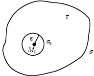
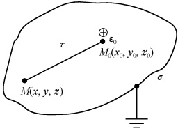
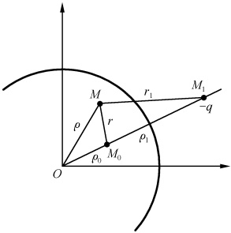
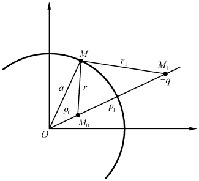
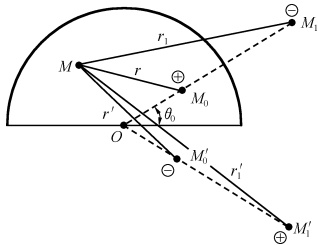

# 10-第十章 格林函数法

[返回全书目录](../../README.md)

> PDF 页码：201–228

<!-- page: 201 -->

## 第十章 格林函数法

我们已看到，分离变量法主要适用于求解各种有界问题，而傅氏变换法主要适用于求解各种无界问题，这两种方法所得到的解一般分别为无穷级数和无穷积分的形式。本章将介绍求解数理方程的另一重要方法——格林（Green）函数法，它在近代物理学特别是量子理论的发展中起着重要的作用。与分离变量法和傅氏变换法不同，它给出的解是有限的积分形式，十分便于理论分析和研究。

格林函数又称为点源函数或影响函数。顾名思义，它表示一个点源在一定的边界条件和（或）初值条件下所产生的场或影响。由于在线性问题中任意分布的源所产生的场均可看成许许多多点源产生的场的叠加，因此格林函数一旦求出，就可算出任意源的场。

格林函数法以统一的方式处理各类数学物理方程，既可以研究常微分方程，又可以研究偏微分方程；既可以研究齐次方程又可以研究非齐次方程；既可以研究有界问题又可以研究无界问题……它的内容十分丰富，应用极其广泛，故不可能在短短的一章中把这个问题讨论得十分全面。本章将通过用格林函数法解决泊松方程的边值问题（着重以第一边值问题为例）来向读者介绍格林函数法的思想、方法、步骤及格林函数的特点。为此，我们首先需引入一个能够表示点源的密度分布的函数。

## 10. 1  $ \delta $ 函数

## 1.  $ \delta $ 函数的引入

设在 x 轴上有一细长的金属线，则在任一点 x 处该金属线的密度为  $ \rho(x)=\lim_{\Delta x\to0}\frac{\Delta m}{\Delta x} $. 若金属线的总质量为 1，且质量集中在 x=0 处，显然此时

 $$ \begin{cases}\rho(x)=0,&x\neq0\\\rho(x)=\infty,&x=0\\\displaystyle\int_{-\infty}^{\infty}\rho(x)\mathrm{d}x=1\end{cases} $$ 

满足以上关系式的量在物理上不少，如点电荷、点热源等. 我们定义满足以上关系式的函数为  $ \delta $ 函数. 即

$$  \begin{cases}\delta(x)=\begin{cases}0,&x\neq0\\\infty,&x=0\end{cases}\\ \int_{-\infty}^{\infty}\delta(x)\mathrm{d}x=1\end{cases}   \tag*{(10.1.1)}$$

<!-- page: 202 -->

更一般有

$$  \left\{\begin{aligned}&\delta(x-x_{0})=\left\{\begin{aligned}&0,&x\neq x_{0}\\ &\infty,&x=x_{0}\end{aligned}\right.\\ &\int_{-\infty}^{\infty}\delta(x-x_{0})\mathrm{d}x=1\end{aligned}\right.   \tag*{(10.1.2)}$$

由此定义我们不难看出：

（1） $ \delta $ 函数是一点源函数，也是一密度函数。若在 x=a 处有一质量为 m 的质点，则 x 轴上任一点 x 处的质量密度为  $ \rho(x)=m\delta(x-a) $;

（2） $ \delta $ 函数是一归一化的分布函数.

（3） $ \delta $ 函数不是普通意义下的函数，因为它没有普通意义下的随自变量取值不同而不断改变的“函数值”。数学家称之为广义函数。

## 2.  $ \delta $ 函数的性质

∂函数具有一些重要的性质. 下面，仅给出几个常用的（其他性质见本节习题）.

（1）对任何一个连续函数  $ f(x) $ 都有

$$  \int_{-\infty}^{\infty}f(x)\delta(x)\mathrm{d}x=f(0)   \tag*{(10.1.3)}$$

或

$$  \int_{-\infty}^{\infty}f(x)\delta(x-x_{0})\mathrm{d}x=f(x_{0})   \tag*{(10.1.4)}$$

证 因为对于任何  $ \varepsilon>0 $，都有

 $$ 1=\int_{-\infty}^{\infty}\delta(x)\mathrm{d}x=\int_{-\varepsilon}^{\varepsilon}\delta(x)\mathrm{d}x $$ 

因此，由积分中值定理有

 $$ \int_{-\infty}^{\infty}f(x)\delta(x)\mathrm{d}x=\int_{-\varepsilon}^{\varepsilon}f(x)\delta(x)\mathrm{d}x=f(\xi)\int_{-\varepsilon}^{\varepsilon}\delta(x)\mathrm{d}x=f(\xi) $$ 

其中， $ -\varepsilon<\xi<\varepsilon $ 。令  $ \varepsilon\to0 $ ，则  $ \xi\to0 $ ，于是得到(10.1.3)式。利用坐标变换和(10.1.3)式，便可得到(10.1.4)式。

这一性质又称之为  $ \delta $ 函数的“筛选”性质。它表明，虽然  $ \delta $ 函数是一种广义函数，但它和任何连续函数的乘积在  $ (-\infty, \infty) $ 内的积分能将函数在定点的值选出来。都有很明确的意义，这使得  $ \delta $ 函数在近代物理和工程技术中有较广泛的应用。

（2）若记 $ \delta^{\prime}(x-a)=\frac{\mathrm{d}}{\mathrm{d}x}\delta(x-a) $，则对于任意的连续函数 $ f(x) $有

$$  \int_{-\infty}^{\infty}f(x)\delta^{(n)}(x-a)\mathrm{d}x=(-1)^{n}f^{(n)}(a)   \tag*{(10.1.5)}$$

证

 $$ \begin{align*}\int_{-\infty}^{\infty}f(x)\delta^{\prime}(x-a)\mathrm{d}x&=\int_{-\infty}^{\infty}f(x)\mathrm{d}\delta(x-a)\\&=f(x)\delta(x-a)\left|_{-\infty}^{\infty}-\int_{-\infty}^{\infty}f^{\prime}(x)\delta(x-a)\mathrm{d}x\right.\\&=-\left.f^{\prime}(a)\right.\end{align*} $$

<!-- page: 203 -->

即

$$  \int_{-\infty}^{\infty}f(x)\delta^{^{\prime}}(x-a)\mathrm{d}x=-f^{^{\prime}}(a)   \tag*{(10.1.6)}$$

我们称满足(10.1.6)式的 $ \delta^{\prime}(x-a) $为 $ \delta(x-a) $的导数.类似地我们易于推得 $ \delta(x-a) $的任意阶导数所具有的性质(10.1.5)式.

（3）若  $ \delta $ 函数以函数  $ \varphi(x) $ 为宗量，则有

$$  \delta\bigl[\varphi(x)\bigr]=\sum_{i=1}^{k}\frac{\delta(x-x_{i})}{\mid\varphi^{^{\prime}}(x_{i})\mid}   \tag*{(10.1.7)}$$

其中  $ x_{i} $ 为  $ \varphi(x)=0 $ 的单根.

证 因为由  $ \delta $ 函数的定义有

 $$ \delta[\varphi(x)]=\left\{\begin{aligned}&0,&&\varphi(x)\neq0\\ &\infty,&&\varphi(x)=0\end{aligned}\right. $$ 

即

 $$ \delta\big[\varphi(x)\big]=\left\{\begin{aligned}&0,&x\neq x_{i}\\ &\infty,&x=x_{i}\end{aligned}\right. $$ 

现将全部积分区间分成一些间隔，使每一间隔 $ [x_{i}-\varepsilon,x_{i}+\varepsilon] $内只含有 $ \varphi(x)=0 $的一个单根 $ (\varepsilon>0) $，则对于任意的连续函数 $ f(x) $有

 $$ \begin{align*}\int_{-\infty}^{\infty}f(x)\delta\big[\varphi(x)\big]\mathrm{d}x&=\sum_{i=1}^{k}\int_{x_{i}-\epsilon}^{x_{i}+\epsilon}f(x)\delta\big[\varphi(x)\big]\mathrm{d}x\\&=\sum_{i=1}^{k}f(\xi)\int_{x_{i}-\epsilon}^{x_{i}+\epsilon}\delta\big[\varphi(x)\big]\mathrm{d}x\end{align*} $$ 

其中， $ x_{i}-\varepsilon<\xi<x_{i}+\varepsilon $，当 $ \varepsilon\to0 $时 $ \xi_{i}\to x_{i} $，记 $ w=\varphi(x) $，注意到 $ \mathrm{d}\left[\varphi(x)\right]=\varphi'(x)\mathrm{d}x $，即 $ \mathrm{d}x=\frac{1}{\varphi'(x)}\mathrm{d}\left[\varphi(x)\right]=\frac{\mathrm{d}w}{\varphi'(x)} $，且考虑到 $ \varphi'(x_{i})>0 $时 $ \varphi(x_{i}+\varepsilon)>\varphi(x_{i}-\varepsilon) $，和 $ \varphi'(x_{i})<0 $时 $ \varphi(x_{i}+\varepsilon)<\varphi(x_{i}-\varepsilon) $，于是有

而

$$  \begin{align*}\int_{x_{i}-\varepsilon}^{x_{i}+\varepsilon}\delta\big[\varphi(x)\big]\mathrm{d}x&=\frac{1}{\varphi^{^{\prime}}(\xi)}\int_{\varphi(x_{i}-\varepsilon)}^{\varphi(x_{i}+\varepsilon)}\delta(w)\mathrm{d}w=\frac{1}{|\varphi^{^{\prime}}(x_{i})|}\\&\int_{-\infty}^{\infty}f(x)\delta\big[\varphi(x)\big]\mathrm{d}x=\sum_{i=1}^{k}\frac{f(x_{i})}{|\varphi^{^{\prime}}(x_{i})|}\end{align*}   \tag*{（10.1.8）}$$

又

$$  \begin{align*}\int_{-\infty}^{\infty}f(x)\sum_{i=1}^{k}\frac{\delta(x-x_{i})}{\mid\varphi^{^{\prime}}(x_{i})\mid}\mathrm{d}x=&\sum_{i=1}^{k}\int_{x_{i}-\varepsilon}^{x_{i}+\varepsilon}f(x)\frac{\delta(x-x_{i})}{\mid\varphi^{^{\prime}}(x_{i})\mid}\mathrm{d}x\\=&\sum_{i=1}^{k}\frac{f(x_{i})}{\mid\varphi^{^{\prime}}(x_{i})\mid}\end{align*}   \tag*{（10.1.9）}$$

比较(10.1.8)和(10.1.9)的结果即得(10.1.7)式 $ ^{①} $.

## 3. 高维空间中的  $ \delta $ 函数

以三维空间为例，若用  $ \delta(M-M_{0}) $ 表示把单位质量集中于点  $ M_{0}(x_{0},y_{0},z_{0}) $ 的密度函数，则

<!-- page: 204 -->

$$  \left\{\begin{aligned}&\delta(M-M_{0})=\left\{\begin{aligned}&0,&M\neq M_{0}\\ &\infty,&M=M_{0}\end{aligned}\right.\\ &\iiint_{-\infty}^{\infty}\delta(M-M_{0})\mathrm{d}v=1\end{aligned}\right.   \tag*{(10.1.10)}$$

其中

 $$ \delta(M-M_{0})=\delta(x-x_{0},y-y_{0},z-z_{0}) $$ 

又定义

$$  \iiint_{-\infty}^{\infty}f(M)\delta(M-M_{0})\mathrm{d}v=f(M_{0})   \tag*{(10.1.11)}$$

 $ f(M) $为任意的连续函数.则由(10.1.4)式有

 $$ \begin{aligned}&\iiint_{-\infty}^{\infty}f(M)\delta(x-x_{0})\delta(y-y_{0})\delta(z-z_{0})\mathrm{d}v\\=&\iint_{-\infty}^{\infty}\delta(y-y_{0})\delta(z-z_{0})\mathrm{d}y\mathrm{d}z\int_{-\infty}^{\infty}f(x,y,z)\delta(x-x_{0})\mathrm{d}x\\=&\int_{-\infty}^{\infty}\delta(z-z_{0})\mathrm{d}z\int_{-\infty}^{\infty}f(x_{0},y,z)\delta(y-y_{0})\mathrm{d}y\\=&\int_{-\infty}^{\infty}f(x_{0},y_{0},z)\delta(z-z_{0})\mathrm{d}z\\=&f(x_{0},y_{0},z_{0})=f(M_{0})\end{aligned} $$ 

与(10.1.11)式相比较，故有

$$  \delta(x-x_{0},y-y_{0},z-z_{0})=\delta(x-x_{0})\delta(y-y_{0})\delta(z-z_{0})   \tag*{（10.1.12）}$$

这说明三维  $ \delta $ 函数可看作三个一维  $ \delta $ 函数的乘积.

同样可以定义二维或其他维的  $ \delta $ 函数.

注 ① 这里，我们引用了高等数学中判断函数相等的一种方法：

设  $ \varphi(x) $,  $ \psi(x) $ 与  $ g(x) $ 均为定义在  $ [a,b] $ 上的函数，若对于定义在  $ [a,b] $ 上的任意连续函数  $ f(x) $，都有

 $$ \int_{a}^{b}f(x)\varphi(x)\mathrm{d}x=\int_{a}^{b}f(x)\psi(x)\mathrm{d}x $$ 

则必有

 $$ \varphi(x)=\psi(x) $$ 

若有

 $$ \int_{a}^{b}f(x)g(x)\mathrm{d}x=0 $$ 

则必有

 $$ g(x)=0 $$ 

此方法很有用，习题10.1中的很多题都可用它来证.

#### 习题10.1

1. 证明

(1)

 $$ x\delta(x)=0； $$ 

(2)

 $$ \delta(a x)=\frac{1}{|a|}\delta(x)\;; $$

<!-- page: 205 -->

(3)  $ f(x)\delta(x-a)=f(a)\delta(x-a) $;

(4)

 $$ \delta(-x)=\delta(x) $$ 

(5)  $ \delta(x^2 - a^2) = \frac{1}{2|a|} [\delta(x - a) + \delta(x + a)] $; (6)

 $$ \delta(x^{2}){\stackrel{}{=}}\frac{\delta(x)}{|x|}. $$ 

其中a为常数.

## 2. 证明

(1)  $ \delta^{'}(-x) = -\delta^{'}(x) $; (2)  $ x\delta^{'}(x) = -\delta(x) $.

3. 证明  $ \delta(x)=\frac{\mathrm{d}H(x)}{\mathrm{d}x} $

提示:证明 $ \int_{-\infty}^{\infty}f(x)\delta(x)\mathrm{d}x=\int_{-\infty}^{\infty}f(x)\frac{\mathrm{d}H(x)}{\mathrm{d}x}\mathrm{d}x $

4. 求  $ \delta $ 函数的傅氏变换和积分表达式.

5. 试证  $ \delta $ 函数的几种极限形式的表达式

 $$ \delta(x)=\lim_{k\to\infty}\frac{\operatorname{sink}x}{\pi x}; $$ 

 $$ \delta(x)=\lim_{\varepsilon\to0}\frac{1}{\sqrt{\pi\varepsilon}}\mathrm{e}^{-\frac{x^2}{\varepsilon}}; $$ 

 $$ \delta(x)=\lim_{\varepsilon\to0}\frac{\varepsilon}{\pi(x^2+\varepsilon^2)}. $$ 

6. 计算下列积分：

(1)  $ \int_{1}^{2} \tan x \delta(x) dx $;

(2)  $ \iiint_{-\infty}^{\infty}\frac{y}{x^{2}+z}\cos(x+z)\delta(x,y-1,z+2)dxdydz; $

 $$ \int_{-2}^{1}\sin x\delta^{^{\prime}}\left(x+\frac{1}{3}\right)\mathrm{d}x； $$ 

 $$ \int_{-1}^{1}\mathrm{e}^{x}x\delta^{^{\prime}}(x)\mathrm{d}x. $$ 

7. 设在  $ M_{0}(x_{0},y_{0},z_{0}) $ 处有一带电量 q 的点电荷，试写出空间中任意一点处的电势  $ V(x,y,z) $ 所满足的方程.

8. 梳状函数  $ \text{comb}(x) = \sum_{n=-\infty}^{\infty} \delta(x-n) $ 的傅氏变换是傅里叶光学中常要用到的，试证

 $$ F[\operatorname{comb}(x)\operatorname{comb}(y)]=\operatorname{comb}\left(\tfrac{\omega_1}{2\pi}\right)\operatorname{comb}\left(\tfrac{\omega_2}{2\pi}\right) $$ 

9. 计算  $ F^{-1}\left[\pi\delta(\omega)+\frac{1}{\mathrm{i}\omega}\right] $

10. 求解下列微分积分方程：

 $$ \delta(x)-f(x)=\frac{\mathrm{d}^{2}f(x)}{\mathrm{d}x^{2}}(-\infty<x<\infty) $$ 

 $$ \delta(x)-\frac{\mathrm{d}f(x)}{\mathrm{d}x}=\int_{-\infty}^{\infty}f(x)\mathrm{d}x(-\infty<x<\infty) $$ 

11. 试用傅氏变换法重解 7.3 节中例题.

12. 用傅氏变换法求解三维无界空间的受迫振动问题

 $$ \begin{cases}u_{tt}(\boldsymbol{r},t)=a^{2}\Delta u(\boldsymbol{r},t)+f(\boldsymbol{r},t),&-\infty<x,y;z<\infty\\u\mid_{t=0}=\varphi(\boldsymbol{r})\\u_{t}\mid_{t=0}=\psi(\boldsymbol{r})\end{cases} $$ 

### 10.2 边值问题的格林函数法

本节将以泊松方程的边值问题为例来初步了解格林函数法。三维泊松方程的边值问题，可用统一的形式表示为

<!-- page: 206 -->

$$  \triangle u(M)=-h(M),\quad M\in\tau   \tag*{(10.2.1)}$$

$$  \left\{\begin{array}{l}{\left[\alpha\frac{\partial u}{\partial n}+\beta u\right]_{\sigma}=g(M)}\end{array}\right.   \tag*{（10.2.2）}$$

其中  $ \alpha,\beta $ 是不同时为零的常数.

这类问题的解，应该说在第八章中我们已讨论过，在这里，我们将换一种方法来求解.

为了得到定解问题(10.2.1)和(10.2.2)式的解的积分表达式，我们首先引入格林公式.

## 1. 格林公式

设函数  $ u(x,y,z) $ 和  $ v(x,y,z) $ 在区域  $ \tau $ 直到边界  $ \sigma $ 上具有连续一阶导数，而在  $ \tau $ 中具有连续的二阶导数，则由高斯公式和微分算子的运算有 $ ^{①} $

$$  \iint_{\sigma}u\mathrm{\boldmath~\nabla~}v\bullet\mathrm{d}\pmb{\sigma}=\iiint_{\tau}\mathrm{\boldmath~\nabla~}\bullet(u\mathrm{\boldmath~\nabla~}v)\mathrm{d}\tau=\iiint_{\tau}u\Delta v\mathrm{d}\tau+\iiint_{\tau}\mathrm{\boldmath~\nabla~}u\bullet\nabla v\mathrm{d}\tau   \tag*{（10.2.3）}$$

此式称为格林第一公式. 同理有

$$  \iint_{\sigma}v\mathrm{\boldmath~\nabla~}u\cdot\mathrm{\boldmath~\mathbf{d}~}\pmb{\sigma}=\iiint_{\tau}v\Delta u\mathrm{d}\tau+\iiint_{\tau}\mathrm{\boldmath~\nabla~}v\cdot\mathrm{\boldmath~\nabla~}u\mathrm{d}\tau   \tag*{(10.2.4)}$$

将此二式相减得

 $$ \iint_{\sigma}\left(u\nabla v-v\nabla u\right)\bullet\mathrm{d}\pmb{\sigma}=\iiint_{\tau}\left(u\Delta v-v\Delta u\right)\mathrm{d}\tau $$ 

即

$$  \iint_{\sigma}\Big(u\frac{\partial v}{\partial n}-\upsilon\frac{\partial u}{\partial n}\Big)\mathrm{d}\sigma=\iiint_{\tau}\left(u\Delta v-v\Delta u\right)\mathrm{d}\tau   \tag*{（10.2.5）}$$

此式称为格林第二公式. 其中 n 为边界面  $ \sigma $ 的外法向.

## 2. 积分公式-格林函数法

现在让我们在有界区域 $ \tau $中讨论定解问题(10.2.1)～(10.2.2)式的解.引入函数 $ G(M,M_{0}) $，使之满足

$$  \Delta G(M,M_{0})=-{}\delta(M-M_{0}),\quad M\in\tau   \tag*{（10.2.6）}$$

其中， $ M_{0}=M_{0}(x_{0},y_{0},z_{0}) $ 为区域  $ \tau $ 中的任意点，则由  $ \delta $ 函数的定义知， $ G(M,M_{0}) $ 为在  $ M_{0} $ 点的点源所产生的场。以函数  $ G(M,M_{0}) $ 乘方程（10.2.1）的两边，同时以函数  $ u(M) $ 乘方程（10.2.6）的两边，然后相减得

 $ G(M,M_{0})\Delta u(M)-u(M)\Delta G(M,M_{0})=u(M)\delta(M-M_{0})-G(M,M_{0})h(M) $

将上式对  $ M(x,y,z) $ 积分，在下节我们将看到，满足方程 (10.2.6) 的解为  $ G(M,M_{0})=\frac{1}{4\pi r} $ [见 (10.3.4) 式]；其中  $ r=\sqrt{(x-x_{0})^{2}+(y-y_{0})^{2}+(z-z_{0})^{2}} $ 为 M 和  $ M_{0} $ 之间的距离，也就是说， $ G(M,M_{0}) $ 以  $ M(x,y,z) $ 为自变量时以  $ M_{0}(x_{0},y_{0},z_{0}) $ 为奇点。所以，为了将格林第二公式 (10.2.5) 应用于上式积分后的左端，积分区域应取  $ \tau $ 内挖去以  $ M_{0} $

<!-- page: 207 -->

点为中心、以 $ \varepsilon(\ll1) $为半径的小球体 $ \tau_{\varepsilon} $后的区域 $ \tau-\tau_{\varepsilon} $（见图10.1）. 记小球体的界面为 $ \sigma_{\varepsilon} $，在区域 $ \tau-\tau_{\varepsilon} $上积分上式 $ ^{①} $，利用(10.2.5)式，于是有

 $$ \begin{align*}\iint_{\sigma+\sigma_{\varepsilon}}\Big[G(M,M_{0})\frac{\partial u}{\partial n}-u(M)\frac{\partial}{\partial n}G(M,M_{0})\Big]\mathrm{d}\sigma\\=\iiint_{\tau-\tau_{\varepsilon}}\big[u(M)\delta(M-M_{0})-G(M,M_{0})h(M)\big]\mathrm{d}\tau\end{align*} $$ 

图10.1
 

注意到  $ M_{0} $ 点不属于区域  $ \tau-\tau_{\varepsilon} $，故由  $ \delta $ 函数定义有

 $$ \iiint_{\tau-\tau_{\varepsilon}}u\left(M\right)\delta(M-M_{0})\mathrm{d}\tau=0 $$ 

而由本篇(7.3.5)、(7.3.4)式可得

 $$ u(M_{0})=\lim_{r\to0}\frac{1}{4\pi r^{2}}\iint_{S_{r}^{M_{0}}}u\mathrm{d}s $$ 

故当  $ \varepsilon \to 0 $ 时有

 $$ \begin{align*}\iint_{\sigma_{\varepsilon}}G(M,M_{0})\frac{\partial u}{\partial n}\mathrm{d}\sigma=&\iint_{\sigma_{\varepsilon}}\frac{1}{4\pi\varepsilon}\frac{\partial u}{\partial n}\mathrm{d}\sigma=\varepsilon\cdot\frac{1}{4\pi\varepsilon^{2}}\iint_{\sigma_{\varepsilon}}u_{n}\mathrm{d}\sigma=\varepsilon u_{n}(M_{0})=0\\\iint_{\sigma_{\varepsilon}}u(M)\frac{\partial}{\partial n}G(M,M_{0})\mathrm{d}\sigma=&-\iint_{\sigma_{\varepsilon}}u\frac{\partial}{\partial r}\Big(\frac{1}{4\pi r}\Big)\mathrm{d}\sigma=\frac{1}{4\pi\varepsilon^{2}}\iint_{\sigma_{\varepsilon}}u\mathrm{d}\sigma=u(M_{0})\end{align*} $$ 

于是，当 $ \varepsilon\to0 $时，由(10.2.7)式得到

$$  u(M_{0})=\iiint_{\tau}G(M,M_{0})h(M)\mathrm{d}\tau+\iint_{\sigma}G(M,M_{0})\frac{\partial u}{\partial n}\mathrm{d}\sigma-\iint_{\sigma}u(M)\frac{\partial}{\partial n}G(M,M_{0})\mathrm{d}\sigma   \tag*{（10.2.8）}$$

上式在物理上很难解释清楚，如，在右边的第一项中， $ G(M,M_{0}) $ 所代表的是  $ M_{0} $ 点的点源在 M 点产生的场，而  $ h(M) $ 所代表的却是 M 点的源。稍后我们将会看到格林函数具有对称性[见(10.2.23)式]

 $$ G(M,M_{0})=G(M_{0},M) $$ 

于是我们可在(10.2.8)式中用 $ G(M_{0},M) $代替 $ G(M,M_{0}) $，并在全式中将M和 $ M_{0} $对换，而得到

$$  u(M)=\iiint_{\tau}G(M,M_{0})h(M_{0})\mathrm{d}\tau_{0}+\iiint_{\sigma}G(M,M_{0})\frac{\partial u}{\partial n_{0}}\mathrm{d}\sigma_{0}-\iiint_{\sigma}u(M_{0})\frac{\partial}{\partial n_{0}}G(M,M_{0})\mathrm{d}\sigma_{0}   \tag*{（10.2.9）}$$

(10.2.9)式被称为基本积分公式. 显然，它的物理意义是十分清楚的，其中右方第一个积分代表在区域  $ \tau $ 中体分布源  $ h\left(M_{0}\right) $ 在 M 点产生的场的总和，而第二、三两个积分则是边界上的源所产生的场. 这两种影响都是由同一格林函数给出的. (10.2.9)给出了泊松方程 (10.2.1) 或拉普拉斯方程 (即当 h=0 时) 解的积分表达式  $ \left(\frac{\partial}{\partial n_{0}}\right) $

<!-- page: 208 -->

表示对  $ M_{0} $ 求导，而  $ \mathrm{d}\sigma_{0} $ 和  $ \mathrm{d}\tau_{0} $ 则分别表示对  $ M_{0} $ 取面积元和体积元），但它还不能直接用来求解泊松方程或拉氏方程的边值问题，因为公式中的  $ G(M,M_{0}) $ 是未知的，且在一般的边值问题中  $ u|_{\sigma} $ 和  $ u_{n}\|_{\sigma} $ 之值也不会同时分别给出。下面针对不同边界条件作具体讨论。

（1）第一类边界条件，即在(10.2.2)中 $ \alpha=0 $，则有

$$  u\mid_{_{\sigma}}=\frac{1}{\beta}g(M)\stackrel{ 记 }{=}f(M)   \tag*{(10.2.10)}$$

若要求  $ G(M,M_{0}) $ 满足第一类齐次边界条件

$$  G(M,M_{0})\mid_{\sigma}=0   \tag*{(10.2.11)}$$

则(10.2.9)式的面积分中，含 $ \frac{\partial u}{\partial n} $的项消失，从而(10.2.9)式变为

$$  u(M)=\iiint_{\tau}G(M,M_{0})h(M_{0})\mathrm{d}\tau_{0}-\iint_{\sigma}f(M_{0})\frac{\partial}{\partial n_{0}}G(M,M_{0})\mathrm{d}\sigma_{0}   \tag*{(10.2.12)}$$

由此可见只要从(10.2.6)式和(10.2.11)式解出 $ G(M,M_{0}) $，则(10.2.12)式已全部由已知量表示。我们称由方程(10.2.6)和边界条件(10.2.11)所构成的定解问题

$$  \left\{\begin{aligned}\Delta G(M,M_{0})=&-\delta(M-M_{0}),&M\in\tau\\ G(M,M_{0})\mid_{\sigma}=0&\end{aligned}\right.   \tag*{(10.2.13)}$$

的解  $ G(M,M_{0}) $，为由方程（10.2.1）和边界条件（10.2.10）所构成的狄氏问题

$$  \left\{\begin{aligned}\triangle u(M)=&-h(M),\quad M\in\tau\\ u\mid_{\sigma}=&f(M)\end{aligned}\right.   \tag*{(10.2.14)}$$

的格林函数，简称为狄氏格林函数；而称(10.2.12)式为狄氏积分公式，它是狄氏问题(10.2.14)的积分形式的解.

（2）第二类边界条件，即在(10.2.2)式中 $ \beta=0 $，则有

 $$ \left.\frac{\partial u}{\partial n}\right|_{\sigma}=\frac{1}{\alpha}g\left(M\right) $$ 

若形式地同样要求 $ G(M,M_{0}) $满足第二类齐次边界条件

$$  \frac{\partial G}{\partial n}\big|_{\sigma}=0   \tag*{(10.2.15)}$$

显然也可以从(10.2.9)式得到

$$  u(M)=\iiint_{\tau}G(M,M_{0})h(M_{0})\mathrm{d}\tau_{0}+\frac{1}{\alpha}\iint_{\sigma}G(M,M_{0})g(M_{0})\mathrm{d}\sigma_{0}   \tag*{(10.2.16)}$$

但(10.2.16)式是不存在的，因为方程(10.2.6)在边界条件(10.2.15)下无解。这从物理上看，其意义十分明显。方程(10.2.6)可看成稳定的热传导方程在 $ M_{0} $点有一个点热源。而边界条件(10.2.15)式表示在边界上是绝热的，由于边界绝热，从点源出来的热量，会使体积 $ \tau $内的温度不断地升高，而不可能达到稳定状态。为了解决这一矛盾，或者修改格林函数所满足的方程(10.2.6)式，使之与边界条件(10.2.15)相容，这就要引入所谓广义格林函数方程；或者修改边界条件(10.2.15)式，使之与方程

<!-- page: 209 -->

(10.2.6)式相容.这已超出本书范围，在此不再详细讨论.

（3）第三类边界条件，即（10.2.2）中 $ \alpha $和 $ \beta $均不为零.若要求 $ G(M,M_{0}) $满足第三类的齐次边界，即

$$  \left[\alpha\frac{\partial}{\partial n}G(M,M_{0})+\beta G(M,M_{0})\right]_{\sigma}=0   \tag*{(10.2.17)}$$

则当以 $ G(M,M_{0}) $乘(10.2.2)式，以 $ u(M) $乘(10.2.17)式，然后再将两式相减得

 $$ \left[G(M,M_{0})\frac{\partial u}{\partial n}-u(M)\frac{\partial}{\partial n}G(M,M_{0})\right]_{\sigma}=\frac{1}{\alpha}G(M,M_{0})g(M) $$ 

代入(10.2.9)式，于是有

$$  u(M)=\iiint_{\tau}G(M,M_{0})h(M_{0})\mathrm{d}\tau_{0}+\frac{1}{\alpha}\iint_{\sigma}G(M,M_{0})g(M_{0})\mathrm{d}\sigma_{0}   \tag*{(10.2.18)}$$

可见，只要从(10.2.6)式和(10.2.17)式解出 $ G(M,M_{0}) $，则(10.2.18)式也已全部由已知量表示。我们称方程(10.2.6)和边界条件(10.2.17)所构成的定解问题

$$  \left\{\begin{aligned}&\Delta G(M,M_{0})=-\delta(M-M_{0}),\quad M\in\tau\\ &\left[\alpha\frac{\partial}{\partial n}G(M,M_{0})+\beta G(M,M_{0})\right]_{\sigma}=0\end{aligned}\right.   \tag*{(10.2.19)}$$

的解  $ G(M,M_{0}) $，为由方程（10.2.1）和边界条件（10.2.2）所构成的定解问题的格林函数，（10.2.18）式即为由（10.2.1）式和（10.2.2）式所构成的定解问题的积分形式的解.

显然，用完全同样的程序，我们可推得亥姆霍兹方程及其他的边值问题

$$  \left\{\begin{array}{l}\Delta u(M)+\lambda u(M)=-h(M),\ M\in\tau\\ \left[\alpha\frac{\partial u}{\partial n}+\beta u\right]_{\sigma}=g(M)\end{array}\right.   \tag*{(10.2.21)}$$

的基本积分公式及形式解亦分别是(10.2.9)及(10.2.12)、(10.2.16)、(10.2.18)式.只是对于边值问题(10.2.20)~(10.2.21)， $ \lambda $不能为相应的本征值问题的本征值，否则，格林函数不存在.

由上面的讨论我们看到，在各类非齐次边界条件下解泊松方程(10.2.1)式，可以先在相应的同类齐次边界条件下解格林函数所满足的方程(10.2.6)式，然后通过积分公式得到解 $ u(M) $.

格林函数的定解问题，其方程(10.2.6)式形式上比(10.2.1)式简单，而且边界条件又是齐次的，因此，相对地说，求G比求解u容易一些。不仅如此，对方程(10.2.1)式中不同的非齐次项 $ h(M) $和边界条件(10.2.2)式中不同的 $ g(M) $，只要属于同一类型边界条件，函数 $ G(M,M_{0}) $都是相同的。这就把解泊松方程的边值问题化为在几种类型边界条件下求格林函数 $ G(M,M_{0}) $的问题。

类似于上面的讨论过程，可以得到二维泊松方程的各类边值问题的积分公式。如二维泊松方程的狄氏问题

$$  \left\{\begin{aligned}\triangle u=&-h(M),\quad M\in\sigma\\ u&\mid_{l}=f(M)\end{aligned}\right.   \tag*{(10.2.22)}$$

<!-- page: 210 -->

的积分形式的解，即二维空间的狄氏积分公式为

$$  u(M)=\iint_{\sigma}G(M,M_{0})h(M_{0})\mathrm{d}\sigma_{0}-\int_{l}f(M_{0})\frac{\partial}{\partial n_{0}}G(M,M_{0})\mathrm{d}l_{0}   \tag*{（10.2.23）}$$

其中， $ G(M,M_{0}) $ 为二维泊松方程的狄氏格林函数即定解问题

$$  \left\{\begin{aligned}\Delta G(M,M_{0})=&-\delta(M-M_{0}),&M\in\sigma\\ G(M,M_{0})\mid_{l}&=0\end{aligned}\right.   \tag*{(10.2.24)}$$

的解： $ M=M(x,y) $， $ M_{0}=M_{0}(x_{0},y_{0}) $；l为区域 $ \sigma $的边界线；而 $ \frac{\partial}{\partial n_{0}} $， $ d\mathrm{l}_{0} $， $ d\sigma_{0} $分别表示对 $ M_{0}(x_{0},y_{0}) $求导、取线元和面积元.

## 3. 格林函数关于源点和场点是对称的

前面在导出积分公式时，用到格林函数的对称性

$$  G(M,M_{0})=G(M_{0},M)   \tag*{(10.2.25)}$$

现在对最一般的亥姆霍兹方程，实际上是算符  $ \Delta+\lambda $（泊松方程可看作  $ \lambda=0 $ 的特例），证明上述结论。设  $ G(M,M_{1}) $ 和  $ G(M,M_{2}) $ 均满足亥姆霍兹方程和某类齐次边界条件，即

$$  \Delta G(M,M_{1})+\lambda G(M,M_{1})=-\delta(M-M_{1})   \tag*{(10.2.26)}$$

$$  \left[\alpha\frac{\partial}{\partial n}G(M,M_{1})+\beta G(M,M_{1})\right]_{\sigma}=0   \tag*{（10.2.27）}$$

$$  \Delta G(M,M_{2})+\lambda G(M,M_{2})=-\delta(M-M_{2})   \tag*{(10.2.28)}$$

$$  \left[\alpha\frac{\partial}{\partial n}G(M,M_{2})+\beta G(M,M_{2})\right]_{\sigma}=0   \tag*{(10.2.29)}$$

以  $ G(M,M_{2}) $ 乘方程 (10.2.26)，同时以  $ G(M,M_{1}) $ 乘方程 (10.2.28)，然后相减，并做积分得 $ ^{②} $

 $$ \iiint_{\tau}\left[G(M,M_{2})\Delta G(M,M_{1})-G(M,M_{1})\Delta G(M,M_{2})\right]\mathrm{d}\tau=-G(M_{1},M_{2})+G(M_{2},M_{1}) $$ 

对上式左端应用格林第二公式得

 $$ \begin{align*}&G(M_{2},M_{1})-G(M_{1},M_{2})\\=&\iint_{\sigma}\Big[G(M,M_{2})\frac{\partial}{\partial n}G(M,M_{1})-G(M,M_{1})\frac{\partial}{\partial n}G(M,M_{2})\Big]\mathrm{d}\sigma\end{align*} $$ 

由边界条件(10.2.27)和(10.2.29)，因为 $ \alpha,\beta $不同时为零，所以有

 $$ \left[G(M,M_{2})\frac{\partial}{\partial n}G(M,M_{1})-G(M,M_{1})\frac{\partial}{\partial n}G(M,M_{2})\right]_{\sigma}=0 $$ 

代入上式右边，于是得

 $$ G(M_{2},M_{1})=G(M_{1},M_{2}) $$ 

由于在物理上，格林函数  $ G(M, M_{0}) $ 表示位于  $ M_{0} $ 点的点源，在一定边界条件下在 M 点产生的场，故其对称性说明，在相同边界条件下，位于  $ M_{0} $ 的点源在 M 点产生的场等于同强度的点源位于 M 点在  $ M_{0} $ 点产生的场。这种性质在物理上称为倒易性。

<!-- page: 211 -->

注 ① 见附录 I.

② 如果积分区域直接取  $ \tau $，虽然此时第二格林公式(10.2.5)的条件并不满足，但撇开这些条件之后所得结果其形式与(10.2.9)式相同。所以，以后用格林第二公式时对积分区域就不再作这样的处理了。

#### 习题10.2

1. 设  $ v(x,y) $ 和  $ u(x,y) $ 在区域  $ \sigma $ 直到边界 l 上具有连续一阶导数，而在  $ \sigma $ 内具有连续的二阶导数，

（1）试导出二维空间的格林第二公式

$$  \int_{l}\left(u\frac{\partial v}{\partial n}-v\frac{\partial u}{\partial n}\right)\mathrm{d}l=\iint_{s}\left(u\Delta v-v\Delta u\right)\mathrm{d}\sigma   \tag*{(10.2.30)}$$

（2）利用二维空间的格林第二公式（10.2.30），导出二维空间的狄氏积分公式（10.2.23）式.

2. 试证明亥姆霍兹方程的边值问题

 $$ \left\{\begin{aligned}&\Delta u(M)+\lambda u(M)=-h(M),\quad M\in\tau\\ &\left[\alpha\frac{\partial u}{\partial n}+\beta u\right]_{\sigma}=g(M)\end{aligned}\right. $$ 

在第一、二、三类边界条件下的形式解分别为(10.2.12)、(10.2.16)和(10.2.18)式。并证明其相应的本征值问题

 $$ \left\{\begin{aligned}&\Delta u+\lambda u=0\\ &\left[\alpha\frac{\partial u}{\partial n}+\beta u\right]_{\sigma}=0\end{aligned}\right. $$ 

中的 $ \lambda $为什么不能为本征值.

### 10.3 稳恒问题的格林函数

从上节的讨论可以看出，求解边值问题实际上归结为求相应的格林函数，只要求出格林函数，将其代入相应的积分公式，就可得到问题的解。

一般说来，实际求格林函数，并非一件容易的事。但在某些情况下，却可以比较容易地求出.

## 1. 无界区域的格林函数

无界区域的格林函数 G，又称为相应方程的基本解。G 满足含有  $ \delta $ 函数的非齐次方程，具有奇异性，一般可以用有限形式表示出来。下面通过具体例子，说明求基本解的方法。

例 1 求三维泊松方程的基本解.

解 其格林函数满足的方程为

$$  \Delta G=-\delta(x-x_{0},y-y_{0},z-z_{0})   \tag*{(10.3.1)}$$

采用球坐标，并将坐标原点放在源点  $ M_{0}(x_{0},y_{0},z_{0}) $ 上（r 是源点  $ M_{0} $ 到场点  $ M(x,y,z) $ 的距离， $ r=\sqrt{(x-x_{0})^{2}+(y-y_{0})^{2}+(z-z_{0})^{2}} $）。则由于区域是无界的，点源所产

<!-- page: 212 -->

生的场应与方向无关，而只是 r 的函数，于是(10.3.1)式简化为

 $$ \frac{1}{r^{2}}\frac{\mathrm{d}}{\mathrm{d}r}\Big(r^{2}\frac{\mathrm{d}G}{\mathrm{d}r}\Big)=-\delta(r) $$ 

当 $ r\neq0 $时，方程化为齐次的，即

 $$ \frac{\mathrm{d}}{\mathrm{d}r}\Big(r^{2}\ \frac{\mathrm{d}G}{\mathrm{d}r}\Big)=0 $$ 

易于求得其一般解为

$$  G=-C_{1}\frac{1}{r}+C_{2}   \tag*{(10.3.2)}$$

取 $ C_{2}=0 $，不失一般性，得

$$  G=-C_{1}\frac{1}{r}   \tag*{(10.3.3)}$$

考虑 r=0 的情形. 为此，对方程(10.3.1)式在以原点为球心， $ \varepsilon $ 为半径的小球体  $ \tau_{\varepsilon} $ 内作体积分

 $$ \iiint_{\tau_{\epsilon}}\Delta G\mathrm{d}x\mathrm{d}y\mathrm{d}z=-\iiint_{\tau_{\epsilon}}\delta(x-x_{0},y-y_{0},z-z_{0})\mathrm{d}x\mathrm{d}y\mathrm{d}z=-1 $$ 

从而

 $$ \lim_{\varepsilon\to0}\iiint_{\tau_{\varepsilon}}\Delta G\mathrm{d}x\mathrm{d}y\mathrm{d}z=-1 $$ 

而由散度定理

 $$ \iiint_{v}\nabla\bullet\nabla u\mathrm{d}v=\oint_{s}\nabla u\mathrm{d}s,\quad s 为 v 的边界面 $$ 

有

 $$ \iiint_{\tau_{e}}\Delta G\mathrm{d}x\mathrm{d}y\mathrm{d}z=\iint_{s_{e}}\frac{\partial G}{\partial n}\mathrm{d}x\mathrm{d}y $$ 

故

 $$ \lim_{\varepsilon\to0}\iint_{s_{\varepsilon}}\frac{\partial G}{\partial n}\mathrm{d}x\mathrm{d}y=\lim_{\varepsilon\to0}\iint_{s_{\varepsilon}}\frac{\partial G}{\partial r}\Big|_{r=\varepsilon}\mathrm{d}x\mathrm{d}y=-1 $$ 

将(10.3.3)式的结果代入上式得

 $$ \begin{aligned}\lim_{\varepsilon\rightarrow0}\int_{0}^{2\pi}\int_{0}^{\pi}C_{1}\frac{1}{\varepsilon^{2}}\cdot\varepsilon^{2}\sin\theta\mathrm{d}\theta\mathrm{d}\varphi=&-1\\C_{1}=&-\frac{1}{4\pi}\end{aligned} $$ 

代入 $ （10.3.3} $式，于是

$$  G(M,M_{0})=\frac{1}{4\pi r}   \tag*{(10.3.4)}$$

例2 求二维泊松方程的基本解.

解 格林函数满足的方程为

$$  \Delta G=-\delta(x-x_{0},y-y_{0})   \tag*{（10.3.5）}$$

采用极坐标，并将坐标原点放在源点 $ M_{0}(x_{0},y_{0}) $上，则 $ r=\sqrt{(x-x_{0})^{2}+(y-y_{0})^{2}} $与三维问题一样，G应只是r的函数，于是(10.3.5)式简化为

<!-- page: 213 -->

$$  \frac{1}{r}\frac{\mathrm{d}}{\mathrm{d}r}\Big(r\frac{\mathrm{d}G}{\mathrm{d}r}\Big)=-\delta(r)   \tag*{(10.3.6)}$$

当 $ r\neq0 $时，解(10.3.6)式得

 $$ G=C_{1}ln r $$ 

当 r=0 时，在以原点为中心， $ \varepsilon $ 为半径的小圆内对方程（10.3.5）式两边作面积分，类似于对三维情况的讨论得

 $$ C_{1}=-\frac{1}{2\pi} $$ 

于是

$$  G=\frac{1}{2\pi}\ln\frac{1}{r}   \tag*{(10.3.7)}$$

当然，我们也可用傅氏变换法来求无界区域的格林函数（参见上章）.

## 2. 边值问题的格林函数

本征函数族展开法是求边值问题的格林函数的一个重要而又普遍的方法. 现以狄氏问题

$$  \left\{\begin{aligned}\Delta G(M,M_{0})+\lambda G(M,M_{0})=&-\delta(M-M_{0}),&M\in\tau\\ G\mid_{\sigma}=0&\end{aligned}\right.   \tag*{（10.3.8）}$$

为例来讨论此法. 写下相应的本征值问题

$$  \left\{\begin{aligned}\Delta\psi(M)+\lambda\psi(M)&=0,\quad M\in\tau\\ \psi\mid_{\sigma}&=0\end{aligned}\right.   \tag*{(10.3.9)}$$

设本征值问题（10.3.9）的全部本征值和相应的归一化本征函数分别是 $ \{\lambda_{n}\} $ 和  $ \{\psi_{n}(M)\}^{①} $，即

$$  \Delta\psi_{n}(M)+\lambda_{n}\psi_{n}(M)=0,\quad M\in\tau   \tag*{(10.3.10)}$$

$$  \psi_{n}\mid_{\sigma}=0   \tag*{(10.3.11)}$$

而且

$$  \iiint_{\tau}\phi_{n}(M)\bar{\psi}_{m}(M)\mathrm{d}\tau=\delta_{n m}   \tag*{(10.3.12)}$$

这里  $ \bar{\psi}_{m}(M) $ 表示  $ \phi_{m}(M) $ 的共轭复变函数. 将函数  $ G(M,M_{0}) $ 在区域  $ \tau $ 上展开为本征函数族  $ \{\phi_{n}(M)\} $ 的广义傅里叶级数

$$  G(M,M_{0})=\sum_{n}C_{n}\psi_{n}(M)   \tag*{(10.3.13)}$$

为定出系数  $ C_{n} $，将（10.3.13）式代入定解问题（10.3.8）的方程中，并利用方程（10.3.10）得

 $$ \lambda\sum_{n}C_{n}\psi_{n}(M)-\sum_{n}\lambda_{n}C_{n}\psi_{n}(M)=-\delta(M-M_{0}) $$ 

设  $ \lambda \neq \lambda_{n} $，以  $ \bar{\psi}_{m}(M) $ 乘上式两端，然后在区域  $ \tau $ 上积分，并利用(10.3.12)式可得

 $$ C_{m}=\frac{1}{\lambda_{m}-\lambda}\bar{\psi}_{m}(M_{0}) $$

<!-- page: 214 -->

代入10.3.13式即得

$$  G(M,M_{0})=\sum_{n}\frac{1}{\lambda_{n}-\lambda}\bar{\psi}_{n}(M_{0})\psi_{n}(M)   \tag*{(10.3.14)}$$

显然，它满足齐次边界条件  $ G|_{\sigma}=0 $.

如果格林函数  $ G(M,M_{0}) $ 的齐次边界条件是第二类的或第三类的，这时可以类似地求得 G，只要本征函数也满足相应的齐次边界条件即可.

例3 求泊松方程在矩形区域0<x<a,0<y<b内的狄氏问题的格林函数.

解 其格林函数的定解问题为

$$  \Delta G(M,M_{0})=-\delta(x-x_{0})\delta(y-y_{0})   \tag*{（10.3.15）}$$

$$  G\mid_{x=0}=G\mid_{x=a}=G\mid_{y=0}=G\mid_{y=b}=0   \tag*{(10.3.16)}$$

它是定解问题

$$  \int\Delta G(M,M_{0})+\lambda G(M,M_{0})=-\delta(x-x_{0})\delta(y-y_{0})   \tag*{（10.3.17）}$$

$$  G\mid_{x=0}=G\mid_{x=a}=G\mid_{y=0}=G\mid_{y=b}=0   \tag*{（10.3.18）}$$

当 $ \lambda=0 $的特例.而与定解问题(10.3.17)～(10.3.18)式相应的本征值问题为

 $$ \left\{\begin{aligned}\Delta\psi(x,y)+\lambda\psi(x,y)&=0\\ \psi\mid_{x=0}=\psi\mid_{x=a}=\psi\mid_{y=0}&=\psi\mid_{y=b}=0\end{aligned}\right. $$ 

它的本征值和归一化的本征函数分别是

 $$ \lambda_{mn}=\pi^{2}\left(\frac{m^{2}}{a^{2}}+\frac{n^{2}}{b^{2}}\right)=\mu_{m}^{2}+\mu_{n}^{2},\qquad m,n=1,2,\cdots $$ 

 $$ \phi_{mn}(x,y)=\frac{2}{\sqrt{ab}}\sin\mu_{m}x\sin\mu_{n}y $$ 

其中

 $$ \mu_{m}=\frac{m\pi}{a},\qquad\mu_{n}=\frac{n\pi}{b} $$ 

在 $  (10.3.15)  $式中  $ \lambda = 0 \neq \lambda_{mn} $，故根据（10.3.14）式有

 $$ G(M,M_{0})=\sum_{m,n=1}^{\infty}\frac{4}{ab}\frac{\sin\mu_{m}x_{0}\sin\mu_{n}y_{0}\sin\mu_{m}x\sin\mu_{n}y}{\mu_{m}^{2}+\mu_{n}^{2}} $$ 

注 ① 这里所说的归一化本征函数，即是指满足(10.3.12)式的本征函数  $ \psi_{n}(M) $. 其中

$$  \delta_{nm}=\left\{\begin{aligned}&1,& 当 n=m\\ &0,& 当 n\neq m\end{aligned}\right.   \tag*{(10.3.19)}$$

称为克罗内克尔(Kronecker) $ \delta $符号. 关于归一化本征函数的一般性讨论见第三篇施图姆-刘维尔本征值问题.

#### 习题10.3

1. 试用傅氏变换法求三维泊松方程的狄氏格林函数.

2. 求解格林函数的定解问题

 $$ \left\{\begin{array}{l}\frac{\mathrm{d}^{2}G}{\mathrm{d}x^{2}}=-\delta(x-x_{0}),\quad0<x,x_{0}<l\\ G\mid_{x=0}=0,\quad G\mid_{x=l}=0\end{array}\right. $$

<!-- page: 215 -->

3. 求一维亥姆霍兹方程的格林函数，即求解定解问题

 $$ \frac{\mathrm{d}^{2}G}{\mathrm{d}x^{2}}+k^{2}G=-\delta(x-x_{0}) $$ 

#####  $ ^{*} $4. 考虑非均匀方程

 $$ u^{\prime \prime}(x)+4u(x)=f(x) $$ 

（1）求这个方程的格林函数  $ G(x,x^{\prime}) $，具有边界条件

 $$ u(0)=u^{^{\prime}}(1)=0 $$ 

（2）考虑边界条件

 $$ u(0)=a,\quad u^{^{\prime}}(1)=b $$ 

求  $ u(x) $ 的解. 将它表示成包含着(1)中所求得的  $ G(x,x^{\prime}) $ 的一个积分.

 $ ^{*} $5.（1）求解方程

 $$ y^{\prime \prime}+k^{2}y=\delta(x-x_{1}),\quad a\leqslant x\leqslant b,a<x_{1}<b $$ 

其边界条件为  $ y(a)=0, y(b)=0 $;

（2）利用(1)的解求出在同样边界条件下方程  $ y''+k^{2}y=f(x) $ 的解.

（4、5题为加州理工学院研究生试题）

### 10.4 电像法与狄氏格林函数

## 1. 泊松方程的狄氏格林函数及其物理意义

为了求三维泊松方程的狄氏格林函数，即求解定解问题

$$  \int\Delta G=-\delta(x-x_{0},y-y_{0},z-z_{0}),\quad M\in\tau   \tag*{(10.4.1)}$$

$$  \left\lfloor G\mid_{\sigma}=0\right.   \tag*{（10.4.2）}$$

可令

$$  G(M,M_{0})=F(M,M_{0})+g(M,M_{0})   \tag*{（10.4.3）}$$

使

$$  \Delta F=-\delta(x-x_{0},y-y_{0},z-z_{0})   \tag*{（10.4.4）}$$

则 g 应满足

$$  \left\{\begin{aligned}\Delta g&=0,\quad M\in\tau\\ g\mid_{\sigma}&=-F\mid_{\sigma}\end{aligned}\right.   \tag*{（10.4.5）}$$

而非齐次方程(10.4.4)的解，已由(10.3.4)式给出，即

 $$ F=\frac{1}{4\pi r} $$ 

其中

 $$ r=\sqrt{(x-x_{0})^{2}+(y-y_{0})^{2}+(z-z_{0})^{2}} $$ 

为源点  $ M_{0}(x_{0},y_{0},z_{0}) $ 与  $ M(x,y,z) $ 点之间的距离， $ \sigma $ 为区域  $ \tau $ 的边界面. 所以三维泊松方程的狄氏格林函数为

$$  G=\frac{1}{4\pi r}+g   \tag*{(10.4.6)}$$

其中

<!-- page: 216 -->

$$  \left\{\begin{aligned}\Delta g&=0,\quad M\in\tau\\ g\mid_{\sigma}&=-\frac{1}{4\pi r}\bigg|_{\sigma}\end{aligned}\right.   \tag*{(10.4.7)}$$

类似地，我们可以写出满足定解问题

$$  \left\{\begin{aligned}\Delta G=&-\delta(x-x_{0},y-y_{0}),&M\in\sigma\\ G&\mid_{l}=0\end{aligned}\right.   \tag*{(10.4.8)}$$

的二维泊松方程的狄氏格林函数

$$  G=\frac{1}{2\pi}\ln\frac{1}{r}+g   \tag*{(10.4.9)}$$

其中

$$  \left\{\begin{aligned}\Delta g=0,\quad M\in\sigma\\ g\mid_{l}=-\frac{1}{2\pi}\ln\frac{1}{r}\bigg|_{l}\end{aligned}\right.   \tag*{（10.4.10）}$$

而

 $$ r=\sqrt{(x-x_{0})^{2}+(y-y_{0})^{2}} $$ 

为源点  $ M_{0}(x_{0},y_{0}) $ 与  $ M(x,y) $ 点之间的距离，l 为区域  $ \sigma $ 的边界线.

由此可见，求泊松方程的狄氏格林函数 G 的问题，已转化为了求 g 的齐次方程（即拉普拉斯方程）的狄氏问题。

不难看出狄氏格林函数 G 所具有的物理意义.

如图 10.2 所示，设  $ \sigma $ 为空间接地的导电壳，在其中  $ M_{0}(x_{0},y_{0},z_{0}) $ 点放有正点电荷  $ \varepsilon_{0} $，则由静电学知，满足 (10.4.6) 式和定解问题 (10.4.7) 的 G 正好是  $ \sigma $ 内除  $ M_{0} $ 点以外的任意一点  $ M(x,y,z) $ 处的电势。它由两部分组成：一部分是处在  $ M_{0} $ 点的正点电荷  $ \varepsilon_{0} $ 在 M 点所产生的电势  $ \frac{1}{4\pi r} $；另一部分是边界面  $ \sigma $ 上感应的

图10.2
 

负电荷在 M 点所产生的电势 g. 所以求 G 的问题，也就转化为了求感应电荷所产生的电势 g 的问题. 正因为 G 具有这样的物理意义，所以对于一些边界形状简单的泊松方程的狄氏格林函数 G，可用电像法来求.

## 2. 用电像法求格林函数

下面我们将通过具体的例子，来了解如何用电像法求狄氏格林函数。

例 1 求解球的狄氏问题

$$  \left\{\begin{array}{l}\Delta u=0,\quad\rho<a\\ u\mid_{\rho=a}=f(M)\end{array}\right.   \tag*{(10.4.11)}$$

解 此时方程的非齐次项 h(M)=0，故由积分公式 (10.2.12) 式得定解问题 (10.4.11) 的解为

<!-- page: 217 -->

$$  u(M)=-\iint_{\sigma}f(M_{0})\frac{\partial}{\partial n_{0}}G(M,M_{0})\mathrm{d}\sigma_{0}   \tag*{(10.4.12)}$$

其中  $ \sigma $ 为球面  $ \rho = a $，G 为球的狄氏格林函数，它满足定解问题

$$  \left\{\begin{aligned}\Delta G=&-\delta(x-x_{0},y-y_{0},z-z_{0}),&\rho<a\\ G\mid_{\rho=a}=0&\end{aligned}\right.   \tag*{(10.4.13)}$$

故求 u 的问题就转化为了求边界为球面的三维泊松方程的狄氏格林函数 G 的问题。而由上面所述的 G 的物理意义知，求 G 即要求在  $ M_{0} $ 点置有正电荷  $ \varepsilon_{0} $ 的接地导体球内任意一点 M 处的电势，亦即要求感应电荷所产生的电势 g，它满足

$$  \left\{\begin{aligned}\Delta g&=0,\quad\rho<a\\ g&\mid_{\rho=a}=-\frac{1}{4\pi r}\Big\vert_{\rho=a}\end{aligned}\right.   \tag*{(10.4.14)}$$

由物理学知识知，倘若我们在  $ M_{0} $ 点关于球面的对称点（又称像点） $ ^{①} $ 处放置一负点电荷 -q，则由于 -q 在球外，它对球内电势的贡献必然满足拉氏方程。因此，只要适当选择 q 的大小，使之对边界面上电势的贡献与  $ M_{0} $ 点的正电荷  $ \varepsilon_{0} $ 对边界面上电势的贡献等值，则 -q 对球内任一点电势的贡献即与 g 等效。为此，如图 10.3 所示，我们延长  $ OM_{0} $ 到  $ M_{1} $，并记  $ \overrightarrow{OM} = \rho_{0} \overrightarrow{OM_{0}} = \rho_{0} $， $ \overrightarrow{OM_{1}} = \rho_{1} $， $ \overrightarrow{MM_{1}} = r_{1} $， $ \overrightarrow{MM_{0}} = r $，使  $ \rho_{0} \cdot \rho_{1} = a^{2} $，即

 $$ \frac{\rho_{0}}{a}=\frac{a}{\rho_{1}} $$ 

则  $ M_{1} $ 为  $ M_{0} $ 关于球面  $ \rho = a $ 的像点。显然，当 M 点在球面  $ \rho = a $ 上时（如图 10.4 所示）， $ \triangle O M_{0} M \sim \triangle O M M_{1} $，故有

$$  \frac{r}{r_{1}}=\frac{\rho_{0}}{a}=\frac{a}{\rho_{1}}   \tag*{(10.4.15)}$$

图10.3
 

图10.4
 

从而有

 $$ \begin{aligned}\frac{1}{r}&=\frac{a/\rho_{0}}{r_{1}}\\-\frac{1}{4\pi r}\Big|_{\rho=a}&=-\frac{a/\rho_{0}}{4\pi r_{1}}\Big|_{\rho=a}\end{aligned} $$ 

即

<!-- page: 218 -->

由(10.4.16)式可以看出，只要我们在 $ M_{1} $点放置一负电荷 $ -\varepsilon_{0}a/\rho_{0} $，则它在球内直到球上任意一点 $ M(x,y,z) $处（除 $ M_{0} $外）所产生的电势 $ -\frac{a/\rho_{0}}{4\pi r_{1}} $，对于球内的任意一点M，均满足拉氏方程

 $$ \Delta\bigl(\frac{a/\rho_{0}}{-4\pi r_{1}}\bigr)=0 $$ 

且在边界面上亦满足(10.4.14)式的边界条件.所以

 $$ g=\frac{a/\rho_{0}}{-4\pi r_{1}} $$ 

我们称这个设想的负点电荷  $ -\varepsilon_{0}a/\rho_{0} $ 为球内  $ M_{0} $ 点所放置的正点电荷  $ \varepsilon_{0} $ 的电像；而称这种在像点放置一虚构的点电荷来等效地代替导体面或介面上的感应电荷的方法为电像法.

将求得的 g 代入(10.4.6)式便得球的狄氏格林函数为

$$  G=\frac{1}{4\pi r}-\frac{a/\rho_{0}}{4\pi r_{1}}   \tag*{(10.4.17)}$$

为了计算积分(10.4.12)式，引入球坐标变量.设

 $$ M_{0}=M_{0}(\rho_{0},\varphi_{0},\theta_{0}),\quad M=M(\rho,\varphi,\theta) $$ 

则

$$  r=\sqrt{\rho^{2}+\rho_{0}^{2}-2\rho\rho_{0}\cos\gamma}   \tag*{(10.4.18)}$$

$$  r_{1}=\sqrt{\rho^{2}+\rho_{1}^{2}-2\rho_{1}\rho\cos\gamma}=\sqrt{\rho^{2}+\left(\frac{a^{2}}{\rho_{0}}\right)^{2}}-2\frac{a^{2}}{\rho_{0}}\rho\cos\gamma   \tag*{(10.4.19)}$$

其中  $ \gamma $ 为矢量  $ OM_{0} $ 和 OM 的夹角（见图 10.3），所以

 $$ \cos\gamma=\cos\theta_{0}\cos\theta+\sin\theta_{0}\sin\theta\cos(\varphi-\varphi_{0})^{\textcircled{2}} $$ 

将(10.4.18)式和(10.4.19)式代入(10.4.17)式并对 $ M_{0}(\rho_{0},\varphi_{0},\theta_{0}) $ 求导，则得

 $$ \frac{\partial G}{\partial n_{0}}\Big|_{\sigma}=\frac{\partial G}{\partial\rho_{0}}\Big|_{\rho_{0}=a}=\frac{1}{4\pi a}\frac{\rho^{2}-a^{2}}{(\rho^{2}+a^{2}-2\rho a\cos\gamma)^{3/2}} $$ 

代入(10.4.12)式，于是得球的狄氏问题(10.4.11)的解为

$$  u(\rho,\theta,\varphi)=\frac{a}{4\pi}\int_{0}^{2\pi}\int_{0}^{\pi}f(\theta_{0},\varphi_{0})\frac{a^{2}-\rho^{2}}{(a^{2}+\rho^{2}-2a\rho\cos\gamma)^{3/2}}\sin\theta_{0}\mathrm{d}\theta_{0}\mathrm{d}\varphi_{0}   \tag*{(10.4.20)}$$

称做球的泊松积分公式.

类似地，用电像法我们可求得定解问题

$$  \left\{\begin{aligned}\Delta G=&-\delta(x-x_{0},y-y_{0}),&\rho<a\\ G\mid_{\rho=a}=0&\end{aligned}\right.   \tag*{(10.4.21)}$$

的解即圆的狄氏格林函数为

$$  G=\frac{1}{2\pi}\ln\frac{\rho_{0}r_{1}}{ar}   \tag*{（10.4.22）}$$

从而可得圆的狄氏问题

<!-- page: 219 -->

$$  \left\{\begin{aligned}&\Delta u=0,\quad\rho=\sqrt{x^{2}+y^{2}}<a\\ &u\mid_{\rho=a}=f(\varphi)\end{aligned}\right.   \tag*{(10.4.23)}$$

的积分形式的解为

$$  u(\rho,\varphi)=\frac{1}{2\pi}\int_{0}^{2\pi}f(\varphi_{0})\frac{a^{2}-\rho^{2}}{a^{2}+\rho^{2}-2a\rho\cos(\varphi-\varphi_{0})}\mathrm{d}\varphi_{0}   \tag*{(10.4.24)}$$

称做圆的泊松积分公式.

容易看出，由于球内、外法向导数只差一个符号，故积分

$$  u_{1}(\rho,\theta,\varphi)=\frac{a}{4\pi}\int_{0}^{2\pi}\int_{0}^{\pi}f(\theta_{0},\varphi_{0})\frac{\rho^{2}-a^{2}}{(a^{2}+\rho^{2}-2a\rho\cos\gamma)^{3/2}}\sin\theta_{0}\mathrm{d}\theta_{0}\mathrm{d}\varphi_{0}   \tag*{（10.4.25）}$$

恰好给出球的狄氏问题在球外的解，只不过这里 $ \rho>a $罢了，称做球外问题的泊松积分公式.同样，积分

$$  u_{1}(\rho,\varphi)=\frac{1}{2\pi}\int_{0}^{2\pi}f(\varphi_{0})\frac{\rho^{2}-a^{2}}{a^{2}+\rho^{2}-2a\rho\cos(\varphi-\varphi_{0})}\mathrm{d}\varphi_{0}   \tag*{(10.4.26)}$$

给出平面上拉氏方程关于圆外问题的解. 其中  $ \rho>a $. 称做圆外问题的泊松积分公式.

例2 求上半空间的狄氏格林函数.

解 其定解问题为

$$  \left\{\begin{aligned}\Delta G=&-\delta(x-x_{0},y-y_{0},z-z_{0}),&z>0\\ G&\mid_{z=0}=0\end{aligned}\right.   \tag*{(10.4.27)}$$

由（10.4.6）式和（10.4.7）式有

$$  G=\frac{1}{4\pi r}+g   \tag*{（10.4.28）}$$

其中

$$  \left\{\begin{aligned}\Delta g&=0,\quad z>0\\ g&\mid_{z=0}=-\frac{1}{4\pi r}\Big|_{z=0}\end{aligned}\right.   \tag*{（10.4.29）}$$

为了求 g，由电像法知，可在  $ M_{0}(x_{0},y_{0},z_{0}) $ 关于边界面 z=0 的像点  $ M_{1}(x_{0},y_{0},-z_{0}) $ 处放置一负电荷 -q，使得它在上半空间中任意一点  $ M(x,y,z) $ 处所产生的电势  $ \frac{-q}{4\pi\varepsilon_{0}r_{1}} $，与  $ M_{0} $ 点的正点电荷  $ \varepsilon_{0} $ 在边界面 z=0 上的感应电荷所产生的电势 g 等效. 为此，只需

 $$ \left.\begin{array}{l}\frac{-q}{4\pi\varepsilon_{0}r_{1}}\Big|_{z=0}=\frac{-1}{4\pi r}\Big|_{z=0}\\ \end{array}\right\} $$ 

则

对比(10.4.29)式和(10.4.30)式知

 $$ g=\frac{-q}{4\pi\varepsilon_{0}r_{1}} $$

<!-- page: 220 -->

注意到在边界面 z=0 上  $ r_{1}=r $，故由定解问题(10.4.30)中的第一个式子有

 $$ \begin{array}{r}{-q=-\varepsilon_{0}}\end{array} $$ 

于是

 $$ g=-\frac{1}{4\pi r_{1}} $$ 

代入(10.4.28)式，得上半空间的狄氏格林函数为

$$  G=\frac{1}{4\pi r}-\frac{1}{4\pi r_{1}},\quad z>0   \tag*{(10.4.31)}$$

类似地，我们可以得到定解问题

$$  \left\{\begin{aligned}\Delta G=&-\delta(x-x_{0},y-y_{0}),&y>0\\ G&\mid_{y=0}=0\end{aligned}\right.   \tag*{(10.4.32)}$$

的解，即上半平面的狄氏格林函数为

$$  G=\frac{1}{2\pi}\ln\frac{r_{1}}{r}   \tag*{（10.4.33）}$$

注 ① 所谓像点即反演点或对称点.

②  $ \cos\nu $ 表达式的证明见二维码.

 $ \cos\nu $表达式的证明

#### 习题10.4

1. 用电像法求圆的狄氏格林函数.

2. 用电像法求上半平面的狄氏格林函数.

3. 求解圆的狄氏问题(10.4.23). 即用电像法导出泊松积分公式(10.4.24). 你能用柯西公式导出此泊松积分公式吗?

提示：令  $ f(z)=f(\rho\mathrm{e}^{\mathrm{i}\varphi})=u(\rho,\varphi)+\mathrm{i}v(\rho,\varphi) $，且设  $ f(z) $ 在  $ \rho<a $ 中解析.

4. 用格林函数法求解上半平面的狄氏问题

 $$ \left\{\begin{aligned}\Delta_{2}u&=0,\quad y>0\\ u&\mid_{y=0}=f(x)\end{aligned}\right. $$ 

并试用柯西公式将此定解问题再求解一遍.

5. 求解上半空间的狄氏问题

 $$ \left\{\begin{aligned}\Delta u&=0,&z&>0\\ u&\mid_{z=0}&=f(x,y)\end{aligned}\right. $$ 

（芝加哥大学研究生试题）

6. 求解四分之一平面的狄氏问题

 $$ \begin{cases}u_{xx}+u_{yy}=0,&0\leqslant x<\infty,0\leqslant y<\infty\\u(0,y)=f(y),&0\leqslant y<\infty\\u(x,0)=0,&0\leqslant x<\infty\end{cases} $$ 

7. 求解圆的狄氏问题

 $$ \left\{\begin{aligned}u_{xx}+u_{yy}=&-xy,\quad\rho<a\\ u\mid_{\rho=a}=&0\end{aligned}\right. $$

<!-- page: 221 -->

8. 求解球的狄氏问题

 $$ \left\{\begin{aligned}\Delta u&=0,\quad\rho<1\\ u&\mid_{\rho=1}=3\cos2\theta+1\end{aligned}\right. $$ 

9.（1）求关于上半圆域的格林函数；

（2）求关于上半球域的格林函数（见图10.5）.

10. 用电像法证明：由一半径为 R 的导电球在均匀电场  $ E_{0} $ 内产生的电势为

 $$ V=-E_{0}\left(r-\frac{R^{3}}{r^{2}}\right)\cos\theta $$ 

其中 r,  $ \theta $ 是以原点为中心的球坐标变量.

图10.5
 

###  $ ^{*}10.5 $ 含时问题的格林函数法

对于含时方程（扩散方程和波动方程）及其定解问题，我们当然也能用格林函数法求解。特别是对于非齐次方程及非齐次边界条件的定解问题，我们将会看到，一旦导出了这类问题的积分公式，其求解过程比直接用分离变量法要简单得多。下面我们将推出（或给出）几个常用的含时积分公式。

## 1. 一维扩散方程的混合问题

（1）对于一维的扩散问题

$$  u_{t}-a^{2}u_{x x}=0,\quad0<x<l,t>0   \tag*{(10.5.1)}$$

$$  u\mid_{x=0}=u\mid_{x=l}=0   \tag*{（10.5.2）}$$

$$  u_{t=0}=\varphi(x)   \tag*{（10.5.3）}$$

我们可以推得其积分公式为

$$  u(x,t)=\int_{0}^{l}G(x,t\mid x_{0},0)\varphi(x_{0})\mathrm{d}x_{0}   \tag*{(10.5.4)}$$

其中，格林函数  $ G(x,t|x_{0},0) $ 满足如下定解问题：

$$  G_{t}-a^{2}G_{x x}=0   \tag*{（10.5.5）}$$

$$  G(x,t\mid x_{0},0)\mid_{x=0}=G(x,t\mid x_{0},0)\mid_{x=l}=0   \tag*{（10.5.6）}$$

$$  G(x,t\mid x_{0},0)\mid_{t=0}=\delta(x-x_{0})   \tag*{（10.5.7）}$$

证 将(10.5.4)式代入方程(10.5.1)，并记算符  $ a^{2}\frac{\partial^{2}}{\partial x^{2}}=L $ 得

 $$ \frac{\partial}{\partial t}\int_{0}^{l}G(x,t\mid x_{0},0)\varphi(x_{0})\mathrm{d}x_{0}-L\int_{0}^{l}G(x,t\mid x_{0},0)\varphi(x_{0})\mathrm{d}x_{0}=0 $$ 

注意到 L 只对变量 x 起作用，于是上式可写为

$$  \int_{0}^{l}(G_{t}-LG)\varphi(x_{0})\mathrm{d}x_{0}=0   \tag*{（10.5.8）}$$

又将(10.5.4)式分别代入边界条件(10.5.2)式和初始条件(10.5.3)式，得到

$$  \int_{0}^{l}G(x,t\mid x_{0},0)\mid_{x=0}\varphi(x_{0})\mathrm{d}x_{0}=\int_{0}^{l}G(x,t\mid x_{0},0)\mid_{x=l}\varphi(x_{0})\mathrm{d}x_{0}=0   \tag*{(10.5.9)}$$

<!-- page: 222 -->

$$  \int_{0}^{l}G(x,t\mid x_{0},0)\mid_{t=0}\varphi(x_{0})\mathrm{d}x_{0}=\varphi(x)=\int_{0}^{l}\delta(x-x_{0})\varphi(x_{0})\mathrm{d}x_{0}   \tag*{(10.5.10)}$$

由于  $ \varphi(x_{0}) $ 是任意函数，于是，由（10.5.8）、（10.5.9）和（10.5.10）式分别可得到（10.5.5）、（10.5.6）及（10.5.7）式。即结论证毕。

格林函数的定解问题(10.5.5)~(10.5.7)式的解，易于由分离变量法求得[见习题8.1,1(2)]：

$$  G(x,t\mid x_{0},0)=\frac{2}{l}\sum_{n=1}^{\infty}\sin\frac{n\pi}{l}x\sin\frac{n\pi}{l}x_{0}\exp\left[-\left(\frac{n\pi a}{l}\right)^{2}t\right]   \tag*{(10.5.11)}$$

代入积分公式 $  (10.5.4)  $，于是得到定解问题 $  (10.5.1) \sim (10.5.3)  $式的解为

$$  u(x,t)=\frac{2}{l}\int_{0}^{l}\left[\sum_{n=1}^{\infty}\sin\frac{n\pi x}{l}\sin\frac{n\pi x_{0}}{l}\exp-\left(\frac{n\pi a}{l}\right)^{2}t\right]\varphi(x_{0})\mathrm{d}x_{0}   \tag*{（10.5.12）}$$

（2）对于一维的扩散问题

$$  u_{t}-a^{2}u_{x x}=f(x,t),\quad0<x<l,t>0   \tag*{（10.5.13）}$$

$$  u\mid_{x=0}=u\mid_{x=l}=0   \tag*{（10.5.14）}$$

$$  u\mid_{t=0}=0   \tag*{（10.5.15）}$$

我们可推得其解的积分公式为

$$  u(x,t)=\int_{0}^{t}\mathrm{d}t_{0}\int_{0}^{l}G(x,t\mid x_{0},t_{0})f(x_{0},t_{0})\mathrm{d}x_{0}   \tag*{（10.5.16）}$$

其中，格林函数  $ G(x,t|x_{0},t_{0}) $ 满足的定解问题为

$$  G_{t}-a^{2}G_{x x}=0   \tag*{（10.5.17）}$$

$$  G(x,t\mid x_{0},t_{0})\mid_{x=0}=G(x,t\mid x_{0},t_{0})\mid_{x=l}=0   \tag*{（10.5.18）}$$

$$  G(x,t\mid x_{0},t_{0})\mid_{t=t_{0}}=\delta(x-x_{0})   \tag*{（10.5.19）}$$

证 由冲量原理（见7.2节）可知，欲求解定解问题（10.5.13）～（10.5.15）式，即要求解定解问题

$$  v_{t}-a^{2}v_{x x}=0,\quad0<x<l,t>0   \tag*{（10.5.20）}$$

$$  v\mid_{x=0}=0,\quad v\mid_{x=l}=0   \tag*{(10.5.21)}$$

$$  v\mid_{t=t_{0}}=f(x,t_{0})   \tag*{（10.5.22）}$$

而

$$  u(x,t)=\int_{0}^{t}v(x,t\mid t_{0})\mathrm{d}t_{0}   \tag*{（10.5.23）}$$

将定解问题(10.5.20)~(10.5.22)式与定解问题(10.5.1)~(10.5.3)式相比较，可见其形式完全一样，只是将初始时刻 t=0 换成了  $ t=t_{0} $ 而已. 故参照(10.5.4)式，有

$$  v(x,t\mid t_{0})=\int_{0}^{l}G(x,t\mid x_{0},t_{0})f(x_{0},t_{0})\mathrm{d}x_{0}   \tag*{(10.5.24)}$$

将(10.5.24)式代入(10.5.23)式即得(10.5.16)式. 又参照(10.5.5)~(10.5.7)式知，其中的 $ G(x,t|x_{0},t_{0}) $ 显然应满足定解问题(10.5.17)~(10.5.19)式. 当然，我们也可将积分公式(10.5.16)代入定解问题(10.5.13)~(10.5.15)式中，以验证它是否

<!-- page: 223 -->

是该定解问题的解.

由（10.5.11）式我们立即可得定解问题（10.5.17）～（10.5.19）式的解为

$$  G(x,t\mid x_{0},t_{0})=\frac{2}{l}\sum_{n=1}^{\infty}\sin\frac{n\pi}{l}x\sin\frac{n\pi}{l}x_{0}\exp\left[-\left(\frac{n\pi a}{l}\right)^{2}(t-t_{0})\right]   \tag*{（10.5.25）}$$

将上式代入(10.5.16)式，即得定解问题(10.5.13)~(10.5.14)式的解.

（3）由以上分析可见，对于一维扩散方程的混合问题

$$  u_{t}-a^{2}u_{x x}=f(x,t),\quad0<x<l,t>0   \tag*{（10.5.26）}$$

$$  u\mid_{x=0}=u\mid_{x=l}=0   \tag*{(10.5.27)}$$

$$  u\mid_{t=0}=\varphi(x)   \tag*{（10.5.28）}$$

易于得到其解的积分公式为

$$  u(x,t)=\int_{0}^{t}G(x,t\mid x_{0},0)\varphi(x_{0})\mathrm{d}x_{0}+\int_{0}^{t}\mathrm{d}t_{0}\int_{0}^{t}G(x,t\mid x_{0},t_{0})f(x_{0},t_{0})\mathrm{d}x_{0}   \tag*{（10.5.29）}$$

其中， $ G(x,t|x_{0},t_{0}) $ 满足定解问题(10.5.17)～(10.5.19)式，它可由分离变量法得到.以上结果是基于叠加原理得到的.因此定解问题是上述两个定解问题(10.5.1)～(10.5.3)式和(10.5.13)～(10.5.15)式的叠加，故其解就是这两个定解问题的解之和.

思考 对于定解问题(10.5.26)~(10.5.28)式，若其边界条件换为非齐次的，即  $ u|_{x=0}=h(t) $,  $ u|_{x=l}=g(t) $，又如何用格林函数法求解呢？

## 2. 一维无界区域的扩散问题

对于一维无界区域的扩散问题

 $$ \int u_{t}-a^{2}u_{x x}=f(x,t),\quad-\infty<x<\infty,t>0 $$ 

$$  \left(u\mid_{t=0}=\varphi(x)\right.   \tag*{（10.5.31）}$$

我们可用与上面完全相同的程序（只是要注意对变量 x 的积分区间不是从 0 到 l，而是从  $ -\infty $ 到  $ \infty $），而推得其解的积分公式为

$$  u(x,t)=\int_{-\infty}^{\infty}G(x,t\mid x_{0},0)\varphi(x_{0})\mathrm{d}x_{0}+\int_{0}^{t}\mathrm{d}t_{0}\int_{-\infty}^{\infty}G(x,t\mid x_{0},t_{0})f(x_{0},t_{0})\mathrm{d}x_{0}   \tag*{（10.5.32）}$$

其中， $ G(x,t|x_{0},t_{0}) $ 满足定解问题

$$  \int G_{t}-a^{2}G_{x x}=0,\quad-\infty<x<\infty,t>0   \tag*{（10.5.33）}$$

$$  G(x,t\mid x_{0},t_{0})\mid_{t=t_{0}}=\delta(x-x_{0})   \tag*{（10.5.34）}$$

可由傅氏变换法求得 $  (10.5.33) \sim (10.5.34)  $式的解为

$$  G(x,t\mid x_{0},t_{0})=\frac{1}{2a\sqrt{\pi(t-t_{0})}}\exp\left[-\frac{(x-x_{0})^{2}}{4a^{2}(t-t_{0})}\right]   \tag*{（10.5.35）}$$

故得  $ G(x,t|x_{0},0)=\frac{1}{2a\sqrt{\pi t}}\exp\left[-\frac{(x-x_{0})^{2}}{4a^{2}t}\right] $，一并代入（10.5.32）式，即得定解问题（10.5.30）～（10.5.31）式的解.

<!-- page: 224 -->

用类似的方法和思路，我们可推得一系列含时定解问题的积分公式.

## 3. 一维有界的波动问题

对于波动问题

$$  u_{t t}-a^{2}u_{x x}=f(x,t),\quad0<x<l,t>0   \tag*{（10.5.36）}$$

$$  u\mid_{x=0}=u\mid_{x=l}=0   \tag*{（10.5.37）}$$

$$  u\mid_{t=0}=\varphi(x),\quad u_{t}\mid_{t=0}=\psi(x)   \tag*{（10.5.38）}$$

可推得其积分公式为

$$  \begin{align*}u(x,t)=&\int_{0}^{t}\frac{\partial}{\partial t}G(x,t\mid x_{0},0)\varphi(x_{0})\mathrm{d}x_{0}+\int_{0}^{t}G(x,t\mid x_{0},0)\psi(x_{0})\mathrm{d}x_{0}\\&+\int_{0}^{t}\mathrm{d}t_{0}\int_{0}^{t}G(x,t\mid x_{0},t_{0})\mathrm{d}x_{0}\tag{1}\end{align*}   \tag*{（10.5.39）}$$

其中， $ G(x,t|x_{0},t_{0}) $ 满足定解问题

$$  G_{t t}-a^{2}G_{x x}=0,\quad0<x<l,t>0   \tag*{（10.5.40）}$$

$$  G\mid_{x=0}G\mid_{x=l}=0   \tag*{（10.5.41）}$$

$$  G\mid_{t=t_{0}}=0,\quad G_{t}\mid_{t=t_{0}}=\delta(x-x_{0})   \tag*{（10.5.42）}$$

它可由分离变量法求出（见 8.1 节）.

## 4. 一维无界的波动问题

对于波动问题

$$  \int u_{tt}-a^{2}u_{xx}=f(x,t),\quad-\infty<x<\infty,t>0   \tag*{（10.5.43）}$$

$$  u\mid_{t=0}=\varphi(x),\quad u_{t}\mid_{t=0}=\psi(x)   \tag*{（10.5.44）}$$

可得其解的积分公式为

$$  \begin{align*}u(x,t)=&\int_{-\infty}^{\infty}\frac{\partial}{\partial t}G(x,t\mid x_{0},0)\varphi(x_{0})\mathrm{d}x_{0}+\int_{-\infty}^{\infty}G(x,t\mid x_{0},0)\psi(x_{0})\mathrm{d}x_{0}\\&+\int_{0}^{t}\mathrm{d}t_{0}\int_{-\infty}^{\infty}G(x,t\mid x_{0},t_{0})f(x_{0},t_{0})\mathrm{d}x_{0}\tag{10.}\end{align*}   \tag*{（10.5.45）}$$

其中， $ G(x,t|x_{0},t_{0}) $ 满足定解问题

$$  \int G_{t t}-a^{2}G_{x x}=0,\qquad-\infty<x<\infty,t>0   \tag*{（10.5.46）}$$

$$  G\mid_{t=t_{0}}=0,\quad G_{t}\mid_{t=t_{0}}=\delta(x-x_{0})   \tag*{（10.5.47）}$$

其解可由积分变换法求得.

## 5. 一些三维问题的积分公式

（1）对于三维扩散方程的混合问题

$$  \left\{\begin{aligned}&u_{t}-a^{2}\Delta u(M,t)=f(M,t),\quad M\in\tau\\&\left[\alpha\frac{\partial u}{\partial n}+\beta u\right]_{\sigma}=g(M^{\prime},t),\quad&M^{\prime}\in\sigma\\&u\mid_{t=0}=\varphi(M)\end{aligned}\right.   \tag*{（10.5.48）}$$

<!-- page: 225 -->

其解的积分公式为

 $$ \begin{align*}u(M,t)=&\iiint_{\tau}G(M,t\mid M_{0},0)\varphi(M_{0})\mathrm{d}\tau_{0}+\int_{0}^{t}\mathrm{d}t_{0}\iiint_{\tau}G(M,t\mid M_{0},t_{0})f(M_{0},t_{0})\mathrm{d}\tau_{0}\\&+a^{2}\int_{0}^{t}\mathrm{d}t_{0}\iiint_{\tau}\Big[G\frac{\partial u}{\partial n_{0}}-u\frac{\partial G}{\partial n_{0}}\Big]\mathrm{d}\sigma_{0}\tag{10.5.49}\end{align*} $$ 

其中， $ G(M,t|M_{0},t_{0}) $ 是定解问题

$$  \left\{\begin{aligned}&G_{t}-a^{2}G(M,t)=0,\quad M\in\tau\\&\left[\alpha\frac{\partial G}{\partial n}+\beta G\right]_{\sigma}=0\\&G(M,t\mid M_{0},t_{0})\mid_{t=t_{0}}=\delta(M-M_{0})\end{aligned}\right.   \tag*{（10.5.50）}$$

的解，可由分离变量法求得. 而解（10.5.49）式中的最后一项，应根据不同的边界条件而具体化.

（2）对于三维无界的扩散问题

$$  \left\{\begin{aligned}u_{t}-a^{2}\Delta u(M,t)&=f(M,t),\quad-\infty<x,y,z<\infty;t>0\\ u\mid_{t=0}&=\varphi(M)\end{aligned}\right.   \tag*{(10.5.51)}$$

其解的积分公式为

$$  \begin{align*}u(M,t)=&\iiint_{-\infty}^{\infty}G(M,t\mid M_{0},0)\varphi(M_{0})\mathrm{d}\tau_{0}\\&+\int_{0}^{t}\mathrm{d}t_{0}\iiint_{-\infty}^{\infty}G(M,t\mid M_{0},t_{0})f(M_{0},t_{0})\mathrm{d}\tau_{0}\end{align*}   \tag*{（10.5.52）}$$

其中， $ G(M,t|M_{0},t_{0}) $ 是定解问题

$$  \left\{\begin{aligned}&G_{t}-a^{2}\Delta G=0,\quad-\infty<x,y,z<\infty;t>0\\ &G(M,t\mid M_{0},t_{0})\mid_{t=t_{0}}=\delta(M-M_{0})\end{aligned}\right.   \tag*{（10.5.53）}$$

的解，可由三维的傅氏变换法求得.

（3）对于三维波动方程的混合问题

$$  \left\{\begin{aligned}&u_{t t}-a^{2}\Delta u(M,t)=f(M,t),\quad M\in\tau\\ &\left[\alpha\frac{\partial u}{\partial n}+\beta u\right]_{\sigma}=g(M^{\prime},t),\quad M^{\prime}\in\sigma\\ &u\mid_{t=0}=\varphi(M),\quad u_{t}\mid_{t=0}=\psi(M)\end{aligned}\right.   \tag*{（10.5.54）}$$

其解的积分公式为

$$  \begin{align*}u(M,t)=&\iiint_{\tau}\frac{\partial}{\partial t}G(M,t\mid M_{0},0)\varphi(M_{0})\mathrm{d}\tau_{0}+\iiint_{\tau}G(M,t\mid M_{0},0)\psi(M_{0})\mathrm{d}\tau_{0}\\&+\int_{0}^{t}\mathrm{d}t_{0}\iiint_{\tau}G(M,t\mid M_{0},t_{0})f(M_{0},t_{0})\mathrm{d}\tau_{0}+a^{2}\int_{0}^{t}\mathrm{d}t_{0}\iint_{\sigma}\Big(G\frac{\partial u}{\partial n_{0}}-u\frac{\partial G}{\partial n_{0}}\Big)\mathrm{d}\sigma_{0}\end{align*}   \tag*{（10.5.55）}$$

其中， $ G(M,t|M_{0},t_{0}) $ 是定解问题

$$  \left\{\begin{aligned}&G_{t t}-a^{2}\Delta G(M,t)=0\\ &\left[\alpha\frac{\partial G}{\partial n}+\beta G\right]_{\sigma}=0\\ &G(M,t\mid M_{0},t_{0})\mid_{t=t_{0}}=0,\quad G_{t}(M,t\mid M_{0},t_{0})\mid_{t=t_{0}}=\delta(M-M_{0})\end{aligned}\right.   \tag*{（10.5.56）}$$

<!-- page: 226 -->

的解可由分离变量法求得.

（4）对于三维无界的波动问题

$$  \left\{\begin{aligned}u_{t t}&-a^{2}\Delta u(M,t)=f(M,t),\quad-\infty<x,y,z<\infty;t>0\\ u&\mid_{t=0}=\varphi(M),\quad u_{t}\mid_{t=0}=\psi(M)\end{aligned}\right.   \tag*{（10.5.57）}$$

其解的积分公式为

$$  \begin{align*}u(M,t)=&\iiint_{-\infty}^{\infty}\frac{\partial G(M,t\mid M_{0},0)}{\partial t}\varphi(M_{0})\mathrm{d}\tau_{0}+\iiint_{-\infty}^{\infty}G(M,t\mid M_{0},0)\psi(M_{0})\mathrm{d}\tau_{0}\\&+\int_{0}^{t}\mathrm{d}t_{0}\iiint_{-\infty}^{\infty}G(M,t\mid M_{0},t_{0})f(M_{0},t_{0})\mathrm{d}\tau_{0}\tag{10.5}.\end{align*}   \tag*{（10.5.58）}$$

其中  $ G(M,t|M_{0},t_{0}) $ 是定解问题

$$  \left\{\begin{aligned}G_{t t}&-a^{2}\Delta G(M,t)=0,\quad-\infty<x,y,z<\infty;t>0\\ G&\mid_{t=t_{0}}=0,\quad G_{t}\mid_{t=0}=\delta(M-M_{0})\end{aligned}\right.   \tag*{（10.5.59）}$$

的解，可由三维的傅氏变换法求得.

#### 习题10.5

1. 用格林函数法求解

 $$ \begin{cases}u_{t}-a^{2}u_{x x}=A\mathrm{s i n}\omega t,\quad0<x<l;t>0\\u_{x}\mid_{x=0}=0,\quad u_{x}\mid_{x=l}=0\\u\mid_{t=0}=0\end{cases} $$ 

2. 用格林函数法求解有界弦振动问题

 $$ \begin{cases}u_{tt}-a^{2}u_{xx}=A\cos\frac{x}{l}\sin\omega t,&0<x<l;t>0\\u_{x}\mid_{x=0}=0,\quad u_{x}\mid_{x=l}=0\\u\mid_{t=0}=0,\quad u_{t}\mid_{t=0}=0\end{cases} $$ 

3. 用格林函数法求解如下的弦的受迫振动问题：

 $$ \left\{\begin{aligned}&u_{t t}-a^{2}u_{x x}=f(x,t),\quad0<x<l;t>0\\ &u\mid_{x=0}=0,\quad u\mid_{x=l}=0\\ &u\mid_{t=0}=\varphi(x),\quad u_{t}\mid_{t=0}=\psi(x)\end{aligned}\right. $$ 

4. 试用格林函数法求解如下更一般的弦的受迫振动问题：

 $$ \left\{\begin{aligned}&u_{t t}-a^{2}u_{x x}=f(x,t),\quad0<x<l;t>0\\ &u\mid_{x=0}=g(t),\quad u\mid_{x=l}=h(t)\\ &u\mid_{t=0}=\varphi(x),\quad u_{t}\mid_{t=0}=\psi(x)\end{aligned}\right. $$ 

5. 用格林函数法求解三维无界区域的扩散问题

 $$ \left\{\begin{aligned}u_{t}&-a^{2}\Delta u=f(\boldsymbol{r},t)\\ u&\mid_{t=0}=0\end{aligned}\right. $$ 

6. 用格林函数法求解三维无界空间的波动问题

 $$ \left\{\begin{aligned}u_{t t}-a^{2}\Delta u&=f(\boldsymbol{r},t)\\ u\mid_{t=0}&=\varphi(\boldsymbol{r}),\quad u_{t}\mid_{t=0}=\psi(\boldsymbol{r})\end{aligned}\right. $$

<!-- page: 227 -->

# 本章小结

## 一、格林函数法的解题要领

1. 由格林第二公式（或推广的格林公式）等导出定解问题的解的积分式（其中含有 G）；

2. 求出该定解问题相应的格林函数 G;

3. 将求得的 G 代入积分公式，化简整理即得定解问题的解.

## 二、格林函数的求法

1. 对于边界为简单几何形状的问题的狄氏格林函数（如：圆、球；平面等）可用电像法来求，这种方法的要领是将格林函数 G 视为其内置有点电荷的接地导体壳内任意一点处的电势，而用虚构的点电荷即电像产生的电势，来等效地代替感应电荷所产生的电势。

2. 其他问题的格林函数可用其他各种方法求，如本征函数展开法、傅氏变换法、分离变量法等.

## 三、格林函数法的优点

一旦求出了某个区域上的(狄氏)格林函数，便可“一劳永逸”地得到这个区域上的一切定解问题的解，而不管其具体的边界条件和方程的非齐次项的形式如何.

## 四、用电像法求得的几个特殊区域的格林函数

<table border=1 style='margin: auto; word-wrap: break-word;'><tr><td style='text-align: center; word-wrap: break-word;'>区域</td><td style='text-align: center; word-wrap: break-word;'>格林函数</td></tr><tr><td style='text-align: center; word-wrap: break-word;'>圆域  $ \rho&lt;a $</td><td style='text-align: center; word-wrap: break-word;'>$ G=\frac{1}{2\pi}\ln\frac{\rho_{0}r_{1}}{ar} $</td></tr><tr><td style='text-align: center; word-wrap: break-word;'>球域  $ \rho&lt;a $</td><td style='text-align: center; word-wrap: break-word;'>$ G=\frac{1}{4\pi r}-\frac{a/\rho_{0}}{4\pi r_{1}} $</td></tr><tr><td style='text-align: center; word-wrap: break-word;'>半平面 y&gt;0</td><td style='text-align: center; word-wrap: break-word;'>$ G=\frac{1}{2\pi}\ln\frac{r_{1}}{r} $</td></tr><tr><td style='text-align: center; word-wrap: break-word;'>半空间 z&gt;0</td><td style='text-align: center; word-wrap: break-word;'>$ G=\frac{1}{4\pi r}-\frac{1}{4\pi r_{1}} $</td></tr></table>

<!-- page: 228 -->

几个常用的积分公式
 

<table border=1 style='margin: auto; word-wrap: break-word;'><tr><td style='text-align: center; word-wrap: break-word;'>类型</td><td style='text-align: center; word-wrap: break-word;'>定解问题</td><td style='text-align: center; word-wrap: break-word;'>积分公式(基本解)</td><td style='text-align: center; word-wrap: break-word;'>其格林函数满足</td></tr><tr><td style='text-align: center; word-wrap: break-word;'>三维狄氏问题</td><td style='text-align: center; word-wrap: break-word;'>$ \left\{\begin{array}{l} \Delta u = -h(M), M \in \tau \\ u \mid_\sigma = f(M) \end{array}\right. $</td><td style='text-align: center; word-wrap: break-word;'>$ u(M) = \int_{\tau} G(M,M_0) h(M_0) d\tau_0 - \int_{\sigma} f(M_0) \frac{\partial G}{\partial n_0} d\sigma_0 $</td><td style='text-align: center; word-wrap: break-word;'>$ G(M,M_0) = \frac{1}{4\pi r} + g \cdot \begin{cases} \Delta g = 0, M \in \tau \\ g \mid_\sigma = -\frac{1}{4\pi r} \end{cases} $</td></tr><tr><td style='text-align: center; word-wrap: break-word;'>二维狄氏问题</td><td style='text-align: center; word-wrap: break-word;'>$ \left\{\begin{array}{l} \Delta u(M) = -h(M), M \in \sigma \\ u \mid_f = f(M) \end{array}\right. $</td><td style='text-align: center; word-wrap: break-word;'>$ u(M) = \iint_{\sigma} G(M,M_0) h(M_0) d\sigma_0 - \int_{f} f(M_0) \frac{\partial G}{\partial n_0} d\rho_0 $</td><td style='text-align: center; word-wrap: break-word;'>$ G = \frac{1}{2\pi} \ln \frac{1}{r} + g \cdot \begin{cases} \Delta g = 0, M \in \sigma \\ g \mid_f = -\frac{1}{2\pi} \ln \frac{1}{r} \end{cases} $</td></tr><tr><td style='text-align: center; word-wrap: break-word;'>一维有界输运问题</td><td style='text-align: center; word-wrap: break-word;'>$ \left\{\begin{array}{l} u_t - a^2 u_{xx} = f(x,t) \\ u \mid_{x=0} = 0, u \mid_{x=t} = 0 \\ u \mid_{t=0} = \varphi(x) \end{array}\right. $</td><td style='text-align: center; word-wrap: break-word;'>$ u(x,t) = \int_0^t G(x,t) |x_0,0) \varphi(x_0) dx_0 + \int_0^t d\theta_0 \int_0^t G(x,t) |x_0,t_0) f(x_0,t_0) dx_0 $</td><td style='text-align: center; word-wrap: break-word;'>$ \begin{cases} G_t - a^2 G_{xx} = 0 \\ G \mid_{x=0} = 0, G \mid_{x=t} = 0 \\ G \mid_{t=t_0} = 0, G_t = \delta(x-x_0) \end{cases} $</td></tr><tr><td style='text-align: center; word-wrap: break-word;'>三维无界运输问题</td><td style='text-align: center; word-wrap: break-word;'>$ \left\{\begin{array}{l} u_t - a^2 \Delta u = f(M,t) \\ u \mid_{t=0} = \varphi(M) \end{array}\right. $</td><td style='text-align: center; word-wrap: break-word;'>$ u(M,t) = \iiint_{-\infty}^\infty G(M,t) |M_0,0) \varphi(M_0) dM_0 + \int_0^t d\theta_0 \iiint_{-\infty}^\infty G(M,t) |M_0,t_0) f(M_0,t_0) dM_0 $</td><td style='text-align: center; word-wrap: break-word;'>$ \begin{cases} G_t - a^2 \Delta G = 0 \\ G \mid_{x=t_0} = \delta(M-M_0) \end{cases} $</td></tr><tr><td style='text-align: center; word-wrap: break-word;'>一维有界波动问题</td><td style='text-align: center; word-wrap: break-word;'>$ \left\{\begin{array}{l} u_{tt} = a^2 u_{xx} = f(x,t) \\ u \mid_{x=0} = 0, u \mid_{x=t} = 0 \\ u \mid_{t=0} = \varphi(x), u_t \mid_{t=0} = \psi(x) \end{array}\right. $</td><td style='text-align: center; word-wrap: break-word;'>$ u(x,t) = \int_0^t \frac{\partial}{\partial t} G(x,t) |x_0,0) \varphi(x_0) dx_0 + \int_0^t d\theta_0 \int_0^t G(x,t) |x_0,t_0) f(x_0,t_0) dx_0 $</td><td style='text-align: center; word-wrap: break-word;'>$ \begin{cases} G_{tt} - a^2 G_{xx} = 0 \\ G \mid_{x=0} = 0, G \mid_{x=t} = 0 \\ G \mid_{t=t_0} = 0, G_t = \delta(x-x_0) \end{cases} $</td></tr><tr><td style='text-align: center; word-wrap: break-word;'>三维无界波动问题</td><td style='text-align: center; word-wrap: break-word;'>$ \left\{\begin{array}{l} u_{tt} - a^2 \Delta u = f(M,t) \\ u \mid_{t=0} = \varphi(M), u_t \mid_{t=0} = \psi(M) \end{array}\right. $</td><td style='text-align: center; word-wrap: break-word;'>$ u(M,t) = \int_0^t d\theta_0 \iiint_{-\infty}^\infty G(M,t) |M_0,t_0) f(M_0,t_0) dM_0 + \iiint_{-\infty}^\infty \left[\begin{array}{l} G(M,t) |M_0,t_0) \psi(M_0) \\ + \varphi(M_0) \frac{\partial}{\partial t} G(M,t) |M_0,t_0) \end{array}\right] dM_0 $</td><td style='text-align: center; word-wrap: break-word;'>$ \begin{cases} G_{tt} - a^2 \Delta G = 0 \\ G \mid_{x=t_0} = 0, G_t = \delta(M-M_0) \end{cases} $</td></tr></table>

