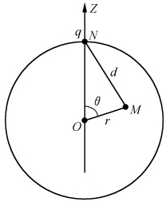
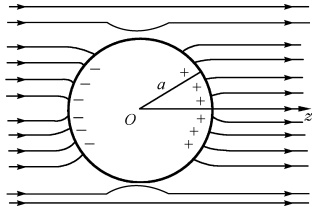
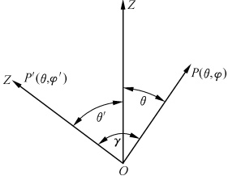

# 11-第十一章 勒让德多项式

[返回全书目录](../../README.md)

> PDF 页码：230–248

<!-- page: 230 -->

在第二篇第八章中我们曾通过在球坐标系中对亥姆霍兹方程和拉氏方程分离变量而得到了关于变量 $ \theta $的连带勒让德方程[见第二篇(8.4.34)式]

 $$ (1-x^{2})y^{\prime \prime}-2xy^{\prime}+\left[l(l+1)-\frac{m^{2}}{(1-x^{2})}\right]y=0 $$ 

其中  $ x=\cos\theta, y=\Theta(\theta) $. 该方程当 m=0 的特例为

 $$ (1-x^{2})y^{\prime \prime}-2xy^{\prime}+l(l+1)y=0 $$ 

称为勒让德方程. 若物理问题关于 z 轴对称，即场量  $ u(r,\theta,\varphi) $ 与  $ \varphi $ 无关， $ \frac{\partial u}{\partial\varphi}=0 $，则分离变量后所得到的关于变量  $ \theta $ 的方程正是这种情形 [见(8.4.29)~(8.4.32)式].

本章将在 x=0 的邻域求解勒让德方程，并着重讨论其特解勒让德多项式（一种特殊函数）所具有的性质.

### 11.1 勒让德多项式

## 1. 勒让德方程的级数解

让我们首先求出勒让德方程

$$  (1-x^{2})y^{\prime \prime}-2xy^{\prime}+l(l+1)y=0   \tag*{(11.1.1)}$$

在 x=0 点邻域的级数解.

由于 x=0 为方程的常点，故在 x=0 的邻域内可设其解 $ ^{①} $为

$$  y=\sum_{k=0}^{\infty}c_{k}x^{k}   \tag*{（11.1.2）}$$

代入方程(11.1.1)得到

 $$ (1-x^{2})\sum_{k=2}^{\infty}k(k-1)c_{k}x^{k-2}-2x\sum_{k=1}^{\infty}k c_{k}x^{k-1}+l(l+1)\sum_{k=0}^{\infty}c_{k}x^{k}=0 $$ 

即

 $$ \sum_{k=2}^{\infty}k(k-1)c_{k}x^{k-2}+l(l+1)\sum_{k=0}^{\infty}c_{k}x^{k}-2\sum_{k=1}^{\infty}kc_{k}x^{k}-\sum_{k=2}^{\infty}k(k-1)c_{k}x^{k}=0 $$ 

比较方程两边 x 的各次幂的系数有

 $$ \begin{aligned}2\bullet1c_{2}+l(l+1)c_{0}&=0\\3\bullet2c_{3}+\left[l(l+1)-2\right]c_{1}&=0\end{aligned} $$

<!-- page: 231 -->

$$ (k+2)(k+1)c_{k+2}+\left[l(l+1)-k(k+1)\right]c_{k}=0 $$ 

从而得如下一组系数递推公式

$$  \begin{aligned}&c_{2}=\frac{-l(l+1)}{2\bullet1}c_{0}\\&c_{3}=-\frac{l(l+1)-2}{3\bullet2}c_{1}\\&\quad\cdots\cdots\\&c_{k+2}=-\frac{l(l+1)-k(k+1)}{(k+2)(k+1)}c_{k},\quad k=0,1,2,\cdots\\ \end{aligned}   \tag*{(11.1.3)}$$

由（11.1.3）式于是有

 $$ \begin{align*}c_{4}=&-\frac{\left[l(l+1)-2\cdot3\right]}{4\cdot3}c_{2}=(-1)^{2}\frac{(l-2)l(l+1)(l+3)}{4!}c_{0};\\c_{5}=&-\frac{\left[l(l+1)-3\cdot4\right]}{5\cdot4}c_{3}=(-1)^{2}\frac{(l-3)(l-1)(l+2)(l+4)}{5!}c_{1};\end{align*} $$ 

即

$$  c_{2n}=\frac{(-1)^{n}(l-2n+2)(l-2n+4)\cdots l(l+1)\cdots(l+2n-1)}{(2n)!}c_{0}   \tag*{(11.1.4)}$$

$$  c_{2n+1}=\frac{(-1)^{n}(l-2n+1)(l-2n+3)\cdots(l-1)(l+2)\cdots(l+2n)}{(2n+1)!}c_{1}   \tag*{（11.1.5）}$$

其中 n=1,2,\cdots 将以上系数代入(11.1.2)式则得方程(11.1.1)的通解为

 $$ y(x)=y_{0}(x)+y_{1}(x) $$ 

其中

$$  \begin{align*}y_{0}(x)&=c_{0}\Big[1-\frac{l(l+1)}{2!}x^{2}+\frac{(l-2)l(l+1)(l+3)}{4!}x^{4}+\cdots\\&\quad+\frac{(-1)^{n}(l-2n+2)(l-2n+4)\cdots l(l+1)\cdots(l+2n-1)}{(2n)!\}x^{2n}+\cdots\Big]\\&=c_{0}+c_{2}x^{2}+c_{4}x^{4}+\cdots+c_{2n}x^{2n}+\cdots\tag{11.1.}\end{align*}   \tag*{（11.1.6）}$$

这是只含有偶次幂的特解. 而

 $$ \begin{aligned}y_{1}(x)&=c_{1}\Big[x-\frac{(l-1)(l+2)}{3!}x^{3}+\frac{(l-3)(l-1)(l+2)(l+4)}{5!}x^{5}+\cdots\\&\quad+\frac{(-1)^{n}(l-2n+1)(l-2n+3)\cdots(l-1)(l+2)\cdots(l+2n)}{(2n+1)!\}x^{2n+1}+\cdots\Big]\\&=c_{1}x+c_{3}x^{3}+c_{5}x^{5}+\cdots+c_{2n+1}x^{2n+1}+\cdots\tag{11.1.7}\end{aligned} $$ 

这是只含有奇次幂的特解.

## 2. 解的敛散性

既然解是无穷级数的形式，故必须讨论其敛散性。由达朗贝尔判别法[见第一篇(3.2.2)式]和递推公式(11.1.3)知， $ y_{0}(x) $ 和  $ y_{1}(x) $ 的收敛半径为

<!-- page: 232 -->

$$ R=\lim_{k\to\infty}\left|\frac{c_{k}}{c_{k+2}}\right|=\lim_{k\to\infty}\left|\frac{(k+2)(k+1)}{l(l+1)-k(k+1)}\right|=1 $$ 

这就是说，当 $ |x|<1 $时， $ y_{0}(x) $和 $ y_{1}(x) $绝对收敛；当 $ |x|>1 $时， $ y_{0} $和 $ y_{1} $发散；当 $ |x|=1 $时达朗贝尔判别法失效，但由高斯判别法[见第一篇(3.1.7)式]知 $ y_{0}(x) $和 $ y_{1}(x) $在 $ x=\pm1 $发散。因为此时 $ y_{0}(x) $和 $ y_{1}(x) $可表示为常数项级数

 $$ y_{0}=c_{0}+\sum_{n=1}^{\infty}c_{2n}=\sum_{n=0}^{\infty}f_{n}, $$ 

 $$ y_{1}=c_{1}+\sum_{n=1}^{\infty}(-1)^{2n+1}c_{2n+1}=\sum_{n=0}^{\infty}g_{n} $$ 

其中， $ c_{2n} $ 和  $ c_{2n+1} $ 分别由(11.1.4)式和(11.1.5)式给出。于是由(11.1.3)式，对于 $ y_{0} $ 有

 $$ \frac{f_{n}}{f_{n+1}}=\frac{(2n+2)(2n+1)}{(2n-l)(2n+1+l)}=1+\frac{1}{n}+O\Big(\frac{1}{n^{2}}\Big) $$ 

同样，对于 $ y_{1} $有

 $$ \frac{g_{n}}{g_{n+1}}=\frac{(2n+3)(2n+2)}{(2n+1-l)(2n+2+l)}=1+\frac{1}{n}+O\Big(\frac{1}{n^{2}}\Big) $$ 

因此  $ y_{0}(\pm1) $ 和  $ y_{1}(\pm1) $ 均发散.

## 3. 本征值和本征函数

在物理上我们常常是要求问题的有限解. 由于勒让德方程中  $ x=\cos\theta $, 即  $ \left|x\right|\leqslant1 $, 这就要求我们所求得的级数解必须满足自然边界条件

$$  y\mid_{|x|\leq1}\rightarrow 有限   \tag*{(11.1.8)}$$

由上面的讨论知，当  $ x = \pm 1 $ 时  $ y_{0} $ 和  $ y_{1} $ 却均不满足这一条件。但是由递推公式 (11.1.3) 我们看到，若取参数 l = 0, 1, 2,  $ \cdots $，则当 l = k 时便有  $ c_{l+2} = 0 $，于是接着便有  $ c_{l+4} = 0, c_{l+6} = 0, \cdots $，而  $ y_{0}(x) $ 和  $ y_{1}(x) $ 两级数解中势必有一个成为 l 次多项式。

具体而言，若 l=k=2n(n=0,1,2,\cdots)，则

于是

$$  \begin{aligned}c_{l+2}&=c_{2n+2}=0\\c_{2n+4}&=0,\quad c_{2n+6}=0,\quad\cdots\\y_{0}(x)&=c_{0}+c_{2}x^{2}+c_{4}x^{4}+\cdots+c_{l}x^{l}\end{aligned}   \tag*{(11.1.9)}$$

是一仅含有偶次幂的 l 次多项式[其中各次幂的系数依附于  $ c_{0} $，由(11.1.4)给出]. 而  $ y_{1}(x) $ 中由于不会出现终止项  $ c_{2n+2}=0 $，故仍为无穷级数. 类似地有

若  $ l=k=2n+1(n=0,1,2,\cdots) $，则

 $$ \begin{aligned}c_{l+2}&=c_{2n+3}=0\\c_{2n+5}&=0,\quad c_{2n+7}=0,\quad\cdots\\x)&=c_{1}x+c_{3}x^{3}+c_{5}x^{5}+\cdots+c_{l}x^{l}\end{aligned} $$ 

于是

是一只含有奇次幂的 l 次多项式[其中各次幂系数依附于  $ c_{1} $，由(11.1.7)给出].而

<!-- page: 233 -->

$ y_{0}(x) $仍为无穷级数.

综上所述，勒让德方程(11.1.1)只有当参数l取0,1,2, $ \cdots $时，才在闭区间 $ -1\leqslant x\leqslant1 $中有有限的解。我们称参数 $ l(l+1),l=0,1,2,\cdots $为方程(11.1.1)在边界条件(11.1.8)下的本征值，而相应的l次多项式解(11.1.9)或(11.1.10)式，为本征函数。

## 4. 勒让德多项式

可以看出，以上 l 次多项式的系数是相当烦的，为了使以上多项式有比较简洁的形式，并使它在 x=1 处的值恒为 1，选最高次幂的系数

 $$ c_{l}=\frac{(2l)!}{2^{l}(l!)^{2}} $$ 

并称以上 l 次多项式为 l 阶勒让德多项式，记为  $ P_{l}(x) $，则由(11.1.3)式有

 $$ c_{k}=\frac{(k+2)(k+1)}{k(k+1)-l(l+1)}c_{k+2}=-\frac{(k+2)(k+1)}{(l-k)(l+k+1)}c_{k+2} $$ 

于是

 $$ \begin{align*}c_{l-2}=&-\frac{l(l-1)}{2(2l-1)}c_{l}=(-1)\frac{l(l-1)}{2(2l-1)}\bullet\frac{(2l)!}{2^{l}(l!)^{2}}\\=&(-1)\frac{(2l-2)!}{2^{l}(l-1)!(l-2)!}\end{align*} $$ 

 $$ \begin{aligned}c_{l-4}=&-\frac{(l-2)(l-3)}{4(2l-3)}c_{l-2}\\=&(-1)^{2}\frac{(l-2)(l-3)}{4(2l-3)}\bullet\frac{(2l-2)!}{2^{l}(l-1)!(l-2)!}\\=&(-1)^{2}\frac{(2l-4)!}{2^{l}\bullet2(l-2)!(l-4)!}\end{aligned} $$ 

 $$ \begin{aligned}c_{l-6}=&-\frac{(l-4)(l-5)}{6(2l-5)}c_{l-4}\\=&(-1)^{3}\frac{(l-4)(l-5)}{6(2l-5)}\bullet\frac{(2l-4)!}{2^{l}\bullet2(l-2)!(l-4)!}\\=&(-1)^{3}\frac{(2l-6)!}{2^{l}3!(l-3)!(l-6)!}\end{aligned} $$ 

仿此做下去，用数学归纳法可得

 $$ c_{l-2n}=(-1)^{n}\frac{(2l-2n)!}{2^{l}n!(l-n)!(l-2n)!},\quad n=0,1,\cdots,\left[\frac{l}{2}\right] $$ 

其中

 $$ \left[\frac{l}{2}\right]=\left\{\begin{aligned}&\frac{l}{2},& 当 l 为偶数 \\&\frac{l-1}{2},& 当 l 为奇数 \end{aligned}\right. $$ 

故有

<!-- page: 234 -->

$$  P_{l}(x)=\sum_{n=0}^{\left[\frac{l}{2}\right]}(-1)^{n}\frac{(2l-2n)!}{2^{l}n!(l-n)!(l-2n)!}x^{l-2n}   \tag*{(11.1.11)}$$

这是一按降幂排列的 l 次多项式，它是 l 阶勒让德方程(11.1.1)的一有界解，即

$$  y=P_{l}(x)   \tag*{(11.1.12)}$$

由（11.1.11）式可得到

$$  \begin{aligned}&P_{0}(x)=1\\&P_{1}(x)=x\\&P_{2}(x)=\frac{1}{2}(3x^{2}-1)\\&P_{3}(x)=\frac{1}{2}(5x^{3}-3x)\\ \end{aligned}   \tag*{(11.1.13)}$$

等等. 且

 $$ P_{0}(1)=P_{1}(1)=P_{2}(1)=P_{3}(1)=\cdots\equiv1 $$ 

在讨论勒让德多项式的一些性质或在与其相关的一些计算中，还要用到它的别种表达式，下面我们导出它的其他两种表达式。

## 5. 勒让德多项式的微分表达式

$$  P_{l}(x)=\frac{1}{2^{l}l!}\frac{\mathrm{d}^{l}}{\mathrm{d}x^{l}}(x^{2}-1)^{l}   \tag*{(11.1.14)}$$

这个表达式又称为罗德里格斯(Rodrigues)公式.

证明 由二项式展开定理

可得到

 $$ \begin{aligned}&(a+b)^{k}=\sum_{n=0}^{k}\frac{k!}{n!(k-n)!}a^{k-n}b^{n}\\ &(x^{2}-1)^{l}=\sum_{n=0}^{l}\frac{(-1)^{n}l!}{n!(l-n)!}x^{2l-2n}\\ \end{aligned} $$ 

因此

 $$ \begin{align*}\frac{1}{2^{l} l!}\frac{\mathrm{d}^{l}}{\mathrm{d}x^{l}}(x^{2}-1)^{l}&=\frac{1}{2^{l} l!}\sum_{n=0}^{l}\frac{(-1)^{n} l!}{n!(l-n)!}\frac{\mathrm{d}^{l}}{\mathrm{d}x^{l}}x^{2l-2n}=\sum_{n=0}^{\left\lfloor\frac{l}{2}\right\rfloor}\frac{(-1)^{n}}{2^{l} n!(l-n)!}\\&\quad\bullet(2l-2n)(2l-2n-1)\cdots(2l-2n-l+1)x^{2l-2n-l}\\&=\sum_{n=0}^{\left\lfloor\frac{l}{2}\right\rfloor}\frac{(-1)^{n}(2l-2n)!}{2^{l} n!(l-n)!(l-2n)!}x^{l-2n}=P_{l}(x)\end{align*} $$ 

## 6. 勒让德多项式的积分表达式

$$  P_{l}(x)=\frac{1}{2\pi\mathrm{i}}\oint_{l^{*}}\frac{(\zeta^{2}-1)^{l}}{2^{l}(\zeta-x)^{l+1}}\mathrm{d}\zeta   \tag*{(11.1.15)}$$

其中  $ l^{*} $ 为包围  $ \zeta = x $ 的回路. 此表达式又称为拖拉夫利 (Schläfli) 公式.

<!-- page: 235 -->

证明 令  $ f(z)=(z^{2}-1)^{l} $，则由解析函数的 n 阶导数公式 [见第一篇(2.3.5)式] 有

 $$ \frac{\mathrm{d}^{l}}{\mathrm{d}z^{l}}(z^{2}-1)^{l}=\frac{l!}{2\pi\mathrm{i}}\oint_{l^{*}}\frac{(\zeta^{2}-1)^{l}}{(\zeta-z)^{l+1}}\mathrm{d}\zeta $$ 

即

 $$ \frac{\mathrm{d}^{l}}{\mathrm{d}x^{l}}(x^{2}-1)^{l}=\frac{l!}{2\pi\mathrm{i}}\oint_{l^{*}}\frac{(\zeta^{2}-1)^{l}}{(\zeta-x)^{l+1}}\mathrm{d}\zeta $$ 

上式两边同乘以因子 $ \frac{1}{2^{l}!} $ 便得(11.1.15)式.

注 ① 对于二阶线性常微分方程

$$  \begin{align*}w''(z)+p(z)w'(z)+q(z)w(z)=0\end{align*}   \tag*{(11.1.16)}$$

若其系数 p(z) 和 q(z) 均在某点  $ z_{0} $ 及其邻域内解析，则称  $ z_{0} $ 为方程的常点.

在常点  $ z = z_{0} $ 的邻域  $ \left| z - z_{0} \right| < R $ 内，方程 (11.1.16) 有唯一的一个满足初始条件

 $$ w(z_{0})=c_{0},\quad w^{\prime}(z_{0})=c_{1} $$ 

的形式为

$$  w(z)=\sum_{k=0}^{\infty}c_{k}(z-z_{0})^{k}   \tag*{(11.1.17)}$$

的幂级数解. 其中  $ c_{0} $ 和  $ c_{1} $ 是任意常数; 而其他各次幂系数与  $ c_{0} $ 和  $ c_{1} $ 的关系, 均由将形式解 (11.1.17) 代入方程 (11.1.16) 中通过比较方程两边同次幂的系数 [即让左边  $ (z - z_{0}) $ 的各次幂的系数均为零] 来确定 (参见参考书目 [5], § 95).

#### 习题11.1

1. 在 x=0 点的邻域求解常微分方程

 $$ y^{\prime \prime}+\omega^{2}y=0 $$ 

2. 用级数解法求艾里方程

 $$ y^{\prime \prime}-xy=0 $$ 

在 x=0 点邻域分别满足条件  $ y(0)=0, y^{\prime}(0)=1 $ 和  $ y(0)=1, y^{\prime}(0)=0 $ 的级数解.

3. 在量子力学中讨论一维谐振子问题会遇到厄米方程. 在 x=0 的邻域求解厄米方程

 $$ y^{\prime \prime}-2xy^{\prime}+(\lambda-1)y=0 $$ 

λ取什么数值可使级数解退化为多项式？这些多项式乘以适当常数可使最高项成为 $ (2x)^{n} $形式，叫做厄米多项式，记作 $ H_{n}(x) $.写出前几个 $ H_{n}(x) $.

4. 在 x=0 的邻域内求解雅可比 (Jacobi) 方程

 $$ (1-x^{2})y^{\prime \prime}+\left[\beta-\alpha-(\alpha+\beta+2)x\right]y^{\prime}+\lambda(\alpha+\beta+\lambda+1)y=0. $$ 

其中 $ \alpha,\beta,\lambda $均为常数.

5. 求方程  $ y'' - x^{2}y = 0 $ 在 x = 0 邻域内的两个级数解

### 11.2 勒让德多项式的性质

在这一节中，我们将首先导出勒让德多项式的母函数展开公式，由此再导出勒让

<!-- page: 236 -->

德多项式的其他一些有用性质.

如果函数  $ w(x,t) $ 满足如下关系：

 $$ w(x,t)=\sum_{n}F_{n}(x)t^{n},\quad t 为复数 $$ 

则称  $ w(x,t) $ 为  $ F_{n}(x) $ 的母函数（或生成函数）.

## 1.  $ P_{i}(x) $ 的母函数

勒让德多项式最早是由勒让德在势论中引入的。如图11.1所示，设在单位球的北极N点放有一电量q为 $ 4\pi\varepsilon_{0} $的正电荷，则由电学知识知，在球内任一点M（设M与N之间的距离为d）处的电势为

 $$ v(r,\theta)=\frac{1}{d}=\frac{1}{\sqrt{1-2r\cos\theta+r^{2}}} $$ 

图11.1
 

其中 r,  $ \theta $ 均为球坐标变量（由于问题是轴对称的，所以与变量  $ \varphi $ 无关）. 若令  $ x = \cos\theta $，则

$$  v(r,\theta)=\frac{1}{d}=\frac{1}{\sqrt{1-2rx+r^{2}}},\quad\mid x\mid\leqslant1   \tag*{(11.2.1)}$$

另一方面，在单位球内

 $$ \Delta v(r,\theta)=0,\quad r<1 $$ 

用分离变量法求解此方程，令

 $$ v(r,\theta)=R(r)\Theta(\theta) $$ 

代入上式，实现变数分离得

$$  \left\{\begin{array}{l}r^{2}\frac{\mathrm{d}^{2}R}{\mathrm{d}r^{2}}+2r\frac{\mathrm{d}R}{\mathrm{d}r}-l(l+1)R=0\end{array}\right.   \tag*{(11.2.2)}$$

$$  (1-x^{2})y^{\prime \prime}-2xy^{\prime}+l(l+1)y=0   \tag*{（11.2.3）}$$

其中， $ l=0,1,2,\cdots;x=\cos\theta,y=\Theta(\theta) $ [参见第二篇8.4节].方程(11.2.2)是我们所熟悉的欧拉方程，其解为

 $$ R(r)=A r^{l}+B r^{-(l+1)} $$ 

其中 A, B 为任意常数. 方程(11.2.3) 的有限解已由(11.1.12)式给出, 即

 $$ y_{l}(x)=P_{l}(x) $$ 

于是

$$  v(r,\theta)=\sum_{l=0}^{\infty}[A_{l}r^{l}+B_{l}r^{-(l+1)}]P_{l}(\cos\theta)   \tag*{(11.2.4)}$$

注意到在原点处不存在电荷，所以  $ v|_{r=0}= $ 有限，因此必须  $ B_{l}=0 $ 。于是

$$  \upsilon(r,\theta)=\sum_{l=0}^{\infty}A_{l}r^{l}P_{l}(\cos\theta),\quad r<1   \tag*{（11.2.5）}$$

对比(11.2.1)式和(11.2.5)式，可得

<!-- page: 237 -->

$$  \frac{1}{\sqrt{1-2rx+r^{2}}}=\sum_{l=0}^{\infty}A_{l}r^{l}P_{l}(x)   \tag*{(11.2.6)}$$

取x=1，并注意到 $ P_{l}(1)\equiv1 $，可得

 $$ \frac{1}{1-r}=\sum_{l=0}^{\infty}A_{l}r^{l} $$ 

与几何级数对比，于是可定出系数

 $$ A_{l}=1,\quad l=0,1,2,\cdots $$ 

代入(11.2.6)式并将 r 改写为  $ t(t $ 为复数)更具有一般性，最后得

$$  \frac{1}{\sqrt{1-2tx+t^{2}}}=\sum_{l=0}^{\infty}P_{l}(x)t^{l},\quad\mid t\mid<1   \tag*{(11.2.7)}$$

所以， $ P_{l}(x) $ 的母函数是含参数的初等函数  $ \frac{1}{\sqrt{1-2tx+t^{2}}} $.

利用特殊函数的母函数展开式，研究特殊函数将十分方便。下面我们将利用(11.2.7)式，导出勒让德多项式的递推公式和归一性，这种用母函数来研究问题的方法，称做母函数法。

## 2. 递推公式

邻阶的勒让德多项式，满足如下的递推公式：

$$  (l+1)P_{l+1}(x)-(2l+1)x P_{l}(x)+l P_{l-1}(x)=0,\quad l=1,2,3,\cdots   \tag*{(11.2.8)}$$

证明 将(11.2.7)式两边对 t 求导，得

 $$ (x-t)(1-2xt+t^{2})^{-\frac{3}{2}}=\sum_{l=0}^{\infty}lP_{l}(x)t^{l-1} $$ 

以 $ (1-2xt+t^{2}) $乘两边，对左边再用（11.2.7）式得

 $$ (x-t)\sum_{l=0}^{\infty}P_{l}(x)t^{l}=(1-2xt+t^{2})\sum_{l=0}^{\infty}lP_{l}(x)t^{l-1} $$ 

比较两边同次幂 $ t^{i} $的系数便得(11.2.8)式.

## 3. 正交归一性

勒让德多项式，在 $ [-1,1] $上满足如下正交归一关系：

$$  \int_{-1}^{1}P_{l}(x)P_{k}(x)\mathrm{d}x=\frac{2}{2l+1}\delta_{kl}   \tag*{(11.2.9)}$$

证明 我们先证明其正交性，即

 $$ \int_{-1}^{1}P_{l}(x)P_{k}(x)\mathrm{d}x=0,\quad k\neq l $$ 

由于  $ P_{l}(x) $ 和  $ P_{k}(x) $ 分别为 l 阶和 k 阶勒让德方程的一特解，故有

 $$ \frac{\mathrm{d}}{\mathrm{d}x}\Big[(1-x^{2})\frac{\mathrm{d}P_{l}(x)}{\mathrm{d}x}\Big]+l(l+1)P_{l}(x)=0 $$

<!-- page: 238 -->

$$ \frac{\mathrm{d}}{\mathrm{d}x}\Big[(1-x^{2})\frac{\mathrm{d}P_{k}(x)}{\mathrm{d}x}\Big]+k(k+1)P_{k}(x)=0 $$ 

以  $ P_{k}(x) $ 乘以第一个式子， $ P_{i}(x) $ 乘以第二个式子，再把结果相减，然后积分得

 $$ \begin{aligned}&\int_{-1}^{1}P_{k}(x)\frac{\mathrm{d}}{\mathrm{d}x}\big[(1-x^{2})P_{l}^{\prime}(x)\big]\mathrm{d}x-\int_{-1}^{1}P_{l}(x)\frac{\mathrm{d}}{\mathrm{d}x}\big[(1-x^{2})P_{k}^{\prime}(x)\big]\mathrm{d}x\\ +\big[l(l+1)-k(k+1)\big]\int_{-1}^{1}P_{l}(x)P_{k}(x)\mathrm{d}x&=0\end{aligned} $$ 

对前两项利用分部积分得

 $$ \begin{align*}&(1-x^{2})P_{k}(x)P_{l}^{\prime}(x)\big|_{-1}^{1}-\int_{-1}^{1}(1-x^{2})P_{l}^{\prime}(x)P_{k}^{\prime}(x)\mathrm{d}x\\&-(1-x^{2})P_{l}(x)P_{k}^{\prime}(x)\big|_{-1}^{1}+\int_{-1}^{1}(1-x^{2})P_{k}^{\prime}(x)P_{l}^{\prime}(x)\mathrm{d}x\\=&\big[k(k+1)-l(l+1)\big]\int_{-1}^{1}P_{l}(x)P_{k}(x)\mathrm{d}x\end{align*} $$ 

即

 $$ \left[k(k+1)-l(l+1)\right]\int_{-1}^{1}P_{l}(x)P_{k}(x)\mathrm{d}x=0 $$ 

因为  $ k \neq l $ ，故有

 $$ \int_{-1}^{1}P_{i}(x)P_{k}(x)\mathrm{d}x=0 $$ 

又由母函数关系式(11.2.7)式，有

 $$ \frac{1}{1-2xt+t^{2}}=\sum_{l=0}^{\infty}P_{l}(x)t^{l}\bullet\sum_{k=0}^{\infty}P_{k}(x)t^{k}=\sum_{l=0}^{\infty}\sum_{k=0}^{\infty}P_{l}(x)P_{k}(x)t^{l+k} $$ 

将上式两边对 x 积分，并引用正交性，便有

 $$ \begin{align*}\int_{-1}^{1}\frac{\mathrm{d}x}{1-2xt+t^{2}}&=\sum_{l=0}^{\infty}\sum_{k=0}^{\infty}\int_{-1}^{1}P_{l}(x)P_{k}(x)\mathrm{d}x\bullet t^{l+k}\\&=\sum_{l=0}^{\infty}\int_{-1}^{1}P_{l}^{2}(x)\mathrm{d}xt^{2l}\end{align*} $$ 

又

 $$ \begin{aligned}\int_{-1}^{1}\frac{\mathrm{d}x}{1-2xt+t^{2}}=&-\frac{1}{2t}\int_{-1}^{1}\frac{\mathrm{d}(1-2xt+t^{2})}{(1-2xt+t^{2})}\\=&\frac{1}{2t}\ln\frac{(1+t)^{2}}{(1-t)^{2}}=\sum_{l=0}^{\infty}\frac{2}{2l+1}t^{2l}\end{aligned} $$ 

对比上两式故有

 $$ \sum_{l=0}^{\infty}\frac{2}{2l+1}t^{2l}=\sum_{l=0}^{\infty}\int_{-1}^{1}P_{l}^{2}(x)\mathrm{d}x t^{2l} $$ 

比较等式两边  $ t^{21} $ 的系数，于是有

 $$ \int_{-1}^{1}P_{l}^{2}(x)\mathrm{d}x=\frac{2}{2l+1} $$ 

记

 $$ N_{l}^{2}=\frac{2}{2l+1} $$

<!-- page: 239 -->

称  $ N_{l} $ 为  $ P_{l}(x) $ 的模，而  $ \frac{1}{N_{l}} $ 为  $ P_{l}(x) $ 的归一化因子。因为函数  $ \frac{P_{l}(x)}{N_{l}} $ 在  $ [-1,1] $ 上归一

 $$ \int_{-1}^{1}\left[\frac{P_{l}(x)}{N_{l}}\right]^{2}\mathrm{d}x=1 $$ 

我们常常利用勒让德多项式的递推公式和正交归一性来计算一些含勒让德多项式的积分.

例1 求积分 $ \int_{-1}^{1}xP_{l}(x)P_{k}(x)\mathrm{d}x $之值.

解 由递推公式 $  (11.2.8)  $式有

 $$ x P_{l}(x)=\frac{1}{2l+1}\big[(l+1)P_{l+1}(x)+l P_{l-1}(x)\big] $$ 

所以

 $$ \begin{aligned}\int_{-1}^{1}xP_{l}(x)P_{k}(x)\mathrm{d}x=&\frac{l+1}{2l+1}\int_{-1}^{1}P_{l+1}(x)P_{k}(x)\mathrm{d}x\\&+\frac{l}{2l+1}\int_{-1}^{1}P_{l-1}(x)P_{k}(x)\mathrm{d}x\end{aligned} $$ 

再利用正交性(11.2.9)式，便有

$$  \int_{-1}^{1}x P_{l}(x)P_{k}(x)\mathrm{d}x=\left\{\begin{aligned}&\frac{2k}{4k^{2}-1},&l&=k-1\\&\frac{2(k+1)}{(2k+3)(2k+1)},&l&=k+1\\&0,&l-k\neq&\pm1\end{aligned}\right.   \tag*{(11.2.10)}$$

最后，我们讨论函数按  $ P_{1}(x) $ 展开为广义傅氏级数的问题.

## 4. 广义傅氏展开

若函数  $ f(x) $ 在区间  $ [-1,1] $ 上有连续的一阶导数，分段连续的二阶导数，且  $ f(x) $ 在  $ [-1,1] $ 上平方可积，则  $ f(x) $ 在  $ [-1,1] $ 上可展开为如下的绝对且一致收敛的级数

$$  f(x)=\sum_{l=0}^{\infty}C_{l}P_{l}(x)   \tag*{(11.2.11)}$$

其中

$$  C_{l}=\frac{2l+1}{2}\int_{-1}^{1}f(x)P_{l}(x)\mathrm{d}x,\quad l=0,1,2,\cdots   \tag*{(11.2.12)}$$

关于展开定理的证明，可参看参考书目[6]第5章，而展开系数公式(11.2.12)，只要在(11.2.11)两边乘上 $ P_{k}(x) $后，再在区间 $ [-1,1] $上对x积分，并利用正交归一性(11.2.9)式便可得到.

由于在物理上常将某一作为表征的物理量展开成级数进行分析，而在数学上数理方程的解又常常是无穷级数的形式（如分离变量解），这就使得函数的广义傅氏展开有重要意义和用处。广义傅氏展开又称之为完备性。

例2 在匀强电场  $ E_{0} $ 中，放一接地的导体球，球的半径等于a，求球外电场.

解 选择球坐标系讨论此问题（见图11.2）. 在球外，由于没有电荷存在，故电势

<!-- page: 240 -->

v 满足拉氏方程

$$  \Delta v=0   \tag*{(11.2.13)}$$

由于导体球接地，故有边界条件

$$  v\mid_{r=a}=0   \tag*{(11.2.14)}$$

又由于问题中的区域是球外，延伸无穷远处，

故还需考虑在无穷远处电势应满足的边界条件。

在无穷远处只有原来的匀强电场  $ E = E_{0} $，

其方向沿 z 轴，即  $ E|_{r \to \infty} = -\frac{\partial v}{\partial z} \bigg|_{r \to \infty} = E_{0} $，设

图11.2
 

在导体未放入前，r=0 处的电势为  $ v_{0} $，则在  $ \infty $ 处电势满足的边界条件为

$$  v\mid_{r\to\infty}=-E_{0}z+v_{0}=-E_{0}r\cos\theta+v_{0}   \tag*{(11.2.15)}$$

现在在球坐标中，用分离变量法来求解定解问题(11.2.13)~(11.2.15)式.考虑到问题的轴对称性，故令

$$  v(r,\theta)=R(r)\Theta(\theta)   \tag*{(11.2.16)}$$

代入(11.2.13)式，类似于前面的过程[见(11.2.2)~(11.2.4)式]实现变数分离，得其解为

$$  v(r,\theta)=\sum_{l=0}^{\infty}[A_{l}r^{l}+B_{l}r^{-(l+1)}]P_{l}(\cos\theta)   \tag*{(11.2.17)}$$

将(11.2.17)式代入边界条件(11.2.14)式得

 $$ B_{l}=-a^{2l+1}A_{l},\quad l=0,1,2,\cdots $$ 

因此，解(11.2.17)式可写成

$$  v(r,\theta)=\sum_{l=0}^{\infty}A_{l}\left[r^{l}-a^{2l+1}r^{-(l+1)}\right]P_{l}(\cos\theta)   \tag*{(11.2.18)}$$

再将上式代入边界条件(11.2.15)得

$$  \sum_{l=0}^{\infty}A_{l}r^{l}P_{l}(\cos\theta)=v_{0}-E_{0}r\cos\theta   \tag*{(11.2.19)}$$

此式左边是函数  $ f(x)=v_{0}-E_{0}rx $ 以勒让德多项式  $ P_{l}(x) $ 为基本函数族的广义傅氏展开，故由(11.2.11)式和(11.2.12)式立即可得

 $$ \begin{align*}A_{l}r^{l}&=\frac{2l+1}{2}\int_{-1}^{1}(v_{0}-E_{0}rx)P_{l}(x)\mathrm{d}x\\&=\frac{2l+1}{2}\Big[v_{0}\int_{-1}^{1}P_{0}(x)P_{l}(x)\mathrm{d}x-E_{0}r\int_{-1}^{1}P_{1}(x)P_{l}(x)\mathrm{d}x\Big],\quad l=0,1,2,\cdots\end{align*} $$ 

而由正交归一公式(11.2.9)式便有

 $$ A_{0}r^{0}=v_{0};\quad A_{1}r=-E_{0}r;\quad A_{l}r^{l}=0,\quad l\neq0,1 $$ 

即

 $$ A_{0}=v_{0}；A_{1}=-E_{0}；A_{l}=0，l\neq0,1 $$ 

这样求展开系数，由于要计算积分，常常是相当麻烦的，特别是对于较复杂的函数  $ f(x) $. 事实上此题不必这样做. 重写(11.2.19)为如下形式：

<!-- page: 241 -->

$$ \begin{aligned}&A_{0}P_{0}(\cos\theta)+A_{1}r P_{1}(\cos\theta)+A_{2}r^{2}P_{2}(\cos\theta)+\cdots\\&=v_{0}P_{0}(\cos\theta)-E_{0}r P_{1}(\cos\theta)\\ \end{aligned} $$ 

比较等式两边同阶勒让德多项式的系数立即可得

 $$ A_{0}=v_{0}；A_{1}=-E_{0}；A_{l}=0,l\neq0,1 $$ 

所以用展开系数公式(11.2.12)式求展开系数除非是不得已[如，没给出 $ f(x) $的具体形式]才为之.将求得的系数 $ A_{l}(l=0,1,2,\cdots) $代入解(11.2.18)得

 $$ v(r,\theta)=v_{0}-\frac{a}{r}v_{0}-E_{0}r\cos\theta+\frac{E_{0}a^{3}}{r^{2}}\cos\theta,\quad r\geqslant a $$ 

#### 习题11.2

1. 试利用母函数关系式(11.2.7)式和递推公式(11.2.8)式导出下列递推公式：

(1)

$$  P_{l}(x)=P_{l+1}^{\prime}(x)-2xP_{l}^{\prime}(x)+P_{l-1}^{\prime}(x);   \tag*{(11.2.20)}$$

$$  (2)P_{l+1}^{\prime}(x)=x P_{l}^{\prime}(x)+(l+1)P_{l}(x);   \tag*{(11.2.21)}$$

(3)

$$  xP_{i}^{\prime}(x)-P_{i-1}^{\prime}(x)=lP_{i}(x);   \tag*{(11.2.22)}$$

(4)

$$  P_{l+1}^{\prime}(x)-P_{l-1}^{\prime}(x)=(2l+1)P_{l}(x);   \tag*{(11.2.23)}$$

$$  (5)\ (x^{2}-1)P_{l}^{\prime}(x)=lxP_{l}(x)-lP_{l-1}(x).   \tag*{(11.2.24)}$$

## 2. 计算积分

(1)

 $$ \int_{-1}^{1}x^{2}P_{t}(x)P_{t+2}(x)\mathrm{d}x; $$ 

(2)

 $$ \int_{-1}^{1}x P_{t}(x)P_{t+1}(x)\mathrm{d}x; $$ 

(3)

 $$ \int_{-1}^{1}P_{l}(x)\mathrm{d}x,l=1,2,3,\cdots; $$ 

(4)

 $$ \int_{-1}^{1}(1-x^{2})\big[P_{i}^{\prime}(x)\big]^{2}\mathrm{d}x. $$ 

3. 从(11.1.11)式出发证明

(1)

$$  P_{i}(-x)=(-1)^{i}P_{i}(x);   \tag*{(11.2.25)}$$

(2)

$$  P_{2n+1}(0)=0,P_{2n+1}^{\prime}(0)=\frac{(-1)^{n}(2n+2)!}{2^{2n+1}n!(n+1)!},   \tag*{(11.2.26)}$$

$$  P_{2n}(0)=(-1)^{n}\frac{(2n)!}{2^{2n}n!n!},\quad P_{2n}^{\prime}(0)=0\quad(n=0,1,2,\cdots)   \tag*{（11.2.27）}$$

(3)

$$  P_{l}(1)=1,P_{l}(-1)=(-1)^{l}   \tag*{（11.2.28）}$$

4. 求下列函数按勒让德多项式展开：

(1)

 $$ f(x)=x^{3} $$ 

(2)

 $$ f(x)=\left|x\right|； $$ 

(3)

 $$ f(x)=\left\{\begin{aligned}&0,&-1\leqslant&x<0\\ &x,&0\leqslant&x<1;\end{aligned}\right. $$ 

(4)

 $$ 4)f(x)=\sqrt{1-2xt+t^{2}}. $$ 

5. 设有一单位球，其边界球面上温度分布为

 $$ u\mid_{r=1}=\frac{1}{4}(\cos3\theta+3\cos\theta) $$ 

试求球内的稳定温度分布.

6. 设有一个半径为 a 的均匀介质球，介电常数为  $ \varepsilon $，在与球心距离为  $ b (b > a) $ 的地方放一点电荷  $ 4\pi\varepsilon_{0}q $，求介质球内外的电势.

7. 设有半径为 a 的导体球壳，被一层过球心的水平的绝缘薄片分隔为两个半球壳。若上、下半球壳各充电到电势为  $ v_{1} $ 和  $ v_{2} $，试求球壳内、外的电势分布。

<!-- page: 242 -->

8. 设有一个均匀的细圆环，环的半径等于 a，质量为 m，求它的引力势.

9. 求表面充电至电势为  $ v_{0}(1+2\cos\theta+3\cos^{2}\theta) $ 的单位空心球内各点的电势  $ (v_{0} $ 为常数 $ ) $.

10. 半径为 a 的半球，其球面保持恒温  $ u_{0} $，而底面温度为零度。求半球内的稳定温度分布。

11. 长为 l 的柔软匀质轻绳，一端固定在以角速度  $ \omega $ 转动的竖直轴上，由于惯性离心力的作用，弦的平衡位置为水平线。设初始位移为  $ \varphi(x) $，初始速度为  $ \psi(x) $，求解弦相对于水平线的横振动。

 $ ^{*} $12. 内半径为 a、外半径为 b 的薄圆环面均匀带电，其总电量为  $ 4\pi\varepsilon_{0}q $，将球坐标系的原点取在环心，极轴垂直于环面，求空间各点的电势.

 $$ v(r,\theta)\mid_{\theta=0}=v(r,\theta)\mid_{\theta=\pi}=\frac{2q}{b^{2}-a^{2}}(\sqrt{b^{2}+r^{2}}-\sqrt{a^{2}+r^{2}}). $$ 

13. 一半径为 a 的带电薄圆盘，其电荷密度  $ \sigma(d)=\frac{4\varepsilon_{0}v_{0}}{\pi\sqrt{a^{2}-d^{2}}} $，其中 d 为圆盘上任一点至盘心的距离， $ v_{0} $ 为常数。求空间各点的电势。

### 11.3 连带勒让德函数与球函数

在球坐标系中，当我们对拉氏方程

$$  \Delta u=0   \tag*{(11.3.1)}$$

分离变量，即令

 $$ u(r,\theta,\varphi)=R(r)y(\theta,\varphi) $$ 

$$  y(\theta,\varphi)=\Theta(\theta)\Phi(\varphi)   \tag*{（11.3.2）}$$

便可得到三个常微分方程（见第二篇8.4节）

$$  \Phi^{\prime \prime}+m^{2}\Phi=0,\quad m=0,1,2,\cdots   \tag*{（11.3.3）}$$

$$  r^{2}R^{\prime \prime}+2rR^{\prime}-l(l+1)R=0   \tag*{（11.3.4）}$$

$$  (1-x^{2})y^{\prime \prime}-2xy^{\prime}+\left[l(l+1)-\frac{m^{2}}{1-x^{2}}\right]y=0,\quad x=\cos\theta,y=\Theta(\theta)   \tag*{（11.3.5）}$$

方程（11.3.3）式和（11.3.4）式的解都是我们所熟悉的，即

$$  \Phi_{m}(\varphi)=A_{m}\cos m\varphi+B_{m}\sin m\varphi   \tag*{（11.3.6）}$$

$$  R_{l}(r)=c_{l}r^{l}+d_{l}r^{-(l+1)}   \tag*{（11.3.7）}$$

因此，只要求出连带勒让德方程(11.3.5)式的解，便可得到拉氏方程在球坐标系中的解。现在我们就来求解方程(11.3.5)。

## 1. 连带勒让德函数

由于 11.1 节中所求解过的勒让德方程(11.1.1)，是连带勒让德方程(11.3.5)在轴对称（即 m=0）情况下的特例，故我们可通过连带勒让德方程和勒让德方程的联系，来得到连带勒让德方程的解.

对于方程(11.3.5)，作变换

<!-- page: 243 -->

$$  y(x)=(1-x^{2})^{\frac{m}{2}}v(x)   \tag*{(11.3.8)}$$

则

 $$ \begin{aligned}&y^{\prime}(x)=(1-x^{2})^{\frac{m}{2}}\Big[v^{\prime}(x)-\frac{mx}{1-x^{2}}v(x)\Big]\\&y^{\prime \prime}(x)=(1-x^{2})^{\frac{m}{2}}\Big[v^{\prime \prime}(x)-\frac{2mx}{1-x^{2}}v^{\prime}(x)+\frac{m^{2}x^{2}-m-mx^{2}}{(1-x^{2})^{2}}v(x)\Big]\\ \end{aligned} $$ 

代入(11.3.5)式并将方程两边乘以 $ (1-x^{2})^{-\frac{m}{2}} $得

$$  (1-x^{2})v^{\prime \prime}-2(m+1)x v^{\prime}+\left[l(l+1)-m(m+1)\right]v=0   \tag*{(11.3.9)}$$

不难看出，这个方程正好是勒让德方程逐项微分 m 次的结果。因为对于勒让德方程

 $$ (1-x^{2})P_{l}^{\prime \prime}(x)-2x P_{l}^{\prime}(x)+l(l+1)P_{l}(x)=0 $$ 

微分一次，得

 $$ (1-x^{2})\big[P_{l}^{\prime}(x)\big]^{\prime \prime}-2x(1+1)\big[P_{l}^{\prime}(x)\big]^{\prime}+\big[l(l+1)-1(1+1)\big]P_{l}^{\prime}(x)=0 $$ 

两微分一次，得

 $$ (1-x^{2})\big[P_{l}^{\prime \prime}(x)\big]^{\prime \prime}-2x(2+1)\big[P_{l}^{\prime \prime}(x)\big]^{\prime}+\big[l(l+1)-2(2+1)\big]P_{l}^{\prime \prime}(x)=0 $$ 

于是，连续微分 m 次，可得

$$  (1-x^{2})\big[P_{l}^{(m)}(x)\big]^{\prime \prime}-2x(m+1)\big[P_{l}^{(m)}(x)\big]^{\prime}+\big[l(l+1)-m(m+1)\big]P_{l}^{(m)}(x)=0   \tag*{(11.3.10)}$$

对比(11.3.9)式和(11.3.10)式知， $ P_{l}^{(m)}(x) $ 是(11.3.9)式的一个特解，即

 $$ v(x)=P_{l}^{(m)}(x),\quad0\leqslant m\leqslant l $$ 

代入(11.3.8)式，得

 $$ y(x)=(1-x^{2})^{\frac{m}{2}}P_{l}^{(m)}(x) $$ 

记

$$  P_{l}^{m}(x)=(1-x^{2})^{\frac{m}{2}}P_{l}^{(m)}(x),\quad0\leqslant m\leqslant l   \tag*{(11.3.11)}$$

称之为 m 阶 l 次的连带勒让德函数，则得连带勒让德方程(11.3.5)的一特解为

$$  y=P_{i}^{m}(x)   \tag*{（11.3.12）}$$

显然，这个解在 $ -1\leqslant x\leqslant1 $是有界的。因为 $ m\geqslant0 $，而 $ P_{l}(x) $是一个l次多项式。这样一来，连带勒让德方程(11.3.5)和自然边界条件 $ y|_{|x|\leqslant1}= $有限值也构成本征值问题，其本征值为 $ l(l+1) $， $ l=0,1,2,\cdots $；本征函数就是连带勒让德函数 $ P_{l}^{m}(x) $。

由(11.3.11)式我们易于写出前几个 $ P_{l}^{m}(x) $，如

$$  \left.\begin{aligned}&P_{1}^{1}(x)=(1-x^{2})^{\frac{1}{2}}=\sin\theta\\ &P_{2}^{1}(x)=3(1-x^{2})^{\frac{1}{2}}x=\frac{3}{2}\sin2\theta\\ &P_{2}^{2}(x)=3(1-x^{2})=\frac{3}{2}(1-\cos2\theta)\\ &P_{3}^{1}(x)=\frac{3}{2}(1-x^{2})^{\frac{1}{2}}(5x^{2}-1)=\frac{3}{8}(\sin\theta+5\sin3\theta)\\ &P_{3}^{2}(x)=15(1-x^{2})x=\frac{15}{4}(\cos\theta-\cos3\theta)\\ \end{aligned}\right\}   \tag*{(11.3.13)}$$

等等.

<!-- page: 244 -->

根据勒让德多项式的微分表达式(11.1.14)，立即可写出连带勒让德函数的微分表达式

$$  P_{l}^{m}(x)=\frac{(1-x^{2})^{\frac{m}{2}}}{2^{l}l!}\frac{\mathrm{d}^{l+m}}{\mathrm{d}x^{l+m}}(x^{2}-1)^{l}   \tag*{(11.3.14)}$$

而由(11.3.14)式和解析函数的导数公式[第一篇(2.3.5)式]，又可写出连带勒让德函数的积分表达式.

$$  P_{l}^{m}(x)=\frac{(1-x^{2})^{\frac{m}{2}}}{2^{l}}\bullet\frac{1}{2\pi\mathrm{i}}\frac{(l+m)!}{l!}\oint_{l^{*}}\frac{(\zeta^{2}-1)^{l}}{(\zeta-x)^{l+m+1}}\mathrm{d}\zeta   \tag*{(11.3.15)}$$

其中  $ l^{*} $ 为平面中包围  $ \zeta = x $ 的回路.

（11.3.14）式虽然是在条件  $ 0 \leqslant m \leqslant l $ 下得到的，但若把（11.3.14）式中的 m 换成 -m，所得到的函数

$$  P_{l}^{-m}(x)=\frac{1}{2^{l}l!}(1-x^{2})^{-\frac{m}{2}}\frac{\mathrm{d}^{l-m}}{\mathrm{d}x^{l-m}}(x^{2}-1)^{l}   \tag*{(11.3.16)}$$

也是方程的解. 因为(11.3.5)仅依赖于 $ m^{2} $，且m是整数. 事实上可以证明, $ P_{l}^{-m}(x) $和 $ P_{l}^{m}(x) $只差一常数因子. 即

$$  P_{l}^{-m}(x)=(-1)^{m}\frac{(l-m)!}{(l+m)!}P_{l}^{m}(x),\quad0\leqslant m\leqslant l   \tag*{(11.3.17)}$$

## 2. 连带勒让德函数的性质

在勒让德多项式的基础上，我们易于导出连带勒让德函数的一系列性质。比如，利用勒让德多项式的递推公式(11.2.8)和习题11.2中的第1题(4)，便可导出连带勒让德函数的递推公式

$$  (l+1-m)P_{l+1}^{m}(x)-(2l+1)x P_{l}^{m}(x)+(l+m)P_{l-1}^{m}(x)=0   \tag*{（11.3.18）}$$

而连带勒让德函数的正交归一性表现为

$$  \int_{-1}^{1}P_{l}^{m}(x)P_{k}^{m}(x)\mathrm{d}x=\frac{(l+m)!}{(l-m)!}\frac{2}{2l+1}\delta_{kl}=(N_{l}^{m})^{2}\delta_{kl}   \tag*{(11.3.19)}$$

它可通过分部积分 m 次并利用勒让德多项式的正交归一性得到. 其中  $ N_{l}^{m} $ 称为  $ P_{l}^{m}(x) $ 的模.

类似的在区间 $ [-1,1] $上有连续的一阶导数，分段连续的二阶导数的函数 $ f(x) $，也可按连带勒让德函数进行广义的傅氏展开

$$  f(x)=\sum_{l=0}^{\infty}C_{l}^{m}P_{l}^{m}(x)   \tag*{(11.3.20)}$$

其中

$$  C_{l}^{m}=\frac{(2l+1)(l-m)!}{2(l+m)!}\int_{-1}^{1}f(x)P_{l}^{m}(x)\mathrm{d}x   \tag*{(11.3.21)}$$

由(11.3.17)式可以看出，若用-m代替m，(11.3.20)、(11.3.21)式仍然有效.

## 3. 球函数

到此为止，我们已可写出拉氏方程在球坐标系中的变量分离的解。将（11.3.6）、

<!-- page: 245 -->

(11.3.7)和(11.3.12)式一并代入(11.3.2)得到拉氏方程(11.3.1)式的一系列特解为

 $$ u_{l,m}=\Big(c_{l}r^{l}+d_{l}\frac{1}{r^{l+1}}\Big)y_{l}^{m}(\theta,\varphi) $$ 

其中

$$  y_{l}^{m}(\theta,\varphi)=P_{l}^{m}(\cos\theta)(A_{m}\cos m\varphi+B_{m}\sin m\varphi),\quad m=0,1,2,\cdots,l;l=0,1,2,\cdots   \tag*{（11.3.22）}$$

或

$$  y_{l}^{m}(\theta,\varphi)=P_{l}^{m}(\cos\theta)\mathrm{e}^{\mathrm{i}m\varphi},\quad m=0,\pm1,\pm2,\cdots,\pm l;l=0,1,2,\cdots   \tag*{（11.3.23）}$$

而

 $$ u=\sum_{m=0}^{l}\sum_{l=0}^{\infty}u_{l,m}\quad 或 \quad u=\sum_{m=-l}^{l}\sum_{l=0}^{\infty}u_{l,m} $$ 

显然， $ y_{l}^{m}(\theta,\varphi) $ 是对拉氏方程  $ \Delta u=0 $，按变量 u=R(r)Y( $ \theta $,  $ \varphi $) 进行变量分离后，所得到的本征值问题

$$  \left\{\begin{aligned}&\frac{1}{\sin\theta}\frac{\partial}{\partial\theta}\Big(\sin\theta\frac{\partial Y}{\partial\theta}\Big)+\frac{1}{\sin^{2}\theta}\frac{\partial^{2}Y}{\partial\varphi^{2}}+l(l+1)Y=0\\ &Y(\theta,\varphi) 单值、有限 \end{aligned}\right.   \tag*{(11.3.24)}$$

的本征函数，其本征值为： $ l(l+1)(l=0,1,2,\cdots) $ 和  $ m(m=0,\pm1,\cdots,\pm l) $.

为了应用的方便，常将(11.3.23)式所表示的  $ y_{l}^{m}(\theta,\varphi) $ 乘上  $ P_{l}^{m}(\cos\theta) $ 和  $ e^{i m\varphi} $ 的归一化常数后记为  $ Y_{l,m}(\theta,\varphi) $，即

$$  \begin{array}{r}{Y_{l,m}(\theta,\varphi)=(-1)^{m}\sqrt{\frac{2l+1}{4\pi}}\frac{(l-m)!}{(l+m)!}P_{l}^{m}(\cos\theta)\mathrm{e}^{\mathrm{i}m\varphi},}\\ {m=0,\pm1,\pm2,\cdots,\pm l;l=0,1,2,\cdots}\end{array}   \tag*{（11.3.25）}$$

并称之为 l 阶球函数. 显然，l 阶球函数在单位球面上是正交归一的，即

$$  \int_{0}^{\pi}\int_{0}^{2\pi}Y_{l,m}(\theta,\varphi)\overline{Y}_{l^{\prime},m^{\prime}}(\theta,\varphi)\sin\theta\mathrm{d}\varphi\mathrm{d}\theta=\delta_{mm^{\prime}}\delta_{ll^{\prime}}   \tag*{（11.3.26）}$$

其中  $ \bar{Y}_{l,m} $ 是  $ Y_{l,m} $ 的共轭复数，且

$$  \overline{Y}_{l,m}=(-1)^{m}Y_{l,-m}   \tag*{(11.3.27)}$$

(11.3.27)式可由(11.3.17)式证得.

独立的l阶球函数共有2l+1个，这由定义(11.3.25)立即可看出.例如

$$  \left\{\begin{aligned}Y_{0,0}&=\frac{1}{\sqrt{4\pi}}\\ Y_{1,0}&=\sqrt{\frac{3}{4\pi}}\cos\theta,Y_{1,\pm1}=\mp\sqrt{\frac{3}{8\pi}}\sin\theta\mathrm{e}^{\pm\mathrm{i}\varphi}\\ Y_{2,0}&=\sqrt{\frac{5}{16\pi}}(3\cos^{2}\theta-1),Y_{2,\pm1}=\mp\sqrt{\frac{15}{8\pi}}\sin\theta\cos\theta\mathrm{e}^{\pm\mathrm{i}\varphi}\\ Y_{2,\pm2}&=\sqrt{\frac{15}{32\pi}}\sin^{2}\theta\mathrm{e}^{\pm\mathrm{i}2\varphi}\end{aligned}\right.   \tag*{（11.3.28）}$$

同样，定义在  $ 0 < \theta < \pi, 0 \leqslant \varphi \leqslant 2\pi $ 上的连续函数  $ f(\theta, \varphi) $，可按球函数  $ Y_{l,m} $ 进行广

<!-- page: 246 -->

义傅氏展开

$$  f(\theta,\varphi)=\sum_{m=-l}^{l}\sum_{l=0}^{\infty}C_{l,m}Y_{l,m}(\theta,\varphi)   \tag*{(11.3.29)}$$

其中

$$  C_{l,m}=\int_{0}^{\pi}\int_{0}^{2\pi}f(\theta,\varphi)\bar{Y}_{l,m}(\theta,\varphi)\sin\theta\mathrm{d}\varphi\mathrm{d}\theta   \tag*{（11.3.30）}$$

例 将  $ f(\theta,\varphi)=\cos\varphi\sin3\theta $ 按球函数展开.

解  $ \cos\varphi\sin3\theta=\sin3\theta\frac{\mathrm{e}^{\mathrm{i}\varphi}+\mathrm{e}^{-\mathrm{i}\varphi}}{2} $

由（11.3.13）式知

 $$ \sin3\theta=\frac{8}{15}P_{3}^{1}(\cos\theta)-\frac{1}{5}P_{1}^{1}(\cos\theta) $$ 

故

 $$ \begin{aligned}\cos\varphi\sin3\theta=&\left[\frac{8}{15}P_{3}^{1}(\cos\theta)-\frac{1}{5}P_{1}^{1}(\cos\theta)\right]\bullet\frac{\mathrm{e}^{\mathrm{i}\varphi}+\mathrm{e}^{-\mathrm{i}\varphi}}{2}\\ =&\frac{4}{15}P_{3}^{1}(\cos\theta)\mathrm{e}^{\mathrm{i}\varphi}+\frac{4}{15}P_{3}^{1}(\cos\theta)\mathrm{e}^{-\mathrm{i}\varphi}-\frac{1}{10}P_{1}^{1}(\cos\theta)\mathrm{e}^{\mathrm{i}\varphi}-\frac{1}{10}P_{1}^{1}(\cos\theta)\mathrm{e}^{-\mathrm{i}\varphi}\\ =&\frac{4}{15}\sqrt{\frac{4\pi}{6+1}\bullet\frac{4!}{2!}}Y_{3,1}(\theta,\varphi)+\frac{4}{15}\sqrt{\frac{4\pi}{7}\bullet\frac{4!}{2!}}Y_{3,-1}(\theta,\varphi)\\ &+\frac{1}{10}\sqrt{\frac{4\pi}{3}\bullet\frac{2!}{0!}}Y_{1,1}(\theta,\varphi)-\frac{1}{10}\sqrt{\frac{4\pi}{3}\bullet\frac{2!}{0!}}Y_{1,-1}(\theta,\varphi)\\ =&-\frac{16}{15}\sqrt{\frac{3\pi}{7}}Y_{3,1}(\theta,\varphi)+\frac{16}{15}\sqrt{\frac{3\pi}{7}}Y_{3,-1}(\theta,\varphi)\\ &+\frac{1}{5}\sqrt{\frac{2\pi}{3}}Y_{1,1}(\theta,\varphi)-\frac{1}{5}\sqrt{\frac{2\pi}{3}}Y_{1,-1}(\theta,\varphi)\end{aligned} $$ 

最后两步，用到了公式（11.3.25）和（11.3.17）。当然，我们也可用展开系数公式（11.3.30）式求上述函数的球函数展开。

球函数在物理学中有着广泛应用，如在量子力学中，角动量平方算符

 $$ \hat{L}^{2}=-\hbar^{2}\Big[\frac{1}{\sin\theta}\frac{\partial}{\partial\theta}\big(\sin\theta\frac{\partial}{\partial\theta}\big)+\frac{1}{\sin^{2}\theta}\frac{\partial^{2}}{\partial\varphi^{2}}\Big] $$ 

的本征值方程为

 $$ -\hbar^{2}\left[\frac{1}{\sin\theta}\frac{\partial}{\partial\theta}\left(\sin\theta\frac{\partial}{\partial\theta}\right)+\frac{1}{\sin^{2}\theta}\frac{\partial^{2}}{\partial\varphi^{2}}\right]Y(\theta,\varphi)=\lambda\hbar^{2}Y(\theta,\varphi) $$ 

故其本征函数

 $$ Y(\theta,\varphi)=Y_{l,m}(\theta,\varphi),\quad m=0,\pm1,\cdots,\pm l;l=0,1,2,\cdots $$ 

就是球函数.

<!-- page: 247 -->

#### 习题11.3

1. 用球函数把下列函数展开：

(1)  $ 3\sin^{2}\theta\cos^{2}\varphi $; (2)  $ (1+3\cos\theta)\sin\theta\cos\varphi $.

2. 有一均匀的球体，球心在原点，在球面上温度为

(1) $ u\big|_{r-a}=u_{0}\cos\theta(1-\cos\theta) $; (2) $ u\big|_{r-a}=\cos\varphi\sin3\theta $.

试在稳定状态下，分别就这两种边界条件求球内的温度分布.

3. 试利用  $ P_{l}^{m}(x) $ 的递推公式，证明球函数的递推公式

(1)

$$  \begin{array}{r}{\sin\theta\mathrm{e}^{\mathrm{i}\varphi}Y_{l,m}=\sqrt{\frac{(l-m+1)(l-m-1)}{(2l+1)(2l-1)}}Y_{l-1,m+1}-\sqrt{\frac{(l+m+1)(l+m+2)}{(2l+1)(2l+3)}}Y_{l+1,m+1};}\end{array}   \tag*{(11.3.31)}$$

(2)

$$  \begin{align*}\sin\theta e^{-i\varphi}Y_{l,m}=-\sqrt{(l+m)(l+m-1)}\;Y_{l-1,m-1}+\sqrt{(l-m+1)(l-m+2)}\;Y_{l+1,m-1}.\end{align*}   \tag*{（11.3.32）}$$

 $ ^{*} $4. 试证球函数的加法公式

$$  \begin{align*}P_{l}(\cos\gamma)&=\sum_{m=-l}^{l}(-1)^{m}P_{l}^{m}(\cos\theta)P_{l}^{-m}(\cos\theta^{\prime})\mathrm{e}^{\mathrm{i}m(\varphi-\varphi^{\prime})}\\&=\sum_{m=-1}^{l}\frac{(l-m)!}{(l+m)!}P_{l}^{m}(\cos\theta)P_{l}^{m}(\cos\theta^{\prime})\mathrm{e}^{\mathrm{i}m(\varphi-\varphi^{\prime})}\\&=P_{l}(\cos\theta)P_{l}(\cos\theta^{\prime})+2\sum_{m=1}^{l}\frac{(l-m)!}{(l+m)!}\cdot P_{l}^{m}(\cos\theta)P_{l}^{m}(\cos\theta^{\prime})\cos m(\varphi-\varphi^{\prime})\end{align*}   \tag*{(11.3.33)}$$

其中

 $$ \cos\gamma=\cos\theta\cos\theta^{\prime}+\sin\theta\sin\theta^{\prime}\cos(\varphi-\varphi^{\prime}) $$ 

 $ \gamma $ 是 OP (方向为  $ \theta, \varphi $) 与改变了方向后的极轴 OP' (方向为  $ \theta', \varphi' $) 之间的夹角 (见图 11.3).

图11.3
 

5. 证明： $ P_{l}^{2n}(x)(n=0,\pm1,\pm2,\cdots,\pm n_{m}) $ 是多项式，而  $ P_{l}^{2k-1}(x)(k=0,\pm1,\pm2,\cdots,\pm k_{m}) $ 不是多项式，其中  $ n_{m}=\left\{\begin{aligned}&\frac{l}{2},& 当 l 为偶数 \\ &\frac{l-1}{2},& 当 l 为奇数\end{aligned}\right. $； $ k_{m}=\left\{\begin{aligned}&\frac{l}{2},& 当 l 为偶数 \\ &\frac{l+1}{2},& 当 l 为奇数\end{aligned}\right. $

6. 试求解微观粒子的宋太薛宗遇方程

 $$ -\frac{\hbar^{2}}{z\mu}\Delta\psi(r,\theta,\varphi)+v(r)\psi(r,\theta,\varphi)=E\psi(r,\theta,\varphi) $$ 

其中， $ \mu $ 是粒子质量， $ \psi $ 是定态波函数， $ v(r) $ 是给定的中心势场，E 是能量.

<!-- page: 248 -->

