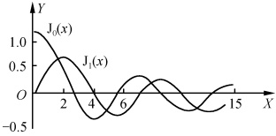

# 12-第十二章 贝塞尔函数

[返回全书目录](../../README.md)

> PDF 页码：249–272

<!-- page: 249 -->

## 第十二章 贝塞尔函数

在第二篇第八章中我们曾通过在柱坐标系中对亥姆霍兹方程和拉氏方程分离变量而得到了关于变量 $ \rho $的贝塞尔方程[见第二篇(8.4.16)式]

 $$ x^{2}y^{\prime \prime}+xy^{\prime}+(x^{2}-n^{2})y=0 $$ 

其中， $ x=k\rho, y=R(\rho) $，而  $ k^{2}=\lambda-\mu $（或  $ -\mu $，当  $ \lambda=0 $ 时）是大于或等于零的常数，n=0,1,2, $ \cdots $。更一般有

 $$ x^{2}y^{\prime \prime}+xy^{\prime}+(x^{2}-\nu^{2})y=0 $$ 

其中  $ \nu $ 为任意实数。本章将在 x=0 的邻域求解贝塞尔方程，并着重讨论其特解贝塞尔函数（一种特殊函数）所具有的性质。为了便于类比和掌握，基本采取类似于上一章的讨论顺序。

### 12.1 贝塞尔函数

## 1. 贝塞尔方程的级数解

由于 x=0 为贝塞尔方程

$$  x^{2}y^{\prime \prime}+xy^{\prime}+(x^{2}-\nu^{2})y=0   \tag*{(12.1.1)}$$

的正则奇点，故在 x=0 的邻域内，可设其解 $ ^{①} $为

$$  y=x^{\rho}\sum_{k=0}^{\infty}c_{k}x^{k}=\sum_{k=0}^{\infty}c_{k}x^{\rho+k}   \tag*{(12.1.2)}$$

代入方程(12.1.1)得

 $$ \sum_{k=0}^{\infty}(k+\rho)(k+\rho-1)c_{k}x^{k+\rho}+\sum_{k=0}^{\infty}(k+\rho)c_{k}x^{k+\rho}+\sum_{k=0}^{\infty}c_{k}x^{k+\rho+2}-\nu^{2}\sum_{k=0}^{\infty}c_{k}x^{k+\rho}=0 $$ 

即

$$  \sum_{k=0}^{\infty}\left[(k+\rho)^{2}-\nu^{2}\right]c_{k}x^{k+\rho}+\sum_{k=0}^{\infty}c_{k}x^{k+\rho+2}=0   \tag*{(12.1.3)}$$

令方程左边 x 的最低次幂项  $ x^{\rho} $ 的系数为零得

 $$ (\rho^{2}-\nu^{2})c_{0}=0 $$ 

取 $ c_{0}\neq0 $，则得指标方程

$$  \rho^{2}-\nu^{2}=0   \tag*{(12.1.4)}$$

由此求得指标

 $$ \rho_{1}=\nu,\quad\rho_{2}=-\nu $$

<!-- page: 250 -->

先取  $ \rho=\rho_{1}=\nu $，并设  $ \nu>0 $，令

$$  y_{1}=\sum_{k=0}^{\infty}c_{k}x^{k+\nu}   \tag*{(12.1.5)}$$

代入方程(12.1.1)，则由(12.1.3)式有

 $$ \sum_{k=0}^{\infty}\left[(k+\nu)^{2}-\nu^{2}\right]c_{k}x^{k+\nu}+\sum_{k=0}^{\infty}c_{k}x^{k+\nu+2}=0 $$ 

令各次幂的系数为零，则得

 $$ \begin{aligned}&(\nu^{2}-\nu^{2})c_{0}=0\\ &[(\nu+1)^{2}-\nu^{2}]c_{1}=0\\ &\quad\cdots\cdots\\ &[(\nu+k)^{2}-\nu^{2}]c_{k}+c_{k-2}=0\\ \end{aligned} $$ 

由此得一组系数递推公式

 $$ \begin{aligned}c_{0}&\neq0&c_{1}&=0[ 因为 (\nu+1)^{2}-\nu^{2}>0]\\c_{2}&=-\frac{1}{2(2\nu+2)}c_{0}&c_{3}&=-\frac{1}{3(2\nu+3)}c_{1}=0\\c_{4}&=-\frac{1}{4(2\nu+4)}c_{2}&c_{5}&=0\\&=(-1)^{2}\frac{1}{4\cdot2(2\nu+4)(2\nu+2)}c_{0}\\&=(-1)^{2}\frac{1}{2^{4}\cdot2(\nu+2)(\nu+1)}c_{0}\end{aligned} $$ 

于是有

 $$ \begin{aligned}c_{2n}&=-\frac{1}{2n(2\nu+2n)}c_{2n-2}=(-1)^{n}\frac{1}{2^{2n}n!(\nu+n)(\nu+n-1)\cdots(\nu+1)}c_{0}\\&=(-1)^{n}\frac{c_{0}\Gamma(\nu+1)}{2^{2n}n!\Gamma(\nu+n+1)}\end{aligned} $$ 

 $$ c_{2n+1}=0 $$ 

其中n=1,2, $ \cdots $.

将以上系数代入(12.1.5)式得贝塞尔方程的一个特解

 $$ y_{1}(x)=\sum_{k=0}^{\infty}c_{k}x^{k+\nu}=c_{0}x^{\nu}+\sum_{n=1}^{\infty}c_{2n}x^{2n+\nu}=\sum_{n=0}^{\infty}\frac{(-1)^{n}c_{0}\Gamma(\nu+1)}{2^{2n}n!\Gamma(\nu+n+1)}x^{2n+\nu} $$ 

类似地，若令

 $$ y_{2}(x)=\sum_{k=0}^{\infty}c_{k}x^{k-v} $$ 

则可得贝塞尔方程的另一特解

 $$ y_{2}(x)=\sum_{n=0}^{\infty}\frac{(-1)^{n}c_{0}\Gamma(-\nu+1)}{2^{2n}n!\Gamma(-\nu+n+1)}x^{2n-\nu} $$

<!-- page: 251 -->

## 2. 解的敛散性

由于 x=0 是方程的正则奇点，方程的另一奇点是  $ x=\infty $，故级数解  $ y_{1}(x) $ 的收敛范围是  $ 0\leqslant|x|<\infty $，而级数解  $ y_{2}(x) $ 的收敛范围是  $ 0<|x|<\infty $。

## 3. 贝塞尔函数

为了方便及与其他理论一致起见，在上述贝塞尔方程的特解  $ y_{1}(x) $ 中，选  $ c_{0}=\frac{1}{2^{\nu}\Gamma(\nu+1)} $ 并记  $ y_{1}(x) $ 为  $ \mathrm{J}_{\nu}(x) $，称之为  $ \nu $ 阶的贝塞尔函数，则

$$  y_{1}(x)=\mathrm{J}_{\nu}(x)=\sum_{k=0}^{\infty}(-1)^{k}\frac{1}{k!\Gamma(\nu+k+1)}\Big(\frac{x}{2}\Big)^{2k+\nu}   \tag*{(12.1.6)}$$

类似的，对于特解  $ y_{2}(x) $，若选  $ c_{0}=\frac{1}{2-\nu}\Gamma(-\nu+1) $，并记  $ y_{2}(x) $ 为  $ \mathrm{J}_{-\nu}(x) $，称之为一 $ \nu $ 阶的贝塞尔函数，则

$$  y_{2}(x)=\mathrm{J}_{\neg}(x)=\sum_{k=0}^{\infty}(-1)^{k}\frac{1}{k!\Gamma(-\nu+k+1)}\Big(\frac{x}{2}\Big)^{2k\neg}   \tag*{(12.1.7)}$$

 $ \mathrm{J}_{\nu}(x) $ 和  $ \mathrm{J}_{-\nu}(x) $ 又均称为第一类柱函数.

显然，若  $ \nu \neq n $（整数）， $ J_{\nu}(x) $ 和  $ J_{-\nu}(x) $ 是线性无关的。因为当  $ x \to 0 $ 时，

类似的

 $$ \begin{aligned}\mathrm{J}_{\nu}(x)=\left(\frac{x}{2}\right)^{\nu}\sum_{k=0}^{\infty}(-1)^{k}\frac{1}{k!\Gamma(\nu+k+1)}\Big(\frac{x}{2}\Big)^{2k}\sim\left(\frac{x}{2}\right)^{\nu}\frac{1}{\Gamma(\nu+1)}\\ \mathrm{J}_{\neg}(x)\sim\left(\frac{x}{2}\right)^{\neg}\frac{1}{\Gamma(-\nu+1)}\rightarrow\infty\\ \frac{\mathrm{J}_{\nu}(x)}{\mathrm{J}_{\neg}(x)}\sim\left(\frac{x}{2}\right)^{2\nu}\frac{\Gamma(-\nu+1)}{\Gamma(\nu+1)}\neq 常数 \end{aligned} $$ 

所以

故此时贝塞尔方程的通解可表示为

$$  y(x)=a_{\nu}\mathrm{J}_{\nu}(x)+b_{\nu}\mathrm{J}_{\neg\nu}(x)   \tag*{(12.1.8)}$$

其中  $ a_{v}, b_{v} $ 为任意常数（注意到问题的有限性，所以在研究柱体内部的解时应将  $ J_{-v}(x) $ 舍去。）

若  $ \nu=n $，则  $ \mathrm{J}_{n}(x) $ 和  $ \mathrm{J}_{-n}(x) $ 是线性相关的。因为

 $$ \mathrm{J}_{-n}(x)=\sum_{k=0}^{\infty}\frac{(-1)^{k}}{k!\Gamma(-n+k+1)}\Big(\frac{x}{2}\Big)^{2k-n} $$ 

而由  $ \Gamma $ 函数的定义知  $ -n+k+1 $ 应大于零即 k>n-1，故

 $$ \mathrm{J}_{-n}(x)=\sum_{k=n}^{\infty}\frac{(-1)^{k}}{k!\Gamma(-n+k+1)}\Big(\frac{x}{2}\Big)^{2k-n} $$ 

令 k-n=l，则 k=n+l。

 $$ \mathrm{J}_{-n}(x)=\sum_{l=0}^{\infty}\frac{(-1)^{l+n}}{(l+n)!\Gamma(l+1)}\Big(\frac{x}{2}\Big)^{2l+n} $$

<!-- page: 252 -->

$$  \begin{aligned}&=(-1)^{n}\sum_{l=0}^{\infty}\frac{(-1)^{l}}{l!\Gamma(l+n+1)}\Big(\frac{x}{2}\Big)^{2l+n}\\&=(-1)^{n}\mathrm{J}_{n}(x)\end{aligned}   \tag*{(12.1.9)}$$

可见正、负 n 阶的贝塞尔函数只差一个常数因子，它们不能组合为通解，我们应按常微分方程的级数解法去寻求另一与  $ \mathrm{J}_{n}(x) $ 线性无关的解，即令

 $$ y_{2}(x)=a\mathrm{J}_{n}(x)\ln x+x^{-\nu}\sum_{k=0}^{\infty}d_{k}x^{k} $$ 

代入方程(12.1.1)去具体确定各常数和系数.但这样作其计算是相当麻烦和冗长的，在此我们不这样作，而将在12.3节中定义诺伊曼函数 $ N_{n}(x) $作为与 $ \mathrm{J}_{n}(x) $线性无关的解.我们将会看到， $ N_{n}(x) $在x=0是无限的.

由（12.1.6）式有

$$  \mathrm{J}_{n}(x)=\sum_{k=0}^{\infty}\frac{(-1)^{k}}{k!(n+k)!}\Big(\frac{x}{2}\Big)^{2k+n}   \tag*{(12.1.10)}$$

整数阶的贝塞尔函数比较重要，特别是  $ \mathrm{J}_{0}(x) $ 和  $ \mathrm{J}_{1}(x) $，在应用上经常遇到，因此数学家已将它们的值制作成表（见数学手册）。

## 4. 本征值问题

现在我们来讨论由在柱坐标系中对亥姆霍兹方程（或拉氏方程）分离变量所得到的贝塞尔方程在柱体内的本征值问题. 即

$$  \left\{\begin{aligned}&\rho^{2}R^{\prime \prime}+\rho R^{\prime}+(k^{2}\rho^{2}-n^{2})R=0,\quad0<\rho<a\\ &R(\rho)\mid_{\rho=0}\rightarrow 有限 \\ &\left[\alpha\frac{\mathrm{d}R}{\mathrm{d}\rho}+\beta R\right]_{\rho=a}=0\end{aligned}\right.   \tag*{(12.1.11)}$$

其中 $ k^{2}=\lambda-\mu $（或 $ -\mu $）是待定常数； $ n=0,1,2,\cdots;R(\rho)|_{\rho=0}\rightarrow $有限，是自然边界条件； $ \alpha $和 $ \beta $是常数。当 $ \alpha=0 $或 $ \beta=0 $或 $ \alpha,\beta $均不为0时分别表示方程在 $ \rho=a $端附有第一、第二、第三类齐次边界条件。由自然边界条件 $ R(\rho)|_{\rho=0}\rightarrow $有限，立即可得方程(12.1.11)的解为

$$  R(\rho)=\mathrm{J}_{n}(k\rho)   \tag*{(12.1.12)}$$

下面仅就在  $ \rho=a $ 端具有第一类边界条件

$$  R(a)=0   \tag*{(12.1.13)}$$

的情况进行讨论.

由（12.1.10）式，可得

 $$ \begin{aligned}\mathrm{J}_{0}(x)=&1-\left(\frac{x}{2}\right)^{2}+\frac{1}{(2!)^{2}}\Big(\frac{x}{2}\Big)^{4}-\frac{1}{(3!)^{2}}\Big(\frac{x}{2}\Big)^{6}\\ &+\cdots+\frac{(-1)^{k}}{(k!)^{2}}\Big(\frac{x}{2}\Big)^{2k}+\cdots\end{aligned} $$

<!-- page: 253 -->

$$ \begin{aligned}\mathrm{J}_{1}(x)=&\frac{x}{2}-\frac{1}{2!}\Big(\frac{x}{2}\Big)^{3}+\frac{1}{2!3!}\Big(\frac{x}{2}\Big)^{5}-\frac{1}{3!4!}\Big(\frac{x}{2}\Big)^{7}\\ &+\cdots+\frac{(-1)^{k}}{(k!)(k+1)!\Big(\frac{x}{2}\Big)^{2k+1}}+\cdots\end{aligned} $$ 

它们分别是 x 的偶函数和奇函数。在图 12.1 中，画出了  $ \mathrm{J}_{0}(x) $ 和  $ \mathrm{J}_{1}(x) $ 当 x>0 时的图形；x<0 的图形可以分别根据  $ \mathrm{J}_{0}(x) $ 和  $ \mathrm{J}_{1}(x) $ 的奇偶性得到。由此图形可以看出， $ \mathrm{J}_{n}(x) $ 是一个衰减振荡函数， $ \mathrm{J}_{n}(x) $ 的图线与 x 轴有无穷多个交点，即  $ \mathrm{J}_{n}(x)=0 $ 有无穷多个实数根。我们称之为  $ \mathrm{J}_{n}(x) $ 的零点，并记作  $ x_{m}^{n} $，表示 n 阶贝塞尔

图12.1
 

函数的第m个零点. 由图12.1我们大致可看出 $ J_{0}(x) $的零点分别为二点几、五点几、八点几等等. 事实上 $ \mathrm{J}_{0}(x) $和 $ \mathrm{J}_{1}(x) $的零点值，数学家也已将之制作成了表. $ \mathrm{J}_{0}(x) $和 $ \mathrm{J}_{1}(x) $的前八个零点为

<table border=1 style='margin: auto; word-wrap: break-word;'><tr><td style='text-align: center; word-wrap: break-word;'>m</td><td style='text-align: center; word-wrap: break-word;'>1</td><td style='text-align: center; word-wrap: break-word;'>2</td><td style='text-align: center; word-wrap: break-word;'>3</td><td style='text-align: center; word-wrap: break-word;'>4</td><td style='text-align: center; word-wrap: break-word;'>5</td><td style='text-align: center; word-wrap: break-word;'>6</td><td style='text-align: center; word-wrap: break-word;'>7</td><td style='text-align: center; word-wrap: break-word;'>8</td></tr><tr><td style='text-align: center; word-wrap: break-word;'>$ x_{m}^{0} $</td><td style='text-align: center; word-wrap: break-word;'>2.4048</td><td style='text-align: center; word-wrap: break-word;'>5.5201</td><td style='text-align: center; word-wrap: break-word;'>8.6537</td><td style='text-align: center; word-wrap: break-word;'>11.7915</td><td style='text-align: center; word-wrap: break-word;'>14.9309</td><td style='text-align: center; word-wrap: break-word;'>18.0711</td><td style='text-align: center; word-wrap: break-word;'>21.2116</td><td style='text-align: center; word-wrap: break-word;'>24.3525</td></tr><tr><td style='text-align: center; word-wrap: break-word;'>$ x_{m}^{1} $</td><td style='text-align: center; word-wrap: break-word;'>0</td><td style='text-align: center; word-wrap: break-word;'>3.8317</td><td style='text-align: center; word-wrap: break-word;'>7.0156</td><td style='text-align: center; word-wrap: break-word;'>10.1735</td><td style='text-align: center; word-wrap: break-word;'>13.3237</td><td style='text-align: center; word-wrap: break-word;'>16.4706</td><td style='text-align: center; word-wrap: break-word;'>19.6159</td><td style='text-align: center; word-wrap: break-word;'>22.7601</td></tr></table>

了解了  $ J_{n}(x) $ 的零点的存在，则由边界条件（12.1.13）式立即可得

 $$ ka=x_{m}^{n} $$ 

故本征值问题(12.1.11)、(12.1.13)式的本征值为

$$  k_{m}^{n}=\frac{x_{m}^{n}}{a}   \tag*{(12.1.14)}$$

而相应的本征函数为

$$  R(\rho)=\mathrm{J}_{n}(k_{m}^{n}\rho)=\mathrm{J}_{n}\left(\frac{x_{m}^{n}}{a}\rho\right)   \tag*{(12.1.15)}$$

至于其他两类边值问题，也可完全按照以上的方法，求得其本征值和本征函数，如在第二类边界条件

 $$ R^{^{\prime}}(a)=0 $$ 

下，方程(12.1.11)的本征值和本征函数分别为

$$  \tilde{k}_{m}^{n}=\frac{\tilde{x}_{m}^{n}}{a},\quad R(\rho)=\mathrm{J}_{n}\left(\frac{\tilde{x}_{m}^{n}}{a}\rho\right)   \tag*{(12.1.16)}$$

其中  $ \tilde{x}_{m}^{n} $ 是  $ \mathrm{J}_{n}^{\prime}(k\rho) $ 的零点.

① 对于本篇 11.1 节附注中的方程(11.1.16)，即

$$  \begin{align*}w''(z)+p(z)w'(z)+q(z)w(z)=0\end{align*}   \tag*{（11.1.16）}$$

若  $ z=z_{0} $ 是它的奇点[即在  $ z_{0} $ 点 p(z) 和 q(z) 之一或均不解析]，且是 p(z) 不高于一阶的极点 q(z) 不高于二阶的极点，则称  $ z_{0} $ 为该方程的正则奇点.

在正则奇点  $ z=z_{0} $ 的邻域  $ 0<|z-z_{0}|<R $ 内，方程（11.1.16）至少有一个形式为  $ w(z)= $

<!-- page: 254 -->

$ (z-z_{0})^{\rho}\sum_{k=0}^{n}c_{k}(z-z_{0})^{k} $ 的正则解. 将此正则解代入方程(11.1.16),通过比较方程两边最低次幂项的系数[即让方程左边 $ (z-z_{0}) $的最低次幂的系数为零],便可得到一关于 $ \rho $的二次方程,称为指标方程(或判别方程),由此方程可求得两个指标(即二次方程的两个根): $ \rho=\rho_{1},\rho=\rho_{2} $(设 $ \rho_{1}>\rho_{2} $).那么,方程(11.1.16)的两线性无关解为

$$  w_{1}(z)=(z-z_{0})^{\rho_{1}}\sum_{k=0}^{\infty}c_{k}(z-z_{0})^{k}   \tag*{(12.1.17)}$$

$$  \int\left(z-z_{0}\right)^{p_{2}}\sum_{k=0}^{+\infty}d_{k}\left(z-z_{0}\right)^{k},\quad\rho_{1}-\rho_{2}\neq\frac{1}{2}   \tag*{（12.1.18）}$$

$$  w_{2}(z)=\left\{\begin{aligned}_{k=0}\\ arw_{1}(z)\ln(z-z_{0})+(z-z_{0})^{\rho_{2}}\sum_{k=0}^{\infty}d_{k}^{\prime}(z-z_{0})^{k},\quad\rho_{1}-\rho_{2}= 整数 \end{aligned}\right.   \tag*{(12.1.19)}$$

其中  $ \rho_{1},\rho_{2},a,c_{k},d_{k},d_{k}^{\prime} $ 为常数，由将形式解代入方程 (11.1.16) 中逐个确定（参见参考文献 [5], 98 节）.

#### 习题12.1

1. 量子力学中的氢原子问题，当用球坐标分离变量后，其波函数的径向方程是拉盖尔（Laguerre）方程。试在 x=0 的邻域求拉盖尔方程

 $$ xy^{\prime \prime}+(1-x)y^{\prime}+\lambda y=0 $$ 

的级数解. $ \lambda $ 取什么数值可使级数退化为多项式？这些多项式乘以适当常数使最高幂项成为 $ (-x)^{n} $ 形式，叫做拉盖尔多项式，记作 $ \mathrm{L}_{n}(x) $.写出前几个 $ \mathrm{L}_{n}(x) $.

2. 在 x=0 的邻域内求解下列方程：

(1)

 $$ x^{2}y^{\prime\prime}+xy^{\prime}+\left(x^{2}-\frac{1}{4}\right)y=0; $$ 

(2)

 $$ 2x^{2}y^{\prime \prime}-xy^{\prime}+(1-x^{2})y=0; $$ 

 $$ xy^{\prime\prime}-xy^{\prime}+y=0； $$ 

(4)

 $$ x^{2}y^{\prime\prime}-2y=0； $$ 

（5）

 $$ xy^{\prime \prime}+2y^{\prime}+m^{2}xy=0； $$ 

(6)

 $$ xy^{\prime\prime}+y^{\prime}+xy=0. $$ 

3. 求勒让德方程

 $$ (1-x^{2})y^{\prime \prime}-2xy^{\prime}+l(l+1)y=0 $$ 

在x=1的有界解.

### 12.2 贝塞尔函数的性质

## 1.  $ \mathrm{J}_{n}(x) $ 的母函数

对于整数阶的贝塞尔函数，有如下的母函数关系式：

$$  \mathrm{e}^{\frac{x}{2}\left(t-\frac{1}{t}\right)}=\sum_{n=-\infty}^{\infty}\mathrm{J}_{n}(x)t^{n}   \tag*{(12.2.1)}$$

证 因为

$$  \mathrm{e}^{\frac{x}{2}t}=\sum_{l=0}^{\infty}\frac{1}{l!}\left(\frac{xt}{2}\right)^{l},\quad\mid t\mid<\infty   \tag*{(12.2.2)}$$

$$  \mathrm{e}^{-\frac{x}{2t}}=\sum_{m=0}^{\infty}\frac{1}{m!}\left(-\frac{x}{2t}\right)^{m},\quad\mid t\mid>0   \tag*{(12.2.3)}$$

<!-- page: 255 -->

对于固定的 x，以上二级数在  $ 0<|t|< \infty $ 都是绝对收敛的，故可逐次相乘，即

 $$ \mathrm{e}^{\frac{x}{2}\left(t-\frac{1}{t}\right)}=\sum_{l=0}^{\infty}\frac{1}{l!}\left(\frac{xt}{2}\right)^{l}\bullet\sum_{m=0}^{\infty}\frac{1}{m!}\left(-\frac{x}{2t}\right)^{m} $$ 

注意到相乘后 t 的幂次数是可能大于、等于和小于零的，为了得到乘积中的 t 的正幂项  $ t^{n}(n \geqslant 0) $，我们应取 (12.2.3) 式中所有各项而分别用 (12.2.2) 式中  $ l = m + n $ 项去乘；为了得到乘积中 t 的负幂项  $ t^{-k}(k > 0) $，应取 (12.2.2) 式中所有各项而分别用 (12.2.3) 式中  $ m = k + l $ 项去乘，于是

 $$ \mathrm{e}^{\frac{x}{2}\left(t-\frac{1}{l}\right)}=\sum_{n=0}^{\infty}\left[\sum_{m=0}^{\infty}\frac{(-1)^{m}}{(m+n)!m!}\left(\frac{x}{2}\right)^{2m+n}\right]t^{n}+\sum_{k=1}^{\infty}\left[\sum_{l=0}^{\infty}\frac{(-1)^{k+l}}{(k+l)!l!}\left(\frac{x}{2}\right)^{2l+k}\right]t^{-k} $$ 

将上式第二项中的 -k 改作 n, l 改作 m, 则

 $$ \begin{align*}\mathrm{e}^{\frac{x}{2}(t-1)}=&\sum_{n=0}^{\infty}\biggl[\sum_{m=0}^{\infty}\frac{(-1)^{m}}{(m+n)!m!}\biggl(\frac{x}{2}\biggr)^{2m+n}\biggr]t^{n}\\&+\sum_{n=-1}^{\infty}(-1)^{n}\biggl[\sum_{m=0}^{\infty}\frac{(-1)^{m}}{(m-n)!m!}\biggl(\frac{x}{2}\biggr)^{2m-n}\biggr]t^{n}\\=&\sum_{n}^{\infty}\mathrm{J}_{n}(x)t^{n}\end{align*} $$ 

即，(12.2.1)式得证.最后一步用到了(12.1.10)式和(12.1.9)式.

由此关系和洛朗级数的系数公式[见第一篇(3.4.3)式]，立即可得到 $ J_{n}(x) $的一种积分表达式

$$  \mathrm{J}_{n}(x)=\frac{1}{2\pi\mathrm{i}}\oint_{l}\frac{\mathrm{e}^{\frac{x}{2}\left(t-\frac{1}{t}\right)}}{t^{n+1}}\mathrm{d}t   \tag*{(12.2.4)}$$

其中 l 为绕 t=0 的任一闭曲线. 若取 l 为单位圆  $ \left|t\right|=1 $，则在  $ \left|t\right|=1 $ 上有  $ t=e^{i\theta} $，于是又有

$$  \mathrm{J}_{n}(x)=\frac{1}{2\pi}\int_{-\pi}^{\pi}\frac{\mathrm{e}^{\frac{x}{2}(\mathrm{e}^{\mathrm{i}\theta}-\mathrm{e}^{-\theta})}}{\mathrm{e}^{\mathrm{i}(n+1)\theta}}\cdot\mathrm{e}^{\mathrm{i}\theta}\mathrm{d}\theta=\frac{1}{2\pi}\int_{-\pi}^{\pi}\mathrm{e}^{\mathrm{i}(x\sin\theta-n\theta)}\mathrm{d}\theta   \tag*{（12.2.5）}$$

$$  \mathrm{J}_{n}(x)=\frac{1}{2\pi}\int_{-\pi}^{\pi}\cos(x\sin\theta-n\theta)\mathrm{d}\theta   \tag*{（12.2.6）}$$

(12.2.5)式称为贝塞尔函数的路径积分，当n不为整数时，此式也成立. 利用贝塞尔函数的路径积分，可研究贝塞尔函数当变量甚大时的渐近行为 $ ^{①} $

$$  \mathrm{J}_{\nu}(x)\sim\sqrt{\frac{2}{\pi x}}\mathrm{c o s}\left(x-\frac{\nu\pi}{2}-\frac{\pi}{4}\right),\quad\mid x\mid\rightarrow\infty   \tag*{(12.2.7)}$$

## 2. 递推公式

我们当然可以如同上章中一样，利用母函数关系式(12.2.1)，而推得整数阶的贝塞尔函数的递推公式。但为了得到任意阶贝塞尔函数的递推公式，我们将从贝塞尔函数的级数表达式(12.1.6)出发进行推导。将(12.1.6)两边乘上 $ x^{v} $后对x求导得

<!-- page: 256 -->

$$ \begin{align*}\frac{\mathrm{d}}{\mathrm{d}x}\big[x^{\nu}\mathrm{J}_{\nu}(x)\big]&=\frac{\mathrm{d}}{\mathrm{d}x}\bigg[2^{\nu}\sum_{k=0}^{\infty}\frac{(-1)^{k}}{k!\Gamma(\nu+k+1)}\bigg(\frac{x}{2}\bigg)^{2(k+\nu)}\bigg]\\&=2^{\nu}\sum_{k=0}^{\infty}\frac{(-1)^{k}(k+\nu)}{k!\Gamma(\nu+k+1)}\bigg(\frac{x}{2}\bigg)^{2(k+\nu)-1}\\&=x^{\nu}\sum_{k=0}^{\infty}\frac{(-1)^{k}}{k!\Gamma(\nu+k)}\bigg(\frac{x}{2}\bigg)^{2k+\nu-1}\end{align*} $$ 

即

$$  \frac{\mathrm{d}}{\mathrm{d}x}\left[x^{\nu}\mathrm{J}_{\nu}(x)\right]=x^{\nu}\mathrm{J}_{\nu-1}(x)   \tag*{（12.2.8）}$$

类似可证

$$  \frac{\mathrm{d}}{\mathrm{d}x}\big[x^{\neg\nu}\mathrm{J}_{\nu}(x)\big]=-x^{\neg\nu}\mathrm{J}_{\nu+1}(x)   \tag*{(12.2.9)}$$

将此二式左边的导数具体写出，并分别消去等式两边的公共因子  $ x^{\nu-1} $ 和  $ x^{-\nu-1} $ 便可得

$$  \nu\mathrm{J}_{\nu}(x)+x\mathrm{J}_{\nu}^{\prime}(x)=x\mathrm{J}_{\nu-1}(x)   \tag*{(12.2.10)}$$

$$  -\nu\mathrm{J}_{\nu}(x)+x\mathrm{J}_{\nu}^{\prime}(x)=-x\mathrm{J}_{\nu+1}(x)   \tag*{(12.2.11)}$$

消去 $ J_{v}^{\prime}(x) $，可得

$$  \mathrm{J}_{\nu-1}(x)+\mathrm{J}_{\nu+1}(x)=\frac{2\nu}{x}\mathrm{J}_{\nu}(x)   \tag*{(12.2.12)}$$

消去 $ J_{\nu}(x) $又可得

$$  \mathrm{J}_{\nu-1}(x)-\mathrm{J}_{\nu+1}(x)=2\mathrm{J}_{\nu}^{\prime}(x)   \tag*{（12.2.13）}$$

由(12.2.10)我们看到，只要知道 $ J_{\nu}(x) $和 $ J_{\nu-1}(x) $之值，便可求得 $ J_{\nu}(x) $之值；而由(12.2.11)看到，只要知道 $ J_{\nu}(x) $与 $ J_{\nu}^{\prime}(x) $之值，便可求得 $ J_{\nu+1}(x) $之值，这样我们只要利用 $ J_{0}(x) $和 $ J_{1}(x) $的函数值的表，从原则上便可求得各整数阶贝塞尔函数及其导数之值.

(12.2.8)式和(12.2.9)式的两种特殊情况，也是常常要用到的。若 $ \nu=0 $，则由(12.2.9)式有

$$  \mathrm{J}_{0}^{\prime}(x)=-\mathrm{J}_{1}(x)   \tag*{(12.2.14)}$$

若 $ \nu=1 $则由(12.2.8)有

 $$ \left.\begin{aligned}&\left[x\mathrm{J}_{1}(x)\right]^{\prime}=x\mathrm{J}_{0}(x)\\ &x\mathrm{J}_{1}(x)=\int_{0}^{x}\xi\mathrm{J}_{0}(\xi)\mathrm{d}\xi\end{aligned}\right\} $$ 

或

例1 计算积分 $ \int_{0}^{a}x^{3}\mathrm{J}_{0}(x)\mathrm{d}x $.

解

 $$ \begin{align*}\int_{0}^{a}x^{3}\mathrm{J}_{0}(x)\mathrm{d}x&=\int_{0}^{a}x^{2}\big[x\mathrm{J}_{0}(x)\big]\mathrm{d}x=\int_{0}^{a}x^{2}\big[x\mathrm{J}_{1}(x)\big]^{\prime}\mathrm{d}x\\&=\big[x^{3}\mathrm{J}_{1}(x)\big]\Big|_{0}^{a}-\int_{0}^{a}x\mathrm{J}_{1}(x)\mathrm{d}x^{2}\\&=a^{3}\mathrm{J}_{1}(a)-2\int_{0}^{a}x^{2}\mathrm{J}_{1}(x)\mathrm{d}x\end{align*} $$

<!-- page: 257 -->

$$ \begin{aligned}&=a^{3}\mathrm{J}_{1}(a)-2\int_{0}^{a}\left[x^{2}\mathrm{J}_{2}(x)\right]^{\prime}\mathrm{d}x\\&=a^{3}\mathrm{J}_{1}(a)-2a^{2}\mathrm{J}_{2}(a)\end{aligned} $$ 

这里，两次用到了递推公式(12.2.8).

## 3. 正交归一性

n 阶贝塞尔函数系  $ \left\{\mathrm{J}_{n}\left(k_{m}^{n}\rho\right)\right\}:\mathrm{J}_{n}\left(k_{1}^{n}\rho\right),\mathrm{J}_{n}\left(k_{2}^{n}\rho\right),\cdots $，在区间  $ [0,a] $ 上满足如下带权  $ \rho $ 的正交归一关系

$$  \int_{0}^{a}\rho\mathrm{J}_{n}(k_{m}^{n}\rho)\mathrm{J}_{n}(k_{l}^{n}\rho)\mathrm{d}\rho=\frac{a^{2}}{2}\big[\mathrm{J}_{n+1}(k_{l}^{n}a)\big]^{2}\delta_{m l}   \tag*{(12.2.16)}$$

证明（12.1.11）式中的贝塞尔方程又可写为

 $$ \frac{\mathrm{d}}{\mathrm{d}\rho}\big(\rho\frac{\mathrm{d}R}{\mathrm{d}\rho}\big)+\Big[k^{2}\rho-\frac{n^{2}}{\rho}\Big]R=0 $$ 

由于  $ \mathrm{J}_{n}(k_{m}^{n}\rho) $， $ \mathrm{J}_{n}(k_{l}^{n}\rho) $ 均为贝塞尔方程的解，故有

 $$ \begin{align*}\frac{\mathrm{d}}{\mathrm{d}\rho}\Big[\rho\frac{\mathrm{d}\mathrm{J}_{n}(k_{m}^{n}\rho)}{\mathrm{d}\rho}\Big]+\Big[(k_{m}^{n})^{2}\rho-\frac{n^{2}}{\rho}\Big]\mathrm{J}_{n}(k_{m}^{n}\rho)&=0\\\frac{\mathrm{d}}{\mathrm{d}\rho}\Big[\rho\frac{\mathrm{d}\mathrm{J}_{n}(k_{l}^{n}\rho)}{\mathrm{d}\rho}\Big]+\Big[(k_{l}^{n})^{2}\rho-\frac{n^{2}}{\rho}\Big]\mathrm{J}_{n}(k_{l}^{n}\rho)&=0\end{align*} $$ 

将  $ \mathrm{J}_{n}(k_{l}^{n}\rho) $ 遍乘前式， $ \mathrm{J}_{n}(k_{m}^{n}\rho) $ 遍乘后式，相减之后再积分得

 $$ \begin{align*}&\big[(\boldsymbol{k}_{l}^{n})^{2}-(\boldsymbol{k}_{m}^{n})^{2}\big]\int_{0}^{a}\rho\mathrm{J}_{n}(\boldsymbol{k}_{m}^{n}\rho)\mathrm{J}_{n}(\boldsymbol{k}_{l}^{n}\rho)\mathrm{d}\rho\\=&\int_{0}^{a}\mathrm{J}_{n}(\boldsymbol{k}_{l}^{n}\rho)\frac{\mathrm{d}}{\mathrm{d}\rho}\Big[\rho\frac{\mathrm{d}\mathrm{J}_{n}(\boldsymbol{k}_{m}^{n}\rho)}{\mathrm{d}\rho}\Big]\mathrm{d}\rho-\int_{0}^{a}\mathrm{J}_{n}(\boldsymbol{k}_{m}^{n}\rho)\frac{\mathrm{d}}{\mathrm{d}\rho}\Big[\rho\frac{\mathrm{d}\mathrm{J}_{n}(\boldsymbol{k}_{l}^{n}\rho)}{\mathrm{d}\rho}\Big]\mathrm{d}\rho\\=&\left[\rho\mathrm{J}_{n}(\boldsymbol{k}_{l}^{n}\rho)\frac{\mathrm{d}\mathrm{J}_{n}(\boldsymbol{k}_{m}^{n}\rho)}{\mathrm{d}\rho}-\rho\mathrm{J}_{n}(\boldsymbol{k}_{m}^{n}\rho)\frac{\mathrm{d}\mathrm{J}_{n}(\boldsymbol{k}_{l}^{n}\rho)}{\mathrm{d}\rho}\right]\Big|_{0}^{a}=0\end{align*} $$ 

上式当 $ \rho=a $时等于零，这是因为 $ \mathrm{J}_{n}(k_{m}^{n}a)=\mathrm{J}_{n}(x_{m}^{n})=0(m=1,2,\cdots,l,\cdots) $

若  $ m \neq l $，则  $ k_{l}^{n} \neq k_{m}^{n} $，故有

 $$ \int_{0}^{a}\rho\mathrm{J}_{n}(k_{m}^{n}\rho)\mathrm{J}_{n}(k_{l}^{n}\rho)\mathrm{d}\rho=0 $$ 

若 m=l，令  $ m\to l $，即  $ k_{m}^{n}\to k_{l}^{n} $，此时有  $ \mathrm{J}_{n}(k_{l}^{n}a)=0 $，而  $ \mathrm{J}_{n}(k_{m}^{n}a)\neq0 $；于是有

 $$ \begin{align*}\int_{0}^{a}\rho\mathrm{J}_{n}(k_{m}^{n}\rho)\mathrm{J}_{n}(k_{l}^{n}\rho)\mathrm{d}\rho=&\lim_{k_{m}^{n}\to k_{l}^{n}}\frac{-a\mathrm{J}_{n}(k_{m}^{n}a)\bullet\mathrm{J}_{n}^{\prime}(k_{l}^{n}a)\bullet k_{l}^{n}}{(k_{l}^{n})^{2}-(k_{m}^{n})^{2}}\\=&\lim_{k_{m}^{n}\to k_{l}^{n}}\frac{-a^{2}\mathrm{J}_{n}^{\prime}(k_{m}^{n}a)\bullet\mathrm{J}_{n}^{\prime}(k_{l}^{n}a)\bullet k_{l}^{n}}{-2k_{m}^{n}}\\=&\frac{a^{2}}{2}\big[\mathrm{J}_{n}^{\prime}(k_{l}^{n}a)\big]^{2}\end{align*} $$ 

在上面证明过程中，由于当  $ k_{m}^{n} \rightarrow k_{l}^{n} $ 时，出现了  $ \frac{0}{0} $ 型不定式，故运用了洛必达法则。又

<!-- page: 258 -->

由（12.2.11）式有

 $$ \mathrm{J}_{n}^{\prime}(k_{l}^{n}a)=-\mathrm{J}_{n+1}(k_{l}^{n}a) $$ 

所以

 $$ \int_{0}^{a}\rho\mathrm{J}_{n}(k_{m}^{n}\rho)\mathrm{J}_{n}(k_{l}^{n}\rho)\mathrm{d}\rho=\frac{a^{2}}{2}\big[\mathrm{J}_{n+1}(k_{l}^{n}a)\big]^{2},\quad m=l $$ 

至于函数系 $ \left\{\mathrm{J}_{n}\left(\tilde{k}_{m}^{n}\rho\right)\right\} $，类似地可证明它满足如下正交归一关系：

$$  \begin{array}{r}{\displaystyle\int_{0}^{a}\rho\mathrm{J}_{n}(\tilde{k}_{m}^{n}\rho)\mathrm{J}_{n}(\tilde{k}_{l}^{n}\rho)\mathrm{d}\rho=\frac{a^{2}}{2}\bigg[1-\Big(\frac{n}{(\tilde{k}_{l}^{n}a)}\Big)^{2}\bigg]\big[\mathrm{J}_{n}(\tilde{k}_{l}^{n}a)\big]^{2}\delta_{m l}}\end{array}   \tag*{(12.2.17)}$$

## 4. 广义傅氏展开

可以证明，如果函数  $ f(\rho) $ 在区间  $ (0, a) $ 上有连续的一阶导数和分段连续的二阶导数，且  $ f(\rho) $ 在  $ (0, a) $ 上平方可积，则  $ f(\rho) $ 在  $ (0, a) $ 上可以展开为绝对且一致收敛的级数

$$  f(\rho)=\sum_{m=1}^{\infty}C_{m}\mathrm{J}_{n}(k_{m}^{n}\rho)   \tag*{(12.2.18)}$$

其中

$$  C_{m}=\frac{1}{\frac{a^{2}}{2}\mathrm{J}_{n+1}^{2}(k_{m}^{n}a)}\int_{0}^{a}\rho f(\rho)\mathrm{J}_{n}(k_{m}^{n}\rho)\mathrm{d}\rho   \tag*{(12.2.19)}$$

例2 半径为a、高为h的圆柱体，下底和侧面保持温度为零度，上底温度分布为 $ u=u_{0} $，求柱内稳定温度分布.

解 选择柱坐标系，其定解问题为

$$  \Delta u=0   \tag*{(12.2.20)}$$

$$  u\mid_{p=a}=0   \tag*{(12.2.21)}$$

$$  u\mid_{z=0}=0,u\mid_{z=h}=u_{0}   \tag*{(12.2.22)}$$

由于问题关于 z 轴对称（与  $ \varphi $ 无关），故令

$$  u(\rho,z)=R(\rho)Z(z)   \tag*{（12.2.23）}$$

代入12.2.20式得

 $$ \left\{\begin{aligned}&z^{\prime \prime}-k^{2}z=0\\ &\rho^{2}R^{\prime \prime}+\rho R^{\prime}+(k^{2}\rho^{2}-0)R=0\end{aligned}\right. $$ 

其中  $ k^{2} $ 为分离变量过程中引入的任意常数. 将边界条件(12.2.21)代入式(12.2.23)有

 $$ R(a)Z(z)=0 $$ 

即

 $$ R(a)=0 $$ 

解本征值问题

 $$ \begin{cases}\rho^{2}R^{\prime \prime}+\rho R^{\prime}+k^{2}\rho^{2}R=0\\R(a)=0\end{cases} $$ 

并注意到  $ R(0)\rightarrow $ 有限的自然边界条件，便有

 $$ R_{m}(\rho)=\mathrm{J}_{0}(k_{m}^{0}\rho) $$

<!-- page: 259 -->

其中

 $$ k_{m}^{0}=\frac{x_{m}^{0}}{a} $$ 

将  $ k=k_{m}^{0} $ 代入关于 z 的方程而得其通解为

于是得到

 $$ \begin{align*}Z_{m}&=A_{m}\mathrm{e}^{k_{m}^{0}z}+B_{m}\mathrm{e}^{-k_{m}^{0}z}\\_i=&R_{m}Z_{m}=(A_{m}\mathrm{e}^{k_{m}^{0}z}+B_{m}\mathrm{e}^{-k_{m}^{0}z})\mathrm{J}_{0}(k_{m}^{0}\rho)\end{align*} $$ 

而由边界条件  $ u|_{z=0}=0 $ 有

所以

 $$ \begin{aligned}A_{m}+B_{m}&=0\\u_{m}&=C_{m}\mathrm{sh}(k_{m}^{0}z)\mathrm{J}_{0}(k_{m}^{0}\rho)\\\iota=\sum_{m=1}^{\infty}u_{m}&=\sum_{m=1}^{\infty}C_{m}\mathrm{sh}(k_{m}^{0}z)\mathrm{J}_{0}(k_{m}^{0}\rho)\end{aligned} $$ 

而

又由边界条件  $ u|_{z=h}=u_{0} $ 有

 $$ \sum_{m=1}^{\infty}C_{m}\mathrm{sh}(k_{m}^{0}h)\mathrm{J}_{0}(k_{m}^{0}\rho)=u_{0} $$ 

故由系数公式12.2.19有

 $$ C_{m}\mathrm{s h}(k_{m}^{0}h)=\frac{\displaystyle\int_{0}^{a}\rho u_{0}\mathrm{J}_{0}(k_{m}^{0}\rho)\mathrm{d}\rho}{\frac{a^{2}}{2}\mathrm{J}_{1}^{2}(k_{m}^{0}a)} $$ 

而由公式12.2.15有

 $$ (k_{m\downarrow}^{\circ}\rho)\mathrm{J}_{\mathrm{0}}(k_{m\downarrow}^{\circ}\rho)=\frac{\mathrm{d}}{\mathrm{d}(k_{m\downarrow}^{\circ}\rho)}\big[(k_{m\uparrow}^{\circ}\rho)\mathrm{J}_{\mathrm{1}}(k_{m\uparrow}^{\circ}\rho)\big] $$ 

所以

 $$ \begin{align*}\int_{0}^{a}\rho\mathrm{J}_{0}(k_{m}^{0}\rho)\mathrm{d}\rho&=\frac{1}{(k_{m}^{0})^{2}}\int_{0}^{a}(k_{m}^{0}\rho)\mathrm{J}_{0}(k_{m}^{0}\rho)\mathrm{d}(k_{m}^{0}\rho)\\&=\frac{1}{(k_{m}^{0})^{2}}\int_{0}^{a}\frac{\mathrm{d}}{\mathrm{d}(k_{m}^{0}\rho)}\big[(k_{m}^{0}\rho)\mathrm{J}_{1}(k_{m}^{0}\rho)\big]\mathrm{d}(k_{m}^{0}\rho)\\&=\frac{1}{(k_{m}^{0})^{2}}\big[k_{m}^{0}\rho\mathrm{J}_{1}(k_{m}^{0}\rho)\big]\Big|_{0}^{a}=\frac{a}{k_{m}^{0}}\mathrm{J}_{1}(k_{m}^{0}a)\end{align*} $$ 

从而得

 $$ C_{m}=\frac{2u_{0}}{\left(\mathrm{sh}k_{m}^{0}h\right)\bullet a^{2}\mathrm{J}_{1}^{2}(k_{m}^{0}a)}\bullet\frac{a\mathrm{J}_{1}(k_{m}^{0}a)}{k_{m}^{0}}=\frac{2u_{0}}{\Big(\mathrm{sh}\frac{x_{m}^{0}}{a}h\Big)x_{m}^{0}\mathrm{J}_{1}(x_{m}^{0})} $$ 

代入(12.2.24)式，得到定解问题(12.2.20)～(12.2.22)式的解为

 $$ u=\sum_{m=1}^{\infty}\frac{2u_{0}}{x_{m}^{0}}\frac{\mathrm{sh}\frac{x_{m}^{0}}{a}z}{\mathrm{sh}\frac{x_{m}^{0}}{a}h}\frac{\mathrm{J}_{0}\left(\frac{x_{m}^{0}}{a}\rho\right)}{\mathrm{J}_{1}\left(x_{m}^{0}\right)} $$ 

最后指出，若将  $ f(\rho) $ 展开为本征函数族  $ \left\{\mathrm{J}_{n}\left(\bar{k}_{m}^{n}\rho\right)\right\} $ (m=1,2,3, $ \cdots $) 的广义傅氏级数，则当  $ n\neq0 $ 时

<!-- page: 260 -->

$$  f(\rho)=\sum_{m=1}^{\infty}C_{m}\mathrm{J}_{n}(\bar{k}_{m}^{n}\rho)   \tag*{（12.2.25）}$$

其中

$$  C_{m}=\frac{2}{a^{2}\left[1-\left(\frac{n}{\tilde{k}_{m}^{n}a}\right)^{2}\right]\left[\mathrm{J}_{n}(\tilde{k}_{m}^{n}a)\right]^{2}}\int_{0}^{a}f(\rho)\mathrm{J}_{n}(\tilde{k}_{m}^{n}\rho)\rho\mathrm{d}\rho   \tag*{（12.2.26）}$$

而当 n=0 时则为

$$  f(\rho)=c_{0}+\sum_{m=1}^{\infty}C_{m}\mathrm{J}_{0}(\tilde{k}_{m}^{0}\rho)   \tag*{(12.2.27)}$$

其中

$$  C_{0}=\frac{2}{a^{2}}\int_{0}^{a}f(\rho)\rho\mathrm{d}\rho   \tag*{（12.2.28）}$$

注 ① 用路径积分公式和最陡下降法证明，见参考文献 $ ^{[3]} $第7章.

#### 习题12.2

1. 若 v=n，试用母函数关系式（12.2.1）重新导出递推公式（12.2.12）和（12.2.13）式，由（12.2.12）和（12.2.13）式再导出（12.2.10）和（12.2.11）式.

2. 试证

(1)

 $$ \left.\begin{array}{r}\cos x=\mathrm{J}_{0}(x)+2\displaystyle\sum_{m=1}^{\infty}(-1)^{m}\mathrm{J}_{2m}(x)\\ \sin x=2\displaystyle\sum_{m=0}^{\infty}(-1)^{m}\mathrm{J}_{2m+1}(x)\end{array}\right\} $$ 

(2)

(3)

 $$ \left.\begin{array}{l}\mathrm{J}_{0}(x)+2\displaystyle\sum_{m=1}^{\infty}\mathrm{J}_{2m}(x)=1\\ 2\displaystyle\sum_{m=0}^{\infty}(2m+1)\mathrm{J}_{2m+1}(x)=x\end{array}\right\} $$ 

(4)

3. 在区间[0,1]试将函数  $ f(\rho)=1 $ 按零阶贝塞尔函数系  $ \left\{J_{0}(k_{m}^{0}\rho)\right\} $ 展开，而将函数  $ g(\rho)=\rho $，按一阶贝塞尔函数系  $ \left\{J_{1}(k_{m}^{1}\rho)\right\} $ 展开 (m=1,2,\cdots).

4. 试证贝塞尔函数的加法公式

$$  \mathrm{J}_{n}(x+y)=\sum_{k=-\infty}^{\infty}\mathrm{J}_{k}(x)\mathrm{J}_{n-k}(y)   \tag*{(12.2.31)}$$

5. 在圆柱形的结构，例如同轴线和圆形截面波导中，电磁场分量  $ E_{z} $ 所满足的方程用柱坐标表示为

 $$ \frac{\partial^{2}E_{z}}{\partial r^{2}}+\frac{1}{r}\frac{\partial E_{z}}{\partial r}+\frac{1}{r^{2}}\frac{\partial^{2}E_{z}}{\partial\varphi^{2}}+k^{2}E_{z}=0 $$ 

试用分离变量法求解.

6. 圆柱形空腔内电磁振荡的定解问题为

 $$ \begin{cases}\Delta u+\lambda u=0,&\sqrt{\lambda}=\frac{\omega}{c}\\u\mid_{r=a}=0&\\\left.\frac{\partial u}{\partial z}\right|_{x=0,l}=0&\end{cases} $$

<!-- page: 261 -->

试证电磁振荡的固有频率为

 $$ \omega_{nm}=c\sqrt{\lambda}=c\sqrt{\left(\frac{x_{m}^{0}}{a}\right)^{2}+\left(\frac{n\pi}{l}\right)^{2}} $$ 

7. 设一无穷长的圆柱体，半径为 R，初温为常数  $ u_{0} $，表面温度维持为零，求柱体内温度的变化.

8. 半径为 R 的圆形膜，边缘固定。初始形状是旋转抛物面  $ \left.u\right|_{t=0}=(1-\rho^{2}/R^{2})H $，初速为零，求解膜的振动情况。

9. 计算积分：

 $$ (1)\int_{0}^{x}t^{-n}J_{n+1}(t)\mathrm{d}t;\quad(2)\int_{0}^{i}J_{0}(\sqrt{x(t-x)})\mathrm{d}x $$ 

10. 计算含贝塞尔函数的积分

(1)

 $$ \int_{0}^{a}x^{4}\mathrm{J}_{1}(x)\mathrm{d}x； $$ 

 $$ \int_{0}^{a}\mathrm{J}_{0}\left(x\right)\mathrm{d}x； $$ 

(3) $ \int_{0}^{\infty}xe^{-ax}J_{1}(bx)dx;\quad(4)\int_{0}^{\infty}e^{-ax}J_{0}(bx)dx,a,b $为实数，a>0.

11. 长为 l 的轴对称匀质细杆，其横截面积正比于它与尖端 x=0 的距离。已知杆的初始位移为  $ \varphi(x) $，初始速度为零，杆的粗端是自由的，求解杆的纵振动情况。

12. 一半径为 R 的圆膜，边缘固定，质量密度为  $ \sigma $（常数），单位面积上作用力为  $ b\left(1-\frac{\rho^{2}}{R^{2}}\right)\sin\omega t $ （ $ b,\omega $ 为常数），求解膜的稳恒振动.

###  $ ^{*}12.3 $ 其他柱函数

## 1. 第二类柱函数

在12.1中，我们已证明当 $ \nu=n(0,1,2,\cdots) $时， $ \mathrm{J}_{n}(x) $和 $ \mathrm{J}_{-n}(x) $是线性相关的，需引入另一与 $ \mathrm{J}_{n}(x) $线性无关的解来组成贝塞尔方程的通解.为此，人们定义

$$  \mathrm{N}_{\nu}(x)=\frac{\cos\nu\pi\mathrm{J}_{\nu}(x)-\mathrm{J}_{\neg\nu}(x)}{\sin\nu\pi}   \tag*{(12.3.1)}$$

为  $ \nu $ 阶的贝塞尔方程的另一特解，称之为第二类柱函数或诺伊曼函数.

显然，当 $ \nu $不为整数时， $ N_{v}(x) $是贝塞尔方程的与 $ \mathrm{J}_{v}(x) $线性无关的解。因为 $ N_{v}(x) $是两个线性无关的解 $ \mathrm{J}_{v}(x) $和 $ \mathrm{J}_{-v}(x) $的线性组合。

当v=n时，(12.3.1)式右方是一不定式，我们可将之表示为

 $$ \mathrm{N}_{n}(x)=\lim_{\nu\to n}\mathrm{N}_{\nu}(x)=\lim_{\nu\to n}\frac{\cos\nu\pi\mathrm{J}_{\nu}(x)-\mathrm{J}_{\neg\nu}(x)}{\sin\nu\pi} $$ 

而由洛必达法则可得

$$  \mathrm{N}_{n}(x)=\frac{1}{\pi}\Big(\frac{\partial\mathrm{J}_{\nu}(x)}{\partial\nu}-(-1)^{n}\frac{\partial\mathrm{J}_{-\nu}(x)}{\partial\nu}\Big)\bigg|_{\nu=n}   \tag*{(12.3.2)}$$

将 $ J_{\pm}(x) $的级数表达式代入(12.3.2)，经过冗长的计算，可得 $ N_{n}(x) $的级数表达式为

<!-- page: 262 -->

$$  \begin{align*}\mathrm{N}_{n}(x)=&\frac{2}{\pi}\mathrm{J}_{n}(x)\ln\frac{x}{2}-\frac{1}{\pi}\sum_{k=0}^{n-1}\frac{(n-k-1)!}{k!}\Big(\frac{x}{2}\Big)^{2k-n}\\&-\frac{1}{\pi}\sum_{k=0}^{\infty}\frac{(-1)^{k}}{k!(n+k)!}[\psi(k+1)+\psi(n+k+1)]\Big(\frac{x}{2}\Big)^{2k+n}\end{align*}   \tag*{(12.3.3)}$$

其中  $ \psi(1)=-\gamma=-0.577216 $ 是欧拉常数 $ ^{①} $， $ \psi(k+1)=-\gamma+1+\frac{1}{2}+\cdots+\frac{1}{k} $. 当 n=0 时，须去掉右方第二项有限和.

 $ N_{n}(x) $是贝塞尔方程的解.因为

 $$ x^{2}\mathrm{J}_{\nu}^{\prime\prime}(x)+x J_{\nu}^{\prime}(x)+(x^{2}-\nu^{2})\mathrm{J}_{\nu}(x)=0 $$ 

将此式对 $ \nu $求导得

$$  x^{2}\frac{\mathrm{d}^{2}}{\mathrm{d}x^{2}}\frac{\partial\mathrm{J}_{\nu}(x)}{\partial\nu}+x\frac{\mathrm{d}}{\mathrm{d}x}\frac{\partial\mathrm{J}_{\nu}(x)}{\partial\nu}+(x^{2}-\nu^{2})\frac{\partial\mathrm{J}_{\nu}(x)}{\partial\nu}-2\nu\mathrm{J}_{\nu}(x)=0   \tag*{(12.3.4)}$$

同理

$$  x^{2}\frac{\mathrm{d}^{2}}{\mathrm{d}x^{2}}\frac{\partial\mathrm{J}_{-\nu}(x)}{\partial\nu}+x\frac{\mathrm{d}}{\mathrm{d}x}\frac{\partial\mathrm{J}_{-\nu}(x)}{\partial\nu}+(x^{2}-\nu^{2})\frac{\partial\mathrm{J}_{-\nu}x}{\partial\nu}-2\nu\mathrm{J}_{-\nu}(x)=0   \tag*{（12.3.5）}$$

由(12.3.4)式减去 $ (-1)^{n} $乘 $ (12.3.5) $式得

 $$ \begin{aligned}&x^{2}\frac{\mathrm{d}^{2}}{\mathrm{d}x^{2}}\Big[\frac{\mathrm{d}\mathrm{J}_{\nu}(x)}{\partial\nu}-(-1)^{n}\frac{\partial\mathrm{J}_{\neg}(x)}{\partial\nu}\Big]+x\frac{\mathrm{d}}{\mathrm{d}x}\Big[\frac{\partial\mathrm{J}_{\nu}(x)}{\partial\nu}-(-1)^{n}\frac{\partial\mathrm{J}_{\neg}(x)}{\partial\nu}\Big]\\&\quad+(x^{2}-\nu^{2})\Big[\frac{\partial\mathrm{J}_{\nu}(x)}{\partial\nu}-(-1)^{n}\frac{\partial\mathrm{J}_{\neg}(x)}{\partial\nu}\Big]\\&\quad-2\nu\big[\mathrm{J}_{\nu}(x)-(-1)^{n}\mathrm{J}_{\neg}(x)\big]=0\\ \end{aligned} $$ 

当 $ \nu=n $时，则有

 $$ x^{2}\mathrm{N}_{n}^{\prime\prime}(x)+x\mathrm{N}_{n}^{\prime}(x)+(x^{2}-n^{2})\mathrm{N}_{n}(x)=0 $$ 

这就证明了当 v=n 时， $ N_{n}(x) $ 是 n 阶贝塞尔方程的解。而且， $ N_{n}(x) $ 也是与  $ \mathrm{J}_{n}(x) $ 线性无关的，因为当 x=0 时由 (12.1.10) 式有

 $$ \mathrm{J}_{0}(x)=1;\quad\mathrm{J}_{n}(x)=0,\quad n\geqslant1 $$ 

故在 x=0 点有

 $$ \begin{aligned}N_{0}(x)&\sim\frac{2}{\pi}\ln\frac{x}{2}\rightarrow-\infty\\ N_{n}(x)&\sim-\frac{(n-1)!}{\pi}\Big(\frac{x}{2}\Big)^{-n}\rightarrow-\infty,\quad n\geqslant1\end{aligned} $$ 

可见，当 x 为小变量时， $ \mathrm{J}_{n}(x) $ 和  $ \mathrm{N}_{n}(x) $ 有明显的不同行径.

综上所述，无论 v 是否为整数， $ N_{v}(x) $ 都是与  $ \mathrm{J}_{v}(x) $ 线性无关的贝塞尔方程的解，故贝塞尔方程的通解总可表示为

$$  y=A_{v}J_{v}(x)+B_{v}N_{v}(x)   \tag*{（12.3.6）}$$

但注意到在 x=0 点，当  $ \nu=n $ 时， $ \mathrm{N}_{n}(x)\rightarrow-\infty $；当  $ \nu\neq n $ 时，由于  $ \mathrm{J}_{-\nu}(x)\rightarrow\infty $ 故  $ \mathrm{N}_{\nu}(x) $ 也趋于  $ -\infty $。所以，在研究圆柱内部的亥姆霍兹方程或拉氏方程时，为了满足解在圆

<!-- page: 263 -->

柱轴（即 $ \rho=0 $或x=0）上有限，应当舍去 $ N_{v}(x) $.

还可以证明，当  $ x \to \infty $ 时，诺伊曼函数的渐近行为为

 $$ \mathrm{N}_{\nu}(x)\sim\sqrt{\frac{2}{\pi x}}\sin\left(x-\frac{\nu\pi}{2}-\frac{\pi}{4}\right) $$ 

## 2. 第三类柱函数

在实际应用中（如，在讨论波的散射问题时），人们又定义

$$  \left\{\begin{aligned}\mathrm{H}_{\nu}^{(1)}(x)&=\mathrm{J}_{\nu}(x)+\mathrm{i}\mathrm{N}_{\nu}(x)\\ \mathrm{H}_{\nu}^{(2)}(x)&=\mathrm{J}_{\nu}(x)-\mathrm{i}\mathrm{N}_{\nu}(x)\end{aligned}\right.   \tag*{(12.3.7)}$$

为第三类柱函数或汉开尔(Hankel)函数. 显然，这两个汉开尔函数是贝塞尔方程的两线性无关的解. 由(12.3.7)式可看出，三类柱函数  $ \mathrm{H}_{\nu}^{(1)}(x) $,  $ \mathrm{H}_{\nu}^{(2)}(x) $,  $ \mathrm{J}_{\nu}(x) $,  $ \mathrm{N}_{\nu}(x) $ 之间的关系、颇似  $ \mathrm{e}^{\mathrm{i}x} $,  $ \mathrm{e}^{-\mathrm{i}x} $,  $ \cos x $,  $ \sin x $ 之间的关系.

通常把三类柱函数，统称为柱函数，以 $ Z_{v}(x) $来表示。由于 $ \mathrm{N}_{v}(x) $和 $ \mathrm{H}_{v}^{(1)}(x) $、 $ \mathrm{H}_{v}^{(2)}(x) $的定义，均建立在 $ \mathrm{J}_{v}(x) $的基础之上，故很易证得 $ \mathrm{N}_{v}(x) $和 $ \mathrm{H}_{v}^{(1)}(x) $、 $ \mathrm{H}_{v}^{(2)}(x) $也均满足与 $ \mathrm{J}_{v}(x) $所满足的同样的递推关系，于是有

$$  \frac{\mathrm{d}}{\mathrm{d}x}\left[x^{\nu}Z_{\nu}(x)\right]=x^{\nu}Z_{\nu-1}(x)   \tag*{(12.3.8)}$$

$$  \frac{\mathrm{d}}{\mathrm{d}x}\left[x^{\neg\nu}Z_{\nu}(x)\right]=-x^{\neg\nu}Z_{\nu+1}(x)   \tag*{(12.3.9)}$$

$$  Z_{\nu-1}(x)+Z_{\nu+1}(x)=\frac{2\nu}{x}Z_{\nu}(x)   \tag*{(12.3.10)}$$

$$  Z_{\nu-1}(x)-Z_{\nu+1}(x)=2Z_{\nu}^{\prime}(x)   \tag*{(12.3.11)}$$

## 3. 球贝塞尔函数

在第二篇第八章中，我们曾通过在球坐标系中对亥姆霍兹方程分离变量，而得到了关于变量 r 的球贝塞尔方程[见第二篇(8.4.29)式]，即

 $$ \begin{aligned}&r^{2}\frac{\mathrm{d}^{2}R}{\mathrm{d}r^{2}}+2r\frac{\mathrm{d}R}{\mathrm{d}r}+\left[k^{2}r^{2}-l(l+1)\right]R=0\\&\quad x^{2}\frac{\mathrm{d}^{2}y}{\mathrm{d}x^{2}}+2x\frac{\mathrm{d}y}{\mathrm{d}x}+\left[x^{2}-l(l+1)\right]y=0\\ \end{aligned} $$ 

亦即

其中，x=kr, y=R. 在第二篇中，我们已看到，若令  $ y(x)=x^{-\frac{1}{2}}v(x) $，则  $ v(x) $ 满足  $ l+\frac{1}{2} $ 阶的贝塞尔方程 [第二篇 (8.4.33) 式]

 $$ x^{2}v^{\prime \prime}(x)+x v^{\prime}(x)+\left[x^{2}-\left(l+\frac{1}{2}\right)^{2}\right]v(x)=0 $$ 

因此球贝塞尔方程(12.3.12)的线性独立解为

 $$ x^{-\frac{1}{2}}\mathrm{J}_{l+\frac{1}{2}}(x),\quad x^{-\frac{1}{2}}\mathrm{N}_{l+\frac{1}{2}}(x) $$

<!-- page: 264 -->

$$ x^{-\frac{1}{2}}\mathrm{H}_{l+\frac{1}{2}}^{(1)}(x),\quad x^{-\frac{1}{2}}\mathrm{H}_{l+\frac{1}{2}}^{(2)}(x) $$ 

但在现今的物理学中，通常是将以上解再乘上一个因子 $ \sqrt{\frac{\pi}{2}} $之后，记之为

$$  \mathrm{j}_{l}(x)=\sqrt{\frac{\pi}{2x}}\mathrm{J}_{l+\frac{1}{2}}(x)   \tag*{(12.3.13)}$$

$$  \mathrm{n}_{l}(x)=\sqrt{\frac{\pi}{2x}}\mathrm{N}_{l+\frac{1}{2}}(x)   \tag*{(12.3.14)}$$

$$  \mathrm{h}_{l}^{(1)}(x)=\sqrt{\frac{\pi}{2x}}\mathrm{H}_{l+\frac{1}{2}}^{(1)}(x)   \tag*{（12.3.15）}$$

$$  \mathrm{h}_{l}^{(2)}(x)=\sqrt{\frac{\pi}{2x}}\mathrm{H}_{l+\frac{1}{2}}^{(2)}(x)   \tag*{（12.3.16）}$$

分别称之为第一类球贝塞尔函数（或球贝塞尔函数）、第二类球贝塞尔函数（或球诺伊曼函数）和第三类球贝塞尔函数（或球汉开尔函数）。

于是，方程(12.3.12)的通解可以写成

$$  y(x)=A_{l}\mathrm{j}_{l}(x)+B_{l}\mathrm{n}_{l}(x)   \tag*{(12.3.17)}$$

当 l 为整数时，球贝塞尔函数可以用初等函数来表示，如

$$   j_{0}\left(x\right)=\frac{\sin x}{x},\quad n_{0}\left(x\right)=-\frac{\cos x}{x}   \tag*{（12.3.18）}$$

 $$ \mathrm{j}_{1}(x)=\frac{1}{x^{2}}(\sin x-x\cos x),\quad n_{1}(x)=-\frac{1}{x^{2}}(\cos x+x\sin x) $$ 

类似于上两节对贝塞尔函数的讨论，我们有本征值问题

$$  \begin{cases}r^{2}\frac{\mathrm{d}^{2}R}{\mathrm{d}r^{2}}+2r\frac{\mathrm{d}R}{\mathrm{d}r}+\left[k^{2}r^{2}-l(l+1)\right]R=0\\R(0)\neq\infty\\R(a)=0\end{cases}   \tag*{（12.3.19）}$$

的本征值和本征函数分别是

$$  k=k_{m}^{\binom{l+\frac{1}{2}}{}}\stackrel{}{=}\frac{x_{m}^{\binom{l+\frac{1}{2}}{}}}{a},\quad R(r)=\mathrm{j}_{l}(k_{m}^{\binom{l+\frac{1}{2}}{}}r),\quad m=1,2,3,\cdots   \tag*{(12.3.20)}$$

其中  $ x_{m}^{(l+\frac{1}{2})} $ 是  $ \mathrm{J}_{l+\frac{1}{2}}(x) $ 的正零点.

本征函数族 $ \left\{\mathrm{j}_{l}\left(k_{m}^{\left(l+\frac{1}{2}\right)}r\right)\right\} $对固定l满足如下正交归一关系

$$  \begin{array}{r}{\displaystyle\int_{0}^{a}\mathrm{j}_{l}(k_{m}^{\left(l+\frac{1}{2}\right)}r)\mathrm{j}_{l}(k_{n}^{\left(l+\frac{1}{2}\right)}r)r^{2}\mathrm{d}r=\frac{\pi}{k_{n}^{\left(l+\frac{1}{2}\right)}}\Big(\frac{a}{2}\Big)^{2}\big[\mathrm{J}_{l+\frac{3}{2}}(k_{n}^{\left(l+\frac{1}{2}\right)}a)\big]^{2}\delta_{m n}}\end{array}   \tag*{(12.3.21)}$$

在区间  $ 0 \leqslant r \leqslant a $ 上满足一定条件的  $ f(r) $，均可按球贝塞尔函数展开为广义傅氏级数

<!-- page: 265 -->

$$  f(r)=\sum_{m=1}^{\infty}c_{m}\mathrm{j}_{l}(k_{m}^{\left(l+\frac{1}{2}\right)}r)   \tag*{（12.3.22）}$$

其中

$$  c_{m}=\frac{1}{\frac{\pi}{k_{m}^{\left(l+\frac{1}{2}\right)}}\left[\frac{a}{2}\mathrm{J}_{l+\frac{3}{2}}\left(k_{m}^{\left(l+\frac{1}{2}\right)}a\right)\right]^{2}}\int_{0}^{a}f(r)\mathrm{j}_{l}\left(k_{m}^{\left(l+\frac{1}{2}\right)}r\right)r^{2}\mathrm{d}r   \tag*{(12.3.23)}$$

例 1 半径为 a 的均匀导热介质球，原来的温度为  $ u_{0} $ 将它放入冰水中，使球面保持为零度。求球内温度的变化。

解 显然温度  $ u(r,t) $ 与  $ \theta $ 和  $ \varphi $ 无关，故其定解问题为

$$  \frac{\partial u}{\partial t}-D\Delta u(r,t)=0   \tag*{(12.3.24)}$$

 $$ u\mid_{r=0}\to 有限 $$ 

$$  u\mid_{r=a}=0   \tag*{（12.3.26）}$$

令

$$  u\mid_{t=0}=u_{0}   \tag*{(12.3.27)}$$

$$  u(r,t)=R(r)T(t)   \tag*{（12.3.28）}$$

代入方程和边界条件得

 $$ \int r R^{\prime \prime}(r)+2R^{\prime}(r)+\lambda rR(r)=0 $$ 

 $ R(0) $ 有限， $ R(a)=0 $

$$  T^{^{\prime}}(t)+\lambda D T(t)=0   \tag*{（12.3.31）}$$

方程(12.3.29)是零阶球贝塞尔方程. 本征值问题(12.3.29)~(12.3.30)的本征值和本征函数分别是

 $$ \lambda=\left(\frac{x_{m}^{\left(\frac{1}{2}\right)}}{a}\right)^{2},\quad R(r)=\mathrm{j}_{0}\left(\frac{x_{m}^{\left(\frac{1}{2}\right)}}{a}r\right) $$ 

由（12.3.18）式又可写成

 $$ \lambda=\left(\frac{m\pi}{a}\right)^{2},\quad R(r)=\frac{a}{m\pi r}\sin\frac{m\pi r}{a},\quad m=1,2,3,\cdots $$ 

将  $ \lambda $ 之值代入方程(12.3.31)并求解此方程得

 $$ T(t)=c_{m}\mathrm{e}^{-(\frac{m\pi}{a})^{2}D t} $$ 

于是

 $$ u(r,t)=\sum_{m=1}^{\infty}c_{m}\frac{a}{m\pi r}\sin\frac{m\pi r}{a}\mathrm{e}^{-(\frac{m\pi}{a})^{2}D t} $$ 

将此式代入初始条件(12.3.27)式定出系数  $ c_{m} $，最后求得定解问题(12.3.24)～(12.3.27)式的解为

 $$ u(r,t)=\frac{2au_{0}}{\pi r}\sum_{m=1}^{\infty}\frac{(-1)^{m-1}}{m}\sin\frac{m\pi r}{a}\mathrm{e}^{-(\frac{m\pi}{a})^{2}D t} $$ 

## 4. 虚宗量贝塞尔函数

在第二篇中，我们曾引入了虚宗量的贝塞尔方程[见第二篇8.4注 $ ^{①} $]

<!-- page: 266 -->

$$  x^{2}y^{\prime \prime}+xy^{\prime}-(x^{2}+\nu^{2})y=0   \tag*{（12.3.32）}$$

其中 x 是实数. 易于看出, 只要令 z=ix, 则方程 (12.3.32) 便化为自变数 z 的贝塞尔方程

 $$ z^{2}w^{\prime \prime}(z)+zw^{\prime}(z)+(z^{2}-\nu^{2})w=0 $$ 

因此当  $ \nu \neq n $（整数）时，方程(12.3.32)的两线性无关的解为

 $$ \begin{aligned}y&=\mathrm{J}_{\pm\nu}(\mathrm{i}x)=\sum_{k=0}^{\infty}\frac{(-1)^{k}}{k!\Gamma(\pm\nu+k+1)}\Big(\frac{\mathrm{i}x}{2}\Big)^{2k\pm\nu}\\&=\mathrm{i}^{\pm\nu}\sum_{k=0}^{\infty}\frac{1}{k!\Gamma(\pm\nu+k+1)}\Big(\frac{x}{2}\Big)^{2k\pm\nu}\end{aligned} $$ 

为了应用上的方便，经常希望将解表示为实数的形式，为此，人们定义

$$  \left\{\begin{aligned}\mathrm{I}_{\nu}(x)&=\mathrm{i}^{-\nu}\mathrm{J}_{\nu}(\mathrm{i}x)\\ \mathrm{L}_{-\nu}(x)&=\mathrm{i}^{\nu}\mathrm{J}_{-\nu}(\mathrm{i}x)\end{aligned}\right.   \tag*{(12.3.33)}$$

并称之为虚宗量的贝塞尔函数或第一类虚宗量的柱函数，则

$$  \mathrm{I}_{\pm\nu}(x)=\sum_{k=0}^{\infty}\frac{1}{k!\Gamma(\pm\nu+k+1)}\Big(\frac{x}{2}\Big)^{2k\pm\nu}   \tag*{（12.3.34）}$$

当  $ \nu \neq n $ 时  $ \mathrm{I}_{\nu}(x) $ 和  $ \mathrm{I}_{-\nu}(x) $ 当然是线性无关的。而当  $ \nu = n $ 时，我们有

$$   I_{-n}(x)=I_{n}(x)   \tag*{（12.3.35）}$$

即  $ \mathrm{I}_{n}(x) $ 和  $ \mathrm{I}_{-n}(x) $ 是线性相关的. 为了寻求另一线性无关的解, 人们定义

$$  \mathrm{K}_{\nu}(x)=\frac{\pi}{2}\bullet\frac{\mathrm{L}_{\nu}(x)-\mathrm{I}_{\nu}(x)}{\sin\nu\pi}   \tag*{（12.3.36）}$$

称之为第二类虚宗量柱函数或麦克唐纳（Macdonald）函数。

显然，当  $ \nu \neq n $ 时， $ K_{\nu}(x) $ 是方程 (12.3.32) 的与  $ \mathrm{I}_{\nu}(x) $ 线性无关的解。当  $ \nu = n $ 时

 $$ \mathrm{K}_{n}(x)=\lim_{\nu\to n}\frac{\pi}{2}\frac{\mathrm{L}_{-\nu}(x)-\mathrm{I}_{\nu}(x)}{\sin\nu\pi}=\frac{(-1)^{n}}{2}\bigg[\frac{\partial\mathrm{L}_{-\nu}(x)}{\partial\nu}-\frac{\partial I_{\nu}(x)}{\partial\nu}\bigg]_{\nu=n} $$ 

可计算出

$$  \begin{align*}\mathrm{K}_{n}(x)=&\frac{1}{2}\sum_{k=0}^{n-1}(-1)^{k}\frac{(n-k-1)!\}{k!}\Big(\frac{x}{2}\Big)^{2k-n}+(-1)^{n+1}\sum_{k=0}^{\infty}\frac{1}{k!(n+k)!}\\&\bullet\Big[\ln\frac{x}{2}-\frac{1}{2}\psi(n+k+1)-\frac{1}{2}\psi(k+1)\Big]\Big(\frac{x}{2}\Big)^{2k+n},\quad n=0,1,2,\cdots\end{align*}   \tag*{(12.3.37)}$$

当n=0时，去掉右边第一项. 可见x=0是 $ \mathrm{K}_{n}(x) $的奇点

 $$ \begin{aligned}\mathrm{K}_{0}\left(x\right)&\sim-\ln\frac{x}{2}\rightarrow\infty\\\mathrm{K}_{n}\left(x\right)&\sim\frac{\left(n-1\right)!}{2}\Big(\frac{x}{2}\Big)^{-n}\rightarrow\infty,\quad n\geqslant1\end{aligned} $$ 

而由(12.3.34)有

 $$  I_{0}(0)=1；I_{n}(0)=0,\quad n\geqslant1 $$

<!-- page: 267 -->

故由类似于对诺伊曼函数的讨论知， $ K_{n}(x) $ 不仅是（12.3.32）的解，而且是（12.3.32）的一个与  $ \mathrm{I}_{n}(x) $ 线性无关的解.

总之，不论 v 是否为整数，虚宗量的贝塞尔方程（12.3.32）的通解均可表示为

$$  y(x)=A_{\nu}\mathrm{I}_{\nu}(x)+B_{\nu}\mathrm{K}_{\nu}(x)   \tag*{（12.3.38）}$$

在实际问题中，如果圆柱的上、下底具有齐次边界条件，而在圆柱的侧面有非齐次的边界条件，则在柱坐标系中用分离变量法解拉氏方程或亥姆霍兹方程时，便会出现虚宗量贝塞尔方程.

#### 例2 求定解问题

$$  \Delta u=0,0<\rho<b,0<\varphi<2\pi,0<z<h   \tag*{（12.3.39）}$$

$$  u\mid_{z=0}=0,u\mid_{z=h}=0   \tag*{(12.3.40)}$$

$$  u\mid_{p=b}=u_{0}   \tag*{(12.3.41)}$$

解 由于问题的对称性，令  $ u(\rho,z)=R(\rho)Z(z) $ 代入方程 (12.3.39) 和齐次边界条件 (12.3.40) 得

$$  \left\{\begin{aligned}Z^{\prime \prime}+\mu Z&=0\\ Z(0)&=0,\quad Z(h)&=0\end{aligned}\right.   \tag*{(12.3.42)}$$

$$  \frac{1}{\rho}\frac{\mathrm{d}}{\mathrm{d}\rho}\Big(\rho\frac{\mathrm{d}R}{\mathrm{d}\rho}\Big)-\mu R=0   \tag*{(12.3.43)}$$

本征问题（12.3.42）的解是我们熟知的

 $$ \mu=k_{m}^{2}=\frac{m^{2}\pi^{2}}{h^{2}},\quad Z_{m}(z)=\sin\frac{m\pi}{h}z,\quad m=1,2,\cdots $$ 

将  $ \mu=k_{m}^{2} $ 代入方程(12.3.43)，并令  $ x=k_{m}\rho,y(x)=R(\rho) $，则方程(12.3.43)变为

 $$ x^{2}y^{\prime \prime}+xy^{\prime}-x^{2}y=0 $$ 

这是零阶虚宗量的贝塞尔方程，注意到 $ K_{0}(0)\rightarrow\infty $，于是有

 $$ R_{m}(\rho)=y_{m}(x)=\mathrm{I}_{0}(k_{m}^{0}\rho),\quad m=1,2,\cdots $$ 

从而有

 $$ u(\rho,z)=\sum_{m=1}^{\infty}A_{m}\mathrm{I}_{0}\left(\frac{m\pi}{h}\rho\right)\sin\frac{m\pi}{h}z $$ 

代入非齐次边界条件(12.3.41)得

 $$ u(b,z)=u_{0}=\sum_{m=1}^{\infty}A_{m}\mathrm{I}_{0}\left(\frac{m\pi}{h}b\right)\sin\frac{m\pi}{h}z $$ 

即  $ A_{m}I_{0}\left(\frac{m\pi}{h}b\right) $ 是  $ u_{0} $ 的傅氏正弦展开系数，为

 $$ \mathrm{A}_{m}\mathrm{I}_{0}\left(\frac{m\pi}{h}b\right)=\frac{2}{h}\int_{0}^{h}u_{0}\sin\frac{m\pi}{h}z\mathrm{d}z=\frac{2u_{0}}{m\pi}\Big(-\cos\frac{m\pi}{h}z\Big)\bigg|_{0}^{h}=\frac{2u_{0}}{m\pi}\big[1-(-1)^{m}\big] $$ 

故

 $$ A_{2n}=0,\quad A_{2n+1}=\frac{4u_{0}}{(2n+1)\pi\mathrm{I}_{0}\left(\frac{2n+1}{h}\pi b\right)} $$

<!-- page: 268 -->

因此

$$  u(\rho,z)=\frac{4u_{0}}{\pi}\sum_{n=0}^{\infty}\frac{\sin\frac{(2n+1)\pi}{h}z\mathrm{I}_{0}\left(\frac{2n+1}{h}\pi\rho\right)}{(2n+1)\mathrm{I}_{0}\left(\frac{2n+1}{h}\pi b\right)}   \tag*{(12.3.44)}$$

## 5. 可以化为贝塞尔方程的微分方程

我们已看到，球贝塞尔方程和虚宗量的贝塞尔方程均可化为贝塞尔方程。实际上，在物理学中有许多微分方程都可以化为贝塞尔方程，因而能借助于贝塞尔方程的解来求得其解。例如，我们可由贝塞尔方程

$$  x^{2}y^{\prime \prime}+xy^{\prime}+(x^{2}-\nu^{2})y=0   \tag*{(12.3.45)}$$

出发，通过作变换

$$  x=\mu t^{\beta},\quad y(x)=t^{-\alpha}w(t)   \tag*{（12.3.46）}$$

便可推得如下的一类方程

$$  t^{2}w^{\prime \prime}(t)+(1-2\alpha)t w^{\prime}(t)+\left[\mu^{2}\beta^{2}t^{2\beta}+(\alpha^{2}-\nu^{2}\beta^{2})\right]w(t)=0   \tag*{(12.3.47)}$$

从而，我们可写出此方程的解为

$$  w(t)=t^{\alpha}J_{\nu}(\mu t^{\beta})   \tag*{（12.3.48）}$$

其中， $ J_{v}(x) $ 是  $ \nu $ 阶的贝塞尔方程（12.3.45）的解。我们所熟悉的艾里方程便是这类方程。不难看出，在方程（12.3.47）中，只要取  $ \alpha=\frac{1}{2},\beta=\frac{3}{2},\mu=i\frac{2}{3},\nu^{2}=\frac{1}{9} $，即，作变换

$$  x=\mathrm{i}\frac{2}{3}t^{2/3},\quad y(x)=t^{-1/2}\varpi(t)   \tag*{(12.3.49)}$$

则方程(12.3.47)就转化为艾里方程

$$  w^{\prime \prime}(t)-t w(t)=0   \tag*{（12.3.50）}$$

我们在第9章曾经已求得其指数形式的解——艾里函数。至此，读者也不妨自行求出其柱函数形式的解。

注 ① 参看参考文献 $ ^{[6]} $第122页.

② 见本节习题第2题.

#### 习题12.3

1. 半奇数阶贝塞尔函数的一个重要特点是可以用初等函数来表示，试证

$$  \left.\begin{array}{l}\mathrm{J}_{\frac{1}{2}}(x)=\sqrt{\frac{2}{\pi x}}\sin x\\ \mathrm{J}_{-\frac{1}{2}}(x)=\sqrt{\frac{2}{\pi x}}\cos x\end{array}\right\}   \tag*{(12.3.51)}$$

<!-- page: 269 -->

$$  \left.\begin{array}{r}\mathrm{J}_{n+\frac{1}{2}}(x)=(-1)^{n}\sqrt{\frac{2}{\pi}}x^{n+\frac{1}{2}}\frac{\mathrm{d}^{n}}{(x\mathrm{d}x)^{n}}\Big(\frac{\sin x}{x}\Big)\\ \mathrm{J}_{-}\big(_{n+\frac{1}{2}}\big)\left(x\right)=\sqrt{\frac{2}{\pi}}x^{n+\frac{1}{2}}\frac{\mathrm{d}^{n}}{(x\mathrm{d}x)^{n}}\Big(\frac{\cos x}{x}\Big)\\ \end{array}\right\}   \tag*{(12.3.52)}$$

2. 试证，对于虚宗量的柱函数有如下递推公式：

 $$ \frac{\mathrm{d}}{\mathrm{d}x}\big[x^{\nu}\mathrm{I}_{\nu}(x)\big]=x^{\nu}\mathrm{I}_{\nu-1}(x),\quad\frac{\mathrm{d}}{\mathrm{d}x}\big[x^{\neg\nu}\mathrm{I}_{\nu}(x)\big]=x^{\neg\nu}\mathrm{I}_{\nu+1}(x), $$ 

 $$ \frac{\mathrm{d}}{\mathrm{d}x}[x^{\nu}\mathrm{K}_{\nu}(x)]=-x^{\nu}\mathrm{K}_{\nu-1}(x),\quad\mathrm{I}_{\nu-1}(x)-I_{\nu+1}(x)=\frac{2\nu}{x}\mathrm{I}_{\nu}(x), $$ 

 $$ \frac{\mathrm{d}}{\mathrm{d}x}\bigl[x^{\neg}\mathrm{K}_{\nu}(x)\bigr]=-x^{\neg}\mathrm{K}_{\nu+1}(x),\quad\mathrm{I}_{\nu-1}(x)+\mathrm{I}_{\nu+1}(x)=2\mathrm{I}_{\nu}^{\prime}(x), $$ 

 $$ \mathrm{K}_{\nu-1}(x)-\mathrm{K}_{\nu+1}(x)=-\frac{2\nu}{x}\mathrm{K}_{\nu}(x),\quad\mathrm{K}_{\nu-1}(x)+\mathrm{K}_{\nu+1}(x)=-2\mathrm{K}_{\nu}^{\prime}(x). $$ 

3. 试证下列含有虚宗量的积分结果：

(1)

 $$ \int_{0}^{\infty}\mathrm{e}^{-\frac{1}{2}ax}\sin bx\mathrm{I}_{0}\left(\frac{1}{2}ax\right)\mathrm{d}x=\frac{1}{\sqrt{(2b)(a^{2}+b^{2})}}\sqrt{b+\sqrt{a^{2}+b^{2}}}, $$ 

 $$ \int_{0}^{\infty}\mathrm{e}^{-\frac{1}{2}ax}\cos bx\mathrm{I}_{0}\left(\frac{1}{2}ax\right)\mathrm{d}x=\frac{1}{\sqrt{2b\left(a^{2}+b^{2}\right)}}\frac{a}{\sqrt{b+\sqrt{a^{2}+b^{2}}}},a>0,b>0; $$ 

(2)

 $$ \int_{0}^{\infty}\mathrm{J}_{0}(\alpha x)\mathrm{K}_{0}(\beta x)x\mathrm{d}x=\frac{1}{\alpha^{2}+\beta^{2}},\alpha>0,\mathrm{Re}\beta>0. $$ 

4. 半径为 a、高为 h 的导热介质圆柱，其侧面有强度为  $ q(z) $ 的恒定热流垂直流入，上下两底保持恒温  $ u_{0} $，求柱体内的稳定温度分布.

5. 圆柱体半径为 a，高为 h，上底保持温度  $ u_{1} $，下底保持温度  $ u_{2} $，侧面温度分布为  $ f(z)=\frac{2u_{1}}{h^{2}}\left(z-\frac{h}{2}\right)z+\frac{u_{2}}{h}(h-z) $. 求柱内各点的稳定温度.

6. 半径为  $ 2a_{0} $ 的匀质球，初始温度为  $ u|_{t=0}=\left\{\begin{aligned}&u_{0},0\leqslant r\leqslant a_{0}\\&0,a_{0}<r<2a_{0}\end{aligned}\right. $ （ $ u_{0} $ 为常数），将球面温度保持为零度而使球冷却，求球内的温度变化.

 $ ^{*} $7. 一块半径为 a 的圆形金属板，围绕它的圆周被牢固地夹紧。描述金属板振动的定解问题为

 $$ \left\{\begin{aligned}&\nabla^{4}u+b\frac{\partial^{2}u}{\partial t^{2}}=0\\ &u\mid_{r=a}=0,\quad\left.\frac{\partial u}{\partial r}\right|_{r=a}=0\end{aligned}\right. $$ 

（1）考虑和这个解的等价的数学问题. 即在单位圆内求解

 $$ \left\{\begin{aligned}&\nabla^{4}u-k^{4}u=0\\ &u\mid_{r=1}=0,\quad\left.\frac{\partial u}{\partial r}\right|_{r=1}=0\end{aligned}\right. $$ 

设该本征值问题的最小本征值是  $ k_{0}^{4} $，试用  $ k_{0} $，a 和 b 表示板的最低振动模式的频率  $ \omega $？

（2）注意到因式分解 $ \nabla^{4}-k^{4}=(\nabla^{2}-k^{2})(\nabla^{2}+k^{2}) $，给出适合于本问题 $ \nabla^{4}u-k^{4}u=0 $的两个线性独立解.

（3）利用（1）的边界条件，求一个超越方程，它的本征值是 k.

<!-- page: 270 -->

（4）如果金属板的周围是自由的而不是夹紧的，边界条件是什么？

*8. 设  $ K_{0}(x)=\int_{0}^{\infty}\exp(-x\cos h\varphi)d\varphi $，证明

（1） $ \mathrm{K}_{0}(x) $ 满足虚宗量的零阶贝塞尔方程，即 $ \mathrm{K}_{0}(x)\equiv\mathrm{J}_{0}(\mathrm{i}x) $;

（2）对很大的 x， $ K_{0}(x) $ 具有渐近形式  $ De^{-x}/\sqrt{x} $，并求出常数 D 的值.

（芝加哥大学研究生试题）

 $ ^{*} $9. 计算和数  $ \sum_{n=1}x_{nl}^{-2} $ 的值，其中  $ x_{nl} $ 是球贝塞尔函数  $ \mathrm{j}_{l}(z) $ 的第 n 个正的零点 [即  $ \mathrm{j}_{l}(x_{nl})=0 $]。有用的公式

 $$ \mathrm{j}_{l}(x)=\frac{2^{l}}{(2l+1)!!}\bigg[1-\frac{z^{2}}{2(2l+3)}+\frac{z^{4}}{8(2l+3)(2l+5)}-\cdots\bigg] $$ 

（第7、9题为加州理工学院研究生试题）

<!-- page: 271 -->

本章授课课件 本章习题分析与讨论

<table border=1 style='margin: auto; word-wrap: break-word;'><tr><td style='text-align: center; word-wrap: break-word;'>在柱、球坐标系中  $ \Delta u + \lambda u = 0 $ 的求解</td></tr><tr><td style='text-align: center; word-wrap: break-word;'>在柱坐标中\n令  $ u(\rho, \varphi, z) = R(\rho) \Phi(\varphi) Z(z) $，则\n1.  $ \Delta u + \lambda u = 0 \rightarrow $\n $ \left\{\begin{array}{l}Z&#x27;&#x27; + \mu Z = 0 \rightarrow Z(z) = c_\mu e^{\sqrt{\mu z}} + d_\mu e^{-\sqrt{\mu z}} \\ \Phi&#x27;&#x27; + n^2 \Phi = 0 \rightarrow \Phi_n(\varphi) = A_n \cos n\varphi + B_n \sin n\varphi \\ \rho^2 R&#x27;&#x27; + \rho R&#x27; + [(\lambda - \mu)\rho^2 - n^2] R = 0 \quad \text{若 }\lambda - \mu \geq 0, \text{令 }\lambda - \mu = k^2 \\ \rho^2 R&#x27;&#x27; + \rho R&#x27; + (k^2 \rho^2 - n^2) R = 0 \quad \text{若 }\lambda - \mu &lt; 0, \text{令 }\lambda - \mu = -k^2 \quad \rho^2 R&#x27;&#x27; + \rho R&#x27; - (k^2 \rho^2 + n^2) R = 0\end{array}\right. $ ①\n②\n又令  $ x = k\rho, y(x) = R(\rho) $，则\n $ \rho^2 R&#x27;&#x27; + \rho R&#x27; + (k^2 \rho^2 - n^2) R = 0 \rightarrow x^2 y&#x27;&#x27; + xy&#x27; + (x^2 - n^2) y = 0 \rightarrow \begin{cases} y_{特} = J_{\pm x}(x) (柱体内) \\ y_{温} = a_n J_n(x) + b_n N_n(x) \end{cases} $ ③\n $ \rho^2 R&#x27;&#x27; + \rho R&#x27; - (k^2 \rho^2 + n^2) R = 0 \rightarrow x^2 y&#x27;&#x27; + xy&#x27; - (x^2 + n^2) y = 0 \rightarrow \begin{cases} y_{特} = I_{\pm x}(x) (柱体内) \\ y_{温} = a_n I_n(x) + b_n K_n(x) \end{cases} $ ③&#x27;</td></tr><tr><td style='text-align: center; word-wrap: break-word;'>故在柱坐标系中， $ \Delta u + \lambda u = 0 $ 的解，应由将上面的①、②、③（或③&#x27;）相乘后叠加得到，其中  $ \mu $、 $ \lambda $、 $ \mu $、叠加系数以及对③和③&#x27;之一的选择，都由题目所给定的边界条件确定，具体而言.当圆柱的上、下底的边界条件至少有一个是非齐次的，而侧面的边界条件是齐次的时，其解应由①、②、③组合成；而当圆柱的上、下底的边界条件是齐次的，而侧面的边界条件是非齐次的时，其解应由①、②和③组成.</td></tr></table>

<!-- page: 272 -->

<table border=1 style='margin: auto; word-wrap: break-word;'><tr><td style='text-align: center; word-wrap: break-word;'>2. 至于  $ \Delta u=0 $ 的求解,只需将上述求解过程每一步中的  $ \lambda $ 取零即可.</td></tr><tr><td style='text-align: center; word-wrap: break-word;'>在球坐标系中</td></tr><tr><td style='text-align: center; word-wrap: break-word;'>令  $ u(r,\theta,\varphi)=R(r)\Theta(\theta)\Phi(\varphi) $,则\n $ \Delta u+\lambda u=0\rightarrow\begin{cases}\Phi&#x27;&#x27;+m^{2}\Phi=0&amp;\longrightarrow\Phi_m(\varphi)=A_m\cos m\varphi+B_m\sin m\varphi\\\frac{1}{\sin\theta}\frac{\mathrm{d}}{\mathrm{d}\theta}\left(\sin\theta\frac{\mathrm{d}\theta}{\mathrm{d}\theta}\right)+\left[l(l+1)-\frac{m^{2}}{\sin^{2}\theta}\right]\Theta=0\\\frac{1}{\sqrt{r^2R&#x27;&#x27;+2rR&#x27;}+[k^{2}r^{2}-l(l+1)]R=0}\quad(k^{2}=\lambda)\\\quad x=kr,y=R(r)\\\quad x^{2}y&#x27;&#x27;-2xy&#x27;+[x^{2}-l(l+1)]y=0\rightarrow\begin{cases}y_特=\mathrm{j}_l(x)(球内)\\y_通=c_{ij}(x)+d_{m}(x)\end{cases}\end{cases} $</td></tr></table>

