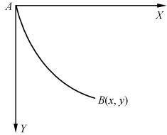

# 14-第十四章 变分法

[返回全书目录](../../README.md)

> PDF 页码：282–299

<!-- page: 282 -->

变分法是求近似解析解的最有力的方法之一，它的原理和应用渗透到了物理学的各个部门，成为理论物理中广泛使用的一种数学工具。通常所说的变分法就是求泛函极值的方法。本章将从数学物理中应用的角度，来说明变分法的基本概念、原理及用来求解数学物理方程的基本思想。为此，我们首先必须了解泛函的概念和泛函的极值问题。

### 14.1 泛函和泛函的极值

## 1. 泛函

泛函是函数概念的推广.为了说明问题先看一个例子.

讨论力学中的最速落径(brachistochrone)问题. 如图14.1所示, 已知A和B为不在同一铅垂线和同一高度的两点, 要求找出A、B间的这样一条曲线, 当一质点在重力作用下沿这条曲线无摩擦地从A滑到B时, 所需时间T最小.

我们知道，此时质点的速度是

图14.1
 

 $$ \mathrm{\frac{ds}{d t}}=\sqrt{2 g y} $$ 

其中 g 为重力加速度，故从 A 滑到 B 所需的时间为

 $$ T=\int_{t_{1}(A)}^{t_{2}(B)}\mathrm{d}t=\int_{A}^{B}\frac{\mathrm{d}s}{\sqrt{2g y}}=\int_{A}^{B}\frac{\sqrt{1+y^{^{\prime}2}}}{\sqrt{2g y}}\mathrm{d}x $$ 

即

$$  T[y(x)]=\int_{A}^{B}\frac{\sqrt{1+y^{^{\prime}2}}}{\sqrt{2gy}}\mathrm{d}x   \tag*{(14.1.1)}$$

我们称上述的 T 为  $ y(x) $ 的泛函，而称  $ y(x) $ 可取的函数类，为泛函  $ T[y(x)] $ 的定义域。简单地说，泛函就是函数的函数（不是复合函数的那种含义）。一般地讲，设 C 是函数的集合，B 是实数或复数的集合，如果对于 C 的任一元素  $ y(x) $，在 B 中都有一个元素 J 与之对应，则称 J 为  $ y(x) $ 的泛函，记为

<!-- page: 283 -->

$$ J=J\bigl[y(x)\bigr] $$ 

必须注意，泛函不同于通常讲的函数，决定通常函数的值的因素是自变量的取值，而决定泛函的值的因素则是函数的取形。如，上面例子中的泛函 T 的变化是由函数  $ y(x) $ 本身的变化（即从 A 到 B 的不同曲线）所引起的。它的值既不取决于某一个 x 值，也不取决于某一个 y 值，而是取决于整个集合 C 中 y 与 x 的函数关系。

泛函通常以积分形式出现，比如，上面描述最速落径问题的(14.1.1)式。一般，最简单而又典型的泛函可表为

$$  J[y(x)]=\int_{a}^{b}F(x,y,y^{\prime})\mathrm{d}x   \tag*{(14.1.2)}$$

其中  $ F(x,y,y') $ 称为泛函的核.

## 2. 泛函的极值与泛函的变分

引入泛函的概念后，上述的最速落径问题就变为了求泛函  $ T[y(x)] $ 的极小值问题。泛函的极值问题在物理学中各部分都有，例如光学中的费马(Fermat)原理 $ ^{①} $，分析力学中的哈密顿(Hamilton)原理 $ ^{②} $等，都是泛函的极值问题。所谓变分法就是求泛函极值的方法，我们将会看到，研究泛函极值问题的方法可归纳为两类，一类叫直接法，即直接分析所提出的问题；另一类叫间接法，即把问题转化为求解微分方程。为讨论间接方法，先介绍泛函的变分。

设有连续函数  $ y(x) $，将它略为变形，即将  $ y(x) $ 变为  $ y(x)+t\eta(x) $，其中 t 为一个小参数，则称  $ t\eta(x) $ 为  $ y(x) $ 的变分。记为

$$  \delta y=t\eta(x)   \tag*{(14.1.3)}$$

此时函数  $ y'(x) $ 将相应地变形为

 $$ \begin{aligned}\lim_{\Delta x\to0}\frac{\Delta(y+t\eta)}{\Delta x}&=y^{\prime}(x)+t\eta^{\prime}(x)\\\delta y^{\prime}&=t\eta^{\prime}(x)=\frac{\mathrm{d}}{\mathrm{d}x}(\delta y)\end{aligned} $$ 

可见

这表明，对于一个给定的函数，变分和微分两种运算可以互换次序。

设(14.1.2)式中 F 对 x, y,  $ y' $ 都是连续二阶可导, y 的二阶导数连续, 则当  $ y(x) $ 有变分  $ \delta y $ 时, J 的变化为

 $$ \begin{aligned}\Delta J&=J\big[y(x)+t\eta(x)\big]-J\big[y(x)\big]\\&=\int_{a}^{b}\big[F(x,y+t\eta,y^{\prime}+t\eta^{\prime})-F(x,y,y^{\prime})\big]\mathrm{d}x\\&=\int_{a}^{b}\Big[\frac{\partial F}{\partial y}t\eta+\frac{\partial F}{\partial y^{\prime}}t\eta^{\prime}+t\  的高阶项 \Big]\mathrm{d}x^{\textcircled{3}}\\ \end{aligned} $$ 

我们称上式右边的线性主部（即略去高阶无穷小量的部分）为泛函  $ J[y(x)] $ 的第一次变分，简称泛函的变分，记为

<!-- page: 284 -->

$$  \delta J=\int_{a}^{b}\Bigl(\frac{\partial F}{\partial y}\delta y+\frac{\partial F}{\partial y^{\prime}}\delta y^{\prime}\Bigr)\mathrm{d}x   \tag*{(14.1.5)}$$

## 3. 泛函取极值的必要条件——欧拉方程

设  $ J[y(x)] $ 的极值问题有解

$$  y=y(x)   \tag*{(14.1.6)}$$

现在推导这个解所满足的常微分方程，这是用间接法研究泛函极值问题的重要一环。设想这个解有变分  $ t\eta(x) $，则  $ J[y(x)+t\eta(x)] $ 可视为参数 t 的函数  $ \Phi(t)=J[y(x)+t\eta(x)] $。而当 t=0 时， $ y(x)+t\eta(x)=y(x) $ 对应于 (14.1.6) 式，即  $ J[y(x)+t\eta(x)] $ 取极值。于是，原来的泛函的极值问题，就化为一个求普通函数  $ \Phi(t) $ 的极值问题。由函数取极值的必要条件，有

 $$ \frac{\mathrm{d}\Phi}{\mathrm{d}t}\bigg|_{t=0}=0 $$ 

即

 $$ \frac{\partial J\left[y(x)+t\eta(x)\right]}{\partial t}\bigg|_{t=0}=0 $$ 

将(14.1.2)式代入，也就是

 $$ \int_{a}^{b}\left[\frac{\partial}{\partial t}F(x,y+t\eta,y^{\prime}+t\eta^{\prime})\right]_{t=0}\mathrm{d}x=0 $$ 

即

 $$ \int_{a}^{b}\left(\frac{\partial F}{\partial y}\eta+\frac{\partial F}{\partial y^{\prime}}\eta^{\prime}\right)\mathrm{d}x=0 $$ 

上式两边乘以 t 得

$$  \int_{a}^{b}\Big(\frac{\partial F}{\partial y}\delta y+\frac{\partial F}{\partial y^{\prime}}\delta y^{\prime}\Big)\mathrm{d}x=0   \tag*{(14.1.7)}$$

与(14.1.5)式比较可知，使得 $ J[y(x)] $取极值的解(14.1.6)必须满足

$$  \delta J=0   \tag*{(14.1.8)}$$

此即泛函取极值的必要条件. 即，泛函 J 的极值函数  $ y(x) $，必须是满足泛函的变分  $ \delta J=0 $ 的函数类  $ y(x) $. 因此，把泛函的极值问题称为变分问题.

（14.1.7）式的积分号下既有 $ \delta y $，又有 $ \delta y' $，对第二项应用分部积分法可使积分号下只出现 $ \delta y $

 $$ \int_{a}^{b}\frac{\partial F}{\partial y^{^{\prime}}}\delta y^{^{\prime}}\mathrm{d}x=\int_{a}^{b}\frac{\partial F}{\partial y^{^{\prime}}}\frac{\mathrm{d}}{\mathrm{d}x}(\delta y)\mathrm{d}x=\frac{\partial F}{\partial y^{^{\prime}}}\delta y\bigg|_{a}^{b}-\int_{a}^{b}\frac{\mathrm{d}}{\mathrm{d}x}\Big(\frac{\partial F}{\partial y^{^{\prime}}}\Big)\delta y\mathrm{d}x $$ 

在简单的变分问题中，都保持 $ \delta y|_{x=a}=0,\delta y|_{x=b}=0 $，即，端点的函数值是固定的 $ ^{④} $，故上式右边第一项为零，于是(14.1.7)式成为

 $$ \int_{a}^{b}\Bigl[\frac{\partial F}{\partial y}-\frac{\mathrm{d}}{\mathrm{d}x}\Bigl(\frac{\partial F}{\partial y^{\prime}}\Bigr)\Bigr]\delta y\mathrm{d}x=0 $$ 

上式对任意给定的 $ [a,b] $和任何的 $ \delta y $都成立，所以

$$  \frac{\partial F}{\partial y}-\frac{\mathrm{d}}{\mathrm{d}x}\Big(\frac{\partial F}{\partial y^{^{\prime}}}\Big)=0   \tag*{(14.1.9)}$$

<!-- page: 285 -->

即，泛函(14.1.2)式有极值的必要条件，又可表示为方程(14.1.9)式，称为泛函(14.1.2)的极值问题的欧拉(Euler)方程 $ ^{⑤} $.

较复杂的泛函的欧拉方程可仿照上述方法导出. 比如，对于取决于一个自变数的几个函数的泛函

 $$ J\left[y_{1}(x),y_{2}(x)\cdots y_{n}(x)\right]=\int_{a}^{b}F(x;y_{1},y_{2}\cdots y_{n};y_{1}^{\prime},y_{2}^{\prime}\cdots y_{n}^{\prime})\mathrm{d}x $$ 

为了寻求这个泛函的极值条件，我们只让泛函中的一个函数，如  $ y_{k}(x) $ 获得变分，而令其余的函数保持不变。这样，原来的泛函 J 可以看成只依赖于一个函数的泛函  $ J_{k}[y_{k}] $，而使得这个泛函具有极值的函数  $ y_{k}(x) $ 应该满足

 $$ \frac{\partial F}{\partial y_{k}}-\frac{\mathrm{d}}{\mathrm{d}x}\Big(\frac{\partial F}{\partial y_{k}^{^{\prime}}}\Big)=0 $$ 

这样的推理对于每一个函数都能适用，故泛函  $ J[y_{1}(x), y_{2}(x), \cdots, y_{n}(x)] $ 的变分问题对应于下列欧拉方程组：

$$  \frac{\partial F}{\partial y_{i}}-\frac{\mathrm{d}}{\mathrm{d}x}\Big(\frac{\partial F}{\partial y_{i}^{^{\prime}}}\Big)=0,\quad i=1,2,3,\cdots,n   \tag*{(14.1.10)}$$

另外，对于泛函取决于  $ y(x) $ 及其 n 阶导数的情况，例如变分问题

 $$ \delta\int_{a}^{b}F(x;y,y^{\prime},y^{\prime \prime},y^{\prime \prime \prime})\mathrm{d}x=0 $$ 

对应的欧拉方程是

$$  \frac{\partial F}{\partial y}-\frac{\mathrm{d}}{\mathrm{d}x}\Big(\frac{\partial F}{\partial y^{\prime}}\Big)+\frac{\mathrm{d}^{2}}{\mathrm{d}x^{2}}\Big(\frac{\partial F}{\partial y^{\prime \prime}}\Big)-\frac{\mathrm{d}^{3}}{\mathrm{d}x^{3}}\Big(\frac{\partial F}{\partial y^{\prime \prime \prime}}\Big)=0   \tag*{(14.1.11)}$$

对于泛函取决于多元函数的情况，例如取决于三元函数  $ u(x, y, z) $，其变分问题为

 $$ \delta\iiint_{v}F(x,y,z;u;u_{x},u_{y},u_{z})\mathrm{d}x\mathrm{d}y\mathrm{d}z=0 $$ 

对应的欧拉方程是偏微分方程

$$  \frac{\partial F}{\partial u}-\frac{\partial}{\partial x}\Big(\frac{\partial F}{\partial u_{x}}\Big)-\frac{\partial}{\partial y}\Big(\frac{\partial F}{\partial u_{y}}\Big)-\frac{\partial}{\partial z}\Big(\frac{\partial F}{\partial u_{z}}\Big)=0   \tag*{(14.1.12)}$$

例 1 求解最速落径问题，即变分问题

 $$ \delta\int_{A}^{B}\frac{\sqrt{1+y^{^{\prime}2}}}{\sqrt{2gy}}\mathrm{d}x=0 $$ 

解 目前我们只能用间接方法来求解. 由于

 $$ F=\frac{\sqrt{1+y^{^{\prime}2}}}{\sqrt{2gy}} $$ 

不显含 x，故其欧拉方程 $ ^{⑤} $为

 $$ y^{^{\prime}}\frac{\partial}{\partial y^{^{\prime}}}\sqrt{\frac{1+y^{^{\prime}2}}{y}}-\sqrt{\frac{1+y^{^{\prime}2}}{y}}=c $$ 

即

<!-- page: 286 -->

$$ \frac{y^{^{\prime}2}}{\sqrt{y(1+y^{^{\prime}2})}}-\sqrt{\frac{1+y^{^{\prime}2}}{y}}=c $$ 

亦即

 $$ \frac{1}{y(1+y^{^{\prime}2})}=c^{2} $$ 

令 $ \frac{1}{c^{2}}=c_{1} $，分离变数得

 $$ \frac{\sqrt{y}\mathrm{d}y}{\sqrt{c_{1}-y}}=\mathrm{d}x,\quad c_{1} 为积分常数 $$ 

再令

 $$ y=c_{1}\sin^{2}\frac{\theta}{2} $$ 

代入上式，则得

 $$ \mathrm{d}x=c_{1}\sin^{2}\frac{\theta}{2}\mathrm{d}\theta=\frac{c_{1}}{2}(1-\cos\theta)\mathrm{d}\theta $$ 

所以有

 $$ \left\{\begin{aligned}x&=\frac{c_{1}}{2}(\theta-\sin\theta)+c_{2}\\ y&=\frac{c_{1}}{2}(1-\cos\theta)\end{aligned}\right. $$ 

此即摆线的参数方程，积分常数  $ c_{1}, c_{2} $ 可由 A、B 的位置决定.

## 4. 泛函的条件极值问题

在许多泛函的极值问题中，变量函数还受到一些附加条件的限制，其中最重要的一种是以积分形式表示的限制

$$  \int_{a}^{b}G(x,y,y^{\prime})\mathrm{d}x=l   \tag*{(14.1.13)}$$

即所谓等周问题 $ ^{⑥} $

$$  \left\{\begin{aligned}J\big[y(x)\big]&=\int_{a}^{b}F(x,y,y^{\prime})\mathrm{d}x,y(a)=y_{0},y(b)=y_{1}\\ \int_{a}^{b}G(x,y,y^{\prime})\mathrm{d}x&=l\end{aligned}\right.   \tag*{(14.1.14)}$$

其中，l 和  $ y_{0} $， $ y_{1} $ 均为常数。用欧拉方程解这类问题，可仿照解函数的条件极值问题的拉格朗日（Lagrange）乘子法 $ ^{⑦} $，即将附加条件（14.1.13）乘以参数  $ \lambda $，求其变分后，加到泛函的变分问题（14.1.8）中，得到

 $$ \delta\int_{a}^{b}\left[F(x;y,y^{\prime})+\lambda G(x;y,y^{\prime})\right]\mathrm{d}x=0 $$ 

于是，问题转化为不带条件的由上式所表示的变分问题. 其对应的欧拉方程为

$$  \frac{\partial F}{\partial y}+\lambda\frac{\partial G}{\partial y}-\frac{\mathrm{d}}{\mathrm{d}x}\big(\frac{\partial F}{\partial y^{\prime}}+\lambda\frac{\partial G}{\partial y^{\prime}}\big)=0   \tag*{(14.1.15)}$$

这是通过 a 和 b 两点的  $ y(x) $ 在附加条件 (14.1.13) 之下使泛函 (14.1.2) 取极值的必

<!-- page: 287 -->

要条件. 它是一个关于  $ y(x) $ 的二阶常微分方程. 其通解中含有三个参数, 即  $ \lambda $ 和两个积分常数. 它们可由条件  $ y(a)=y_{0}, y(b)=y_{1} $ 和附加条件 (14.1.13) 来定.

例2 求  $ J[y(x)]=\int_{0}^{1}(y')^{2}dx $ 的极值，其中 y 是归一化的，即  $ \int_{0}^{1}y^{2}dx=1 $，且已知  $ y(0)=0,y(1)=0 $.

解 这是求泛函的条件极值问题，可化为变分问题

 $$ \delta\int_{0}^{1}(y^{\prime2}+\lambda y^{2})\mathrm{d}x=0 $$ 

对应的欧拉方程是

 $$ y^{\prime \prime}-\lambda y=0 $$ 

其通解为

 $$ y=c_{1}\mathrm{e}^{\sqrt{\lambda}x}+c_{2}\mathrm{e}^{-\sqrt{\lambda}x} $$ 

代入条件  $ y(0)=0, y(1)=0 $ 得

 $$ y_{n}(x)=c_{n}\mathrm{s i n}n\pi x,\quad n=1,2,\cdots $$ 

代入归一化条件得

 $$ \int_{0}^{1}c_{n}^{2}\sin^{2}n\pi x\mathrm{d}x=1 $$ 

于是得  $ c_{n}=\pm\sqrt{2} $，故原极值问题的解为

 $$ y_{n}=\pm\sqrt{2}\sin n\pi x $$ 

而泛函 $ \int_{0}^{1}(y^{\prime})^{2}\mathrm{d}x $的极值为

 $$ \int_{0}^{1}2\pi^{2}\cos^{2}n\pi x\mathrm{d}x=n^{2}\pi^{2} $$ 

当n=1时，极值函数 $ y_{1}(x)=\pm\sqrt{2}\sin\pi x $使泛函取得最小值 $ \pi^{2} $

## 5. 求泛函极值的直接方法——里兹(Ritz)方法

上面，我们将变分问题归结为求解微分方程的问题。而微分方程仅在不多的情况下能够积分为有限形式，因此人们就想到，从泛函本身出发，不经过微分方程直接求出其极值曲线。这就是所谓研究泛函极值问题的直接方法。

里兹方法就是比较典型的直接方法. 其基本要点是, 不把泛函  $ J[y(x)] $ 放在它的全部定义域内来考虑, 而把它放在其定义域的某一部分来考虑. 具体而言, 取某种完备函数系

 $$ \varphi_{1}(x),\varphi_{2}(x),\cdots $$ 

尝试以其中的前几个来表示变分问题  $ \delta J = 0 $ 的解，即，令解为

$$  y(x)=f(\varphi_{1},\varphi_{2},\varphi_{3},\cdots,\varphi_{n};c_{1},c_{2},c_{3},\cdots,c_{n})   \tag*{（14.1.16）}$$

其中  $ c_{1}, c_{2}, c_{3}, \cdots, c_{n} $ 为待定参数。把上式代入 J 的表示式，J 便成了  $ c_{1}, c_{2}, c_{3}, \cdots, c_{n} $ 的 n 元函数，即  $ J[y(x)] = \Phi(c_{1}, c_{2}, \cdots, c_{n}) $。由于 f 的形式是我们预先选定了的[如，可选  $ f = \sum_{i=1}^{n} c_{i} \varphi_{i}(x) $]，故按照多元函数的极值的方法令

<!-- page: 288 -->

$$  \frac{\partial\Phi}{\partial c_{i}}=0,\quad i=1,2,\cdots,n   \tag*{(14.1.17)}$$

而求出系数  $ c_{1}, c_{2}, \cdots, c_{n} $，从而也就完全确定了  $ y(x) $。但这样得到的  $ y(x) $ 并非  $ \delta J = 0 $ 的严格解，而只是近似解，若将上述近似解记作  $ y_{n}(x) $ 则严格解应该是

 $$ y(x)=\lim_{n\to\infty}y_{n}(x) $$ 

不过，这个极限过程是否收敛，收敛的快慢如何，是否收敛于严格解，都还是问题；而且实际问题中果真去求上列极限往往很麻烦，因此，通常就止于求出近似解。

在里兹方法中，如果函数系  $ \varphi_{1}(x) $， $ \varphi_{2}(x) $，…选得适当，而且尝试函数 f 也取得适当，便能求出近似程度很高的近似解；如果选得不当，所得“近似解”可能与严格解相差很远。至于怎样才能适当，并无一定方法可循，只能根据问题的性质（如边值的性质）结合经验来试选。常常选择函数系为多项式或三角函数系。

例 3 用里兹方法解例 2，求其最小值.

解 试以  $ c_{n}x^{n} $ 作为所选用的函数系，采用试探解

$$  y(x)=x(x-1)(c_{0}+c_{1}x)   \tag*{(14.1.18)}$$

头两个因式的取用，是为了满足  $ y(0)=0 $ 和  $ y(1)=0 $ 。将（14.1.18）式代入  $ \int_{0}^{1}(y^{\prime})^{2}dx $ ，则

$$  \begin{align*}J[y(x)]=&\int_{0}^{1}[3c_{1}x^{2}+2(c_{0}-c_{1})x-c_{0}]^{2}\mathrm{d}x\\=&\frac{1}{3}\Big(c_{0}^{2}+c_{0}c_{1}+\frac{2}{5}c_{1}^{2}\Big)\end{align*}   \tag*{(14.1.19)}$$

由归一化条件 $ \int_{0}^{1}y^{2}dx=1 $得到

$$  \frac{1}{30}\Big(c_{0}^{2}+c_{0}c_{1}+\frac{2}{7}c_{1}^{2}\Big)=1   \tag*{(14.1.20)}$$

在条件(14.1.20)式下求(14.1.19)式的极值本可采用拉格朗日乘子法，但本题有如下简便的方法，由(14.1.20)式

 $$ c_{0}^{2}+c_{0}c_{1}=30-\frac{2}{7}c_{1}^{2} $$ 

代入14.1.19式

 $$ J[y(x)]=\frac{1}{3}\Big(30-\frac{2}{7}c_{1}^{2}+\frac{2}{5}c_{1}^{2}\Big)=\frac{2}{3}\Big(15+\frac{2}{35}c_{1}^{2}\Big) $$ 

显然，在  $ c_{1}=0 $ 时， $ J[y(x)] $ 最小，其值为 10. 此时，由（14.1.20）式有  $ c_{0}=\pm\sqrt{30} $，所以

 $$ y(x)=\pm\sqrt{30}x(x-1) $$ 

让我们将这个近似解与例2求得的严格解比较。近似解为两条过 $ (0,0) $和 $ (1,0) $的、开口分别向上和向下的抛物线；严格解则为两条以 $ (0,0) $和 $ (1,0) $为拐点的正弦曲线。在区间 $ [0,1] $上，它们是很相近的。近似解反映泛函最小值的近似值为10，而严格解表明泛函的最小值为 $ \pi^{2} $。

<!-- page: 289 -->

在物理学中用变分法（中的直接方法）求泛函的极值是经常用到的。如，在量子力学中常用变分法求体系基态能量，其基本步骤是：选取含有参量  $ \lambda $ 的尝试波函数  $ \psi(\lambda) $，代入描述体系能量平均值的公式

 $$ \overline{{H}}=\int\psi^{*}\hat{H}\psi\mathrm{d}\tau $$ 

算出 $ \bar{H}(\lambda) $，然后由

 $$ \frac{\partial\overline{H}(\lambda)}{\partial\lambda}=0 $$ 

来求出  $ \overline{H}(\lambda) $ 的最小值. 可以看到, 用变分法求得的氦原子的基态能量, 比另一近似方法微扰法求得的更接近.

注 ① 费马原理指出：光线在 A、B 两点间传播的实际路径，与其他可能的邻近的路程相比，其光程为极值。即，光线的实际路径上光程的变分为零。其数学表述为

$$  \delta l=\delta\int_{A}^{B}n\mathrm{d}l=0   \tag*{(14.1.21)}$$

其中，n为介质的折射率，dl为沿光线进行方向的路程元。

②哈密顿原理指出：保守的、完整的力学体系在相同时间内，由某一初位形转移到另一已知位形的一切可能运动中，真实运动的作用函数具有极值，即，对于真实运动来讲，作用函数的变分等于零。其数学表述为

$$  \delta S=\delta\int_{t_{0}}^{t_{1}}L(q_{i},\dot{q}_{i},t)\mathrm{d}t=0,\quad i=1,2,\cdots,s   \tag*{(14.1.22)}$$

其中，L 为拉格朗日函数，等于力学体系动能和势能之差， $ q_{i} $ 为广义坐标，dt 为时间元。

除哈密顿原理外，在力学中用到变分法的还有虚功原理、最小作用量原理等其他一些原理，详见理论力学。

③这里引用了多元函数的泰勒展开公式： $ F(x,y+\Delta y,z+\Delta z)=F(x,y,z)+\frac{\partial F}{\partial y}\Delta y+\frac{\partial F}{\partial z}\Delta z+\cdots $

④如在最速落径问题中， $ y+\delta y $ 和 y 两曲线都从 A 出发到 B 终止，即  $ y+\delta y-y|_{A}=\delta y|_{A}=0 $； $ y+\delta_{y}-y|_{B}=\delta y|_{B}=0 $。有些变分问题其端点的函数值是可变的，如  $ y(b) $ 是可变的，则 (14.1.2) 式的变分问题除满足 (14.1.9) 式外，在变端点还需满足自然边界条件  $ \left.\frac{\partial F}{\partial y}\right|_{y=b}=0 $，对此类变端点问题本书不作详细讨论。

⑤（14.1.9）式是一个关于函数  $ y(x) $ 的二阶常微分方程。其中的偏导，不过是表明如何根据泛函 J 的核 F 来写出这个常微分方程。若 F 不显含 x，则欧拉方程（14.1.9）可化为

$$  y^{\prime}\frac{\partial F}{\partial y}-F=c   \tag*{(14.1.23)}$$

顺便提及，应该说方程（14.1.8）和（14.1.9）是等价的，如，在分析力学中，是用拉格朗日方程

$$  \frac{\mathrm{d}}{\mathrm{d}x}\Big(\frac{\partial L}{\partial\dot{q}_{i}}\Big)-\frac{\partial L}{\partial q_{i}}=0,\quad i=1,2,\cdots,s   \tag*{(14.1.24)}$$

推出哈密顿原理（14.1.22）的，反过来，当然也可以从哈密顿原理推出拉格朗日方程。

⑥ 这种问题之所以称为等周问题，是因为在历史上这种问题始原于求一条通过  $ p_{0} $ 和  $ p_{1} $ 两点、长度固定为 l 的曲线  $ y = y(x) $，使面积  $ S = \int_{a}^{b} y(x) \, dx $ 取极大值.

<!-- page: 290 -->

⑦ 所谓解函数的条件极值问题的拉格朗日乘子法是指：若要求函数  $ y=f(x) $， $ x=(x_{1},x_{2},\cdots,x_{n}) $ 在  $ m(m<n) $ 个约束条件  $ g_{k}(x)=0,k=1,2,\cdots,m $ 下的极值，可引进修正的函数  $ F=y+\sum_{k=1}^{m}\lambda_{k}g_{k} $，式中  $ \lambda_{k} $ 为待定常数。把 F 当作  $ n+m $ 个变量  $ x_{1},x_{2},\cdots,x_{n} $ 和  $ \lambda_{1},\lambda_{2},\cdots,\lambda_{m} $ 的无约束函数，对这些变量求一阶偏导数得极值点所要满足的方程

 $$ \left\{\begin{aligned}\frac{\partial F}{\partial x_{i}}&=0,\quad i=1,2,\cdots,n\\ g_{k}&=0,\quad k=1,2,\cdots,m\end{aligned}\right. $$ 

#### 习题14.1

1. 证明： $ \delta\int_{a}^{b}F(x)\mathrm{d}x=\int_{a}^{b}\delta F(x)\mathrm{d}x. $

2. 计算下列泛函的变分：

(1)  $ J[y(x)] = \int_{x_0}^{x_1} (y^2 + y'^2 - 2y\mathrm{ch}x)\mathrm{d}x; $

(2)  $ J[y(x)] = \int_{x_0}^{x_1} (x^4 y' + x^3 y + 3) \, dx. $

3. 试导出二元函数  $ u(x,y) $ 的欧拉方程

 $$ \frac{\partial F}{\partial u}-\frac{\partial}{\partial x}\Big(\frac{\partial F}{\partial u_{x}}\Big)-\frac{\partial}{\partial y}\Big(\frac{\partial F}{\partial u_{y}}\Big)=0 $$ 

4. 对于泛函

 $$ J\big[u(x,y)\big]=\iint_{D}\big[u_{x}^{2}+u_{y}^{2}+2uf(x,y)\big]\mathrm{d}x\mathrm{d}y $$ 

和

 $$ J\left[u(x,y)\right]=\iint_{D}\left[\left(\frac{\partial u}{\partial x}\right)^{2}-\left(\frac{\partial u}{\partial y}\right)^{2}\right]\mathrm{d}x\mathrm{d}y $$ 

分别写出其欧拉方程.

5. 求连接一平面上两定点间的曲线段中最短者.

6. 在质点力学中，系统的作用量表示为

 $$ S=\int_{t_{1}}^{t_{2}}L(t,q,\dot{q})\mathrm{d}t $$ 

是 $ q(t) $的泛函. 其中， $ q(t) $和 $ \dot{q}(t) $分别为广义坐标和广义速度，L称为拉格朗日函数. 已知

（1）自由质点的拉氏函数为

 $$ L=-m c^{2}\sqrt{1-\frac{v^{2}}{c^{2}}} $$ 

（2）在势能场 $ U(r) $中运动的质点的拉氏函数为

 $$ L=\frac{mv^{2}}{2}-U(r) $$ 

分别求它们的作用量 S 有极值的必要条件.

7. 在什么样的曲线上，下列泛函可能达到极值？

(1)

 $$ \begin{cases}J[y(x)]=\int_{0}^{\frac{\pi}{2}}[(y^{\prime})^{2}-y^{2}]\mathrm{d}x\\y(0)=0,y\Big(\frac{\pi}{2}\Big)=1;\end{cases} $$

<!-- page: 291 -->

(2)

 $$ \begin{cases}J[y(x)]=\displaystyle\int_{x_{0}}^{x_{1}}(16y^{2}-y^{\prime \prime}^{2}+x^{2})\mathrm{d}x\\y(x_{0})=y_{0},y^{\prime}(x_{0})=y^{\prime}_{0}\\y(x_{1})=y_{1},y^{\prime}(x_{1})=y^{\prime}_{1}.\end{cases} $$ 

8. 求解注释 $ ^{⑥} $中所述的始原的等周问题.

9. 用里兹方法求泛函  $ J[y(x)]=\int_{0}^{x}(y^{\prime2}+y^{2}+2xy)dx;y(0)=y(2)=0 $ 的极小值问题的近似解，并与其准确解进行比较.

提示：近似解可用  $ y(x)=x(2-x)(c_{0}+c_{1}x+\cdots+c_{n}x_{n}) $ 来试探.

10. 用拉格朗日乘子法，再求一次例3中的极值.

 $ ^{*} $11. 假设大气的折射率  $ n(y) $ 只依赖于高度 y.

（1）利用费马原理，导出在大气中光线轨迹的微分方程；

（2）一个旅行者与水平成角度  $ \varphi $ 的方向上看到“空中的绿洲”。如果  $ n=n_{0} $  $ \sqrt{1-\Omega^{2}y^{2}} $，其中  $ n_{0} $ 和  $ \Omega $ 是常数，问这块绿洲离旅行者有多远？

（加州理工学院研究生试题）

### 14.2 用变分法解数理方程

变分法解数理方程的基本原理是：

（1）把一个微分方程的本征值问题或者定解问题和一个泛函的极值问题联系起来，使原来的方程是这个泛函的欧拉方程.

（2）用直接方法求出使泛函取极值的函数. 由于这函数必满足欧拉方程，它也是原方程的解.

本节将以亥姆霍兹方程的本征值问题和泊松方程的边值问题为例，说明如何把一个微分方程的本征值问题或边值问题化为一个泛函的极值问题，然后便可利用上节介绍的里兹方法来求泛函的极值，此即原问题的解。

## 1. 本征值问题和变分问题的关系

考虑亥姆霍兹方程的本征值问题

$$  \left\{\begin{aligned}\Delta u+\lambda u&=0\\ u\mid_{\sigma}&=0\end{aligned}\right.   \tag*{(14.2.1)}$$

其中设 u 在区域  $ \tau $ 中有连续的二阶导数， $ \lambda $ 是参数， $ \sigma $ 是  $ \tau $ 的边界.

将(14.2.1)左边乘以-u，然后在 $ \tau $上求积分，便得到一个泛函

$$  J\left[u\right]=-\iiint_{\tau}\left(u\Delta u+\lambda u^{2}\right)\mathrm{d}\tau   \tag*{(14.2.3)}$$

我们来求这个泛函的欧拉方程. 为了能够直接应用(14.1.12)式, 先利用边界条件把泛函(14.2.3)化为只含 u 的一阶导数的积分. 由格林第一公式(10.2.3)有

<!-- page: 292 -->

$$  J[u]=-\iiint_{\tau}(u\Delta u+\lambda u^{2})\mathrm{d}\tau=-\iint_{\sigma}u\frac{\partial u}{\partial n}\mathrm{d}\sigma+\iiint_{\tau}[(\nabla u)^{2}-\lambda u^{2}]\mathrm{d}\tau   \tag*{(14.2.4)}$$

而由边界条件(14.2.2)有

 $$ \iint_{\sigma}u\frac{\partial u}{\partial n}\mathrm{d}\sigma=0 $$ 

于是

$$  J[u]=\iiint_{\tau}[(\nabla u)^{2}-\lambda u^{2}]\mathrm{d}\tau   \tag*{(14.2.5)}$$

根据（14.1.12），得这个泛函的欧拉方程为

 $$ \Delta u+\lambda u=0 $$ 

这正是原本征值问题的方程(14.2.1).

又由上节对泛函的条件极值的讨论知，泛函(14.2.5)式的变分问题和泛函

$$  J_{1}[u]=\iiint_{\tau}(\nabla u)^{2}\mathrm{d}\tau   \tag*{(14.2.6)}$$

 $$ \iiint_{\tau}u^{2}\mathrm{d}\tau=1 $$ 

在附加条件

之下的变分问题等价，因此，求解本征值问题(14.2.1)～(14.2.2)式，可归结为在一化条件(14.2.7)式和边界条件(14.2.2)式下求泛函(14.2.6)式的极值的问题.

如果方程(14.2.1)带有第二类的边界条件

$$  \left.\frac{\partial u}{\partial n}\right|_{\sigma}=0   \tag*{(14.2.8)}$$

也会使泛函(14.2.4)在边界上的积分 $ \iint_{\sigma}u\frac{\partial u}{\partial n}d\sigma $为零.故本征值问题

 $$ \left\{\begin{aligned}&\Delta u+\lambda u=0\\ &\frac{\partial u}{\partial n}\bigg|_{\sigma}=0\end{aligned}\right. $$ 

所对应的泛函亦为(14.2.5)，但由于边界条件的不同，因此在求泛函极值时，与带有第一类边界条件的情况并不相同.

若方程(14.2.1)带有第三类边界条件

$$  \left[\frac{\partial u}{\partial n}+h u\right]_{\sigma}=0   \tag*{(14.2.9)}$$

此时，由(14.2.4)式有

 $$ \begin{aligned}J\left[\boldsymbol{u}\right]=&-\iiint_{\sigma}\boldsymbol{u}\frac{\partial\boldsymbol{u}}{\partial n}\mathrm{d}\sigma+\iiint_{\tau}\left[(\nabla\boldsymbol{u})^{2}-\lambda\boldsymbol{u}^{2}\right]\mathrm{d}\tau\\=&-\iiint_{\sigma}\boldsymbol{u}\left[\frac{\partial\boldsymbol{u}}{\partial n}+h\boldsymbol{u}\right]\mathrm{d}\sigma+h\iiint_{\sigma}\boldsymbol{u}^{2}\mathrm{d}\sigma+\iiint_{\tau}\left[(\nabla\boldsymbol{u})^{2}-\lambda\boldsymbol{u}^{2}\right]\mathrm{d}\tau\\=&\iiint_{\tau}\left[(\nabla\boldsymbol{u})^{2}-\lambda\boldsymbol{u}^{2}\right]\mathrm{d}\tau+h\iiint_{\sigma}\boldsymbol{u}^{2}\mathrm{d}\sigma\end{aligned} $$

<!-- page: 293 -->

记

$$  J_{1}[u]=\iiint_{\tau}(\nabla u)^{2}\mathrm{d}\tau+h\iint_{\sigma}u^{2}\mathrm{d}\sigma   \tag*{(14.2.10)}$$

故由类似于前面的讨论知，本征值问题

 $$ \left\{\begin{aligned}&\Delta u+\lambda u=0\\ &\left(\frac{\partial u}{\partial n}+h u\right)_{\sigma}=0\end{aligned}\right. $$ 

可归结为在归一化附加条件(14.2.7)和边界条件(14.2.9)下求泛函(14.2.10)的极值问题.

对于任意的二阶常微分方程的本征值问题 $ ^{①} $

$$  \left\{\begin{aligned}&\frac{\mathrm{d}}{\mathrm{d}x}\lbrack k(x)y^{\prime}(x)\rbrack-q(x)y(x)+\lambda\varrho(x)y(x)=0,\quad a\leqslant x\leqslant b\\ &y(a)=y(b)=0,\quad 或 \quad y^{\prime}(a)=y^{\prime}(b)=0\end{aligned}\right.   \tag*{(14.2.11)}$$

类似地，我们可以证明，它们均可归结为在归一化附加条件

 $$ \int_{a}^{b}\rho(x)y^{2}(x)\mathrm{d}x=1 $$ 

和相应的边界条件下求泛函

 $$ J[y]=\int_{a}^{b}[k(x)(y^{\prime})^{2}+q y^{2}]\mathrm{d}x $$ 

的极值问题.

## 2. 本征值与泛函的极值的关系

我们当然可借助于里兹方法来求泛函的极值，从而求得本征值问题的解.为此，我们先以本征值问题(14.2.1)～(14.2.2)式为例来证明一个重要结论：

泛函(14.2.6)式的最小值 $ \lambda_{0} $，就是本征值问题(14.2.1)～(14.2.2)式的最小本征值；而使泛函(14.2.6)式在边界条件(14.2.2)式和附加条件(14.2.7)式下取这最小值的函数 $ u_{0} $，就是该本征值问题对应于本征值 $ \lambda_{0} $的本征函数.

证 设  $ u_{0} $ 是使泛函(14.2.6)式有最小值  $ \lambda_{0} $ 的极值函数，则

$$  \begin{align*}J_{1}\left[u_{0}\right]=\lambda_{0}=&\iiint_{\tau}\left(\nabla u_{0}\right)^{2}\mathrm{d}\tau\\=&\iiint_{\tau}\nabla\bullet\left(u_{0}\nabla u_{0}\right)\mathrm{d}\tau-\iiint_{\tau}u_{0}\Delta u_{0}\mathrm{d}\tau\\=&\iint_{\sigma}u_{0}\frac{\partial u_{0}}{\partial n}\mathrm{d}\sigma-\iiint_{\tau}u_{0}\Delta u_{0}\mathrm{d}\tau\end{align*}   \tag*{(14.2.12)}$$

由边界条件（14.2.2）式有，右边第一项积分为零；又由于（14.2.1）式是在条件（14.2.7）式下泛函（14.2.6）式的欧拉方程，所以 $ u_{0} $ 满足方程（14.2.1），即

 $$ \begin{aligned}\triangle u_{0}+\lambda u_{0}&=0\\\triangle u_{0}&=-\lambda u_{0}\end{aligned} $$ 

由此得

<!-- page: 294 -->

$$ \iiint_{\tau}u_{0}\Delta u_{0}\mathrm{d}\tau=-\lambda\iiint_{\tau}u_{0}^{2}\mathrm{d}\tau=-\lambda $$ 

代入14.2.12式有

 $$ J_{1}[u_{0}]=\lambda_{0}=\lambda $$ 

这说明  $ \lambda_{0} $ 是本征值. 当然, 相应的满足方程的  $ u_{0} $ 是本征函数.

其次，再证明  $ \lambda_{0} $ 是最小本征值。设  $ \lambda_{1} $ 是小于  $ \lambda_{0} $ 的本征值，相应本征函数是  $ u_{1} $，重复上述的推导（从  $ \lambda_{1} $ 倒推上去），得

 $$ J_{1}\left[u_{1}\right]=\iiint_{\tau}\left(\nabla u_{1}\right)^{2}\mathrm{d}\tau=\lambda_{1}<\lambda_{0}=J_{1}\left[u_{0}\right] $$ 

而这是与  $ J_{1}[u_{0}] $ 为泛函  $ J[u] $ 的最小值相矛盾的. 故上述结论得证.

用类似的方法可以证明，若  $ u_{1} $ 是使泛函(14.2.6)式有次小值  $ \lambda_{1} $ 的极值函数，且它除了满足边界条件(14.2.2)式和附加条件(14.2.7)式外还满足与  $ u_{0} $ 正交的条件

 $$ \iiint_{\tau}u_{1}u_{0}\mathrm{d}\tau=0 $$ 

则由它得到的泛函的次小值  $ J_{1}(u_{1})=\lambda_{1} $ 就是相应本征值问题(14.2.1)～(14.2.2)式的次小本征值，而  $ u_{1} $ 是相应的本征函数，它满足方程

 $$ \Delta u_{1}+\lambda u_{1}=0 $$ 

依此类推，若找到了使得泛函取第i个极值 $ \lambda_{i} $的极值函数 $ u_{i} $，它不仅满足（14.2.2）式和（14.2.7）式还满足与它前面所有的极值函数正交的条件

 $$ \iiint_{\tau}u_{i}u_{j}\mathrm{d}\tau=0,\quad j=0,1,\cdots,i-1 $$ 

则  $ \lambda_{i}=J_{1}[u_{i}] $ 为第 i 个本征值. 于是得到一系列本征值

 $$ \lambda_{0}\leqslant\lambda_{1}\leqslant\lambda_{2}\leqslant\cdots\leqslant\lambda_{i}\leqslant\cdots $$ 

和相应的本征函数

 $$ u_{0},u_{1},u_{2},\cdots,u_{i},\cdots $$ 

至于其他的本征值问题，不难验证上述结论同样成立。

例 用变分法求边界固定半径为 b 的圆膜横振动的本征振动.

解 圆膜的横振动满足二维的波动方程，以圆膜的中心为原点取极坐标，则定解问题为

 $$ \left\{\begin{aligned}&u_{tt}-a^{2}\frac{1}{\rho}\frac{\partial}{\partial\rho}\Big(\rho\frac{\partial u}{\partial\rho}\Big)=0\\ &u\mid_{\rho=b}=0\end{aligned}\right. $$ 

令

 $$ u(\rho,t)=R(\rho)\mathrm{e}^{i\omega t} $$ 

ω是本征圆频率，则得

$$  \left\{\begin{aligned}&\frac{1}{\rho}\frac{\mathrm{d}}{\mathrm{d}\rho}\Big(\rho\frac{\mathrm{d}R}{\mathrm{d}\rho}\Big)+\lambda R=0\\ &R(b)=0\end{aligned}\right.   \tag*{(14.2.13)}$$

<!-- page: 295 -->

其中

 $$ \lambda=\frac{\omega^{2}}{a^{2}} $$ 

引进无量纲的变数  $ x=\frac{\rho}{b} $（在应用变分法时常常如此），并记这时的函数  $ R(\rho) $ 为  $ y(x) $， $ \lambda b^{2} $ 为 k，于是本征值问题（14.2.13）式化为

$$  \left\{\begin{array}{l}\frac{\mathrm{d}}{\mathrm{d}x}\Big(x\frac{\mathrm{d}y}{\mathrm{d}x}\Big)+k x y=0\\ y(1)=0\end{array}\right.   \tag*{(14.2.14)}$$

对照(14.2.11)式，此时的变分问题是在边界条件(14.2.15)和归一化条件

$$  \int_{0}^{1}b^{2}xy^{2}\mathrm{d}x=1   \tag*{(14.2.16)}$$

之下求泛函

$$  J[y]=\int_{0}^{1}x\Big(\frac{\mathrm{d}y}{\mathrm{d}x}\Big)^{2}\mathrm{d}x   \tag*{(14.2.17)}$$

的极小值问题. 为此, 用里兹方法来求解. 选取含有两个参数  $ C_{1} $ 和  $ C_{2} $ 并满足边界条件  $ y|_{x=1}=0 $ 的尝试函数 $ ^{①} $

$$  y(x)=C_{1}(1-x^{2})+C_{2}(1-x^{2})^{2}   \tag*{(14.2.18)}$$

将之代入归一化条件(14.2.16)和泛函(14.2.17)得

$$  I(C_{1},C_{2})=b^{2}\int_{0}^{1}xy^{2}\mathrm{d}x=b^{2}\left(\frac{1}{6}C_{1}^{2}+\frac{1}{4}C_{1}C_{2}+\frac{1}{10}C_{1}^{2}\right)=1   \tag*{(14.2.19)}$$

$$  J\left(C_{1},C_{2}\right)=\int_{0}^{1}x\left(\frac{\mathrm{d}y}{\mathrm{d}x}\right)^{2}\mathrm{d}x=C_{1}^{2}+\frac{4}{3}C_{1}C_{2}+\frac{2}{3}C_{2}^{2}   \tag*{（14.2.20）}$$

这是两个关于参量  $ C_{1}, C_{2} $ 的二元函数，由拉格朗日乘子法即取极值的条件

 $$ \frac{\partial}{\partial C_{1}}(J-\lambda I)=0,\quad\frac{\partial}{\partial C_{2}}(J-\lambda I)=0 $$ 

得到关于 $ C_{1},C_{2} $的齐次代数方程组

$$  \left\{\begin{aligned}&\Big(2-\frac{k}{3}\Big)C_{1}+\Big(\frac{4}{3}-\frac{k}{4}\Big)C_{2}=0\\ &\Big(\frac{4}{3}-\frac{k}{4}\Big)C_{1}+\Big(\frac{4}{3}-\frac{k}{5}\Big)C_{2}=0\end{aligned}\right.   \tag*{(14.2.21)}$$

它有非零解的条件是系数行列式为零，即

 $$ \left|\begin{array}{l l}2-\frac{k}{3}&\frac{4}{3}-\frac{k}{4}\\\frac{4}{3}-\frac{k}{4}&\frac{4}{3}-\frac{k}{5}\end{array}\right|=0 $$ 

由此解得 k=5.7841 或 k=36.8825；因此，最小本征值  $ \lambda_{1}=\frac{5.7841}{b^{2}} $，代入  $ C_{1}, C_{2} $ 的代数方程组（14.2.21）中的任一方程，并与（14.2.19）式联立，于是求得

<!-- page: 296 -->

$$ C_{1}=\frac{1.650}{b},\quad C_{2}=\frac{1.054}{b} $$ 

代入(14.2.18)，从而求得本征值问题的近似解为

 $$ y(x)=\frac{1.650}{b}(1-x^{2})+\frac{1.054}{b}(1-x^{2})^{2} $$ 

实际上本例的严格解可用分离变量法求出，其结果为

 $$ \lambda_{1}=(2.4048/b)^{2}=5.7831/b^{2} $$ 

 $$ R(\rho)=J_{0}(2.4048\rho/b)=J_{0}(\sqrt{\lambda_{1}}\rho)=J_{0}(x_{1}^{0}\rho/b) $$ 

其中， $ \lambda_{1} $ 为最小本征值， $ J_{0}(2.4048\rho/b) $ 为相应的本征函数；而  $ J_{0}(\sqrt{\lambda_{1}}\rho) $ 称为零阶贝塞尔函数， $ x_{1}^{0}=2.4048 $ 是零阶贝塞尔函数的第一个零点（见第三篇）。由此我们看到近似本征值略大于严格本征值，相差是很小的。

## 3. 边值问题与变分问题的关系

下面我们以泊松方程的边值问题为例来说明微分方程的边值问题与变分问题的关系.

先考虑第一类边值问题

$$  \int\Delta u=-f(M),\quad M\in\tau   \tag*{(14.2.22)}$$

$$  \left|u\right|_{\sigma}=g(M),\quad M\in\sigma   \tag*{(14.2.23)}$$

其中， $ \sigma $ 为区域  $ \tau $ 的边界。仿照本节对本征值问题的做法，将  $ (\Delta u + f) $ 乘以 -u 后在  $ \tau $ 上积分，得泛函

 $$ J_{1}[u]=-\iiint_{\tau}(u\Delta u+f u)\mathrm{d}\tau=-\iint_{\sigma}u\frac{\partial u}{\partial n}\mathrm{d}\sigma+\iiint_{\tau}[(\nabla u)^{2}-f u]\mathrm{d}\tau $$ 

其中后一步用了格林第一公式. 由于 g 是边界  $ \sigma $ 上的给定函数, 故在边界条件 (14.2.23) 式下

 $$ \delta u\mid_{s}=\delta g=0( 包括 g(M)=0 的情况 ) $$ 

故对  $ J_{1}[u] $ 取变分并利用(10.2.4)式有

$$  \delta J_{1}[u]=2\iiint_{\tau}\nabla u\cdot\nabla\delta u\mathrm{d}\tau-\iiint_{\tau}f\delta u\mathrm{d}\tau=-\iiint_{\tau}(2\Delta u+f)\delta u\mathrm{d}\tau   \tag*{(14.2.24)}$$

由泛函取极值的条件  $ \delta J_{1}[u]=0 $，得其欧拉方程为  $ 2\Delta u+f=0 $，这不是方程 (14.2.22)，但若将 (14.2.24) 式写为

 $$ \begin{aligned}&\delta J_{1}[u]=-2\iiint_{\tau}\left(\Delta u+f\right)\delta u\mathrm{d}\tau+\iiint_{\tau}f\delta u\mathrm{d}\tau\\&\delta\left\{J_{1}[u]-\iiint_{\tau}f u\mathrm{d}\tau\right\}=-2\iiint_{\tau}\left(\Delta u+f\right)\mathrm{d}\tau\\ \end{aligned} $$ 

则

故若取泛函

$$  J[u]=J_{1}[u]-\iiint_{\tau}f u\mathrm{d}\tau=\iiint_{\tau}[(\nabla u)^{2}-2f u]\mathrm{d}\tau   \tag*{（14.2.25）}$$

<!-- page: 297 -->

则其相应的欧拉方程正是方程(14.2.22). 由此可见，求解边值问题(14.2.22)~(14.2.23)，可归结为在边界条件(14.2.23)下求泛函(14.2.25)式的极值.

再考虑第二、三类边值问题，不妨设

$$  \left[\frac{\partial u}{\partial n}+h u\right]_{\sigma}=g   \tag*{(14.2.26)}$$

于是，当 h=0 时为第二类边界条件， $ h\neq0 $ 时为第三类边界条件。由于方程(14.2.22)对应的泛函是(14.2.25)，故自然想到令

 $$ J_{2}[u]=\iiint_{\tau}\left[(\nabla u)^{2}-2f u\right]\mathrm{d}\tau $$ 

则在边界条件(14.2.26)下有

 $$ \begin{align*}\delta J_{2}[u]&=2\iiint_{\tau}\left(\nabla u\bullet\nabla\delta u-2f\delta u\right)\mathrm{d}\tau\\&=2\iiint_{\sigma}\frac{\partial u}{\partial n}\delta u\mathrm{d}\sigma-2\iiint_{\tau}\left(\Delta u+f\right)\delta u\mathrm{d}\tau\\&=2\iiint_{\sigma}(g-hu)\delta u\mathrm{d}\sigma-2\iiint_{\tau}\left(\Delta u+f\right)\delta u\mathrm{d}\tau\end{align*} $$ 

故

 $$ \delta\left\{J_{2}[u]-2\iiint_{\sigma}g u\mathrm{d}\sigma+\iiint_{\sigma}h u^{2}\mathrm{d}\sigma\right\}=-2\iiint_{\tau}(\Delta u+f)\delta u\mathrm{d}\tau $$ 

于是，在边界条件(14.2.26)下方程(14.2.22)的泛函为

$$  \begin{align*}J[u]&=J_{2}[u]-2\iint_{\sigma}gu\mathrm{d}\sigma+\iint_{\sigma}hu^{2}\mathrm{d}\sigma\\&=\iiint_{\tau}[(\nabla u)^{2}-2fu]\mathrm{d}\tau-2\iint_{\sigma}gu\mathrm{d}\sigma+\iint_{\sigma}hu^{2}\mathrm{d}\sigma\end{align*}   \tag*{(14.2.27)}$$

即求解边值问题

$$  \left\{\begin{aligned}\Delta u=&-f\\\left.\frac{\partial u}{\partial n}\right|_{\sigma}=g\end{aligned}\right.   \tag*{(14.2.28)}$$

可归结为在第二类边界条件下求泛函

$$  J[u]=\iiint_{\tau}[(\nabla u)^{2}-2f u]\mathrm{d}\tau-2\iint_{\sigma}g u\mathrm{d}\sigma   \tag*{(14.2.29)}$$

的极值（因为此时 h=0）；而求解边值问题

$$  \left\{\begin{aligned}\Delta u=&-f\\ \left(\frac{\partial u}{\partial n}+h u\right)_{\sigma}=g\end{aligned}\right.   \tag*{（14.2.30）}$$

则可归结为在第三类边界条件下求泛函（14.2.27）的极值，亦即求泛函

$$  J[u]=-\iiint_{\tau}(u\Delta u^{2}+2f u)\mathrm{d}\tau-\iint_{\sigma}g u\mathrm{d}\sigma   \tag*{（14.2.31）}$$

的极值.

注 ① 这里选择尝试函数为 $ (1-x^{2}) $的多项式而不是 $ (1-x) $的多项式，是为了使近似解在圆

<!-- page: 298 -->

膜中心 x=0 处无尖点，即使  $ \frac{dy}{dx}\bigg|_{x=0}=0 $.

此即施图姆-刘维尔本征值问题. 见第3篇第13章.

#### 习题14.2

1\. 证明亥姆霍兹方程的本征值问题

 $$ \left\{\begin{aligned}&\Delta u+\lambda u=-f(M)\\ &\left[\frac{\partial u}{\partial n}+h u\right]_{\sigma}=g(M)\end{aligned}\right. $$ 

可化为在相同边界条件下的泛函

 $$ J[u]=\iiint_{\tau}u[\Delta u+\lambda u+2f]\mathrm{d}\tau+\iint_{\sigma}g u\mathrm{d}\sigma $$ 

的变分问题.

2. 求半径为 a 边缘固定的圆膜本征振动问题

 $$ \left\{\begin{aligned}&\frac{\mathrm{d}}{\mathrm{d}\rho}\Big(\rho\frac{\mathrm{d}R}{\mathrm{d}\rho}\Big)+\Big(\frac{\omega}{c}\Big)^{2}\rho R=0,\quad\rho<a\\ &R(a)=0\end{aligned}\right. $$ 

的最低频率 $ \omega_{0} $

提示：取尝试函数  $  R(\rho) = 1 - \left( \frac{\rho}{a} \right)^{n}  $.

3. 在矩形区域  $ D:0 \leq x \leq a, 0 \leq y \leq b $ 内用变分法求方程

 $$ \frac{\partial^{2}u}{\partial x^{2}}+\frac{\partial^{2}u}{\partial y^{2}}=f(x,y) $$ 

具有零值边值条件的解.

提示：取试探函数

 $$ u=\sum_{p=1}^{n}\sum_{q=1}^{m}a_{pq}\sin\frac{p\pi x}{a}\sin\frac{q\pi y}{b} $$ 

并令

 $$ f(x,y)=\sum_{p=1}^{\infty}\sum_{q=1}^{\infty}\beta_{pq}\sin\frac{p\pi x}{a}\sin\frac{q\pi y}{b} $$ 

4. 求解本征值问题

 $$ \left\{\begin{aligned}y^{\prime \prime}&+\lambda y=0\\ y^{\prime}&(0)=0,y(1)=0\end{aligned}\right. $$ 

的最小本征值.

提示：取试探函数  $ y(x)=(x^{2}-1)(c_{0}x^{2}+c_{1}) $.

5. 求方程  $ \Delta u = -1 $ 在正方形  $ -a \leqslant x \leqslant a, -a \leqslant y \leqslant a $ 内的近似解，且在正方形的边界上等于 0.

提示：取试探函数  $ u(x,y)=c(x^{2}-a^{2})(y^{2}-a^{2}) $

6. 试求薛定谔方程

 $$ \begin{array}{l}-\frac{\hbar^{2}}{2m}\frac{\mathrm{d}^{2}\psi}{\mathrm{d}x^{2}}+kx^{4}\psi=E\psi,\quad-\infty<x<\infty\end{array} $$ 

的能量 E 的最小值  $ E_{0} $. 其中 k 是正常数.

提示:取试探函数  $ \phi=ce^{-ax^{2}}(a>0) $.

<!-- page: 299 -->

# 本章小结

基本问题

变分法

关于泛函极值

的问题. 求泛函

极值的方法有

间接法：解微分方程. 即解欧拉方程，

它是泛函取极值的必要条件

直接法：里兹方法

解数理方程

程步骤

1. 构造所需求解的方程或定解问题的泛函. 通常是将原方程通过用某量作用后在整个求解区间中积分, 且使之满足原定解条件

2. 适当选取试探函数，通常选择多项式或三角函数系；用里兹方法求泛函的极值，从而得到原定解问题近似解。泛函条件极值的最小值，为相应本征值问题的最小本征值

