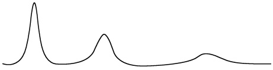
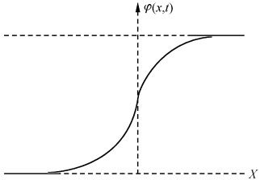

# 15-第十五章 非线性方程

[返回全书目录](../../README.md)

> PDF 页码：300–318

<!-- page: 300 -->

现代科学技术的发展，使人们必须改变科学研究的方法。自20世纪60年代以来，非线性科学飞跃发展，在数学物理问题中以非线性方程——KdV（Korteweg-de Vries）方程为中心所展开的关于所谓孤立子（soliton）的研究，显得十分活跃，孤立子效应在浅水波、基本粒子、激光物理以及等离子体物理等方面的研究中，已引起了广泛的注意。所以，引入本章以了解有关非线性方程的知识很有必要。

所谓非线性方程一般是指，含有未知函数和未知函数的导数的高次项的方程。非线性方程是一个广阔的领域，它和线性方程在其性质上有着很大的差异。如，对于线性方程而言解的唯一性、单值性、有限性等性质，对于某些非线性方程均可能不复存在，线性叠加原理失效。正因为如此，对非线性方程不存在一般理论和求解方法，常常是对于不同的具体问题采用不同的手段，且能求得其解析解的方程屈指可数，必须谨慎处理。常用于求解非线性方程的方法有反散射法、达布（Darboux）变换、巴克朗德（Backlund）变换等等。其中反散射法可用于求解一大类的非线性偏微分方程，但由于受篇幅和教材性质的限制本书不可能一一展开讨论。本章将仅对非线性方程的某些初等解法作简单的介绍，并以物理问题中的几个典型的非线性方程为例概略地讨论有关孤立波的问题。

### 15.1 非线性方程的某些初等解法

本节将通过对几个特例的讨论，来介绍非线性方程的某些初等解法。这些解法的指导思想是寻找、选择某一种适当的变换，使方程化为线性方程或易于求解的方程。这些特例的解法和结果，对于我们解决物理学中的一些具体问题是十分有用的。

## 1. 基尔霍夫(Kirchhoff)变换

对于方程

$$  \nabla\bullet\left[G(u)\;\nabla u\right]=0   \tag*{(15.1.1)}$$

为了使之线性化，我们试探选择函数

$$  w=w(u)   \tag*{（15.1.2）}$$

使

$$  \nabla\mathcal{w}=G(u)\;\nabla u   \tag*{（15.1.3）}$$

<!-- page: 301 -->

则由(15.1.2)式有

 $$ \nabla\mathcal{w}=\frac{\mathrm{d}\mathcal{w}}{\mathrm{d}u}\nabla u $$ 

将之与(15.1.3)式对比，易于看出w应满足

 $$ \frac{\mathrm{d}w}{\mathrm{d}u}=G(u) $$ 

即

$$  \mathcal{w}=\int_{u_{0}}^{u}G(\zeta)\mathrm{d}\zeta,\quad u_{0} 为常数   \tag*{(15.1.4)}$$

这样，方程(15.1.1)就化为了我们熟知的线性拉普拉斯方程.

 $$ \Delta w=0 $$ 

变换(15.1.4)式称为基尔霍夫变换. 显然，当方程(15.1.1)带有边界条件时，还必须对边界条件作相应变换.

## 2. 柯勒-霍普夫(Cole-Hopf)变换

方程

$$  u_{t}+u u_{x}=\delta u_{x x}   \tag*{（15.1.5）}$$

是某些研究工作中所用到的非线性耗散方程——著名的伯格斯(Burgers)方程，其中 $ \delta $是扩散系数(正实数).如果没有左边的第二项，(15.1.5)则是一线性的扩散方程.故我们试图将之变为这种线性方程来求解.

方程(15.1.5)又可写为

$$  \frac{\partial u}{\partial t}=\frac{\partial}{\partial x}\Big(\partial u_{x}-\frac{u^{2}}{2}\Big)   \tag*{（15.1.6）}$$

于是，由全微分方程存在的充要条件 $ ^{①} $有

 $$ \mathrm{d}\psi=u\mathrm{d}x+\left(\delta u_{x}-\frac{u^{2}}{2}\right)\mathrm{d}t $$ 

显然  $ \phi(x,t) $ 满足下列关系：

 $$ \psi_{x}=u $$ 

$$  \phi_{t}=\partial u_{x}-\frac{u^{2}}{2}   \tag*{（15.1.8）}$$

由（15.1.7）式和（15.1.8）式得

$$  \phi_{t}+\frac{1}{2}\psi_{x}^{2}=\delta\phi_{x x}   \tag*{（15.1.9）}$$

故求解伯格斯方程(15.1.5)的问题就转化为了求解方程(15.1.9)的问题.为了寻求方程(15.1.9)与易于求解的线性扩散方程

$$  v_{t}=\partial v_{x x}   \tag*{（15.1.10）}$$

之间的关系，令

$$  v=g(\psi)   \tag*{（15.1.11）}$$

代入(15.1.10)式，于是有

$$  \psi_{t}-\delta\frac{g^{^{\prime \prime}}(\psi)}{g^{^{\prime}}(\psi)}\psi_{x}^{2}=\delta\psi_{x x}   \tag*{（15.1.12）}$$

<!-- page: 302 -->

对比(15.1.9)式和(15.1.12)式知 $ g(\phi) $需满足方程

 $$ -\delta\frac{g^{^{\prime \prime}}(\phi)}{g^{^{\prime}}(\phi)}=\frac{1}{2} $$ 

积分得

 $$ g(\psi)=c_{1}\mathrm{e}^{-\frac{1}{2\delta}\psi}+c_{2} $$ 

取  $ c_{1}=1, c_{2}=0 $ 并将  $ g(\psi) $ 代入 (15.1.11) 式得

 $$ v=g(\psi)=\mathrm{e}^{-\frac{1}{2\delta}\psi} $$ 

即

 $$ \psi=-2\delta\mathrm{l n}v $$ 

代入15.1.7式得

$$  u(x,t)=-2\delta\frac{\partial\ln v}{\partial x}   \tag*{（15.1.13）}$$

变换(15.1.13)式称为柯勒-霍普夫变换. 在处理非线性问题时，常常会用到这种变换. 由此已看到，选取柯勒-霍普夫变换后，求解非线性方程(15.1.5)式的问题便转化为了求解线性方程(15.1.10)式的问题.

对于高维方程及方程组

$$  \frac{\partial u_{i}}{\partial t}+\sum_{j=1}^{3}u_{j}\frac{\partial u_{i}}{\partial x_{j}}=\delta\Delta u_{i},\quad i=1,2,3   \tag*{（15.1.14）}$$

类似地，可作变换

$$  u=-2\delta\nabla\ln v   \tag*{（15.1.15）}$$

则求解 $  (15.1.14)  $式便转化为了求解线性方程

$$  v_{i}=\delta\Delta v   \tag*{（15.1.16）}$$

## 3. 相似变换

对于广义热传导方程

$$  \frac{\partial u}{\partial t}=\frac{\partial}{\partial x}\Big[G(u)\frac{\partial u}{\partial x}\Big]   \tag*{（15.1.17）}$$

为了使之便于求解，我们试图使之变为关于某一新的变量如  $ \xi $ 的常微分方程。为此，作变换

$$  \left\{\begin{aligned}u&=u(\xi)\\ \xi&=x^{\alpha}t^{\beta}\end{aligned}\right.   \tag*{（15.1.18）}$$

其中  $ \alpha $ 和  $ \beta $ 为待定常数. 此时

 $$ \frac{\partial u}{\partial t}=\beta x^{\alpha}t^{\beta-1}\frac{\mathrm{d}u}{\mathrm{d}\xi} $$ 

 $$ \frac{\partial u}{\partial x}=\alpha x^{\alpha-1}t^{\beta}\frac{\mathrm{d}u}{\mathrm{d}\xi} $$ 

 $$ \begin{array}{r}{\frac{\partial}{\partial x}\Big[G(u)\frac{\partial u}{\partial x}\Big]=\alpha(\alpha-1)x^{\alpha-2}t^{\beta}G(u)\frac{\mathrm{d}u}{\mathrm{d}\xi}+\alpha^{2}x^{2(\alpha-1)}t^{2\beta}\frac{\mathrm{d}}{\mathrm{d}\xi}\Big[G(u)\frac{\mathrm{d}u}{\mathrm{d}\xi}\Big]}\end{array} $$

<!-- page: 303 -->

代入方程(15.1.17)，于是得

$$  \beta\frac{x^{2}}{t}\xi\frac{\mathrm{d}u}{\mathrm{d}\xi}=\alpha(\alpha-1)\xi G(u)\frac{\mathrm{d}u}{\mathrm{d}\xi}+\alpha^{2}\xi^{2}\frac{\mathrm{d}}{\mathrm{d}\xi}\Big[G(u)\frac{\mathrm{d}u}{\mathrm{d}\xi}\Big]   \tag*{（15.1.20）}$$

为使方程(15.1.20)变为只含变量 $ \xi $（不显含x和t）的常微分方程，显而易见只需令

$$  \frac{x^{2}}{t}=g(\xi)   \tag*{(15.1.21)}$$

即可. 其中  $ g(\xi) $ 为  $ \xi $ 的任意函数, 适当选取  $ g(\xi) $ 的形式, 可使方程 (15.1.20) 变为形式简洁易于求解的常微分方程. 比如取

 $$ \begin{aligned}&g(\xi)=\xi^{2}\\ &\xi=x/\sqrt{t}\\ \end{aligned} $$ 

即

这意味着(15.1.19)式中 $ \alpha=1,\beta=-\frac{1}{2} $.于是方程(15.1.20)亦即方程(15.1.17)变为

$$  \frac{\mathrm{d}}{\mathrm{d}\xi}\Big[G(u)\frac{\mathrm{d}u}{\mathrm{d}\xi}\Big]+\frac{\xi}{2}\frac{\mathrm{d}u}{\mathrm{d}\xi}=0   \tag*{（15.1.23）}$$

这是一易于求解的常微分方程。由变换(15.1.18)和(15.1.19)式所构成的解称为自型解，其中变换(15.1.19)式称为相似变换，而变换(15.1.22)称为玻尔兹曼(Boltzmann)变换。

## 4. 行波解

方程

$$  \frac{\partial u}{\partial t}=\frac{\partial}{\partial x}\Big[u^{n}\;\frac{\partial u}{\partial x}\Big]   \tag*{(15.1.24)}$$

是方程(15.1.17)当 $ G(u)=u^{n} $的特例，故我们当然可通过引入相似变换而求得其自型解.对于这种特例，我们也可采取下述解法：

令

其中a为常数.则

 $$ \begin{aligned}&\left\{\begin{aligned}u&=g(\hat{\xi})\\\dot{\xi}&=x+at\end{aligned}\right.\\ &\quad\frac{\partial u}{\partial t}=a\frac{\mathrm{d}g}{\mathrm{d}\xi}\\ &\quad\frac{\partial u}{\partial x}=\frac{\mathrm{d}g}{\mathrm{d}\hat{\xi}}\\ \end{aligned} $$ 

代入(15.1.24)式于是得未知函数  $ g(\xi) $ 的常微分方程

 $$ a\frac{\mathrm{d}g}{\mathrm{d}\xi}=\frac{\mathrm{d}}{\mathrm{d}\xi}\Big(g^{n}\frac{\mathrm{d}g}{\mathrm{d}\xi}\Big) $$ 

通过积分两次得

$$  u=g(\xi)=\{n[a(x+at)+c]\}^{\frac{1}{n}}   \tag*{（15.1.26）}$$

其中 c 为积分常数. 变换(15.1.25)称为行波解.

<!-- page: 304 -->

自型解和行波解对许多方程都是可以尝试的，例如对于下节将要讨论的正弦戈登方程

 $$ \varphi_{xx}-\varphi_{t}=\sin\varphi $$ 

我们亦可用行波解(15.1.25)式尝试求得其解.

## 5. 端迹变换

在流体力学等物理问题中，常常会碰到如下形式的拟线性方程 $ ^{②} $组

$$  \left\{\begin{aligned}u_{1}&\frac{\partial F}{\partial x}+u_{2}\frac{\partial F}{\partial y}+u_{3}\frac{\partial E}{\partial x}+u_{4}\frac{\partial E}{\partial y}=0\\ v_{1}&\frac{\partial F}{\partial x}+v_{2}\frac{\partial F}{\partial y}+v_{3}\frac{\partial E}{\partial x}+v_{4}\frac{\partial E}{\partial y}=0\end{aligned}\right.   \tag*{（15.1.27）}$$

其中  $ u_{i}, v_{i} (i=1,2,3,4) $ 仅仅是 F 和 E 的函数。显然，方程组 (15.1.27) 是关于未知函数  $ F(x, y) $ 和  $ E(x, y) $ 的非线性方程组。若雅可比 (Jacobi) 行列式

 $$ J\equiv\frac{\partial(F,E)}{\partial(x,y)}=F_{x}E_{y}-E_{x}F_{y}\neq0 $$ 

则可引入变换

$$  \left\{\begin{aligned}x&=x(F,E)\\ y&=y(F,E)\end{aligned}\right.   \tag*{（15.1.28）}$$

将方程组(15.1.27)化为未知函数  $ x(F,E) $ 和  $ y(F,E) $ 的方程组. 将会看到此方程组是线性齐次的. 将(15.1.28)式中的两式分别对 x 求导得

$$  \left\{\begin{aligned}1&=x_{F}F_{x}+x_{E}E_{x}\\ 0&=y_{F}F_{x}+y_{E}E_{x}\end{aligned}\right.   \tag*{（15.1.29）}$$

解此关于  $ F_{x} $ 和  $ E_{x} $ 的二元方程组得

$$  \left\{\begin{aligned}F_{x}&=\frac{y_{E}}{x_{F}y_{E}-x_{E}y_{F}}=\frac{y_{E}}{j}=Jy_{E}\\ E_{x}&=-Jy_{F}\end{aligned}\right.   \tag*{（15.1.30）}$$

其中

 $$ j=\frac{\partial(x,y)}{\partial(F,E)}=J^{-1}\neq0 $$ 

将（15.1.28）式中的两式分别对 y 求导，类似地可求得

$$  \left\{\begin{aligned}F_{y}=&-Jx_{E}\\ E_{y}=&Jx_{F}\end{aligned}\right.   \tag*{（15.1.31）}$$

将（15.1.30）式和（15.1.31）式代入（15.1.27）式于是得

$$  \left\{\begin{aligned}u_{1}\frac{\partial y}{\partial E}-u_{2}\frac{\partial x}{\partial E}-u_{3}\frac{\partial y}{\partial F}+u_{4}\frac{\partial x}{\partial F}&=0\\ v_{1}\frac{\partial y}{\partial E}-v_{2}\frac{\partial x}{\partial E}-v_{3}\frac{\partial y}{\partial F}+v_{4}\frac{\partial x}{\partial F}&=0\end{aligned}\right.   \tag*{（15.1.32）}$$

<!-- page: 305 -->

注意到  $ u_{i}, v_{i} (i=1,2,3,4) $ 只是 F 和 E 的函数（不是 x 和 y 的函数），所以此方程组当然是线性的.

变换(15.1.28)称为端迹变换，在流体力学中，它代表速度向量在 x-y 平面上的端点的轨迹.

注 ① 对于方程

$$  P(x,y)\mathrm{d}x+Q(x,y)\mathrm{d}y=0   \tag*{(1)}$$

若有

 $$ \mathrm{d}u=P(x,y)\mathrm{d}x+Q(x,y)\mathrm{d}y $$ 

则(1)式称为全微分方程.(1)式为全微分方程的充要条件是

$$  \frac{\partial P}{\partial y}=\frac{\partial Q}{\partial x}   \tag*{(2)}$$

②对于 m 阶的微分方程，若仅关于 m 阶的导数是线性的，而最高阶（m 阶）导数的系数为未知函数及其低阶导数的函数，则称该方程为 m 阶拟线性方程.

#### 习题15.1

1. 求解边值问题

 $$ \left\{\begin{aligned}\nabla\bullet\left[\sin u\nabla u\right]=0,\quad&y>0;-\infty<x<\infty\\ u\mid_{y=0}=x\end{aligned}\right. $$ 

2. 求方程  $ u_{t}=u_{xx}+u_{yy} $ 的自型解.

3. 求下述方程的广义行波解  $ u = f(\xi) $ :

(1)  $ u_{y}u_{xy} - u_{x}u_{yy} = 0, \xi = y + \varphi(x) $;

 $$ u_{t}+\frac{1}{2}(u_{x}^{2}+u_{y}^{2})=\lambda(u_{x x}+u_{y y}),\xi=t+g(x)+h(y). $$ 

其中  $ \varphi(x) $， $ g(x) $ 和  $ h(y) $ 为待定函数.

4. 求伯格斯方程的初值问题

 $$ \left\{\begin{aligned}u_{t}+u u_{x}&=\lambda u_{x x},-\infty<x<\infty,t>0\\ u(x,0)&=f(x)\end{aligned}\right. $$ 

5. 求解方程组

 $$ \left\{\begin{aligned}\frac{\partial V}{\partial x}+&\left[\frac{1}{C}+\frac{P E}{(E^{2}+V^{2})^{3/2}}\right]\frac{\partial V}{\partial t}=\frac{P V}{(E^{2}+V^{2})^{3/2}}\frac{\partial E}{\partial t}\\ \frac{\partial E}{\partial x}+&\left[\frac{1}{C}+\frac{P E}{(E^{2}+V^{2})^{3/2}}\right]\frac{\partial E}{\partial t}=-\frac{P V}{(E^{2}+V^{2})^{3/2}}\frac{\partial V}{\partial t}\end{aligned}\right. $$ 

### 15.2 孤波和孤子

## 1. KdV 方程

KdV 方程是孤波问题的模型. 所谓孤波 (solitary waves) 是指一种单峰行进的波, 它以常速传播且在传播过程中波形保持不变. 孤波最早是在 1834 年由苏格兰的科学家斯柯特·罗素 (Scott Russel) 在他沿着河边骑马追踪一个水波 $ ^{①} $ 时所看到的.

<!-- page: 306 -->

直至 1895 年荷兰的两个科学家柯特维格（Kortweg）和德弗里斯（de Vries）才导出了在一个浅水沟表面上按一个方向传播的波的运动方程。它的具体形式是

$$  \frac{\partial\eta}{\partial t}=\sqrt{\frac{3}{2}}\sqrt{\frac{g}{l}}\frac{\partial}{\partial x}\Big(\frac{2}{3}\alpha\eta+\frac{1}{2}\eta^{2}+\frac{1}{3}\sigma\frac{\partial^{2}\eta}{\partial x^{2}}\Big)   \tag*{（15.2.1）}$$

其中  $ \sigma=l^{3}/3-T l/\rho g $ 是一个任意常数，l 是沟道的深度，T 是表面张力， $ \rho $ 是流体密度。这就是著名的 KdV 方程。为了使它的形式更为简捷，我们取

 $$ \eta=8\alpha u,\quad\xi=\left(\frac{2\alpha}{\sigma}\right)^{1/2}x,\quad\tau=\left(\frac{2\alpha^{3}g}{\sigma l}\right)^{1/2}t $$ 

于是得到

$$  u_{\tau}+u_{\xi}+12u u_{\xi}+u_{\xi\xi\xi}=0   \tag*{（15.2.2）}$$

这就是常见形式的 KdV 方程。它现在在等离子体物理学、低温物理学和光学等领域中都有着广泛的应用。

为了寻找一个类似于斯柯特·罗素所观察到的孤波，我们必须求方程(15.2.2)的一个永久型的行波解.为此，作变换

$$  \left\{\begin{aligned}u&=u(\theta)\\ \theta&=a\xi-\omega\pi+\delta\end{aligned}\right.   \tag*{(15.2.3)}$$

其中 a 和  $ \delta $ 均为常数， $ \delta $ 是相位因子，且当  $ |\theta| \rightarrow \infty $ 时，要求 u 和它的各阶导数均趋于零，因为孤波要求一种渐近稳定性。将 (15.2.3) 式代入 (15.2.2) 式且为简单见取  $ \omega = a + a^{3} $ 得

 $$ u_{\theta\theta\theta}+\frac{12}{a^{2}}u u_{\theta}-u_{\theta}=0 $$ 

两边对变量 $ \theta $积分得

 $$ u_{\theta\theta}+\frac{6}{a^{2}}u^{2}-u+c_{1}=0 $$ 

用 $ u_{\theta} $乘上式再对 $ \theta $积分得

 $$ \frac{1}{2}u_{\theta}^{2}+\frac{2}{a^{2}}u^{3}-\frac{1}{2}u^{2}+c_{1}u+c_{2}=0 $$ 

由渐近稳定性立即可确定积分常数  $ c_{1}=c_{2}=0 $ ，于是得

 $$ u^{2}_{\theta}=u^{2}\Big(1-\frac{4}{a^{2}}u\Big) $$ 

即

 $$ \frac{a\mathrm{d}u}{u\ \sqrt{a^{2}-4u}}=\mathrm{d}\theta $$ 

两边积分，取积分常数为0并设a>0得

 $$ \theta=\ln\frac{a-\sqrt{a^{2}-4u}}{a+\sqrt{a^{2}-4u}} $$ 

于是

 $$ \mathrm{e}^{\theta}=\frac{a^{2}-2u-a\ \sqrt{a^{2}-4u}}{2u} $$

<!-- page: 307 -->

即

 $$ 2u(e^{\theta}+1)-a^{2}=-a\sqrt{a^{2}-4u} $$ 

两边平方并移项整理得

 $$ 4u^{2}(\mathrm{e}^{\theta}+1)^{2}-4a^{2}u\mathrm{e}^{\theta}=0 $$ 

所以

$$  \begin{aligned}u&=\frac{a^{2}\mathrm{e}^{\theta}}{(\mathrm{e}^{\theta}+1)^{2}}=\frac{a^{2}}{\mathrm{e}^{\theta}+2+\mathrm{e}^{-\theta}}\\&=\frac{a^{2}}{(\mathrm{e}^{\frac{\theta}{2}}+\mathrm{e}^{-\frac{\theta}{2}})^{2}}=\frac{1}{4}a^{2}\mathrm{sech}^{2}\frac{\theta}{2}\\&=\frac{1}{4}a^{2}\mathrm{sech}^{2}\frac{1}{2}[a\xi-(a+a^{3})\tau+\delta]\\&=\frac{1}{4}a^{2}\mathrm{sech}^{2}\frac{a}{2}\Big[\xi-(1+a^{2})\tau+\frac{\delta}{a}\Big]\\ \end{aligned}   \tag*{(15.2.4)}$$

这完全像斯柯特·罗素所观察到的孤波。其图形如图15.1所示。它是一个仅仅在小范围内向上凸的曲线。当 $ \tau $改变时该曲线以常速 $ 1+a^{2} $向右运动，且其形状保持不变，称为孤立子（soliton）。由于速度 $ 1+a^{2} $依赖于振幅，因此一个峰较高的波比一个峰较低的波运动得快些。由图15.1和（15.2.4）式还可看出，其速率大的波波宽反而小。

图15.1
 

1965 年萨布斯基(Zabusky)和克鲁斯卡尔(Kruskal)发现，当两个或更多的 KdV 孤波相碰撞时，它们不受干涉破坏，不消失，萨布斯基和克鲁斯卡尔把它们称为孤子(soliton). 这个词的英语的最后两个字母“on”，是希腊语的“粒子”的意思，所以孤子这个词生动地描绘了这些孤波的类粒子行径.

## 2. 正弦戈登(Gordon)方程

在场论中最早的模型之一是线性克莱因(Klein)-戈登方程

$$  \varphi_{x x}-\varphi_{t t}=m^{2}\varphi   \tag*{（15.2.5）}$$

1958年 Skyrme 提出了一个非线性场理论，得到了非线性的场方程

$$  \varphi_{xx}-\varphi_{t}=\sin\varphi   \tag*{（15.2.6）}$$

这就是著名的正弦戈登(SG)方程. 该方程现已在超导光脉冲、超导性及非线性量子力学等方面有着广泛的应用.

为了解此方程，先作坐标变换

 $$ \xi=\frac{x-t}{2},\quad\tau=\frac{x+t}{2} $$

<!-- page: 308 -->

则(15.2.6)式变为

$$  \varphi_{\hat{\tau}\tau}=\sin\varphi   \tag*{（15.2.7）}$$

继而取（15.2.7）式的两个独立解为

$$  \varphi=u+v,\quad\bar{\varphi}=u-v   \tag*{（15.2.8）}$$

并考虑一对以变量  $  u(\xi, \tau)  $ 和  $  v(\xi, \tau)  $ 表示的方程

$$  \left\{\begin{aligned}u_{\xi}&=f(v)\\ v_{\tau}&=g(u)\end{aligned}\right.   \tag*{（15.2.9）}$$

其中  $ f(v) $ 和  $ g(u) $ 的形式，可通过将方程（15.2.9）分离为分别只含未知量 u 和 v 的方程来确定。将上述两方程分别对  $ \tau $ 和  $ \xi $ 求导得

$$  \left\{\begin{aligned}u_{\xi\tau}&=g(u)f^{\prime}(v)\\ v_{\xi\tau}&=g^{\prime}(u)f(v)\end{aligned}\right.   \tag*{（15.2.10）}$$

为了使得变量 u 和 v 分离，我们将上述两方程相加和相减，于是得到

$$  \left\{\begin{aligned}(u+v)_{\hat{\tau}\tau}&=g(u)f^{\prime}(v)+g^{\prime}(u)f(v)\\ (u-v)_{\hat{\tau}\tau}&=g(u)f^{\prime}(v)-g^{\prime}(u)f(v)\end{aligned}\right.   \tag*{（15.2.11）}$$

由于 $ \varphi $和 $ \bar{\varphi} $是方程(15.2.7)的两个独立解，故有

$$  \left\{\begin{aligned}\sin(u+v)&=g(u)f^{\prime}(v)+g^{\prime}(u)f(v)\\ \sin(u-v)&=g(u)f^{\prime}(v)-g^{\prime}(u)f(v)\end{aligned}\right.   \tag*{（15.2.12）}$$

将此二式相加得

 $$ g(u)f^{\prime}(v)=\sin\mathrm{u}\cos v $$ 

分离变量得

 $$ \frac{g(u)}{\sin u}=\frac{\cos v}{f^{\prime}(v)}=\alpha $$ 

于是得

$$  g(u)=\alpha sin u   \tag*{（15.2.13）}$$

其中  $ \alpha $ 为任意常数. 类似的将(15.2.12)式中的两式相减并分离变量得

 $$ \frac{f(v)}{\sin v}=\frac{\cos u}{g^{^{\prime}}(u)}=\beta $$ 

于是得

$$  f(v)=\beta\mathrm{s i n}v=\frac{1}{\alpha}\mathrm{s i n}v   \tag*{（15.2.14）}$$

因为  $ u=\frac{1}{2}(\varphi+\bar{\varphi}) $， $ v=\frac{1}{2}(\varphi-\bar{\varphi}) $，于是现在(15.2.9)式中的两式变为

$$  \left\{\begin{aligned}&\frac{1}{2}(\varphi+\bar{\varphi})_{\xi}=\frac{1}{\alpha}\sin\frac{1}{2}(\varphi-\bar{\varphi})\\ &\frac{1}{2}(\varphi-\bar{\varphi})_{\tau}=\alpha\sin\frac{1}{2}(\varphi+\bar{\varphi})\end{aligned}\right.   \tag*{（15.2.15）}$$

这是正弦戈登方程的巴克朗德变换. 它们是一对与正弦戈登方程(15.2.7)的两个特解 $ \varphi $和 $ \bar{\varphi} $相关的方程. 显然, 若(15.2.7)有某一特解 $ \bar{\varphi} $, 则代入巴克朗德变换

<!-- page: 309 -->

(15.2.29)式后所求得的 $ \varphi $也是方程(15.2.7)的特解.易于看出 $ \bar{\varphi}=0 $就是(15.2.7)式的一特解，将之代入(15.2.15)式得

$$  \varphi_{\xi}=2\frac{1}{\alpha}\sin\frac{\varphi}{2}   \tag*{(15.2.16)}$$

$$  \varphi_{\tau}=2\alpha\sin\frac{\varphi}{2}   \tag*{(15.2.17)}$$

解方程（15.2.16）得

$$  \varphi=4\arctan\left\{\exp\left[\frac{1}{\alpha}\xi+c(\tau)\right]\right\}   \tag*{（15.2.18）}$$

将（15.2.18）式代入（15.2.17）式便可确定对变量  $ \xi $ 而言的积分常数为

 $$ c(\tau)=\alpha\tau+\delta $$ 

其中 $ \delta $为常数，于是得方程(15.2.7)的一个特解为

$$  \varphi=4arctan\Big[\exp\Big(\frac{1}{\alpha}\xi+\alpha\tau+\delta\Big)\Big]   \tag*{(15.2.19)}$$

变回原来的变量 $ (x,t) $，得正弦戈登方程（15.2.5）的一个特解为

$$  \varphi=4arctan\mathrm{exp}[a(x-bt)+\delta]   \tag*{（15.2.20）}$$

其中

 $$ a=\frac{\alpha^{2}+1}{2\alpha},\quad b=\frac{1-\alpha^{2}}{\alpha^{2}+1} $$ 

这个解已被命名为一个“扭结”，因为它表示出函数  $ \varphi $ 的一个扭弯。图15.2画出了  $ \varphi(x,t) $ 随 x 的变化图。将(15.2.19)式分别对  $ \xi $ 和  $ \tau $ 求导可得

图15.2
 

$$  \varphi_{\xi}=4\frac{1}{\alpha}\mathrm{s e c h}\big[a(x-b t)+\delta\big]   \tag*{(15.2.21)}$$

$$  \varphi_{\tau}=4\alpha\mathrm{s e c h}\big[a(x-b t)+\delta\big]   \tag*{（15.2.22）}$$

是孤波解，在此不详细论证。都是孤波，由此易于推想正弦戈登方程的解亦

## 3. 非线性薛定谔方程

随着等离子体物理和非线性光学的物理进展产生了如下的非线性方程：

$$  \mathrm{i}\varphi_{t}+\varphi_{x x}+\beta\varphi\mid\varphi\mid^{2}=0   \tag*{（15.2.23）}$$

由于它具有一个作为势  $ \beta|\varphi|^2 $ 的量子薛定谔方程的结构，故人们称之为非线性薛定谔(NLS)方程。该方程现已用于近代量子力学、超导性、激光等方面。其中  $ \varphi $ 是一个复函数，正因为如此，我们期望求一个具有振荡调制的渐近稳定的行波解。为此，令

$$  \begin{cases}\varphi=\mathrm{e}^{\mathrm{i}(kx-vt)}u(\theta)\\\theta=x-bt\end{cases}   \tag*{（15.2.24）}$$

<!-- page: 310 -->

其中 k, v 都是待定常数. 将(15.2.24)式代入(15.2.23)式得

取

 $$ \begin{align*}u_{\varnothing}+\mathrm{i}(2k-b)u_{\varnothing}+(v-k^{2})u+\beta u^{3}&=0\\k=\frac{b}{2},\quad v=\frac{b^{2}}{4}-a^{2}\end{align*} $$ 

则上述方程化为

$$  u_{\varnothing}-a^{2}u+\beta u^{3}=0   \tag*{（15.2.25）}$$

两边乘以  $ u_{\theta} $ 再积分得

 $$ u_{\theta}^{2}=c+a^{2}u^{2}-\frac{\beta}{2}u^{4} $$ 

注意到当 $ \left|x\right|\rightarrow\infty $时 $ \varphi $及各阶导数趋于零的条件，故有积分常数c=0.于是

 $$ \frac{\mathrm{d}u}{u\sqrt{a^{2}-\frac{\beta}{2}u^{2}}}=\mathrm{d}\theta $$ 

两边积分并取积分常数为零得

 $$ \theta=-\frac{1}{a}\ln\frac{a+\sqrt{a^{2}-\frac{\beta}{2}u^{2}}}{\sqrt{\frac{\beta}{2}}u} $$ 

类似于前面(15.2.4)式导出的过程，立即可得

$$  u(\theta)=a\sqrt{\frac{2}{\beta}}sech a\theta   \tag*{（15.2.26）}$$

代入(15.2.24)可得非线性薛定谔方程的解为

$$  \varphi(x,t)=a\sqrt{\frac{2}{\beta}}\exp\left\{i\left[\frac{1}{2}b x-\left(\frac{1}{4}b^{2}-a^{2}\right)t\right]\right\}\mathrm{s e c h}\big[a(x-b t)\big]   \tag*{（15.2.27）}$$

其中 a 和 b 为任意常数. 这是一个广义孤波解.

注 ① 斯柯特的叙述为：“我正在观察一条船的运动，这条船被两匹马拉着，沿着狭窄的河道迅速前进，船突然停了，河道内被船体扰动的水团却没有停下来，而是以剧烈受激的状态聚集在船头周围，然后形成了一个巨大的圆而光滑的孤立水峰，突然离开船头以极大速度向前推进，这水峰约有30英尺（1英尺=0.3048米）长，1~1.5英尺高，在河道中行进时一直保持着起初的形状，速度也未见减慢，我骑着马紧紧跟着，发觉它以每小时8～9英里（1英里=1609.344米）的速度前进。后来波的高度渐渐减小，过了1～2英里之后，终于消失在蜿蜒的河道中。这就是我在1834年8月第一次偶然发现这奇异而美妙的现象的经过……”

#### 习题15.2

1. 粒子物理中所谓的  $ \varphi^{4} $ 方程为

 $$ \varphi_{x x}-\varphi_{u}=\lambda\varphi^{3}-m^{2}\varphi,\quad\lambda>0 $$ 

试求出它的一个行波解

<!-- page: 311 -->

$$ \varphi=\pm\tanh\biggl[\frac{1}{\sqrt{2}}\frac{1}{\sqrt{1-v^{2}}}(x-v t)+\delta\biggr] $$ 

2. 非线性光学中的麦克斯韦-布洛赫(Maxwell-Bloch)方程组为

 $$ \left\{\begin{aligned}&E_{x x}-E_{u}=-a P_{t}\\ &P_{u}+\mu^{2}P=(E N)_{t}\\ &N_{t}=-E P\end{aligned}\right. $$ 

试在边界条件：“ $ \left|x\right|\rightarrow\infty $时E，P $ \rightarrow $0；N $ \rightarrow $-1”下，求出其孤波解

 $$ E=a\mathrm{sech}\frac{1}{2}(at-\omega x+\delta) $$ 

 $$ \omega^{2}=a^{2}+\frac{2a^{2}}{\frac{a^{2}}{4}+\mu^{2}} $$ 

## 3. 方程

 $$ \varphi_{\xi\tau}=\varphi-\varphi^{3}/6 $$ 

是在特征坐标中的一种截断正弦戈登方程. 取  $ \varphi=g/f $, 证明该方程能简化为 g 和 f 的二阶齐次方程

 $$ \left\{\begin{aligned}&g^{2}=2(ff_{\xi\tau}-f_{\xi}f_{\tau})\\ &fg_{\xi\tau}+gf_{\xi\tau}-g_{\xi}f_{\tau}-g_{\tau}f_{\xi}=gf\end{aligned}\right. $$ 

用一个小参量 $ \varepsilon $展开g和f

 $$ \left\{\begin{aligned}g&=\sum_{n=0}^{\infty}\varepsilon^{2n+1}g^{(2n+1)}\\ f&=1+\sum_{n=1}^{\infty}\varepsilon^{2n}f^{(2n)}\end{aligned}\right. $$ 

证明，能求出其一个1参量的精确解为

 $$ \begin{cases}g=2\sqrt{2}\exp\theta_{1}\\f=1+\exp2\theta_{1}\\\theta=a_{i}\xi+\tau/a_{i}+\delta_{i}\end{cases} $$ 

4. 试用行波解（15.1.25）尝试，再次求解正弦戈登方程（15.2.6）.

### 15.3 解析近似法之正则摄动法

由于大多数非线性方程无法求得其解析解（即精确解），因而我们不得不借助于解析近似法来求其近似解析解（即近似解的解析表达式）。在上一章中，我们已介绍了求解方程近似解析解的变分法，本节将介绍另一种求非线性方程近似解析解的正则摄动法。

## 1. 摄动法

摄动法的解题思想是：如果非线性方程的非线性项是高阶小量，作为初步近似，可将其略去，从而非线性问题便化为了线性问题；求解该线性问题，并将所得的解作为非线性问题的零级近似；再把原非线性定解问题的解看作它的零级近似解与一个待求的含有小参量的解（即摄动解）的和，代入原定解问题，略去更高阶小

<!-- page: 312 -->

量，得到关于摄动解的线性定解问题；求解该线性问题并将求得的解作为原定解问题的高一级的近似——一级近似；仿此步骤进行下去便可得到各级近似。这种求近似解析解的方法被称为摄动法或小参数法，而以上这种带有小参量的定解问题被称为摄动问题。

摄动问题用数学式子可表示为

$$  P_{\varepsilon}:\quad\left\{\begin{aligned}&L_{\varepsilon}u=f(x,\varepsilon),x\in\sigma\\ &B_{j\varepsilon}u=\varphi_{j}(x,\varepsilon),x\in\Gamma,j=1,2,\cdots,k\end{aligned}\right.   \tag*{(15.3.1)}$$

其中  $ 0<\varepsilon\ll1 $， $ L_{\varepsilon} $ 和  $ B_{je} $ 分别为区域  $ \sigma $ 上和  $ \sigma $ 的边界或部分边界  $ \Gamma $ 上的非线性微分算子，下标上的  $ \varepsilon $ 表示算子与  $ \varepsilon $ 有关。由摄动法的思想可看出，用摄动法研究问题，首先需构造一解的小参量展开式使序列  $ \{g_{n}(\varepsilon)\} $ 满足

$$  \begin{align*}\lim_{n\to\infty}g_{n}(\varepsilon)&=0,\quad\lim_{\varepsilon\to0}\frac{g_{n+1}(\varepsilon)}{g_{n}(\varepsilon)}=0\\u(x,\varepsilon)&=u_{0}(x)+\sum_{n=1}^{N} g_{n}(\varepsilon)u_{n}(x)+R_{N}(x,\varepsilon)\end{align*}   \tag*{（15.3.2）}$$

其中  $ u_{0} $ 为零级近似， $ R_{N} $ 为余项。其次应讨论余项的值。

若

$$  R_{N}(x,\varepsilon)=O(g_{N+1}(\varepsilon))   \tag*{（15.3.3）}$$

则在摄动理论中称

$$  u_{0}(x)+\sum_{n=1}^{\infty}g_{n}(\varepsilon)u_{n}(x)   \tag*{(15.3.4)}$$

为（15.3.1）式的一致有效近似解.

## 2. 正则摄动法

下面，我们将从一个具体的例子来介绍正则摄动法的解题步骤。

例 试在单位圆内求解定解问题

$$  \left\{\begin{aligned}&\Delta u+\varepsilon\frac{\partial u}{\partial\rho}\frac{\partial u}{\partial\varphi}=0,\quad\rho<1;0<\varepsilon\leqslant1\\ &u(\rho,\varphi)\mid_{p=1}=\cos\varphi\end{aligned}\right.   \tag*{（15.3.5）}$$

解 这是一含有小参量的非线性问题. 当  $ \varepsilon=0 $ 时, 显然, (15.3.5) 式变为了线性定解问题

$$  \left\{\begin{aligned}&\Delta u=0,\quad\rho<1\\ &u(1,\varphi)=\cos\varphi\end{aligned}\right.   \tag*{（15.3.6）}$$

由分离变量法立即可以求得其解，视为零级近似，并记作  $ u_{0} $，即

$$  u_{0}=\rho\mathrm{{c o s}}\varphi   \tag*{（15.3.7）}$$

又设

$$  u=u_{0}+\varepsilon u_{1}=\rho\mathrm{c o s}\varphi+\varepsilon u_{1}   \tag*{（15.3.8）}$$

将(15.3.8)式代入(15.3.5)式，并略去 $ O(\varepsilon^{2}) $得

<!-- page: 313 -->

$$  \left\{\begin{aligned}\Delta u_{1}&=\frac{1}{2}\rho\sin2\varphi\\ u_{1}(1,\varphi)&=0\end{aligned}\right.   \tag*{（15.3.9）}$$

这是一线性的泊松方程的狄氏问题，我们可通过下述方法求得其解，即由(15.3.9)式右边函数的形式，可设(15.3.9)式的试探解为

 $$ u_{1}(\rho,\varphi)=f(\rho)\sin2\varphi $$ 

 $$ \left\{\begin{aligned}&\rho^{2}f^{\prime \prime}(\rho)+\rho f^{\prime}(\rho)-4f=\frac{1}{2}\rho^{3}\\ &f(1)=0,f(0) 有界 \end{aligned}\right. $$ 

代入15.3.9式得

又根据(15.3.10)式右边函数的形式，可令

 $$ f=c\rho^{k} $$ 

代入(15.3.10)式的方程中可求得其特解为

 $$ f_{c}=\frac{1}{10}\rho^{3} $$ 

所以通解为

 $$ f=c_{1}\rho^{2}+c_{2}\rho^{-2}+\frac{1}{10}\rho^{3} $$ 

再代入边界条件得

 $$ f=-\frac{1}{10}\rho^{2}+\frac{1}{10}\rho^{3} $$ 

故

 $$ u_{0}+\varepsilon u_{1}=\rho\mathrm{c o s}\varphi+\frac{\varepsilon}{10}(\rho^{3}-\rho^{2})\mathrm{s i n}2\varphi $$ 

此即定解问题(15.3.5)式的一级近似.

一般地，可令

 $$ u=u^{(0)}(\rho,\varphi)+\varepsilon u^{(1)}(\rho,\varphi)+\varepsilon^{2}u^{(2)}(\rho,\varphi)+\cdots $$ 

代入(15.3.5)式，比较 $ \varepsilon $的同次幂系数可得

 $$ \begin{aligned}&\left\{\begin{aligned}&\Delta u^{(0)}=0\\&u^{(0)}(1,\varphi)=\cos\varphi\end{aligned}\right.\\&\left\{\begin{aligned}&\Delta u^{(1)}=-&\frac{\partial u^{(0)}}{\partial\rho}&\frac{\partial u^{(0)}}{\partial\varphi}\\&u^{(1)}(1,\varphi)=0\end{aligned}\right.\\&\left\{\begin{aligned}&\Delta u^{(2)}=&-\frac{\partial u^{(0)}}{\partial\rho}&\frac{\partial u^{(1)}}{\partial\varphi}-\frac{\partial u^{(1)}}{\partial\rho}&\frac{\partial u^{(0)}}{\partial\varphi}\\&u^{(2)}(1,\varphi)=0\end{aligned}\right.\end{aligned} $$ 

这是一系列泊松方程的狄氏问题. 依次求解每一泊松方程的狄氏问题

 $$ \left\{\begin{aligned}\Delta u^{(k)}&=f(u^{(0)},u^{(1)},\cdots,u^{(k-1)}),k=1,2,\cdots\\ u^{(k)}(1,\varphi)&=0\end{aligned}\right. $$

<!-- page: 314 -->

从而可得到定解问题(15.3.5)式的各级近似解.

用以上的摄动法求定解问题时，若小参量 $ \varepsilon $是方程中最高阶偏导数的系数，则求解会遇到困难。因为此时略去含 $ \varepsilon $的高阶项后，就会降低方程的阶数或改变方程的类型，因此所得的线性的近似方程的解将不可能满足原来定解问题的边界条件，因而上面所叙的正则摄动法失效，需考虑所谓的奇异摄动法。正则摄动法与奇异摄动法的区别就在于所求近似解在求解区域中是否一致有效。后者所涉及的内容已超过本课程内容，在此不再赘述。

顺便提及，对于非线性方程我们也可通过数值近似法，如差分法等求得其数值近似解，关于这方面的内容在“计算方法”、“数值计算”等课程和读物中会有所涉及。

当然，无论是摄动法还是差分法，也都同样适于解线性偏微分方程。

#### 习题15.3

1. 气体平面定常无旋运动方程为

 $$ (a^{2}-u^{2})w_{xx}-2uvw_{xy}+(a^{2}-v^{2})w_{yy}=0 $$ 

其中  $ u=w_{x}, v=w_{y}, a^{2}=a_{1}^{2}+\frac{v-1}{2}(b_{1}^{2}-w_{x}^{2}-w_{y}^{2}), a_{1}, v $ 和  $ b_{1} $ 为常数， $ 0<b_{1}<a_{1} $，边界条件为

 $$ \begin{cases}w_{y}\mid_{y=\varepsilon sinx}=\varepsilon\cos x\bullet w_{x}\mid_{y=\varepsilon sinx}\\\lim_{w\rightarrow\infty}w=b_{1}x\end{cases} $$ 

试用正则摄动法求该问题的一级近似解.

2. 用正则摄动法求定解问题

 $$ \begin{cases}\Delta u=0,\rho<R+\varepsilon\cos\varphi\\u\mid_{\rho=R+\varepsilon\cos\varphi}=\sin\varphi,\varphi<\varepsilon\leqslant R\end{cases} $$ 

即令

 $$ u(\rho,\varphi)=u^{(0)}+\varepsilon u^{(1)}+\varepsilon^{2}u^{(2)}+\cdots $$ 

求  $  u^{(0)}  $,  $  u^{(1)}  $,  $  u^{(2)}  $.

### 15.4 数值解法之分步傅里叶变换法

当无法求得非线性方程解析解时，人们也常采用数值解法求得其近似解。如，传统的差分法、有限元法、蒙特卡洛方法等。这些方法在一般的计算物理、计算方法等教材中均有详述。本节将给大家将介绍在非线性光学中求解非线性薛定谔方程的分步傅里叶变换法（SSFT），它最早是在1973年开始使用的 $ ^{①} $。由于它原理简单、易于编程，比大多数有限差分法精度高、见效快，故近些年来已受到许多学者青睐。

## 1. 光传输方程

光纤中光脉冲传输的方程为

$$  \frac{\partial A}{\partial z}+\frac{\alpha}{2}A+\frac{\mathrm{i}\beta_{2}}{2}\frac{\partial^{2}A}{\partial T^{2}}-\frac{\beta_{3}}{6}\frac{\partial^{3}A}{\partial T^{3}}\\ =i\gamma\Big[\left|A\right|^{2}A+\frac{\mathrm{i}}{\omega_{0}}\frac{\partial}{\partial T}(\left|A\right|^{2}A)-T_{R}A\frac{\partial\left|A\right|^{2}}{\partial T}\Big]   \tag*{(15.4.1)}$$

<!-- page: 315 -->

称为广义非线性薛定谔方程. 其中 z 和 T 分别为光纤的长度和传播时间，A 为振幅， $ \beta_{2} $、 $ \beta_{3} $ 分别为二阶、三阶色散系数， $ \gamma $ 为非线性系数 $ ^{②} $.

高阶非线性方程(15.4.1)，除了某些特殊情况，一般不能求得其解析解.本节将介绍可对其进行数值求解的分步傅里叶变换法.

## 2. 分步傅里叶变换法的原理

记

$$  \hat{D}=-\frac{\mathrm{i}}{2}\beta_{2}\frac{\partial^{2}}{\partial T^{2}}+\frac{1}{6}\beta_{3}\frac{\partial^{3}}{\partial T^{3}}-\frac{\alpha}{2}   \tag*{(15.4.2)}$$

$$  \tilde{N}=\mathrm{i}\gamma\Big[\left|A\right|^{2}+\frac{\mathrm{i}}{\omega_{0}}\frac{1}{A}\frac{\partial}{\partial T}(\left|A\right|^{2}A)-T_{R}\frac{\partial\left|A\right|^{2}}{\partial T}\Big]   \tag*{(15.4.3)}$$

式中  $ \hat{D} $ 是微分算符，它表示线性介质的色散和吸收； $ \hat{N} $ 是非线性算符，它决定了脉冲传输过程中光纤的非线性效应。

于是方程(15.4.1)可改写为如下形式：

$$  \frac{\partial A}{\partial z}=(\hat{D}+\hat{N})A   \tag*{(15,4,4)}$$

一般而言，光在传输的过程中，其色散效应和非线性效应是同时起作用的。现假定在传输过程中，光场每通过一小段距离 h，色散效应和非线性效应是分别独立起作用，也就是从 z 到  $ z+h $ 的传输过程中，分两步进行：第一步仅有非线性起作用，即方程（15.4.4）中的  $ \hat{D}=0 $ 而变为方程（15.4.5），第二步仅有色散作用，即方程（15.4.4）中的  $ \hat{N}=0 $ 而变为方程（15.4.6）

$$  \frac{\partial A}{\partial z}=\hat{N}A   \tag*{（15.4.5）}$$

$$  \frac{\partial A}{\partial z}=\hat{D}A   \tag*{（15.4.6）}$$

方程(15.4.5)和(15.4.6)均为算符的线性(微分)方程，可用傅里叶变换法求解。我们以适当的h为步长，只要h足够的小，一步步反复循环地分别求解方程(15.4.5)和(15.4.6)，便可得到非线性方程(15.4.4)，也就是光传输方程(15.4.1)的近似解。这就是分步傅里叶变换法。对于足够小的h，它有足够的精度。

## 3. 分步傅里叶变换法的求解过程

当光脉宽大于5皮秒时，方程(15.4.1)中的三阶色散项和最后两项均可忽略，于是有如下形式的非线性薛定谔方程：

$$  \mathrm{i}\frac{\partial A}{\partial z}+\frac{\mathrm{i}\alpha}{2}A-\frac{\beta_{2}}{2}\frac{\partial^{2}A}{\partial T^{2}}+\gamma\left|A\right|^{2}A=0   \tag*{（15.4.7）}$$

它是非线性科学的一个基本方程，被广泛应用于研究孤子。

为简单起见，我们现以非线性薛定谔方程（15.4.7）为例，来了解分步傅里叶变换法的解题过程。显然，方程（15.4.7）的微分算符 $ \hat{D} $和非线性算符 $ \hat{N} $分别为

<!-- page: 316 -->

$$  \hat{D}=-\frac{\mathrm{i}}{2}\beta_{2}\frac{\partial^{2}}{\partial T^{2}}-\frac{\alpha}{2}   \tag*{（15.4.8）}$$

$$  \hat{N}{=}\mathrm{i}\gamma\mid A\mid^{2}   \tag*{（15.4.9）}$$

因而此时的方程(15.4.5)和(15.4.6)的具体形式分别为

$$  \frac{\partial A}{\partial z}=-\frac{\mathrm{i}}{2}\beta_{2}\frac{\partial^{2}A}{\partial T^{2}}-\frac{\alpha}{2}A   \tag*{（15.4.10）}$$

$$  \frac{\partial A}{\partial z}{=}\mathrm{i}\gamma\mid A\mid{}^{2}A   \tag*{（15.4.11）}$$

我们先求解色散算子方程(15.4.10)，它是变量 T 的二阶线性偏微分方程，对它的各项（关于变量 T）施行傅里叶变换，并记

 $$ \tilde{A}(z,\omega)=\int_{-\infty}^{\infty}A(z,T)\exp(-\mathrm{i}\omega T)d T $$ 

于是有

$$  \frac{\mathrm{d}\widetilde{A}}{\mathrm{d}z}=-\frac{\mathrm{i}}{2}\beta_{2}(\mathrm{i}\omega)^{2}\widetilde{A}-\frac{\alpha}{2}\widetilde{A}   \tag*{（15.4.12）}$$

 $$ \widetilde{A}(z,\omega)=\widetilde{A}(0,\omega)\exp\left(\frac{i}{2}\beta_{2}\omega^{2}-\frac{\alpha}{2}\right)z $$ 

解之得

其中  $ \widetilde{A}(0,\omega) $ 是初始输入值  $ A(0,T) $ 的傅氏变换。求逆变换，从而得线性作用方程 (15.4.10) 的解为

$$  A(z,T)=F^{-1}\left[\exp\left(\frac{i}{2}\beta_{2}\omega^{2}-\frac{\alpha}{2}\right)z\right]*\left[A(0,T)\right]   \tag*{（15.4.13）}$$

再求解非线性算子方程(15.4.11)，它是变量z的常微分方程，直接求解得

$$  A(z,T)=A(0,T)\exp(i\gamma\left|A(0,T)\right|^{2}z)   \tag*{（15.4.14）}$$

由上面的讨论可知，在设定步长 h 后，应通过以下两步循环计算 z 段光纤的色散和非线性效应

$$  A_{1}(z,T)=A(0,T)\exp(\mathrm{i}\gamma\mid A(0,T)\mid^{2}z)   \tag*{（15.4.15）}$$

$$  A(z,T)=F^{-1}\left[\exp\left(\frac{i}{2}\beta_{2}\omega^{2}-\frac{\alpha}{2}\right)z\right]*\left[A_{1}(z,T)\right]   \tag*{（15.4.16）}$$

从而得到方程(15.4.7)的数值近似解。特别要强调的是在计算过程中离散的傅里叶变换(DFT)和逆变换都应取快速傅里叶变换(FFT)和快速逆变换 $ ^{③} $，这样才能提高计算速度。体现该方法的优点。关于数值计算的编程，不属本教材内容，可参考其他计算方法教材及文献，在此不加叙述。

## 4. 对称分步傅里叶变换方法

我们知道，若以 h 为步长，方程（15.4.4）即（15.4.1）的精确解可表示为

$$  \mathrm{A}(z+h,T)=\mathrm{ext}[h(\hat{D}+\hat{N})]A(z,T)   \tag*{（15.4.17）}$$

而用分步傅里叶变换法分两步求得的（15.4.1）的近似解为

$$  \mathrm{A}(z+h,T)\simeq\mathrm{ext}(h\hat{D})\mathrm{ext}(h\hat{N})A(z,T)   \tag*{（15.4.18）}$$

<!-- page: 317 -->

对比此二式可看出，用分步傅里叶变换法求解时是忽略了算符 $ \hat{D} $和 $ \hat{N} $的非对异性的。依据非对异性公式分析知，分步傅里叶变换法精确到步长h的二阶项 $ ^{④} $。

倘若我们采用如下公式来代替（15.4.18）式：

$$  A(z+h,T)\simeq\mathrm{e x t}(\frac{h}{2}\hat{D})\mathrm{e x t}\big[\int_{z}^{z+h}\hat{N}(z^{\prime})d z^{\prime}\big]\mathrm{e x t}(\frac{h}{2}\hat{D})A(z,T)   \tag*{（15.4.19）}$$

即，使非线性包含在小区间 h 的中间，而不是边界，便可改善分步傅里叶变换法的精确度为 h 的三阶项 $ ^{⑤} $。由于方程(15.4.19)中指数算符的对称形式，该方法称为对称分步傅里叶方法。

方程(15.4.19)中间的指数项内的积分，包含了与z有关的非线性算符 $ \hat{N} $，若步长足够小，此中间项也可近似表示为 $ \mathrm{ext}(h\hat{N}) $，这与(15.4.18)式类似.

分步傅里叶变换法已广泛应用于各种光学领域，包括大气中的传播、折射梯度光纤、半导体激光器、非稳腔及波导等。它也为求解其他的非线性方程提供了一种思路和途径，是一个很好的方法和工具。

注 ①参见 A. Hasegawa and E. Tappert, Appl. Phys. Lett. 23, 142 (1973).

②参见 Govind P. Agrawal, Nonlinear Fiber Optics & Application of Nonlinear Fiber Optics

③参见张开明，顾昌鑫.计算物理，复旦大学出版社，1987

④参见G. H. Weiss and A. A. Maradudin, J. Math. Phys. 3, 771(1962)中的贝克豪斯多夫公式

⑤ 可通过将上述贝克豪斯多夫公式两次用于(15.4.19)式来证明.

<!-- page: 318 -->

# 本章小结

1. 非线性方程不同于线性方程，它没有普遍适用的解法，只能根据具体情况具体而定。对于大量的非线性方程，我们是无法求得其解析解的，只能利用解析近似法（如摄动法、变分法等）和数值计算方法（如差分法、分步傅里叶变换法等）求得其近似解析解和近似数值解。

2. 对少数非线性方程我们可通过反散射法、各种变换法等求得其解析解。本章介绍了其中的某些初等解法，它们的主要做法是：

（1）或通过引入自变量的幂次组合（如相似变换）或线性组合（如行波解）使自变量的个数减少乃至化为常微分方程，而使求解难度大为降低；

（2）或引入某些自变量或函数的变换，如基尔霍夫变换、柯勒-霍普夫变换、端迹变换等，从而将非线性偏微分方程化为线性偏微分方程求解.

3. 本章解析求解了三个具有孤波解的方程. 对孤波和孤子我们都有了一定程度的了解. 值得指出的是, 在物理学和其他实际问题中具有孤波解的当然不只是这三个方程, 目前数学物理中发现的至少就已有六个. 这些问题求解的技巧性强, 涉及的知识面广, 鉴于篇幅的限制, 在此我们不能一一详细介绍.

4. 本章介绍了求解非线性方程解析近似解的摄动法和数值近似解的分步傅里叶变换法.

