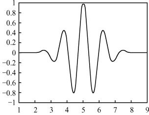
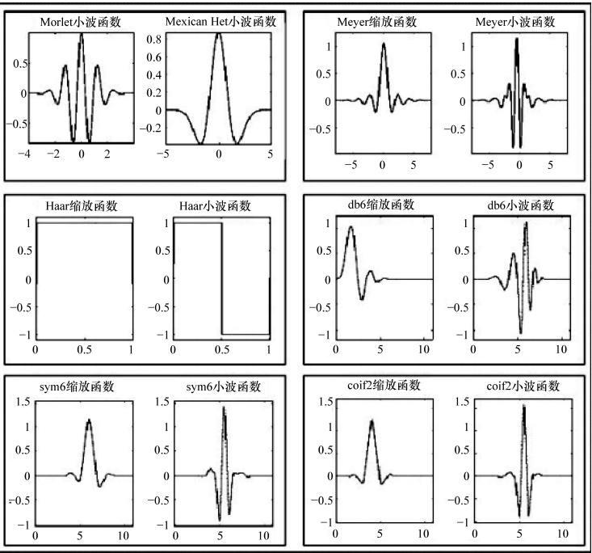

# 17-第十七章 小波变换

[返回全书目录](../../README.md)

> PDF 页码：333–339

<!-- page: 333 -->

在积分变换法一章(第九章)中，我们曾引入了傅里叶变换的概念，虽然在那一章的侧重面是介绍如何用傅里叶变换法求解数理方程方程，但与此同时我们也了解到傅里叶变换是时域到频域互相转化的工具，曾经是信号处理领域应用最广泛、效果最好的一种分析手段。本章将引入信号时频分析和处理的更为理想的工具——小波变换（wavelet transform，wt）。

小波分析，是当前数学中一个迅速发展的新领域。它继承和发展了短时傅里叶变换局部化的思想，同时又克服了窗口大小不随频率变化等缺点，能够提供一个随频率改变的“时间-频率”窗口，是时间（空间）频率的局部化分析。通过伸缩平移运算对信号（函数）逐步进行多尺度细化，小波变换可聚焦到信号的任意细节，从而解决了傅里叶变换的困难问题，成为继傅里叶变换以来在科学方法上的重大突破。由于受篇幅限制，本章将只介绍小波变换的由来及相关基本概念。

### 17.1 小波变换的由来

## 1. 傅里叶变换的困难

为方便起见，本章记函数  $ f(t) $ 的傅里叶变换为  $ \tilde{f}(\omega) $，则傅里叶变换和逆变换的表达式为

$$  \tilde{f}(\omega)=\int_{-\infty}^{\infty}f(t)\mathrm{e}^{-\mathrm{i}\omega t}\mathrm{d}t   \tag*{（17.1.1）}$$

$$  f(t)=\frac{1}{2\pi}\int_{-\infty}^{\infty}\tilde{f}(\omega)\mathrm{e}^{\mathrm{i}\omega t}\mathrm{d}\omega   \tag*{(17.1.2)}$$

众所周知，如果把  $ f(t) $ 理解为信号的描述，则信号的傅里叶变换能给出信号的频率特性，即其频谱分析。但是傅里叶变换仅适用于确定性的平稳信号。从定义可以看出，为了应用傅里叶变换去研究一个信号的频谱特性，必须获得在整个时域  $ -\infty < t < \infty $ 中信号的全部信息。由于  $ |e^{\pm i\omega t}| = 1 $，即傅里叶变换的积分核在任何情形下的模都是1，所以信号  $ f(t) $ 的频谱  $ \tilde{f}(\omega) $ 的任一频点值都是由  $ f(t) $ 在整个时间域上的贡献决定的；反之，信号  $ f(t) $ 在任一时刻的状态，也是由频谱  $ \tilde{f}(\omega) $ 在整个频域  $ -\infty < \omega < \infty $ 上的贡献决定的。所以在时域中傅里叶变换没有任何分辨能力，通过有限频段上的  $ \tilde{f}(\omega) $ 不能获得信号  $ f(t) $ 在任何有限时间间隔内的频率信息。因为一个信号在某个时刻的一个小的邻域中发生了变化，那么整个频域都要受到影响。这就是说，傅里叶变

<!-- page: 334 -->

换在时域没有局域特性.

为研究信号在局部时间范围的频域特征，1946年盖柏（Gabor）提出了著名的盖柏变换，之后又进一步发展为窗口傅里叶变换，窗口傅里叶变换是在傅里叶变换的框架内，将非平稳过程看成是一系列短时平稳信号的叠加，通过在时域上加上窗口来实现短时性。从而弥补了傅里叶变换的一些不足。

## 2. 窗口傅里叶变换

设函数  $  g(t)  $ 平方绝对可积，则称  $  f(t) g(t - \tau)  $ 的傅里叶变换为  $  f(t)  $ 的窗口 Fourier 变换，也称  $  f(t)  $ 的盖柏变换，并记

$$  G_{f}(\omega,\tau)=\int_{-\infty}^{\infty}f(t)g(t-\tau)\mathrm{e}^{-\mathrm{i}\omega t}\mathrm{d}t   \tag*{(17.1.3)}$$

而称

 $$ f(t)=\frac{1}{2\pi}\int_{-\infty}^{\infty}\mathrm{d}\tau\int_{-\infty}^{\infty}G_{f}(\omega,\tau)\mathrm{e}^{\mathrm{i}\omega t}g(t-\tau)\mathrm{d}\omega $$ 

为窗口傅里叶变换的逆变换或反演公式，g(t)称为时窗函数，以下均取时窗函数g(t)满足

$$  \int_{-\infty}^{\infty}\mid g(t)\mid^{2}\mathrm{d}t=1   \tag*{（17.1.5）}$$

窗口傅里叶变换的逆变换公式(17.1.4)的得到是因为由傅里叶变换的反演公式，有

 $$ f(t)g(t-\tau)=\frac{1}{2\pi}\int_{-\infty}^{\infty}G_{f}(\omega,\tau)\mathrm{e}^{\mathrm{i}\omega t}\mathrm{d}\omega $$ 

于是

 $$ f(t)[g(t-\tau)]^{2}=\frac{1}{2\pi}\int_{-\infty}^{\infty}G_{f}(\omega,\tau)\mathrm{e}^{i\omega t}g(t-\tau)\mathrm{d}\omega $$ 

从而

 $$ f(t)\int_{-\infty}^{\infty}\left[g(t-\tau)\right]^{2}\mathrm{d}\tau=\frac{1}{2\pi}\int_{-\infty}^{\infty}\mathrm{d}\tau\int_{-\infty}^{\infty}G_{f}(\omega,\tau)\mathrm{e}^{\mathrm{i}\omega t}g(t-\tau)\mathrm{d}\omega $$ 

而

 $$ \int_{-\infty}^{\infty}\left[g(t-\tau)\right]^{2}\mathrm{d}\tau=\int_{-\infty}^{\infty}\mid g(t)\mid^{2}\mathrm{d}\tau=1 $$ 

代入上式即得到(17.1.4)式，记

$$  t^{*}=\int_{-\infty}^{\infty}t\mid g(t)\mid^{2}\mathrm{d}t   \tag*{(17.1.6)}$$

$$  \Delta t=\sqrt{\int_{-\infty}^{\infty}(t-t^{*})^{2}\mid g(t)\mid^{2}\mathrm{d}t}   \tag*{(17.1.7)}$$

分别称为时窗函数  $ g(t) $ 的时窗中心和时窗半径. 于是时窗函数  $ g(t) $ 的窗口为  $ \left[t^{*}-\Delta t, t^{*}+\Delta t\right] $, 窗口的宽度为  $ 2\Delta t $. 若记时窗函数  $ g(t-\tau) $ 的时窗中心和时窗半径分别为  $ t_{\tau}^{*} $ 和  $ \Delta t_{\tau} $, 则

 $$ t_{\tau}^{*}=\int_{-\infty}^{\infty}t\mid g(t-\tau)\mid^{2}\mathrm{d}t=\int_{-\infty}^{\infty}(u+\tau)\mid g(u)\mid^{2}\mathrm{d}u $$

<!-- page: 335 -->

$$ \begin{aligned}=&\int_{-\infty}^{\infty}u\mid g(u)\mid^{2}\mathrm{d}u+\tau\int_{-\infty}^{\infty}\mid g(u)\mid^{2}\mathrm{d}u=t^{*}+\tau\\\Delta t_{\tau}=&\sqrt{\int_{-\infty}^{\infty}(t-t_{\tau}^{*})^{2}\mid g(t-\tau)\mid^{2}\mathrm{d}t}=\sqrt{\int_{-\infty}^{\infty}(u+\tau-t_{\tau}^{*})^{2}\mid g(u)\mid^{2}\mathrm{d}u}\\=&\sqrt{\int_{-\infty}^{\infty}(u-t^{*})^{2}\mid g(u)\mid^{2}\mathrm{d}u}=\Delta t\end{aligned} $$ 

由此可见，时窗中心在平移，而时窗半径不变。

我们称时窗函数  $  g(t)  $ 的傅里叶变换， $ \tilde{g}(\omega) = F[g(t)] $ 为频窗函数并记

$$  \omega^{*}=\frac{\int_{-\infty}^{\infty}\omega\mid\widetilde{g}(\omega)\mid^{2}\mathrm{d}\omega}{\int_{-\infty}^{\infty}\mid\widetilde{g}(\omega)\mid^{2}\mathrm{d}\omega}   \tag*{(17.1.8)}$$

$$  \Delta\omega=\sqrt{\frac{\int_{-\infty}^{\infty}(\omega-\omega^{*})^{2}\mid\tilde{g}(\omega)\mid^{2}\mathrm{d}\omega}{\int_{-\infty}^{\infty}\mid\tilde{g}(\omega)\mid^{2}\mathrm{d}\omega}}   \tag*{(17.1.9)}$$

分别称为频窗中心和频窗半径. 当频窗函数是  $ \tilde{g}(\omega-\eta) $ 时，类似地可以推导出相应的频中心和频窗半径为

 $$ \omega_{\eta}^{*}=\omega^{*}+\eta,\quad\Delta\omega_{\eta}=\Delta\omega $$ 

因此频窗中心在平移，频窗半径不变，在时-频坐标系中，时窗和频窗共同作用，形成时-频窗。窗口傅里叶变换把时域上的信号  $ f(t) $ 映射到时-频域平面  $ (\tau, \omega) $ 中的一个二维函数  $ G_{f}(\omega, \tau) $。

例

$$  g(t)=\frac{b}{2\sqrt{\pi a}}\mathrm{e}^{-\frac{t^{2}}{4a}},\quad a,b>0   \tag*{（17.1.10）}$$

是一个常用的窗口函数称为高斯函数。试求其时窗中心、时窗半径以及频窗函数和时-频窗面积。

解 易于求得其时窗中心为

 $$ t^{*}=\int_{-\infty}^{\infty}t\mid g(t)\mid^{2}\mathrm{d}t=0 $$ 

并且时窗半径为

 $$ \Delta t=\sqrt{\int_{-\infty}^{\infty}(t-t^{*})^{2}\mid g(t)\mid^{2}\mathrm{d}t}=\sqrt{a} $$ 

相应的频窗函数  $ \tilde{g}(\omega)=be^{-\omega\omega^{2}} $，因此可以计算频窗中心  $ \omega^{*}=0 $，频窗半径  $ \Delta\omega=\frac{1}{2\sqrt{a}} $。所以时-频窗面积为  $ (2\Delta t)(2\Delta\omega)=2 $。

众所周知，高频信号波长较短，即在时间轴上的扩展较窄，因此为了提取高频分量的信息，时窗应该尽量地调窄一些，并允许频窗适当地宽；而低频信号波长较长，即在时间轴上的扩展较宽，因此时窗应尽量地调宽一些，频窗应当尽量缩小，以保证有较高的频率分辨率。然而，窗口傅里叶变换的窗函数一旦选定以后，其时-频窗口大小

<!-- page: 336 -->

和形状就固定不变了，与时间和频率无关，所以并没有很好地解决时-频局部化问题，这样就限制了窗口傅里叶变换的实际应用。

## 3. 小波变换的诞生

为了克服窗口傅里叶变换的不足，法国的地球物理学家 J. Morlet 在 1974 年首先提出了小波变换的概念。当时 Morlet 在分析地震数据时提出将地震波按一个确定函数的伸缩平移系展开。然后数学家 Meyer 对 Morlet 提出的方法进行系统研究，并与其他一些人的工作联合奠定了小波分析的基础。

### 17.2 小波变换

## 1. 连续小波变换

设  $ \psi(t) $ 及其傅里叶变换  $ \tilde{\psi}(\omega) $ 均为平方绝对可积函数，其宽度均为有限值，且满足相容性条件

$$  C_{\psi}=\int_{-\infty}^{\infty}\frac{\mid\tilde{\psi}(\omega)\mid^{2}}{\omega}\mathrm{d}\omega<\infty   \tag*{(17.2.1)}$$

则称  $ \phi(t) $ 为基小波或小波母函数，对于基小波  $ \phi(t) $，定义  $ f(t) $ 的小波变换。为

$$  (w_{\psi}f)(a,b)=\int_{-\infty}^{\infty}f(t)\psi_{a,b}^{*}(t)\mathrm{d}t   \tag*{(17.2.2)}$$

其中

$$  \psi_{a,b}(t)=\frac{1}{\sqrt{\left|\begin{matrix}a\\ \end{matrix}\right|}}\psi\Big(\frac{t-b}{a}\Big),\quad a,b\in R,a\neq0   \tag*{（17.2.3）}$$

为由基小波  $ \psi(t) $ 通过平移和伸缩生成的一族小波或小波基函数，a 和 b 为参数，分别为伸缩因子（或尺度因子）和平移因子（或位移因子）.

小波就是小的波形。所谓“小”是指它具有衰减性；而称之为“波”则是指它的波动性，如图17.1所示。具有其振幅正负相间的震荡形式。条件(17.2.1)意味着 $ \tilde{\psi}(0)=0 $。即， $ \int_{-\infty}^{\infty}\tilde{\psi}(t)dt=0 $。可见 $ \psi(t) $具有一定的振荡性，这正是称为小波的原因。

图17.1
 

连续小波  $ \psi_{a,b}(t) $ 的作用与窗口傅里叶变换中的  $ g(t-\tau)\mathrm{e}^{-\omega t} $ 作用类似，其中 b 与  $ \tau $ 一样都起着时间平移的作用，而 a 在连续小波变换中是一个尺度参数，它既能改变窗口的大小与形状，同时也能改变连续小波的频谱结构。

#### 常用的基本小波有

<!-- page: 337 -->

哈尔(Haar)小波  $ \psi(t)=\left\{\begin{aligned}&1,&0\leqslant t<\frac{1}{2}\\ &-1,&\frac{1}{2}\leqslant t<1\\ &0,& 其他 \end{aligned}\right. $

Morlet 小波  $ \psi(t)=\mathrm{e}^{\frac{t^{2}}{2}}\mathrm{e}^{\mathrm{i}\omega_{0}t},\quad-\infty<t<\infty,\quad\omega_{0}\leqslant5 $ (1)

墨西哥草帽小波(Marr 小波)  $ \psi(t)=(1-t^{2})\left(\frac{1}{\sqrt{2\pi}}\right)\mathrm{e}^{\frac{t^{2}}{2}},-\infty<t<\infty $

图 17.2 给出了部分小波的波形：

图17.2
 

<!-- page: 338 -->

## 2. 离散小波变换

在实际应用中，需要对伸缩因子a和平移因b进行离散化处理，可以取 $ a=a_{0}^{m} $， $ b=nb_{0}a_{0}^{m} $，m,n为整数， $ a_{0} $为大于1的常数， $ b_{0} $为大于0的常数，a和b的选取与小波 $ \phi(t) $的具体形式有关。离散小波函数表示为

$$  \psi_{m,n}(t)=\frac{1}{\sqrt{a_{0}^{m}}}\psi\Big(\frac{t-n b_{0}a_{0}^{m}}{a_{0}^{m}}\Big)=\frac{1}{\sqrt{a_{0}^{m}}}\psi(a_{0}^{-m}t-n b_{0})   \tag*{(17.2.7)}$$

相应的离散小波变换可以表示为

$$  (w_{\psi}f)(m,n)=\int_{-\infty}^{\infty}f(t)\psi_{m,n}^{*}(t)\mathrm{d}t   \tag*{(17.2.8)}$$

当 $ a_{0}=2,b_{0}=1 $时，离散少波变换为二进离散小波变换，这样便于分析，并适合于在计算机上进行高效的运算.

## 3. 小波变换的性质

设  $ f(t) $,  $ g(t) $ 平方绝对可积,  $ k_{1} $,  $ k_{2} $ 是任意常数, 则小波变换具有如下一些主要性质：

$$  (1) 线性性质 \quad(\mathcal{w}_{\psi}(k_{1}f+k_{2}g))(a,b)=k_{1}(\mathcal{w}_{\psi}f)(a,b)+k_{2}(\mathcal{w}_{\psi}g)(a,b)   \tag*{(17.2.9)}$$

$$  (2) 平移性质 \quad(\mathcal{w}_{\psi}f(t-t_{0}))(a,b)=(\mathcal{w}_{\psi}f(t))(a,b-t_{0})   \tag*{(17.2.10)}$$

$$  (3) 尺度法则 \quad(\mathcal{w}_{\psi}f(\lambda t))(a,b)=\frac{1}{\sqrt{\lambda}}(\mathcal{w}_{\psi}f(t))(\lambda a,\lambda b),\quad\lambda>0   \tag*{(17.2.11)}$$

与窗口傅里叶变换类似，在小波变换中，也可称  $ \psi_{a,b}(t) $ 是窗函数，小波变换的时频窗表现了小波变换的时-频局部化能力。其时窗中心  $ t^{*} $，时窗半径  $ \Delta t $，频窗中心  $ \omega^{*} $ 和频窗半径  $ \Delta\omega $ 分别为

$$  t^{*}=\frac{\int_{-\infty}^{\infty}t\mid\psi_{a,b}(t)\mid^{2}\mathrm{d}t}{\int_{-\infty}^{\infty}\mid\psi_{a,b}(t)\mid^{2}\mathrm{d}t},\qquad\Delta t=\sqrt{\frac{\int_{-\infty}^{\infty}(t-t^{*})^{2}\mid\psi_{a,b}(t)\mid^{2}\mathrm{d}t}{\int_{-\infty}^{\infty}\mid\psi_{a,b}(t)\mid^{2}\mathrm{d}t}}   \tag*{(17.2.12)}$$

$$  \omega^{*}=\frac{\int_{-\infty}^{\infty}\omega\mid\tilde{\psi}_{a,b}(\xi)\mid^{2}\mathrm{d}\omega}{\int_{-\infty}^{\infty}\mid\tilde{\psi}_{a,b}(\omega)\mid^{2}\mathrm{d}\omega},\qquad\Delta\omega=\sqrt{\frac{\int_{-\infty}^{\infty}(\omega-\omega^{*})^{2}\mid\tilde{\psi}_{a,b}(\omega)\mid^{2}\mathrm{d}\omega}{\int_{-\infty}^{\infty}\mid\tilde{\psi}_{a,b}(\omega)\mid^{2}\mathrm{d}\omega}}   \tag*{(17.2.13)}$$

小波变换中的窗函数  $ \psi_{a,b}(t) $ 是由  $ \psi(t) $ 的平移和缩放得来的，分别记对应于  $ \psi_{a,b}(t) $ 的有关量为：时窗中心  $ t_{\psi}^{*} $ 、时窗半径  $ \Delta t_{\psi} $ 、频窗中心  $ \omega_{\psi}^{*} $ 和频窗半径  $ \Delta\omega_{\psi} $

 $$ t^{*}=a t_{\psi}^{*}+b,\quad\Delta t=a\Delta t_{\psi},\quad\omega^{*}=a\omega_{\psi}^{*},\quad\Delta\omega=a\Delta\omega_{\psi} $$ 

虽然  $ \phi_{a,b}(t) $ 的时窗和频窗的中心与宽度随着 a, b 在变化，但是在时-频面上，窗口的面积不变，这是因为

<!-- page: 339 -->

$$ (2\Delta t)(2\Delta\omega)=(2a\Delta t_{\psi})\Bigl(2\frac{1}{a}\Delta\omega_{\psi}\Bigr)=(2\Delta t_{\psi})(2\Delta\omega_{\psi}) $$ 

由  $ f(t) $ 的小波变换  $ (w_{\phi}f)(a,b) $ 我们可得到其反演公式.

小波变换克服了傅里叶变换和窗口傅里叶变换的缺点，在时域和频域同时具有良好的局域化性质，被誉为“数学显微镜”。小波变换是泛函分析、调和分析和数值分析等数学分支发展的综合结晶，作为一种数学理论和方法在科学技术领域引起了越来越多的关注和重视。

小波变换联系了应用数学、物理学、计算机科学、信号与信息处理、图像处理、地震勘探等多个学科。数学家认为，小波分析是一个新的数学分支，它是泛函分析、傅里叶分析、样条分析、数值分析的完美结晶；信号和信息处理专家认为，小波分析是时间-尺度分析和多分辨分析的一种新技术，它在信号分析、语音合成、图像识别、计算机视觉、数据压缩、地震勘探、大气与海洋波分析等方面的研究都取得了有科学意义和应用价值的成果。

小波变换同样也可用于求解数理方程，特别是用于数值求解。在数字计算中，要把连续小波及其变换离散化。一般对小波变换进行二进制离散，这种离散化的小波和相应的小波变换叫做二进小波和二进小波变换。受篇幅限制，本书对这些内容都不再一一叙述。感兴趣的读者，可参看相关书籍及论文 $ ^{①} $。

#### 注 ① 可供参考的书籍：

1. Barbara Burke Hubbard. The Word according to Wavelets. A K Peters, Wellesley, MA, 1996.

2. Mark A. Pinsky. Introduction to Fourier Analysis and Wavelets. Pacific Grove, CA: Brooks/Cole., 2002.

3. David K. Ruch, Wavelet Theory: an Elementary Approach with Applications, Hoboken, NJ: Wiley, 2009.

4. C. Sidney Burrus, Ramesh A. Gopinath, Haitao Guo, Introduction to wavelet Transforms: A Primer.

