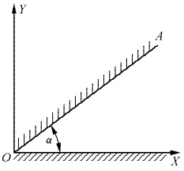
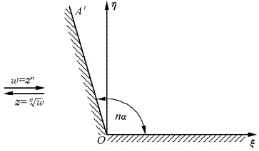
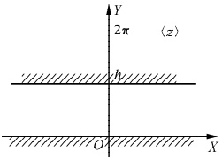
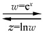
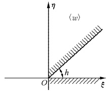
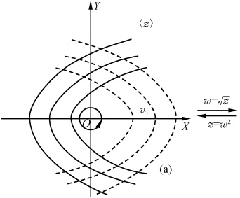
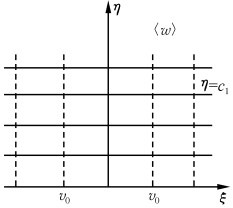
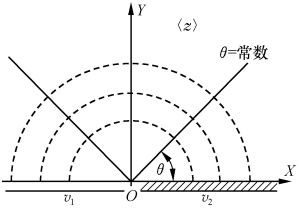
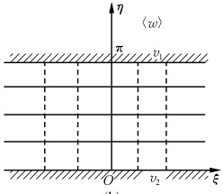

# 18-习题参考答案

[返回全书目录](../../README.md)

> PDF 页码：340–361

<!-- page: 340 -->

### 第 一 篇

##### 习题1.1

4. (1)  $ 1 - \cos\alpha, \sin\alpha, 2\sin\frac{\alpha}{2}, \frac{\pi}{2} - \frac{\alpha}{2} $ (2)  $ \frac{16}{25}, \frac{8}{25}, \frac{8\sqrt{5}}{25}, \arctan\frac{1}{2} $

(3)  $ 0, -\frac{1}{8}, \frac{1}{8}, -\frac{\pi}{2} $

(4) ecos1, esin1, e, 1

5.  $ \cos n\theta = \sum_{l=0}^{\left[\frac{n}{2}\right]}\frac{(-1)^{l} n!}{(2l)!(n-2l)!}\sin^{2l}\theta\cos^{n-2l}\theta $

 $ \sin n\theta = \sum_{l=0}^{\left[\frac{n}{2}\right]}\frac{(-1)^{l} n!}{(2l+1)!(n-2l-1)!}\sin^{2l+1}\theta\cos^{n-2l-1}\theta $

 $ \left[\frac{n}{2}\right]=\left\{\begin{aligned}&\frac{n}{2}, 当 n 为偶数 \\&\frac{n-1}{2}, 当 n 为奇数\end{aligned}\right. $

6. (1)  $ \pm\frac{1}{\sqrt{2}}(\sqrt{\sqrt{2}+1}+\mathrm{i}\sqrt{\sqrt{2}-1}) $ (2)  $ -16\sqrt{3}-16\mathrm{i} $

(3) $ -\frac{\pi}{4}+2k\pi(k=0,\pm1,\pm2,\cdots) $ (4) $ 2^{-11}(-1+\sqrt{3})\mathrm{i} $

7. (1)  $ 1, -\frac{1}{2} \pm i \frac{\sqrt{3}}{2} $ (2)  $ 1 + 2i, 1 + i $

8. 大小： $ \sqrt{2} $; 方向： $ \frac{\pi}{4} $

10. (1)  $ z^{2} + \bar{z}^{2} = 2 $

(2)  $ \left(\frac{1}{4a^{2}}-\frac{1}{4b^{2}}\right)z^{2}+\left(\frac{1}{2a^{2}}+\frac{1}{2b^{2}}\right)z\cdot\bar{z}+\left(\frac{1}{4a^{2}}-\frac{1}{4b^{2}}\right)\bar{z}^{2}-1=0 $

(3)  $ z\bar{z}+z_{0}\bar{z}_{0}-z_{0}\bar{z}-z\bar{z}_{0}=R^{2} $

(4) $ (A-iB)z+(A+iB)\bar{z}+2C=0 $

##### 习题1.2

1. (1)  $ \frac{x^{2}+y^{2}-1}{(x+1)^{2}+y^{2}} $,  $ \frac{2y}{(x+1)^{2}+y^{2}} $ (2)  $ x^{3}-3xy^{2} $,  $ 3x^{2}y-y^{3} $

3. (1)  $ \lim_{n \to \infty} a_n = \lim_{n \to \infty} \left( \frac{2}{5} \right)^n \cos \frac{n\pi}{3} + i \lim_{n \to \infty} \left( \frac{2}{5} \right)^n \sin \frac{n\pi}{3} = 0 $

<!-- page: 341 -->

(2)  $ \lim_{n\to\infty}a_n = \lim_{n\to\infty}\frac{1}{n}\cos\frac{n-1}{2}\pi + i \lim_{n\to\infty}\frac{1}{n}\sin\frac{n-1}{2}\pi = 0 $

##### 习题1.3

2.（1）在复平面可导、解析（2）在z=0可导、全平面不解析

（3）每一单值支解析 （4）在 z=0 可导，全平面不解析

4. (1)  $ \left(1-\frac{1}{2}\mathrm{i}\right)z^{2}+\frac{1}{2}\mathrm{i} $ (2)  $ -\mathrm{i}(1-z)^{2} $ (3)  $ \frac{1}{2}-\frac{1}{z} $ (4)  $ \ln z $

5. 与虚轴相切于原点的圆族，复势  $ \omega=\frac{C_{1}}{z}+C_{2}+iC_{3}(C_{1},C_{2},C_{3} $ 为实数)

6. 抛物线族  $ y^{2}=C^{2}-2Cx(C>0) $. 复势  $ \omega=C_{1}\sqrt{z}+C_{2}+iC_{3}(C_{1},C_{2},C_{3} $ 为实数)

7. 不能

##### 习题1.4

## 5. 均为无穷多值函数

6. (1)  $ \mathrm{i}k\pi(k=0,\pm1,\pm2,\cdots) $ (2)  $ \ln2+\mathrm{i}\left(\frac{\pi}{3}+2k\pi\right)(k=0,\pm1,\cdots) $

(3)  $ \left(2k+\frac{1}{2}\right)\pi-\mathrm{i}\ln\left(2\pm\sqrt{3}\right) $ (k=0, $ \pm1 $,…) (4)  $ k\pi+\mathrm{i}\frac{1}{2}\ln2 $ (k=0, $ \pm1 $,…)

7.（1）2值；1, $ \infty $ （2）单值 （3）6值；2，-2, $ \infty $，1,-1

(4) 2值; $ (2k+1)\frac{\pi}{2}(k=0,\pm1,\pm2,\cdots) $ (5) 单值 (6) 2值;0, $ \infty $

(7)无穷多值； $ 0,\pm\pi,\pm2\pi,\cdots $ (8)2值；1,2

8.  $ -\frac{1}{2}(\sqrt{3}+i) $

9.  $ \sqrt{2}i $

10. (1)  $ \mathrm{e}^{\mathrm{i}\ln\sqrt{2}}\mathrm{e}^{-\left(\frac{\pi}{4}+2k\pi\right)}(k=0,\pm1,\cdots) $ (2)  $ 25\mathrm{e}^{-6k\pi}\mathrm{e}^{\mathrm{i}3\ln5}(k=0,\pm1,\cdots) $

(3)  $ \cos^{5}\varphi-10\cos^{3}\varphi\sin^{2}\varphi+5\cos\varphi\sin^{4}\varphi $ (4)  $ \ln\sqrt{2}+\mathrm{i}\left(\frac{1}{4}+2k\right)\pi(k=0,\pm1,\cdots) $

##### 习题1.5

1. 是  $ w(=u+iv) $ 平面中，由 v=0,  $ v^{2}=4(1-u) $ 和  $ v^{2}=4(1+u) $ 三条曲线所组成的图形

2.  $ 1, \pi; \frac{1}{2}, -\frac{\pi}{2} $

3. (1)  $ u^{2} + v^{2} = \frac{1}{4} $ (2)  $ v = -u $ (3)  $ u = \frac{1}{2} $ (4)  $ \left(u - \frac{1}{2}\right)^{2} + v^{2} = \frac{1}{4} $

4. (1)  $ w = z^n $ 将  $ z $ 平面与正实轴夹角为  $ \alpha $ 的角形区域:  $ 0 < \arg z < \alpha $ ( $ 0 < \alpha \leq \frac{2\pi}{n} $), 保角变换为  $ w $ 平面与正实轴夹角  $ n\alpha $ 的角形区域:  $ (0 < \arg z \leq n\alpha) $, 其反函数  $ z = \sqrt[n]{w} $ 当然正好反过来 (见图 1.15)

(2)  $ w = e^z $ 将  $ z $ 平面的带形区域:  $ 0 < \mathrm{Im}z < h $ ( $ 0 < h \leq 2\pi $) 保角变换为  $ w $ 平面的角域:  $ 0 < \arg w < h $, 而其后函数  $ y = \log x $ 正好结束 (见图 1.16)

 $$ z=\ln w $$ 

 $ ^{*} $5. 提示：可选变换  $ w=\sqrt{z} $. 等势线和电场线分别由一族开口向右的抛物线族（见图1.17中实线族）和开口向左的抛物线族（见图1.17中虚线族）给出

6. 提示：作变换 w =  $ \ln z $。等势线是由 O 点出发的矢径： $ \theta = 常数 $， $ 0 < r < \infty $（见图 1.18（a）中的实

<!-- page: 342 -->

线. 其中  $ r=|z| $. 电场线是 r= 常数  $ (0<\theta<\pi) $，它们是一些半圆（见图1.18(a)中的虚线）

图1.15
 

图1.16
 

(2)
 

(b)
 

图1.17
 

(a)
 

图1.18
 

(b)
 

<!-- page: 343 -->

##### 习题2.1

1.  $ -\frac{1}{3}(1-i) $

2.（1）1（2）2（3）2

5.  $ \left\{\begin{array}{l}\pi\mathrm{i},n=1\\\frac{r^{1-n}}{1-n}[(-1)^{1-n}-1],n\neq1\end{array}\right. $

#### 习题2.2

1. (1) 0 (2)  $ 4\pi $

2. (1)  $ -\frac{\mathrm{i}}{3} $ (2)  $ 2\mathrm{ch}1 $ (3)  $ -\frac{\pi}{2}\mathrm{e} $

#### 习题2.3

1. (1)  $ 4\pi i $ (2)  $ \sqrt{2}\pi i $ (3)  $ 2\pi i $ (4) 0

2. (1)  $ \frac{\pi}{3} $ (2)  $ -\frac{\pi}{3} $ (3) 0

3. (1)  $ -\frac{\pi^{5}}{12}\mathrm{i} $ (2)  $ \mathrm{i}\pi\sqrt{2}\sin\left(1-\frac{\pi}{4}\right) $ (3)  $ -\frac{2\pi\mathrm{i}}{5!} $ (4)  $ 4\pi\mathrm{i} $

4.  $ 2\pi(-6+13i) $

6. (1) 1 (2)  $ -\frac{e}{2} $ (3)  $ 1-\frac{e}{2} $

##### 习题3.2

1. (1)  $ \infty $ (2) 2 (3) e (4) 若  $ \left|a\right|\leqslant1,1; $ 若  $ \left|a\right|>1,\frac{1}{\left|a\right|} $ (5)  $ \frac{1}{3} $

2. (1) R (2) 0 (3)  $ R^{n} $

3.（1）除 z = -1 外，在所有点上收敛（非绝对） （2）绝对收敛

4.（1）收敛，不绝对收敛（2）不绝对收敛.

##### 习题3.3

1. (1) 提示： $ \frac{1}{(1-z)^2} = \left(\frac{1}{1-z}\right)^x $ (2)  $ \sum_{k=0}^{\infty} (-1)^k \frac{a^k}{b^{k+1}} z^k $,  $ |z| < \left|\frac{b}{a}\right| $

(3)  $ \mathrm{e}\left(1+z+\frac{3}{2!}z^{2}+\frac{13}{3!}z^{3}+\cdots\right) $ (4)  $ \sum_{k=0}^{\infty}\frac{(-1)^k}{(2k+1)}z^{2k+1} $ (5)  $ \sum_{k=0}^{\infty}z^{3k}-\sum_{k=0}^{\infty}z^{3k+1} $ ( $ |z|<1 $)

(6)  $ \sum_{n=1}^{\infty}\sum_{m=0}^{\left\lbrack(n-1)/2\right\rbrack}\frac{(-1)^m}{(2m+1)!}z^n $ ( $ |z|<1 $)

2. (1) 提示： $ \cos z = \cos(z - 1 + 1) $ (2)  $ \frac{1}{4} + \sum_{k=1}^{\infty}(-1)^k \frac{(k-3)(z-1)^k}{2^{k+2}} $ ( $ |z-1|<2 $)

（3）提示： $ \frac{z}{z+2}=1-\frac{2}{3}\frac{1}{1+\frac{z-1}{2}}\quad(|z-1|<3)\quad(4)\sum_{k=0}^{\infty}\frac{\sin\left(1-\frac{k\pi}{2}\right)}{k!}(z-1)^{2k}\quad(|z-1|<\infty) $

3. (1)  $ \sum_{k=1}^{\infty}(-1)^{k-1}\frac{z^{4k-1}}{(4k-1)(2k-1)!} $,  $ \sum_{k=0}^{\infty}(-1)^{k}\frac{z^{4k+1}}{(4k+1)(2k)!} $

<!-- page: 344 -->

(2)  $ \frac{2}{\sqrt{\pi}}\sum_{k=0}^{\infty}(-1)^k\frac{z^{2k+1}}{(2k+1)k!} $ (3)  $ \sum_{k=1}^{\infty}(-1)^{k-1}\frac{z^{2k-1}}{(2k-1)(2k-1)!} $

 $$ 2k\pi\mathrm{i}+\sum_{k=1}^{\infty}(-1)^{k-1}\frac{z^{k}}{k}\quad(\mid z\mid<1) $$ 

6. (1) 4 级 (2) 15 级

 $ ^{*}7.\ \frac{z(1+z)}{(1-z)^{3}} $

 $ ^{*} $8.  $ \ln(1-\mathrm{e}^{-t})\sin h t+\frac{1}{2}+\frac{\mathrm{e}^{-t}}{4} $

##### 习题3.4

1. (1) 对于 $0 < |z| < 1$, $\frac{1}{z^2} - 2\sum_{k=0}^{\infty} z^{k-2}$; 对于 $1 < |z| < \infty$, $\frac{1}{z^2} + 2\sum_{k=0}^{\infty} \frac{1}{z^{k+3}}$

(2) $2\sum_{k=1}^{\infty}(-1)^k \frac{1}{z^{2k}} - \sum_{k=0}^{\infty} \frac{z^k}{2^{k+1}}$

(3) $\sum_{k=0}^{\infty} c_k z^k + \sum_{k=1}^{\infty} c_{-k} z^{-k}$ 其中 $c_k = c_{-k} = \sum_{n=0}^{\infty} \frac{1}{n!(n+k)!}$ ($k=0,1,2,\cdots$)

(4) $\sum_{k=0}^{\infty} c_{2k} z^{2k} + \sum_{k=1}^{\infty} c_{-2k} z^{-2k}$ 其中 $c_{2k} = c_{-2k} = (-1)^k \sum_{n=0}^{\infty} \frac{1}{(2n+1)!(2n+2k+1)!}$ ($k=0,1,2,\cdots$)

2. (1) $\sum_{k=0}^{\infty}(-1)^k (k+1)\frac{(z-i)^{k-2}}{(2i)^{k+2}}$ ($0 < |z-i| < 2$)

(2) $(z-1)^2 \sum_{k=0}^{\infty}(-1)^k \frac{1}{k!} \frac{1}{(z-1)^k}$ ($0 < |z-1| < \infty$)

(3) $\frac{(-1)^k}{a^k} \sum_{n=0}^{\infty}\binom{n+k-1}{k-1}\left(\frac{z}{a}\right)^n$ ($|z| < a$)

(4) $\frac{1}{2} + z + z^2 + \sum_{k=1}^{\infty}\frac{1}{(k+2)!z^k}$ ($0 < |z| < \infty$)

(5) $-\sum_{k=0}^{\infty}\frac{\sin\left(1+\frac{k\pi}{2}\right)}{k!(z-1)^k}$ ($0 < |z-1| < \infty$)

(6) $\sum_{n=-\infty}^{\infty} J_n(a)\left(\frac{z}{a}\right)^n (0 < |z| < \infty)$ 其中 $J_m(a) = \begin{cases} \sum_{k=0}^{\infty}\frac{(-1)^k}{k!(k+m)!}\left(\frac{a}{2}\right)^{2k+m}, & m=0,1,2,\cdots \\ \sum_{k=-m}^{\infty}\frac{(-1)^k}{k!(k+m)!}\left(\frac{a}{2}\right)^{2k+m}, & m=-1,-2,\cdots \end{cases}$

3. $|z|<a$ : $\frac{1}{b-a}\sum_{k=0}^{\infty}\frac{b^{k+1}-a^{k+1}}{a^{k+1}b^{k+1}}z^k$

$0 < |z-a| < |b-a| : \frac{1}{a-b}\left[\frac{1}{z-a} + \sum_{k=0}^{\infty}\frac{(z-a)^k}{(b-a)^{k+1}}\right]$

$|a|<z|<b|, \frac{1}{z-b}\sum_{k=0}^{\infty}\left(\frac{z^k}{z^{k+1}} + \frac{d^k}{z^{k+1}}\right)$

5. (1)  $ \sum_{k=0}^{\infty}z^{k-1} $ (2)  $ -\sum_{k=0}^{\infty}\frac{1}{z^{k+2}} $ (3)  $ \sum_{k=-1}^{\infty}(-1)^k(z-1)^k $ (4)  $ \sum_{k=2}^{\infty}(-1)^{k-1}\frac{1}{(z-1)^k} $

<!-- page: 345 -->

(5)  $ \sum_{k=0}^{\infty}\left[-1+\frac{1}{2^{k+1}}\right](z+1)^k $ (6)  $ \sum_{k=0}^{\infty}\frac{1}{(z+1)^{k+1}}+\frac{1}{2}\sum_{k=0}^{\infty}\left(\frac{z+1}{2}\right)^k $

(7)  $ \sum_{k=0}^{\infty}(1-2^k)\frac{1}{(z+1)^{k+1}} $

##### 习题3.5

4.（1）z=0 为一阶极点， $ z=\pm2i $ 为二阶极点

(2) $ z=1 $ 为二阶极点， $ z=\infty $ 为三阶极点

(3) $ z=k\pi-\frac{\pi}{4}\quad(k=0,\pm1,\cdots) $ 各为一阶极点； $ z=\infty $ 为非孤立奇点

(4) $ z=(2k+1)\pi i\quad(k=0,\pm1,\cdots) $ 各为一阶极点； $ z=\infty $ 为非孤立奇点

(5) $ z=\left(k+\frac{1}{2}\right)\pi $  $ (k=0,\pm1,\cdots) $ 各为二阶极点； $ z=\infty $ 为非孤立奇点

(6) $ z=\infty $为二阶极点

(7) $ z=-1 $为一阶极点， $ z=\infty $为可去奇点

(8) $ z=\pm i $为一阶极点， $ z=\infty $为本性奇点

(9) $ z=\infty $为本性奇点

(10) z=0 为本性奇点,  $ z=\infty $ 为一阶极点

(11)  $ z = \frac{1}{k\pi} (k = \pm 1, \pm 2, \cdots) $ 为本性奇点, z = 0 为非孤立奇点,  $ z = \infty $ 为本性奇点

(12) z = -2 为二阶极点，z = 2 为非孤立奇点， $ z = \infty $ 为三阶极点， $  z = \frac{1}{(k+1/2)\pi} + 2  $ 为一阶极点

5.（1）对一支为正则点，对另一支为二阶极点

（2）对一支为一阶极点，对另外五支为正则点

（3）对一支为正则点，对另一支为本性奇点

（4）对两支都为一阶极点

6. (1) 当  $ m \neq n $ 时为  $ \max(m, n) $ 阶极点，当 m = n 时为 k 阶极点 ( $ k \leq m $) 或可去奇点或零点

(2) $ m+n $ 阶极点

（3）当 m>n 时为 m-n 阶极点，m<n 时为 n-m 阶零点，m=n 时为可去奇点

7.（1）能（2）能（3）否（4）否

##### 习题4.1

4.  $ F(z)=\frac{1}{(z-1)(z-2)} $

习题4.2

3. (1) 6 (2)  $ \frac{1}{2^7}6! $ (3)  $ \Gamma(1-\alpha)\cos\frac{\alpha\pi}{2} $ (4)  $ \Gamma(1-\alpha)\sin\frac{\alpha\pi}{2} $

(5)  $ \Gamma(\alpha)\cos\alpha\theta $ (6)  $ \Gamma(\alpha)\sin\alpha\theta $

4.  $ \frac{(2n)!}{2^{2n}(n!)^2} $

 $$ *5.\ \frac{\pi^{2}}{2} $$

<!-- page: 346 -->

##### 习题4.3

3. (1)  $ 2^{2n+1}B(n+1,n+1)=2^{2n+1}\frac{(n!)^2}{(2n+1)!} $ (2)  $ 2^{p+q+1}B(p+1,q+1) $

(3)  $ \frac{1}{2}B\left(\frac{1-\alpha}{2},\frac{1+\alpha}{2}\right)=\frac{\pi}{2\cos\frac{\alpha\pi}{2}} $

##### 习题5.1

1. (1)  $ \pm\frac{1}{4},0 $ (2) 1,-1 (3)  $ \frac{1}{2} $ (4)  $ (-1)^{k-1}\frac{(2k+1)}{2}\pi $

(5)  $ -\sum_{k=0}^{\infty}\frac{(-1)^{k}}{k!(k+1)!}\left(\frac{a}{2}\right)^{2k+1}=-\mathrm{J}_{1}(a),\mathrm{J}_{1}(a) $ 为一阶贝塞尔函数（见第三篇）

(6) $ (-1)^{n}\frac{1}{n!} $

2. (1)  $ \mathrm{resf}(-1)=(-1)^{m+1}\frac{(2m)!}{(m-1)!(m+1)!} $,  $ \mathrm{resf}(\infty)=(-1)^m\frac{(2m)!}{(m-1)!(m+1)!} $

 $$ \mathrm{resf}(0)=\frac{1}{9},\mathrm{resf}(\pm3\mathrm{i})=-\frac{1}{54}(\sin3\mp\mathrm{i}\cos3),\mathrm{resf}(\infty)=\frac{1}{27}(\sin3-3) $$ 

(3)  $ \mathrm{resf}(-1)=2\sin2,\mathrm{resf}(\infty)=-2\sin2 $ (4)  $ \mathrm{resf}(2)=-\mathrm{resf}(\infty)=-\frac{143}{24} $

(5)  $ \mathrm{resf}(\infty)=0 $ (6)  $ \mathrm{resf}(0)=-\frac{1}{2} $,  $ \mathrm{resf}(\infty)=\frac{1}{2} $

3. (1)  $ -\frac{\pi i}{\sqrt{2}} $ (2)  $ -2\pi i $ (3)  $ -\frac{\pi i}{121} $ (4)  $ 1 $

 $ ^{*} $5.  $ \frac{i\pi}{2} $

##### 习题5.2

1. (1)  $ \sqrt{2}\pi $ (2)  $ \frac{\pi}{\mu} e^{-r\mu} $ (3)  $ \frac{\pi \exp(-a/\sqrt{2})}{2\sqrt{2}} \left( \cos \frac{a}{\sqrt{2}} + \sin \frac{a}{\sqrt{2}} \right) $ (4)  $ \frac{\pi}{2} e^{-ab} $

2. (1)  $ \frac{2\pi}{1-b^2} $ (2)  $ \sqrt{2}\pi $ (3)  $ \frac{\pi}{2\sqrt{a(a+1)}} $ (4)  $ \frac{\pi}{2\sqrt{2}} $

 $ ^{*} $5. (1)  $ \frac{\pi^{2}}{6} $ (2)  $ \frac{\pi^{4}}{15} $

 $ ^{*} $6. (1)  $ \pi $ (2)  $ \frac{\pi}{2} $

 $$ \pi^{1/2} $$ 

 $ ^{*}8.\frac{1}{\cos(\alpha/2)} $

 $ ^{*}10.\ (1)\ 2\pi(a^{2}-1)^{-1/2}\ (2)-2\pi i(1-a_{0}^{2})^{-1/2} $

11. 当  $ |a| > |b| $ 时，I = 0；当  $ |a| < |b| $ 时， $ I = \frac{2\pi}{b} $

##### 习题5.3

3. (1)  $ -\frac{\pi}{2} $ (2)  $ -\frac{\pi}{2} $

<!-- page: 347 -->

4. (1)  $ \frac{\pi}{2}\left(1-\frac{3}{2\mathrm{e}}\right) $ (2)  $ \frac{\pi}{2a^{2}}(1-\mathrm{e}^{-a}) $ * (3)  $ \frac{3}{4}\pi $

(4) $ \frac{b-a}{2}\pi $ (5) $ \frac{\pi}{2}\mathrm{e}^{-4}(2\cos2+\sin2) $ (6) $ \frac{\pi}{2}\mathrm{e}^{-4}(-\cos2+2\sin2) $

5.  $ *(1) $  $ \frac{\pi}{\sin a\pi} $ (2)  $ \frac{\pi\sin(b-a)\pi}{\sin a\pi\sin b\pi} $ (3)  $ \frac{\pi}{2} $ th  $ \frac{\pi}{2} $ (4)  $ \frac{\pi}{2}\frac{1}{\cosh\frac{m\pi}{2}} $

7.  $ *\frac{1}{2}\pi^{2}R^{4} $

##### 习题5.4

1. (1)  $ \pi $ (2)  $ \frac{\pi}{2} $

2. (1)  $ -\frac{\pi}{\sqrt{3}} $ (2)  $ \frac{\pi(1-\alpha)}{4\cos\frac{\pi\alpha}{2}} $ (3)  $ -\frac{\pi}{4} $ (4)  $ -\frac{7}{128}\pi^{4} $

3. (1)  $ \sqrt{\frac{\pi}{2}} $ (2)  $ \frac{\pi}{4} $

 $ ^{*} $4.  $ \frac{\pi}{\sqrt{2}} $

 $ ^{*} $5.  $ \frac{\pi^{2}}{2\sqrt{2}} $

### 第 二 篇

##### 习题6.2

6.  $ u_{tt}=\frac{1}{2}\omega^{2}\frac{\partial}{\partial x}[(l^{2}-x^{2})u_{x}] $ （以水平线为 x 轴，原点取在竖轴上）

7.  $ u_{tt}=g\frac{\partial}{\partial x}[(l-x)u_{x}]+\omega_{x}^{2}u $ （以绳的上端为原点，沿竖直轴取 x 轴向下）

##### 习题6.3

1.  $ \left\{\begin{aligned}u|_{x=0}=0\\ u|_{x=l}=0\end{aligned}\right.\quad\left\{\begin{aligned}u|_{t=0}=\varphi(x)\\ u_{t}|_{t=0}=\psi(x)\end{aligned}\right. $

2.  $ \left\{\begin{aligned}u_{u}&=a^{2}u_{xx},&x\geqslant0,t>0\\ u|_{x=0}&=A\sin\omega t,&t>0\\ u|_{t=0}&=\varphi(x),&u_{t}|_{t=0}=\psi(x),&x\geqslant0\end{aligned}\right. $

3.  $ \left\{\begin{aligned}u_{x}|_{x=0}=&\frac{F(t)}{ES}\\ u_{x}|_{x=l}=&\frac{F(t)}{ES}\end{aligned}\right.\quad\left(\begin{aligned}E& 为杨氏模量 \\ S& 为杆的横截面积\end{aligned}\right) $

4.  $ -u_{x}|_{x=0}=u_{x}|_{x=l}=\frac{q_{0}}{k} $ （k为热导率）

5.  $ \left\{\begin{array}{l} u|_{x=0}=0, u_{x}|_{x=l}=0 \\ u|_{t=0}=\frac{b}{l}x, u_{t}|_{t=0}=0 \end{array}\right. $

<!-- page: 348 -->

6. 两端受压： $ \left\{\begin{aligned}u|_{t=0}&=\varepsilon(l-2x)\\ u_{t}|_{t=0}&=0\end{aligned}\right. $，一端受压： $ \left\{\begin{aligned}u|_{t=0}&=-2\varepsilon x\\ u_{t}|_{t=0}&=0\end{aligned}\right. $

 $$ \begin{align*}7.\begin{cases}u_{t}^{\mathrm{I}}=&\frac{k_{1}}{c_{1}\rho_{1}}u_{xx}^{\mathrm{I}}\quad(0<x<x_{0})\\u^{\mathrm{I}}(0,t)=0\\u^{l}(x,0)=&u_{0}\end{cases},&\begin{cases}u_{t}^{\mathrm{II}}=&\frac{k_{2}}{c_{2}\rho_{2}}u_{xx}^{\mathrm{II}}\quad(x_{0}<x<l)\\u^{\mathrm{II}}(l,t)=&0\\u^{\mathrm{II}}(x,0)=&u_{0}\end{cases}\end{align*} $$ 

连接条件： $ \left\{\begin{aligned}u^{\mathrm{I}}\mid_{x_{0}-0}=u^{\mathrm{II}}\mid_{x_{0}+0}\\ k_{\mathrm{I}}\frac{\partial u^{\mathrm{I}}}{\partial x}\bigg|_{x_{0}-0}=k_{2}\frac{\partial u^{\mathrm{II}}}{\partial x}\bigg|_{x_{0}+0}\end{aligned}\right. $

 $$ \left.u\right|_{t=0}\!=\!\left\{\begin{aligned}{}&{{}\frac{F_{0}(l\!-\!h)}{T_{0}l}x}&{(0\leqslant x\leqslant h)}\\ {}&{{}\frac{F_{0}h}{T_{0}l}(l\!-\!x)}&{(h\leqslant x\leqslant l)}\\ \end{aligned}\right. $$ 

*9. (1)  $ \begin{cases} u|_{x=0}=0 \\ u_x|_{x=l+b}=-\dfrac{P}{ESg}u_{tt}(l+b,t) \end{cases} $ (2)  $ \begin{cases} u|_{x=0}=0 \\ P\left[1-\dfrac{1}{g}u_{tt}(l,t)\right] \\ u_x|_{x=l}=\dfrac{ES}{ }\end{cases} $

(E为杨氏模量，S为杆的横截面积)

##### 习题7.1

1. (1)  $ t $ (2)  $ \sin x \cos at + x^2 t + \frac{1}{3} a^2 t^3 $ (3)  $ x^3 + 3a^2 xt^2 + xt $ (4)  $ \cos x \cos at + t / e $

 $$ \varphi(x-at) $$ 

3.  $ \varphi\left(\frac{x-t}{2}\right)+\psi\left(\frac{x+t}{2}\right)-\varphi(0) $

 $$ V(x,t)=A\cos k(x-at),I(x,t)=\sqrt{\frac{C}{L}}A\cos k(x-at) $$ 

5.  $ \frac{1}{x}[f_1(x+at)+f_2(x-at)] $

 $$ \begin{array}{r l}&{6.\ \frac{(h-x-a t)\varphi(x+a t)+(h-x+a t)\varphi(x-a t)}{2(h-x)}+\frac{1}{2a(h-x)}\int_{x-a t}^{x+a t}(h-\xi)\psi(\xi)\mathrm{d}\xi}\end{array} $$ 

7. (1)  $ f(3x+y)+g(x-y) $ (2)  $ f(x+y)+g(y) $

8.  $ \frac{1}{4}\sin(y+x)+\frac{3}{4}\sin(-y/3+x)+y^{2}/3+xy $

10.  $ u(x,t)=\left\{\begin{aligned}&\frac{1}{2}\left[\varphi(x+at)+\varphi(x-at)\right]+\frac{1}{2a}\int_{x-at}^{x+at}\psi(a)\mathrm{d}\alpha\quad\left(t\leqslant\frac{x}{a}\right)\\&\frac{1}{2}\left[\varphi(x+at)-\varphi(at-x)\right]+\frac{1}{2a}\int_{at-x}^{x+at}\psi(a)\mathrm{d}\alpha\quad\left(t\geqslant\frac{x}{a}\right)\end{aligned}\right. $

 $ t \leqslant \frac{x}{a} $ 时，端点影响未传到； $ t \geqslant \frac{x}{a} $ 时，端点影响已传到，产生反射波

11.  $ u(x,t)=\begin{cases}0 & \left(t\leqslant\frac{x}{a}\right)\\A\sin\omega\left(t-\frac{x}{a}\right) & \left(t>\frac{x}{a}\right)\end{cases} $

<!-- page: 349 -->

$$ u(x,t)=\left\{\begin{aligned}&\frac{1}{2}\big[\varphi(x+at)+\varphi(x-at)\big]+\frac{1}{2a}\int_{x-at}^{x+at}\psi(a)\mathrm{d}a\quad\left(t\leqslant\frac{x}{a}\right)\\ &\frac{1}{2}\big[\varphi(x+at)+\varphi(at-x)\big]+\frac{1}{2a}\int_{0}^{x+at}\psi(a)\mathrm{d}a\\ &\quad+\frac{1}{2a}\int_{0}^{at-x}\psi(a)\mathrm{d}a+\frac{A a}{\omega E S}\Big[\cos\omega\Big(t-\frac{x}{a}\Big)-1\Big]\quad\left(t>\frac{x}{a}\right)\end{aligned}\right. $$ 

(E为杨氏模量，S为杆的横截面积)

13. 反射波:  $  g \left( t + \frac{n_{1} x}{a} \right) = \left\{ \begin{aligned} & 0 & \left( t + \frac{n_{1} x}{a} < 0, x < 0 \right) \\ &\frac{n_{1} - n_{2}}{n_{1} + n_{2}} E_{0} \sin \omega \left( t + \frac{n_{1} x}{a} \right) & \left( t + \frac{n_{1} x}{a} > 0, x > 0 \right) \\ &0 & \left( t < \frac{n_{2} x}{a}, x > 0 \right) \\ &\frac{2n_{1} E_{0}}{n_{1} + n_{2}} \sin \left( t - \frac{n_{2} x}{a} \right) & \left( t > \frac{n_{2} x}{a}, x > 0 \right) \end{aligned} \right. $

##### 习题7.2

1. (1)  $ \frac{xt^{2}}{2} + \frac{at^{3}}{6} $ (2)  $ -4y^{2} $

2. (1)  $ t\sin x $ (2)  $ \sin x\cos y + xy - \frac{y^2}{2} $ (3)  $ 3at + \frac{1}{2}axt^2 $ (4)  $ \sin x\cos at + (e^t - 1)(xt + x) - xte^t $

习题 7.3

 $$ S(r,t)=\left\{\begin{aligned}&0,&0\leqslant&t<r-R\\ &\frac{S_{0}(r-t)}{2r},&r-R<&t<r+R\\ &0,&r+&R<t<\infty\end{aligned}\right. $$ 

 $$ x^{2}t+\frac{1}{3}a^{2}t^{3}+y z t $$ 

5.  $ x^{2}(x+y)+a^{2}t^{2}(3x+y) $

##### 习题8.1

 $$ \sum_{n=1}^{\infty}\left[\frac{2}{l}\int_{0}^{l}\varphi(\alpha)\sin\frac{n\pi\alpha}{l}\mathrm{d}\alpha\right]\mathrm{e}^{-\left(\frac{\pi r}{l}\right)^{2}D t}\sin\frac{n\pi x}{l} $$ 

 $$ \begin{array}{r}{\frac{a_{0}}{2}+\displaystyle\sum_{n=1}^{\infty}a_{n}\mathrm{e}^{-(\frac{n\pi}{l})^{2}D t}\cos\frac{n\pi x}{l},\quad a_{n}=\frac{2}{l}\int_{0}^{l}\varphi(\alpha)\cos\frac{n\pi\alpha}{l}\mathrm{d}\alpha(n=0,1,\cdots)}\end{array} $$ 

 $$ \sum_{n=0}^{\infty}a_{n}\mathrm{e}^{\frac{\left(n+\frac{1}{2}\right)^{2}\pi^{2}}{l^{2}}D_{t}}\sin\frac{n+\frac{1}{2}}{l}\pi x,\quad a_{n}=\frac{2}{l}\int_{0}^{l}\varphi(a)\sin\frac{n+\frac{1}{2}}{l}\pi a\mathrm{d}a $$ 

2.  $ \sum_{n=1}^{\infty}\frac{8h}{n^{2}\pi^{2}}\sin\frac{n\pi}{2}\cos\frac{n\pi a}{2}t\sin\frac{n\pi x}{2} $

3. (1)  $ 3\cos\alpha\sin x $

 $$ \sum_{n=1}^{\infty}\frac{6}{\pi}\left(\frac{2}{2n-1}\right)^{2}\left\lbrack\pi^{2}-\frac{8}{(2n-1)^{2}}\right\rbrack\sin\frac{2n-1}{2}\pi\cos\frac{(2n-1)}{2}at\sin\frac{(2n-1)}{2}x $$

<!-- page: 350 -->

(3)

 $$ N_{0}-\frac{4N_{0}}{\pi}\sum_{k=0}^{\infty}\frac{1}{(2k+1)}\mathrm{e}^{-4(2k+1)^{2}\pi^{2}}\sin(2k+1)\pi x $$ 

 $$ \mathrm{(4)}\sum_{n=1}^{\infty}\frac{4\left[1-(-1)^{n}\right]}{(n\pi)^{3}\operatorname{sh}n\pi}\operatorname{s i n}n\pi x\operatorname{s h}n\pi(y-1) $$ 

4.  $ \sum_{n=1}^{\infty}a_{n}T(t)\sin\frac{n\pi x}{l} $，其中 $ a_{n}=\frac{2}{l}\int_{0}^{l}g(x)\sin\frac{n\pi x}{l}dx $

 $$ T_{n}(t){=}\left\{\begin{aligned}{}&{{}\frac{2\mathrm{e}^{-a t/2}}{\sqrt{a^{2}-a}}\operatorname{s h}\frac{\sqrt{a^{2}-a}}{2}t}&{(a^{2}>a)}\\ {}&{{}t\mathrm{e}^{-a t/2}}&{(a^{2}=a)}\\ {}&{{}\frac{2\mathrm{e}^{-a t/2}}{\sqrt{a-a^{2}}}\operatorname{s i n}\frac{\sqrt{a-a^{2}}}{2}t}&{(a^{2}<a)}\\ \end{aligned}\right. $$ 

 $$ \alpha=\left(\frac{2cn\pi}{l}\right)^{2} $$ 

5.  $ \frac{8Ql}{E\sigma\pi^{2}}\sum_{n=0}^{\infty}\frac{(-1)^{n}}{(2n+1)^{2}}\cos\frac{\left(n+\frac{1}{2}\right)\pi a}{l}t\sin\frac{\left(n+\frac{1}{2}\right)\pi}{l}x $ （E为杨氏模量； $ \sigma $为杆的横截面积）

7.  $ \sin\pi x\sin\pi y\sin\pi z\cos\sqrt{3}\pi at $

 $$ u_{0}-\frac{4u_{0}}{\pi}\sum_{n=0}^{\infty}\frac{1}{(2n+1)}\mathrm{e}^{-\frac{(2n+1)^{2}}{4t^{2}}\pi^{2}a^{2}t}\sin\frac{2n+1}{2l}\pi x $$ 

 $$ \sum_{n=1}^{\infty}\left(A_{n}\cos\frac{n^{2}\pi^{2}a}{l}t+B_{n}\sin\frac{n^{2}\pi^{2}a}{l}t\right)\sin\frac{n\pi}{l}x, 其中 \left\{\begin{aligned}A_{n}&=\frac{2}{l}\int_{0}^{l}\varphi(\alpha)\sin\frac{n\pi\alpha}{l}\mathrm{d}\alpha\\ B_{n}&=\frac{2l}{n^{2}\pi^{2}a}\int_{0}^{l}\varphi(\alpha)\sin\frac{n\pi\alpha}{l}\mathrm{d}\alpha\end{aligned}\right. $$ 

 $$ \begin{align*}u(x,y,t)&=\frac{16A b^{4}}{\pi^{6}}\sum_{n=0}^{\infty}\sum_{m=0}^{\infty}\frac{1}{(2n+1)^{3}(2m+1)^{3}}\bullet\sin\frac{(2n+1)\pi x}{b}\sin\frac{(2m+1)\pi y}{b}\\&\quad\bullet\cos\left[\sqrt{(2n+1)^{2}+(2m+1)^{2}}\frac{\pi at}{b}\right]\end{align*} $$ 

 $$ E_{n}=\frac{n^{2}\pi^{2}\hbar^{2}}{8a^{2}\mu},n=1,2,3,\cdots;\quad\psi(x,t)=\frac{1}{\sqrt{a}}\mathrm{e}^{-\mathrm{i}\frac{E_{2}}{\hbar}t}\sin\frac{\pi}{a}(x+a) $$ 

 $$ V(x,y,z)=\sum_{n,m=1}^{\infty}A_{nm}\sin(\alpha_{n}x)\sin(\beta_{m}y)\sinh(\gamma_{nm}z) $$ 

 $$  其中 A_{nm}=\frac{4}{a b\sinh(\gamma_{nm}C)}\int_{0}^{a}\mathrm{d}x\int_{0}^{b}\mathrm{d}y f(x,y)\sin(\alpha_{n}x)\sin(\beta_{m}y) $$ 

 $$ a_{n}=\frac{n\pi}{a},\beta_{m}=\frac{m\pi}{b},\gamma_{mn}=\pi\sqrt{\frac{n^{2}}{a^{2}}+\frac{m^{2}}{b^{2}}} $$ 

13. 一般解为： $ u(x,t)=\sum_{n=1}^{\infty}(C_{n}\cos\omega_{n}t+D_{n}\sin\omega_{n}t)\sin\frac{n\pi}{l}x $ 其中  $ \omega_{n}=\sqrt{\left(\frac{n\pi a}{l}\right)^{2}+c} $

 $$ C_{n}=\frac{2}{l}\int_{0}^{l}\varphi(x)\sin\frac{n\pi}{l}x\mathrm{d}x,D_{n}=\frac{b}{\omega_{n}}C_{n}+\frac{2}{l\omega_{n}}\int_{0}^{l}\psi(x)\sin\frac{n\pi}{l}x\mathrm{d}x $$ 

##### 习题8.2

 $$ \mathbf{1}.u(x,t)=\sum_{n=1}^{\infty}\left\{\frac{2T_{0}}{n\pi}\left[1-(-1)^{n}\right]\mathrm{e}^{-\left(\frac{n\pi u}{l}\right)^{2}t}-\frac{2A}{a^{2}n\pi}\frac{\left[1-(-1)^{n}\mathrm{e}^{-u l}\right]}{a^{2}+\left(\frac{n\pi}{l}\right)^{2}}\left[\mathrm{e}^{-\left(\frac{n\pi u}{l}\right)^{2}t}-1\right]\right\}_{\substack{\mathrm{f}}}\sin\frac{n\pi}{l}x $$

<!-- page: 351 -->

$$ 2.\frac{b l t^{3}}{12\rho}+\frac{2b l^{3}}{\rho a^{2}\pi^{4}}\sum_{n=1}^{\infty}\frac{(-1)^{n}-1}{n^{4}}\left[t-\frac{l}{n\pi a}\sin\frac{n\pi a}{l}t\right]\cos\frac{n\pi x}{l}+\frac{l}{2}t+\frac{2l^{2}}{a\pi^{3}}\sum_{n=1}^{\infty}\frac{1-(-1)^{n}}{n^{3}}\sin\frac{n\pi a}{l}t\cos\frac{n\pi x}{l}, $$ 

其中 $ \rho $为弦密度，a为波传播速度

3. (1)

 $$ \sum_{n=1}^{\infty}\frac{2A(-1)^{n}}{a^{2}}\left(\frac{l}{n\pi}\right)^{3}\left\lbrack\cos\frac{n\pi a}{l}t-1\right\rbrack\sin\frac{n\pi}{l}x $$ 

 $$ \sum_{n=0}^{\infty}\frac{2A}{\left(n+\frac{1}{2}\right)\pi}\bullet\frac{\left[\frac{\left(n+\frac{1}{2}\right)}{l}\pi a\right]^{2}\sin\omega t-\omega\cos\omega t+\omega\mathrm{e}^{\frac{\left(n+\frac{1}{2}\right)^{2}\pi^{2}a^{2}t}{l}}}{\left[\frac{\left(n+\frac{1}{2}\right)\pi a}{l}\right]^{4}+\omega^{2}}\bullet\sin\frac{\left(n+\frac{1}{2}\right)\pi}{l}x $$ 

(2)

(3)

 $$ \begin{aligned}3)\ &\frac{4A a^{2}}{\pi^{3}}\sum_{k=0}^{\infty}\frac{1}{(2k+1)^{3}}\bullet\frac{\mathrm{sh}\Big[(2k+1)\pi\frac{y}{a}\Big]+\mathrm{sh}\Big[(2k+1)\pi\frac{b-y}{a}\Big]-\mathrm{sh}\Big[(2k+1)\pi\frac{b}{a}\Big]}{\mathrm{sh}\Big[(2k+1)\pi\frac{b}{a}\Big]}\\ &\bullet\sin\frac{(2k+1)}{a}\pi x\end{aligned} $$ 

 $$ (4)\frac{A}{1+\omega^{2}a^{2}}\Big(\mathrm{e}^{-t}-\cos\omega a t+\frac{1}{\omega a}\sin\omega a t\Big)\cos\omega x,\quad\omega=\frac{\pi}{2l} $$ 

 $$ \mathbf{5}.~{\frac{4I^{2}r}{c\rho\pi}}\sum_{n=0}^{\infty}{\frac{\sin{\frac{2n+1}{l}\pi x}}{(2n+1)\left[{\frac{(2n+1)^{2}\pi^{2}a^{2}}{l^{2}}}+{\frac{h}{c\rho}}\right]}}\bullet\{1-\mathrm{e}^{-\left[{\frac{(2n-1)^{2}\pi^{2}a^{2}}{l^{2}}}+{\frac{h}{c\rho}}\right]t}\} $$ 

##### 习题8.3

 $$ \mathbf{1}.\frac{Q}{E}x+\frac{8Q l}{E\pi^{2}}\sum_{n=0}^{\infty}\frac{(-1)^{n+1}}{(2n+1)^{2}}\cos\frac{\left(n+\frac{1}{2}\right)\pi a}{l}t\sin\frac{\left(n+\frac{1}{2}\right)\pi a}{l}x $$ 

 $$ \begin{array}{r l}{\mathbf{2}.}&{-\frac{2c l^{2}}{a^{2}\pi^{3}}\displaystyle\sum_{n=1}^{\infty}\frac{1}{n^{3}}(1-\mathrm{e}^{-\frac{n^{2}\pi^{2}a^{2}}{l^{2}}}t)\sin\frac{n\pi}{l}x+\frac{c t}{l}(l-x)}\end{array} $$ 

3.  $ u(x,t)=v(x,t)+w(x,t) $，其中

 $$ \begin{align*}v(x,t)&=\frac{2\omega A l}{a\pi^{2}}\sum_{n=1}^{\infty}\frac{(-1)^{n}}{n^{2}}\sin\frac{n\pi a}{l}t\sin\frac{n\pi x}{l}\\&\quad+\frac{2\omega^{2}A}{a\pi^{2}}\sum_{n=1}^{\infty}\frac{(-1)^{n}}{n^{2}\left[\omega^{2}-\left(\frac{n\pi a}{l}\right)^{2}\right]}\left(n\pi a\sin\omega t-\omega l\sin\frac{n\pi}{l}a t\right)\sin\frac{n\pi}{l}x\end{align*} $$ 

 $$ w(x,t)=\frac{A x}{l}\sin\omega t $$ 

 $$ u(x,t)=x+\frac{4}{a^{2}}\cos\frac{x}{2}+\left(1-\frac{4}{a^{2}}\right)\exp\left(\frac{a^{2}}{4}t\right)\cos\frac{x}{2} $$ 

##### 习题8.4

 $$ u(\rho,\varphi)=\left\{\begin{aligned}&\frac{A}{a}\rho\cos\varphi\quad(\rho<a)\\ &\frac{Aa}{\rho}\cos\varphi\quad(\rho>a)\end{aligned}\right. $$ 

2.  $ \sum_{n=1}^{\infty}A_{n}\rho^{\frac{n\pi}{\beta-\alpha}}\sin\frac{n\pi}{\beta-\alpha}(\varphi-\alpha) $，其中 $ A_{n}=\frac{2}{\beta-\alpha}\cdot\alpha^{\frac{-n\pi}{\beta-\alpha}}\int_{\alpha}^{\beta}f(\varphi)\sin\frac{n\pi(\varphi-\alpha)}{\beta-\alpha}\mathrm{d}\varphi $

<!-- page: 352 -->

$ ^{*} $3.

 $$ a^{2}-\rho^{2} $$ 

 $$ u(r,\varphi)=-E_{0}r\cos\varphi+E_{0}\frac{a^{2}}{r}\cos\varphi $$ 

5.  $ u = \frac{r_1}{r_1^2 - r_2^2} \cdot \frac{r^2 - r_2^2}{r} \cdot \sin\theta $

 $$ u(r,\varphi)=\frac{u_{1}+u_{2}}{2}+\frac{2(u_{1}-u_{2})}{\pi}\sum_{n=0}^{\infty}\left(\frac{r}{a}\right)^{2n+1}\cdot\frac{\sin(2n+1)\varphi}{2n+1} $$ 

 $$ {}^{*}\mathbf{8}. \quad \frac{\cos2\varphi}{a^{4}+b^{4}}\bigg[(a^{4}+b^{4})\rho^{4}-(a^{6}+2b^{6})\rho^{2}-(a^{2}-2b^{2})\frac{a^{4}b^{4}}{\rho^{2}}\bigg] $$ 

 $$ \bullet \quad u_{1}+\frac{4(u_{0}-u_{1})}{\pi}\sum_{k=0}^{\infty}\frac{1}{2k+1}\Big(\frac{\rho}{a}\Big)^{2k+1}\sin(2k+1)\varphi $$ 

 $$ \frac{q}{\pi H}+\frac{q}{2(k+Ha)}\sin\varphi+\frac{2q}{\pi}\sum_{n=1}^{\infty}\frac{\rho^{2n}\cos^{2}n\varphi}{a^{2n-1}(2kn+Ha)(1-4n^{2})} $$ 

##### 习题9.1

 $$ \left\{\begin{aligned}&\pi,&&\left|\omega\right|<a\\ &\frac{\pi}{2},&&\left|\omega\right|=a\\ &0,&&\left|\omega\right|>a\end{aligned}\right.(2)\sqrt{\frac{\pi}{\eta}}\mathrm{e}^{\frac{\omega^{2}}{-4\eta}} $$ 

 $$ -\sqrt{\frac{\pi}{\eta}}\sin\left(\frac{\omega^{2}}{4\eta}-\frac{\pi}{4}\right),\quad\sqrt{\frac{\pi}{\eta}}\cos\left(\frac{\omega^{2}}{4\eta}-\frac{\pi}{4}\right) $$ 

(4)  $ \frac{2a}{a^{2}+\omega^{2}} $ (5)  $ -\frac{\mathrm{i}\omega}{2a}\sqrt{\frac{\pi}{a}}\mathrm{e}^{-\frac{\omega^{2}}{4a}} $

3.  $ \frac{a(b-a)}{\pi b[x^{2}+(b-a)^{2}]} $

5.  $ \frac{C}{2\pi}\int_{-\infty}^{\infty}e^{\frac{\omega^{3}}{3}+i\omega x}d\omega $

 $ ^{*} $9.  $ asin(at) $

 $ ^{*} $10. (1) 当  $ t \leqslant -\tau $ 时,  $ x(t) = 0 $

(2) 当  $ |t| < \tau $ 时,  $ x(t) = f_{0}\left[\frac{\mathrm{e}^{\mathrm{i}\omega_{1}(t-\tau)}}{(\omega_{2}-\omega_{1})\omega_{1}} + \frac{\mathrm{e}^{\mathrm{i}\omega_{2}(t+\tau)}}{(\omega_{1}-\omega_{2})\omega_{2}} - \frac{1}{\omega_{1}\omega_{2}}\right] $

(3) 当  $ t \geqslant \tau $ 时， $ x(t) = f_{0}\left[\frac{\mathrm{e}^{\mathrm{i}\omega_{1}(t-\tau)}}{\omega_{1}(\omega_{2}-\omega_{1})} + \frac{\mathrm{e}^{\mathrm{i}\omega_{2}(t+\tau)}}{\omega_{2}(\omega_{2}-\omega_{1})} - \frac{\mathrm{e}^{\mathrm{i}\omega_{1}(t+\tau)}}{\omega_{1}(\omega_{1}-\omega_{2})} - \frac{\mathrm{e}^{\mathrm{i}\omega_{1}(t+\tau)}}{\omega_{2}(\omega_{2}-\omega_{1})}\right] $

其中  $ \omega_{1}=ia+\omega_{0}\sqrt{1-\frac{a^{2}}{\omega_{0}^{2}}},\omega_{2}=ia-\omega_{0}\sqrt{1-\frac{a^{2}}{\omega_{0}^{2}}} $

##### 习题9.2

1.  $ \frac{1}{\pi}\int_{-\infty}^{\infty}\frac{y}{(x-\xi)^2+y^2}f(\xi)\mathrm{d}\xi $

 $$ 3.u(x,t)=\frac{1}{2\sqrt{\pi at}}\int_{-\infty}^{\infty}\varphi(x-\xi)\cos\left(\frac{\pi}{4}-\frac{\xi^{2}}{4at}\right)\mathrm{d}\xi-\frac{1}{2\sqrt{\pi at}}\int_{-\infty}^{\infty}\varphi(x-\xi)\sin\left(\frac{\pi}{4}-\frac{\xi^{2}}{4at}\right)\mathrm{d}\xi $$ 

 $$ u(x,t)=\frac{1}{2}\mathrm{e}^{D\beta^{2}t}\left[\mathrm{e}^{-\beta x}\operatorname{e r f c}\left(\frac{2D\beta t-x}{2\sqrt{D t}}\right)-\mathrm{e}^{\beta x}\operatorname{e r f c}\left(\frac{2D\beta t+x}{2\sqrt{D t}}\right)\right] $$

<!-- page: 353 -->

$$ \mathrm{e}^{-a^{2}t}\sin x $$ 

 $$ x^{2}+1+2a^{2}t $$ 

 $$ u(x,t){=}\sqrt{\frac{\pi}{2}}\mathrm{e}^{-\mid x+t\mid}\qquad\mathrm8. $$ 

 $$ u(x,t)=f\Big(x-\frac{t^{2}}{2}\Big) $$ 

##### 习题9.3

1. (1)  $ \frac{1}{p+2} $ (Rep>-2)

(2)  $ \frac{p^{3}+2p^{2}-4p+2}{p^{3}(p-1)^{2}} $ (3)  $ \frac{p^{2}+2pa-a^{2}}{(p^{2}+a^{2})^{2}} $

(4)  $ \frac{-5p^{2}-14p-188}{(p+2)(p^{2}+4p+40)} $ (5)  $ \frac{[np^{n}-(p-a)^{n+1}]\Gamma(n)}{(p-a)^{n+1}p^{n}} $ (n>0)

2. (1)  $ e^{-2t} \cos t + 6e^{-2t} \sin t $ (2)  $ \frac{t \sin at}{2a} $

3. (1)  $ \frac{1}{ab} + \frac{1}{a-b}\left(\frac{e^{-at}}{a} - \frac{e^{-bt}}{b}\right) $ (2)  $ \frac{e^{-t}}{2} (\sin t - t\cos t) $

4. (1)  $ e^{t} + e^{-2t} $ (2)  $ \frac{1}{4}[(7+2t)e^{-t}-3e^{-3t}] $

(3)  $ 3 + 4t - 2e^t $ (4)  $ \begin{cases} y = \int_0^t (1 - 2\cos\tau) f(t - \tau) \, \mathrm{d}\tau \\ z = -\int_0^t \cos\tau f(t - \tau) \, \mathrm{d}\tau \end{cases} $

 $$ \begin{aligned}&\cdot\frac{1}{m\omega_{0}}\int_{0}^{t}f(\tau)\sin\omega_{0}(t-\tau)\mathrm{d}\tau,\quad\omega_{0}=\sqrt{\frac{k}{m}}\\&\cdot\left\{\begin{aligned}&\frac{E_{0}}{L}\Big(1-\frac{R}{2L}t\Big)\mathrm{e}^{-\frac{R}{2L}t},& 当 R^{2}=&\frac{4L}{C}\\&\frac{E_{0}}{\sqrt{R^{2}-\frac{4L}{C}}}\mathrm{e}^{-\frac{R}{2L}t}\left[\frac{\sqrt{R^{2}-\frac{4L}{C}}}{L}\mathrm{ch}\frac{\sqrt{R^{2}-\frac{4L}{C}}}{2L}t-\frac{R}{L}\mathrm{sh}\frac{\sqrt{R^{2}-\frac{4L}{C}}}{2L}t\right],& 当 R^{2}>\frac{4L}{C}\\&\frac{E_{0}}{\sqrt{\frac{4L}{C}-R^{2}}}\mathrm{e}^{-\frac{R}{2L}t}\left[\frac{\sqrt{\frac{4L}{C}-R^{2}}}{L}\cos\frac{\sqrt{\frac{4L}{C}-R^{2}}}{2L}t-\frac{R}{L}\sin\frac{\sqrt{\frac{4L}{C}-R^{2}}}{2L}t\right],& 当 R^{2}<\frac{4L}{C}\end{aligned}\right.\end{aligned} $$ 

##### 习题9.4

1.  $ xy + y + 1 $

2.  $ u(x,t)=u_0\operatorname{erfc}\left(\frac{x}{2a\sqrt{t}}\right)=u_0\left(1-\operatorname{erf}\frac{x}{2a\sqrt{t}}\right) $，其中  $ \operatorname{erfc}(x)=\frac{2}{\sqrt{\pi}}\int_{x}^{\infty}\mathrm{e}^{-u^2}\mathrm{d}u $ 称为余误差函数，而  $ \operatorname{erf}(x)=\frac{2}{\sqrt{\pi}}\int_{0}^{x}\mathrm{e}^{-\xi^2}\mathrm{d}\xi $ 称为误差函数

 $$ \frac{a A\omega}{E}\left\{\frac{\sin\frac{\omega x}{a}\sin\omega t}{\omega^{2}\cos\frac{\omega l}{a}}-\frac{16l^{2}}{\pi}\sum_{n=1}^{\infty}(-1)^{n}\cdot\frac{\sin\frac{(2n-1)a\pi t}{2l}\sin\frac{(2n-1)\pi t}{2l}}{(2n-1)\left[4\omega^{2}l^{2}-(2n-1)^{2}a^{2}\pi^{2}\right]}\right\} $$ 

 $$ \begin{cases}\frac{2}{\omega^{2}}\Big[\sin^{2}\frac{\omega t}{2}-\sin^{2}\frac{1}{2}\omega\big(t-\frac{x}{a}\big)\Big]&\big(t\geqslant\frac{x}{a}\big)\\\frac{2}{\omega^{2}}\sin^{2}\frac{\omega t}{2}&\big(0<t<\frac{x}{a}\big)\end{cases} $$

<!-- page: 354 -->

$$ u(x,t)=u_{0}\frac{x}{l}+\frac{2u_{0}}{\pi}\sum_{k=1}^{\infty}\frac{(-1)^{k}}{k}\bullet\sin\frac{k\pi x}{l}\mathrm{e}^{-(\frac{k\pi u}{l})^{2}/t} $$ 

 $$ \mathbf{6}.u(x,t)=\frac{\varphi(x+at)+\varphi(x-at)}{2}+\frac{1}{2a}\int_{x-at}^{x+at}\psi(\xi)\mathrm{d}(\xi)+\frac{1}{2a}\int_{0}^{l}\left[\int_{x-a(t-\tau)}^{x+a(t-\tau)}f(\xi,\tau)\mathrm{d}\xi\right]\mathrm{d}\tau $$ 

7.  $ u(x,t)=\sin\frac{\pi x}{l}\exp\left[-\left(\frac{a\pi}{l}\right)^2t\right] $

 $$ u(x,t)=\frac{1}{\sqrt{\pi(4a^{2}+1)}}\exp\left[-\frac{(x-kt)^{2}}{4a^{2}t+1}\right] $$ 

9.  $ u(x,t)=t\sin x $

##### 习题10.1

 $$ 1,\frac{1}{2\pi}\int_{-\infty}^{\infty}\mathrm{e}^{\mathrm{i}\omega x}\mathrm{d}\omega $$ 

6. (1) 0 (2)  $ -\frac{1}{2}\cos2 $ (3)  $ -\cos\frac{1}{3} $ (4) -1

7.  $ \Delta v = -\frac{q}{\varepsilon_0} \delta(x - x_0, y - y_0, z - z_0) $

 $$ f(t)=\left\{\begin{aligned}&0,&(t<0)\\ &\frac{1}{2}&(t=0)\\ &1&(t>0)\end{aligned}\right. $$ 

 $$ \mathbf{10.}(1)\left\{\begin{aligned}&-\frac{1}{2}\sin x(x<0)\\ &\frac{1}{2}\sin x\quad(x>0)\end{aligned}\right.\quad(2)\left\{\begin{aligned}&-\frac{1}{2}\cos x(x<0)\\ &0\quad(x=0)\\ &\frac{1}{2}\cos x\quad(x>0)\end{aligned}\right. $$ 

##### 习题10.3

2.  $ 2l \sum_{n=1}^{\infty} \frac{\sin \frac{n\pi}{l} x \sin \frac{n\pi}{l} x_0}{(n\pi)^2} $

 $$ \frac{i}{2k}\mathrm{e}^{ik\mid x-x_{0}}\mid $$ 

 $$ G(x,x^{\prime})=\left\{\begin{aligned}&-\frac{1}{2\cos2}\sin2x\cos(2x^{\prime}-2)&(x<x^{\prime})\\ &-\frac{1}{2\cos2}\cos(2x-2)\sin2x^{\prime}&(x>x^{\prime})\end{aligned}\right. $$ 

(2)

 $$ u(x)=\frac{b+2a\sin2}{2\cos2}\sin2x+a\cos2x+\int_{0}^{1}G(x,x^{\prime})f(x^{\prime})\mathrm{d}x^{\prime} $$ 

*5. (1)  $  y = \begin{cases} \frac{\sinh(x_1 - b) \sinh(x - a)}{k \sinh(b - a)} & (x < x_1) \\ \frac{\sinh(x_1 - a) \sinh(x - b)}{k \sinh(b - a)} & (x > x_1) \end{cases}  $

(2) 设(1)的解为  $  g(x, x_1)  $ 则  $  y(x) = \int_a^b g(x, \xi) f(\xi) \, \mathrm{d}\xi  $

<!-- page: 355 -->

##### 习题10.4

4.  $ \frac{1}{\pi}\int_{-\infty}^{\infty}\frac{yf(\xi)}{(\xi-x)^2+y^2}d\xi $

 $$ u(x,y,z)=\frac{z}{2\pi}\iint_{-\infty}^{\infty}\frac{f(\xi,\eta)\mathrm{d}\xi\mathrm{d}\eta}{\left[(\xi-x)^{2}+(\eta-y)^{2}+z^{2}\right]^{3/2}} $$ 

 $$ u(x,y)=\frac{x}{\pi}\int_{0}^{\infty}f(\eta)\left[\frac{1}{x^{2}+(\eta-y)^{2}}-\frac{1}{x^{2}+(\eta+y)^{2}}\right]\mathrm{d}\eta $$ 

 $$ -\frac{1}{12}xy(x^{2}+y^{2}-a^{2}) $$ 

8.  $ 3\rho^{2}\cos2\theta+\rho^{2} $

9. (1)  $ \frac{1}{2\pi}\left(\ln\frac{\rho_0 r_1}{ar} - \ln\frac{\rho_0 r_1'}{ar'}\right)\quad(0 \leqslant \theta \leqslant \pi) $

 $$ \frac{1}{4\pi}\Big[\left(\frac{1}{r}-\frac{a}{\rho_{0}}\frac{1}{r_{1}}\right)-\left(\frac{1}{r^{^{\prime}}}-\frac{a}{\rho_{0}}\frac{1}{r^{^{\prime}}}\right)\Big]\quad\left(0\leqslant\theta\leqslant\frac{\pi}{2},0\leqslant\varphi\leqslant2\pi\right) $$ 

##### 习题10.5

1.  $ \frac{A}{\omega}(1-\cos\omega t) $

3. 解的积分公式为： $ u(x,t)=\frac{\partial}{\partial t}\int_{0}^{t}\varphi(x_{0})G(x,t\mid x_{0},0)\mathrm{d}x_{0}+\int_{0}^{t}\psi(x_{0})G(x,t\mid x_{0},0)\mathrm{d}x_{0} $

 $ \int_{0}^{t}\int_{0}^{t}f(x_{0},\tau)G(x,t\mid x_{0},\tau)\mathrm{d}x_{0}\mathrm{d}\tau $

 $ G(x,t\mid x_{0},t_{0}) $ 满足的定解问题为： $ \left\{\begin{aligned}&G_{tt}-a^{2}G_{xx}=0\\&G|_{x=0}=G|_{x=t}=0\\&G|_{t=t_{0}}=0,G_{t}|_{t=t_{0}}=\delta(x-x_{0})\end{aligned}\right. $

4. 提示：先令  $ u(x,t)=v(x,t)+g(t)+\frac{x}{l}[h(t)-g(t)] $，再用格林函数法求解  $ v(x,t) $ 的定解问题

 $$ \mathrm{i}.\int_{a}^{t}\mathrm{d}t_{0}\iiint_{-\infty}^{\infty}f(r_{0}t_{0})\left\{\frac{1}{\left[2a\sqrt{\pi(t-t_{0})}\right]^{3}}\mathrm{e}^{-\frac{(r-r_{0})^{2}}{4a^{2}(t-t_{0})}}\right\}\mathrm{d}r_{0} $$ 

 $$ \begin{align*}u(\boldsymbol{r},t)=&\frac{1}{4\pi a}\Biggl[\frac{\partial}{\partial t}\iiint\frac{\varphi(\boldsymbol{r}^{\prime})}{|\boldsymbol{r}-\boldsymbol{r}^{\prime}|}\delta(|\boldsymbol{r}-\boldsymbol{r}^{\prime}|-at)\mathrm{d}\boldsymbol{r}^{\prime}+\iiint\frac{\psi(\boldsymbol{r}^{\prime})}{|\boldsymbol{r}-\boldsymbol{r}^{\prime}|}\delta(|\boldsymbol{r}-\boldsymbol{r}^{\prime}|-at)\mathrm{d}\boldsymbol{r}^{\prime}\Biggr]\\&+\frac{1}{4\pi a}\int_{0}^{t}\mathrm{d}\tau\iiint\frac{f(\boldsymbol{r}^{\prime},\tau)}{|\boldsymbol{r}-\boldsymbol{r}^{\prime}|}\delta[|\boldsymbol{r}-\boldsymbol{r}^{\prime}|-a(t-\tau)]\mathrm{d}\boldsymbol{r}^{\prime}\end{align*} $$ 

化简得： $ u(r,t)=\frac{1}{4\pi a}\left[\frac{\partial}{\partial t}\iint_{S_{at}^{M}}\frac{\varphi(r^{\prime})}{at}\mathrm{d}s^{\prime}+\iint_{S_{at}^{M}}\frac{\psi(r^{\prime})}{at}\mathrm{d}s^{\prime}\right] $

 $ + \frac{1}{4\pi a^{2}} \iint_{T_{at}^{M}} \frac{1}{|r - r^{\prime}|} f(r, t - \frac{|r - r^{\prime}|}{a}) \, \mathrm{d}r^{\prime} \text{)} $

#### 第 三 篇

##### 习题11.1

 $$ y(x)=c_{0}\cos\omega x+\frac{c_{1}}{\omega}\sin\omega x $$

<!-- page: 356 -->

$$ y_{1}=x+\sum_{n=1}^{\infty}\frac{x^{3n-1}}{3\bullet4\bullet6\bullet7\cdots3n(3n+1)} $$ 

 $$ y_{2}=1+\sum_{n=1}^{\infty}\frac{x^{3n}}{2\cdot3\cdot5\cdot6\cdots(3n-1)3n} $$ 

 $$ y=a_{0}y_{0}\left(x\right)+a_{1}y_{1}\left(x\right) $$ 

 $$ y_{0}(x)=1+\frac{1-\lambda}{2!}x^{2}+\frac{(1-\lambda)(5-\lambda)}{4!}x^{4}+\cdots+\frac{(1-\lambda)(5-\lambda)\cdots(4k-3-\lambda)}{(2k)!}x^{2k}+\cdots $$ 

 $$ y_{1}(x)=x+\frac{3-\lambda}{3!}x^{3}+\frac{(3-\lambda)(7-\lambda)}{5!}x^{5}+\cdots+\frac{(3-\lambda)(7-\lambda)\cdots(4k-1-\lambda)}{(2k+1)!}x^{2k+1}+\cdots $$ 

当 $ \lambda=4k-3 $和 $ \lambda=4k-1(k=1,2,\cdots) $时， $ y_{0}(x) $和 $ y_{1}(x) $分别退化为多项式

 $$  H_{0}(x)=1;H_{1}(x)=2x;H_{2}(x)=(2x)^{2}-2;H_{3}(x)=(2x)^{3}-12x $$ 

4.  $ \sum_{n=0}^{\infty}C_{n}x^{n} $，其中 $ C_{0}, C_{1} $是任意常数，且

 $$ C_{k+2}=\frac{(k-\lambda)(k+\alpha+\beta+\lambda+1)}{(k+2)(k+1)}C_{k}+\frac{\alpha-\beta}{k+2}C_{k+1}\quad(k=0,1,2,\cdots) $$ 

 $$ \mathbf{5}.y_{1}=\sum_{n=0}^{\infty}\frac{\Gamma(3/4)}{n!\Gamma(n+3/4)}\left(\frac{x}{2}\right)^{4n},\qquad y_{2}=\sum_{n=0}^{\infty}\frac{\Gamma(5/4)}{n!\Gamma(n+5/4)}\left(\frac{x}{2}\right)^{4n+1} $$ 

##### 习题11.2

 $$ 2.\quad(1)\quad\frac{2(l+1)(l+2)}{(2l+1)(2l+3)(2l+5)}\quad(2)\quad\frac{2(l+1)}{(2l+1)(2l+3)}\quad(3)0\quad(4)\quad\frac{2l(l+1)}{2l+1} $$ 

 $$ \frac{3}{5}P_{1}(x)+\frac{2}{5}P_{3}(x) $$ 

(2)

 $$ \sum_{k=0}^{\infty}(-1)^{k+1}\frac{(2k)!}{(2^k k!)^2}\frac{4k+1}{2(2k-1)(k+1)}P_{2k}(x) $$ 

 $$ (3)\frac{1}{2}P_{1}(x)+\sum_{k=0}^{\infty}(-1)^{k+1}\frac{(2k)!}{(2^{k}k!)^{2}}\cdot\frac{4k+1}{4(2k-1)(k+1)}P_{2k}(x) $$ 

 $$ \sum_{k=0}^{\infty}\Big(\frac{t^{k+2}}{2k+3}-\frac{t^k}{2k-1}\Big)P_{k}\left(x\right) $$ 

 $$ \mathbf{5}.~\frac{1}{5}r\cos\theta(5r^{2}\cos^{2}\theta-3r^{2}+3) $$ 

 $$ V_{i}(r,\theta)=\frac{q}{b}\sum_{l=0}^{\infty}\frac{2l+1}{(\varepsilon+1)l+1}\left(\frac{r}{b}\right)^{l}\mathrm{P}_{l}(\cos\theta)\quad(r<a) $$ 

 $$ V_{e}(r,\theta)=\frac{q}{R}-\frac{q(\varepsilon-1)}{a}\sum_{l=0}^{\infty}\frac{l}{(\varepsilon+1)l+1}\left(\frac{a^{2}}{br}\right)^{l+1}P_{1}(\cos\theta)\quad[r>a,R=(r^{2}+b^{2}-2br\cos\theta)^{\frac{1}{2}}] $$ 

 $$ 7.V_{i}(r,\theta)=\frac{v_{1}+v_{2}}{2}+\frac{v_{1}-v_{2}}{2}\cdot\sum_{k=0}^{\infty}(-1)^{k}\frac{(4k+3)(2k)!}{(2k+2)!!(2k)!!}\left(\frac{r}{a}\right)^{2k+1}\cdot P_{2k+1}(\cos\theta) $$ 

 $$ V_{e}(a,\theta)=\frac{v_{1}+v_{2}}{2}\frac{a}{r}+\frac{v_{1}-v_{2}}{2}\cdot\sum_{k=0}^{\infty}(-1)^{k}\frac{(4k+3)(2k)!}{(2k+2)!!(2k)!!}\left(\frac{a}{r}\right)^{2k+2}\cdot P_{2k+1}(\cos\theta) $$ 

 $$ \begin{aligned}&\cdot\frac{m}{a}+\frac{m}{a}\sum_{n=1}^{\infty}(-1)^{n}\frac{(2n-1)!!}{(2n)!!}\Big(\frac{r}{a}\Big)^{2n}P_{2n}(\cos\theta)\quad(r<a)\\&\quad\frac{m}{r}+\frac{m}{a}\sum_{n=1}^{\infty}(-1)^{n}\frac{(2n-1)!!}{(2n)!!}\Big(\frac{a}{r}\Big)^{2n+1}P_{2n}(\cos\theta)\quad(r>a)\\&\quad 其中 (2n-1)!!\quad=(2n-1)(2n-3)\cdots3\times1,(2n)!!\quad=2n(2n-)\end{aligned} $$

<!-- page: 357 -->

$$ u(r,\theta)=2v_{0}\left[1+rP_{1}\left(\cos\theta\right)+r^{2}P_{2}\left(\cos\theta\right)\right] $$ 

 $$ \mathbf{10.}u(r,\theta)=u_{0}\sum_{n=1}^{\infty}(-1)^{n}\frac{(4n+3)(2n-1)!!}{(2n+2)!!}\left(\frac{r}{a}\right)^{2n+1}P_{2n+1}(\cos\theta) $$ 

 $$ \begin{aligned}1.\quad&u(x,t)=\sum_{k=1}^{n}[a_{k}\cos\sqrt{2k(2k-1)}at+b_{k}\sin\sqrt{2k(2k-1)}at]\bullet P_{2k+1}\left(\frac{x}{l}\right)\\&a_{k}=\frac{4k-1}{l}\int_{0}^{1}\varphi(x)P_{2k-1}\left(\frac{x}{l}\right)\mathrm{d}x\\&b_{k}=\frac{4k-1}{al\sqrt{2k(2k-1)}}\int_{0}^{1}\varphi(x)P_{2k-1}\left(\frac{x}{l}\right)\mathrm{d}x\\&12.\quad u(r,\theta)=\left\{\begin{matrix}\frac{2q}{b^{2}-a^{2}}\Biggl[(b-a)P_{0}(\cos\theta)+\frac{1}{2}\left(\frac{1}{b}-\frac{1}{a}\right)r^{2}P_{2}(\cos\theta)\\-\frac{1}{8}\left(\frac{1}{b^{3}}-\frac{1}{a^{2}}\right)r^{4}P_{4}(\cos\theta)+\cdots\Biggr],& 当 r<a\\\frac{2q}{b^{2}-a^{2}}\Biggl[\cdots\frac{1}{16}\frac{a^{6}}{r^{5}}P_{4}(\cos\theta)+\frac{1}{8}\frac{a^{4}}{r^{3}}P_{2}(\cos\theta)\\-\frac{1}{2}\frac{a^{2}}{r}P_{0}(\cos\theta)+bP_{0}(\cos\theta)-r\left|P_{1}(\cos\theta)\right|\\+\frac{1}{2}\frac{r^{2}}{b}P_{2}(\cos\theta)-\frac{1}{8}\frac{r^{4}}{b^{3}}P_{4}(\cos\theta)+\cdots\Biggr],& 当 a<r<b\\\frac{2q}{b^{2}-a^{2}}\Biggl[\frac{1}{2}\frac{b^{2}-a^{2}}{r}P_{0}(\cos\theta)-\frac{1}{8}\frac{b^{4}-a^{4}}{r^{3}}P_{2}(\cos\theta)\\+\frac{1}{16}\frac{b^{6}-a^{6}}{r^{5}}P_{4}(\cos\theta)+\cdots\Biggr],& 当 r>b\\\end{matrix}\right.\end{aligned} $$ 

 $$ \frac{2v_{0}}{\pi}\left[\frac{\pi}{2}+\sum_{n=0}^{\infty}(-1)^{n+1}\frac{1}{2n+1}\left(\frac{r}{a}\right)^{2n+1}\mid P_{2n+1}(\cos\theta)\mid\right], 当 r<a $$ 

 $$ \frac{2v_{0}}{\pi}\sum_{n=0}^{\infty}(-1)^{n}\frac{1}{2n+1}\left(\frac{a}{r}\right)^{2n+1}P_{2n}(\cos\theta), 当 r>a $$ 

##### 习题11.3

1. (1)

 $$ 2\sqrt{\pi}Y_{0,0}\left(\theta,\varphi\right)-2\sqrt{\frac{\pi}{5}}Y_{2,0}\left(\theta,\varphi\right)+3\sqrt{\frac{2\pi}{15}}\left[Y_{2,2}\left(\theta,\varphi\right)+Y_{2,-2}\left(\theta,\varphi\right)\right] $$ 

 $$ (2)\sqrt{\frac{2\pi}{3}}[-Y_{1,1}(\theta,\varphi)+Y_{1,-1}(\theta,\varphi)]+\sqrt{\frac{6\pi}{5}}[-Y_{2,1}(\theta,\varphi)+Y_{2,-1}(\theta,\varphi)] $$ 

2.（1）

 $$ u_{0}\bigg[-\frac{1}{3}+\frac{r}{a}\cos\theta-\frac{1}{3}\frac{r^{2}}{a^{2}}(3\cos^{2}\theta-1)\bigg] $$ 

(2)

 $$ \cos\varphi\left[-\frac{r}{a}\frac{\sin\theta}{5}+\frac{r^{3}}{a^{3}}\frac{1}{5}(\sin\theta+5\sin3\theta)\right] $$ 

6.  $ \psi(\gamma,\theta,\varphi)=R(r)Y_{l,m}(\theta,\varphi) $

 $$ \frac{\mathrm{d}}{\mathrm{d}r}[r^{2}R^{\prime \prime}(r)]-\left[l(l+1)+\frac{2\mu r^{2}}{\hbar^{2}}V(r)-\frac{2\mu r^{2}}{\hbar}E\right]R(r)=0 $$ 

##### 习题12.1

 $$ y=a_{0}\left[1+\frac{-\lambda}{(1!)^{2}}x+\frac{(-\lambda)(1-\lambda)}{(2!)^{2}}x^{2}+\cdots+\frac{(-\lambda)(1-\lambda)\cdots(k-1-\lambda)}{(k!)^{2}}x_{k}\right] $$ 

当 $ \lambda=0,1,2,\cdots $时，级数解退化为多项式：

<!-- page: 358 -->

$$ L_{0}(x)=1 $$ 

 $$ L_{1}(x)=-x+1 $$ 

 $$ L_{2}(x)=(-x)^{2}-4x+2 $$ 

 $$ L_{3}(x)=(-x)^{3}+9x^{2}-18x+6 $$ 

2. (1)  $ y = c_{0} \frac{\sin x}{\sqrt{x}} + c_{1} \frac{\cos x}{\sqrt{x}} $ (2)  $ c_{1} y_{1}(x) + c_{2} y_{2}(x) $

 $$ y_{1}=x\left(1+\frac{1}{2\cdot5}x^{2}+\frac{1}{2\cdot4\cdot5\cdot9}x^{4}+\cdots\right),\\ y_{2}=\sqrt{x}\left(1+\frac{1}{2\cdot3}x^{2}+\frac{1}{2\cdot4\cdot3\cdot7}x^{4}+\cdots\right) $$ 

(3)

 $$ y_{1}=x;\quad y_{2}=x\ln x-1+\sum_{k=2}^{\infty}\frac{1}{(k-1)k!}x^{k} $$ 

(4)

 $$ y(x)=c_{0}x^{2}+d_{0}\frac{1}{x} $$ 

（5）取 $ \rho=0 $，得 $ y_{1}=\frac{\sin mx}{mx} $；取 $ \rho=-2 $，得 $ y_{2}=\frac{\cos mx}{mx} $

 $$ y_{1}=J_{0}(x);y_{2}=J_{0}(x)\ln x+\sum_{k=0}^{\infty}\frac{(-1)^{k}}{(k!)^{2}}\left[\frac{1}{k}+\frac{1}{k-1}+\cdots+1\right]\left[\frac{x}{2}\right]^{2k} $$ 

 $$ y_{1}=\sum_{k=0}^{\infty}\frac{\Gamma(k+1+l)}{(k!)^{2}\Gamma(-k+1+l)}\left(\frac{x-1}{2}\right)^{k};y_{2}=\sum_{k=0}^{\infty}\frac{(n+k)!}{(k!)^{2}(n-k)!}\left(\frac{x-1}{2}\right)^{k} $$ 

##### 习题12.2

 $$ 1=\sum_{m=1}^{\infty}\frac{2}{x_{m}^{0}J_{1}(x_{m}^{0})}J_{1}(x_{m}^{0}\rho),\rho=\sum_{m=1}^{\infty}\frac{2}{x_{m}^{1}J_{2}(x_{m}^{1})}J_{1}(x_{m}^{1}\rho) $$ 

 $$ \sum_{m=0}^{\infty}(A_{m}\cos m\varphi+B_{m}\sin m\varphi)\mathrm{J}_{m}(k\varphi) $$ 

7.  $ 2u_0 \sum_{m=1}^{\infty} e^{-D\left(\frac{x_m^0}{a}\right)^2 t} \cdot \frac{\mathrm{J}_0\left(\frac{x_m^0}{a}\rho\right)}{x_m^0 \mathrm{J}_1(x_m^0)} $

 $$ \begin{array}{r l}{8H\displaystyle\sum_{m=1}^{\infty}\frac{1}{\left(x_{m}^{0}\right)^{3}\mathrm{J}_{1}\left(x_{m}^{0}\right)}\mathrm{J}_{0}\left(\frac{x_{m}^{0}}{R}\rho\right)\cos\frac{x_{m}^{0}}{R}a t}\end{array} $$ 

9. (1)  $ -x^{-n}J_{n}(x)+\frac{1}{2^{n}n!} $ (2)  $ 2\sin\frac{t}{2} $

 $$ a^{4}\mathrm{J}_{2}(a)-2a^{3}\mathrm{J}_{3}(a) $$ 

 $$ \sum_{k=0}^{\infty}\frac{(-1)^{k}a^{2k+1}}{(k!\alpha^{k})^{2}(2k+1)} $$ 

 $$ b(a^{2}+b^{2})^{-\frac{3}{2}} $$ 

 $$ \frac{1}{\sqrt{a^{2}+b^{2}}} $$ 

11.  $ A_{0} + \sum_{n=1}^{\infty} A_{n} J_{0} \left( \frac{x_{n}^{1}}{l} x \right) \cos \frac{x_{n}^{1} a t}{l} $，其中  $ A_{0} = \frac{2}{l^{2}} \int_{0}^{l} \varphi(x) \, dx $

 $$ A_{n}=\frac{2}{l^{2}\left[\mathrm{J}_{0}\left(x_{n}^{1}\right)\right]^{2}}\int_{0}^{l}\varphi(x)\mathrm{J}_{0}\left(\frac{x_{n}^{1}x}{l}x\right)x\mathrm{d}x $$ 

 $$ \frac{4}{\sigma\omega^{2}}\Biggl\{\frac{b a^{2}}{R^{2}\omega^{2}}\Biggl[\frac{\mathrm{J}_{0}\left(\frac{\omega}{a}\rho\right)}{\mathrm{J}_{0}\left(\frac{\omega}{a}R\right)}-1\Biggr]+\left(\frac{\rho^{2}}{R^{2}}-1\right)\Biggr\}\sin\omega t $$ 

##### 习题12.3

 $$ u(\rho,z)=u_{0}+\frac{2}{k\pi}\sum_{n=1}^{\infty}\frac{1}{nI_{0}\left(\frac{n\pi a}{h}\right)}\int_{0}^{h}q(\xi)\sin\frac{n\pi\xi}{h}\mathrm{d}\xi I_{0}\left(\frac{n\pi}{h}\rho\right)\bullet x\sin\frac{n\pi z}{h} $$

<!-- page: 359 -->

$$ u=u_{2}+\frac{u_{1}-u_{2}}{h}z+v,v=\sum_{n=1}^{\infty}A_{n}I_{0}\left(\frac{n\pi}{h}\rho\right)\sin\frac{n\pi}{h}z $$ 

 $$ A_{n}=\left\{\begin{aligned}&\frac{-16u_{1}}{(n\pi)^{3}I_{0}(n\pi a/h)}&(n=2k+1,k=0,1,2,\cdots)\\ &0&(n=2k,k=0,1,2,\cdots)\end{aligned}\right. $$ 

 $$ u=\frac{1}{r}\sum_{n=1}^{\infty}A_{n}\sin\frac{n\pi r}{2a_{0}}\mathrm{e}^{-(\frac{n\pi a}{2a_{0}})^{2}t} $$ 

 $$ A_{2k}=(-1)^{k+1}\frac{u_{0}a_{0}}{k\pi}\quad(k=1,2,3,\cdots) $$ 

 $$ A_{2k+1}=(-1)^{k}\frac{4u_{0}a_{0}}{(2k+1)2\pi^{2}}\quad(k=0,1,2,\cdots) $$ 

 $ ^{*}7.\ (1)\ \omega_{0}=\frac{k_{0}^{2}}{a^{2}\sqrt{b}}\quad(2)\ u=AJ_{0}(ar)+BI_{0}(cr) $

 $$ 3)\frac{\mathrm{J}_{0}(k_{0})}{\mathrm{J}_{1}(k_{0})}=-\frac{I_{0}(k_{0})}{I_{1}(k_{0})}\quad(4)\left.\frac{\partial^{2}u}{\partial r^{2}}\right|_{r=a}=0,\left.\frac{\partial^{3}u}{\partial r^{3}}\right|_{r=a}=0 $$ 

 $$ \mathbf{\Psi}^{*}\mathbf{8}.\left(2\right)D=\left(\frac{\pi}{2}\right)^{1/2} $$ 

 $$ {}^{*}\mathbf{9}.\quad\sum_{n=1}^{\infty}\frac{1}{x_{n l}^{2}}=\frac{1}{2(2l+3)} $$ 

习题13.1

 $$ \left(2\right)\lambda=\left[\frac{n+\frac{1}{2}}{b}\right]^{2} $$ 

 $$ \mathbf{5}.\ \psi(x)=\frac{\sqrt{ma}}{h}\exp\left(-\frac{ma}{h^{2}}\left|\ x\right|\right) $$ 

##### 习题14.1

 $$ (1)\delta J=2\int_{x_{0}}^{x_{1}}(-y^{\prime \prime}+y-\mathrm{ch}x)\delta y\mathrm{d}x+2y^{\prime}\delta y\bigg|_{x_{0}}^{x_{1}}\quad(2)\delta J=x^{4}\delta y\bigg|_{x_{0}}^{x_{1}}-3\int_{x_{0}}^{x_{1}}x^{3}\delta y\mathrm{d}x $$ 

4.  $ u_{xx} + u_{yy} = f(x, y) $;  $ u_{xx} - u_{yy} = 0 $

5.  $ y=c_{1}x+c_{2} $，其中常数  $ c_{1} $ 和  $ c_{2} $ 由两定点的坐标定出

6. (1)  $ \frac{\mathrm{d}}{\mathrm{d}t}\frac{mv}{\sqrt{1-\left(\frac{v}{c}\right)^2}}=0 $ (2)  $ m\frac{\mathrm{d}v}{\mathrm{d}t}=-\nabla U $

7. (1)  $ \sin x $

（2）欧拉方程为： $ y^{(4)}-16y=0 $；通解： $ y=c_{1}e^{2x}+c_{2}e^{-2x}+c_{3}\cos2x+c_{4}\sin2x $；其中任意常数 $ c_{1}, c_{2}, c_{3}, c_{4} $由边界条件确定

8. 所求的曲线是圆： $ (x-a)^{2}+(x-b)^{2}=\left(\frac{l}{2\pi}\right)^{2} $

9. 准确解  $ y=\frac{2\sin x}{\sin 2}-x $

11. (1)  $ y' = \frac{1}{k} \sqrt{n^2(y) - k^2} $ (2)  $ d = \frac{\pi \cos \varphi}{\Omega} $，当  $ n \to \infty $， $ m \to \infty $ 时得准确解

<!-- page: 360 -->

##### 习题14.2

2.  $ \omega_{0}=2.414\frac{c}{a} $

3. 近似解： $ \frac{-1}{\pi^{2}}\sum_{p=1}^{n}\sum_{q=1}^{m}\frac{B_{pq}}{\left(\frac{p^{2}}{a^{2}}+\frac{q^{2}}{b^{2}}\right)}\sin\frac{p\pi x}{a}\sin\frac{q\pi y}{b} $

4.  $ \lambda=2.468 $

5.  $ u=\frac{5}{16a^{2}}(x^{2}-a^{2})(y^{2}-b^{2}) $，如需更准确，则解可由下形式来求，即取

 $$ u=\left(x^{2}-a^{2}\right)\left(y^{2}-b^{2}\right)\left[c_{0}+c_{1}\left(x^{2}+y^{2}\right)\right] $$ 

6.  $ E_{0} = -\frac{3}{64}k $

##### 习题15.1

1.  $ u = \arccos\left(\frac{C_1e^y + C_2e^{-y}}{C_1 + C_2}\cos x\right) $

 $$ u=C_{1}\int_{\xi_{0}}^{y/\sqrt{t}}\mathrm{e}^{\frac{\xi^{2}}{4}}\mathrm{d}\xi+C_{2}\int_{\eta_{0}}^{y/\sqrt{t}}\mathrm{e}^{\frac{\eta^{2}}{4}}\mathrm{d}\eta $$ 

3. (1)  $  g(y + \varphi(x))  $; (2)  $  u = -2\lambda\ln|\mathrm{e}^{\frac{\xi}{\lambda(a^2 + b^2)}} - C_1| + C_2  $, 其中  $ \xi = t + at + by $

4.  $ u(x,t)=-2\lambda\frac{\partial\ln v}{\partial x} $，其中  $ v(x,t)=\frac{1}{2\sqrt{\lambda\pi t}}\int_{-\infty}^{\infty}\mathrm{e}^{\frac{1}{-2\lambda}\int_{0}^{\xi_{0}}f(\eta)\mathrm{d}\eta}\mathrm{e}^{\frac{(x-\xi)^{2}}{4\lambda t}}\mathrm{d}\xi $

##### 习题15.2

 $$ \varphi(x,t)=\pm\sqrt{\frac{n^{2}}{\lambda}}\tanh\left(\frac{1}{2}\sqrt{\frac{2}{v^{2}-1}}n(x-vt)\right) $$ 

2.  $ E=2C_{2}\operatorname{sech}(C_{2}t+C_{1}x+C_{3}) $

4.  $ \varphi=g(\xi) $，其中 $ g(\xi) $由等式 $ \int\frac{dg}{\sqrt{|\frac{2\cos g}{a^{2}}-1}+C_{0}|}=\pm\xi+C_{1} $给出， $ \xi=x+at $

##### 习题15.3

 $$ w(x,y)=b_{1}x-\frac{\varepsilon a_{1}b_{1}\sin\left(x-\frac{\sqrt{b_{1}^{2}-a_{1}^{2}}}{a_{1}}y\right)}{\sqrt{b_{1}^{2}-a_{1}^{2}}} $$ 

 $$ u^{(0)}=\frac{\rho}{R}\sin\varphi,\quad u^{(1)}=-\frac{\rho^{2}\sin2\varphi}{2R^{3}},\quad u^{(2)}=\frac{\rho^{3}\sin3\varphi}{4R^{5}}-\frac{\rho\sin\varphi}{4R^{3}} $$ 

##### 习题16.1

1. (1)  $ u(x)=e^{x}+\frac{3\lambda}{3-\lambda}x $ (2)  $ u(x)=\pm\frac{2i}{\pi}(A\sin x-B\cos x) $，A，B为任意常数

2.  $ g(x)=x^{2}+\frac{3}{8}x $

3. (1)  $ u(x)=x+\frac{\lambda}{1-\lambda} $

(2)  $ u(x) $ 只有零解

4.（1）本征值为 $ \lambda=1 $，本征函数为 $ g(x)=Ae^{x} $ （2） $ g(x)=\frac{e^{x}}{1-\lambda} $

5. (1)  $ g(x) = \mathrm{e}^x - 1 $; (2)  $ u(x) = \frac{1}{2\pi\mathrm{i}}\int_{\beta-i\infty}^{\beta+i\infty} \frac{\varepsilon!}{p^{\varepsilon-1}(p^2 - \lambda)}\mathrm{e}^{px} \, \mathrm{d}p $

<!-- page: 361 -->

$$ )g(x)=x+144\lambda\int_{0}^{1}\frac{y(x+y)-\lambda\left[\frac{xy^{2}}{2}+\frac{y(x+3y)}{3}+\frac{y}{4}\right]}{144-96\lambda+53\lambda^{2}}y\mathrm{d}y $$ 

(2)

 $$ g(x)=g_{0}(x)+g_{1}(x)+g_{2}(x)=\frac{\lambda}{4}+\frac{\lambda^{2}}{12}+\left(3+\frac{2}{3}\lambda+\frac{17}{72}\lambda^{2}\right)x+\left(\frac{\lambda}{2}+\frac{6}{\lambda^{2}}\right)x^{2} $$ 

7. (1)  $ \tilde{u}(\omega)=\frac{\sqrt{\pi}\mathrm{e}^{-\frac{\omega}{4}}}{1-\lambda\sqrt{\pi}\mathrm{e}^{-\frac{\omega}{4}}} $，求其逆变换，即为原方程的解

(2) $ \bar{u}(\omega)=\frac{\pi\mathrm{sech}\left(\frac{\pi\omega}{2}\right)}{1-\lambda\pi\mathrm{sech}\left(\frac{\pi\omega}{2}\right)} $，求其逆变换，即为原方程的解

8.  $  g(x) = \frac{\left( e^{-|x|} + \frac{\lambda}{1+x^2} \right)}{1 - \frac{\lambda^2 \pi}{2}}  $

9.  $ g(x)=\sqrt{\frac{1}{1-2\lambda}}e^{-\frac{|x|}{\sqrt{1/(1-2\lambda)}}} $

##### 习题16.2

1.  $ g(x) = C \sin 2\sqrt{\lambda} $

 $$ g(x)=\lambda\frac{\frac{1}{\pi^{2}}\int_{0}^{2\pi}\sin x f(x)\mathrm{d}x}{\frac{1}{\pi}-\lambda}\sin x+f(x) $$ 

(2)

 $$ g(x)=\lambda\bigg[\frac{\displaystyle\int_{0}^{1}x\lambda_{1}(x+x^{2})\mathrm{d}x}{\lambda_{1}-\lambda}\lambda_{1}(x+x^{2})+\frac{\displaystyle\int_{0}^{1}x\lambda_{2}(x+x^{2})\mathrm{d}x}{\lambda_{2}-\lambda}\lambda_{2}(x+x^{2})\bigg]+x $$

